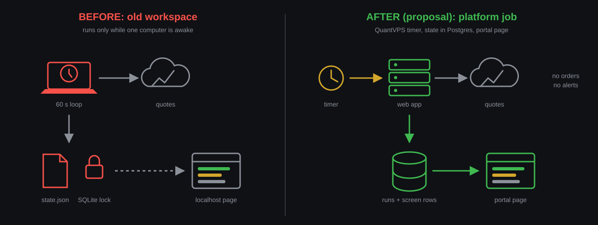
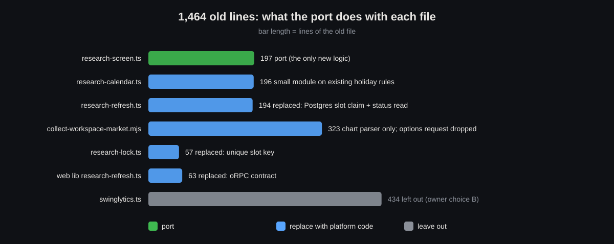
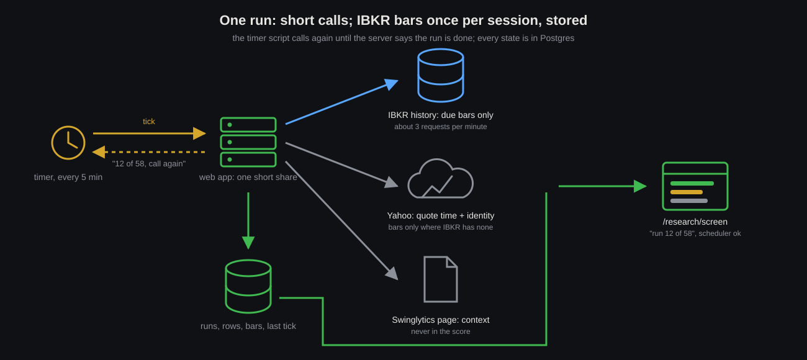

# Research screen as a platform job

- **Author:** Jeff Scott Ward (drafted by the job agent for card vertex-merge-p1-3-refresh-scheduler)
- **Status:** Implemented (reviewed by 10 fresh reviewers on 2026-11-15; compared with the code on 2026-11-15, see "Implementation notes")
- **Date:** 2026-11-15
- **Base:** jeffscottward/vertex-research-public, branch `vertex/rebuild-darkfactory-20260921`, commit `bf961e3e`

The first two pictures show the change and the size of the port. The third shows one run.





## Overview

The research catalog of the platform (58 reports on 2026-10-16, [research reports](../../research-reports.md)) has dossiers and no current market view. A dossier is the stored research file of one company or instrument. The old workspace has that view: a market and technical screen of every catalog report, run on a fixed schedule. This design moves the screen to the platform as a scheduled job named **research screen**.

A timer on QuantVPS calls the web app every 5 minutes. The web app decides if a schedule slot is due, claims the slot in Postgres, reads the prices of each catalog report, computes the screen, and stores the run and one current row per report. An operator page under `/research` shows the state of the scheduler, the last run and the rows.

The screen is research only. It is not a backtest and not a trading path: it sends no order, no market alert and no notification, no engine reads it, and it never writes a dossier.

### Terms

- **Slot:** one scheduled time. Slots come from two rules: the grid (00, 04, 08, 12, 16 and 20 UTC on every day) and the checkpoints (09:00, 12:00, 30 minutes before the close and 2 hours after the close, New York time, on NYSE trading days). The close is 16:00, or 13:00 on an early-close day. Two rules at one time give one slot. A slot label is the name of its rule: "Every 4 hours", "9 AM", "Noon", "30 minutes before close", "2 hours after close".
- **Timer run:** one start of the timer unit. **Tick:** one call of the procedure `researchScreen.tick`. One timer run makes one or more ticks.
- **Run:** the work for one claimed slot. **Share:** the part of a run that one tick does.
- **Row:** the current screen result of one report.
- **Action:** `review-entry` (no blocking warning), `watch` (the trend holds but a warning blocks an entry), `wait` (the trend does not hold), `unavailable` (no usable observation). The rules are in "Screen rules".
- **Quote-age rule:** a quote older than 4 hours cannot be or stay `review-entry`. The grid interval is also 4 hours; the two are not related.
- **Provider symbol:** the symbol of a report at the price provider (column `provider_symbol`), sent without any rewrite.
- **QuantVPS:** the host of the web app (`vertex-web.service`) and its Postgres database. **The rig:** the development machine; it runs no part of this feature.
- **History service:** the read-only IBKR market data service on QuantVPS (`infra/quant-vps/history/vertex_history.py`) that the web app reads through `packages/api/src/server/merged-bars.ts`. It allows at most 6 history requests per 120 seconds for all features together.
- **Agent write key:** an API key of an operator with write access. **Scheduler-only:** a procedure that passes `requireOperator` and also requires that the request carries an agent key (`context.agentApiKeyPresented`); a read key is refused for it (`packages/api/src/server/operator-access.ts`). **Operator-only:** a procedure behind `requireOperator` for a signed-in operator; the agent viewer (a read-only session account) can read GET procedures.
- **Restart script:** `infra/quantvps/restart-when-idle.sh`, the only allowed way to restart the web app. It waits until no request is open and none finished in the last 30 seconds.
- **Swinglytics:** a public third-party website with a daily market summary. See "Swinglytics context".

### Sources

- Old workspace: the private repository jeffscottward/vertex-research, branch wip/vertex-research-local-20261016, commit 67e4268c. Files under apps/server/src: research-refresh.ts (194 lines), research-calendar.ts (196), research-screen.ts (197), research-lock.ts (57), swinglytics.ts (434); apps/web/src/lib/research-refresh.ts (63); scripts/collect-workspace-market.mjs (323). Total 1,464 lines. The implementer may read them; no data is copied.
- Migration requirement: `docs/vertex-rebuild/migration-matrix.json`, entry "Durable screening-worker semantics".
- Owner decision of 2026-11-10 on price sources (card vertex-yahoo-terms-decision): merge, do not replace; the live paths read IBKR first and Yahoo for the gaps. Recorded in [data sources](../../../data-sources-and-platform-roles.md) and [the source review](../../data-sources/reel-de8mrtzrrpy.md).
- Owner decisions of 2026-11-15 for this design are listed in "Decisions".
- The concept brief and the review reports of this design are kept outside the repository, in the report folder of the card.
- NYSE holidays and early closes: <https://www.nyse.com/markets/hours-calendars>, read on 2026-11-15 (years 2026 to 2028).

## The Problem

The old screen runs inside a local backend process. It needs that process up and that computer awake, it keeps its state in one JSON file, and it uses a SQLite lock that tests the process id of its owner. The platform is different: the web app is a long-lived service that runs the application as Workers isolates. An isolate has no background loop and shares only plain numbers between requests (`packages/api/src/server/merged-bars.ts`), so work happens only inside a request. Storage is Postgres through Drizzle, and every API is an oRPC contract (`AGENTS.md`, golden rules 6 and 7).

The migration matrix requires this port: keep the 4-hour UTC schedule and the NYSE checkpoints, deduplicate, allow at most one recent catch-up, and hold the claims in Postgres. That requirement is the reason for a scheduler. A screen that is computed only when the operator opens the page would not meet it, and later research slices (technicals, market health) are planned readers of the stored rows.

New logic for the platform: the screen rules (197 old lines), the early-close and slot rules, and the Swinglytics parser (434 old lines, by owner decision). For the holiday rules, the indicator math, the IBKR-first bar loader, the timer client and the install script, the platform has code to reuse or a model to copy. Expected size of the slice: about 30 new files and 5 tables.

The old design leaves 3 points open that a platform job must settle: how the platform knows that a run died, how the operator sees that the scheduler stopped, and which price source the screen uses under the decision of 2026-11-10.

## Goals

1. **Schedule parity.** The slots are those of the old `scheduleRuns`: the 6 grid times on every day and the 4 checkpoints on trading days, with holidays, 13:00 early closes and daylight saving. Tests will use the official NYSE list for 2026 to 2028. The week 2026-11-23 to 2026-11-29 has 57 slots (10, 10, 10, 6, 9, 6, 6).
2. **One run per slot.** A slot is claimed once. At most one run is active. A slot older than the newest claimed slot is never run. After downtime only the newest due slot runs.
3. **Screen parity.** For the same price input the row has the same action, score, support, buy zone and target as the old screen, and a stop and a reward to risk within 0.5 %. The ATR is the platform's `wilderAtr`; on 1 year of bars it differed from the old loop by less than 1 part in 100 million (AAPL, TSLA and ES=F, measured on the rig on 2026-11-15 with a scratch script).
4. **Quote-age rule on every read.** A stored `review-entry` whose quote is older than 4 hours is returned as `watch` with the score reduced by 20 and a warning. The stored row does not change. One read function applies the rule for every reader.
5. **A failed collection does not overwrite good values.** When the collection of one report fails, its last good values stay with their time and the row is `unavailable` with an error code. A run without an end after its deadline is shown as `interrupted`. The page shows a scheduler state from the age of the last tick.
6. **Bounded run.** A run has a deadline of 25 minutes after its claim. One tick ends within 180 seconds.
7. **IBKR first, with a small footprint.** IBKR daily bars are read once per session and stored; a report without stored bars is read in its first run. A run of the screen makes at most 58 IBKR requests on a day.
8. **Access.** The tick is scheduler-only and has no input that selects or forces a slot. The status is operator-only.

## Non-Goals

- Orders, market alerts, notifications about screen results, dossier writes and broker fields (account, position and order data).
- Operational alerting for a stopped scheduler. The page shows it; a notice is left for a later card.
- A manual "run now". A failed slot waits for the next slot (at most 4 hours).
- The Yahoo options request of the old collector and its warning line.
- A history of rows per run, a retention job and a gate that skips grid slots while a market is closed.
- Changes to the 5 existing Yahoo chart fetchers and to the existing calendar users. A follow-up card unifies them.
- Import of the old state file. The first run on the platform is a cold start.
- Closures of the exchange that are not in the fixed list of special closures of `packages/api/src/strategy-dsl-compile.ts`. The calendar is a rule set, not a live feed.
- Use of the Swinglytics snapshot in the score, the action or any order path.

## Decisions

| Id | Decision | By | Record (owner answers in the job channel of the card) |
| --- | --- | --- | --- |
| D1 | Bars: IBKR first. Completed daily bars are read from IBKR once per session and stored; a report with no stored bars is read on the miss. Yahoo fills what IBKR lacks. | Owner, 2026-11-15 | first choice (IBKR bars in each run), changed after the review: second choice |
| D2 | Port the Swinglytics parser in this slice. | Owner, 2026-11-15 | choice |
| D3 | The run executes in the web app in bounded shares that the timer script requests; no separate worker process. | Author | "Place of the run" |
| D4 | The timer fires every 5 minutes; the server alone decides what is due. | Author | "Cadence" |

Open owner question that this design does not settle: how the Yahoo terms apply to the platform ([data sources](../../../data-sources-and-platform-roles.md)). The screen adds one Yahoo chart request per report in each run.

## Critical User Journeys (CUJs)

### CUJ 1: A run at a slot

- **Given**: the timer is active, the catalog has 58 reports, and the slot 16:00 UTC has no run.
- **When**: a tick arrives at or after 16:00 UTC.
- **Then**: one run for that slot is stored with its claim time, end time, counts and status (`completed`, `partial` or `failed`); every report has one current row; the tick answer names the slot and the run.

### CUJ 2: A second tick for the same slot

- **Given**: the slot 16:00 UTC has a finished run.
- **When**: another tick arrives before the next slot.
- **Then**: no run starts and no row changes; the answer is `not-due`; the time of the tick is stored.

### CUJ 3: A holiday and an early close

- **Given**: Thursday 2026-11-26 (Thanksgiving) and Friday 2026-11-27 (close at 13:00).
- **When**: the ticks of both days arrive.
- **Then**: Thursday has only the 6 grid slots. Friday has the grid slots and the checkpoints 09:00, 12:00, 12:30 and 15:00 New York time; 15:00 is also a grid time and gives one run.

### CUJ 4: Downtime

- **Given**: the web app was down for 9 hours and missed 3 slots.
- **When**: the first tick after the restart arrives.
- **Then**: only the newest due slot runs. The older slots never run. The page lists them as missed.

### CUJ 5: An old quote

- **Given**: a row stored as `review-entry` with a quote time 5 hours ago.
- **When**: the operator opens the page.
- **Then**: the row shows `watch`, the score is 20 lower, and a warning says that the entry expired. The stored row is unchanged.

### CUJ 6: One report fails

- **Given**: a run in which the price request of one report fails.
- **When**: the run ends.
- **Then**: the run is `partial`. The row of that report keeps its last good values and their time, shows `unavailable`, and has an error code. The other rows are new.

### CUJ 7: A run that stops in the middle

- **Given**: the web app stops while a run is active, and no tick reaches the server before the deadline of that run.
- **When**: the operator opens the page after the deadline.
- **Then**: the run shows `interrupted` with its progress. Rows written before the stop keep their new values; the other rows keep their last good values and their older time. The next slot runs as usual. If a tick arrives before the deadline, it takes the expired lease and continues the run.

### CUJ 8: The scheduler stops

- **Given**: the timer unit is stopped.
- **When**: the operator opens the page more than 30 minutes after the last tick.
- **Then**: the page shows the scheduler state `silent` and the time of the last tick above the rows.

### CUJ 9: Access

- **Given**: an anonymous caller, a signed-in user who is not an operator, and a caller with an agent read key.
- **When**: each calls the tick, and the first two call the status.
- **Then**: the anonymous caller gets `UNAUTHORIZED`, the others get `FORBIDDEN`, and nothing is stored.

### CUJ 10: The first run after a session, and a deploy

- **Given**: the stored bars of all reports end one session before the last closed session, and the time is 2 hours after the close.
- **When**: the run of that slot starts, and an operator starts a deploy during it.
- **Then**: the run reads the bars of each report from IBKR once (about 19 minutes for 58 reports, an estimate from the pacing of the history service) and stores them. The timer script sees the pause file of the restart script and stops calling; the web app becomes idle and restarts; the next timer run continues the run. Later runs of that session make no IBKR request.

## Technical Plan (Architecture)



### Parts

```text
systemd timer (QuantVPS, every 5 minutes)
  -> tick script (bundled Node, loops)             holds only the agent write key
       -> researchScreen.tick (scheduler-only)     one share of a run per call
            calendar: newest due slot              pure module
            claim: research_screen_runs            unique slot, lease, deadline
            for each report in the share:
              quote + Yahoo bars <- one Yahoo chart request
              IBKR bars          <- research_screen_bars, or the history service when they are due
              screen             <- pure function
              write              -> research_screen_rows
            context <- Swinglytics page (once per run, isolated)
       <- { decision, slotAt, runId, done, remaining, ... }
operator page /research/screen
  -> researchScreen.status (operator-only)         one read function applies the read-time rule
```

1. **Calendar** (pure). The session function (open, close, early close) sits beside `isNyseTradingDay`, which supplies holidays and the listed special closures. The slot rules sit in the feature module.
2. **Screen** (pure). Input: the parsed catalog entry, the quote, the completed daily bars and the time. Output: one row. See "Screen rules".
3. **Price reader** (server).
   - **Quote and Yahoo bars:** one Yahoo chart request per report in each run (1 year of daily bars). Its meta block gives the price, the provider time, the instrument type, the currency, the time zone and the session period; the history service answer has none of these. The same answer holds the Yahoo daily bars.
   - **IBKR bars:** for a report that IBKR can serve (a US stock or ETF in USD, or a continuous future that `historyInstrument` knows), the completed daily bars come from the table `research_screen_bars`. The stored bars are **due** when the report has none, when its provider symbol changed, or when they end before the newest NYSE session whose close is at least 2 hours ago. Due bars are read from the history service (1 year of daily `TRADES` bars, `offline: true`, `ibkrOnly: true`, no `fillBefore`, so one series never mixes sources; the Yahoo bars of the gap rule come from the chart answer, not from a second request) and stored. The 2-hour delay lets the scheduled sector-rotation collection at 16:50 New York time run first and lets the bar settle.
   - **Gap rule:** a report that IBKR cannot serve, or whose due read fails, is screened with the Yahoo bars of its chart answer. The row stores `bars_source` and `quote_source`.
   - **IBKR budget of a run:** after 3 reports in a row whose IBKR read fails or exceeds its paced wait, the run reads no more IBKR bars; the remaining due reports use the gap rule and are tried again in the next run. The counter is on the run row, because shares run in separate requests.
4. **Run engine** (server).
   - A tick closes a run whose deadline and lease have both passed, continues the active run, or claims the newest due slot. It stores its time and its decision as soon as the decision is known, before the share starts.
   - The claim is one transaction under a transaction advisory lock: the slot time is unique, no other run is active, and the slot is newer than every claimed slot. A claimed slot is never run again. A new table is used and not `vertex_worker_jobs` or `outbox_events`: those are bound to worker event envelopes and to outbox handlers; the lease column names follow `outbox_events` (`lease_owner`, `lease_expires_at`, `fence`).
   - A tick takes the lease when it is free or expired (database clock) and raises the fence number. Every write of that tick checks the fence, so a late tick of an older lease writes nothing.
   - A tick works on reports until 50 seconds have passed and starts a report only then; it renews the lease after each report, frees the lease when it stops with work left, and returns the count that remains. Order: the report with the oldest last attempt first.
   - When the deadline comes before all reports are done, the tick that sees it ends the run.
5. **Tick script and timer.** The timer fires every 5 minutes; the unit is a oneshot service that systemd does not start again while it runs. The script calls the tick, and calls again while the answer says that work remains. Before each call it checks the pause file of the restart script (`VERTEX_WORKER_PAUSE_FILE`, younger than 90 minutes) and stops when it exists. It holds no calendar and sends no slot. The flow timer (`infra/flow/quantvps/vertex-flow.timer`) is the model: a frequent tick, and the server decides.
6. **Swinglytics context** (server). Once per run, in the tick that claims the slot and before the first report. A failure of the read is stored as the last attempt and never changes the run. If the read throws or the storage of its result fails, the run continues and the event `research.screen.context.failed` is emitted with a one-line message.
7. **Status and page.** `researchScreen.status` returns the scheduler state, the active and the last finished run, next and missed slots, the rows after the read-time rule, the Swinglytics snapshot and the limitation texts. The page `/research/screen` is linked from `/research`.

### Run statuses

| Status | Rule |
| --- | --- |
| `running` | claimed, not ended |
| `completed` | every report was attempted and none failed |
| `partial` | at least one report succeeded, and at least one failed or was not reached before the deadline |
| `failed` | every report was attempted or the deadline came, and none succeeded; also when the catalog has no report |
| `interrupted` | the deadline and the lease passed with no end. The status read shows it from these two facts; the next tick writes it |

A report "succeeded" when its row got a new observation with an action other than `unavailable`. A report that fails steps 1 to 6 of the screen rules counts in `total` and in `failed`. A report that was not reached gets no write, so it is first in the next run.

### Data model

Five tables; the columns are in "Detailed Implementation Plan".

- `research_screen_runs`: one row per claimed slot, with the lease, the deadline, the counts and the IBKR failure counter.
- `research_screen_rows`: one row per report (cascade on delete of the report): the last good observation and the last attempt.
- `research_screen_bars`: one row per report that IBKR serves: the stored completed daily bars and the session date they end at.
- `research_screen_scheduler`: one row: the last tick and its decision.
- `research_screen_swinglytics`: one row: the last good snapshot and the last attempt.

Rows are written as each report ends. A reader sees a run in progress as "n of 58"; each row carries its own times.

### Place of the run (D3)

The migration matrix says: "Move scheduling/locking into an always-on worker with Postgres job claims rather than serverless request timers." This design keeps the claims in Postgres and deviates on the worker: the systemd timer is the always-on scheduler, the tick script is the only loop and holds no state, and the work runs in the web app. The platform has an always-on worker that claims through the API with a key (`infra/research-worker/README.md`, the Nautilus backtest worker). A screen worker of that form would compute outside the web app, so it would need the bearer configuration of the history service and a second place for the calendar, claim and screen rules. A worker with direct database access would be a second process that holds the database secret and a second database client. The timer script needs only the agent write key that the QuantVPS timer units use already. The run engine has no dependency on the request, so a worker can call it later.

### Cadence (D4)

A timer run every 5 minutes gives 288 timer runs a day; a timer run with nothing due is one tick. When no tick is lost and no run is active, a slot starts within 5 minutes plus the random delay of 20 seconds. A tick lost during a web restart is replaced by the next one. The tick is also the signal for the scheduler state.

### Cost and limits

- **IBKR:** at most 58 requests on a day (one per report that IBKR serves), in the first run 2 hours after the close. At 6 requests per 120 seconds that run takes about 19 minutes; this is an estimate (58 / 3 per minute), not a measurement. Live features also use the history service in that time and can slow the run; then the IBKR budget rule or the deadline ends the fill, and the next run continues it.
- **While that run waits for IBKR pacing**, charts, ticks, news and alerts can get a paced answer and read Yahoo for that request, as `merged-bars.ts` defines for live sites: about 19 minutes on a trading day.
- **Yahoo:** one chart request per report in each run: up to 580 on a trading day (10 runs in winter, 9 in summer) and 348 on a closed day. Measured on the rig on 2026-11-15: 57 public symbols, 1 year of daily bars, 4 at a time, 1.1 seconds, 1.5 MB.
- **Catalog size:** the daily fill covers about 75 reports inside one 25-minute run. Above that, the fill takes two runs; rows are still screened in every run with the bars that exist. The share budget and the deadline do not grow with the catalog.
- **Closed days:** the grid runs on every day, as the matrix requires. On a closed day no IBKR request is made (no new session), and every US quote is older than 4 hours, so no row is `review-entry`.
- **Deploys:** a deploy waits for at most one tick (180 seconds) plus the quiet window, because the script honours the pause file.

## Risks & Mitigations

| Risk | Mitigation |
| --- | --- |
| Two price bases in one row: levels from IBKR `TRADES` bars (split-adjusted, not dividend-adjusted) and a Yahoo quote; for a continuous future IBKR and Yahoo can use different contracts | Each row shows both sources. A future is never `review-entry`. A test covers a split inside the 50-bar window. Follow-up: evaluate the forming bar of the IBKR answer as the price |
| Yahoo is the source of every quote; a block or rate limit makes rows `unavailable` | Quote requests stop after 3 rate-limit answers in a row for the rest of the run; the rows keep their last good values; the next run tries again. The terms question stays with the owner |
| The history service is down or slow | IBKR budget rule (3 failures in a row), then the gap rule with Yahoo bars; the row says `yahoo` |
| The daily fill competes with live features and with sector rotation | The fill starts 2 hours after the close (sector rotation runs at 16:50; its retry at 18:40 is after the fill of a normal day). One request at a time. 58 requests a day |
| A change of the Swinglytics page breaks its parser | The snapshot shows as stale with the error; the screen is not affected |
| Third-party page content shown to operators | Bounded read, no redirects, strict schema with length limits, values rendered as text only |
| The agent write key on the timer host can call the tick | The tick has no input and does nothing when no slot is due; one run at a time; the same key and env file as the existing QuantVPS timer units, no new secret |
| A stopped scheduler is seen only on the page | The page shows `late` and `silent`. Operational alerting is a non-goal of this slice |
| The calendar rules are verified to 2028 | A status limitation says so when the current year is after 2028; a test fails from 2028-07-01, six months before the end of the verified range |
| A long run blocks a deploy | The tick script honours the pause file; a run continues after the restart |

## Alternatives Considered

### Alt 1: Yahoo only for bars and quote

- **Pros**: one request per report, about 1 second per run, one price basis per row.
- **Cons**: Yahoo becomes the first source of bars for every report, against the decision of 2026-11-10 that Yahoo only fills what IBKR lacks.
- **Reason for Rejection**: Rejected by the owner (D1): the levels of a row must come from IBKR bars where IBKR has them. The Yahoo request count per run is the same as in the chosen design.

### Alt 2: IBKR bars in every run

- **Pros**: no bar store; always the newest IBKR answer.
- **Cons**: completed daily bars change once per session, so 9 of 10 runs on a trading day read the same data; up to 580 IBKR requests a day; about 193 minutes a day in which live features can lose IBKR slots.
- **Reason for Rejection**: Rejected by the owner (D1, second choice) after the review showed these costs.

### Alt 3: Leave Swinglytics for a later card

- **Pros**: no dependency on the page structure of a third-party site; 434 old lines less.
- **Cons**: the old context view has no feed on the platform.
- **Reason for Rejection**: Rejected by the owner (D2): the context is wanted beside the screen now. The port is isolated: one parser, one table, one panel.

### Alt 4: Compute the screen when the operator opens the page

- **Pros**: no scheduler, no claim, no timer.
- **Cons**: no stored rows for later slices; the first page load after a session waits for the IBKR fill; the matrix requires the schedule.
- **Reason for Rejection**: Rejected by author: it does not meet the migration requirement.

### Alt 5: The whole run in one web request

- **Pros**: one transaction at the end; no lease.
- **Cons**: the daily fill takes about 19 minutes; the model unit allows 600 seconds; a restart in the middle loses the whole run.
- **Reason for Rejection**: Rejected by author: the fill does not fit one request.

### Alt 6: A worker process

- **Pros**: matches the wording of the migration matrix; no request limits.
- **Cons**: see "Place of the run": the history service configuration and the rules in a second place, or a second holder of the database secret.
- **Reason for Rejection**: Rejected by author: the timer script gives the needed properties (claims and state in Postgres; a lost timer run is replaced by the next) with the existing key.

### Alt 7: The tick script fetches and computes, the server only stores

- **Pros**: no long work in the web app (the breadth-90 form, `scripts/breadth-90/tick.ts`).
- **Cons**: the same as Alt 6 for the history service configuration and the rules.
- **Reason for Rejection**: Rejected by author.

### Alt 8: A timer run every minute

- **Pros**: a slot starts within 1 minute; the flow timer does this.
- **Cons**: 1,440 timer runs a day for at most 10 runs of the screen.
- **Reason for Rejection**: Rejected by author: 5 minutes of delay do not matter for a 4-hour screen.

### Alt 9: Timer runs only at the slot clock times

- **Pros**: the fewest calls.
- **Cons**: one lost tick loses the slot; the clock times would exist in the unit file and in the calendar; no signal for the scheduler state.
- **Reason for Rejection**: Rejected by author.

### Alt 10: Port the old calendar whole

- **Pros**: a copy of tested code.
- **Cons**: it duplicates the holiday rules of `nyseHolidays`.
- **Reason for Rejection**: Rejected by author: only early closes, sessions and slots are new.

### Alt 11: Move all calendar users to one module now

- **Pros**: one calendar.
- **Cons**: it changes the strategy compiler (which has a Python mirror), the options engine and breadth 90.
- **Reason for Rejection**: Rejected by author: regression risk outside this feature; a follow-up card.

### Alt 12: Keep the Yahoo options request

- **Pros**: the old warning line about options.
- **Cons**: a second request per report and the crumb flow, for one text line.
- **Reason for Rejection**: Rejected by author.

### Alt 13: Keep a manual "run now"

- **Pros**: no wait after a failed slot.
- **Cons**: any holder of the key could start 58 outbound reads at will.
- **Reason for Rejection**: Rejected by author for this slice.

### Alt 14: Keep the rows of every run

- **Pros**: history for later analysis.
- **Cons**: about 176,000 rows a year with no reader.
- **Reason for Rejection**: Rejected by author; the two run references per row allow a history table later.

### Alt 15: Show the screen on `/engines`

- **Pros**: one status page.
- **Cons**: that page shows only the trading-engine timers of the rig.
- **Reason for Rejection**: Rejected by author.

## Implementation notes

Differences between this document and the code that were found by the drift comparison of 2026-11-15 and kept on purpose:

- The session function for early closes is also used to decide if an IBKR daily bar is complete, for every instrument. On an NYSE holiday on which a future trades, a futures bar read during its session counts as complete. A future is never `review-entry`.
- The check "does IBKR serve this report" is a call of the bars reader without a configuration, which makes no request. A history service that is not configured counts as a failed IBKR read for the IBKR stop.
- The Swinglytics parser reads at most the first 15 setup candidates per direction, upper-cases tickers, cuts a ticker to 12 characters, reads the scan counts beside the scanner when the scanner has none, truncates a count that is not an integer, and skips a line with no `:`. The script elements are found by a linear scan, not by a regular expression.
- The page shows the words "none" and "no source" for missing values and "No current data" for the action `unavailable`, because the status-language check of the web app does not allow a bare dash or the word "unavailable".
- A failed row shows score 0; the last score is not shown beside the last action.
- The runs table has one more check (`research_screen_runs_shape_check`) for the bounds of the message and the labels.
- If the file SOURCE_SHA exists and cannot be read, the tick script stops before its first call.

## Detailed Implementation Plan

`NNNN` is the next free migration number when the branch is ready to merge (the newest file on the base commit is `0074`); after the base branch is merged into the feature branch, `pnpm db:renumber` moves the migration of the feature branch behind the newest one. All other names are final. New files are written without code marks until they exist.

### Contracts

Errors of both procedures (the `sectorRotation` form, `packages/api/src/contracts/sector-rotation.ts`): `FORBIDDEN` 403 "Forbidden", `STORAGE_ERROR` 503 "Research screen storage unavailable", `UNAUTHORIZED` 401 "Authentication required". A provider failure is never an API error; it is a row error code.

Tick: `researchScreen.tick`, POST `/research-screen/tick`, input `{}` (strict), scheduler-only. Times are `z.date()`.

```text
{ decision: "not-due" | "claimed" | "resumed" | "busy",
  slotAt: Date | null, slotLabels: string[], runId: string | null,
  runStatus: "running" | "completed" | "partial" | "failed" | "interrupted" | null,
  done: boolean, processed: number, remaining: number, total: number, requestId: string }
```

| State at the tick | Action | decision | Output |
| --- | --- | --- | --- |
| A run is active and its lease is live | none | `busy` | the run's slot, id, `running`; `done` true; processed and remaining of the run |
| A run is active, lease free or expired, deadline not passed | take the lease, work a share | `resumed` | `done` true when the run ended |
| A run is active, lease expired, deadline passed | end it as `interrupted`, then continue with the next line; if the database refuses the end, try to take the lease | | |
| A share loses its fence (another tick took the lease) | stop without a further write | as started | `done` true, `runStatus` `running` |
| No run is active and the newest slot at or before now has no run and is newer than every claimed slot | claim, read Swinglytics, work a share | `claimed` | as `resumed` |
| Otherwise | none | `not-due` | slot, run and status null; counts 0; `done` true |

`requestId` is `context.requestId`. `processed` counts the reports attempted in the run so far.

Status: `researchScreen.status`, GET `/research-screen/status`, input `{}`, operator-only; not in any key list.

```text
{ evaluatedAt: Date,
  scheduler: { state: "ok" | "late" | "silent" | "never", lastTickAt: Date | null, lastTickDecision: Decision | null },
  activeRun: Run | null, lastRun: Run | null,
  nextSlots: { at: Date, labels: string[] }[],      exactly 12
  missedSlots: { at: Date, labels: string[] }[],    slots of the last 24 hours with no run, newest first
  rows: Row[],                                      order: catalog position
  swinglytics: Context | null, limitations: string[] }
Run = { id, slotAt, slotLabels, status, claimedAt, finishedAt: Date | null, deadlineAt,
        total, succeeded, failed, notReached, barsFromIbkr, barsFromYahoo, message: string | null }   message at most 300 characters
Row = { reportId, symbol, providerSymbol, collection: "fresh" | "failed" | "never",
        storedAction: Action | null, action: Action, storedScore: number | null, score: number,
        quoteAt: Date | null, quoteAgeMs: number | null, price, changePercent, momentumPercent,
        buyZone: { low: number, high: number } | null, support, stop, target, rewardRisk: number | null,
        reasons: string[], warnings: string[], blockingWarnings: { code: string, text: string }[],
        barsSource: "ibkr" | "yahoo" | null, quoteSource: "yahoo" | null, historyAt: Date | null,
        lastGoodRunId: string | null, lastGoodAt: Date | null, lastAttemptRunId: string | null, lastAttemptAt: Date | null,
        errorCode: ErrorCode | null, errorMessage: string | null }                                    errorMessage at most 300 characters
Context = { generatedAt: Date | null, retrievedAt: Date | null, stale: boolean, snapshot: Snapshot | null,
            lastAttemptAt: Date | null, lastAttemptStatus: "ok" | "error" | null, lastError: string | null, warning: string }
```

- `collection`: `never` when the report has no row or its row belongs to another provider symbol; `failed` when the last attempt is newer than the last good observation; else `fresh`. A row with `never` or with no good observation has action `unavailable`, score 0 and null values.
- Scheduler state from the age of the last tick: `never` with no tick; `ok` up to 10 minutes; `late` up to 30 minutes; `silent` above.
- Error codes of a row (9): `identity-unverified`, `metadata-invalid`, `provider-http`, `provider-timeout`, `rate-limited`, `identity-mismatch`, `quote-missing`, `too-few-bars`, `invalid-ohlc`.

### Constants

| Name | Value |
| --- | --- |
| Share budget (a report starts only before it) | 50,000 ms |
| Run deadline after the claim | 25 minutes |
| Lease | 240 seconds |
| Yahoo chart request | 10,000 ms, one attempt, at most 4 MiB, range 1 year, interval 1 day |
| Yahoo stop | after 3 rate-limit answers (HTTP 429) in a row, for the rest of the run |
| IBKR bars request | `timeoutMs` 20,000, `maxPacedWaitMs` 70,000, `pacedRetries` 1, `unavailableRetries` 0 |
| IBKR stop | after 3 failed reads in a row, for the rest of the run |
| Bars due delay after the close | 2 hours |
| Quote-age limit | 4 hours |
| History-age limit | 4 days |
| Minimum completed bars | 50 |
| Swinglytics read | 10,000 ms, 1,000,000 bytes; stale after 4 hours |
| Scheduler `ok` / `late` | 10 minutes / 30 minutes |
| Last verified calendar year | 2028 |
| Tick script | 200,000 ms per call; wall limit 28 minutes; no wait between calls |

Worst case of one tick: 50 seconds, then one report with a Yahoo request (10 seconds) and an IBKR read (20 + 70 + 20 seconds) = 170 seconds; the claiming tick adds the Swinglytics read (10 seconds) = 180 seconds. The lease (240 seconds) and the script timeout (200 seconds) are above it.

### Screen rules

Source of the rules: the old workspace (see "Sources"), file apps/server/src/research-screen.ts, function `screenInstrument`; the read-time rule is in apps/server/src/research-refresh.ts. The implementer may read these files. The rules below are complete; the old files are the reference for the wording of messages.

Inputs of `screenReport(entry, evidence, now)`:

- `entry`: the parsed catalog entry (see "Catalog entry").
- `evidence`: `{ quote: { price, quoteAt, instrumentType, currency, timeZone, sessionStart, sessionEnd } | null, bars: { date, o, h, l, c }[], barsSource }`. A failed chart read never reaches the screen; the engine writes its error code.
- `now`: the time of the screen.

Steps, in this order. The first step that fails ends the screen with action `unavailable`, score 0 and the named error code.

| # | Rule | On failure |
| --- | --- | --- |
| 1 | The catalog entry parses, and `identity_status` is `verified`. | `metadata-invalid` or `identity-unverified` |
| 2 | The price read returned an answer (checked by the engine before the screen). | the error code of the read (`provider-http`, `provider-timeout`, `rate-limited`) |
| 3 | Identity match: the quote's instrument type equals the expected type of the asset type (`equity` EQUITY, `etf` ETF, `future` FUTURE, `index` INDEX), its currency equals the entry currency and its time zone equals the entry time zone. | `identity-mismatch` |
| 4 | The quote has a price above 0 and a provider time. | `quote-missing` |
| 5 | Completed bars: a bar counts when it has a close above 0, a valid date, a date not after `now`, and is not the bar of a session that still runs; one bar per date, oldest first. At least 50 completed bars exist. | `too-few-bars` |
| 6 | Every completed bar has high and low above 0, high not below close, low not above close, high not below low; the ATR is above 0. | `invalid-ohlc` |

Values (all from completed bars; `last` is the newest completed bar):

- `changePercent` = (price / close of the newest completed bar before the date of the quote in the entry time zone, minus 1) x 100; null when no such bar exists.
- `momentumPercent` = (close of `last` / close of the bar 20 bars before it, minus 1) x 100; null with fewer than 21 bars.
- `sma20`, `sma50`: mean of the last 20 and 50 closes.
- `atr`: `wilderAtr(bars, 14)` of `packages/api/src/pick-list-screen.ts`.
- `support` = lowest low of the last 20 bars. `target` = highest high of the last 20 bars (observed resistance).
- `buyZone` = `{ low: support, high: min(target, support + 0.5 x atr) }`.
- `stop` = support minus atr when that is above 0, else null.
- `rewardRisk` = (target minus price) / (price minus stop) when stop is not null, stop is below price and target is above price, and the result is above 0; else null.

Conditions:

- `trend`: close of `last` is at or above `sma20`, `sma20` is above `sma50`, and `momentumPercent` is above 0.
- `inZone`: price is inside `buyZone` (both ends included).
- `rewardAdequate`: `rewardRisk` is at least 2.
- `quoteFresh`: the age of the quote at `now` is from 0 to 4 hours.
- `historyCurrent`: the end of the day of `last` is at most 4 days old (no lower limit: the end of the day of a session that closed today is a few hours after `now`). For stored IBKR bars, `last` must also be the bar of the due session date ("Price reader") or newer. For Yahoo bars, when the quote names a session that has ended, `last` must be the bar of that session date or newer.

Blocking warnings (each has a fixed code and text): `quote-stale` (not `quoteFresh`), `history-stale` (not `historyCurrent`), `trend-not-aligned`, `outside-buy-zone`, `reward-below-2`, `catalog-not-ready` (catalog status is not `ready`), `future-not-executable` (asset type `future`), `alias-unconfirmed` (an alias with `confirmed` false).

Score (0 to 100) = 30 for `trend` + 25 for `inZone` + 25 for `rewardAdequate` + 20 when `quoteFresh` and `historyCurrent`.

Action: `review-entry` when no blocking warning exists; else `watch` when `trend` holds; else `wait`.

Reasons: 4 fixed sentences (trend result, zone result, reward result, and the note that levels use the provider's own OHLC of the last 20 completed sessions). Warnings: the fixed research-only note; a currency note when the currency is not USD; the futures note; one line per alias; the fixed line "Options are not checked by this screen." Every message list holds at most 24 entries of at most 400 characters; the fixed lines come first, so alias lines are the ones cut.

Read-time rule `effectiveRow(stored, now)`: when the stored action is `review-entry` and the age of the quote at `now` is below 0 or above 4 hours, the shown action is `watch`, the shown score is the stored score minus 20 (not below 0), and the warning `entry-expired` is added. A `review-entry` with no quote time also expires. Two more display rules apply when the status is read: a row whose latest collection failed is shown as `unavailable` with score 0 and its last good values, and a stored row whose provider symbol differs from the catalog is shown as not collected. The quote-age test also runs at screen time (`quoteFresh`), so a run on a closed day stores `watch` or `wait`, never `review-entry`.

Parity test: one fixed synthetic series of 260 daily bars with two quotes (an entry case and a wait case), written in the test file, with the expected rows recorded from a run of the old `screenInstrument` on the same input (price levels to 6 decimals; the ATR-dependent values within 0.5 %).

### Catalog entry

`parseCatalogEntry(report)` reads the columns `id`, `symbol`, `provider_symbol`, `asset_type`, `status`, `identity_status` and these keys of `metadata` (Zod, unknown keys ignored):

| Key | Type | Rule |
| --- | --- | --- |
| `currency` | string, 3 upper-case letters | required |
| `timeZone` | string, an IANA zone that `Intl.DateTimeFormat` accepts | required |
| `aliases` | array of `{ input: string, resolution: string, confirmed: boolean }` | optional, default empty |
| `contractSpecs` | object | optional; used only to say that a future is a provider series |

`asset_type` null means `equity`; another value than `equity`, `etf`, `future`, `index` fails. A failed parse gives `metadata-invalid` with the name of the first failed key. The importer and `research_reports` do not change.

### Swinglytics context

Swinglytics is a public third-party website (`https://www.swinglytics.com/`) that shows a daily market summary for swing traders: a market regime label, market breadth, the VIX level, counts of a stock scanner, sector themes and a few named setups. The old workspace read its public start page and showed the values as corroborating context beside its own research ("research vectors"). The owner chose on 2026-11-15 to port it in this slice. It is display-only: one parser, one table (`research_screen_swinglytics`) and one panel; removing these three removes the port.

Source of the parser: the old workspace (see "Sources"), file apps/server/src/swinglytics.ts (434 lines), functions `parseSwinglyticsHtml` and `collectSwinglytics`.

Read (`readSwinglytics`, a new bounded HTML read in the evidence module; `fetchBoundedJson` accepts only JSON and `fetchBoundedText` sends an RSS header, so neither fits):

- GET `https://www.swinglytics.com/`, headers `accept: text/html` and `user-agent: Vertex Research/1.0 (low-frequency public context)`, `redirect: "error"`, timeout 10,000 ms.
- Refuse: a status that is not 2xx; a content type other than `text/html`; a `content-length` above 1,000,000; a body above 1,000,000 bytes (the read stops at the limit); bytes that are not valid UTF-8.

Parse (`parseSwinglyticsHtml(html)`, pure, in the new module packages/api/src/swinglytics.ts):

1. Take every `<script>` element whose trimmed body starts with `self.__next_f.push(` and ends with `)`. More than 100 such elements: refuse. An argument above 400,000 bytes: refuse.
2. Parse each argument as JSON. Keep the second array item when it is a string of at most 400,000 bytes; skip the others.
3. Join the kept strings, split at line ends, and for each line parse the text after the first `:` as JSON; skip lines that do not parse.
4. Search the parsed values (depth-first, at most 20,000 nodes, else refuse) for the first object that has a valid `generated_at` time and the objects `market_regime`, `breadth`, `vix` and `scanner`. None found: refuse.
5. Build the snapshot. Text values lose control and direction characters, are trimmed and cut to their limit; numbers outside their range become null.

Snapshot schema (Zod, also the type of `snapshot` in the status):

```text
{ regime:  { label: string(60), trendStrength: string(60) | null, riskLevel: string(60) | null },
  breadth: { score: 0..100 | null, regime: string(60) | null,
             above20DayPercent, above50DayPercent, above200DayPercent: -100..100 | null },
  vix:     { level: 0..1000 | null, percentile1Year: 0..100 | null, regime: string(60) | null, trend: string(60) | null },
  scanner: { total, withSetups, bullish, bearish: integer 0..1000000 | null },
  themes:  { name: string(60), changePercent: -100..100 | null, bias: string(40) | null }[]   at most 10, unique names, from the first 20 items
  setups:  { ticker: /^[A-Z0-9.-]{1,12}$/, name: string(60) | null, direction: "bullish" | "bearish",
             pattern: string(80) | null, sector: string(60) | null }[]                          at most 5 per direction }
```

A missing regime label or `generated_at` refuses the page. The result is `{ generatedAt, snapshot }`.

Store and show:

- A success writes `generated_at`, `retrieved_at` and `snapshot` and sets the last attempt to `ok`. A failure keeps the last good snapshot and writes the last attempt as `error` with a message of at most 240 characters on one line.
- The status marks the snapshot `stale` when either clock is in the future or more than 4 hours old.
- The fixed warning on the panel: "Third-party context only. Swinglytics is not Vertex research, not a market measurement of the platform, not an input of the screen and not an order signal."
- Every text of the snapshot is rendered as text (React escapes it); no link from the page is followed or shown except the fixed site URL.

Tests of the parser (synthetic page built in the test, no copy of the site): a complete page; no matching script; 101 chunks; an oversized chunk; a chunk that is not JSON; no dashboard object; a missing regime label; a missing `generated_at`; out-of-range numbers; duplicate themes; 11 themes; an invalid ticker; 6 setups in one direction; control characters in a text.

### Tables

`research_screen_runs`

| Column | Type | Notes |
| --- | --- | --- |
| `id` | uuid, primary key | default random |
| `slot_at` | timestamptz, not null | unique index `research_screen_runs_slot_at_idx` |
| `slot_labels` | jsonb, not null | array of strings |
| `status` | text, not null | check `research_screen_runs_status_check`: the 5 statuses; partial unique index `research_screen_runs_running_idx` on `(status)` where `status = 'running'` |
| `claimed_at`, `deadline_at` | timestamptz, not null | `deadline_at` = `claimed_at` + 25 minutes, database clock |
| `finished_at` | timestamptz, null | |
| `lease_owner` | text, null | the request id of the tick that holds the lease |
| `lease_expires_at` | timestamptz, null | set with `now() + interval '240 seconds'` |
| `fence` | integer, not null, default 0 | raised by each lease take |
| `total`, `succeeded`, `failed`, `not_reached`, `bars_from_ibkr`, `bars_from_yahoo` | integer, not null, default 0 | |
| `ibkr_failures_in_row`, `yahoo_rate_limits_in_row` | integer, not null, default 0 | the stop counters |
| `message` | text, null | at most 300 characters |

`research_screen_rows`

| Column | Type | Notes |
| --- | --- | --- |
| `report_id` | text, primary key | foreign key to `research_reports.id`, on delete cascade |
| `provider_symbol` | text, not null | a change clears the last good observation |
| `good_run_id` | uuid, null | foreign key to runs, on delete set null |
| `good_at`, `quote_at`, `history_at` | timestamptz, null | |
| `observation` | jsonb, null | price, changePercent, momentumPercent, buyZone, support, stop, target, rewardRisk, action, score, reasons, warnings, blockingWarnings |
| `bars_source`, `quote_source` | text, null | check: `ibkr` or `yahoo` |
| `attempt_run_id` | uuid, null | foreign key to runs, on delete set null |
| `attempt_at` | timestamptz, null | |
| `error_code` | text, null | check: the 9 codes |
| `error_message` | text, null | at most 300 characters, no URL |

`research_screen_bars`

| Column | Type | Notes |
| --- | --- | --- |
| `report_id` | text, primary key | foreign key to `research_reports.id`, on delete cascade |
| `provider_symbol` | text, not null | |
| `session_date` | date, not null | date of the newest stored bar |
| `fetched_at` | timestamptz, not null | |
| `bars` | jsonb, not null | at most 300 items `{ date, o, h, l, c }`, oldest first |

`research_screen_scheduler`: `id` integer primary key with check `id = 1`; `last_tick_at` timestamptz not null; `last_tick_decision` text not null (check: the 4 decisions).

`research_screen_swinglytics`: `id` integer primary key with check `id = 1`; `generated_at`, `retrieved_at` timestamptz null; `snapshot` jsonb null; `last_attempt_at` timestamptz null; `last_attempt_status` text null (check: `ok` or `error`); `last_error` text null.

Grants in the migration (the conditional block for `vertex_research` of `packages/db/migrations/0044_research_reports.sql`): SELECT, INSERT, UPDATE on the 5 tables. No DELETE: rows leave only through the cascade.

Down file: one transaction that locks and drops the 5 tables (rows and bars first, then runs, scheduler, Swinglytics). It has no emptiness guard, and its header says why: rows, bars and the snapshot are filled again by the next runs; the history of runs and the last tick are lost, which is accepted for a rollback.

### Target Files to Create/Modify

#### 1. Contract

- packages/api/src/contracts/research-screen.ts (Create): the schemas and the two procedures above.
- packages/api/src/research-screen.contract.test.ts (Create): input strictness, every enum, a full status sample.
- `packages/api/src/index.ts` (Modify): export the contract types for the web app.

#### 2. Calendar

- `packages/api/src/strategy-dsl-compile.ts` (Modify): add `nyseSession(day: number): { open: Date; close: Date; earlyClose: boolean } | null` beside `isNyseTradingDay` (`day` is the UTC day number of the New York date). Early close at 13:00 on 3 July, on the day after Thanksgiving and on 24 December when that day is a trading day; else 16:00; open 09:30.
- `packages/api/src/strategy-dsl-compile.test.ts` (Modify): every holiday and early close of the official list for 2026 to 2028; both daylight-saving weeks of 2026.
- packages/api/src/research-screen-slots.ts (Create): `slotsBetween(after: Date, until: Date): { at: Date; labels: string[] }[]` (after exclusive, until inclusive, ascending, labels joined in rule order), `newestSlotAtOrBefore(now: Date)`, `barsDueSessionDate(now: Date): string | null` (null only for an invalid date; the New York date of the newest session whose close is at least 2 hours before `now`), `calendarVerified(now: Date): boolean`.
- packages/api/src/research-screen-slots.test.ts (Create): the 57 slots of 2026-11-23 to 2026-11-29; a normal week in summer and in winter; a slot exactly at `now`; `barsDueSessionDate` before the close, 1 hour after, 2 hours after, on a weekend, after an early close; `calendarVerified` in 2028 and 2029; a test with the real clock that fails from 2028-07-01.

#### 3. Screen

- packages/api/src/research-screen.ts (Create): `parseCatalogEntry`, `screenReport`, `effectiveRow`, `runStatusOf(counts)`, the warning codes and texts, the limitation texts (4: research only; quotes can be delayed and the quote-age rule; schedule and calendar limits; provider limits and "Options are not checked by this screen"), the constants. It imports `wilderAtr` from `packages/api/src/pick-list-screen.ts`; SMA 20 and 50 are plain means of the last closes.
- packages/api/src/research-screen.test.ts (Create): each failure step 1 to 6; each blocking warning alone; each action; the score sums; null cases of change, momentum, stop and reward to risk; a split inside the window; the parity series; `effectiveRow` at 3 hours 59 minutes, 4 hours 1 minute and a future quote; each `runStatusOf` result; each parser failure.

#### 4. Yahoo chart parser

- packages/api/src/research-screen-quote.ts (Create): `researchScreenChartUrl(providerSymbol)` = `https://query1.finance.yahoo.com/v8/finance/chart/<encoded symbol>?range=1y&interval=1d&includePrePost=false` with the symbol passed without rewrite; `parseResearchScreenChart(json)` returns the quote (`meta.regularMarketPrice`, `meta.regularMarketTime`, `meta.instrumentType`, `meta.currency`, `meta.exchangeTimezoneName`, `meta.currentTradingPeriod.regular.start` and `.end`) and the bars (`timestamp`, `indicators.quote[0]`), or null parts when fields are missing. It is a new parser because `quoteFromYahooChart` and the pick-list reader do not read the identity fields; the follow-up card that unifies the Yahoo fetchers moves them to this one.
- packages/api/src/research-screen-quote.test.ts (Create): a full answer; no result; no meta; missing price; missing time; null OHLC entries; a suffixed foreign symbol and a futures symbol in the URL.

#### 5. Swinglytics parser

- packages/api/src/swinglytics.ts (Create), packages/api/src/swinglytics.test.ts (Create): see "Swinglytics context".

#### 6. Evidence readers

- packages/api/src/server/research-screen-evidence.ts (Create):
  - `readChart(providerSymbol)`: a bounded GET like `fetchBoundedJson` but with its own status mapping: HTTP 429 gives `rate-limited`, another status that is not 2xx gives `provider-http`, a timeout or network error gives `provider-timeout`. Header `user-agent` as the existing Yahoo reads.
  - `readIbkrBars(entry, config)`: `request` is null (no IBKR read) unless the entry currency is USD, the asset type is `equity`, `etf` or `future`, and `historyInstrument(providerSymbol)` is not null. Else `loadMergedBars` with `site: "research-screen"`, `offline: true`, `ibkrOnly: true` (the Yahoo bars come from the chart answer, not from a second request), `barSize: "1 day"`, `duration: DAILY_HISTORY_DURATION["1y"]`, `whatToShow: "TRADES"`, the transport options of the constants table, no `fillBefore`, `keyOf` the date, and `fromIbkr` that drops a bar whose session still runs (`sessionRunning`). `config` is `context.marketHistory`. Result: bars or a failure.
  - `readSwinglytics()`: see "Swinglytics context".
  - `setResearchScreenOptionsForTesting({ fetch, now })`: the one test seam for fetch and clock, as `setSectorRotationOptionsForTesting`.
- packages/api/src/server/research-screen-evidence.test.ts (Create): each status mapping; the byte limit; each `request: null` case; an IBKR success, a paced failure and a not-configured service (with `packages/api/src/server/merged-bars.test-support.ts`); each Swinglytics refusal.
- `packages/api/src/server/merged-bars.ts` (Modify): the "Used by" comment only.

#### 7. Router and run engine

- packages/api/src/server/research-screen.ts (Create): `researchScreenRouter` with `tick` and `status` as in the decision table. The engine functions take the repository and the readers of item 6; the clock comes from the test seam.
- packages/api/src/research-screen-server.test.ts (Create): every line of the decision table; a lease takeover; a write refused by the fence; the deadline that ends a run as `partial`; `failed` with no success; the Yahoo stop and the IBKR stop; bars not due, due and missing; the gap rule; a provider symbol change; a Swinglytics failure that leaves the run unchanged; `interrupted` in the status before the next tick; the scheduler states; missed slots; the empty state; `UNAUTHORIZED` and `FORBIDDEN` callers.
- `packages/api/src/contract.ts`, `packages/api/src/server/router.ts` (Modify): register `researchScreen`, both in this step.

#### 8. Key scope and pinned lists

- `packages/api/src/server/handler.ts` (Modify): add `researchScreen.tick` to `AGENT_API_KEY_PROCEDURE_PATHS`, to its comment and to the FORBIDDEN text.
- `packages/api/src/agent-api-keys.test.ts` (Modify): the pinned path list.
- `packages/api/src/agent-viewer.test.ts` (Modify): add `researchScreen.status` to `REVIEWED_READS` (a new GET procedure; the agent viewer may read it, it holds no account data).

#### 9. OpenAPI

- `packages/api/openapi.json` (Modify, generated): `bun run openapi:generate`.

#### 10. Schema and migration

- packages/db/src/schema/research-screen.ts (Create); `packages/db/src/schema/index.ts` (Modify): the 5 tables.
- packages/db/migrations/NNNN_research_screen.sql, packages/db/migrations/meta/NNNN_snapshot.json (Create, from `bun run db:generate` plus the grant block); `packages/db/migrations/meta/_journal.json` (Modify).
- packages/db/rollback/NNNN_research_screen.down.sql (Create).
- packages/db/src/server/research-screen-migration.test.ts (Create): create-only statements; the grants; SQL columns equal the Drizzle columns; the journal index; the down file drops exactly the 5 tables in the stated order inside one transaction.
- `packages/db/src/server/migration-journal.test.ts` (Modify) if it lists tables per migration.

#### 11. Repository

- packages/db/src/server/research-screen.ts (Create), with `createResearchScreenRepository(database, now)`:
  - `recordTick(decision): Promise<void>`
  - `findActiveRun(): Promise<RunRecord | null>`
  - `claimSlot({ slotAt, labels, total, owner }): Promise<RunRecord | null>` (null when the unique slot, the running index or the high-water rule refuses; it also takes the first lease)
  - `takeLease(runId, owner): Promise<RunRecord | null>` (the fresh run with its new fence; null when the lease is live)
  - `releaseLease(runId, fence): Promise<boolean>`
  - `countReports(): Promise<number>`
  - `renewLease(runId, fence): Promise<boolean>`
  - `closeExpiredRun(runId): Promise<boolean>`
  - `listWork(runId): Promise<WorkItem[]>` (catalog reports with their row and stored bars, not yet attempted in this run, oldest attempt first)
  - `saveBars(runId, fence, reportId, providerSymbol, sessionDate, bars): Promise<boolean>`
  - `writeRow(runId, fence, row): Promise<boolean>` (false when the fence is old; it also updates the run counters and the two stop counters)
  - `finishRun(runId, fence, status, message, notReached): Promise<boolean>` (it stores `total` as succeeded + failed + notReached)
  - `saveSwinglytics(result): Promise<void>`
  - `readStatus(): Promise<{ scheduler, activeRun, lastRun, runsSince(24 hours), rows, swinglytics }>`
- packages/db/src/server/research-screen.test.ts (Create): each function with a fake database in the style of `packages/db/src/server/research-reports.test.ts`.
- `packages/db/src/server/repositories.ts`, `packages/db/src/server/repositories.test.ts`, `packages/db/src/server/index.ts` (Modify): register `researchScreen`.

#### 12. Integration tests

- tests/integration/database/research-screen.test.ts (Create): the three claim rules; two claims at one time; a lease takeover and the refused late write; counters; the cascade when `replaceCatalog` removes a report with a row and bars.
- `tests/integration/database/database.test.ts` (Modify): the primary keys of the 5 tables in the table map.

#### 13. Tick script

- scripts/research-screen/tick.ts (Create): modelled on `scripts/price-alerts/tick.ts`, with these differences: procedure path `/api/orpc/researchScreen/tick`; a loop while `done` is false; before each call the pause-file check (`VERTEX_WORKER_PAUSE_FILE`, default `$HOME/.local/state/vertex-nautilus-worker.pause`, ignored when older than 90 minutes); a timeout of 200,000 ms per call; a wall limit of 28 minutes checked between calls; one JSON line per call on stdout (the answer plus `sourceSha`). The `io` type adds `now`, `fileAgeMs(path)` and `sourceSha` (read from the file SOURCE_SHA beside the bundle).
- Exit codes: 0 when the last answer has `done` true, or the pause file or the wall limit ended the loop; 1 on an HTTP error or an answer that is not JSON; 2 when a call got no answer in 200,000 ms.
- scripts/research-screen/tick.test.ts (Create): one call with `not-due`; three calls until `done`; `busy`; the pause file (fresh and older than 90 minutes); the wall limit; HTTP 403 with the body printed; a timeout; missing env values.
- scripts/vertex-research-screen-tick.ts (Create): the entry file, as `scripts/vertex-price-alerts-tick.ts`.
- `package.json` (Modify): script `vertex:research-screen:tick`.

#### 14. Units and install

- infra/research-screen/quantvps/vertex-research-screen.timer (Create): `OnCalendar=*:0/5`, `Persistent=false`, `RandomizedDelaySec=20`.
- infra/research-screen/quantvps/vertex-research-screen.service (Create): the service of `infra/sector-rotation/quantvps/vertex-sector-rotation.service` with `TimeoutStartSec=2100` (above the script's worst case of 1,880 seconds), `Environment=VERTEX_WORKER_PAUSE_FILE=/root/.local/state/vertex-nautilus-worker.pause` (a system unit has no HOME; the restart script runs as root), the new paths (/opt/vertex-research-screen), the same env file, `Nice`, `After` and hardening lines; `ProtectHome=read-only` allows the pause-file read.
- infra/research-screen/quantvps/install.sh (Create): `infra/sector-rotation/quantvps/install.sh` with the new names and without the alert-route drop-in; the dirty-tree override is `VERTEX_RESEARCH_SCREEN_ALLOW_DIRTY`.
- infra/research-screen/quantvps/install.test.ts (Create): the cases of `infra/sector-rotation/quantvps/install.test.ts` for the new names, and a check that every unit line above is present.

#### 15. Page

- apps/web/src/features/research-screen/view-model.ts (Create): `RESEARCH_SCREEN_PATH`, `toResearchScreenViewModel(status)` (times in New York time with the UTC time): scheduler line, run lines with "n of total", slot lists in New York time with the UTC time, row view-models (action label, the stored action when it differs, quote age text, level texts, source labels), the context panel model.
- apps/web/src/features/research-screen/view-model.test.ts (Create): each scheduler state; a run in progress; no run; each action; a row with `failed` and `never`; a stale and a missing snapshot.
- apps/web/src/components/portal/research-screen.tsx (Create): gateway `api().researchScreen.status({})`; states loading, forbidden, error and ready as in `apps/web/src/components/portal/research-reports.tsx`; a reload every 60 seconds while a run is active; `h1` "Research screen"; the `data-slot="page-status"` chip with the scheduler state; the rows table; the context panel; the limitation list. Texts must pass `apps/web/src/status-language.test.ts`: the action `unavailable` is shown as "No current data".
- apps/web/src/components/portal/research-screen.test.tsx (Create): each load state; the reload while a run is active; the stale-response case; the table and the panel.
- apps/web/src/app/(portal)/research/screen/page.tsx, apps/web/src/app/(portal)/research/screen/route-files.test.tsx (Create): as the files of `/research/reports`; `metadata.title` "Research screen".

#### 16. Links and lists

- `apps/web/src/features/experience/research.tsx` (Modify): the link "Research screen"; `apps/web/src/features/experience/research-workspace.test.tsx` (Modify).
- `apps/web/src/lab/entries/research.tsx`, `apps/web/src/lab/fixtures/research.ts`, `apps/web/src/lab/entries/research.test.tsx` (Modify): the lab entry `research-screen` with route `/research/screen` and a fixture status (required by `apps/web/src/lab/entries/index.test.ts`).
- `tests/e2e/research-markets-structure.spec.ts` (Modify): `{ path: "/research/screen", title: "Research screen" }`.

#### 17. Documents

- docs/vertex-rebuild/research-screen.md (Create): operator guide and runbook: what each scheduler state means; the deploy and rollback commands below; `systemctl status vertex-research-screen.timer`, `systemctl list-timers`, `journalctl -u vertex-research-screen.service`.
- `docs/data-sources-and-platform-roles.md` (Modify): the research screen in the source-order table; a row for the Swinglytics page.
- `docs/vertex-rebuild/data-sources/reel-de8mrtzrrpy.md` (Modify): the new Yahoo call site.
- `docs/vertex-rebuild/designs/research-screen/design.md` (Modify): status and any drift found after the implementation.

### Order of work

Each step ends with `bun run typecheck` and the named tests green.

1. Pure modules: items 2, 3, 4, 5 and the contract file with its test (not yet registered).
2. Database: items 10, 11, 12 (`bun run test:integration`).
3. Server: items 6, 7, 8, 9 and the export in `packages/api/src/index.ts` (`bun run openapi:check`).
4. Timer: items 13, 14.
5. Page: items 15, 16.
6. Documents; a comparison of this design with the code (the EGM drift report); a fresh-context code review; `bun run verify:prepush`; the draft PR.

### Rollout

1. After the merge and the final migration number, on QuantVPS: apply the one SQL file as in [the go-live draft queue runbook](../../golive-draft-queue.md) (`psql -v ON_ERROR_STOP=1 --single-transaction`, the production database URL from the private vars file). Pass: the 5 tables exist and `has_table_privilege('vertex_research', <table>, 'SELECT, INSERT, UPDATE')` is true for each.
2. Deploy the web build as `infra/quantvps/README.md` describes, through `infra/quantvps/restart-when-idle.sh`. The deploying agent first takes the deploy claim for the web app in the job tracker, which is outside this repository.
3. Run the install script from the deployed commit. It needs `/opt/vertex-autopilot/bin/node` and `/etc/vertex-autopilot/autopilot.env` with `VERTEX_ORIGIN` and `VERTEX_AGENT_API_KEY`; both exist for the sector-rotation unit. The first tick claims the newest due slot (cold start: every report reads its IBKR bars in the first run).

### Rollback

1. `systemctl disable --now vertex-research-screen.timer`.
2. Restore the previous web build (the backup pair of `infra/quantvps/README.md`) through the restart script.
3. Apply the down file with `psql -v ON_ERROR_STOP=1`.

### Verification Plan

- **Compilation/Build**: `bun run typecheck`, `bun run build`.
- **Unit Tests**: `pnpm exec vitest run <file>` for each new test file; `bun run verify:prepush`.
- **Static Analysis & Linting**: `bun run lint`, `bun run openapi:check`, `bun run docs:check`.
- **Test Coverage Requirement**: 100 % of lines, branches, functions and statements for every measured source file, new or modified (`bun run verify:coverage`). Entry files under `scripts/*.ts`, SQL, units and documents are not measured.
- **Integration**: `bun run test:integration`.
- **Before the first push**: the three steps of [the CI cutover](../../ci-cutover.md) on the branch diff: the sanitize script, `gitleaks`, and the tree scan.
- **CI**: the required check `ci-gate` on the head commit of the PR; after the merge, `ci.yml` dispatched on the merge commit before the deploy.
- **Live**: the pass condition of rollout step 1; the timer active and enabled; one finished run in the database; its journal lines; the page in headless Chrome on the rig at 375 px and 1440 px (dark). The quote-age rule is checked live on a grid run outside the session: no row shows `review-entry`.
- **Measurements to report**: the duration of the cold first run, of the first run after a close, and of a run with no bars due.
