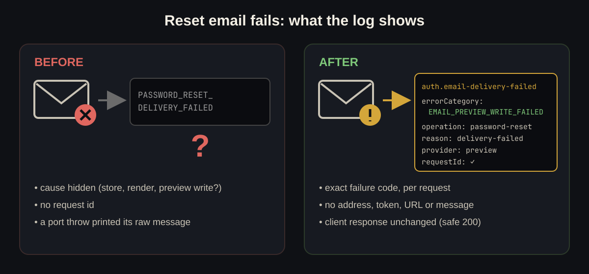

# Plan: record the cause of auth email delivery failures



- Card: `vertex-reset-delivery-error-code`. It is a follow-up of item I5 of card `vertex-timeout-scale-stale-under-load` (2026-11-20). I5 found that the reset failure hides its cause but did not fix it, because another card held a claim on `packages/auth/src/server.ts`.
- Flow: full. A bug fix in this flow needs a one-page plan and an Elephant-Goldfish Model (EGM) review. The review reports are in [review/](review/) (`consolidated_review_report.md`, `goldfish_review_report.md` and one report per stage).
- Status: implemented on branch `ws/log-the-underlying-email`. The steps below describe the code in that branch.

## Problem Statement

Terms:

- **Email port**: the `EmailPort` interface in `packages/email/src/index.ts`. It returns a typed result: `sent`, `previewed`, or `failed` with a failure `code`, a `provider` and a `retryable` flag.
- **Mail-limit store**: the per-recipient mail cap (5 emails per hour per address). `recipientMayReceiveMail` in `packages/auth/src/server.ts` consults it when rate limiting is on.
- **Preview email**: in development and E2E tests, the email port writes the email to a preview store instead of sending it. The E2E reset test reads the reset link from that preview.

Better Auth (1.7.14) calls `sendResetPassword` as a background task (`runInBackgroundOrAwait`). The client always gets HTTP 200 with the safe reset response, before the email is sent. When the email cannot be sent, `sendResetPassword` throws `PASSWORD_RESET_DELIVERY_FAILED` in two cases: the mail-limit store throws, or the email port returns `status: "failed"`. Better Auth logs the thrown error as "Failed to run background task". In a third case, the email port throws, and the original error is rethrown; its message can hold the email address.

The log line does not show which case happened, or the port's failure code (for example `EMAIL_PREVIEW_WRITE_FAILED`, `EMAIL_RENDER_FAILED`, `EMAIL_PROVIDER_UNAVAILABLE`). `sendVerificationEmail` drops the same facts and throws `EMAIL_VERIFICATION_DELIVERY_FAILED`. Sign-up and sign-in send verification in the background; only `/send-verification-email` waits for the send and returns the error (HTTP 503) to the client.

Observed symptom: the E2E test `tests/e2e/auth.spec.ts` "resets a password safely" failed intermittently. In CI run [44763985560](https://github.com/jeffscottward/vertex-research-public/actions/runs/44763985560) (2026-11-20) it timed out waiting for the reset preview link, and the app log showed only `PASSWORD_RESET_DELIVERY_FAILED`. E2E runs with `APP_ENV=test`, so the mail-limit store is off there; the failure was therefore a `failed` port result, but the code was not logged. The E2E capture helper (`tests/e2e/helpers/preview-capture.ts`) already logs `[preview-capture] rejected ...` when the capture server refuses a write. It cannot see failures before the request reaches it (render failure, network error).

## Goals & Non-Goals

Goal: in `apps/web`, each auth email delivery failure emits one `auth.email-delivery-failed` event that names the operation, the failure reason and a non-sensitive cause. If the E2E timeout comes from a delivery failure, the event names the failure code.

Non-goals:

- No change to the HTTP responses that clients get. The reset response stays the safe 200; `/send-verification-email` keeps its 503 `EMAIL_VERIFICATION_DELIVERY_FAILED`.
- No retry, no change to rate limits, no change to the email adapters. `EMAIL_PREVIEW_WRITE_FAILED` covers several adapter faults; telling them apart needs an adapter change and is out of scope.
- No fix for the flaky test itself.
- `apps/operator` (dev-only) does not pass `onEmailDeliveryFailure`, so its failures emit no event.

## Proposed Architecture

Data flow:

```text
sendResetPassword / sendVerificationEmail      (packages/auth, background task)
  -> onEmailDeliveryFailure(AuthEmailDeliveryFailure)   optional callback
  -> createAuthEmailDiagnosticSink                       (apps/web/src/lib/auth-email-diagnostics.ts)
  -> SemanticEvent "auth.email-delivery-failed"          (request evlog sink, waitUntil)
  -> evlog: failure events are written at error level to stderr
```

1. `packages/auth` stays free of an observability dependency. It reports a small typed value through an optional callback, and `apps/web` maps it to a semantic event. `packages/db` does the same with `RequestDatabaseDiagnosticSink` (`packages/db/src/server/client.ts`) and `apps/web/src/lib/request-database-diagnostics.ts`.
2. `AuthEmailDeliveryFailure` is a union on `reason`. No email address, user name, user id, URL, token or error message is in it.

   | `reason` | When | Other fields |
   | --- | --- | --- |
   | `delivery-failed` | The email port returned `status: "failed"` | `code`, `provider`, `retryable` from the port result |
   | `recipient-limit-failed` | The mail-limit store threw | `errorName` |
   | `delivery-threw` | The email port threw | `errorName` |

   Every value also has `operation`: `password-reset` or `email-verification`. `errorName` is the thrown value's class name, checked in `packages/auth` (Detailed Plan, Phase 1); the error message is never read.
3. The callback type returns `void`. The auth code calls it in `try`/`catch` and attaches a `catch` to a returned promise, so a callback that throws or rejects does not change the auth result.
4. Thrown errors: every reset failure now throws `PASSWORD_RESET_DELIVERY_FAILED`, including a port throw. Before, a reset port throw was rethrown unchanged, and Better Auth logged its message. Verification already worked this way. Clients see no change, because the reset response is always the safe 200.
5. The event (`createAuthEmailDiagnosticSink`):

   | `reason` | `errorCategory` | `attributes` |
   | --- | --- | --- |
   | `delivery-failed` | the port `code` | `operation`, `reason`, `provider`, `retryable` |
   | `recipient-limit-failed` | `AUTH_EMAIL_RECIPIENT_LIMIT_FAILED` | `operation`, `reason`, `errorName` |
   | `delivery-threw` | `AUTH_EMAIL_PORT_THREW` | `operation`, `reason`, `errorName` |

   Fixed fields: `outcome: "failure"`, `source: "worker"` (the callback runs in a background task, like the database diagnostics), `correlation.requestId` from the web request. The mapper closes over the request id because `withRequestScope` calls `createAuth` once per request.
6. Value checks: the mapper trusts the typed value, because its only producer is `createAuth`, which builds it from typed port fields and the checked `errorName`. It drops a value with an unknown `reason`. The evlog sink still runs every event through `redactSemanticEvent` (`packages/observability/src/server/evlog.ts`), which scrubs addresses, URLs and tokens.
7. Scheduling: the mapper schedules the emission with the platform `waitUntil`, not `database.schedule`, because emission is not database work. `request-database-diagnostics.ts` does the same.

## Alternatives Considered

- **Import the observability port into `packages/auth`.** Rejected: it adds a dependency to a product brick for one event, and the `packages/db` callback pattern already exists.
- **Put the code on the thrown `APIError` (`cause`) and rely on Better Auth's log line.** Rejected: that line has no request id, and it goes through Better Auth's logger instead of the redacting evlog sink.
- **Wrap the email port in `request-scope.ts`.** Rejected: it would cover only two of the three reasons, so the store failure would still need a callback, and reporting would be split across two places.
- **Emit from the email adapters.** Rejected: the adapters do not know the auth operation or the request.

## Risks and Mitigations

- **Event after the response.** The callback runs in a background task. If the platform drops the task, the event is lost. Mitigation: `withRequestScope` hands task finalization to `waitUntil`, and the emission is scheduled with `waitUntil` too.
- **Two log lines per failure.** Better Auth still logs "Failed to run background task" with the generic error. This is intended: that line is now always redacted, and the event carries the cause.
- **Volume.** One event per failed send. The rate limits bound the sends (5 reset requests per minute per IP, 5 emails per hour per recipient).
- **Generic error names.** Database drivers often throw `Error`, so `errorName` may not separate store faults. Accepted for now; the reason and operation still narrow the cause.
- **No event for some timeouts.** An unknown user, a capped recipient or a dropped background task emits nothing. The `docs/debugging.md` row says this.

## Detailed Implementation Plan

Phase 1, `packages/auth` (checkpoint: `pnpm exec vitest run packages/auth/src` passes):

1. Modify `packages/auth/src/server.ts`:
   - Import types `EmailDeliveryFailureCode`, `EmailDeliveryResult`, `EmailProvider`, `FailedEmailDelivery` from `@darkfactory/email`.
   - Export `AuthEmailDeliveryFailure`, `AuthEmailOperation` and `AuthEmailDeliveryFailureSink` (Design 2 and 3).
   - Add `errorNameOf(error: unknown): string`: the `Error.name` when it matches `^[A-Za-z_$][\w$]{0,63}$`, else `UnknownError`; `NonError` for a thrown value that is not an `Error`. Add `deliveryFailed(operation, result)`.
   - Add `onEmailDeliveryFailure?: AuthEmailDeliveryFailureSink` to `AuthFactoryOptions`, and `reportEmailDeliveryFailure` inside `createAuth`.
   - In both send callbacks, use three steps: a store `try` that reports `recipient-limit-failed`; a port `try` around only the port call that reports `delivery-threw`; then, outside both, the `status === "failed"` check that reports `delivery-failed`. Each failure is reported once. Every path throws the operation's delivery error.
2. Modify `packages/auth/src/verification-config.test.ts` (new `describe` "auth email delivery failure diagnostics"): `delivery-failed` for both operations; `delivery-threw` with a safe name, a non-`Error`, an unsafe name and a too-long name; the redacted reset throw; a throwing and a rejecting callback; no report on success. Each case checks that no user id, address, name, token or error message is in the reported value.
3. Modify `packages/auth/src/abuse-limits.test.ts` (it mocks the mail-limit store): a store failure reports `recipient-limit-failed` with the error name for both operations; a capped recipient reports nothing.

Phase 2, `apps/web` (checkpoint: the two web test files pass):

1. Create `apps/web/src/lib/auth-email-diagnostics.ts` with `createAuthEmailDiagnosticSink({ sink, scheduleBackgroundTask, requestId })` and `AUTH_EMAIL_DELIVERY_FAILED_EVENT`.
2. Create `apps/web/src/lib/auth-email-diagnostics.test.ts`: the exact event per reason, a dropped unknown reason, and contained emission failures (the two containment cases of `request-database-diagnostics.test.ts`).
3. Modify `apps/web/src/server/request-scope.ts`: pass `onEmailDeliveryFailure: createAuthEmailDiagnosticSink({ sink, scheduleBackgroundTask: waitUntil, requestId })` to `createAuth`.
4. Modify `apps/web/src/server/request-scope.test.ts`: the exact `createAuth` assertion gets `onEmailDeliveryFailure: expect.any(Function)`; a new case calls the callback and checks that the evlog sink gets the event with the request id.

Phase 3, integration and docs:

1. Modify `tests/integration/auth/auth.test.ts`, case "DF-043 treats typed delivery failure as a hook error, reports its code, and keeps the Fetch bridge enumeration-safe": pass a spy as `onEmailDeliveryFailure`, drain the background tasks after the reset requests, and check one `delivery-failed` report for the direct hook call and one for the known address, none for the unknown address, and no address in the reports.
2. Modify `docs/debugging.md`: one row for `auth.email-delivery-failed`, with the categories, the files, and the cases that emit no event.

Verification:

- `pnpm exec vitest run apps/web/src/lib/auth-email-diagnostics.test.ts apps/web/src/server/request-scope.test.ts packages/auth/src`
- `bun scripts/with-test-env.ts pnpm exec vitest run --config vitest.config.ts --project integration tests/integration/auth/auth.test.ts`
- `tsc --noEmit` for `apps/web`, `packages/auth` and `tests/tsconfig.json`; `biome lint` on the changed files.
- `git push` runs `verify:prepush`. Coverage is checked in the CI lane `Verification (coverage)`: the new mapper and `request-scope.ts` must be at 100%; `packages/auth/src/server.ts` must stay at or above its baseline in `scripts/ci/coverage-baseline.json` (lines 98.64, branches 95.92).

## Acceptance test

- Integration (`tests/integration/auth/auth.test.ts`, DF-043 case): with a port that returns `failed` / `EMAIL_DELIVERY_DISABLED`, both reset requests return 200 with the safe reset response, and after the background tasks drain the callback received `delivery-failed` with that code, without the address.
- Unit (`request-scope.test.ts`): a reported failure reaches the request evlog sink as `auth.email-delivery-failed` with `errorCategory` set to the port code and the request id in `correlation`.
- Unit (`verification-config.test.ts`, `abuse-limits.test.ts`): no reported value contains the user id, address, name, token or error message.

## Risk and revert

The change adds reporting on failure paths and restructures the two send callbacks into three `try` steps. Success paths keep their behavior; the existing success tests in `verification-config.test.ts`, `abuse-limits.test.ts` and the integration suite pass unchanged. Revert: revert the PR commits. No schema or data change.
