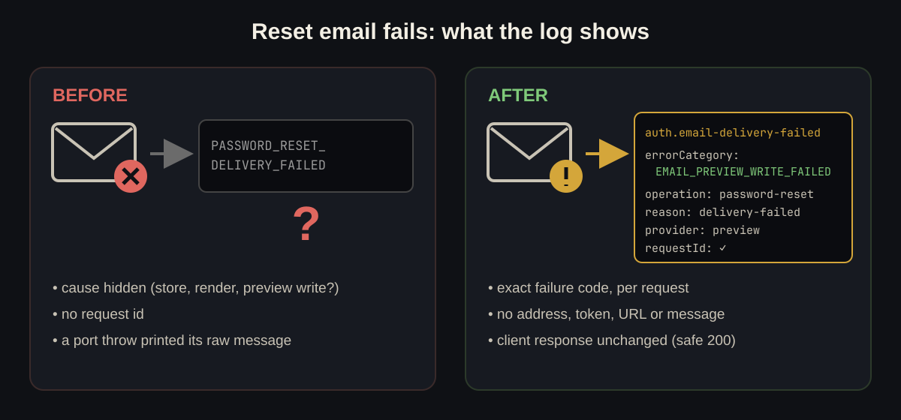

# Consolidated review report: reset-delivery-error-code

Mode: Consolidated report with all review rubrics (picked per the standing owner rule of 2026-11-15). Direct dispatch, one round per stage.

## Stages

| Stage | Reviewers | Report | Result |
| --- | --- | --- | --- |
| 5 Initial Zoom Out | egm-zoom-out, egm-inventive-catalyst | `zoom_out_report.md` | 1 blocker, plus major and nit findings |
| 6 Comprehension | egm-comprehension | `comprehension_report.md` | no blocker; major and nit findings |
| 7 Critic (feature range) | egm-design, egm-structural, egm-style | `critic_report.md` | 3 blockers, plus major and nit findings |
| 8 Intermediate Zoom Out | egm-zoom-out | `intermediate_zoom_out_report.md` | 0 blockers, 1 major, 4 nits |
| 9 Implementation readiness | egm-implementation-readiness, egm-codebase-details, egm-style | `implementation_readiness_report.md` | 2 blockers, plus major and nit findings |

All requested reviewers completed; none was recorded as not run.

## Action items by priority

- 🔴 The reset error never reached the client: rewritten Problem, Goal and acceptance test (fixed).
- 🔴 Missing Alternatives and Risks sections (fixed).
- 🟡 Raw reset port error logged by Better Auth (fixed in code: redacted throw).
- 🟡 Async callback rejection could escape (fixed in code).
- 🟡 Store-failure tests had no working harness (fixed: moved to `abuse-limits.test.ts`).
- 🟡 Mapper re-validated typed values in three layers (fixed in code: mapper trusts the typed value; sink redaction stays).
- 🟡 Contract tables, file list, phases and coverage command (fixed in `plan.md`).
- 🟢 Terms, links, heading names, wording (fixed).

The full traceability from each finding to its resolution is in `goldfish_review_report.md`.

## Verification of the implemented branch

- Unit: `pnpm exec vitest run apps/web/src/lib/auth-email-diagnostics.test.ts apps/web/src/server/request-scope.test.ts packages/auth/src` passed.
- Integration: `tests/integration/auth/auth.test.ts` (17 tests, real Postgres) passed, including the DF-043 report case.
- Type check: `tsc --noEmit` for `apps/web`, `packages/auth` and `tests/` passed. `biome lint` on the changed files: no new findings (one complexity warning in `server.ts` exists on the base).
- Coverage (focused run): `packages/auth/src/server.ts` lines 98.85 and branches 96.28, above its baseline (98.64 / 95.92); the new mapper at 100%.
- Fresh-context code review of the diff: no findings.
