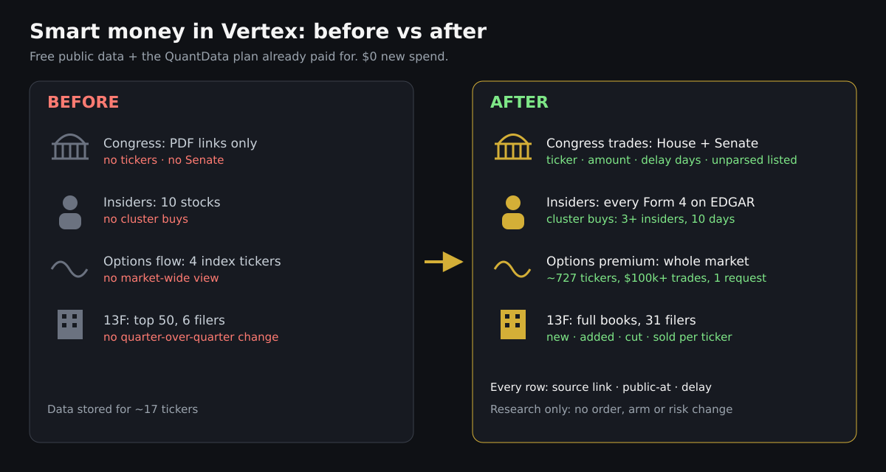

# Smart-money coverage from free and already-paid data



* **Author:** Jeff Ward
* **Date:** 2026-11-19
* **Status:** Reviewed (EGM consolidated review, auto-resolved 2026-11-19)
* **Card:** vertex-smart-money-gaps
* **PR plans:** [plan-pr1.md](plan-pr1.md) (Congress trades), [plan-pr2.md](plan-pr2.md) (market-wide options premium), [plan-pr3.md](plan-pr3.md) (Form 4 market-wide), [plan-pr5.md](plan-pr5.md) (13F changes and FINRA short volume), [plan-pr6.md](plan-pr6.md) (`/smart-money` page, stock-tab sections, overdue state and alerts). Later PRs get their own plan file and EGM review before build.

---

## Overview

Vertex Research is a private, login-only research portal for one owner. This design fills the "smart money" gaps with public government data and with QuantData, which Vertex already pays for. The owner decided on 2026-11-11 (owner Discord message (private)): "We are not going to pay for anything new. Just cover all the gaps that you see."

| Gap today | After this design | PR |
| --- | --- | --- |
| Congress: House PTR links only, no tickers, no Senate, nothing stored | House and Senate electronic PTR transactions with ticker, amount range, dates and reporting delay; unparsed filings listed with a reason | 1 |
| No market-wide options view | Daily and intraday market-wide ranking of large options trades (>= $100,000 per trade), bullish and bearish premium per ticker, from one QuantData request per capture | 2 |
| Form 4 for 10 stocks | Every Form 4 on EDGAR, market-wide, with issuer and reporting-person CIKs; insider cluster buys | 3 |
| Live option prints for SPY, SPX, QQQ, NDX only | More option-print tickers if the measured QuantData budget allows, else the measured numbers that show no room | 4 |
| 13F top 50 for 6 filers, no changes | Full holdings for more filers; quarter-over-quarter changes per security | 5 |
| FINRA short volume for 17 symbols | Short volume for every symbol in the daily FINRA file | 5 |
| Data spread over pages, no freshness check | "Smart money" sections on the stock page, a market-wide `/smart-money` page, MCP tools, and an overdue state per source | 1-6 |
| No smart-money signal tests | Backtests of insider clusters, Congress buys and large-premium flow, recorded as pass, fail or insufficient history | 7 |

The feature is research only. It never places, changes or arms an order and never changes a risk setting.

## The Problem

The owner wants to see what Congress members, company insiders and large options traders are doing, with each source's delay visible. Today:

* Live option prints cover 4 index products (`FLOW_OPTION_TICKERS`: SPY, SPX, QQQ, NDX).
* Form 4 rows exist for 10 large stocks, through the per-symbol OpenBB job `sec-insider`.
* 13F holdings cover the top 50 positions of 6 filers and 17 tickers, with no quarter-over-quarter change.
* FINRA short volume is kept for 17 symbols, although the daily file has every symbol.
* The `/congress-trades` page reads the House index file live and shows PDF links only.

A paid product (Unusual Whales) sells this data. The owner will not pay for it.

## Goals

1. **Congress (PR 1):** store House and Senate electronic PTR transactions with member, ticker, asset, transaction type, amount range, transaction date and filing date; show the reporting delay; list every filing that could not be parsed, with a reason code; never guess a row.
2. **Options premium (PR 2):** rank all tickers by large-trade premium (each trade >= $100,000), with bullish and bearish premium shown separately, from QuantData `gainers-losers`.
3. **Insiders (PR 3):** store every Form 4 transaction filed on EDGAR with issuer CIK, reporting-person CIKs and acceptance time; list insider cluster buys.
4. **Live tape (PR 4):** add option-print tickers up to the measured QuantData budget, or record why none fit.
5. **13F and short volume (PR 5):** quarter-over-quarter changes from full holdings; FINRA short volume for all symbols.
6. **Pages and tools (PRs 1-6):** each data PR ships its own page or page section and its read-only MCP tool (PR 1: the `/congress-trades` page); PR 6 adds the stock-page sections, the market-wide page and the overdue state per source.
7. **Backtests (PR 7):** test three signals and record the result in the Strategy Library.

## Non-Goals

* Any new paid source, trial or plan upgrade.
* OCR of scanned (paper) PTRs. They are listed as unparsed with reason `scanned_image`.
* A blended "smart money score". Each source keeps its own list and delay.
* A Cboe end-of-day option-chain scan of 170 names (the hypothesis's path 3(b)): QuantData's market-wide endpoint covers the same need in one request.
* Exposing the new MCP tools to the in-app assistant. They follow the `openbb_*` rule in `packages/api/src/server/assistant-runtime.ts` (MCP-only until the semantic-layer eval fixture `tests/integration/semantic-layer/eval-recording.fixture.json` is re-recorded).
* Any order, arming, risk or trading-unit change.

## Open Questions

* **Question 1 (PR 4):** answered 2026-11-23 in [plan-pr4.md](plan-pr4.md): `market-watch-gex` peaks at 122 req/60 s at the open (09:38-10:24 ET) and 49 req/60 s near the close; `market-watch-wheel` peaks at 32 req/60 s (staggered 5 min after gex); `market-watch-reentry` uses <= 24 req/60 s (staggered 1 min before gex). Spare budget after 25% safety margin (60 req/60 s) is 58 req/60 s at the open; raising the Vertex client cap to 54 req/60 s (6 reserved for `/charts`, 48 for the collector) supports activating `QQQ` and `NDX` and adding N=2 tickers (`IWM`, `NVDA`) with parity staggering (worst-case collector run 32 <= 48 req/60 s).
* **Question 2 (PR 5):** how large are the full 13F information tables of the added filers? Measured in PR 5 before the job design is fixed.

## Glossary

* **PTR:** STOCK Act periodic transaction report. A member must file within 30 days after notice of a trade and no later than 45 days after the trade.
* **eFD:** the Senate electronic financial disclosure site, `efdsearch.senate.gov`.
* **Form 4:** the SEC filing of an insider trade, due within 2 business days. Transaction code P = open-market purchase. **Reporting person:** the insider who files (identified by an owner CIK).
* **CIK:** the SEC's numeric identifier of a company or person.
* **13F:** quarterly holdings report of a manager with at least $100M in 13(f) securities, due 45 days after quarter end.
* **Holder (Congress):** whose account a PTR trade is in: `self`, `spouse`, `joint` or `dependent`.
* **Public at:** when an item became public: the PTR filing date, the Form 4 EDGAR acceptance time, the 13F filing date, or the QuantData capture time. **Reporting delay:** public-at date minus transaction date (Congress, Form 4); for 13F, filing date minus quarter end. **First seen:** when Vertex first stored the row.
* **Insider cluster buy:** an issuer with open-market purchases (code P) by at least 3 distinct reporting persons whose filings were accepted within 10 calendar days. Joint filers on one filing count as one person. Amendments (4/A) do not add persons. The MCP tool and page show clusters whose newest acceptance is in the requested lookback (default 7 days).
* **Large-trade premium:** QuantData `gainers-losers` totals over trades with premium >= $100,000 each (verified 2026-11-19 and 2026-11-20, see [plan-pr2.md](plan-pr2.md) "Vendor checks": the filter applies per trade). Bullish and bearish premium are QuantData's own trade-side classes; the page sorts by bullish premium minus bearish premium (net) and shows both.
* **Overdue:** a source whose newest successful run is older than its maximum age (table in PR 6).
* **The rig:** the owner's Linux machine that runs the OpenBB data jobs (`infra/openbb/rig/`). The jobs post rows to the app through the `openbb.ingest` procedure ([openbb.md](../../openbb.md)).
* **QuantVPS:** the server that runs the web app (`vertex-web.service`) and the flow collector (`vertex-flow.timer`).
* **market-watch-bot:** a separate owner bot that shares the QuantData account (240 requests per 60 s for the whole account).

## Critical User Journeys (CUJs)

### CUJ 1: Who in Congress traded NVDA?

* **Given** the Congress jobs ran in the last 30 hours,
* **When** the owner opens `/congress-trades?ticker=NVDA&days=90`, or calls MCP tool `openbb_congress_trades` with `{ "ticker": "NVDA", "days": 90 }`,
* **Then** he sees each trade with member, chamber, holder, transaction type, amount range, transaction date, filing date and reporting delay in days, with a link to the filing; a line shows how many filings in the window are unparsed, by reason; amendments are marked.

### CUJ 2: What is large options money doing today?

* **Given** the flow collector captured QuantData `gainers-losers` in the last 30 minutes of the session,
* **When** the owner opens `/smart-money` or calls `openbb_smart_money_ranking`,
* **Then** he sees tickers sorted by net large-trade premium with bullish and bearish premium, trade count, capture time and the label "QuantData, intraday"; insider cluster buys, Congress purchases and 13F changes are separate lists with their own delay labels.

### CUJ 3: Insider cluster buys this week

* **Given** the Form 4 job finished the previous business day's EDGAR index,
* **When** the owner calls `openbb_insider_clusters` with `{ "days": 7 }`,
* **Then** he gets issuers with a cluster buy (Glossary) whose newest purchase was accepted in the last 7 days, with reporting persons, total value, acceptance times and filing links.

### CUJ 4: A source stops updating

* **Given** a Congress job has not succeeded for 30 hours,
* **When** the owner opens `/congress-trades`,
* **Then** the coverage line for that chamber says "overdue since <time>" instead of showing old data as current (PR 1); from PR 6 the overdue state also appears in `openbb_status` and sends one alert per incident.

## Technical Plan (Architecture)

### Principles

* **Read each public item market-wide, keyed by its source id** (PTR document id, Form 4 accession, 13F accession, QuantData session and ticker). A symbol list is a read-time filter, never a fetch list.
* **Store raw rows, aggregate at read time.** Clusters, quarter-over-quarter changes and rankings are SQL queries.
* **A ledger per filing source.** Each fetched filing gets one ledger row with status and reason, so unparsed or partly processed items are visible and resumable (Congress in PR 1; Form 4 index days and accessions in PR 3).
* **Each data PR ships its section and MCP tool** (minimum useful slice), so the owner questions are answered as soon as their data exists.

### Data flow

```text
SOURCE                     COLLECTOR                     TABLES                                READ PATH
House index + PDFs  ──┐
Senate eFD pages    ──┴─► rig jobs congress-*  ─► openbb_congress_filings / _trades ─► congressTrades.feed ─► /congress-trades, MCP   (PR 1)
QuantData gainers-losers ─► QuantVPS flow collector ─► flow_market_premium ─────────► ranking query ─► /smart-money, MCP          (PR 2)
EDGAR daily index + XML ─► rig job sec-form4 (ledger) ─► sec_form4_* tables ────────► cluster query ─► /smart-money, stock tab, MCP (PR 3)
QuantData order flow ─► flow collector (more tickers if budget) ─► flow_option_prints ─► /flow                                       (PR 4)
SEC 13F + FINRA file ─► rig jobs sec-13f, finra-short-volume ─► 13F tables, short volume ─► change query ─► stock tab, /smart-money   (PR 5)
openbb_ingest_runs + flow_samples ─► overdue state ─► pages, openbb_status, one alert per incident                                  (PR 6)
```

### PR 1: Congress trades (detail in [plan-pr1.md](plan-pr1.md))

* Two rig jobs, `congress-house` and `congress-senate`, replace the in-app live House reader. They write a filing ledger and a transaction table through `openbb.ingest`.
* House: the yearly index lists PTRs; electronic PDFs are read with `pdfplumber` (already pinned in the OpenBB lock file); scanned filings are listed as unparsed. Senate: the eFD search lists PTRs; electronic reports are HTML tables; paper reports are listed as unparsed.
* A filing that fails to download on a later run keeps its stored parsed rows (the ledger is not overwritten by a fetch failure).
* `congressTrades.feed` reads Postgres and returns trades, the filing ledger, unparsed counts and per-chamber coverage.
* Amendments: Senate reports titled "Amendment" are flagged; House amendments are not detectable in the index and are not flagged (known limitation). Pages mark flagged rows; the PR 7 backtest uses the first filing that disclosed each trade.

### PR 2: Market-wide options premium (detail in [plan-pr2.md](plan-pr2.md))

* The flow collector on QuantVPS adds source `market_premium`: one `gainers-losers` request with `filterExpression premium >= 100000` (and `isCancelled = false`), about every 15 minutes while options trade (09:30-16:15 ET). QuantData already returns the session total; 15 minutes is a page freshness choice, not a budget limit (1 request per 15 minutes is far below any limit).
* Table `flow_market_premium` is keyed by (session date, ticker); each capture replaces the session's rows (`captured_at` column). No intraday history, so no compaction job. A session ledger `flow_market_premium_sessions` records each session as complete, partial, no data or unavailable.
* Known schema work: `flow_samples` CHECKs and `QUANTDATA_ENDPOINTS` allowlist must accept the new source; the 2 MiB response cap must be checked (the 727-ticker response measured about 99 KB).
* The backfill of the past year runs inside the collector through the app's QuantData client, so it respects the shared budget: when no live capture is due, each run fills the oldest weekday of the last 400 days that the ledger does not hold as complete or no data (partial and unavailable sessions after 6 hours). A session becomes complete only from a fetch on a later day, so the same gap fill settles each live session after midnight and repairs missed ones.

### PR 3: Form 4 market-wide

* Rig job `sec-form4` reads each EDGAR daily index (`form.YYYYMMDD.idx`) and fetches each Form 4 and 4/A once. A ledger records each index day (entries listed, entries done, complete) and each accession (status), so a run that hits the 240 s deadline resumes where it stopped. The tick passes the incomplete days and done accessions to the job through a new read procedure.
* The XML parser reuses OpenBB's pinned `openbb_sec` Form 4 helpers where they expose the needed fields (issuer CIK, owner CIKs, transaction code, acceptance time, 10b5-1 flag), and adds only the missing ones.
* It replaces `sec-insider`: `openbb.sec` and the `openbb_sec` MCP tool switch to the new tables in PR 3; `openbb_sec_insider_trades` stays frozen (no writer) until the new data covers 30 days, then the old job and table are removed in a follow-up migration.
* History for backtests: the same job with `--since` (one parser, one key; about 21 hours of runs per year of filings). Older years, if needed, go to a separate research-only table from the SEC quarterly data sets.
* Cadence: the daily index appears after about 22:00 ET, so Form 4 rows are "previous business day". The plan states the step stage and run math for the real rig cycle (stages run one after another; cycle up to about 41 minutes).

### PR 4: Live option-print tickers (detail in [plan-pr4.md](plan-pr4.md))

* Measured 10 trading days (2026-11-10 through 2026-11-23) of server-side QuantData usage across all shared consumers (`market-watch-gex`, `market-watch-wheel`, `market-watch-reentry`) because `X-RateLimit-Remaining` stays stuck at `19`. Peak concurrent external demand at the open is 122 req/60 s, leaving 58 req/60 s after a 25% margin (60 req/60 s) against the 240 req/60 s account limit.
* Raises the Vertex QuantData client cap from 30 to 54 req/60 s (`DEFAULT_QUOTA_RESERVE` 60, `FLOW_QUANTDATA_CALLER_RESERVE` 6 -> 48 collector starts/min), activates `QQQ` and `NDX`, and widens `FLOW_OPTION_TICKERS` by N=2 (`IWM`, `NVDA`) with minute-parity staggering (even minutes: `SPY, SPX, IWM`; odd minutes: `QQQ, NDX, NVDA`; worst-case run 32 <= 48 req/60 s). Option-only tickers (`IWM`, `NVDA`) add zero IBKR requests.
* Migration `0095_flow_option_tickers.sql` widens the CHECK constraints on `flow_option_prints`, `flow_option_gaps`, `flow_samples` (options only for `IWM`/`NVDA`), and `flow_events` (quantdata only for `IWM`/`NVDA`) with `vertex-flow.timer` paused (runbook in [flow-pipeline.md](../../flow-pipeline.md)); `0095_flow_option_tickers.down.sql` refuses while rows for `IWM` or `NVDA` exist. Exposes `flow.optionPrints` (`flow-option-prints.v1`), the `/flow` 6-ticker Option Tape panel, and MCP tool `flow_option_prints`.

### PR 5: 13F changes and short volume

* The existing `sec-13f` job and table are extended: the top-50 cut (`TOP_HOLDINGS`) is removed, rows gain accession and filing date, and each run checks all filers' submissions and downloads only filings not yet stored. Changes are computed per CUSIP between two full books of the same filer; a ticker is attached where a CUSIP-to-ticker map entry exists (new map table; its free source is chosen in the PR 5 plan). Filers: the 6 tracked plus the largest active managers (index funds, custodians and market makers excluded), fixed list with source date.
* `finra-short-volume` keeps every symbol in the daily file (about 2.7M rows a year).

### PR 6: Market-wide page and overdue state

* `/smart-money`: one list per source, no blended score. The stock page's existing filings tab gains Congress, insider cluster and options-premium sections and keeps its SEC filings and fails-to-deliver panels.
* Each source gets a maximum age in the job registry (`OPENBB_JOBS` metadata and the flow sources table). `openbb.status` computes `overdue`; a QuantVPS timer sends one alert per incident through the existing ntfy alert path (`price-alerts-ntfy.ts`) and clears it on recovery.

### PR 7: Backtests (research only)

* Insider clusters: feed the existing Strategy Library entry `insider-purchase-confirmation`; the cluster rule is a counted variant. History: the PR 3 job run with `--since` (acceptance time is public-at).
* Congress buys: entry at the next open after the filing date; first filing per trade.
* Large bullish premium (QuantData's bullish class includes sold puts, so the signal is named "large bullish premium", not "call flow"): QuantData has about 1 year of history, below the agreed 2-year holdout, so the result is recorded as "insufficient history" with the data start date, and the frozen rule collects out-of-sample events.
* Deflated Sharpe from the existing implementation; trial count from the existing run store; pass rule in `decisions.md`.

## Alternatives Considered

### Alternative A: widen the per-symbol OpenBB jobs

* **Pros:** smallest code change; reuses `sec-insider` and `sec-13f` as they are.
* **Cons:** refetches the same filings on every run; about 170 symbols do not fit the 240 s job deadline or the SEC request budget.
* **Reason for rejection:** it cannot meet the freshness limits.

### Alternative B: write market-wide Form 4 rows into `openbb_sec_insider_trades`

* **Pros:** no new table; the stock page needs no change.
* **Cons:** its row number is OpenBB parse order, so two writers corrupt rows; it has no reporting-person CIK, so clusters would count names.
* **Reason for rejection:** wrong cluster counts.

### Alternative C: one generic `smart_money_events` table

* **Pros:** one read model for pages and backtests.
* **Cons:** a loosely typed detail column; each source loses its own keys and checks.
* **Reason for rejection:** source tables with read-time queries give the same public-at ordering with real keys.

### Alternative D: Cboe end-of-day chains for 170 names (path 3(b))

* **Pros:** free; per-contract volume and open interest.
* **Cons:** 170 sequential chain downloads do not fit the job deadline; no history; trade direction unknown.
* **Reason for rejection:** QuantData `gainers-losers` covers the whole market in one already-paid request with trade-side classes.

### Alternative E: keep the live House index reader beside the new tables

* **Pros:** 15-minute freshness for the filing list; no cutover.
* **Cons:** two code paths for the same filings with different coverage (House only versus House and Senate).
* **Reason for rejection:** one reader of Postgres is simpler; 6-hour freshness is inside the agreed 24-hour limit.

### Alternative F: blended smart-money score

* **Pros:** one number per ticker.
* **Cons:** mixes delays from minutes (options) to 45 days (Congress, 13F); weights would be arbitrary.
* **Reason for rejection:** separate lists keep each delay visible.

## Non-Functional Requirements

* **Freshness (maximum age; changed from the hypothesis where the source publishes later than first assumed, for example the EDGAR daily index after 22:00 ET):** Congress 30 h after the last successful run; options premium 30 min in session; Form 4: previous business day's index complete by 10:00 ET; 13F 3 days after EDGAR acceptance; FINRA short volume 10:00 ET next trading day.
* **Request budgets:** SEC <= 8 requests/s through `sec_guard.py` and the shared SEC lock; House Clerk 2 requests/s; Senate eFD 1 request/s; QuantData `market_premium` 1 request per 15 minutes.
* **Storage (per year, estimates):** Congress about 10k trade rows; Form 4 about 1M rows; market premium about 0.2M rows (700 tickers x 250 sessions); 13F full books at most about 0.35M rows (measured in PR 5: about 86,800 information-table entries per quarter for 23 filers); FINRA short volume about 3.1M rows (12,301 symbols on 2026-11-18).
* **Security:** public data only; declared research User-Agent with the existing contact address; no new credentials (QuantData key unchanged). Parsing runs inside the rig job's systemd limits (`MemoryMax=3G`, step timeout).
* **Untrusted text:** filing text (asset names) reaches pages and MCP clients. Pages render it as text; MCP results cap each text field at 300 characters and label the field as source data.
* **Rights:** the Senate eFD site requires accepting a statement that reports are not used for an unlawful or commercial purpose, credit rating, or soliciting money. Vertex is a private research tool for one owner and does not sell or publish the data; the job accepts the statement per session. Test fixtures are synthetic (fictional members and filings), because this repository is public. QuantData data stays inside Vertex and its MCP tools, as today (`flow_snapshot`).
* **Rollout and rollback:** each PR follows the deploy order in its plan (pause the rig timer, apply the migration with grants, deploy the app with `infra/quantvps/restart-when-idle.sh` after 16:00 ET or before 08:30 ET, install the rig at the same SHA, run each new job once, live check, resume). Rollback runs in reverse: re-install the rig at the previous SHA, redeploy the previous app, apply the down migration (PR 1's drops the two congress tables; they hold only re-fetchable public data).

## Risks and Mitigations

| Risk | Detection | Mitigation |
| --- | --- | --- |
| House PDF or Senate page layout changes | Ledger reason `layout_unknown` count per run | Parser version bump; unparsed filings stay listed, never guessed |
| Senate eFD blocks automated sessions | Job failure, coverage overdue | 1 request/s, single session per run; report as a gap if blocked |
| SEC blocks requests | `forbidden` errors in run warnings | Shared limiter (8/s) and declared User-Agent; stop on 403 |
| The rig is down | Overdue state (PR 6), alert | Jobs resume from ledgers when the rig returns |
| Live House reader removed before backfill | Empty `/congress-trades` after deploy | Deploy step runs a backfill from 2026-01-01 before the page goes live |
| QuantData history window (about 1 year) passes before backfill | Ledger rows `pending` in `smartMoney.ranking` history | PR 2's gap fill starts at deploy, oldest weekday first |
| Prompt injection through filing text in MCP results | Review of MCP output | Text caps, structured fields, labelled source data |

## Additional Resources

* Brainstorm brief and reviews: `~/Documents/reports/web/vertex-smart-money-gaps/` on the rig (concepts_brief.md, goldfish/, review/, decisions.md). Not in the repository.
* Existing pipelines: [openbb.md](../../openbb.md), [flow-pipeline.md](../../flow-pipeline.md).

## Future Improvements

* OCR of scanned PTRs with a human check queue.
* Intraday Form 4 discovery from EDGAR's current-filings feed.

---

## Detailed Implementation Plan

See [plan-pr1.md](plan-pr1.md) for PR 1 and [plan-pr2.md](plan-pr2.md) for PR 2. Each later PR adds `plan-prN.md` with its own file list and verification plan before build.
