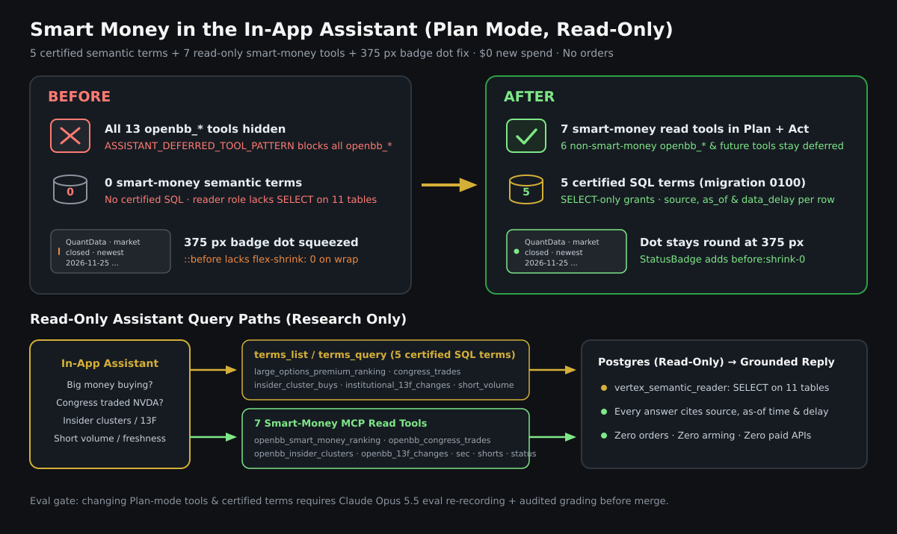

# Smart-Money Assistant Terms & Read-Tool Plan

Parent design: [design.md](design.md) (owner picks 2026-11-11, owner Discord message (private); card `vertex-smart-money-assistant-terms`, closing item 6 of parent card `vertex-smart-money-gaps`). Research only: no order, arming, risk setting, or trading-unit change, and $0 new paid sources. Reviewed with a fresh-context Goldfish review on 2026-11-26 (all 13 findings — 4 Blocker, 5 High, 3 Medium, 1 Low — applied; 0 ESCALATE).

## 1. Problem & Goal

The external MCP tools for smart money (`openbb_smart_money_ranking`, `openbb_congress_trades`, `openbb_insider_clusters`, `openbb_13f_changes`, `openbb_sec`, `openbb_shorts`, `openbb_status`) are live on `/api/mcp`, and the smart-money tables exist in Postgres (migrations `0064`, `0085`, `0086`, `0088`, `0089`). However:

1. `ASSISTANT_DEFERRED_TOOL_PATTERN` in `packages/api/src/server/assistant-runtime.ts` hides every `openbb_*` tool from the in-app assistant.
2. The semantic catalog (`semantic_terms`) has 0 smart-money terms; `/semantic-terms` shows nothing for Congress trades, insider clusters, 13F changes, large options premium, or short volume.
3. At 375 px on `/smart-money`, the status dot (`::before`) inside a multi-line wrapping `StatusBadge` shrinks horizontally into a thin bar because `StatusBadge` omits `before:shrink-0`.

**Goal:** Give the in-app assistant (Plan mode, read-only, inherited by Act mode) certified semantic-layer terms and direct smart-money read tools so questions about large options buying, Congress trades, insider cluster buys, 13F quarter-over-quarter changes, and short volume answer accurately with explicit source, as-of time, and data delay, and keep the 375 px `StatusBadge` dot circular.

### Non-Goals

* Exposing non-smart-money `openbb_*` tools (`openbb_vol_context`, `openbb_iv_history`, `openbb_cot`, `openbb_macro`, `openbb_events`, `openbb_factors`), `market_notes_list`, or `flow_option_prints` to the in-app assistant.
* Changing the semantic-layer eval recording format or grader model (`anthropic/claude-opus-5-5`); those belong to card `vertex-eval-recording-cost`.
* Any order, arming, risk gate, or paid data provider change.

## 2. Architecture Decisions

### Decision A: Expose only the 7 smart-money read tools (not all 13 `openbb_*`)

**Choice:** Expose exactly the 7 read-only smart-money tools to `assistantToolsFor("plan")` (and therefore `"act"`), and add one concise "Smart-money research" rule bullet to `assistantSystemPrompt` in `packages/api/src/server/assistant-runtime.ts` directing the assistant to use the certified smart-money terms or matching `openbb_*` tools (plus `openbb_status` for overdue state) and always cite source, as-of date/time, and data delay.

| Tool | Procedure | Role |
| --- | --- | --- |
| `openbb_smart_money_ranking` | `smartMoney/ranking` | Market-wide large options trades (`>= 100,000 USD` premium, QuantData) |
| `openbb_congress_trades` | `congressTrades/feed` | House Clerk & Senate eFD STOCK Act PTRs |
| `openbb_insider_clusters` | `openbb/insiderClusters` | SEC EDGAR Form 4 open-market purchase clusters (`>= 3` persons in 10 days) |
| `openbb_13f_changes` | `openbb/changes13f` | Market-wide quarter-over-quarter 13F-HR changes across tracked filers |
| `openbb_sec` | `openbb/sec` | Per-symbol SEC filings, Form 4 trades, 13F holders + `changes13f`, FTD |
| `openbb_shorts` | `openbb/shorts` | FINRA Reg SHO daily short volume, short interest, weekly OTC, SEC FTD |
| `openbb_status` | `openbb/status` | Per-source ingest & overdue status (`sources[].overdue`) |

**Why not all 13 `openbb_*`:**

* Keeps the Plan-mode tool prompt compact and avoids introducing unrelated macro/COT/events/vol tools that have no certified terms here and could distract existing account/backtest eval trials.
* Implemented with a negative-lookahead `ASSISTANT_DEFERRED_TOOL_PATTERN` backed by `ASSISTANT_SMART_MONEY_TOOLS`, so any future `openbb_*` tool stays deferred by default until explicitly reviewed and eval-recorded.

### Decision B: Five certified Postgres semantic terms (Migration `0100`)

**Choice:** Seed 5 certified `source = 'postgres'` terms in `0100_semantic_terms_smart_money.sql` with certified SQL attributes in `semantic_sql_attributes`, 5 true `many_to_one` entries in `semantic_relationships`, and read-only `GRANT SELECT` on 11 tables to `vertex_semantic_reader`.

| Term ID | Grain | Parameters | Tables Read | Source & Delay Columns |
| --- | --- | --- | --- | --- |
| `large_options_premium_ranking` | `ticker` | `sessions` (opt, 1–20, default 1), `ticker` (opt) | `flow_market_premium`, `flow_market_premium_sessions` | `source`, `as_of`, `data_delay`, `session_status`, `newest_session_date` |
| `congress_trades` | `filing_trade` | `ticker` (opt), `member` (opt), `days` (opt, 1–365, default 30) | `openbb_congress_trades`, `openbb_congress_filings` | `source`, `as_of` (`filed_on`), `filing_delay_days`, `data_delay`, `source_url` |
| `insider_cluster_buys` | `issuer_cluster` | `days` (opt, 1–90, default 7), `symbol` (opt) | `openbb_sec_form4_filings`, `openbb_sec_form4_transactions`, `openbb_sec_form4_owners` | `source`, `as_of` (`last_accepted_at`), `data_delay`, `first_accepted_at`, `value_incomplete` |
| `institutional_13f_changes` | `filer_position` | `ticker` (opt), `change` (opt: `all`/`new`/`added`/`reduced`/`sold`) | `openbb_sec_13f_filings`, `openbb_sec_13f_holdings`, `openbb_cusip_symbols` | `source`, `as_of` (`filed_on`), `delay_days`, `data_delay`, `period`, `previous_period` |
| `short_volume` | `ticker_session` | `symbol` (**required**), `days` (opt, 1–365, default 30) | `openbb_short_volume_daily` | `source`, `as_of` (`date`), `data_delay`, `short_ratio_percent` |

**SQL correctness invariants:**

1. **No `$`+digits inside SQL literals or comments:** `certifiedStatement()` (`packages/db/src/server/semantic-layer.ts`) parses `/\$(\d+)/g` across the entire SQL text. Certified SQL uses `100,000 USD` (never `$100,000`) inside string literals and comments, and `semantic-layer-migration.test.ts` asserts no `$N` exceeds each term's parameter count.
2. **Numeric clamping & input normalization:** Every numeric parameter is clamped in `numeric` before casting to `integer` (`least(greatest(coalesce(floor($n::numeric), default), min), max)::integer`) so floats, negatives, or huge values (`1e30`) never throw Postgres `22003`/`22P02`. Text ticker filters normalize with `upper(...)`, `member` escapes `\`, `%`, and `_` before `ilike ... escape '\'`, and `short_ratio_percent` guards `total_volume = 0` (`case when s.total_volume > 0 ... else null end`).
3. **No wall-clock drift in CI or stale-ingest silent hiding:** Relative `days` windows anchor to the newest stored row of the table (`max(filed_on)` in parsed `openbb_congress_filings`, `max(accepted_at)` in parsed Form 4 `openbb_sec_form4_filings`, table-wide `max(date)` in `openbb_short_volume_daily` so delisted/stale symbols do not appear recent), never raw `current_date` / `now()`. Every row exposes its real `as_of` date/timestamp, and descriptions direct the assistant to `openbb_status` / `openbb_*` for real-time overdue flags. Every Postgres `DATE` output column is cast to `::text` (`YYYY-MM-DD`) so `pg` never shifts dates across local server timezones; `bigint` fields (`volume`, `short_volume`, `shares`, `amount_low`, `amount_high`) follow `semantic-layer.ts` `toJson` string serialization; dollar aggregates and ratios cast to `double precision` and counts to `integer`.
4. **Exact domain filters:**
   * `large_options_premium_ranking`: `filter_profile = 'premium-gte-100k.v1'`, sessions with `status in ('complete', 'partial')` and `not (status = 'complete' and tickers < 50)` (holiday exclusion matching `MARKET_PREMIUM_MIN_SESSION_TICKERS`), market-wide rank computed before optional `ticker` filter.
   * `congress_trades`: composite join on `(chamber, doc_id)` with `openbb_congress_filings`, requiring `status = 'parsed'` and `t.row_number <= f.row_count`.
   * `insider_cluster_buys`: `status = 'parsed'`, `form_type = '4'` (excludes `4/A`), `tx.row_number <= f.row_count`, `transaction_code = 'P'`, `acquired_disposed = 'A'`, `derivative = false`, correlated `JOIN LATERAL` on non-empty `openbb_sec_form4_owners` signature (hitting PK `(accession_number, owner_cik)` only on lookback-window filings), `coalesce(..., 0)` sums with `bool_or(tx.shares is null or tx.price is null)` for `value_incomplete`. Evaluates candidate `[e.accepted_at - interval '10 days', e.accepted_at]` windows across every qualifying end filing `e` in `[anchor - days, anchor]` (reading window members back `days + 10` days), requiring `count(distinct person_key) >= 3`, and picks `DISTINCT ON (issuer_cik) ORDER BY last_accepted_at DESC, anchor_accession DESC`. Notes in description: call `openbb_insider_clusters` for full transitive union-find across mixed joint/solo filings and per-filing EDGAR links.
   * `institutional_13f_changes`: deduplicates `(filer_cik, period_ending)` in `openbb_sec_13f_filings` by `filed_on asc, accession_number asc`, keeps only consecutive quarter-end pairs, joins `openbb_sec_13f_holdings` using the `(filer_cik, period_ending)` PK prefix plus strict `accession_number` match, computes `new`/`added`/`reduced`/`sold` (using `shares` when both non-null, else `value`; excluding `unchanged`), resolves display `ticker` via correlated `LEFT JOIN LATERAL` on `openbb_cusip_symbols` PK `(cusip, symbol)` (`coalesce(c.symbol, pr.symbol, cm.symbol)`) and filters optional `$1` against both `upper(ticker) = upper($1::text)` and `EXISTS (SELECT 1 FROM openbb_cusip_symbols cs WHERE cs.cusip = joined.cusip AND cs.symbol = upper($1::text))`, ordered by `greatest(coalesce(value_usd, 0), coalesce(previous_value_usd, 0)) desc, filer_cik asc, cusip asc, option_type asc`.
   * `short_volume`: FINRA Reg SHO daily short volume, exempt volume, total volume, and `short_ratio_percent`; explicitly notes short volume is not short interest.
5. **Grain schema & contract extension:** Widen `SEMANTIC_ATTRIBUTE_GRAINS` and `semantic_sql_attributes_grain_check` to add `ticker`, `filing_trade`, `issuer_cluster`, `filer_position`, and `ticker_session`, update `SEMANTIC_GRAIN_LABELS`, generate `packages/db/migrations/meta/0100_snapshot.json`, and regenerate `packages/api/openapi.json`.
6. **Least privilege & guarded rollback:** `vertex_semantic_reader` receives `GRANT SELECT` only (same plain-role guard as `0056_semantic_layer.sql`) on the 11 tables above. Guarded rollback `packages/db/rollback/0100_semantic_terms_smart_money.down.sql` (`BEGIN; ... COMMIT;`, run with `psql -v ON_ERROR_STOP=1` without `--single-transaction`) refuses if any seeded row across all 3 catalog tables has `updated_by IS NOT NULL OR NOT certified OR certified_by IS DISTINCT FROM 'migration 0100' OR certification_note IS DISTINCT FROM '<exact seed note>'` or if any non-`0100` row uses the 5 added grains, deletes only the `0100` rows, revokes the 11 `SELECT` grants (guarded by `IF EXISTS` on `vertex_semantic_reader`), and restores the `0058` grain check. Only true `many_to_one` relationships are seeded (omitting many-to-many `openbb_cusip_symbols`).

### Decision C: 375 px `/smart-money` StatusBadge dot fix

`packages/ui/src/status-badge.tsx` renders its indicator dot with `before:size-1.5 before:rounded-full before:bg-current` inside an `inline-flex` container. When `/smart-money` allows long coverage text to wrap (`whitespace-normal` at 375 px), flex item shrinking squashes the `::before` pseudo-element horizontally. Adding `before:shrink-0` in `statusBadgeVariants` fixes `/smart-money` and every wrapping `StatusBadge` without altering single-line layout.

## 3. Files Touched

* `docs/vertex-rebuild/designs/smart-money/plan-assistant-terms.md` & `plan-assistant-terms.svg`
* `packages/db/src/schema/semantic-layer.ts`
* `packages/db/migrations/0100_semantic_terms_smart_money.sql`
* `packages/db/migrations/meta/0100_snapshot.json` & `packages/db/migrations/meta/_journal.json`
* `packages/db/rollback/0100_semantic_terms_smart_money.down.sql`
* `packages/api/src/contracts/semantic-terms.ts` & `packages/api/openapi.json`
* `packages/api/src/server/assistant-runtime.ts`
* `packages/ui/src/status-badge.tsx` & `packages/ui/src/semantics.test.ts`
* `docs/vertex-rebuild/agent-semantic-layer/fixture.sql`
* `packages/api/src/assistant.test.ts`
* `packages/db/src/server/semantic-layer-migration.test.ts`
* `tests/integration/database/semantic-layer.test.ts`
* `tests/integration/semantic-layer/harness.ts`
* `tests/integration/semantic-layer/read-tools.test.ts`
* `tests/integration/semantic-layer/smart-money-terms.test.ts`
* `tests/integration/semantic-layer/eval-recording.fixture.json` (updated on a host with `anthropic/claude-opus-5-5` credentials before marking the PR ready)

## 4. Verification, Eval Gate & Deployment

1. **Automated checks (run in sandbox & CI):**
   * `bun run verify:prepush` (`format:check`, `lint`, `auth:schema:check`, `openapi:check`, `typecheck`, `docs:check`, `test:gateway`, `test:unit`, `test:contract`, `test:operations`).
   * `pnpm exec vitest run --config vitest.config.ts --project acceptance scripts/init/init.acceptance.test.ts -t "renames"`.
   * Postgres integration suites: `tests/integration/database/semantic-layer.test.ts`, `tests/integration/semantic-layer/read-tools.test.ts` (including `READ_TOOL_CALLS` for all 7 tools, `ANSWERING_TERMS` for all 5 terms, and `REQUIRED_TERM_PARAMS` for `short_volume`), `tests/integration/semantic-layer/smart-money-terms.test.ts`, `tests/integration/semantic-layer/flow-control-terms.test.ts`, `tests/integration/semantic-layer/trend-terms.test.ts`.
   * `tests/integration/semantic-layer/harness.ts` pins and resets `setSmartMoneyClockForTesting`, `setCongressTradesClockForTesting`, and `setOpenbbClockForTesting` to `() => EVAL_NOW` so smart-money tool replies are deterministic for eval replay.
   * Coverage check for every modified source file (`100%` / baseline ratchet intact).
2. **Semantic-layer eval re-recording & audited grading (rig-only prerequisite before marking PR ready):**
   * Adding 7 Plan-mode tools, 5 certified terms, and the Smart-money system-prompt bullet makes all 90 trials in `tests/integration/semantic-layer/eval-recording.fixture.json` stale (`inputDigest` covers `request.tools`, the system prompt, and `terms_list` output).
   * `grader-self-test.test.ts` binds the independent audit to `anthropic/claude-opus-5-5`. Re-recording and 3-run majority grading must run on a host with Anthropic credentials (never faking the grader model with a failover model).
3. **Merge & off-hours deploy (after eval re-recording + full CI green):**
   * Merge via `scripts/merge-pr` after exact-head fresh-context review and green `ci-gate`.
   * Dispatch exact-SHA full CI (`browser_tests: on`), apply `0100_semantic_terms_smart_money.sql` on QuantVPS Postgres (via `pnpm db:migrate` or `psql -v ON_ERROR_STOP=1 --single-transaction` with Drizzle ledger reconciliation), deploy `vertex-web` off-hours with `infra/quantvps/restart-when-idle.sh`.
   * Verify live (agent viewer session, headless Chrome on the rig, dark 1440 px & 375 px screenshots): `/semantic-terms` lists the 5 certified smart-money terms; live assistant answers "What is big money buying today?", "Who in Congress traded NVDA?", and "Insider cluster buys this week?" with source and data delay; `/smart-money` 375 px dot stays round; `openbb.status` and `openbb.changes13f` answer live.
4. **Rollback:** Deploy previous `vertex-web` SHA with `infra/quantvps/restart-when-idle.sh`, and (only if no operator edited the seeded terms) run `psql -v ON_ERROR_STOP=1 -f packages/db/rollback/0100_semantic_terms_smart_money.down.sql` (no `--single-transaction`, as the file wraps itself in `BEGIN; ... COMMIT;`).
