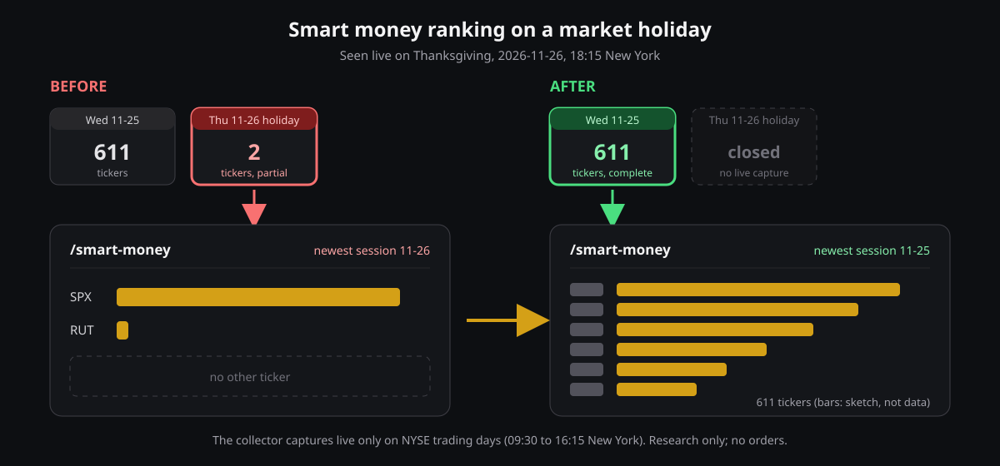

# Plan: no live capture of the options premium on a market holiday

* **Card:** vertex-smart-money-gaps (the job tracker entry of this work)
* **Kind:** bug fix (no new interface, module or data format)
* **Baseline commit:** `ac9281e8a` on `vertex/rebuild-darkfactory-20260921`
* **Parent design:** [design.md](./design.md)
* **Related plan:** [plan-pr2.md](./plan-pr2.md) (the feature this plan repairs)

## Background

Vertex Research is a private, login-only research portal. The page `/smart-money` ranks tickers by large-trade options premium. The data comes from QuantData, a market data vendor that Vertex already pays for: one `gainers-losers` request returns per-ticker totals of the option trades with a premium of at least $100,000 each for one session date.

* **Writer.** The flow collector is a procedure of the web app (`flow.collect`) that a timer calls every 60 seconds. Its market premium part (`packages/api/src/server/flow-market-premium-collect.ts`) makes at most one QuantData request per run:
  * **Live capture:** from 09:30 to 16:15 New York on every weekday, it requests today's session about every 15 minutes. The ledger row of the session is `partial`.
  * **Gap fill:** when no live capture is due, it requests the oldest weekday before today whose ledger row is missing, or is `partial` or `unavailable` and was last tried at least 6 hours ago. A session that is fetched on a New York day after its date is `complete`. So the gap fill settles yesterday's session in the first runs after midnight New York (the settle fetch).
* **Storage.** `flow_market_premium` holds the totals per session date and ticker. `flow_market_premium_sessions` is the ledger: one row per session date with the status, the capture time and the ticker count.
* **Readers.** Two readers sum the newest stored sessions (the session window; the default is 1 session; the procedure takes 1, 5 or 20, the SQL term 1 to 20):
  * the procedure `smartMoney.ranking` (`packages/api/src/server/smart-money.ts`), read by the page, by the MCP tool `openbb_smart_money_ranking` and by the read tool of the same name in the in-app assistant;
  * the certified semantic-layer term `large_options_premium_ranking` (SQL in `packages/db/migrations/0100_semantic_terms_smart_money.sql`), which the in-app assistant reads through the semantic layer.
  * Both leave a `complete` session with fewer than 50 tickers out of the window, because that is a market holiday (2025-11-27 has one ticker; trading days have 608 to 750).
* **Calendar.** `packages/api/src/nyse-calendar.ts` computes the NYSE full-day holidays of any year from the holiday rules, plus a list of special closures. `isMarketPremiumSessionOpen(now)` in `packages/api/src/openbb-overdue.ts` is true on an NYSE trading day from 09:30 to 16:15 New York. The `coverage` field of `smartMoney.ranking` and the overdue alert of this source already use it: on a holiday they report the source as closed.

## Problem

On a market holiday, both readers rank the holiday instead of the last trading session.

* Seen live on 2026-11-26 (Thanksgiving) at 18:15 New York: `/smart-money` showed "2 tickers" (SPX and RUT, session 2026-11-26, partial). The session of 2026-11-25 had 611 tickers.
* Cause: the live capture of the collector has no holiday check. Its condition is `flowSessionOpen("options", "SPY", now)`: a weekday from 09:30 to 16:15. On a weekday holiday it captures about 29 times and stores a `partial` row with the few index tickers that trade. The readers leave out only `complete` holiday rows, so the `partial` row takes the newest slot until the settle fetch after midnight.
* The writer and the reader side disagree: the coverage and the alert treat the holiday as closed, and the collector treats it as a session.
* [plan-pr2.md](./plan-pr2.md) recorded this as a known limit ("On the holiday itself the live view shows the few holiday tickers"). The page is meant to answer "what is big money buying". Two index tickers on a closed market do not answer it.

## Goal

On an NYSE holiday the page, the MCP tool and the assistant rank the last trading session. The readers, the contract, the database and the SQL term do not change.

## Fix

The live capture runs only while `isMarketPremiumSessionOpen(now)` is true. This is the same window as before (09:30 to 16:15 New York) with the NYSE trading-day check added, and it is the function that the coverage and the alert already use.

Data flow, with the one changed step marked:

`flow.collect` timer → market premium part: **live capture only on an NYSE trading day (changed)**, else gap fill → ledger and totals → `smartMoney.ranking` (page, MCP tool) and the SQL term (assistant), both unchanged.

| Time | Before | After |
| --- | --- | --- |
| Holiday, 09:30 to 16:15 | about 29 live requests; a `partial` row with 1 or 2 tickers; both readers rank it | no live request; the gap fill runs as on a weekend; no row for the holiday; both readers rank the last trading session |
| Holiday, after 16:15 | the `partial` row stays the newest session | no row for the holiday |
| After midnight | the settle fetch makes the row `complete`; both readers leave it out | the gap fill stores the holiday as `complete` (it is a missing weekday), or as `no_data` when QuantData returns no rows; both readers leave it out |
| Trading day | live capture | live capture (no change) |

On a holiday `coverage` reports today's date with `state: closed` and no capture, as it does on a trading day before 09:30. `coverage` describes today's capture, and `sessions` names the ranked sessions.

## Alternatives considered

| Alternative | Decision | Reason |
| --- | --- | --- |
| Reader rule: a session with fewer than 50 tickers takes no slot, whatever its status (revision 1 of this plan) | Rejected | It also hides a trading day with a failed capture: the page would show the session before it as complete. It needs the same change twice (TypeScript and the SQL term, with a new migration). |
| Reader rule: leave out a session whose date is not an NYSE trading day | Rejected | The SQL term has no calendar, so the assistant would keep the bug, or the two readers would follow different rules. |
| A holiday check in `flowSessionOpen` (`packages/api/src/server/flow-snapshot.ts`), the session check of the option print, GEX and net drift sources | Not in this fix | It is the wider root cause: those three sources also read on a holiday. But it changes when four live sources collect and the freshness states of `/flow`, whose documented model is "holidays are not modelled". It needs its own plan and review: follow-up card `vertex-flow-collect-holiday-guard`. Their holiday reads return no data; they do not produce a wrong ranking. |
| A holiday mark on the ledger row, set by the collector | Rejected | A new column is a data format change. On the holiday no row exists; afterwards the existing rule for `complete` rows under 50 tickers applies. |
| A threshold relative to the session before | Rejected | A new tunable with no evidence; the fixed 50 separates 1 or 2 tickers from 608 to 750. |

## Out of scope

* The readers (`smartMoney.ranking`, the SQL term), the contract schema, the database, the page components.
* The gap fill. It keeps the weekday rule: it requests a holiday once on a later day and stores it as `complete`, and `history.stored` still counts that row. Reason: the history counts weekdays, the stored row records what QuantData holds for the date, and the reader rule for `complete` rows under 50 tickers must stay for a closure that the calendar does not hold.
* The seed run (an operator option of `flow.collect`). It still captures the newest session date on request.
* The other flow sources (option prints, GEX, net drift). They still have no holiday check (follow-up card `vertex-flow-collect-holiday-guard`).
* Orders, arming, risk settings and trading units. The repository rules require this statement; this change is in a collector of research data.

## Risks and limits

| Risk | Effect | Handling |
| --- | --- | --- |
| A closure that the calendar does not hold (a new day of mourning) | The collector captures as before; that day shows the few tickers until the settle fetch | Same as the baseline; add the date to `NYSE_SPECIAL_CLOSURES` |
| The calendar marks a trading day as a holiday | No live capture on that day; the page shows the session before it with `state: closed`; the gap fill stores the session after midnight. The coverage and the overdue alert use the same calendar, so nothing reports the missed day (a common-mode fault; at the baseline the collector would still capture) | Accepted. The calendar is rule-based, and `packages/api/src/price-freshness.test.ts` pins its holidays of 2024 to 2028 to the committed closure list (50 dates). Extend that list before 2029 |
| A seed run (operator option) on a holiday | It stores a `partial` holiday row; the readers rank it until the settle fetch | Same as the baseline; a seed run is a manual action |
| The holiday row of 2026-11-26 that is already stored | None after the settle fetch of 2026-11-27 (after midnight New York) | No data repair expected. If the settle fetch brings no row, the row stays `partial` (the collector keeps stored totals when an answer shrinks below half): the live check finds this, and the repair is then one operator statement that sets the status of that ledger row to `complete` |

Security: none (no new input, no new access). Load: about 29 QuantData requests fewer on a holiday.

## Acceptance criteria

* Unit tests of the collector prove: no live request on an NYSE holiday inside 09:30 to 16:15; the gap fill still runs on the holiday; the holiday is fetched as `complete` on the next day; a trading day still captures live.
* The coverage lane of the PR checks reports 100% for `packages/api/src/server/flow-market-premium-collect.ts`. Only this lane checks the criterion (it checks every file); `verify:prepush` has no coverage run.
* `bun run verify:prepush` passes, and the PR checks pass on the reviewed head.
* Live, after the deploy: `flow.collect` runs without a failure on the next timer runs, the ledger shows 2026-11-26 as `complete`, and `/smart-money` names a trading session as the newest session. The unit tests are the only required proof of the rule; the live check proves that the deploy did not break the collector. The first holiday after the deploy is 2026-12-25 (no ledger row for that date before midnight); a look on that day is optional.

## Implementation Plan

Files (all Modify; no file created or deleted besides this plan and its picture):

1. `packages/api/src/server/flow-market-premium-collect.ts`:
   * In `collectMarketPremium`, replace the condition `flowSessionOpen("options", "SPY", now)` with `isMarketPremiumSessionOpen(now)`.
   * Import `isMarketPremiumSessionOpen` from `../openbb-overdue.ts` and remove the import of `flowSessionOpen` (no other use in this file). `openbb-overdue.ts` imports only contracts and `nyse-calendar.ts`, so there is no import cycle.
   * Header comment: "about every 15 minutes while options trade, 09:30-16:15 New York" becomes "about every 15 minutes while options trade, 09:30-16:15 New York on an NYSE trading day". Comment above the condition: "Live captures run while options trade (09:30-16:15 New York on an NYSE trading day): on a market holiday the gap fill runs instead."
2. `packages/api/src/server/flow-market-premium-collect.test.ts`, in `describe("collectMarketPremium")`, with the helpers of the file (`depsWith`, `fullLedger`, `session`):
   * "makes no live capture on a market holiday": `now` 2026-11-26 17:00 UTC (12:00 New York, Thanksgiving), `sessionDate` "2026-11-26" (the field is used only by a seed run), `ledger: fullLedger("2026-11-26")`. Expect `status: "skipped"`, `record: false`, a message that starts with "not due", and no client request.
   * "fills a gap on a market holiday and settles the holiday on the next day": same `now`, `ledger: fullLedger("2026-11-26").filter((row) => row.sessionDate !== "2026-01-05")`: expect the message to start with "gap fill 2026-01-05" and the request body to hold `sessionDate: "2026-01-05"`. Then, with a second `depsWith` call, `now` 2026-11-27 05:05 UTC (00:05 New York), `ledger: fullLedger("2026-11-26")`: expect the message to start with "gap fill 2026-11-26" and the stored session status `complete`.
   * Existing tests that stay as the proof of the trading-day cases: "captures today's session live and stores the rows with a partial ledger row" (Friday 2026-11-20 10:00 New York), "fills the oldest gap after the live window closes at 16:15", "fills gaps outside the live window, also on a weekend".
3. Text that describes the live capture:
   * `packages/api/src/openbb-overdue.ts`, doc comment of `isMarketPremiumSessionOpen`: "Shared between `openbb.status` and `smartMoney.ranking`." becomes "Shared between the live capture of `flow.collect`, `openbb.status` and `smartMoney.ranking`."
   * `packages/api/src/server/smart-money.ts`, comment in `coverageOf` (comment only): "while options trade (09:30-16:15 New York)" gets "on an NYSE trading day".
   * `packages/api/src/contracts/smart-money.ts`, comment of `coverage.sessionDate`: "the live capture runs on weekdays" becomes "the live capture runs on NYSE trading days"; comment of `coverage.state`: "closed: outside that window or on a weekend" becomes "closed: outside that window, on a weekend or on an NYSE holiday" (comments only, no schema change; the code has reported a holiday as closed since PR 6).
   * `docs/vertex-rebuild/flow-pipeline.md`, section "Market premium", source table, row "Market premium": "while options trade" gets "on NYSE trading days". Item "Live capture": "While options trade (09:30-16:15 New York, the options and GEX session)" becomes "While options trade (09:30-16:15 New York on an NYSE trading day; `isMarketPremiumSessionOpen`)". Add after the item list: "On a market holiday no live capture runs. The gap fill stores the holiday on a later day: as `complete` with the few tickers that traded, or as `no_data` when QuantData returns no rows."
   * `docs/vertex-rebuild/designs/smart-money/plan-pr2.md` (anchors are the quoted phrases): "while options trade (09:30-16:15 New York time)" in the summary gets "on NYSE trading days". "Holidays are not modelled; QuantData answers a holiday with almost no data." becomes "The live capture skips NYSE holidays (plan-holiday-session.md); the gap fill stores a holiday with almost no data." In the risk row of the weekday holiday, "On the holiday itself the live view shows the few holiday tickers." becomes "On the holiday itself no live capture runs (plan-holiday-session.md)." In the step "Live capture", `flowSessionOpen("options", "SPY", now)` becomes `isMarketPremiumSessionOpen(now)` and "(09:30-16:15 New York)" becomes "(09:30-16:15 New York on an NYSE trading day)". In the output item `coverage`, the same function name replacement (the code has used `isMarketPremiumSessionOpen` for the coverage since PR 6).
   * `CHANGELOG.md`, under `## [Unreleased]`, `### Fixed`, as the first entry: "- Smart money ranking on a market holiday (Vertex, research only; card `vertex-smart-money-gaps`, plan `docs/vertex-rebuild/designs/smart-money/plan-holiday-session.md`): the flow collector makes no live capture of the market premium on an NYSE holiday (`isMarketPremiumSessionOpen`, the check that the coverage and the overdue alert already use). Before, a weekday holiday got about 29 QuantData requests and a `partial` session of 1 or 2 index tickers, and `/smart-money`, the MCP tool `openbb_smart_money_ranking` and the assistant term `large_options_premium_ranking` ranked it until the settle fetch after midnight (seen live on 2026-11-26: 2 tickers, not the 611 of 2026-11-25). The readers do not change; the gap fill still stores the holiday on a later day as `complete`, (or as `no_data` when QuantData returns no rows), which the readers leave out."
4. Verify: `pnpm exec vitest run src/server/flow-market-premium-collect.test.ts` in `packages/api` (this form ran a single test file of that package on the baseline on 2026-11-26), then `bun run verify:prepush` at the repository root. The coverage criterion is checked by the PR coverage lane.
5. Deploy: the 8 steps of "Deploy a new web build" in `infra/quantvps/README.md` with `restart-when-idle.sh --deploy <merged sha>` and the deploy claim of the card (`fm claim vertex-smart-money-gaps deploy:quantvps-web`), after the four CI verification lanes (core, coverage, integration, browser; `AGENTS.md`, "Lifecycle gates") passed on that exact commit, and outside the market hours guard of that script (08:30 to 16:00 New York on a trading day, 13:00 on an early-close day). No migration. A failed health check rolls back in the script. A later rollback is a revert commit through a PR, deployed in the same way (a newer commit passes the version guard).
6. Live check, read-only:
   * Collector: after the restart, `openbb.status` (read by `/smart-money` with the agent viewer session) lists the source `market_premium` with `overdue: false`, and no flow source has a newer failed run than before the restart.
   * Ledger: on QuantVPS, in `vertex-postgres`, `select session_date, status, tickers from flow_market_premium_sessions order by session_date desc limit 3;` shows 2026-11-26 as `complete`.
   * Page: `smartMoney.ranking` (the response that `/smart-money` loads) has a `sessions[0].sessionDate` that is an NYSE trading day, and the page shows more than 50 tickers.
