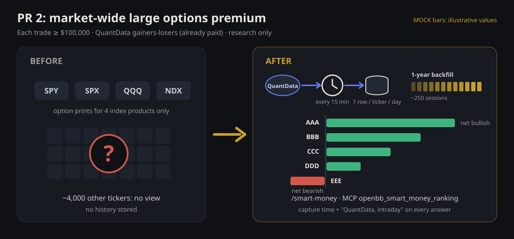

# PR 2 plan: market-wide options premium (QuantData gainers-losers)

Design: [design.md, section "PR 2"](design.md#pr-2-market-wide-options-premium-detail-in-plan-pr2md). This plan is the binding interface for PR 2. It was reviewed with the EGM consolidated review on 2026-11-20 (10 stage reports, 46 consolidated items); the review changed the backfill into an in-collector gap fill with a session ledger.

## Outcome

* The flow collector on QuantVPS stores QuantData's market-wide totals of large option trades. A large trade has a premium of at least $100,000.
* It stores one row for each session date and ticker. Each row holds bullish premium, bearish premium, total premium, trade count and volume.
* It captures today's session about every 15 minutes while options trade (09:30-16:15 New York time). When no live capture is due, it fills one missing or partial past session per run. This fill is the one-year backfill.
* The new page `/smart-money` and the MCP tool `openbb_smart_money_ranking` rank tickers by net premium or total premium over the newest 1, 5 or 20 stored sessions. Each answer shows the capture time, the status of each session, the source text and the delay text ("QuantData, intraday").

## Scope

* This PR is for research only. It does not place, change or arm an order. It does not change a risk setting.
* This PR adds no paid source. QuantData is already paid. The QuantData key, its cost and its request limits do not change.
* The `/smart-money` page holds the options premium list only. PR 3 and PR 5 add the insider, Congress and 13F lists; PR 6 adds the stock-page sections, the per-source overdue registry and the alerts. This PR sends no alert.
* No intraday history is kept (rejected alternative A below).

## Glossary (additions to design.md)

* **Net premium:** bullish large-trade premium minus bearish large-trade premium.
* **Bullish, bearish:** the trade sides that QuantData assigns. QuantData does not assign every trade to a side, so total premium can be greater than bullish premium plus bearish premium. A bullish trade can be a sold put; a large trade can be a hedge, one leg of a spread or a closing trade.
* **Session date:** the New York weekday date of a session. Holidays are not modelled; QuantData answers a holiday with almost no data.
* **Live capture:** a request for today's session while options trade. It gives running totals.
* **Gap fill:** a request for a past session when no live capture is due.
* **Session ledger:** the table `flow_market_premium_sessions`, one row per session date that the collector tried.
* **Complete session:** a session fetched on a New York day after the session date. Its totals are final. A **partial session** has only live captures.
* **Start:** one request start in the QuantData client's 60 s window. The client allows 30 starts per 60 s; the collector keeps 6 of them free for `/charts` (`withCallerReserve`).
* **Not due:** a collector result that sends no request and stores no `flow_samples` row; it appears in the run output only.
* **Filter profile:** the name of the request filter, stored per row: `premium-gte-100k.v1` = `premium >= 100000` and `isCancelled = false`.

## Design decisions

* **The collector sends one request per capture.** `gainers-losers` returns, in one response, every ticker with at least one large trade (727 tickers and about 99 KB on 2026-11-19, against the 2 MiB response cap of the client). QuantData applies the filter to each trade before it computes the totals.
* **A capture replaces the session's rows.** QuantData returns running session totals. The newest capture replaces the session's whole row set in one transaction. An answer with fewer than half the tickers already stored for the session is not stored (shrink guard).
* **The existing flow collector runs the source.** The collector already has the QuantData budget view (`withCallerReserve`), the per-source budget gate and the `flow_samples` row for each attempt.
* **The backfill runs in the collector.** The gap fill uses the same client, budget gate and ledger as the live capture. It also settles each live session after midnight and repairs sessions that a collector outage missed.
* **Multi-leg trades count.** QuantData's own tool counts each leg of a multi-leg trade as a trade. Excluding them (`isComplex = false`) removed 62% of the large-trade premium on 2026-11-19. The filter profile name records this choice; a change needs a new profile name.

## Alternatives considered

* **A. Intraday snapshot table** (every capture kept, or one pre-close capture): rejected. No user journey or PR 7 test reads intraday state (design.md, PR 7). A table can be added later; the live captures from that day on would then be kept. Accepted limitation: what the totals were at a given time of a past day is not stored.
* **B. A backfill procedure and a script** (`flow.marketPremiumBackfill`, `bun run …`): rejected. QuantVPS has no bun and no source checkout (`infra/flow/quantvps/install.sh`); a script needs a host, a key and a manual rerun; a one-time run does not repair sessions missed later.
* **C. `flow.collect --seed`:** rejected for the backfill. It has no date input. A seed run still captures the newest session (section 4).
* **D. A rig OpenBB job:** rejected. It would use a second QuantData client outside the app's budget view.
* **E. A `MARKET` flow symbol:** rejected for PR 2. It widens every reader that assumes the four flow symbols. The source records its attempts under SPY instead.

## Vendor checks

From QuantVPS with the existing QuantData key, without printing it. Values stay out of this public repository; the full table is in the job report (not in the repository).

* **2026-11-19 (7 requests, design review):** with `premium >= 100000`, 727 tickers; without the filter, 4,477 tickers. The filter applies per trade.
* **2026-11-20 (10 requests):**
  * Past `sessionDate` values (2025-11-14, 2025-11-21, 2026-05-19, 2026-05-20) each return their own answer (different tickers and totals). QuantData does not clamp old dates. History reaches back at least 371 days.
  * A market holiday (2025-11-27) answers HTTP 200 with one ticker.
  * `isCancelled = false` gives the same answer as no such filter.
  * `isComplex = false` removes 243 of 727 tickers and 62% of the premium.
  * The largest answer was about 101 KB. Every ticker key matched the ticker rule.

## Risks and limits

| Risk | Detection | Mitigation |
| --- | --- | --- |
| QuantData's history window passes before the backfill | `history.pending` in `smartMoney.ranking`; ledger counts | The gap fill starts at deploy, oldest weekday first (about 280 weekdays, about 5 hours). |
| The answer format changes | `unavailable` samples with "unexpected shape" | Strict parser; nothing is stored from an unreadable answer. |
| A short or bad answer overwrites good totals | `unavailable` sample "answer shrank" | Shrink guard (half of the stored tickers). A real downward correction of more than half is also held back: accepted. |
| The 2 MiB response cap | Client failure "response too large" | Measured about 101 KB; the parser refuses more than 10,000 tickers. |
| Budget contention with `/charts` and market-watch-bot | `budget:` not-due messages | One request per run at most; budget gate `FLOW_QUANTDATA_SOURCE_MAX.market_premium = 1`; the client's shared-quota wait. |
| A weekday holiday is stored as a complete one-ticker session | Ledger `tickers` below 50 | The ranking leaves complete sessions with fewer than 50 tickers out of its window (trading days had 608-750). On the holiday itself the live view shows the few holiday tickers. |
| Absolute dollars favour the largest names | Index ETFs at the top | The `total` sort and the ticker filter; normalisation is out of scope. |

---

## Detailed Implementation Plan

Phases, in commit order. Each phase passes its tests and typecheck alone:

1. Client and parser (sections 1-2).
2. Storage and collector together (sections 3-4): the source value is one type across `packages/db` and `packages/api` (`flow-features.test.ts` compares `FLOW_SOURCE_VALUES` with `FLOW_SOURCES`), and the new repository methods need the API fakes.
3. Ranking contract, server, MCP and access lists (section 5).
4. Page (section 6).
5. Docs (section 7).

File markers: **C** = create, **M** = modify.

### 1. QuantData client (M `packages/api/src/server/quantdata-client.ts`)

* Add `gainersLosers: "/v1/options/tool/gainers-losers"` to `QUANTDATA_ENDPOINTS`.
* Add the optional field `httpStatus?: number` to the failure variant of `QuantDataResult`. It is set when an HTTP answer arrived that was not 200 (including 429). It is absent when no answer arrived (cooldown, quota wait, timeout, network error). Existing callers and fakes need no change.

### 2. Pure request and parser (C `packages/api/src/flow-market-premium.ts`; M `packages/api/src/contracts/openbb.ts`)

* Constants: `MARKET_PREMIUM_FILTER_PROFILE = "premium-gte-100k.v1"`, `MARKET_PREMIUM_MIN_TRADE_PREMIUM = 100_000`, `MARKET_PREMIUM_MAX_TICKERS = 10_000`.
* `marketPremiumRequest(sessionDate)` returns `{ sessionDate, filterExpression: { conjunction: "AND", filters: [{ field: "premium", operation: ">=", value: 100000 }, { field: "isCancelled", operation: "=", value: false }] } }`.
* `contracts/openbb.ts` exports its private ticker rule as `TICKER_SYMBOL_PATTERN` (`^[A-Z0-9.^=-]{1,16}$`, flag `u`); its `symbol` schema uses it. The new code and the page reuse it.
* The module header says that the `market_premium` source (`server/flow-market-premium-collect.ts`) sends the request and stores the rows.
* `parseMarketPremium(data)`: the answer must be an object with at most 10,000 keys. A key that does not match `TICKER_SYMBOL_PATTERN` is skipped and counted. Each kept value needs `bullishPremium`, `bearishPremium` and `premium` (numbers >= 0) and `tradeCount` and `volume` (whole numbers >= 0); other fields are ignored. Returns `{ ok: true, rows, skipped }` in ticker order, or `{ ok: false, message }`. The message names the field path with `*` for the ticker key, never a payload value.

### 3. Storage (`packages/db`)

Files: C `packages/db/migrations/0087_flow_market_premium.sql`, C `packages/db/migrations/meta/0087_snapshot.json` and M `packages/db/migrations/meta/_journal.json` (generated by `drizzle-kit generate --name flow_market_premium`; renumbered from 0086 at merge, because PR 5 took 0086), C `packages/db/rollback/0087_flow_market_premium.down.sql`, M `packages/db/src/schema/flow.ts`, M `packages/db/src/server/{flow.ts,index.ts}`, M tests `packages/db/src/server/{flow.test.ts,flow-migration.test.ts,openbb.test.ts}` (`openbb.test.ts` looked for 0085 as the last journal entry; it now finds the entry by tag).

`flow_market_premium`, primary key `(session_date, ticker)`:

| column | type | check |
| --- | --- | --- |
| session_date | date not null | |
| ticker | text not null | `~ '^[A-Z0-9.^=-]{1,16}$'` |
| bullish_premium, bearish_premium, premium | double precision not null | >= 0 |
| trade_count | integer not null | >= 0 |
| volume | bigint not null | >= 0 |
| filter_profile | text not null | length <= 40 |
| captured_at | timestamptz not null | |

`flow_market_premium_sessions`, primary key `session_date`:

| column | type | check |
| --- | --- | --- |
| status | text not null | `complete`, `partial`, `no_data` or `unavailable` |
| captured_at | timestamptz | not null exactly when the status is `complete` or `partial` |
| tickers | integer not null | >= 0 |
| attempts | integer not null | >= 1 |
| last_attempt_at | timestamptz not null | |
| last_message | text not null | length <= 300 |

* The migration also widens `flow_samples_check` (and `FLOW_SOURCE_VALUES`) with `market_premium`. It grants `vertex_research` SELECT, INSERT, UPDATE and DELETE on `flow_market_premium` (DELETE removes rows of older captures) and SELECT, INSERT and UPDATE on the ledger, with the guarded block of `0077_flow_net_drift.sql`.
* No index other than the primary keys (PR 7 adds one if its reads need it). Neither table is pruned; `FLOW_RETENTION_DAYS` and `FlowPruneTable` do not change.
* Rollback file `packages/db/rollback/0087_flow_market_premium.down.sql` (guarded, not the rollback path; see section 9): restores the 0077 `flow_samples_check` and drops both tables. Before it runs, a person must delete the `market_premium` rows of `flow_samples`.
* Repository (`packages/db/src/server/flow.ts`, `FlowRepository`). Exported types: `FlowMarketPremiumRecord`, `FlowMarketPremiumSessionRecord` (the `$inferSelect` types of the two tables), `FlowMarketPremiumSort` (`"net_bullish" | "net_bearish" | "total"`), `FlowMarketPremiumRankingQuery`, `FlowMarketPremiumRankingRow`, `FlowMarketPremiumRanking`.
  * Signatures: `storeMarketPremium(input: { rows: readonly FlowMarketPremiumRecord[]; session: FlowMarketPremiumSessionRecord }): Promise<number>`; `marketPremiumLedger(range: { from: string; to: string }): Promise<FlowMarketPremiumSessionRecord[]>`; `marketPremiumRanking(query: { sessionDates: readonly string[]; filterProfile: string; ticker: string | null; sort: FlowMarketPremiumSort; limit: number }): Promise<{ rows: FlowMarketPremiumRankingRow[]; totals: { tickers; bullishPremium; bearishPremium; premium } }>`; a ranking row is `{ rank, ticker, bullishPremium, bearishPremium, premium, tradeCount, volume, sessionsPresent }`.
  * `storeMarketPremium({ rows, session })`: one transaction. Upserts the rows in batches of `FLOW_UPSERT_BATCH` (250), replacing every value column and `captured_at`. Deletes the session's rows whose `captured_at` is older than the new rows' (all rows of one call share one session date and capture time; nothing is deleted when `rows` is empty). Upserts the ledger row. Returns the rows written.
  * `marketPremiumLedger({ from, to })`: ledger rows with `from <= session_date <= to`, oldest first.
  * `marketPremiumRanking({ sessionDates, filterProfile, ticker, sort, limit })`: only rows of `filterProfile` count (PR 2 has one profile; a new profile also needs a rule for the stored sessions, out of scope). Per ticker over the given dates, the sums of bullish, bearish and total premium, trade count and volume, and the number of sessions present. Order: `net_bullish` = net premium descending, `net_bearish` = net premium ascending, `total` = total premium descending; then ticker. `rank` is the position in that order over the whole market. Without a ticker, at most `limit` rows. With a ticker, the query orders every ticker of the dates (a few thousand at most) and returns that ticker's row with its market rank, or no row. Also returns the window totals over every ticker (ticker count, bullish, bearish, total). Empty `sessionDates` returns an empty ranking without a query.
* `latestSamples` reads `market_premium` too (2 more small queries per symbol and run).

### 4. Collector source `market_premium`

Files: C `packages/api/src/server/flow-market-premium-collect.ts`, M `packages/api/src/server/{flow-collect.ts,flow-snapshot.ts}`, M `packages/api/src/contracts/flow.ts`, M `packages/api/src/flow-features.ts`, M tests `packages/api/src/server/{flow-collect.test.ts,flow.test.ts}` (the fake `FlowRepository` objects gain the three methods; `fakeQuantData` sends `gainersLosers` to its own mock).

* `FLOW_SOURCES` adds `market_premium`. `FLOW_SNAPSHOT_SOURCES` does not change: `/flow` freshness does not list the source.
* Only the SPY entry of `FLOW_INSTRUMENTS` lists `market_premium`, because `flow_samples.symbol` is one of the four flow symbols. `flow.collect` with `symbols` that leave out SPY skips the source.
* `flowSessionOpen("market_premium", …)` is always true (the gap fill also runs at night and on weekends). `FLOW_DUE_SECONDS.market_premium = 0`: the ledger sets the cadence. `FLOW_STALE_SECONDS.market_premium = 1800` (used by the ranking coverage). `FLOW_QUANTDATA_SOURCE_MAX.market_premium = 1`. `SOURCE_ORDER` puts `market_premium` last. `flowQuantDataRunWorstCase` adds 1: the worst case is 24 requests, equal to 30 starts minus the reserve of 6.
* `collectMarketPremium(deps)` (deps: client, repository, now, seed, dry run, session date) makes at most one request:
  1. No QuantData client: not due ("QuantData not configured").
  2. It reads the ledger from today minus 400 days to today (New York dates).
  3. **Seed run:** captures the newest session (`flowSessionDate`), at any time.
  4. **Live capture:** while `flowSessionOpen("options", "SPY", now)` (09:30-16:15 New York), when today's ledger row is missing or its last attempt is at least `MARKET_PREMIUM_LIVE_SECONDS` (840 s) old.
  5. **Gap fill:** otherwise the oldest weekday from today minus `MARKET_PREMIUM_HISTORY_DAYS` (400) to yesterday whose ledger row is missing, or is `partial` or `unavailable` with a last attempt at least `MARKET_PREMIUM_RETRY_SECONDS` (6 hours) old. There is no attempt limit: a stuck date costs at most 4 requests a day. No such weekday: not due ("the ledger holds every weekday of the last 400 days").
* One request: `gainersLosers` with `marketPremiumRequest(date)`, cache 60 s.
  * Reason `reserved`: not due ("budget: QuantData starts kept free for other callers"); no ledger write.
  * Reason `rate_limited` without `httpStatus` (the client's cooldown or shared-quota wait refused before any request left): not due ("QuantData paused: …"); no ledger write, no sample. A real HTTP 429 is an attempt (sample `unavailable`).
  * HTTP 422: handled as an answer without rows (QuantData documents 422 as "data-unavailable": a valid request with no data).
  * Other failures and parse failures: sample `unavailable` with the message.
  * Shrink guard: when the ledger holds N tickers for the session and the answer has fewer than `Math.ceil(N × MARKET_PREMIUM_MIN_KEEP_SHARE)` (0.5) rows, the sample is `unavailable` ("answer shrank from N to M tickers; stored totals kept") and no rows are written. This also covers an empty answer or HTTP 422 for a session that has rows.
  * Otherwise the rows are stored with `session_date` = the requested date, `filter_profile` = the profile and `captured_at` = now. Sample `ok` with rows, `empty` without.
* Ledger row after each attempt: `attempts` + 1, `last_attempt_at` = now, `last_message` (at most 300 characters).
  * Rows stored: status `complete` when now is on a New York day after the session date, else `partial`; `captured_at` = now; `tickers` = the row count.
  * No rows, failure or shrink, and the session already has rows: status, `captured_at` and `tickers` stay.
  * No rows and no stored rows: `no_data` when the answer (not a failure) came after the session date, else `unavailable`.
* Dry run: request and parse; no storage write; items = the rows that would be stored (0 after a shrink).
* Every attempt that sends a request writes one `flow_samples` row under SPY (live and gap fill alike). The ranking coverage reads the ledger, so a gap-fill sample never hides a failing live capture.

### 5. Ranking procedure `smartMoney.ranking`

Files: C `packages/api/src/contracts/smart-money.ts`, C `packages/api/src/server/smart-money.ts`, M `packages/api/src/contract.ts`, M `packages/api/src/index.ts`, M `packages/api/src/server/router.ts`, M `packages/api/src/server/handler.ts` (`AGENT_API_KEY_PROCEDURE_PATHS` and the error message, which now also names `congressTrades.feed`), M `packages/api/src/server/operator-access.ts` (`AGENT_API_KEY_READ_PROCEDURES`), M `packages/api/src/server/mcp.ts`, M `packages/api/openapi.json` (`bun run openapi:generate`), M tests `packages/api/src/{agent-api-keys.test.ts,agent-viewer.test.ts}` and `packages/api/src/server/mcp.test.ts`, C test `packages/api/src/smart-money-ranking.test.ts`.

The procedure reads "now" from a module clock with the test hook `setSmartMoneyClockForTesting`, as `setCongressTradesClockForTesting` does; tests reset it in `afterEach`.

* GET `/smart-money/ranking`. Access: an operator session, or an agent API key with read scope.
| Input field | Rule |
| --- | --- |
| `sessions` | 1, 5 or 20; default 1; coerced from text |
| `sort` | `net_bullish` (default), `net_bearish`, `total` |
| `ticker?` | trimmed, upper-cased, `TICKER_SYMBOL_PATTERN` |
| `limit` | whole number 1-100; default 50; coerced |

| Output field | Type |
| --- | --- |
| `rows[]` (at most 100) | `{ rank, ticker, bullishPremium, bearishPremium, netPremium, premium, tradeCount, volume, sessionsPresent }`; money >= 0 except `netPremium`; counts whole >= 0 |
| `totals` | `{ tickers, bullishPremium, bearishPremium, netPremium, premium }` |
| `sessions[]` (at most 20) | `{ sessionDate, status: "complete" \| "partial", capturedAt: Date }` |
| `capturedAt` | `Date \| null` |
| `coverage` | `{ sessionDate, status: ledger status \| null, capturedAt, lastAttemptAt, lastMessage (<= 300), overdueSince, state }`, each value nullable except `sessionDate` and `state` |
| `history` | `{ from, weekdays, stored, noData, pending }` |
| `source`, `delay` | text, at most 300 characters |
| `receivedAt` | `Date` |

| Error | Status | Message |
| --- | --- | --- |
| `UNAUTHORIZED` | 401 | Authentication required |
| `FORBIDDEN` | 403 | Forbidden |
| `UNAVAILABLE` | 503 | Smart money storage not configured |
| `STORAGE_ERROR` | 503 | Smart money storage unavailable |
| `BAD_REQUEST` | 400 | oRPC input validation |

* **Reads:** the ledger from today minus 400 days to today, then `marketPremiumRanking` over the newest `sessions` ledger dates that have rows (`complete` or `partial`). A `complete` session with fewer than `MARKET_PREMIUM_MIN_SESSION_TICKERS` (50) tickers is a market holiday and is left out of the window.
* **Output:**
  * `rows[]`: rank, ticker, bullish, bearish, net and total premium, trade count, volume, sessions present.
  * `totals`: tickers, bullish, bearish, net and total premium of the window.
  * `sessions[]`: the summed sessions, newest first, each with `sessionDate`, `status` (`complete` or `partial`) and `capturedAt`. A 5- or 20-session window can include today's partial session.
  * `capturedAt`: the capture time of the newest summed session, or null.
  * `coverage`: today's ledger row (`sessionDate`, `status`, `capturedAt`, `lastAttemptAt`, `lastMessage`), `state` and `overdueSince`. While options trade (`flowSessionOpen("options", "SPY", now)`), the stale time is today's capture time plus `FLOW_STALE_SECONDS.market_premium` (1800 s), or 09:30 plus 1800 s (10:00) without a capture. `stale` from that time on (`overdueSince` = that time); before it `fresh` with a capture and `never` without. Otherwise `closed` (`overdueSince` null). The server computes `overdueSince`, so the page holds no copy of the 1800 s. PR 6 replaces this with its per-source registry.
  * `history`: weekdays from today minus 400 days to yesterday, and how many are stored (`complete` or `partial`), `no_data` or pending (the rest).
  * `source`: "QuantData gainers-losers: per-ticker totals of option trades with premium >= $100,000 each; bullish and bearish are QuantData's trade-side classes".
  * `delay`: "QuantData, intraday: captured about every 15 minutes while options trade; final totals from a fetch after the session day".
  * `receivedAt`: server time.
* **Errors:** `UNAUTHORIZED`, `FORBIDDEN`, `UNAVAILABLE` (no flow repository), `STORAGE_ERROR` (a read failed), `BAD_REQUEST` (input).
* **MCP tool** `openbb_smart_money_ranking` (title "Smart money: large options trades by ticker", read-only, procedure `smartMoney/ranking`, same input). The presenter passes the answer through, keeps at most 50 rows and adds `rowsOmitted`; an answer without a `rows` array becomes `{ context: "The smart money ranking is not available: the response was not a ranking.", rows: [] }`. The description says the data is research input only, not a trade signal, and that large trades include hedges, spreads and closing trades. The `openbb_` prefix keeps the tool MCP-only (`assistant-runtime.ts`).

### 6. Web page `/smart-money`

Files (following the congress trades page): `apps/web/src/app/(portal)/smart-money/{page.tsx,loading.tsx,error.tsx,route-files.test.tsx}`, `apps/web/src/components/portal/smart-money-{params.ts,client.ts,workspace.tsx}` and their tests; sidebar disclosure "Smart money lists" (lucide `Coins`, `PORTAL_SMART_MONEY` in `apps/web/src/lib/navigation.ts`, rendered by the generalised disclosure of `apps/web/src/components/portal-shell.tsx`) that holds "Congress trades" and "Smart money" (the page label equals its h1), so the sidebar still fits 1440 × 900, and `/smart-money` in the route lists of `apps/web/src/lib/navigation.ts`, `apps/web/src/lib/server-session.ts` and `apps/web/src/app/robots.ts`; the lab entry in `apps/web/src/lab/entries/lenses.tsx` with fictional data in `apps/web/src/lab/fixtures/lenses.ts`; the route and navigation lists in `apps/web/src/app-foundation.test.ts`, `apps/web/src/app/(portal)/layout.test.ts` and the e2e specs `tests/e2e/auth.spec.ts`, `tests/e2e/account-admin-theme.spec.ts` (also the allowed-503 list: `/api/orpc/smartMoney/ranking`) and `tests/e2e/day-trader-workflows.spec.ts` where they list `/congress-trades`.

Files: C `apps/web/src/app/(portal)/smart-money/{page.tsx,loading.tsx,error.tsx,route-files.test.tsx}`, C `apps/web/src/components/portal/smart-money-{params,client}.ts` and `smart-money-workspace.tsx` with their tests, M `apps/web/src/lib/{navigation.ts,server-session.ts}`, M `apps/web/src/app/robots.ts`, M `apps/web/src/lab/entries/{lenses.tsx,lenses.test.tsx}`, M `apps/web/src/lab/fixtures/lenses.ts`, M `apps/web/src/app-foundation.test.ts`, M `apps/web/src/app/(portal)/layout.test.ts`, M `tests/e2e/{auth.spec.ts,account-admin-theme.spec.ts,day-trader-workflows.spec.ts}`.

* URL params: `sessions` (1, 5, 20), `sort`, `ticker`; unknown values fall back to the defaults; the search string leaves out defaults. The page sends no `limit`, so it shows at most 50 rows.
* Header "Smart money" with a ticker-count badge, the line "Market-wide lists of where large traders put their money. Research only; these lists are not trade signals." and a Refresh button.
* Section "Large options trades (QuantData)":
  * Filter bar: a Sessions select (1, 5, 20 sessions), a Sort select (Net bullish, Net bearish, Total premium), a Ticker text input and an Apply button.
  * Coverage line (a status badge that wraps on a phone):
    * `fresh`: "QuantData, intraday · captured HH:MM ET · session partial" (the session status word).
    * `stale`: "Today's capture is overdue since HH:MM ET" (from `overdueSince`), then "last capture HH:MM ET" and "last attempt HH:MM ET: <message>" when present.
    * `never`: "No capture yet today", then the last attempt when present.
    * `closed`: "QuantData · market closed · newest session <date> · captured <date> HH:MM ET · <status>", or "QuantData · market closed · nothing stored yet".
    * Status words: "session complete", "session partial", "no data for the session", "QuantData could not supply the session".
  * Sessions line: "Session <date>, <status>" for 1 session; "N of M sessions: <oldest> to <newest>" for more, with ", newest partial" when the newest session is partial; "No session stored yet".
  * History line: "History: N of M weekdays stored, K without data, P pending".
  * KPI cards: tickers, bullish premium, bearish premium, net premium (window totals).
  * "Top N of T tickers, sorted by <sort>", then a table: rank, ticker (link to `/stock/<ticker>`), bullish, bearish, net, total, trades, volume, and "Sessions" only when sessions > 1. Compact dollars; net with a sign.
  * Empty states: "No large-trade premium stored yet." without a ticker; "No large-trade premium stored for <TICKER> in the newest N sessions." with one.
  * Error: an alert "Ranking not loaded: <message>". The loaded ranking is a region named "Smart money ranking".
  * Small print: source, delay, read time, and a note that premium counts trades of at least $100,000, that net is bullish minus bearish, and that a ranking is not a trade signal.
* Words instead of bare marks in cells (`status-language.test.ts`). Light, dark and system themes; targets of at least 44 × 44 px.

### 7. Docs

`docs/vertex-rebuild/flow-pipeline.md` (source table row, section "Market premium", retention, deploy steps "Market premium (migration 0087)", worst case 24), `docs/vertex-rebuild/designs/smart-money/design.md` (PR plans line, PR 2 section, glossary evidence, risk row, plan links), `CHANGELOG.md`.

### 8. Verification

* Unit (Vitest, 100% on each new or changed file):
  * `packages/api/src/flow-market-premium.test.ts`: request body; ticker order; ignored fields; skipped keys; negative, fractional, text and infinite values; non-object values; root shapes; the 10,000-key cap.
  * `packages/api/src/server/flow-market-premium-collect.test.ts`: completeness by date; gap-date choice (missing, partial, unavailable, retry time, no attempt limit, final statuses); ledger transitions; live capture and its interval; gap fill after 16:15 and on a weekend; seed; reserved; HTTP 422; other failures; unreadable answer; shrink guard; skipped keys; dry run.
  * `packages/api/src/server/flow-collect.test.ts`: the new run entry, the Saturday gap fill, the worst case 24.
  * `packages/api/src/smart-money-ranking.test.ts`: access, errors, reads, market rank with a ticker, sessions and statuses, coverage states (never, fresh, stale, closed before the open, after 16:15, Saturday, no data), history counts, defaults, bad input, agent lists and the MCP tool.
  * `packages/api/src/server/mcp.test.ts`: tool list and the 50-row presenter.
  * `packages/db/src/server/flow.test.ts` and `flow-migration.test.ts`: the three repository methods; the migration text, columns, checks, grants, journal entry and rollback.
  * Web: params (defaults, fallbacks, ticker normalisation, search string); client (call shape, empty ticker left out); workspace (each coverage state, sessions and history lines, KPI cards, the table with and without the sessions column, both empty states, the error alert, `/stock/<ticker>` links, compact dollars); route files; the lab entry checks the fake ranking against the output schema for each window and sort.
  * E2E (`bun run test:e2e` in CI): `day-trader-workflows.spec.ts` opens `/smart-money` at each viewport and expects the "Smart money ranking" region or the "Ranking not loaded" alert, with no sideways scroll; `account-admin-theme.spec.ts` and `auth.spec.ts` list the route (503 of `/api/orpc/smartMoney/ranking` allowed without a database).
* Integration (`bun scripts/with-test-env.ts pnpm exec vitest run --config vitest.config.ts --project integration`): `tests/integration/database/flow-market-premium.test.ts` (row-set replace, ledger rows, ranking sums, sorts, market rank with a ticker, checks, a `market_premium` sample, the rollback file) and `database.test.ts` (key matrix).
* `bun run check`, `bun run openapi:check`, `bun run verify:coverage`.
* Browser: the lab entry and the page at 375, 768, 1024 and 1440 px in light and dark.
* Live (after deploy), each with evidence in the receipt:
  * `select status, count(*) from flow_market_premium_sessions group by 1` shows the gap fill growing; within about 5 hours about 280 weekdays are stored or `no_data`.
  * `select session_date, count(*) from flow_market_premium group by 1 order by 1 desc limit 5`.
  * A dark screenshot of `/smart-money` (headless Chrome on the rig, agent viewer account), desktop and 375 px.
  * An `openbb_smart_money_ranking` answer with the source and delay texts.

### 9. Deploy and rollback

Deploy after 16:00 ET or before 08:30 ET (owner rule 2026-11-16). No rig change: this PR adds no OpenBB job. The flow tick script does not change (its schema reads `source` as text), so `infra/flow/quantvps/install.sh` needs no rerun.

1. `fm claim vertex-smart-money-pr2-market-premium service:vertex-postgres` (the claim name other jobs use for the QuantVPS database).
2. On QuantVPS: `systemctl stop vertex-flow.timer`.
3. Apply `0087_flow_market_premium.sql` alone with `psql -v ON_ERROR_STOP=1 --single-transaction` in the `vertex-postgres` container (never `db:migrate`: the QuantVPS Drizzle ledger is incomplete).
4. Check: `\d flow_market_premium` and `\d flow_market_premium_sessions`; `select pg_get_constraintdef(oid) from pg_constraint where conname = 'flow_samples_check'` lists `market_premium`; `\dp flow_market_premium*` shows the grants of section 3.
5. Deploy the app with `infra/quantvps/restart-when-idle.sh`.
6. `systemctl start vertex-flow.timer`; `fm release vertex-smart-money-pr2-market-premium service:vertex-postgres`.
7. Live checks of section 8.

Rollback: stop the timer, deploy the previous app (it runs on the migrated database and leaves both tables alone), start the timer. The guarded down file is a separate, deliberate step: it drops the stored sessions, which the gap fill can fetch again only while QuantData keeps them.
