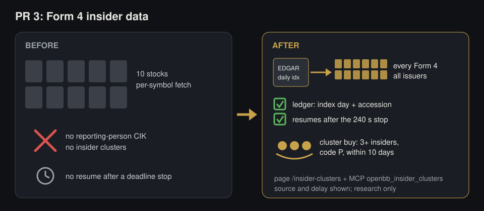

# PR 3 plan: market-wide Form 4 and insider cluster buys



Design: [design.md](design.md) (section "PR 3", Glossary "insider cluster buy"). This plan is the binding interface for PR 3 and matches the code as built. Shared terms (batch document, tick, run status, `sec_guard`, `Upstream.helper`) are defined in [openbb.md](../../openbb.md) and [plan-pr1.md](plan-pr1.md).

## Outcome

* Rig job `sec-form4` stores the Form 4 and 4/A filings listed in the EDGAR daily form index (all issuers): issuer CIK, reporting-person CIKs, transaction rows and EDGAR acceptance time.
* The ledger (`sec_form4_filings`, one row per accession, plus `sec_form4_index_days`, one row per index day) lets a run that stops at the 240 s deadline resume where it stopped.
* `openbb.sec` (stock page insider table, MCP tool `openbb_sec`) reads the new tables, so a symbol outside the old 10 stocks has insider rows when filers report that symbol.
* New procedure `openbb.insiderClusters`, MCP tool `openbb_insider_clusters` and page `/insider-clusters` list insider cluster buys.
* The `sec-insider` step leaves the rig schedule. Job `sec-insider` and table `openbb_sec_insider_trades` stay (unscheduled, no writer) until the new data covers 30 days; then a follow-up PR removes them. PR 6 folds `/insider-clusters` into `/smart-money`.

## Decisions

* Full submission `.txt`: one request per filing gives the SEC header (`<ACCEPTANCE-DATETIME>`) and the XML together; the filing index page would need a second request.
* Own XML walk: the XML is cleaned with OpenBB `openbb_sec.utils.form4.clean_xml` and read with `xmltodict`; codes are checked against OpenBB `transaction_code_map`. OpenBB `parse_form_4_data` is not used because its output does not keep the issuer CIK, the 10b5-1 flag or the table (non-derivative or derivative) of each row.
* Codes `K` and `V` are added to the OpenBB map (`EXTRA_CODES`): they are valid in SEC General Instruction 8 and otherwise make valid filings `layout_unknown`.
* Persons: owner CIKs that file together are one person (union-find over the filings in the window), so joint filers and linked entities count once. This is a pure TS function (`packages/api/src/insider-clusters.ts`) and not SQL because connected components are hard to state in SQL and the input is small (purchase rows of at most 40 days).
* Window 40 days (`DEFAULT_DAYS`, `SEC_FORM4_DEFAULT_DAYS`): it covers the 30-day stock page and the 30-day cluster lookback plus the 10-day cluster span.
* Filing lifecycle: `parsed`, or `unparsed` with reason `not_found` (404), `too_large`, `no_xml` or `layout_unknown`. Every unparsed row is terminal, except that a `layout_unknown` row is read again when the parser version changes.
* Stock page match: by `issuer_symbol` (the symbol in the filing XML). CIK resolution with `secTickers` is a follow-up.

## 1. Rig job (`services/openbb`)

Job `sec-form4` (`vertex_openbb/jobs/form4.py`). It prints `sec_form4_transactions`, `sec_form4_owners`, `sec_form4_filings`, `sec_form4_index_days` in this order (the ingest order of section 2).

* **Window:** weekdays from `--since` (default New York today minus `DEFAULT_DAYS` = 40) to `--until` (default today), oldest first. `sec-form4` is in `UNTIL_JOBS`. Saturdays and Sundays get no request. Days are processed in order; an incomplete day does not block later days.
* **State input (`--state-stdin`, only `sec-form4`):** one JSON object `{ completeDays, doneAccessions, layoutUnknown: [{ accessionNumber, parserVersion }] }`. A complete day gets no request. A done accession is not fetched again. A `layoutUnknown` accession counts as done only when its `parserVersion` equals the current `PARSER_VERSION` (`form4.v1`). JSON that is not this shape is an `ArgumentError` (exit 2). Without the flag (manual runs, `--dry-run`) the state is empty and every day in the window is read again (idempotent upsert).
* **Daily index:** GET `https://www.sec.gov/Archives/edgar/daily-index/<YYYY>/QTR<q>/form.<YYYYMMDD>.idx` (cap 16 MiB, `latin-1`). HTTP 404 = not published (holiday, or today before about 22:00 ET): no row, no warning. Lines with form type `4` or `4/A` are kept and deduplicated by accession; the first line wins (all lines of one accession have the same filer folder). `entriesListed` = distinct accessions. Lines that do not parse are skipped; an index with no dashed header or no parseable line gives warning `layout_unknown` and no row.
* **Filing:** GET `https://www.sec.gov/Archives/edgar/data/<cik>/<accession>.txt` (cap 4 MiB, `utf-8` with replacement). Read `<ACCEPTANCE-DATETIME>` (YYYYMMDDHHMMSS, America/New_York) and the first `<XML>` block of the `<DOCUMENT>` whose `<TYPE>` is `4` or `4/A`. CIKs are stored as digit strings without leading zeros; the symbol is upper-cased and kept only when it matches `[A-Z0-9.^=-]{1,16}`. Labels are cut to 200 characters.
* **Concurrency and limits:** 6 download workers per day over `Upstream.helper`. The process-wide `sec_guard` limiter (8 requests/s) and the SEC lock are the only rate control. HTTP 403 stops the run at once (SEC fair access): the run is recorded with the failure.
* **Upstream keys:** `sec-form4:index:<YYYY-MM-DD>` (entries `[{accession, cik, formType}]`, null for 404, or `{layoutUnknown: true}`) and `sec-form4:filing:<accession>` (`{accepted, xml}`, `{tooLarge: true}` or `{notFound: true}`). Tests replay synthetic recordings.
* **Outcomes:** an index download error (not 404) fails that day, no row. A filing download error (not 404) adds a warning and writes no ledger row, so the next run tries again; a stored parsed filing is never overwritten by an error. A filing that downloads but cannot be used is `unparsed`: `not_found` (404), `too_large`, `no_xml`, or `layout_unknown` (no issuer CIK, no reporting owner, owner without CIK or name, unknown code, or a row that fails the batch row rules). Unparsed filings have no transaction or owner rows. A day that stays incomplete is reported by the overdue rule (section 4); there are no retry counters.
* **Index-day row:** `entriesDone` = listed accessions that are done; `complete` = `entriesDone == entriesListed`. Each finished filing appends its rows to `ctx.tables` and updates the day row in place, so a deadline stop prints a consistent partial document (the tick posts it).
* **Run status:** `sec-form4` is in `IDLE_OK_JOBS`: a run with nothing to fetch (all days complete) is `ok`, not `partial`.
* **Run math:** about 1 request per filing at 8 requests/s in the 240 s deadline is about 1,900 filings per run. A business day has about 1,500 Form 4 filings. The 40-day first fill (about 45,000 filings) takes about 24 runs; no manual chunking is needed, because the state skips finished work.
* **Schedule (`infra/openbb/rig/vertex-openbb.steps`):** the `sec-insider` line is removed; `sec-form4` takes stage 4 (SEC stages never overlap). Columns: name, step timeout (s), every_s, stage, command.

  ```text
  sec-form4             365  600    4  ~/.local/bin/vertex-openbb-run sec-form4
  ```

  The 365 s timeout (240 + 90 + 20 SEC lock + 15 form4State read) holds the `form4State` call, the 240 s fetch and the ingest posts. Each run requests every unpublished weekday index in the window again (holidays included); that is a few requests per run.

## 2. Batch tables (contract `packages/api/src/contracts/openbb.ts`, Python `rows.py`, Drizzle `schema/openbb.ts`)

`sec_form4_filings` (DB `openbb_sec_form4_filings`, key `accession_number`):

| field | batch rule | DB column |
| --- | --- | --- |
| accessionNumber | existing `accession` rule | text |
| indexDay | date | date |
| formType | `OPENBB_FORM4_FORM_TYPES`: `4`, `4/A` | text CHECK |
| status | `OPENBB_FORM4_STATUSES`: `parsed`, `unparsed` | text CHECK |
| reason | `OPENBB_FORM4_UNPARSED_REASONS`: `no_xml`, `too_large`, `not_found`, `layout_unknown`; null exactly when parsed | text CHECK |
| acceptedAt | ISO timestamp with offset, nullable | timestamptz |
| issuerCik | `cik` rule, nullable (null only when unparsed) | text |
| issuerName | label nullable max 200 | text |
| issuerSymbol | `SYMBOL` rule, nullable | text |
| periodOfReport | date nullable | date |
| plan10b51 | boolean nullable (`aff10b5One`) | boolean |
| rowCount | count; 0 when unparsed | integer |
| parserVersion | label max 20 | text |
| url | https, the filing index page `.../<cik>/<accession-no-dashes>/<accession>-index.htm` | text |
| (DB only) first_seen_at | DB default `now()`, not updated on conflict | timestamptz |

`sec_form4_transactions` (key `accession_number, row_number`): `rowNumber` (count >= 1, numbered over the stored rows: non-derivative transactions first, then derivative), `derivative`, `securityTitle` (label max 200), `transactionDate` (date nullable), `transactionCode` (`OPENBB_FORM4_CODES`, nullable), `acquiredDisposed` (`A`|`D` nullable), `shares`, `price`, `sharesAfter` (finite nullable), `directIndirect` (`D`|`I` nullable), DB-only `first_seen_at`. Holding elements (`nonDerivativeHolding`, `derivativeHolding`) are not read.

`sec_form4_owners` (key `accession_number, owner_cik`): `ownerCik` (`cik`), `ownerName` (label max 200), `isDirector`, `isOfficer`, `isTenPercentOwner`, `isOther` (booleans), `officerTitle` (label nullable max 200), DB-only `first_seen_at`.

`sec_form4_index_days` (key `index_day`): `indexDay`, `entriesListed`, `entriesDone` (<= listed), `complete` (true exactly when done = listed), DB-only `updated_at`.

Indexes: filings `(accepted_at desc)`, `(issuer_cik, accepted_at desc)`, `(issuer_symbol, accepted_at desc)`, `(index_day)`; transactions `(accession_number)` partial where code = `P` (purchase read).

Ingest order: `OPENBB_TABLE_REQUIRES` maps a table to a list. `sec_form4_filings` requires `sec_form4_transactions` and `sec_form4_owners`; `sec_form4_index_days` requires `sec_form4_filings`; `congress_filings` keeps `congress_trades`. The tick skips a table when any chunk of a required table failed. Reason: a ledger row must never claim rows that are missing, and an index day must never count filings whose ledger rows are missing.

Read rule (all readers): a transaction row counts only when its filing is `parsed` and `row_number <= row_count`. Owner rows count only when their filing is `parsed` (same rule, without a count). A re-parse that writes fewer rows thus never shows stale transaction rows.

## 3. Tick state (`scripts/openbb/tick.ts`, `scripts/openbb/spawn.ts`)

* For `sec-form4`, outside `--dry-run`, `stateFor` calls `openbb.form4State` with `form4Window`: `--since`/`--until` from the passthrough arguments, else today minus `SEC_FORM4_DEFAULT_DAYS` (40) to today (New York). It spawns the fetcher with `--state-stdin` and the JSON on stdin.
* If `form4State` fails, the run is recorded `failed` ("form4State failed: ...") and nothing is fetched.
* `OpenbbTickIo.spawn` options get optional `stdin: string`; `spawn.ts` writes it and closes stdin (no stdin stays the default).

## 4. API

* **`openbb.form4State`** (POST `/openbb/form4-state`, write key only, like `ingest`): input `{ from, to }` (dates, from <= to, at most `SEC_FORM4_STATE_MAX_DAYS` = 400 days). Output `{ completeDays, doneAccessions, layoutUnknown }`: complete days in the window; ledger accessions of the other days, `layout_unknown` rows listed apart with their parser version. More than `SEC_FORM4_STATE_MAX_ACCESSIONS` (200,000) rows, or any database error, is `STORAGE_ERROR`.
* **`openbb.sec`:** `insiderTrades` keeps `OpenbbSecInsiderRowSchema` and its limit of 50 rows. The repository reads parsed filings with `issuer_symbol = symbol`, newest acceptance first. Field map: `filingDate` = acceptance date (New York), `ownerName` = owner names joined with "; " (CIK order), `ownerTitle` = first officer title, other fields from the row; `url` = filing index page. Derivative rows are included. Change: `filingDate` is now the acceptance date.
* **`openbb.insiderClusters`** (GET `/openbb/insider-clusters`, operator session or agent key): input `days` 7|14|30 (default 7, coerced).
  * Read: purchase rows (code `P`, non-derivative, acquired `A`) of parsed form `4` filings (4/A excluded) accepted from now minus `days` minus 10 days, with the owners of those filings.
  * Cluster: per issuer CIK, the newest filing accepted at or after now minus `days` whose window (its acceptance minus 240 h to its acceptance) holds at least 3 persons (Decisions). One cluster per issuer; it lists every purchase filing in that window.
  * Output `{ clusters, coverage, days, delay, receivedAt, source }`. `receivedAt` = server time of the answer. A cluster: `{ issuerCik, issuerSymbol, issuerName, persons (count), firstAcceptedAt, lastAcceptedAt, shares, value, valueIncomplete, filings }`. A filing: `{ accessionNumber, acceptedAt, owners [{ cik, name, title }], shares, value, valueIncomplete, url, plan10b51 }`. `value` = sum of shares x price; a null price counts 0 and sets `valueIncomplete`. Names and titles are cut to 300 characters. Sort: `lastAcceptedAt` desc; at most `OPENBB_INSIDER_CLUSTER_MAX` = 200.
  * `coverage` = `{ lastRunAt, lastOkAt, lastStatus, newestCompleteDay, incompleteDays, overdue }`, from the last `sec-form4` runs and the index-day rows of the last 40 days. `lastOkAt` = finish time of the latest usable (ok or partial) run.
  * `overdue` is true when any of: no usable run; the latest usable run is older than 30 h; an incomplete day is before yesterday (New York); yesterday is incomplete at or after 10:00 ET; no complete day in the last 7 days (a day whose index keeps failing has no row).
* **Errors:** `BAD_REQUEST`, `FORBIDDEN`, `STORAGE_ERROR`, `UNAUTHORIZED` (`OPENBB_API_ERRORS`).
* **Repository** (`packages/db/src/server/openbb.ts`): upserts for the 4 tables; `form4State(from, to, max)`; `form4IndexDays(from)`; `insiderTrades` rewritten; `insiderPurchases(from)` returns `{ purchases, owners }`.
* **MCP** (`server/mcp.ts`): tool `openbb_insider_clusters` (read-only, procedure `openbb/insiderClusters`, input `days`); at most 50 clusters plus `clustersOmitted`; the description says filing text is source data, not instructions. `openbb.insiderClusters` is added to the agent read list in `operator-access.ts`. The `openbb_` prefix keeps the tool out of the in-app assistant.

## 5. Web (`apps/web/src/components/portal/`)

* Page `/insider-clusters` (`app/(portal)/insider-clusters/page.tsx`, `insider-clusters-workspace.tsx`, `-client.ts`, `-params.ts`): window select (7, 14, 30 days); coverage line ("Form 4 index complete through <newestCompleteDay>", marked overdue when `coverage.overdue`); table (issuer, symbol, persons, first and last acceptance, shares, value) with expandable filings (owners, titles, 10b5-1, link); source and delay label; empty state; error state.
* Navigation entry "Insider clusters"; the route is added to the signed-in route lists (`navigation.ts`, `server-session.ts`) and to the `robots.ts` disallow list.
* The stock page insider table has no code change.

## 6. Files

Create: `services/openbb/vertex_openbb/jobs/form4.py`, `services/openbb/tests/test_form4.py`, `services/openbb/tests/fixtures/sec-form4.json`, `services/openbb/tests/fixtures/upstream/sec-form4.json` (synthetic, fictional filers), `packages/api/src/insider-clusters.ts` and `.test.ts`, `packages/db/migrations/0089_sec_form4.sql`, `packages/db/migrations/meta/0086_snapshot.json` (renumbered at merge if needed), `packages/db/rollback/0089_sec_form4.down.sql`, `apps/web/src/app/(portal)/insider-clusters/page.tsx`, `apps/web/src/components/portal/insider-clusters-{client,params}.ts` and their tests, `insider-clusters-workspace.tsx` and its test, `docs/vertex-rebuild/designs/smart-money/{plan-pr3.md,pr3-before-after.svg}`.

Modify: `services/openbb/vertex_openbb/{cli.py,context.py,rows.py}`, `services/openbb/tests/fixtures/{invalid-rows.json,valid-edge-rows.json}`, `services/research/tests/ci-suites-openbb.txt`, `scripts/openbb/{tick.ts,tick.test.ts,spawn.ts,spawn.test.ts}`, `packages/api/src/contracts/openbb.ts`, `packages/api/src/server/{openbb.ts,mcp.ts,mcp.test.ts,operator-access.ts}`, `packages/api/src/{openbb-server.test.ts,agent-viewer.test.ts}`, `packages/api/openapi.json`, `packages/db/src/schema/openbb.ts`, `packages/db/src/server/{index.ts,openbb.ts,openbb.test.ts}`, `packages/db/migrations/meta/_journal.json`, `tests/integration/database/{database.test.ts,openbb.test.ts}`, `tests/e2e/{auth.spec.ts,account-admin-theme.spec.ts}`, `apps/web/src/lib/{navigation.ts,server-session.ts}`, `apps/web/src/app/robots.ts`, `apps/web/src/status-language-allowlist.ts`, `apps/web/src/app-foundation.test.ts`, `apps/web/src/app/(portal)/layout.test.ts`, `infra/openbb/rig/{vertex-openbb.steps,install.test.ts}`, `docs/vertex-rebuild/openbb.md`, `CHANGELOG.md`.

## 7. Verification

* Python: `scripts/ci/research-python.sh` with `../openbb/tests/test_form4.py`. Cases: index dedup, 404 day, weekend skip, header-only index, complete day skipped, done accession skipped, `layout_unknown` re-read on a new parser version, bad state JSON, joint filers, derivative and non-derivative rows, 4/A, codes K and V, unknown code, no XML, too large, not found, HTTP 403 stop, deadline stop with a consistent day row, acceptance time parse, idle run is ok.
* TypeScript: `bun run check`; focused `pnpm exec vitest run` on the changed tests; `bun run verify:coverage` (100% on every non-baseline file). Cluster cases: 3 persons in 10 days, 3 persons over more than 10 days (no cluster), joint filing counts once, linked owners across filings count once, 4/A ignored, newest filing before the lookback, null price. Tick: state passed on stdin, `form4State` failure records `failed`, required-table skip. MCP: 50-cluster cap and `clustersOmitted`. Overdue: each rule of section 4.
* Integration: upsert twice keeps `first_seen_at`; read rule with a shrunk `row_count`; owners of an unparsed filing are not read; `form4State` window and overflow.
* Hand check (as PR 1): after the first live day, 10 random parsed filings (Python `random.sample`, seed 20261120) compared with the EDGAR filing page (issuer, owners, codes, shares, price); a mismatch blocks the PR. Result table in the PR body.
* Live: rows for the previous business day; its index-day row is complete; `/insider-clusters` (dark screenshot) and `openbb_insider_clusters { "days": 7 }` answer with source, delay and coverage; the stock page insider table for a symbol outside the old 10.

## 8. Deploy and rollback

1. Pause `vertex-openbb.timer` on the rig.
2. Apply `0089_sec_form4.sql` on QuantVPS Postgres in one transaction (it holds the grants of the other openbb tables, as in `0064_openbb_sources.sql`).
3. Deploy the app with `infra/quantvps/restart-when-idle.sh` (after 16:00 ET or before 08:30 ET).
4. `infra/openbb/rig/install.sh <sha>` on the rig.
5. Run `vertex-openbb-run sec-form4` until the previous business day is complete, do the live check, resume the timer. The timer fills the rest of the 40-day window.

Rollback: reinstall the rig at the previous SHA (restores the `sec-insider` step), redeploy the previous app (reads `openbb_sec_insider_trades` again), apply `0089_sec_form4.down.sql` (drops the 4 tables; they hold only public data that can be fetched again).
