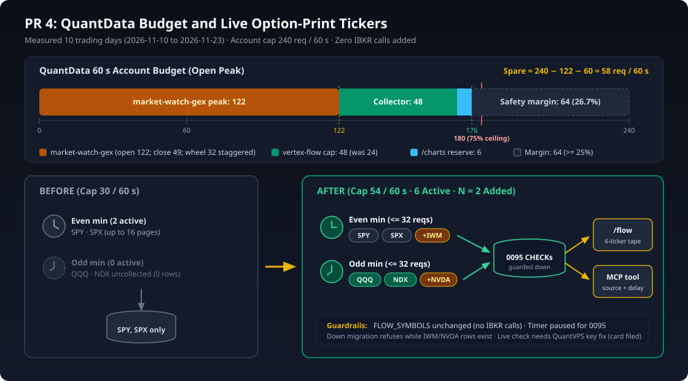

# PR 4 plan: Measure QuantData budget and widen live option-print tickers

Design: [design.md](design.md), section "PR 4". This plan is the binding interface for PR 4. Research only: no order, arming, risk setting or trading-unit change, and no new paid source. Reviewed with the EGM consolidated review on 2026-11-23 (8 Goldfish reviewers); all 14 resolved `PROPOSE FIX` findings are applied below, 1 finding (`CONTEST`: dedicated `flow.optionPrints` + `<FlowOptionTapePanel />` for option-only tickers outside `FLOW_SYMBOLS`) is recorded in `goldfish_review_report.md`, and 0 findings required escalation.

## Outcome

* Record verified server-side QuantData usage across all consumers (`market-watch-gex` and `market-watch-wheel` over 10 trading days 2026-11-10 to 2026-11-23; `market-watch-reentry` over 4 active trading days 2026-11-16 to 2026-11-19 plus code-verified batch cap), confirming **58 req / 60 s** of spare budget for `vertex-web` after `market-watch-bot`'s open peak (122 req / 60 s) and a 25% account safety margin (60 req / 60 s).
* Raise `vertex-web`'s QuantData client cap (`DEFAULT_MAX_PER_MINUTE`) from **30** to **54 req / 60 s** while keeping `FLOW_QUANTDATA_CALLER_RESERVE = 6` free for `/charts` and `optionsChain` (48 collector starts per 60 s; 64 req / 60 s = 26.7% safety margin below the 240/60 s account limit). Lower `DEFAULT_QUOTA_RESERVE` from **120** (50% of 240, which caused 19 false `yieldUntil` pauses on Nov 19–20) to **60** (matching the 25% safety margin).
* Activate live option-print collection for **`QQQ`** and **`NDX`** (already listed in `FLOW_OPTION_TICKERS` and DB CHECK constraints, previously uncollected with 0 rows) and widen `FLOW_OPTION_TICKERS` by **N = 2** new option-only tickers: **`IWM`** (Russell 2000 ETF, one of the repo's Core 7 ETFs) and **`NVDA`** (high-volume single-stock options tape). Total active live option-print tickers rises from 2 (`SPY`, `SPX`) to **6** (`SPY`, `SPX`, `QQQ`, `NDX`, `IWM`, `NVDA`).
* Stagger option-print collection across even and odd minutes (`SPY`, `SPX`, `IWM` on even minutes; `QQQ`, `NDX`, `NVDA` on odd minutes), lowering `FLOW_DUE_SECONDS.options` from `110` to `50` so parity alone controls the 2-minute cadence without jitter skips, keeping parity active during post-close gap draining (after reporting `"market closed"` when no gaps exist) so at most 3 option streams ever run in one tick, and bypassing parity only on `--seed` runs. Each 1-minute tick sends at most `3 x 8 (options) + 4 (net_drift) + 3 (gex) + 1 (market_premium) = 32` collector requests. `FLOW_SYMBOLS` stays `["SPY", "ES", "QQQ", "NQ"]`, adding **zero IBKR requests**.
* Model per-ticker options close hours in `FLOW_OPTION_STREAMS`: index and broad-ETF options (`SPY`, `SPX`, `QQQ`, `NDX`, `IWM`) trade `09:30–16:15 ET`, while single-stock equity options (`NVDA`) close at `16:00 ET`.
* Apply migration `0095_flow_option_tickers.sql` with `vertex-flow.timer` paused (widening the CHECK constraints on `flow_option_prints`, `flow_option_gaps`, `flow_samples` for `source = 'options'`, and `flow_events` for `source = 'quantdata'`), paired with a guarded rollback `packages/db/rollback/0095_flow_option_tickers.down.sql` that refuses while rows for `IWM` or `NVDA` exist.
* Expose all 6 tickers through oRPC procedure `flow.optionPrints` (`GET /flow/option-prints`), read-only MCP-only tool `flow_option_prints` (deferred from the in-app assistant via `ASSISTANT_DEFERRED_TOOL_PATTERN` per `design.md` Non-Goals), and `<FlowOptionTapePanel />` on `/flow`. Each reports source (`QuantData order-flow/consolidated`), per-ticker delay/hours, freshness (`fresh | stale | closed | never`), unread gap count (`unreadRanges`), full-window summary totals (`trades`, `callPremium`, `putPremium`, `bullishPremium`, `bearishPremium`, `sweeps`, `blocks`, `goldenSweeps`, `unusualCount`), and newest prints.

## Measurements (design question 1, 2026-11-23)

### Live header check

On 2026-11-23 UTC, read-only probes across all 5 QuantData endpoints (`order-flow/consolidated`, `term-structure`, `open-interest-by-strike`, `gainers-losers`, `net-drift`) returned `X-RateLimit-Limit: 240` with a stuck constant `X-RateLimit-Remaining: 19` and `X-RateLimit-Reset: 55`. Server-side request logs are therefore the source of truth.

### Server-side QuantData usage

Hosts and services sharing the single 240 req / 60 s QuantData account: `omarchy-rig` (local Linux compute host running `market-watch-gex`, `market-watch-wheel`, and `vertex-option-chain`), `QuantVPS` (production server running `vertex-web`, `vertex-flow`, and `market-watch-reentry`), and `omarchy-mac` (MacBook host, zero QuantData timers).

| Consumer | Host | Sample window | RTH schedule (ET) | Open peak (09:30–10:30) | Midday (10:30–15:00) | Close peak (15:00–16:15) | Limit / pacing |
| --- | --- | --- | --- | --- | --- | --- | --- |
| `market-watch-gex.service` | `omarchy-rig` | 10 trading days (2026-11-10..23) | `:08/:23/:38/:53` | **122 req / 60 s** (150 reqs in 74–75 s on 39/40 runs) | med 31, p95 58, max 121 (10:38 tail) | med 32, p95 46, **max 49 / 60 s** | `CAP_RTH = 150`, `MIN_INTERVAL_S = 0.5 s` |
| `market-watch-wheel.service` | `omarchy-rig` | 10 trading days (2026-11-10..23) | `:13/:43` (5 min after `gex`) | **32 req / 60 s** (21–32 in 10–18 s) | 21–32 / 60 s | **32 req / 60 s** (21–32 in 10–15 s) | `CAP = 60`, `MIN_INTERVAL_S = 0.5 s` |
| `market-watch-reentry.service` | `QuantVPS` | 4 active days (2026-11-16..19, n=197 ticks; Nov 20 & 23 skipped on incomplete IBKR snapshot) | `:02/:07/:12/...` (every 5 min) | **<= 34 req / 60 s** (`<= 10` OI via `FLEX_BATCH = 10` + `<= 24` flow) | `<= 24` flow / 60 s (max 4 syms x 6 pages) | `<= 18` flow / 60 s | `FLEX_BATCH = 10`, `max_pages = 6`, observed tick max 39 s |
| `market-watch-copyrot.timer` | `omarchy-rig` | 2026-11-23 | disabled / inactive | 0 | 0 | 0 | disabled |
| `omarchy-mac` | `omarchy-mac` | 2026-11-23 | none | 0 | 0 | 0 | none |
| `vertex-option-chain.timer` | `omarchy-rig` | 10 trading days | 12:30, 15:30 | 0 (calls `vertex-web`) | inside `vertex-web` cap | inside `vertex-web` cap | shares `/charts` reserve |
| `vertex-flow.service` (existing) | `QuantVPS` | 2 clean days (2026-11-19..20; Nov 23 HTTP 401) | every 1 min | max 20 observed; worst-case 24 + 6 reserve = **30 / 60 s** | med 6, p95 13, max 19 | max 18 | `DEFAULT_MAX_PER_MINUTE = 30`, `minIntervalMs = 1000` |

* **Reentry 09:32 OI cache proof:** In `market_watch/reentry/runner.py:27,203-210,307`, Flex candidate evaluations are hard-capped at `FLEX_BATCH = 10` symbols per 5-minute tick. Although `oi_cache` accumulated 64 unique symbols over the full trading day on 2026-11-19, any single tick (including the first active tick at `09:32 ET`, 6 minutes before `gex` at `09:38 ET`) fetches at most 10 OI requests plus at most 24 flow requests (<= 34 req / 60 s total, completing in <= 39 s).
* **Overlap analysis:** `market-watch-wheel` runs 5 minutes after `market-watch-gex` and never overlapped an open `gex` run in 10 trading days. `market-watch-reentry` starts at `:07/:22/:37/:52` (60 s before `gex`) and completed in at most 39 s (`:37:39`, 21 s before `gex` starts at `:38:00`); in any 60 s window straddling `:37:18..:38:18`, `reentry` (<= 34) + `gex` (18 s x 2 req/s = 36) = 70 req / 60 s, well below `gex`'s own `:38:00..:39:00` peak of 122 req / 60 s.
* **HTTP 429 audit:** Zero HTTP 429 responses occurred across all 10 trading days in `market-watch-gex`, `market-watch-wheel`, `market-watch-reentry`, and `vertex-flow`. Nineteen `vertex-flow` pauses on Nov 19–20 were client-side `yieldUntil` waits caused by `DEFAULT_QUOTA_RESERVE = 120` (50% of 240) tripping whenever `market-watch-gex` pushed a live header below 120.
* **Unrelated live finding recorded:** On 2026-11-23 (14:30–21:19 UTC), QuantVPS `vertex-web` logged 1,357 HTTP 401 errors because QuantVPS holds a stale `QUANTDATA_API_KEY` compared with the working key on `omarchy-rig`. Filed owner-gate card `quantvps-quantdata-key-401` in the FIRSTMATE tracker (updating server secrets requires owner authorization).

### Budget math

* **Account limit:** 240 req / 60 s.
* **25% safety margin:** 60 req / 60 s -> **180 req / 60 s** combined ceiling.
* **Measured non-overlapping open peak (`market-watch-gex`):** 122 req / 60 s.
* **Spare budget for `vertex-web`:** `240 - 122 - 60 = 58 req / 60 s`.
* **Fixed non-options worst case inside `vertex-web`:** `/charts` reserve (`FLOW_QUANTDATA_CALLER_RESERVE = 6`) + `net_drift` (2 tickers x 2 = 4) + `gex` (1 staggered ticker x 3 = 3) + `market_premium` (1) = **14 req / 60 s** (8 collector + 6 reserve).
* **Remaining option-print budget:** `58 - 14 = 44 req / 60 s`.
* **Chosen client cap:** `DEFAULT_MAX_PER_MINUTE = 54` (`48` collector starts + `6` reserve), leaving **64 req / 60 s (26.7% safety margin)** below 240 at open peak (and 30–40 req / 60 s below 240 even in a hypothetical `gex + reentry` simultaneous overrun). `DEFAULT_QUOTA_RESERVE` is lowered from `120` to `60` so client-side yielding matches the 25% safety margin instead of halting `vertex-web` during normal `gex` runs.
* **Why 48 collector starts when one live tick uses at most 32:** Each live tick sends at most `3 x 8 (options) + 4 (net_drift) + 3 (gex) + 1 (market_premium) = 32` collector requests (~16–18 reqs typical, ~35 s worst-case at `minIntervalMs = 1000`). The extra `48 - 32 = 16` starts absorb up to 16 s of minute-to-minute jitter across adjacent even/odd ticks (plus `--seed` runs and post-close gap draining) without hitting `"reserved"` or starving `/charts`.
* **Wall-clock overrun behavior:** Typical ticks (avg ~2.5 pages/ticker x 3 + 5 fixed = ~13 reqs) finish in ~15–18 s. If slow QuantData latency or a 10 s request timeout ever pushes a tick past 60 s, `vertex-flow.timer` (`Persistent=false`) skips one minute and `flow_option_gaps` (ranges left unread by page caps or missed minutes) queues any unread window for automatic catch-up on the next parity turn with zero silent data loss.

### Ticker selection rationale

A live trading KB query (`kb-chat` at `127.0.0.1:8787`) returned a model usage limit; the choice is grounded in the local trading rule corpus (`~/Github/knowledge-bases/trading/_master-rules/rules.jsonl`: `skydweller:indicator:15` on `QQQ`/`NQ` alignment and `skydweller:sizing:2` on pairing IV with order flow for direction) and existing Vertex coverage (PR 2 `flow_market_premium` from QuantData `gainers-losers` already captures market-wide single-stock trades >= $100,000 every 15 minutes):

1. **`QQQ` and `NDX`** (already in `FLOW_OPTION_TICKERS` and DB CHECKs, 0 rows): complete the Nasdaq-100 group beside `SPY` and `SPX` on `/flow`.
2. **`IWM`** (new, N=1): completes the three major US equity index ETFs (`SPY`, `QQQ`, `IWM`) and is one of Vertex's Core 7 ETFs (`SPY, QQQ, IWM, DIA, TLT, GLD, USO`).
3. **`NVDA`** (new, N=2): adds a high-volume single-stock intraday options tape alongside the five index/ETF products.

## Alternatives Considered

* **Alternative A (N = 0, keep cap at 30 / 60 s and activate `QQQ`/`NDX` only):** Rejected because measured open peak (122 req / 60 s) leaves 58 req / 60 s of spare budget after the 25% safety margin; keeping the cap at 30 leaves 28 req / 60 s unused and fails to widen `FLOW_OPTION_TICKERS` when room exists.
* **Alternative B (Add `IWM` and `NVDA` to `FLOW_SYMBOLS` and reuse `flow.snapshot`):** Rejected by `design.md` PR 4 because `FLOW_SYMBOLS` also drives IBKR tick/depth subscriptions, `flow_gex`, `flow_net_drift`, and confluence; keeping `FLOW_OPTION_TICKERS` separate from `FLOW_SYMBOLS` adds zero IBKR requests.
* **Alternative C (Add `TLT` instead of `NVDA`):** Rejected because `IWM` already covers the small-cap index ETF gap while `NVDA` exercises single-stock equity-option hours (`16:00 ET` close) and adds single-name intraday print granularity beside PR 2's 15-minute `gainers-losers` ranking.

## Risks & Limits

* **QuantVPS QuantData HTTP 401:** Live QuantData ingestion on QuantVPS is currently blocked by owner-gate card `quantvps-quantdata-key-401`. Code, migration, deploy, UI rendering, and MCP schema verification proceed normally; fresh post-deploy `IWM`/`NVDA`/`QQQ`/`NDX` QuantData rows require the rotated key on QuantVPS.
* **Early-close market holidays:** `flowSessionOpen` models regular sessions (`09:30–16:15 ET` index/ETF, `09:30–16:00 ET` equity) and does not model 13:00 ET holiday early closes (existing pipeline limit).
* **Existing `SPY`/`ES`-only analytics panels:** `FLOW_HEDGING_SYMBOLS`, `FLOW_PUT_CALL_RATIO_SYMBOLS`, and `FLOW_STRIKE_HEATMAP_SYMBOLS` stay `["SPY", "ES"]` in PR 4. Activating `"options"` on `QQQ` and `NQ` automatically enables their existing `flow.snapshot` Options section, option events, `flow.control` cross-check, and updates `notCollectedLine` (`QQQ` -> `"trades"` only, `NQ` -> `null`).

## 1. Contracts and Shared Constants

### `packages/api/src/contracts/flow.ts`

* Keep `FLOW_SYMBOLS = ["SPY", "ES", "QQQ", "NQ"] as const` unchanged.
* Add `FLOW_INDEX_OPTION_TICKERS = ["SPY", "SPX", "QQQ", "NDX"] as const` (`FlowIndexOptionTicker`). Switch index-only schemas (`FlowGexSchema.ticker`, `FlowControlOptionsSideSchema.{primaryTicker,checkTicker}`, `FlowNetDriftSeriesSchema.ticker`, `FlowCrossCheckSchema.ticker`, `FlowSessionLevelsSchema.ticker`, `FlowHedgingPressureOutputSchema.ticker`, `FlowPutCallRatioOutputSchema.ticker`, `FlowStrikeHeatmapOutputSchema.ticker`) from `FLOW_OPTION_TICKERS` to `FLOW_INDEX_OPTION_TICKERS`.
* Add `FLOW_EXTRA_OPTION_TICKERS = ["IWM", "NVDA"] as const` (`FlowExtraOptionTicker`).
* Widen `FLOW_OPTION_TICKERS = ["SPY", "SPX", "QQQ", "NDX", "IWM", "NVDA"] as const` (`FlowOptionTicker`).
* Add `FLOW_OPTION_PRINT_SYMBOLS = ["SPY", "ES", "QQQ", "NQ", "IWM", "NVDA"] as const` (`FlowOptionPrintSymbol`).
* Widen `FlowCollectInputSchema.symbols` from `z.array(z.enum(FLOW_SYMBOLS)).min(1).max(4).optional()` to `z.array(z.enum(FLOW_OPTION_PRINT_SYMBOLS)).min(1).max(FLOW_OPTION_PRINT_SYMBOLS.length).optional()` (omitted runs all 4 `FLOW_SYMBOLS` for non-options sources and all 6 `FLOW_OPTION_STREAMS` for `options`).
* Widen `FlowCollectRunSchema.symbol` from `z.enum(FLOW_SYMBOLS)` to `z.enum(FLOW_OPTION_PRINT_SYMBOLS)`.
* Add read-only procedure **`flow.optionPrints`**:
  * Route: `{ method: "GET", path: "/flow/option-prints", operationId: "flow.optionPrints", tags: ["Flow"], summary: "Read stored live QuantData option prints, full-window summary, freshness and unread gap count for one option ticker" }`.
  * Input (`FlowOptionPrintsInputSchema`):
    * `ticker`: `z.enum(FLOW_OPTION_TICKERS).default("SPY")`
    * `windowMinutes`: `z.coerce.number().int().min(5).max(390).default(60)`
    * `limit`: `z.coerce.number().int().min(1).max(200).default(50)`
  * Summary schema (`FlowOptionTapeSummarySchema` — full-window SQL totals over `[windowStart, windowEnd]`, no redundant `topPrints`):
    * `ticker`: `z.enum(FLOW_OPTION_TICKERS)`
    * `trades`: `count`
    * `callPremium`, `putPremium`, `bullishPremium`, `bearishPremium`: `nonNegative`
    * `sweeps`, `blocks`, `goldenSweeps`, `unusualCount`: `count`
  * Output (`FlowOptionPrintsOutputSchema`, `schemaVersion: z.literal("flow-option-prints.v1")`):
    * `schemaVersion`, `asOf` (ISO timestamp of `now`), `windowStart`, `windowEnd` (ISO timestamps of the queried window)
    * `ticker` (`FlowOptionTicker`), `symbol` (`FlowOptionPrintSymbol`), `windowMinutes`
    * `source`: `z.literal("QuantData order-flow/consolidated")`
    * `delay`: `text(200)` (e.g. `"Intraday; collected every ~2 minutes during US options hours (09:30-16:15 ET)."` or `09:30-16:00 ET` for `NVDA`)
    * `freshness`: `FlowFreshnessSchema` (existing schema: `{ state: "fresh" | "stale" | "closed" | "never", lastOkAt, lastAttemptAt, lastStatus, message, ageSeconds }`)
    * `unreadRanges`: `count` (integer count of all open `flow_option_gaps` rows for `symbol`)
    * `summary`: `FlowOptionTapeSummarySchema`
    * `prints`: `z.array(FlowOptionPrintViewSchema)` (existing print view schema: `id, tradedAt, expiry, strike, right, price, size, premium, side, consolidation, sentiment, moneyness, unusual, goldenSweep, volumeOverOi, opening`; up to `limit` newest prints in `[windowStart, windowEnd]`, descending `tradedAt`, `id`)
  * Auth: `api.flow.optionPrints.use(requireOperator)` (same operator/agent-read middleware as `flow.snapshot`).

### `packages/api/src/flow-features.ts` and `packages/api/src/index.ts`

* Add `"options"` to `FLOW_INSTRUMENTS.QQQ.sources` and `FLOW_INSTRUMENTS.NQ.sources`.
* Type `FLOW_GROUPS.{primaryTicker,checkTicker}` with `FlowIndexOptionTicker`.
* Narrow `flowSymbolForTicker(ticker: FlowIndexOptionTicker): FlowSymbol` (updating index-only callers in `flow-control.ts`, `flow-control.test.ts`, `flow-net-drift.ts`, `flow-snapshot.ts`).
* Add `isFlowSymbol(symbol: FlowOptionPrintSymbol): symbol is FlowSymbol`.
* Add `FlowOptionStream` and `FLOW_OPTION_STREAMS` (6 entries):
  * `SPY`: `{ symbol: "SPY", optionsTicker: "SPY", parity: "even", optionEventPremium: 500_000, closeMinuteEt: 16 * 60 + 15 }`
  * `ES`: `{ symbol: "ES", optionsTicker: "SPX", parity: "even", optionEventPremium: 1_000_000, closeMinuteEt: 16 * 60 + 15 }`
  * `IWM`: `{ symbol: "IWM", optionsTicker: "IWM", parity: "even", optionEventPremium: 500_000, closeMinuteEt: 16 * 60 + 15 }`
  * `QQQ`: `{ symbol: "QQQ", optionsTicker: "QQQ", parity: "odd", optionEventPremium: 500_000, closeMinuteEt: 16 * 60 + 15 }`
  * `NQ`: `{ symbol: "NQ", optionsTicker: "NDX", parity: "odd", optionEventPremium: 1_000_000, closeMinuteEt: 16 * 60 + 15 }`
  * `NVDA`: `{ symbol: "NVDA", optionsTicker: "NVDA", parity: "odd", optionEventPremium: 500_000, closeMinuteEt: 16 * 60 }`
* Add `flowOptionSymbolForTicker(ticker: FlowOptionTicker): FlowOptionPrintSymbol` and `flowOptionStreamForSymbol(symbol: FlowOptionPrintSymbol): FlowOptionStream`.
* Re-export all new constants, types, and helpers from `packages/api/src/index.ts`.

## 2. Database Schema and Migration (`packages/db`)

### `packages/db/src/schema/flow.ts`

* Export `FLOW_INDEX_OPTION_TICKER_VALUES = ["SPY", "SPX", "QQQ", "NDX"] as const`, `FLOW_EXTRA_OPTION_TICKER_VALUES = ["IWM", "NVDA"] as const`, `FLOW_OPTION_TICKER_VALUES = ["SPY", "SPX", "QQQ", "NDX", "IWM", "NVDA"] as const`, and `FLOW_OPTION_PRINT_SYMBOL_VALUES = ["SPY", "ES", "QQQ", "NQ", "IWM", "NVDA"] as const`.
* Widen `.$type<...>()` annotations: `flowSamples.symbol`, `flowOptionPrints.symbol`, `flowOptionGaps.symbol`, `flowEvents.symbol` -> `FlowOptionPrintSymbolValue`; `flowOptionPrints.ticker` -> `FlowOptionTickerValue`. Narrow `flowGex.ticker` and `flowNetDrift.ticker` -> `FlowIndexOptionTickerValue`.
* Update CHECK definitions to match migration `0095`:
  * `flow_option_prints_check`: `symbol IN ('SPY', 'ES', 'QQQ', 'NQ', 'IWM', 'NVDA')` and `ticker IN ('SPY', 'SPX', 'QQQ', 'NDX', 'IWM', 'NVDA')` (plus existing `right`, `premium`, `id` checks).
  * `flow_option_gaps_check`: `symbol IN ('SPY', 'ES', 'QQQ', 'NQ', 'IWM', 'NVDA')` and `end_time >= start_time`.
  * `flow_samples_check`: `((symbol IN ('SPY', 'ES', 'QQQ', 'NQ')) OR (symbol IN ('IWM', 'NVDA') AND source = 'options'))` (plus existing `source`, `status`, `items`, `message` checks).
  * `flow_events_check`: `((symbol IN ('SPY', 'ES', 'QQQ', 'NQ')) OR (symbol IN ('IWM', 'NVDA') AND source = 'quantdata'))` (plus existing `direction`, `source`, `detail`, `key` checks).
* Keep `flow_gex`, `flow_net_drift`, `flow_minutes`, `flow_book`, `flow_book_snapshots`, `flow_large_trades`, `flow_tape_seconds` unchanged.

### Migration `packages/db/migrations/0095_flow_option_tickers.sql` and snapshot

* Generated and verified via `pnpm db:generate` (updating `packages/db/migrations/meta/_journal.json` and `packages/db/migrations/meta/0095_snapshot.json`; zero schema drift).
* Drops and recreates the 4 CHECK constraints (`flow_option_prints_check`, `flow_option_gaps_check`, `flow_samples_check`, `flow_events_check`). No new tables or columns; existing `vertex_research` grants remain valid.

### Guarded rollback `packages/db/rollback/0095_flow_option_tickers.down.sql`

* Starts with a `DO $$ ... END $$;` guard counting rows where `symbol IN ('IWM', 'NVDA')` or `ticker IN ('IWM', 'NVDA')` across `flow_option_prints`, `flow_option_gaps`, `flow_samples`, and `flow_events`.
* If count > 0, raises an exception (`cannot roll back 0095_flow_option_tickers while rows exist for added option tickers`) and aborts before modifying any constraint.
* If count = 0, restores the 4 pre-0095 CHECK constraints.

### `packages/db/src/server/flow.ts` and `packages/db/src/server/index.ts`

* Widen parameter types for `latestSamples`, `recordSample`, `insertOptionPrints`, `newestOptionPrintAt`, `optionGaps`, `addOptionGap`, `moveOptionGapEnd`, `insertEvents` to `FlowOptionPrintSymbolValue`; narrow `netDriftPriceAtOrBefore` to `FlowIndexOptionTickerValue`.
* Add `readOptionTape({ symbol, from, to, limit }): Promise<FlowOptionTapeReadResult>` executing two indexed SQL queries over `flow_option_prints_symbol_time_idx`:
  1. Full-window aggregate query over all rows in `[from, to]` returning exact `FlowOptionTapeSummaryRecord` (`trades`, `callPremium`, `putPremium`, `bullishPremium`, `bearishPremium`, `sweeps`, `blocks`, `goldenSweeps`, `unusualCount`).
  2. Bounded query (`WHERE symbol = $1 AND traded_at >= $2 AND traded_at <= $3 ORDER BY traded_at DESC, id DESC LIMIT $4`) returning newest `FlowOptionPrintRecord[]`.
* Re-export `FlowOptionTapeSummaryRecord` and `FlowOptionTapeReadResult` from `packages/db/src/server/index.ts`.

## 3. Collector, QuantData Client, API, and MCP (`packages/api`)

### `packages/api/src/server/quantdata-client.ts`

* Raise `DEFAULT_MAX_PER_MINUTE` from `30` to `54`.
* Lower `DEFAULT_QUOTA_RESERVE` from `120` to `60` (matching the 25% safety margin on the 240/60 s account cap).
* Keep `minIntervalMs = 1000` unchanged. Update header comments with the 2026-11-23 measured budget math.

### `packages/api/src/server/flow-collect.ts`

* Keep `FLOW_QUANTDATA_CALLER_RESERVE = 6` unchanged (48 collector starts per 60 s inside the 54/60 s cap).
* Lower `FLOW_DUE_SECONDS.options` from `110` to `50` so `optionTurn` parity alone controls the 2-minute live cadence without jitter skips while blocking duplicate runs within the same minute.
* Add `optionTurn(stream, now)`: checks `Math.floor(now.getTime() / 60_000) % 2 === 0 ? "even" : "odd"` against `stream.parity`; returns `notDue("staggered: <ticker> options runs on <parity> minutes")` when off-parity. Bypass `optionTurn` only on `--seed` runs; during post-close gap draining (`!open`), check stored gaps first so empty symbols still report `"market closed"`, then enforce parity inside `collectOptions` so `NVDA` (closed at 16:00 ET) cannot stack onto even-minute live runs at 16:00–16:14 ET and post-16:15 gap draining stays capped at 3 streams/min.
* Refactor `collectOptions` and its helpers (`readOptionWindow`, `fetchOptions`, `storeOptions`, `readGaps`, `resumeOptionGaps`) to accept `stream: FlowOptionStream` instead of `instrument: FlowInstrument`.
* In `runFlowCollect`:
  * Load `lastAttempts` across all `FLOW_OPTION_PRINT_SYMBOLS`.
  * For non-`options` sources in `SOURCE_ORDER`, iterate `symbols.filter(isFlowSymbol)` (never indexing `FLOW_INSTRUMENTS` with `IWM` or `NVDA`).
  * For `source === "options"`, iterate `FLOW_OPTION_STREAMS` filtered by `input.symbols`.
  * Keep `FLOW_QUANTDATA_SOURCE_MAX.options = 8` pre-check enforced on live, gap-drain, and `--seed` runs.
* Update `flowQuantDataRunWorstCase(instruments, groups, optionStreams)` to compute `Math.max(evenCount, oddCount) * FLOW_OPTION_RUN_PAGES_MAX + net_drift(4) + gex(3) + market_premium(1) = 32` (`<= DEFAULT_MAX_PER_MINUTE - FLOW_QUANTDATA_CALLER_RESERVE = 48`).

### `packages/api/src/server/flow-snapshot.ts` and `packages/api/src/server/flow-option-prints.ts`

* In `flow-snapshot.ts`: widen `flowSessionOpen`, `flowStaleSeconds`, `buildSourceFreshness`, and `FlowSampleRow.symbol` to `FlowOptionPrintSymbol` (for `source === "options"`, read `closeMinuteEt` from `FLOW_OPTION_STREAMS`, closing `NVDA` at `16:00 ET` and index/ETF tickers at `16:15 ET`). Export `printView`.
* Create `packages/api/src/server/flow-option-prints.ts` exporting `readFlowOptionPrints`:
  * Maps `ticker` to `stream` via `flowOptionSymbolForTicker` + `flowOptionStreamForSymbol`.
  * Determines window `[windowStart, windowEnd]`: if `flowSessionOpen("options", symbol, now)` is true, tries `to = now`; if closed (or if `[now - windowMinutes, now]` has 0 trades and `newestOptionPrintAt(symbol)` exists), anchors `to = newestOptionPrintAt(symbol) ?? now` and `from = new Date(to.getTime() - windowMinutes * 60_000)`.
  * Calls `repository.readOptionTape({ symbol, from, to, limit })`, `repository.optionGaps(symbol)`, and `repository.latestSamples(symbol)`.
  * Builds `freshness` via `buildSourceFreshness`, maps prints via `printView`, derives `delay` from `stream.closeMinuteEt`, and returns `flow-option-prints.v1`.

### `packages/api/src/server/flow.ts`, `mcp.ts`, and `assistant-runtime.ts`

* Wire `flow.optionPrints` in `packages/api/src/server/flow.ts` using `.use(requireOperator)` and `readFlowOptionPrints`.
* Register read-only MCP tool **`flow_option_prints`** in `packages/api/src/server/mcp.ts` dispatching via oRPC `procedure: "flow/optionPrints"` with input `{ ticker, windowMinutes, limit }` and returning the `flow-option-prints.v1` JSON document. Description states source (`QuantData order-flow/consolidated`), supported tickers (`SPY, SPX, QQQ, NDX, IWM, NVDA`), cadence and per-ticker hours (`09:30-16:15 ET` index/ETF; `09:30-16:00 ET` NVDA), `unreadRanges` unread gap count caveat, and research-only disclaimer.
* Update `ASSISTANT_DEFERRED_TOOL_PATTERN` in `packages/api/src/server/assistant-runtime.ts` to defer `flow_option_prints` (MCP-only per `design.md` Non-Goals; keeps `tests/integration/semantic-layer/eval-recording.fixture.json` unchanged).
* Regenerate `packages/api/openapi.json` with `bun run openapi:generate`.

### `scripts/flow/tick.ts`

* No runtime code change needed (`CollectSchema.runs[].symbol` is already `z.string()`). Add a test case in `scripts/flow/tick.test.ts` verifying `QQQ`, `NQ`, `IWM`, and `NVDA` output formatting.

## 4. Web (`apps/web`)

* Create pure view-model `apps/web/src/features/flow/option-tape-view-model.ts` formatting ticker tabs (`SPY, SPX, QQQ, NDX, IWM, NVDA`), freshness badge (`fresh | stale | closed | never`), source and delay caption, unread gap count (`unreadRanges`), summary metrics (`trades`, `callPremium`, `putPremium`, `bullishPremium`, `bearishPremium`, `sweeps`, `blocks`, `goldenSweeps`), and table rows (`Time, Contract, Side, Sentiment, Size, Premium, Kind`).
* Create `apps/web/src/components/portal/flow-option-tape-panel.tsx`:
  * Fetches `flow.optionPrints` via the portal oRPC client (`useQuery` / client call matching existing `/flow` panels) with loading, error, empty, and populated states.
  * 6-ticker selector bar with 44x44 px targets and visible keyboard focus; window selector (`15m`, `60m`, `390m`).
  * Responsive table at 375, 768, 1024, and 1440 px using light/dark/system Tailwind/shadcn tokens (no emoji controls).
* Mount `<FlowOptionTapePanel />` in `apps/web/src/app/(portal)/flow/page.tsx` between `<FlowWorkspace />` and `<OpenbbShortsPanel symbol="SPY" />`.

## 5. Files

* **Docs:**
  * Modify: `docs/vertex-rebuild/designs/smart-money/plan-pr4.md`, `docs/vertex-rebuild/designs/smart-money/plan-pr4.svg`, `docs/vertex-rebuild/designs/smart-money/design.md`, `docs/vertex-rebuild/flow-pipeline.md`.
* **DB (`packages/db`):**
  * Create: `packages/db/migrations/0095_flow_option_tickers.sql`, `packages/db/migrations/meta/0095_snapshot.json`, `packages/db/rollback/0095_flow_option_tickers.down.sql`.
  * Modify: `packages/db/migrations/meta/_journal.json`, `packages/db/src/schema/flow.ts`, `packages/db/src/server/flow.ts`, `packages/db/src/server/index.ts`, `packages/db/src/server/flow.test.ts`, `packages/db/src/server/flow-migration.test.ts`.
* **API (`packages/api`):**
  * Create: `packages/api/src/server/flow-option-prints.ts`, `packages/api/src/server/flow-option-prints.test.ts`.
  * Modify: `packages/api/src/contracts/flow.ts`, `packages/api/src/flow-features.ts`, `packages/api/src/flow-features.test.ts`, `packages/api/src/flow-net-drift.ts`, `packages/api/src/flow-options.ts`, `packages/api/src/flow-tape-speed.contract.test.ts`, `packages/api/src/index.ts`, `packages/api/src/options-analytics.test.ts`, `packages/api/src/server/quantdata-client.ts`, `packages/api/src/server/flow-collect.ts`, `packages/api/src/server/flow-collect.test.ts`, `packages/api/src/server/flow-snapshot.ts`, `packages/api/src/server/flow-control.ts`, `packages/api/src/server/flow-control.test.ts`, `packages/api/src/server/flow.ts`, `packages/api/src/server/flow.test.ts`, `packages/api/src/server/mcp.ts`, `packages/api/src/server/mcp.test.ts`, `packages/api/src/server/assistant-runtime.ts`, `packages/api/openapi.json`.
* **Scheduler & Integration tests:**
  * Create: `tests/integration/database/flow-option-tickers.test.ts`.
  * Modify: `scripts/flow/tick.test.ts`.
* **Web (`apps/web`):**
  * Create: `apps/web/src/features/flow/option-tape-view-model.ts`, `apps/web/src/features/flow/option-tape-view-model.test.ts`, `apps/web/src/components/portal/flow-option-tape-panel.tsx`, `apps/web/src/components/portal/flow-option-tape-panel.test.tsx`.
  * Modify: `apps/web/src/app/(portal)/flow/page.tsx`, `apps/web/src/app/(portal)/flow/route-files.test.tsx`, `apps/web/src/features/flow/view-model.ts`, `apps/web/src/features/flow/view-model.test.ts`, `apps/web/src/components/portal/flow-workspace.test.tsx`.

## 6. Verification

* **Unit and contract tests (100% coverage on every newly created and changed non-baseline file; baseline ratchet preserved on `mcp.ts`):**
  * `options-analytics.test.ts`: `DEFAULT_MAX_PER_MINUTE = 54`, `DEFAULT_QUOTA_RESERVE = 60`, reserve `6` keeps `48` collector starts.
  * `flow-option-prints.test.ts`: all 6 tickers, `fresh | stale | closed | never` freshness states, off-hours window anchoring to `newestOptionPrintAt`, full-window summary totals independent of `limit`, `unreadRanges` count, source and per-ticker delay strings.
  * `flow-migration.test.ts`: 0077 assertion updated to `FLOW_INDEX_OPTION_TICKER_VALUES`; 0095 up SQL widens the 4 CHECK constraints; 0095 down SQL contains the guard and restores pre-0095 CHECKs.
  * `mcp.test.ts` + assistant runtime test: `flow_option_prints` tool schema, oRPC dispatch, source/delay metadata, and deferral from in-app assistant.
  * `option-tape-view-model.test.ts`, `flow-option-tape-panel.test.tsx`, `view-model.test.ts`: ticker switching, loading/error/empty/populated states, dark/light tokens, `notCollectedLine` for `QQQ`/`NQ`.
* **Integration tests (Postgres):** `tests/integration/database/flow-option-tickers.test.ts` proves migration 0095 applies cleanly, inserts `IWM` and `NVDA` prints/gaps/samples/events, rejects `IWM`/`NVDA` non-options samples and non-quantdata events, proves `readOptionTape` computes full-window aggregates independently of `limit`, proves down migration refuses while `IWM`/`NVDA` rows exist, and proves down migration succeeds once those rows are deleted.
* **Pre-push & CI:** `bun run openapi:generate`, `bun run verify:prepush`, fresh-context exact-head diff review, PR checks green (`ci-gate`), exact-SHA full CI before deploy.
* **Live checks after off-hours deploy:**
  * Postgres: 0095 CHECK constraints verified on all 4 tables; rolled-back `vertex_research` write probe succeeds for `IWM` and `NVDA`; fresh `flow_option_prints` rows for `SPY`, `SPX`, `QQQ`, `NDX`, `IWM`, `NVDA` (fresh QuantData rows depend on owner-gate card `quantvps-quantdata-key-401` if QuantVPS HTTP 401 persists).
  * Web: dark-mode headless Chrome screenshots of `/flow` (1440 px and 375 px) showing the 6-ticker Option Tape panel with source and delay.
  * MCP: live `flow_option_prints` answer showing ticker, source, delay, and freshness.

## 7. Deploy and rollback

Deploy after 16:00 ET or before 08:30 ET (owner rule 2026-11-16):

1. Pause the flow timer on QuantVPS: `sudo systemctl stop vertex-flow.timer`.
2. Apply `packages/db/migrations/0095_flow_option_tickers.sql` alone with `psql -v ON_ERROR_STOP=1 --single-transaction` in `vertex-postgres` (do not run `db:migrate`; the QuantVPS Drizzle ledger is incomplete per `flow-pipeline.md`).
3. Verify the 4 CHECK constraints and run a rolled-back `vertex_research` write probe inserting an `IWM` option print and options sample.
4. Build and deploy `vertex-web` at the exact merged commit SHA via `infra/quantvps/restart-when-idle.sh --deploy <sha>` (`vertex-flow-tick.mjs` does not change, so no `infra/flow/quantvps/install.sh` reinstall is needed).
5. Run one QuantVPS dry-run tick (`/opt/vertex-autopilot/bin/node /opt/vertex-flow/vertex-flow-tick.mjs --dry-run` with `/etc/vertex-autopilot/autopilot.env`), then resume the timer: `sudo systemctl start vertex-flow.timer`.
6. Run the live checks in section 6.

Rollback:

1. Pause `vertex-flow.timer`, deploy the previous `vertex-web` SHA via `infra/quantvps/restart-when-idle.sh`, and resume `vertex-flow.timer`. The previous app runs cleanly against the widened CHECK constraints.
2. Only if reverting the DB constraints is also required: pause `vertex-flow.timer`, explicitly delete `IWM`/`NVDA` rows from `flow_option_prints`, `flow_option_gaps`, `flow_samples`, and `flow_events`, then apply `packages/db/rollback/0095_flow_option_tickers.down.sql` (which refuses while any `IWM`/`NVDA` rows exist), and resume `vertex-flow.timer`.
