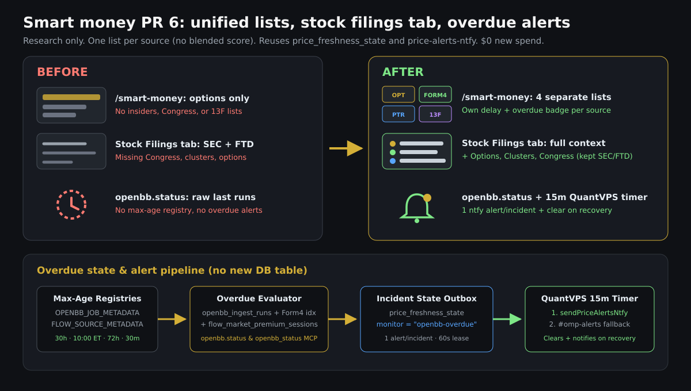

# PR 6 plan: `/smart-money` page, stock-tab sections, overdue state + one alert per incident

Design: [design.md](design.md), section "PR 6" and CUJ 2 / CUJ 4. This plan is the binding interface for PR 6. Research only: no order, arming, risk setting, or trading-unit change, and no new paid source. Reviewed with two fresh-context consolidated plan reviews on 2026-11-24 (all Blocker/High/Medium findings applied, 0 ESCALATE).

## Outcome

* `/smart-money` shows one separate list per source with its own source and delay label (no blended score):
  1. **Large options trades (QuantData)** — existing `smartMoney.ranking` ranking panel, unchanged controls and URL sync.
  2. **Insider cluster buys (SEC Form 4)** — 7-day clusters (`openbb.insiderClusters`), filtered by the page's ticker when set, with link to `/insider-clusters`.
  3. **Congress trades (House and Senate PTRs)** — 30-day disclosures (`congressTrades.feed`), defaulting to purchases (toggle for all trades), filtered by ticker when set, with unparsed count and link to `/congress-trades`.
  4. **13F quarter-over-quarter changes (SEC Form 13F-HR)** — new market-wide read-only procedure `openbb.changes13f` (and MCP tool `openbb_13f_changes`), top changes (excluding unchanged) across tracked filers' two newest consecutive full books, filtered by ticker when set.
  5. **Per-source freshness strip** at the top of `/smart-money` showing each smart-money source's overdue state (never a blended score).
* The stock page's Filings tab (`/stock/[symbol]?tab=filings`, `OpenbbFilingsTab`) keeps SEC filings, insider trades, tracked 13F holders, 13F quarter-over-quarter changes, short volume, short interest, OTC weekly, and SEC FTD, and adds three smart-money sections for that symbol with isolated loading/error states:
  1. **Large options premium (QuantData)** (5 sessions, `smartMoney.ranking`, link to `/smart-money?ticker=<SYMBOL>`).
  2. **Insider cluster buys (SEC Form 4)** (30 days, `openbb.insiderClusters` with new optional `symbol` filter, link to `/insider-clusters`).
  3. **Congress trades (House and Senate PTRs)** (90 days, `congressTrades.feed`, link to `/congress-trades?ticker=<SYMBOL>&days=90`).
* Maximum age per source lives in single-source-of-truth metadata registries:
  * `OPENBB_JOB_METADATA` in `packages/api/src/contracts/openbb.ts` (every job in `OPENBB_JOBS`, reused by `CONGRESS_TRADES_OVERDUE_HOURS`).
  * `FLOW_SOURCE_METADATA` in `packages/api/src/contracts/flow.ts` (every source in `FLOW_SOURCES`, reused by `FLOW_STALE_SECONDS`).
* `openbb.status` (and MCP tool `openbb_status`) computes per-source `overdue`, `overdueSince`, `maxAgeSeconds`, `lastOkAt`, and `reason` for every OpenBB job and flow source (`checkedAt`, `overdueCount`, `sources`), keeping existing `runs` and `tables` intact.
* A QuantVPS systemd timer (`vertex-openbb-overdue.timer`, every 15 minutes) calls `openbb.checkSourceOverdue` (write-key only, with strictly read-only `--dry-run`) to send **one alert per incident** via `sendPriceAlertsNtfy` (`packages/api/src/server/price-alerts-ntfy.ts`), with `#omp-alerts` fallback outbox (`openbb.recordSourceOverdueChat`) when server ntfy is unconfigured or fails, and clears + sends one recovery notice when all overdue sources recover. Durable state reuses the existing `price_freshness_state` table (`monitor = "openbb-overdue"`) — zero new migrations.

## 1. Max-age registries & overdue rules (`packages/api`)

### `OPENBB_JOB_METADATA` (`packages/api/src/contracts/openbb.ts`)

Every job in `OPENBB_JOBS` has `{ label, maxAgeHours, schedule, smartMoney }`:

| Job | Schedule | Max age | Extra deadline | Smart money |
| --- | --- | --- | --- | --- |
| `congress-house` | `calendar` | 30 h | — | yes |
| `congress-senate` | `calendar` | 30 h | — | yes |
| `sec-form4` | `calendar` | 30 h | Any existing incomplete index day older than yesterday, or yesterday incomplete at/after 10:00 ET; plus at least one complete day in last 7 calendar days (avoids false alarms on Columbus/Veterans Day when NYSE is open but EDGAR is closed) | yes |
| `sec-13f` | `calendar` | 72 h (3 days) | Daily check run (`vertex-openbb.steps` runs every 24 h and records `ok` even when 0 new filings arrive) | yes |
| `finra-short-volume` | `calendar` | 30 h | On NYSE trading days at/after 10:00 ET, `short_volume_daily` newest date >= previous NYSE trading day | yes |
| `sec-insider` | `retired` | `null` | Never overdue (retired by `sec-form4`) | no |
| `cboe-vol-indices`, `cboe-vx-curve`, `cboe-option-iv`, `sec-filings`, `daily-prices`, `cme-futures-oi` | `trading-day` | 30 trading-day h | Clock pauses on weekends and NYSE holidays (`nyse-calendar.ts`) | no |
| `cftc-cot` | `calendar` | 192 h (8 days) | Weekly Fri/Sat/Mon cadence | no |
| `fed-rates`, `fed-regime`, `fed-events`, `treasury-tga`, `fred-keyless` | `calendar` | 30 h | — | no |
| `finra-otc`, `finra-short-interest`, `sec-ftd` | `calendar` | 48 h | — | no |
| `oecd-cli`, `famafrench` | `calendar` | 72 h | — | no |

### `FLOW_SOURCE_METADATA` (`packages/api/src/contracts/flow.ts`)

Every source in `FLOW_SOURCES` has `{ label, maxAgeSeconds, smartMoney }`:

| Source | Max age (in session) | Smart money |
| --- | --- | --- |
| `market_premium` | 1800 s (30 min, options session 09:30–16:15 ET on NYSE trading days) | yes |
| `gex` | 1800 s (30 min, options session) | no |
| `options` | 300 s (5 min, options session) | no |
| `net_drift` | 300 s (5 min, 09:30–16:20 ET) | no |
| `ticks` | 600 s (10 min, stock/futures session) | no |
| `depth` | 180 s (3 min, stock/futures session) | no |

`FLOW_STALE_SECONDS` in `packages/api/src/server/flow-snapshot.ts` derives from `FLOW_SOURCE_METADATA`.

### Pure overdue evaluator (`packages/api/src/openbb-overdue.ts`)

* `elapsedTradingDayMs(from, to)`: resolves exact UTC instants for each `America/New_York` calendar date's `[00:00, next 00:00)` window (DST-safe) and sums elapsed milliseconds on dates where `isNyseTradingDay` is true, so `trading-day` jobs never false-alarm across weekends, NYSE holidays, or DST transitions.
* `evaluateForm4Overdue({ days, lastOkAt, now })`: shared by `openbb.insiderClusters` and `openbb.status` (single definition of Form 4 overdue). Keeps the existing rule: overdue when no usable run in 30 h, or any existing incomplete index day `< yesterday`, or `yesterday` incomplete at/after 10:00 ET, or no complete index day in the last 7 calendar days (avoids false alarms on US federal holidays like Columbus Day / Veterans Day when NYSE is open and EDGAR publishes no index).
* `evaluateOpenbbSources({ form4Days, marketPremiumSession, now, runs, samples, shortVolumeNewestDate })`: returns sorted `OpenbbSourceStatus[]` for all 23 `OPENBB_JOBS` + flow sources (when flow data is supplied).
  * For `market_premium`, shares `isMarketPremiumSessionOpen(now)` (`isNyseTradingDay` AND 09:30–16:15 ET) with `smartMoney.ranking`, and reads exclusively from `flow_market_premium_sessions` over `nyDate(-7)..today` (never `flow_samples`, because gap-fill runs write `ok` samples for past dates). Overdue when in session and (`capturedAt === null` and wall clock >= 10:00 ET, OR `now - capturedAt > 1800 s`).
  * Outside session hours, `market_premium` has `overdue: false`, and for the alert monitor it is marked **clearable only when** the newest session's ledger status is `"complete"`, OR `capturedAt` is at or after 15:45 ET (within the 30-minute limit of the 16:15 ET close) on that session date. An outage at 15:00 ET that stays broken through 16:15 ET therefore does not send a false "recovered" alert at 16:16 ET.
  * Known limitation: `nyse-calendar.ts` models full-day closures only, not 13:00 ET NYSE half-days; on a half-day, `market_premium` may fire one alert after 13:30 ET.
* **Alerted monitor scope (`monitor = "openbb-overdue"` in `price_freshness_state`):** all 22 non-retired `openbb:<job>` sources + `flow:market_premium` (23 monitored sources). Short-window intraday `/flow` sources (`depth` 3m, `options`/`net_drift` 5m, `ticks` 10m, `gex` 30m) appear in `openbb.status` for visibility without triggering the 15-minute data-overdue pager.
* `diffOverdueIncident`: reuses the exact 5-way transition + 60 s in-flight lease pattern from `price-freshness.ts`:
  * `alert`: newly overdue keys (not yet in `activeKeys`) trigger one consolidated ASCII alert (title <= 120 B, body <= 1000 B, up to 8 named sources + overflow count, total overdue count). `idempotencySource` includes `lastTransitionAt?.toISOString() ?? "init"` so retries keep the same key while a new same-day incident after recovery gets a fresh key.
  * `recovery`: when `nextActiveKeys` becomes empty and `activeKeys` was non-empty, sends one recovery alert and clears `activeKeys`.
  * `prune-active`: partial recovery shrinks `activeKeys` silently without spamming.
  * `clear-pending` / `in-flight` / `noop`: steady-state healthy ticks write zero DB rows.

## 2. Database & API procedures (`packages/db`, `packages/api`)

* **No new migration:** reuses `price_freshness_state` (`monitor = "openbb-overdue"`) via existing `OpenbbFreshnessRepository`.
* **`OpenbbRepository.changes13fMarket` (`packages/db/src/server/openbb.ts`):**
  * Computes quarter-over-quarter changes across all tracked filers' two newest consecutive full 13F-HR books (earliest-filed original per period) using a single SQL `FULL OUTER JOIN` in Postgres, joining `openbb_sec_13f_holdings` on leading primary-key columns `(filer_cik, period_ending)` plus `h.accession_number = f.accession_number` (excluding pre-PR5 rows where `accession_number IS NULL`).
  * Excludes `"unchanged"` unless requested; optionally filters by `change` (`new`, `added`, `reduced`, `sold`) and `ticker` (matching `holding.symbol` or `openbb_cusip_symbols` CUSIPs).
  * Orders by `GREATEST(COALESCE(curr.value, 0), COALESCE(prev.value, 0)) DESC, filer_cik, cusip, option_type`, capped at `limit` (1–100, default 50), and attaches `symbol` via `COALESCE(holding.symbol, (SELECT cs.symbol FROM openbb_cusip_symbols cs WHERE cs.cusip = ... ORDER BY cs.last_seen DESC, cs.symbol ASC LIMIT 1))` (preferring `$ticker` when filtered by ticker).
* **Contracts & handlers:**
  * `openbb.status` (`GET /openbb/status`): adds `checkedAt`, `overdueCount`, `sources` (keeps `runs` and `tables` unchanged). Reads `lastRunsFor(OPENBB_JOBS)`, `form4IndexDays(nyDate(-7))`, `tableStats()`, `latestRuns()`, `blockedStreaks()`, and (when `context.repositories.flow` exists) `flow.marketPremiumLedger({ from: nyDate(-7), to: today })` + `flow.latestSamples("SPY", nonPremiumSources)` (SPY flow sources only; `market_premium` comes solely from the session ledger).
  * `openbb.changes13f` (`GET /openbb/changes-13f`): read-only operator procedure (allowed for read-access API keys and agent viewers). Returns `changes`, `coverage` (with `sec-13f` overdue state, `filersWithTwoBooks`, `totalFilers`), `source`, `delay`, `receivedAt`.
  * `openbb.insiderClusters` (`GET /openbb/insider-clusters`): adds optional `symbol` filter (upper-cased ticker, matching `cluster.issuerSymbol`).
  * `openbb.checkSourceOverdue` (`POST /openbb/source-overdue/check`): write-key scheduler procedure (`{ dryRun?: boolean }`). Runs Phase 1 (advisory-locked stage) -> Phase 2 (`sendPriceAlertsNtfy` outside DB tx) -> Phase 3 (commit delivery) -> optional `pendingChat` return for `#omp-alerts` fallback.
  * `openbb.recordSourceOverdueChat` (`POST /openbb/source-overdue/chat-delivery`): write-key scheduler procedure acknowledging `#omp-alerts` fallback delivery.
* **MCP (`packages/api/src/server/mcp.ts`):**
  * Updates `openbb_status` description to document `sources`, `overdue`, `overdueSince`, `maxAgeSeconds`, and `reason`.
  * Adds read-only `openbb_13f_changes` MCP tool (capped at 50 rows, explicit source/45-day delay/untrusted-text notice, research-only notice).
  * Updates `openbb_insider_clusters` description to mention optional `symbol` filter.

## 3. QuantVPS timer (`scripts/openbb-overdue/`, `infra/openbb-overdue/quantvps/`)

* `scripts/openbb-overdue/tick.ts` + `scripts/vertex-openbb-overdue-tick.ts` (`bun run vertex:openbb-overdue:tick [--dry-run]`): calls `openbb.checkSourceOverdue`, prints one concise summary line, delivers `pendingChat` to `VERTEX_ALERT_POST_URL`/`VERTEX_ALERT_CHANNEL` and acknowledges via `openbb.recordSourceOverdueChat` if server ntfy was not configured or failed.
* `infra/openbb-overdue/quantvps/`:
  * `vertex-openbb-overdue.service`: hardened `DynamicUser=yes`, `ProtectSystem=strict`, `NoNewPrivileges=yes`, `EnvironmentFile=/etc/vertex-autopilot/autopilot.env`, optional drop-ins for `/etc/vertex-openbb-overdue/agent-key.env` and `/etc/vertex-openbb-overdue/alert.env`.
  * `vertex-openbb-overdue.timer`: `OnCalendar=*-*-* *:00/15:00 America/New_York`, `RandomizedDelaySec=30`, `Persistent=true`.
  * `install.sh` + `install.test.ts`: bundles `scripts/vertex-openbb-overdue-tick.ts` with `bun build --target=node --format=esm`, validates optional 0600 env files, installs to `/opt/vertex-openbb-overdue` with `.prev` rollback copies, enables timer.

## 4. Web UI (`apps/web`)

* **`/smart-money` (`apps/web/src/components/portal/smart-money-workspace.tsx` + `smart-money-client.ts`):**
  * Adds per-source freshness status strip (from `openbb.status` or each section's coverage: Options premium, Form 4 insiders, Congress House, Congress Senate, SEC 13F; shows exact "Overdue since …" when overdue).
  * Keeps `Large options trades (QuantData)` panel unchanged at top.
  * Adds three independent source panels below it, each with its own delay label, coverage badge, loading/error/empty state, and full-page link:
    1. `Insider cluster buys (SEC Form 4)` (link to `/insider-clusters`)
    2. `Congress trades (House and Senate PTRs)` (Purchases / All toggle, default Purchases; unparsed count; link to `/congress-trades`)
    3. `13F quarter-over-quarter changes (SEC Form 13F-HR)` (change badge, shares/value now vs before, delay in days)
  * Shared ticker filter applies cleanly to all four lists; never combines sources into one score.
* **Stock Filings tab (`apps/web/src/features/openbb/openbb-panels.tsx` + `gateway.ts`):**
  * Keeps `SEC filings`, `Insider trades`, `Tracked 13F holders`, `13F quarter-over-quarter change`, and `ShortBlocks` (short volume, short interest, OTC weekly, SEC FTD).
  * Adds three isolated smart-money sections for `symbol`:
    1. `Large options premium (QuantData)` (5-session summary + link to `/smart-money?ticker=<SYMBOL>`)
    2. `Insider cluster buys (SEC Form 4)` (30-day clusters for `symbol` + link to `/insider-clusters`)
    3. `Congress trades (House and Senate PTRs)` (90-day PTRs for `symbol` + link to `/congress-trades?ticker=<SYMBOL>&days=90`)
  * Independent loading/error isolation per smart-money section so a QuantData or Congress failure never blocks SEC filings or FTD.

## 5. Files

* Docs & visuals: `docs/vertex-rebuild/designs/smart-money/plan-pr6.md`, `plan-pr6.svg`, `design.md` (link PR 6 plan), `docs/vertex-rebuild/openbb.md`.
* Contracts & pure domain: `packages/api/src/contracts/openbb.ts`, `packages/api/src/contracts/openbb-overdue.ts`, `packages/api/src/contracts/flow.ts`, `packages/api/src/contracts/congress-trades.ts`, `packages/api/src/contract.ts`, `packages/api/src/openbb-overdue.ts`, `packages/api/src/openbb-overdue.test.ts`, `packages/api/src/insider-clusters.ts`, `packages/api/src/insider-clusters.test.ts`, `packages/api/src/index.ts`, `packages/api/openapi.json`.
* DB repository: `packages/db/src/server/openbb.ts`, `packages/db/src/server/openbb.test.ts`, `packages/db/src/server/index.ts`.
* API server & MCP: `packages/api/src/server/flow-snapshot.ts`, `packages/api/src/server/smart-money.ts`, `packages/api/src/server/openbb.ts`, `packages/api/src/server/openbb-overdue.ts`, `packages/api/src/openbb-overdue-server.test.ts`, `packages/api/src/server/router.ts`, `packages/api/src/server/operator-access.ts`, `packages/api/src/server/mcp.ts`, `packages/api/src/openbb-server.test.ts`, `packages/api/src/agent-viewer.test.ts`, `packages/api/src/server/mcp.test.ts`.
* QuantVPS timer & tick: `package.json`, `scripts/openbb-overdue/tick.ts`, `scripts/openbb-overdue/tick.test.ts`, `scripts/vertex-openbb-overdue-tick.ts`, `infra/openbb-overdue/quantvps/*`.
* Web UI: `apps/web/src/components/portal/smart-money-client.ts`, `smart-money-client.test.ts`, `smart-money-sections.tsx`, `smart-money-workspace.tsx`, `smart-money-workspace.test.tsx`, `apps/web/src/features/openbb/gateway.ts`, `gateway.test.ts`, `openbb-panels.tsx`, `openbb-panels.test.tsx`, `smart-money-filings-sections.tsx`, `smart-money-filings-sections.test.tsx`.

## 6. Verification

* Unit & contract tests: 100% line/branch/function/statement coverage on all changed/added files (including `openbb-overdue.ts`, server handlers, tick client, `install.test.ts`, `smart-money-workspace.tsx`, `openbb-panels.tsx`).
* Repository gates: `bun run check`, `bun run test:json-data`, status-language tests (`apps/web/src/status-language.test.ts`, `packages/api/src/status-language.test.ts`), `public-names` check, OpenAPI drift check, `bun run verify:prepush`.
* Fresh-context review of full diff at HEAD; CI green on GitHub PR.
* Deploy & live check (performed on rig/QuantVPS after 16:00 ET or before 08:30 ET, owner rule 2026-11-16): deploy web with `infra/quantvps/restart-when-idle.sh`, install `vertex-openbb-overdue.timer` with `infra/openbb-overdue/quantvps/install.sh`, run `--dry-run` + one real tick, verify `/smart-money`, `/stock/AAPL?tab=filings`, `openbb_status` MCP, and `openbb_13f_changes` MCP.

## 7. Deploy and rollback

Deploy (after 16:00 ET or before 08:30 ET, or weekend):

1. No database migration needed (`price_freshness_state` from migration 0092 already holds named monitors).
2. Deploy `vertex-web` via `infra/quantvps/restart-when-idle.sh` (web only; never restarts trading units).
3. Verify `openbb.status` returns `sources` with `overdue` and `openbb.changes13f` returns 13F changes.
4. Create `/etc/vertex-openbb-overdue/alert.env` (mode 0600, root) with `VERTEX_ALERT_POST_URL` and `VERTEX_ALERT_CHANNEL` (required whenever `VERTEX_PRICE_ALERTS_NTFY_*` is not configured on QuantVPS so pending alerts deliver cleanly).
5. Run `infra/openbb-overdue/quantvps/install.sh` from a clean checkout of the merged commit on the rig (builds the Node bundle and installs the timer onto QuantVPS over SSH).
6. Run one `--dry-run` via `systemd-run --wait --pipe -p DynamicUser=yes ...` in the service environment (confirm no surprise never-run alerts), then `systemctl start vertex-openbb-overdue.service` and confirm `vertex-openbb-overdue.timer` is active.

Rollback: `systemctl disable --now vertex-openbb-overdue.timer`, redeploy previous `vertex-web` via `infra/quantvps/restart-when-idle.sh --deploy <prev-sha> --allow-older "<reason>"`.
