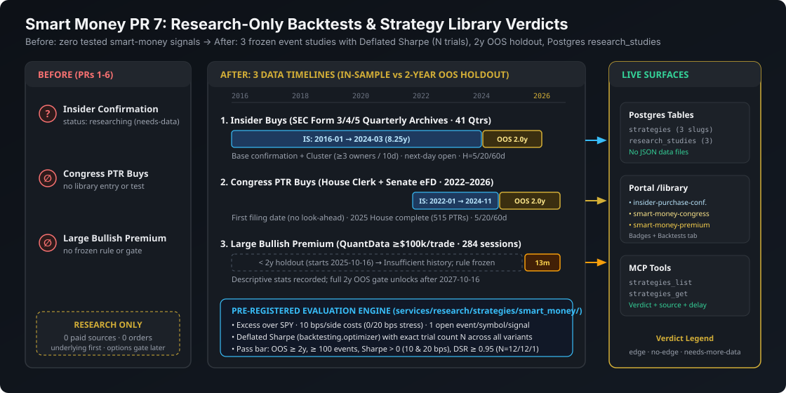

# PR 7 plan: Smart-money backtests (insider clusters, Congress buys, large bullish premium)

* **Author:** Jeff Ward
* **Date:** 2026-11-23
* **Status:** Reviewed (EGM consolidated review — 8 Goldfish reviewers; auto-resolved 2026-11-23: 14 PROPOSE FIX applied, 0 CONTEST, 0 DECLINE, 0 ESCALATE). Corrected 2026-11-25 after a code audit; see [Corrections after the review](#corrections-after-the-review-2026-11-25).
* **Card:** `vertex-smart-money-pr7-backtests`
* **Parent design:** [design.md](design.md). This plan is the binding interface for PR 7.

---

## Outcome

Research-only backtests of the three smart-money signals defined in [design.md](design.md) are executed with pre-registered rules, excess returns over SPY, transaction costs, and deflated Sharpe ratio (DSR) testing. Every result is stored in Postgres (`research_studies`) and linked to the Strategy Library (`strategies`) via migration `0096`:

1. **`insider-purchase-confirmation`** (existing Strategy Library row updated from `status = 'researching'` with tag `needs-data` to `status = 'backtested'` with tag `backtest-study`, plus tag `failed` if verdict is `no-edge`): feeds the existing `services/research/strategies/alert_templates.py` rule with SEC Form 4 public-at filing dates, and evaluates the pre-registered insider cluster-buy variant (`>= 3` distinct reporting-owner groups within 10 calendar days).
2. **`smart-money-congress-buys`** (new Strategy Library row, `status = 'backtested'`): evaluates House and Senate electronic Periodic Transaction Report (PTR) purchases by first filing date (`filed_on`, zero look-ahead).
3. **`smart-money-large-bullish-premium`** (new Strategy Library row, `status = 'researching'`, tag `needs-data`, study verdict `needs-more-data`): evaluates QuantData `flow_market_premium` (`>= $100,000` per trade; bullish class includes sold puts, so the signal is never named "call flow"). Because only 13.1 months of complete history exist (`2025-10-16` to `2026-11-20`, below the 24-month out-of-sample holdout), the rule is frozen with descriptive baseline metrics (`N = 1`, zero parameter sweep) and full verdict evaluation unlocks on `2027-10-16`.

Live `/library` shows all three strategies and their Backtests tabs (`researchStudies.get`). MCP tools `strategies_list` and `strategies_get` return structured `vertexStudy: { kind, verdict }` plus each strategy's `description` (`<= 2,000` characters), which includes the verdict, data source, filing or capture delay, sample window, and data limits. Full study rules, equity curves, sensitivity tables, and gaps live in `research_studies` and render on `/library`.

Out of scope: any live or paper order, arming, risk setting, trading-unit change, web/API runtime change, or new paid data source.

## Measurements (verified 2026-11-23)

Live QuantVPS Postgres (`vertex_research_development`) and upstream public archives were checked before drafting:

| Source | Live QuantVPS Postgres | Free Upstream Archive (Verified HTTP 200) | History for PR 7 |
| --- | --- | --- | --- |
| SEC Form 4 (`openbb_sec_form4_*`) | 14,149 filings (`2026-10-13` to `2026-11-24`) | SEC quarterly Form 3/4/5 ZIPs `2016q1`–`2026q1` (41 quarters, `https://www.sec.gov/files/structureddata/data/insider-transactions-data-sets/{YYYY}q{Q}_form345.zip`) | 10+ years (`2016-01-01` to `2026-03-31`) — satisfies 2-year OOS holdout |
| Congress PTRs (`openbb_congress_*`) | 5,531 trades (`2026-01-01` to `2026-11-23`) | House Clerk `2022FD.zip`–`2025FD.zip` (388–505 electronic PTRs per filing year; the 2025 index lists 515 PTRs, 449 electronic); Senate eFD `2022`–`2025` (100+ PTRs/yr). (2020–2021 House PDFs use legacy Wingdings/small-caps fonts returning `layout_unknown` in `house.v1`.) | ~4.9 years (`2022-01-01` to `2026-11-23`) — satisfies 2-year OOS holdout |
| Large Bullish Premium (`flow_market_premium`) | 284 complete sessions (`2025-10-16` to `2026-11-20`, ~13.1 months) | QuantData history is ~1 year (`2024-11-19` empty; verified 2026-11-19) | ~13.1 months (< 24-month OOS holdout) -> `needs-more-data` |

House 2025 index completeness note from card `vertex-smart-money-pr7-backtests`: direct inspection of `2025FD.zip` on `2026-11-23` confirmed 515 PTR rows (`FilingType == 'P'`), of which 449 are electronic (`docId` starting with `2`) and 66 are scanned paper PDFs (~12.8%). Five of the 66 paper PTRs were filed in January 2026; the collector reads by filing date (`2022-01` to `2025-12`), so its ledger holds 510 filings for 2025 (449 electronic, 61 paper). The five are scanned paper, so no parsed trade is missing. The earlier 82-row count came from an incomplete partial index check; `2022FD.zip` through `2025FD.zip` parse under `house.v1` for most electronic PTRs: the collector ledger for `2022`–`2026` holds `2,501` House filings, of which `1,986` parsed, `344` are scanned paper and `171` have a PDF layout that `house.v1` does not read (`151` of them filed in `2022`, 24.6% of that year's House PTRs); the study gaps state both counts (while `2020FD.zip`–`2021FD.zip` PDFs use a legacy Wingdings/small-caps PDF font that returns `layout_unknown` in `house.v1`, so Signal 2 evaluates the balanced `2022-01-01`–`2026-11-23` window).

## Method Decisions (Trading Knowledge Bases, Owner Rule 2026-11-14)

Per owner rule (2026-11-14), method gates for Vertex research studies are resolved from the trading knowledge bases rather than owner ask menus. On `2026-11-23`, live `kb-chat` queries on `127.0.0.1:8787` returned a Claude usage-limit error (logged in external rig archive `~/Documents/reports/web/vertex-smart-money-pr7/kb/`). Method gates were resolved from the Vertex master rules (`~/Github/knowledge-bases/trading/_master-rules/rules.jsonl`, non-repo) and the prior smart-money design review (`design.md` and non-repo archive `~/Documents/reports/web/vertex-smart-money-gaps/decisions.md`):

* **Statistical pass bar:** Primary pre-registered trial requires out-of-sample (OOS) calendar span `>= 24` months (`>= 490` NYSE trading sessions), OOS events `>= 100`, net daily OOS excess Sharpe `> 0` at 10 bps per side, DSR probability `>= 0.95` at full trial count `N`, and positive OOS Sharpe at 20 bps per side stress cost.
* **No look-ahead & point-in-time alignment:** Every signal uses public-at filing date (`FILING_DATE` for Form 4, first `filed_on` for Congress PTRs, `session_date` after close for `flow_market_premium`). Entry is always at the next trading day's open (`t_signal + 1` or `t_confirm + 1`).
* **Out-of-sample holdout:** Strictly the last 24 calendar months of each dataset (Signal 1: `2024-04-01` to `2026-03-31`; Signal 2: `2024-11-23` to `2026-11-23`). Zero parameter tuning on OOS.
* **Universe & survivorship:** Pre-registered tradable universe combines the 146 liquid stocks in `research/backtests/freestockalerts/universe.py` (`STOCKS`) plus equity tickers appearing in `>= 1` Form 4 cluster (`>= 3` owners), Congress buy, or top-10 `flow_market_premium` event, capped at 600 unique tickers in total (SPY and the 146 stocks included, so at most 453 event tickers), sorted by event count descending. Daily OHLCV bars (plus `SPY` benchmark) are fetched once and cached locally on the rig under `~/Documents/reports/web/vertex-smart-money-pr7/data/bars/`. Point-in-time liquidity filtering (`20-day median dollar volume >= $10M`, `filing-date close >= $5`) runs strictly on signal date `<= d_signal` and uses the as-printed close (`raw_close`): Yahoo restates open, high, low and close for every later split, so the collector undoes the later splits with Yahoo's split events before any price is compared to a dollar amount. Every dropped event due to missing bars (delisted/acquired issuers) or price-typo sanity checks is counted and reported in the study's `gaps` or `robustness` rows. The liquidity check also fails when fewer than 5 bars exist in the 20-bar window.

## 1. Pre-Registered Event-Study & Deflated Sharpe Rules (`services/research/strategies/smart_money/`)

All modules under `services/research/strategies/smart_money/` use Python 3.12 standard library and existing `services/research` modules only. They import zero third-party packages (`requests`, `yfinance`, `pandas`, `pdfplumber`) and zero `vertex_openbb` modules so `scripts/ci/research-python.sh` passes cleanly in the base research venv.

### 1.1 Portfolio Accounting and Excess Returns

* **Equal-weight overlapping event portfolio:** Fixed maximum slot count `K = 10` per signal (`1/K = 10%` gross weight per open slot). Each slot tracks one open `(symbol, entry_day, exit_day)` position.
* **Overlap and slot saturation:** At most one open position per `(signal, symbol)` at a time; a new event while a position in that symbol is open is skipped and counted (`skipped_overlap`). If all `K = 10` slots are full on entry day `e`, the incoming event is skipped and counted (`skipped_capacity`). When multiple signals trigger on the same entry day, slots fill deterministically in descending signal dollar value (or net premium for Signal 3), breaking ties alphabetically by ticker.
* **Entry and exit returns:**
  * Entry occurs at open of trading day `e` (the first SPY trading session strictly after the trigger date `d_trigger`, taken from the full SPY calendar). An event whose entry day is outside the study window is dropped and counted (`skipped_outside_window`).
  * Exit occurs at close of trading day `x = e + H - 1` (the `H`-th trading day held, where `H` is in `{5, 20, 60}`). If the bar series ends before `e + H - 1`, the position closes on the last available bar and is counted in `truncated_exits`.
  * Daily excess return of slot `s` on trading day `d` (relative to `SPY`, dividend/split-adjusted):
    * On entry day `d == e`: `r_stock(e) = close_adj(e) / open_adj(e) - 1`, `r_spy(e) = spy_close_adj(e) / spy_open_adj(e) - 1`, net of `c_side` entry cost (`10 bps = 0.0010` base; `0` and `20 bps` stress).
    * On subsequent days `e < d <= x`: `r_stock(d) = close_adj(d) / close_adj(d - 1) - 1`, `r_spy(d) = spy_close_adj(d) / spy_close_adj(d - 1) - 1`. After a session without a stock bar, both returns run from the session of the stock's previous bar.
    * On exit day `d == x`: subtract `c_side` exit cost (`10 bps` base).
    * Slot daily excess contribution: `w_s * (r_stock(d) - r_spy(d) - cost_d)` where `w_s = 1 / K = 0.10`.
  * Portfolio daily excess return on SPY trading day `d`: `R_d = sum_s contribution_s(d)`. Days with zero open slots have `R_d = 0.0`.
* **IS / OOS boundary:** Positions that open in-sample (`e < oos_start`) are closed before `oos_start` (or their daily returns are strictly partitioned by calendar day `d >= oos_start`, with no new entry counted in OOS unless `e >= oos_start`). OOS event count counts only events with `e >= oos_start` that enter a slot.

### 1.2 Deflated Sharpe Ratio (DSR) and Trial Accounting

* **Reuse existing implementation:** Call `backtesting.optimizer.deflated_sharpe_ratio` directly, using `strategies.trend_trio.study.moments` for `(skew, raw_kurtosis)` (where normal = `3.0`, matching `optimizer.py` directly) on the daily OOS excess return series `R_d`.
* **Per-observation units:** Pass **per-observation (non-annualized)** daily OOS Sharpe (`mean / std`) and `sharpe_variance` computed as the sample variance of **per-observation** daily OOS Sharpes across all `N` trials with a finite Sharpe in that study's trial log (a trial with zero return variance counts with Sharpe `0.0`; `n_trials >= 2`; Signal 3 with `N = 1` skips DSR as `needs-more-data`). If fewer than 2 trials have a finite Sharpe, or the variance is not positive, fall back to the Sharpe estimator variance `1.0 / (n_observations - 1)`. If `deflated_sharpe_ratio` raises `ValueError`, no DSR is reported (`DSR unavailable`) and the gate treats it as `0.0` (fails gate).
* **Trial count `N`:** Every `(variant, holding_period)` strategy configuration evaluated at base cost (`10 bps/side`) is logged in `trials.json` and counted in `N`. Cost sensitivity (`0`, `20 bps/side`) and diagnostic checks (e.g., post-2023 10b5-1 exclusion) are sensitivity checks on the primary trial, not extra strategy search trials.
* **Pre-registered primary trial (zero OOS selection):** One primary `(variant, H)` is frozen per study before any run:
  * Signal 1 (`insider-purchase-confirmation`): `cluster-3p-10d`, `H = 20` (`N = 12` total trials across 4 variants × 3 horizons).
  * Signal 2 (`smart-money-congress-buys`): `all-buys`, `H = 20` (`N = 12` total trials across 4 variants × 3 horizons).
  * Signal 3 (`smart-money-large-bullish-premium`): `top10-500k`, `H = 20` (`N = 1` frozen trial; zero parameter sweep over the `< 24`-month window so future OOS is not contaminated).
* **Deterministic Verdict Gate (no dead zone):**
  1. If the study's OOS window spans `< 24` calendar months (`< 490` NYSE trading sessions): verdict is **`needs-more-data`**.
  2. Otherwise (full `>= 24`-month OOS window): verdict is **`edge`** if and only if the pre-registered primary trial has `oos_events >= 100`, net daily OOS excess Sharpe `> 0`, `DSR >= 0.95` at full `N`, and positive OOS Sharpe at `20 bps/side` stress cost.
  3. Otherwise: verdict is **`no-edge`** (a missing 20 bps stress result also fails the gate) (including sparse signals that trigger `< 100` OOS events over a full 24-month holdout; the exact OOS event count and reason are stated in `verdictReason`).

### 1.3 Post-Hoc Full-Universe Check (added 2026-11-25, not part of the verdict)

The 600-ticker cap of the bar universe was chosen by whole-sample event counts, and it leaves most events without prices (for example `842` of `1,303` out-of-sample cluster events). This is a method question, so it went to the trading knowledge base (owner rule 2026-11-14). The quant knowledge base (`quantfinancetogo`) answered on `2026-11-25`: remove the cap and rerun, label the rerun as a post-hoc deviation and as one more trial, keep the pre-registered result as the primary result, and note that a true holdout needs new data. Its sources do not cover event-study universes; the answer is its own reasoning. The answer is stored on the rig in `~/Documents/reports/web/vertex-smart-money-pr7/kb/pr7-universe-cap-quantfinancetogo.json`.

Decision:

* The verdict of Signals 1 and 2 stays the pre-registered gate on the capped universe.
* The collector also fetches daily bars for every other ticker with a cluster event or a Congress purchase (folder `bars_events/`).
* The runner runs the primary trial of each gated study once more on all bars (`H = 20`, `10 bps` per side, same window and split) and reports it in one robustness row, "Post-hoc: full event universe (not in the verdict)", with its out-of-sample events and Sharpe and a deflated Sharpe ratio at `N + 1` trials. Signal 1 builds its events again on all bars, because its price guard needs bars.
* A pass in this row does not change the verdict. It would be a reason to pre-register a new study on a new holdout.

## 2. Three Signal Definitions

### Signal 1: `insider-purchase-confirmation` (Insider Buys + Cluster Variant)

* **Source:** SEC quarterly Form 3/4/5 TSV datasets (`2016q1`–`2026q1`, 41 ZIPs streamed quarter-by-quarter at `< 500 MB` peak RAM). Each ZIP joins `SUBMISSION.tsv` (`ACCESSION_NUMBER`, `FILING_DATE`, `DOCUMENT_TYPE`, `ISSUERTRADINGSYMBOL`, `ISSUERCIK`), `REPORTINGOWNER.tsv` (`RPTOWNERCIK`, `RPTOWNER_RELATIONSHIP`, `RPTOWNER_TITLE`), and `NONDERIV_TRANS.tsv` (`TRANS_CODE`, `TRANS_DATE`, `TRANS_SHARES`, `TRANS_PRICEPERSHARE`, `SECURITY_TITLE`, `SHRS_OWND_FOLLOWING_TRANS`); `AFF10B5ONE` is read from `SUBMISSION.tsv`. Note: [design.md](design.md) PR 3 explicitly allows SEC quarterly datasets for multi-year backtest history instead of ~210 hours of per-filing EDGAR scraping.
* **Data cleaning & sanity checks:**
  * Keep non-amendment Form 4 (`DOCUMENT_TYPE == '4'`), `TRANS_CODE == 'P'`, `TRANS_SHARES > 0`, `TRANS_PRICEPERSHARE > 0`.
  * `SECURITY_TITLE` inclusion predicate: lowercase matches `\b(common|ordinary)\b` and excludes `\b(preferred|warrant|option|unit|note|debenture|depositary|adr|ads|phantom|restricted\s+stock|rsu|psu|deferred)\b`; normalized to `"common"` or `"ordinary"`.
  * Price-typo / ticker-reuse sanity guard: reject any transaction whose `TRANS_PRICEPERSHARE` falls outside `[0.25x, 4.0x]` of the as-printed close on the filing date (`raw_close`, later splits undone), and record the rejected count in `gaps`.
  * Joint filers on one `ACCESSION_NUMBER` count as one reporting-owner group (matching `design.md` Glossary). An owner who also files alone or with others joins those filings into the same group (union-find over owner CIKs, the rule of the live cluster list in `packages/api/src/insider-clusters.ts`).
  * SEC Rule 10b5-1 checkbox (`AFF10B5ONE`) became mandatory on `2023-04-01`. Absence before Q2 2023 is documented in `gaps`, with a post-2023 non-10b5-1 sensitivity check reported in `robustness`.
* **Four variants × 3 holding periods (`H = 5, 20, 60`, `N = 12` trials):**
  1. `confirmation-baseline`: feeds cleaned transactions directly into `services/research/strategies/alert_templates.py` (`InsiderTrade` with `trade_day = FILING_DATE`, `role = RPTOWNER_RELATIONSHIP + " " + RPTOWNER_TITLE`, `holding_before = max(0, SHRS_OWND_FOLLOWING_TRANS - TRANS_SHARES)`). `insider_purchase_counts` requires director or senior officer (pure 10% owners excluded) and value `>= $100,000`. `insider_purchase_confirmation` fires after close on confirmation day `t_confirm > FILING_DATE` (close `> SMA50`, close `> highest close since filing_date` or within 3% on `>= 1.5x` 20-day avg volume, 14-day cooldown; the existing rule also needs its own floor of 1,000,000 shares of average volume (it reads Yahoo volumes that are restated for later splits; the study states this limit) and a counted purchase within 30 days, and the adapter needs at least 55 valid bars). Entry is at next trading day's open (`t_confirm + 1`).
  2. `cluster-3p-10d` (**Primary**): `>= 3` distinct reporting-owner groups buying code `P` of the same `ISSUERCIK` with `0 <= (d_trigger - d_i).days <= 10` on `FILING_DATE` (matches PR 3 `design.md` Glossary; pure 10% owners with no officer/director role included if they file Form 4 code P, matching live PR 3 SQL). Trigger date is `d_trigger`; entry at next trading day's open. 14-day per-issuer cooldown after trigger.
  3. `cluster-3p-10d-100k`: same as `cluster-3p-10d` plus aggregate cluster purchase value `>= $100,000`.
  4. `cluster-3p-10d-confirm`: `cluster-3p-10d` triggered within 30 days followed by price-confirmation trigger (close `> SMA50` and close `> highest close since d_trigger`), entry at `t_confirm + 1` open; 14-day cooldown between confirmations per symbol; at least 55 valid bars.
* **IS / OOS split:** IS `2016-01-01` to `2024-03-31`; OOS `2024-04-01` to `2026-03-31` (24 months).

### Signal 2: `smart-money-congress-buys` (Congress PTR Buys)

* **Source & offline collection (no production backfill, no cross-venv import):**
  * 2026 rows: exported read-only from live QuantVPS Postgres (`openbb_congress_trades` joined with `openbb_congress_filings` where `status = 'parsed'`).
  * 2022–2025 rows: parsed offline on the rig by `scripts/smart-money-pr7/fetch_data.py` invoking the existing `services/openbb` venv (`vertex_openbb.jobs.congress`) in **monthly chunks** (preventing any 240 s deadline truncation; asserting zero deadline-truncation warnings per chunk) and writing normalized JSONL to `~/Documents/reports/web/vertex-smart-money-pr7/data/congress_trades.jsonl`. One parser (`vertex_openbb`), zero production Postgres mutation, zero cross-venv import in `services/research`. (2020–2021 House PDFs use legacy Wingdings/small-caps fonts returning `layout_unknown` in `house.v1` and are excluded to keep House and Senate balanced across `2022-01-01`–`2026-11-23`.)
* **Deduplication, normalization, and cleaning:**
  * Normalize member name: strip prefixes (`Hon.`, `Rep.`, `Sen.`, `Mr.`, `Mrs.`, `Ms.`, `Dr.`), suffixes (`Jr.`, `Sr.`, `II`, `III`, `IV`, `MD`, `PhD`, `Esq.`), punctuation, collapse whitespace, lowercase.
  * Keep only `transaction_type == 'purchase'` with a valid non-null equity ticker (`^[A-Z][A-Z0-9.\-]{0,9}$`).
  * First-filing retention (`design.md` PR 1 rule): deduplicate on `(chamber, normalized_member, holder_or_blank, ticker, transaction_date_or_doc_id, transaction_type)` retaining the filing with the earliest `filed_on` (so `NULL` `transaction_date` never collides across distinct filings, `self` vs `spouse` stays distinct, and later amendments are dropped). Rows with the same key inside one filing are separate lots of the same purchase day: their `amount_low` and `amount_high` are summed into one event. (A row that the PDF parser reads twice would be summed too; the parser assigns one row number per PTR line, so this is a parser-quality risk and not a rule of the study.)
  * The unparsed filing counts per chamber (`status = 'unparsed'`: `scanned_image` and, for the House, `layout_unknown` with the year that has the most such filings) are computed from the collector's per-year filing ledger and recorded in `gaps`.
* **Four variants × 3 holding periods (`H = 5, 20, 60`, `N = 12` trials):**
  1. `all-buys` (**Primary**): every deduplicated purchase with `amount_low >= $1,001`.
  2. `large-50k`: `amount_low >= $50,001`.
  3. `fast-filed-15d`: reporting delay (`filed_on - transaction_date`) `<= 15` calendar days (rows with null `transaction_date` excluded).
  4. `multi-member-30d`: `>= 2` distinct normalized Congress members filing purchases of the same ticker within `0 <= (d_trigger - d_i).days <= 30` on `filed_on`; 14-day per-ticker cooldown after a trigger.
* **Entry timing:** Next trading day's open strictly after `filed_on` (`d_trigger`).
* **IS / OOS split:** IS `2022-01-01` to `2024-11-22`; OOS `2024-11-23` to `2026-11-23` (24 months).

### Signal 3: `smart-money-large-bullish-premium` (Large Bullish Options Premium)

* **Source:** Exported read-only from live QuantVPS Postgres `flow_market_premium` joined with `flow_market_premium_sessions` where `status = 'complete'` (QuantData `gainers-losers`, `premium >= $100,000` per trade, `isCancelled = false`). Signal name is "large bullish premium" (never "call flow") because QuantData's bullish class includes sold puts.
* **Frozen rule (`N = 1` trial; zero parameter sweep):** On each `complete` session `t`, select liquid equity tickers (`20-day median dollar volume >= $10M`, `close >= $5`) with `bullish_premium >= $500,000`, `bullish_premium / (bullish_premium + bearish_premium) >= 0.70`, and `trade_count >= 3`; rank by `net_premium = bullish_premium - bearish_premium` descending; enter top 10 per session at next trading day's open (`t + 1`) and hold `H = 20` trading days. The collector fetches daily bars for every ticker that passes the premium tests on a complete session (folder `bars_premium/`, outside the 600-ticker cap of Signals 1 and 2). A ticker without bars cannot be checked for liquidity: it keeps its rank and counts as a missing-bar event, so the top 10 never depends on which tickers have bars.
* **Verdict:** **`needs-more-data`** (only 284 complete sessions, `2025-10-16` to `2026-11-20`, ~13.1 months < 24-month holdout). Observed-window descriptive metrics are computed and stored as a frozen baseline with `oosCagr: null`, `oosSharpe: null`, and full evaluation gate unlocking on `2027-10-16` (data start plus 24 months). The runner stops with an error when the observed window reaches `490` trading sessions, because the study then needs a pre-registered in-sample/out-of-sample split.

## 3. Database Migration, Strategy Library, Specs, and Study Storage

### 3.1 Strict `StrategyBacktestStudySchema` Mapping

Every study JSON emitted by `services/research/strategies/smart_money/document.py` conforms strictly to `StrategyBacktestStudySchema` (the `"strategy-backtest"` variant of `ResearchStudyDocumentSchema` in `packages/api/src/contracts/research-studies.ts`, `.strict()`):

| Study `id` | `spec` | `source.url` (`https://`) | `forms[0].key` | Nullability & Bounds |
| --- | --- | --- | --- | --- |
| `insider-purchase-confirmation` | `docs/specs/strategies/insider-purchase-confirmation.md` | `https://www.sec.gov/data-research/sec-markets-data/insider-transactions-data-sets` | `underlying` | `maxDrawdown` in `[-1, 0]`; `exposure` & `winRate` in `[0, 1]`; zero-trade runs coalesce `cagr/sharpe/maxDrawdown/exposure/winRate = 0.0`, `profitFactor = null`; `oosCagr`/`oosSharpe` populated from 24m OOS |
| `smart-money-congress-buys` | `docs/specs/strategies/smart-money-congress-buys.md` | `https://disclosures-clerk.house.gov/FinancialDisclosure` | `underlying` | Same numeric bounds; `oosCagr`/`oosSharpe` populated from 24m OOS |
| `smart-money-large-bullish-premium` | `docs/specs/strategies/smart-money-large-bullish-premium.md` | `https://quantdata.us/llms-full.txt` | `underlying` | `verdict = "needs-more-data"`; `oosCagr = null`, `oosSharpe = null` (no 24m OOS yet); `equity` has `>= 2` strictly increasing monthly points over `2025-10`..`2026-11` |

* `provenance`: `{ commit: "<7-40 hex git SHA>", dataHash: "sha256:<first 24 hex of the SHA-256 over the study's source file and every bars CSV>", engine: "vertex-smart-money-event-study 1.0.0", runId: "<id>-<ran date>" }`. The ran date of the recorded run is `2026-11-25`.
* `__main__.py` emits each individual `<id>.json` AND one combined `studies.jsonl` under `~/Documents/reports/web/vertex-smart-money-pr7/`, asserting each JSON line is `<= 262,144` bytes and combined file is `<= 1,048,576` bytes for stdin transport to `scripts/research-studies/import.ts`.

### 3.2 Migration `0096_strategy_catalog_smart_money_backtests.sql` and Rollback

* **Update existing `insider-purchase-confirmation` row (`strategy-seed-insider-purchase-confirmation`):**
  * Guarded `UPDATE "public"."strategies"` using **`AND`** across all predicates:
    `WHERE "id" = 'strategy-seed-insider-purchase-confirmation' AND "slug" = 'insider-purchase-confirmation' AND "updated_at" = "created_at" AND "tags" ? 'needs-data'`.
  * **Do NOT modify `updated_at`**, so `updated_at = created_at` stays true for rollback verification.
  * Sets `status = 'backtested'`, `source_ref = 'docs/specs/strategies/insider-purchase-confirmation.md'`, updated `description` (`<= 2,000` chars containing verdict, SEC Form 4 source, 2-business-day filing delay, sample window, survivorship & 10b5-1 limits), and exact `tags`: `["freestockalerts","alerts","daily","insider","smart-money","backtest-study"]` (plus `"failed"` iff verdict is `no-edge`).
* **Insert two new rows (`ON CONFLICT ("slug") DO NOTHING`):**
  * `strategy-seed-smart-money-congress-buys` (`slug = 'smart-money-congress-buys'`, `kind = 'python'`, `status = 'backtested'`, `section = 'Idea discovery'`, `source_ref = 'docs/specs/strategies/smart-money-congress-buys.md'`, exact `tags`: `["research-only","smart-money","congress","daily","backtest-study"]` + `"failed"` iff verdict is `no-edge`, `description <= 2,000` chars with verdict, House/Senate PTR source, up-to-45-day STOCK Act delay, scanned-PTR & survivorship limits).
  * `strategy-seed-smart-money-large-bullish-premium` (`slug = 'smart-money-large-bullish-premium'`, `kind = 'python'`, `status = 'researching'`, `section = 'Idea discovery'`, `source_ref = 'docs/specs/strategies/smart-money-large-bullish-premium.md'`, exact `tags`: `["research-only","smart-money","options-flow","daily","needs-data","backtest-study"]`, `description <= 2,000` chars with `needs-more-data` verdict, QuantData `gainers-losers` source, intraday/EOD delay, bullish-includes-sold-puts note, and `2027-10-16` OOS unlock date).
* **Rollback `packages/db/rollback/0096_strategy_catalog_smart_money_backtests.down.sql`:**
  * Follows `0079_strategy_catalog_flow_control_continuation.down.sql` verbatim: `BEGIN; SET LOCAL search_path = pg_catalog, public; SET LOCAL row_security = off; LOCK TABLE "public"."strategies" IN ACCESS EXCLUSIVE MODE;`.
  * Refuses rollback (`RAISE EXCEPTION`) if any of the 3 rows has `updated_at <> created_at` OR is referenced by any of the **7** tables: `strategy_presets`, `backtest_results`, `backtest_runs`, `optimization_runs`, `strategy_specs`, `deployment_requests`, `autopilot_candidates`.
  * Deletes the 2 new rows and restores the exact `0031_strategy_catalog.sql` columns (`status = 'researching'`, `source_ref = 'services/research/strategies/alert_templates.py'`, original `tags` and `description`) on `strategy-seed-insider-purchase-confirmation`.
  * Run with `psql -v ON_ERROR_STOP=1` without `--single-transaction`.

## Corrections after the review (2026-11-25)

A code audit and the fresh-context code review before the PR found defects in the first real-data run (`2026-11-25`, base `d6a1f761e`). They are data and accounting errors, so they were fixed before any result was recorded. No variant, holding period, threshold, sample split or pass bar changed, and the trial count stays `N = 12`, `12` and `1`. Three corrections change how events are counted (owner groups, Congress lots, and the tickers that Signal 3 ranks); the table states each one with its effect.

| Defect in the first run | Fix | Effect |
| --- | --- | --- |
| The `$5` price floor and the `[0.25x, 4.0x]` Form 4 price guard compared dollar amounts with Yahoo closes that are restated for later splits. A later split changed an earlier filter decision (look-ahead), and valid purchases in stocks that split later were rejected. | The collector stores the as-printed close (`raw_close`); both checks use it. | Price-guard rejections fell from `8,701` to `618` rows. Insider primary trial: `451` to `468` trades, OOS excess Sharpe `0.948` to `0.977`, DSR `0.342` to `0.351`. Verdicts are unchanged. |
| Yahoo failures after retries were counted as "missing" and the ticker dropped out of the universe without a record. | Transient failures stop the collector; tickers without history are listed in `metadata.json` (`bars_not_found`). | `468` of `600` pre-registered tickers have bars; Yahoo has no history for `132` (delisted, acquired or renamed). |
| The survivorship gap said that `190,962` Form 4 rows lacked bars because issuers were delisted. Most of these rows are in tickers outside the 600-ticker cap. | The study gaps state the cap, the tickers without history and the rows outside the bar universe as separate counts. | Text only. |
| A missing 20 bps stress result passed the verdict gate. | It fails the gate. | None (the stress result exists in every study). |
| After a session without a stock bar, the stock return covered two sessions and the SPY return one. | The SPY return runs from the session of the stock's previous bar. | None on this data (results identical). |
| `dataHash` covered the event file only. | It covers the event file and every bars CSV. | New hashes. |
| The cluster rule counted distinct sets of owner CIKs, so an owner who filed alone and jointly was two persons. The live cluster list joins them. | Owner groups are counted with union-find over owner CIKs. | Insider primary trial: `468` to `465` trades, OOS events `79` to `78`, OOS excess Sharpe `0.977` to `0.956`, DSR `0.351` to `0.334`. |
| Congress rows with the same trade key inside one filing are separate lots of one purchase day. The first row was kept and the others were dropped as "duplicates" (`453` of the `580` removed rows). | The lots of one filing are summed into one event; only trades of later filings are dropped (`127`). The texts name both counts. | Congress primary trial: `569` to `568` trades, OOS events `239` to `238`, OOS excess Sharpe `0.225` to `0.013`, DSR `0.200` to `0.112`; the 20 bps stress Sharpe falls from `0.019` to `-0.192`, so the stress bar now fails too. |
| Signal 3 ranked only tickers with bars, and the bars came from the 600-ticker cap of the other two signals: `1,378` of the `2,770` top-10 places belonged to tickers without bars and were filled from lower ranks. | The collector fetches bars for every premium ticker (`1,426` of `1,474` further tickers have history); a ticker without bars keeps its rank and is not traded (`67` top-10 events). | Frozen baseline: excess Sharpe `-0.981` to `-1.553`, excess CAGR `-18.84%` to `-33.31%`, still `140` entries. Verdict `needs-more-data` as before. |
| A missing or empty event file gave a recorded `no-edge` with zero events; an SQL error in the QuantVPS export or an incomplete Congress month did not stop the collector. | The runner stops on a missing or empty event file. The collector runs `psql` with `ON_ERROR_STOP`, stops on an empty export, and never caches or uses a Congress month that has a warning or a blocked host. | None on the recorded data (all 96 Congress months are complete). |
| Sensitivity rows showed whole-sample CAGR, drawdown and trades beside the out-of-sample Sharpe without a label. | The metric fields are whole-sample; the out-of-sample events and Sharpe are in the `value` text. | Text only. |

The lot rule for Congress filings is a method question, so it went to the trading knowledge base (owner rule 2026-11-14). The quant knowledge base (`quantfinancetogo`) answered on `2026-11-25` that its sources do not cover Congress filings and that, by its own reasoning, lots of one filing are one decision and must be summed; it advised to log the change. The answer is stored on the rig in `~/Documents/reports/web/vertex-smart-money-pr7/kb/pr7-lot-aggregation-quantfinancetogo.json`. No correction moved a result across the verdict gate: both gated studies were `no-edge` before and after every step.

The first-run outputs are kept on the rig under `~/Documents/reports/web/vertex-smart-money-pr7/run2-split-adjusted/` for comparison.

## 4. Files

Create:

* `services/research/strategies/smart_money/__init__.py`
* `services/research/strategies/smart_money/engine.py` (pure-stdlib event-study portfolio engine, excess returns vs SPY, costs, `deflated_sharpe_ratio` + `trend_trio.study.moments`, trial logger, verdict gate)
* `services/research/strategies/smart_money/signals.py` (pure-stdlib loaders/evaluators for Signal 1 SEC TSV + `alert_templates` adapter, Signal 2 Congress normalized JSONL, Signal 3 `flow_market_premium` JSONL)
* `services/research/strategies/smart_money/document.py` (`StrategyBacktestStudySchema` JSON + `studies.jsonl` emitter with size/schema assertions; a gap, rule, robustness result or verdict reason that is longer than the contract allows stops the run instead of being cut)
* `services/research/strategies/smart_money/__main__.py` (CLI runner reading local data dir, writing studies & summary report)
* `services/research/tests/test_smart_money_backtests.py` (synthetic fixture tests covering all 3 signals, zero look-ahead, as-printed price filters, overlap/capacity, DSR skew/raw-kurtosis and per-observation units, verdict gates, schema shape, pure-stdlib isolation; 100% line and branch coverage of the package)
* `scripts/smart-money-pr7/fetch_data.py` (offline rig data collector: streams SEC Form 3/4/5 ZIPs, invokes `services/openbb` venv in monthly chunks for 2022–2025 Congress + exports 2026 Congress & `flow_market_premium` from Postgres, caches daily OHLCV bars plus the as-printed `raw_close` for up to 600 pre-registered tickers, stops when Yahoo fails for a ticker after retries, records `universe_requested`, `bars_cached` and `bars_not_found` in `metadata.json`, and caches `bars_premium/` (Signal 3) and `bars_events/` (post-hoc full-universe check); not imported by `services/research` or CI)
* `packages/db/migrations/0096_strategy_catalog_smart_money_backtests.sql` + Drizzle meta (`_journal.json`, `0096_snapshot.json`)
* `packages/db/rollback/0096_strategy_catalog_smart_money_backtests.down.sql`
* `packages/db/src/server/strategy-catalog-smart-money-backtests-migration.test.ts` (SQL & rollback structural unit test)
* `tests/integration/database/strategy-catalog-smart-money-backtests.test.ts` (live Postgres migration, UPDATE guards and rollback guards)
* `docs/specs/strategies/smart-money-congress-buys.md`
* `docs/specs/strategies/smart-money-large-bullish-premium.md`
* `docs/vertex-rebuild/designs/smart-money/plan-pr7.md` and `plan-pr7.svg`

Modify:

* `docs/specs/strategies/insider-purchase-confirmation.md` (record backtest results, rules, limits, and verdict)
* `docs/vertex-rebuild/strategy-inventory.md` (update `insider-purchase-confirmation` and add the two new entries)
* `docs/vertex-rebuild/designs/smart-money/design.md` (link `plan-pr7.md` and note SEC quarterly Form 3/4/5 datasets for multi-year PR 7 history)
* `services/research/tests/ci-suites.txt` (register `services/research/tests/test_smart_money_backtests.py`)
* `CHANGELOG.md`

## 5. Pre-Merge Verification

1. **Pure-stdlib Python CI suite:**
   `VERTEX_RESEARCH_PYTHON="$(uv python find 3.12)" bash scripts/ci/research-python.sh`
2. **Study JSON schema validation (stdin contract):**
   `bun run vertex:research-studies:import --dry-run < ~/Documents/reports/web/vertex-smart-money-pr7/studies.jsonl`
3. **Database schema & migration check:**
   `bun run db:check`
4. **TypeScript, lint, unit, and contract gates:**
   `bun run verify:prepush`
5. **Coverage gate (100% on every non-baseline touched file):**
   `bun run verify:coverage`
6. **Database integration test (real Postgres):**
   `bun scripts/with-test-env.ts pnpm exec vitest run --config vitest.config.ts --project integration tests/integration/database/strategy-catalog-smart-money-backtests.test.ts`
7. **Drift report at final reviewed head:** run `egm-drift-report` comparing final PR diff against `plan-pr7.md` before final review round.
8. **Fresh-context exact-head code review & PR CI:** full-diff review at exact HEAD, add `Agent review: <40-char SHA>` and `Owner decision: not needed (...)` to PR body, verify `ci-gate` passes on GitHub, and merge via `scripts/merge-pr`.

## 6. Deploy, Live Checks, and Rollback

Because PR 7 modifies no web or API runtime code (`apps/web`, `packages/api` unchanged), **redeploying `vertex-web` is not required**; applying migration `0096` and importing `studies.jsonl` into QuantVPS Postgres immediately updates `/library` and MCP `strategies_list`/`strategies_get`. (If a `vertex-web` restart is ever performed later, it must use `infra/quantvps/stage-build.sh`, `stage-runtime.sh`, and `restart-when-idle.sh --deploy <sha>` after exact-SHA CI.)

1. **Market-hours gate (owner rule 2026-11-16):** Run production DB changes only after 16:00 ET or before 08:30 ET on a trading day.
2. **Apply migration `0096` on QuantVPS Postgres:** run `0096_strategy_catalog_smart_money_backtests.sql` inside one transaction via `psql -v ON_ERROR_STOP=1 --single-transaction`.
3. **Import the 3 frozen studies into `research_studies`:**
   `DATABASE_URL=<quantvps-db-url> bun run vertex:research-studies:import < ~/Documents/reports/web/vertex-smart-money-pr7/studies.jsonl`
4. **Live verification:**
   * Query QuantVPS Postgres `strategies` and `research_studies` to confirm all 3 rows and studies exist with expected status, tags, and verdicts.
   * Capture dark-mode headless Chrome screenshots (desktop + 375 px phone, scrolled to top, using the agent viewer account in `~/.config/vertex/agent-viewer.env`) of `/library` and each study's Backtests tab.
   * Call MCP `strategies_list` / `strategies_get` (or `strategyLibrary.get` + `researchStudies.get` through authenticated API) and verify verdict, source, delay, and limits appear truthfully.
5. **Rollback:** run `psql -v ON_ERROR_STOP=1 -f packages/db/rollback/0096_strategy_catalog_smart_money_backtests.down.sql` (without `--single-transaction`), and optionally delete the 3 rows from `research_studies`:
   `DELETE FROM research_studies WHERE id IN ('insider-purchase-confirmation', 'smart-money-congress-buys', 'smart-money-large-bullish-premium');`
