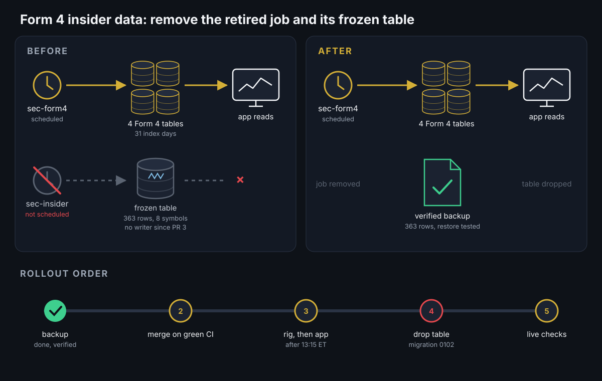

# Plan: remove the retired `sec-insider` job and drop its frozen table



* **Card:** `vertex-sec-insider-retire-cleanup` (work tracker card)
* **Kind:** cleanup (removal of retired job, table, and contract members; no new feature)
* **Baseline commit:** `77cce8c1` on `vertex/rebuild-darkfactory-20260921`
* **Parent design:** [design.md](./design.md#pr-3-form-4-market-wide) (section "PR 3: Form 4 market-wide")
* **Related plan:** [plan-pr3.md](./plan-pr3.md) (the change that retired the job)
* **Owner decision:** 2026-11-27, owner Discord message (private; recorded in the pull request `Owner decision:` line): back up `openbb_sec_insider_trades`, verify the backup, then remove the `sec-insider` job and drop the table in a migration.

## Background

Vertex Research is a private, login-only research portal. Scheduled OpenBB jobs run on a workstation called the rig (`services/openbb`), fetch public market data, and send rows to the portal's ingest endpoint. The portal stores those rows in PostgreSQL on QuantVPS (container `vertex-postgres`, database `vertex_research_development`, which is the single live portal database despite the `_development` name).

Form 4 is the SEC filing in which a company insider reports a trade. Before PR 3 of the smart money design, the job `sec-insider` fetched Form 4 rows for 10 tracked large stocks and wrote them to `openbb_sec_insider_trades`. PR 3 added `sec-form4`, which reads each SEC EDGAR daily form index into four market-wide tables (`openbb_sec_form4_filings`, `openbb_sec_form4_transactions`, `openbb_sec_form4_owners`, `openbb_sec_form4_index_days`), moved every insider-trade reader to those four tables, and removed `sec-insider` from the rig schedule.

The parent design specifies: keep `sec-insider` and `openbb_sec_insider_trades` unscheduled with no scheduled writer until the new Form 4 data covers 30 days, then remove both in a follow-up migration. This plan executes that follow-up.

## Problem

The 30-day condition is met, and the retired job and table have no scheduled writer and no row reader:

* **Form 4 coverage verified on live DB:** `openbb_sec_form4_index_days` (one row per processed SEC EDGAR daily filing index date) holds 31 SEC filing index days spanning `2026-10-13` through `2026-11-25` (checked on 2026-11-25 and again on 2026-11-27; 2026-11-26 was US Thanksgiving, an SEC holiday with no daily index, and 2026-11-27 is in progress).
* **Frozen table verified on live DB:** `openbb_sec_insider_trades` holds 363 rows across 8 symbols (8 of the 10 tracked symbols had Form 4 filings in that date range) and 100 distinct accessions, filing dates `2026-10-13` through `2026-11-19`. All 363 rows (100 of 100 accessions) are also present in `openbb_sec_form4_filings`. Checked via `git grep` at `77cce8c1`: no scheduled job writes to it (manual CLI runs and the ingest union still accept it until rollout completes), and no page or API reads its row data. Its only remaining database reader is the table-statistics query (`STAT_TABLES` in `packages/db/src/server/openbb.ts`), which feeds `openbb.status.tables`.
* **Dead code across five repo areas:** `services/openbb`, `packages/api`, `packages/db`, `apps/web` tests, `tests/integration/database`, and `infra/openbb` still carry `sec-insider`, `sec_insider_trades`, a `retired` schedule kind (the freshness monitoring classification of each job in `OPENBB_JOB_METADATA`), the `retired` boolean on `OpenbbSourceStatusSchema`, and nullable `maxAgeHours` / `maxAgeSeconds` solely for `sec-insider`. The `openbb.status` response (`sources` and `tables`) still lists "SEC insider (retired)" and `openbb_sec_insider_trades`.

## Precondition (completed 2026-11-27)

Before this plan was finalized, `public.openbb_sec_insider_trades` was backed up from QuantVPS `vertex-postgres` (`vertex_research_development`) in three files:

* `openbb_sec_insider_trades.dump` (`pg_dump --format=custom`, SHA-256 `4299166c74122dbbfa85d7c6b9ad9bda4368a86f8c9a1f5fcbba5d5d357822ff`)
* `openbb_sec_insider_trades.sql` (`pg_dump --format=plain`, SHA-256 `b4dfe2c4aa2aaced629fe2c4cf4142ce1202d2722eab481a63332c721245c111`)
* `openbb_sec_insider_trades.csv` (`\copy ... ORDER BY accession_number, row_number`, 363 data rows, SHA-256 `ded8200a1cbfc5e6d7be9814ffbc10c20e664ecc1bdf40a07830e286349c7620`)

Both dump files (`.dump` via `pg_restore --exit-on-error` and `.sql` via `psql -v ON_ERROR_STOP=1`) were restored into a temporary scratch database on `vertex-postgres`; both matched the live table's row count and ordered-row MD5 (`363|ba77f3777f0b530ca4e03b26d2eb57c1`, computed over `ORDER BY accession_number, row_number`) and all 7 constraints, and the scratch database was dropped. The CSV file was exported and SHA-256 hashed, not restore-tested. Copies plus a `README.md` recording the hashes, restore result, and restore commands live in two locations excluded from automated cleanup and retained indefinitely until the owner deletes them:

* Rig: `~/.local/share/vertex-research-data/backups/openbb_sec_insider_trades-20261127/`
* QuantVPS: `/root/backups/openbb_sec_insider_trades-20261127/`

## Goal

After this change and rollout:

1. The job `sec-insider`, the ingest table name `sec_insider_trades`, the Drizzle schema export `openbbSecInsiderTrades`, and the live table `public.openbb_sec_insider_trades` do not exist in active code or in the live database.
2. The single allowed camelCase exception is `OpenbbSecInsiderRowSchema` (and the `OpenbbInsiderRow` repository type), because `openbb.sec` returns Form 4 rows built from the four Form 4 tables in that shape (`insiderTrades`).
3. The 46 historical `sec-insider` rows in `openbb_ingest_runs` (`2026-11-09` through `2026-11-20`, newest status `ok`) remain untouched as read-only audit history. `openbb.status.runs` uses `job: z.string()`, so it continues to serialize them safely, and `connectivity-health.ts` ignores `ok` runs. `openbb.status.sources` has no `sec-insider` entry and `openbb.status.tables` has no `openbb_sec_insider_trades` entry.
4. **Contract narrowing:** removing `sec-insider`, `sec_insider_trades`, the `"retired"` schedule kind, `OpenbbSourceStatusSchema.retired`, and `null` from `maxAgeSeconds` narrows the ingest and status contracts and updates `packages/api/openapi.json` and the `openbb_status` MCP tool description. Consumers checked at `77cce8c1`: web status panels (`apps/web`), the `openbb_status` MCP tool (`packages/api/src/server/mcp.ts`), and `services/openbb`. `openbb.sec`'s `insiderTrades` output shape and returned rows do not change.

## Fix

1. **Remove the Python job (`services/openbb`):** delete `sec-insider` from `JOBS`, `JOB_TABLES`, `SYMBOL_JOBS`, and remove `("sec", "InsiderTrading")` from `FETCHERS_USED`; delete `_transaction_codes`, `insider_rows`, `insider`, and the now-unused `defaultdict` import in `jobs/sec.py`; delete `"sec_insider_trades"` from `rows.py`; delete `sec-insider` fixtures and `record.py` entry; add a CLI test confirming `sec-insider` is rejected.
2. **Narrow the API contract and services (`packages/api`):** remove `"sec-insider"` and `"sec_insider_trades"` from `contracts/openbb.ts`, remove `"retired"` from schedule kinds, change `maxAgeHours` from `number | null` to `number`, change `OpenbbSourceStatusSchema.maxAgeSeconds` from `count.nullable()` to `count`, remove `OpenbbSourceStatusSchema.retired`, simplify `openbb-overdue.ts`, rename `SEC_INSIDER_LIMIT` to `SEC_FORM4_LIMIT` in `server/openbb.ts`, remove `, retired` from the `openbb_status` MCP description in `server/mcp.ts`, delete `fixtures/openbb/sec_insider_trades.json`, update tests (and add an ingest rejection test), and regenerate `openapi.json`.
3. **Drop the database table (`packages/db` + integration/infra tests):** remove `openbbSecInsiderTrades` from `schema/openbb.ts` and `server/openbb.ts` (`UPSERT_TABLES`, `STAT_TABLES`); generate migration `0102_drop_openbb_sec_insider_trades.sql` (single statement `DROP TABLE "openbb_sec_insider_trades";`, no `CASCADE`); write its rollback `packages/db/rollback/0102_drop_openbb_sec_insider_trades.down.sql` derived from in-repo `0064_openbb_sources.sql`; add `packages/db/src/server/sec-insider-drop-migration.test.ts`; update `tests/integration/database/database.test.ts`, `tests/integration/database/openbb.test.ts`, and `infra/openbb/rig/install.test.ts`.
4. **Update docs:** update `docs/vertex-rebuild/openbb.md`, `design.md`, `plan-pr3.md`, `CHANGELOG.md`, and run `bun run docs:generate`.
5. **Roll out safely ([Step 6: Rollout](#step-6-rollout)):** verify pre-flight `DROP TABLE ... ROLLBACK`, install rig, deploy QuantVPS app (normal deploy — no guard override needed because `scripts/migrations/check-applied.ts` removes expectations on `DROP TABLE` and does not check table absence), re-check live row count and MD5, apply `0102`, and verify live checks.

## Alternatives considered

* **Keep the table, remove only the job.** Rejected on technical grounds: the table has no scheduled writer, no row reader, and 100% of its 363 rows (100/100 accessions) already exist in `openbb_sec_form4_filings`. Keeping it leaves dead schema and a stale row on `openbb.status.tables`. This matches the owner decision recorded in the pull request `Owner decision:` line.
* **Keep the `retired` schedule kind and `retired` status field for future retirements.** Rejected: no remaining job uses them, and the repository's 100% branch-coverage gate requires live callers or synthetic dead-code tests. A later retirement can restore them from this commit's history.
* **Apply migration `0102` before deploying the new app.** Rejected: the currently running build queries `openbb_sec_insider_trades` in `STAT_TABLES` inside `Promise.all` (`packages/db/src/server/openbb.ts`), so dropping the table first breaks `openbb.status` until `restart-when-idle.sh` finishes its idle wait (which has no timeout).
* **Split into two releases (Release 1 removes code references; Release 2 drops the table).** Rejected: because `scripts/migrations/check-applied.ts` (`recordDropTable`) deletes expectations for dropped tables and does not check table absence, a single release deploys cleanly through the migration guard with zero override flags and zero alert notices, followed immediately by applying `0102`. A second release would add a second PR, review, and idle-wait restart for no reduction in downtime or risk.
* **Delete the 46 `sec-insider` rows from `openbb_ingest_runs` inside `0102`.** Rejected: the owner authorized dropping `openbb_sec_insider_trades`, not deleting ingest audit history, and the latest `sec-insider` run row has status `ok` (so `connectivity-health.ts` ignores it and `openbb.status.runs` validates it cleanly).

## Out of scope

* The four Form 4 tables, the `sec-form4` job, and the `/smart-money` and SEC pages' insider-trade rendering.
* The 13F, fails-to-deliver, and SEC filings jobs.
* Historical rows in `openbb_ingest_runs`.
* Trading: this change touches research data only. It places, changes, or cancels no orders, never arms or disarms an engine, and changes no risk settings.

## Risks and limits

* **Data loss on permanent drop.** Mitigation: verified backup in two locations (see Precondition) plus 100% overlap (363/363 rows) in `openbb_sec_form4_filings`. Immediately before applying `0102`, re-verify the live row count (`363`) and ordered-row MD5 (`ba77f3777f0b530ca4e03b26d2eb57c1`); abort and take a fresh backup on any mismatch.
* **Dependent database object blocking the drop.** Mitigation: live DB check on 2026-11-27 found 0 views and 0 incoming foreign keys. Before deploying, run a transactional dry run (`BEGIN; SET LOCAL lock_timeout = '2s'; DROP TABLE "openbb_sec_insider_trades"; ROLLBACK;`) to prove no catalog-tracked object blocks the drop. The migration uses `DROP TABLE` without `CASCADE`, so an unexpected dependent fails loudly rather than cascading.
* **Hold state if migration `0102` fails after the app deploy.** Mitigation: if `0102` fails after the new build is live, the new build continues running cleanly because it never queries or writes `openbb_sec_insider_trades`, and future deploys still pass the migration guard (which does not check table absence). The operator reports the failure, resolves the blocking object and retries `0102`, or reverts the migration commit.
* **Market-hours window.** Research portal restarts are restricted outside market hours to avoid interrupting operator research sessions during trading. `infra/quantvps/restart-when-idle.sh` enforces no restarts from 08:30 to 16:00 ET on regular US trading days. On the 2026-11-27 half day (US market 09:30–13:00 ET), no rig install, web restart, or database migration runs between 08:30 and 13:15 ET. Rollout runs after 13:15 ET on 2026-11-27 (or outside 08:30–16:00 ET on a later regular trading day).

## Acceptance criteria

1. **Backup verified:** both backup directories exist with matching SHA-256 hashes against their `README.md`, and the restore test result (`363|ba77f3777f0b530ca4e03b26d2eb57c1`) is recorded in both `README.md` files and the card receipt.
2. **No active code references:** `git grep -i -e "sec-insider" -e "sec_insider" -e "SecInsiderTrades"` on the merged commit matches only: applied migrations and snapshots `0064`..`0101`, `packages/db/rollback/0064_openbb_sources.down.sql`, new migration `0102_drop_openbb_sec_insider_trades.sql`, its rollback `0102_drop_openbb_sec_insider_trades.down.sql`, `packages/db/src/server/sec-insider-drop-migration.test.ts`, `services/openbb/tests/test_jobs.py` (CLI rejection test), `packages/api/src/openbb-overdue.test.ts` (ingest rejection test), `tests/integration/database/openbb.test.ts` (0102 migration/rollback SQL paths), `CHANGELOG.md`, and design/plan docs under `docs/vertex-rebuild/designs/smart-money/`. (`OpenbbSecInsiderRowSchema` is the single allowed camelCase exception, and TypeScript compilation in `verify:prepush` catches any leftover `openbbSecInsiderTrades` reference.)
3. **All gates green:** `scripts/ci/research-python.sh`, `bun run verify:prepush`, `bun run verify:integration`, EGM drift report, fresh-context code-diff review, and GitHub required check `ci-gate` all pass on the merged head SHA.
4. **Live table dropped:** on QuantVPS `vertex-postgres` (`vertex_research_development`), `SELECT to_regclass('public.openbb_sec_insider_trades');` returns `NULL` (the sole proof of the drop, since the migration guard does not check table absence), and `restart-when-idle.sh --dry-run` still prints `migrations: all`.
5. **Live status clean:** QuantVPS `vertex-web` runs the merged commit; `openbb.status` returns HTTP 200 with no `sec-insider` entry in `sources` and no `openbb_sec_insider_trades` entry in `tables` (historical `sec-insider` rows in `runs` remain as audit history).
6. **Insider-trade API unchanged:** `openbb.sec` for a symbol with recent Form 4 filings (e.g. `AAPL`) returns the same `insiderTrades` rows before and after rollout (compared by JSON snapshot captured before deploy).
7. **Rig CLI rejects retired job:** on the rig, `vertex-openbb` runs from the merged commit and `vertex-openbb sec-insider --dry-run` exits non-zero rejecting the unknown job name.

## Implementation plan

Steps 1 through 4 land in **one atomic commit** because `packages/db` (`UPSERT_TABLES`) and `apps/web` tests depend directly on `packages/api` contract types.

### File boundary (Create / Modify / Delete)

| Action | Path | Summary |
| --- | --- | --- |
| Delete | services/openbb/tests/fixtures/sec-insider.json (deleted) | Retired job fixture |
| Delete | services/openbb/tests/fixtures/upstream/sec-insider.json (deleted) | Retired upstream fixture |
| Delete | packages/api/src/fixtures/openbb/sec_insider_trades.json (deleted) | Retired contract fixture |
| Create | `packages/db/migrations/0102_drop_openbb_sec_insider_trades.sql` | Non-CASCADE `DROP TABLE` migration |
| Create | `packages/db/migrations/meta/0102_snapshot.json` | Generated Drizzle snapshot |
| Create | `packages/db/rollback/0102_drop_openbb_sec_insider_trades.down.sql` | Full table + constraints + guarded grant rollback |
| Create | `packages/db/src/server/sec-insider-drop-migration.test.ts` | Migration and rollback unit tests |
| Modify | `services/openbb/vertex_openbb/cli.py` | Remove `sec-insider` from `JOBS`, `JOB_TABLES`, `SYMBOL_JOBS`, and `("sec", "InsiderTrading")` from `FETCHERS_USED` |
| Modify | `services/openbb/vertex_openbb/jobs/sec.py` | Remove `_transaction_codes`, `insider_rows`, `insider`, `defaultdict` import; update docstring |
| Modify | `services/openbb/vertex_openbb/rows.py` | Remove `"sec_insider_trades"` from row rules and key map |
| Modify | `services/openbb/tests/fixtures/invalid-rows.json` | Remove `sec_insider_trades` cases |
| Modify | `services/openbb/tests/fixtures/valid-edge-rows.json` | Remove `sec_insider_trades` case |
| Modify | `services/openbb/tests/record.py` | Remove `"sec-insider"` entry |
| Modify | `services/openbb/tests/test_jobs.py` | Add `test_retired_sec_insider_job_is_rejected_by_cli` asserting CLI rejects `sec-insider` |
| Modify | `packages/api/src/contracts/openbb.ts` | Remove `sec-insider`, `sec_insider_trades`, `"retired"` schedule kind, `retired` status field; make `maxAgeHours` and `maxAgeSeconds` non-nullable numbers |
| Modify | `packages/api/src/openbb-overdue.ts` | Remove `retired` branches and field; simplify `OPENBB_MONITORED_OVERDUE_KEYS` to `OPENBB_JOBS`; update count comment ("22 OpenBB jobs") |
| Modify | `packages/api/src/openbb-overdue.test.ts` | Rename healthy-path test, delete lines 220–224, remove `retired: false` at line 604; add contract test rejecting `table: "sec_insider_trades"` |
| Modify | `packages/api/src/openbb-server.test.ts` | Assert `status.sources.length >= OPENBB_JOBS.length` (22) instead of 23 |
| Modify | `packages/api/src/server/openbb.ts` | Rename `SEC_INSIDER_LIMIT` to `SEC_FORM4_LIMIT` |
| Modify | `packages/api/src/server/mcp.ts` | Remove `, retired` from `openbb_status` description (line 749) |
| Modify | `packages/api/openapi.json` | Regenerate via `bun run openapi:generate` |
| Modify | `apps/web/src/components/portal/smart-money-workspace.test.tsx` | Remove the 5 `retired: false` fixture properties |
| Modify | `packages/db/src/schema/openbb.ts` | Remove `openbbSecInsiderTrades` table export |
| Modify | `packages/db/src/server/openbb.ts` | Remove `openbbSecInsiderTrades` import, `UPSERT_TABLES` entry, and `STAT_TABLES` entry |
| Modify | `packages/db/src/server/openbb.test.ts` | Update expected 0064 active table count (15), `OPENBB_UPSERT_TABLES` count (20), and `tableStats` count (21) |
| Modify | `packages/db/migrations/meta/_journal.json` | Add `0102_drop_openbb_sec_insider_trades` entry (via `pnpm db:generate`) |
| Modify | `tests/integration/database/database.test.ts` | Remove `openbb_sec_insider_trades` from PK map |
| Modify | `tests/integration/database/openbb.test.ts` | Wire `0102` down/up around `0064` rollback tests; assert 23 OpenBB tables at end |
| Modify | `infra/openbb/rig/install.test.ts` | Delete `unscheduled = ["sec-insider"]` filter and comment; compare steps directly to sorted `OPENBB_JOBS` |
| Modify | `docs/vertex-rebuild/openbb.md` | Remove lines 155, 366, `sec_insider_trades` at 387; update line 442 ("22 non-retired" -> "22") |
| Modify | `docs/vertex-rebuild/designs/smart-money/design.md` | Add completion note at line 149 linking `./plan-sec-insider-retire.md` |
| Modify | `docs/vertex-rebuild/designs/smart-money/plan-pr3.md` | Add completion note at line 13 linking `./plan-sec-insider-retire.md` |
| Modify | `CHANGELOG.md` | Add one bullet under Unreleased |
| Modify | `docs/generated/*` (if changed by `bun run docs:generate`) | Generated docs sync |

### Step 1: Python service (`services/openbb`)

* `vertex_openbb/cli.py`: remove `"sec-insider"` from `JOBS`, `JOB_TABLES`, and `SYMBOL_JOBS`; remove `("sec", "InsiderTrading")` from `FETCHERS_USED` (verified unused by any other job at `77cce8c1`).
* `vertex_openbb/jobs/sec.py`: remove `_transaction_codes`, `insider_rows`, `insider`, and the unused `from collections import defaultdict` import; update the module docstring so it lists only the remaining SEC jobs (`sec-filings`, `sec-ftd`, `sec-13f`, `sec-form4`).
* `vertex_openbb/rows.py`: remove `"sec_insider_trades"` from the row specs and from the primary key map.
* Fixtures & tests: delete services/openbb/tests/fixtures/sec-insider.json (deleted) and services/openbb/tests/fixtures/upstream/sec-insider.json (deleted); remove `sec_insider_trades` entries from `services/openbb/tests/fixtures/invalid-rows.json` and `services/openbb/tests/fixtures/valid-edge-rows.json`; remove `"sec-insider"` from `services/openbb/tests/record.py`; add a Python test asserting that invoking the CLI with `sec-insider` exits non-zero as an unknown job.

### Step 2: API contract, services, and web tests (`packages/api`, `apps/web`)

* `packages/api/src/contracts/openbb.ts`:
  * Remove `"sec-insider"` from `OPENBB_JOBS` and `"sec_insider_trades"` from `OPENBB_INGEST_TABLES`.
  * Remove `"sec-insider"` from `OPENBB_JOB_METADATA` and `OPENBB_JOB_TABLES`.
  * Remove `sec_insider_trades` from the ingest union and `OPENBB_TABLE_ROW_SCHEMAS`.
  * Remove `"retired"` from `OPENBB_SCHEDULE_KINDS`; change `maxAgeHours` from `number | null` to `number`; change `OpenbbSourceStatusSchema.maxAgeSeconds` from `count.nullable()` to `count`; remove `retired: z.boolean()` from `OpenbbSourceStatusSchema`.
  * Keep `OpenbbSecInsiderRowSchema` unchanged (used by `openbb.sec` output `insiderTrades`).
* `packages/api/src/openbb-overdue.ts`:
  * Update comment at line 41 from "22 non-retired OpenBB jobs" to "22 OpenBB jobs".
  * Set `OPENBB_MONITORED_OVERDUE_KEYS` directly from `OPENBB_JOBS` (all 22 jobs are monitored).
  * Remove `retired` checks and `retired` property from returned source status objects, and simplify `maxAgeSeconds` to `meta.maxAgeHours * 3600`.
* `packages/api/src/server/openbb.ts`: rename `SEC_INSIDER_LIMIT` to `SEC_FORM4_LIMIT` (lines 67 and 671).
* `packages/api/src/server/mcp.ts`: remove `, retired` from the `openbb_status` tool description (line 749).
* Tests & fixtures:
  * Delete packages/api/src/fixtures/openbb/sec_insider_trades.json (deleted).
  * `packages/api/src/openbb-overdue.test.ts`: rename the healthy-path test at line 185 (drop "and keeps retired sec-insider non-overdue"), delete lines 220–224, remove `retired: false` at line 604, and add a contract test confirming the ingest payload schema rejects `table: "sec_insider_trades"`.
  * `apps/web/src/components/portal/smart-money-workspace.test.tsx`: remove the 5 `retired: false` properties from fixture objects.
* Regenerate OpenAPI: run `bun run openapi:generate`.

### Step 3: Database, integration tests, and rig install test (`packages/db`, `tests/integration/database`, `infra/openbb/rig`)

* `packages/db/src/schema/openbb.ts`: remove `openbbSecInsiderTrades`.
* `packages/db/src/server/openbb.ts`: remove `openbbSecInsiderTrades` import, `sec_insider_trades` entry in `UPSERT_TABLES`, and `openbb_sec_insider_trades` entry in `STAT_TABLES`.
* Generate migration (`pnpm` is used for workspace-filtered Drizzle CLI commands per `package.json`):

  ```sh
  pnpm --filter @darkfactory/db exec drizzle-kit generate --config drizzle.config.ts --name drop_openbb_sec_insider_trades
  ```

  Ensure `packages/db/migrations/0102_drop_openbb_sec_insider_trades.sql` contains strictly:

  ```sql
  DROP TABLE "openbb_sec_insider_trades";
  ```

  (no `CASCADE`). Verify `packages/db/migrations/meta/_journal.json` and `0102_snapshot.json` match and `pnpm db:check` passes.
* Write `packages/db/rollback/0102_drop_openbb_sec_insider_trades.down.sql` derived from in-repo `packages/db/migrations/0064_openbb_sources.sql` lines 161–177 and 215–223 (no later migration altered `openbb_sec_insider_trades`; cross-checked against the backup DDL), using the standard rollback wrapper:

  ```sql
  -- Reversal of 0102_drop_openbb_sec_insider_trades only.
  -- Recreates the empty table with the exact columns, primary key, CHECK constraint, and guarded
  -- vertex_research grant from 0064_openbb_sources.sql. Restore rows data-only from backup before
  -- redeploying a pre-0102 build. Outside discoverable migrations.
  BEGIN;
  SET LOCAL search_path = pg_catalog, public;
  SET LOCAL row_security = off;
  CREATE TABLE "public"."openbb_sec_insider_trades" (
    "accession_number" text NOT NULL,
    "acquired_disposed" text,
    "filing_date" date NOT NULL,
    "owner_name" text NOT NULL,
    "owner_title" text,
    "price" double precision,
    "row_number" integer NOT NULL,
    "shares" double precision,
    "shares_after" double precision,
    "symbol" text NOT NULL,
    "transaction_code" text,
    "transaction_date" date,
    "url" text,
    CONSTRAINT "openbb_sec_insider_trades_accession_number_row_number_pk" PRIMARY KEY("accession_number","row_number"),
    CONSTRAINT "openbb_sec_insider_trades_check" CHECK ("openbb_sec_insider_trades"."accession_number" ~ '^[0-9]{10}-[0-9]{2}-[0-9]{6}$' and ("openbb_sec_insider_trades"."row_number" is null or "openbb_sec_insider_trades"."row_number" >= 0) and "openbb_sec_insider_trades"."symbol" ~ '^[A-Z0-9.^=-]{1,16}$' and ("openbb_sec_insider_trades"."owner_name" is null or char_length(trim("openbb_sec_insider_trades"."owner_name")) between 1 and 200) and ("openbb_sec_insider_trades"."owner_title" is null or char_length(trim("openbb_sec_insider_trades"."owner_title")) between 1 and 200) and ("openbb_sec_insider_trades"."transaction_code" is null or char_length(trim("openbb_sec_insider_trades"."transaction_code")) between 1 and 10) and ("openbb_sec_insider_trades"."shares" is null or ("openbb_sec_insider_trades"."shares" > '-Infinity'::float8 and "openbb_sec_insider_trades"."shares" < 'Infinity'::float8)) and ("openbb_sec_insider_trades"."price" is null or ("openbb_sec_insider_trades"."price" > '-Infinity'::float8 and "openbb_sec_insider_trades"."price" < 'Infinity'::float8)) and ("openbb_sec_insider_trades"."shares_after" is null or ("openbb_sec_insider_trades"."shares_after" > '-Infinity'::float8 and "openbb_sec_insider_trades"."shares_after" < 'Infinity'::float8)) and ("openbb_sec_insider_trades"."acquired_disposed" is null or "openbb_sec_insider_trades"."acquired_disposed" in ('A', 'D')) and ("openbb_sec_insider_trades"."url" is null or "openbb_sec_insider_trades"."url" ~ '^https://'))
  );
  DO $$
  BEGIN
    IF EXISTS (SELECT 1 FROM pg_roles WHERE rolname = 'vertex_research') THEN
      GRANT SELECT, INSERT, UPDATE, DELETE ON TABLE "public"."openbb_sec_insider_trades" TO "vertex_research";
    END IF;
  END
  $$;
  COMMIT;
  ```

* Create `packages/db/src/server/sec-insider-drop-migration.test.ts` verifying:
  * `0102_drop_openbb_sec_insider_trades.sql` executes a single `DROP TABLE "openbb_sec_insider_trades";` with no `CASCADE` and matches `_journal.json`.
  * `0102_drop_openbb_sec_insider_trades.down.sql` recreates the exact columns, primary key, CHECK constraint, and guarded `vertex_research` grant matching `0064_openbb_sources.sql`.
* `tests/integration/database/database.test.ts`: remove `openbb_sec_insider_trades` from the primary key map.
* `tests/integration/database/openbb.test.ts`: load `0102_drop_openbb_sec_insider_trades.sql` and `.down.sql`; apply `0102.down.sql` before each `0064` rollback run (so `0064`'s `LOCK TABLE` / `DROP TABLE` succeeds against real Postgres), re-apply `0102.sql` after re-applying `0064`..`0089`, and assert `expect(await tables()).toHaveLength(23)`.
* `infra/openbb/rig/install.test.ts`: delete the comment and `unscheduled = ["sec-insider"]` filter at lines 56–58; compare scheduled step names directly against sorted `OPENBB_JOBS`.

### Step 4: Documents

* `docs/vertex-rebuild/openbb.md`: remove the `sec-insider` row (line 155), remove the `openbb_sec_insider_trades` row (line 366), remove `sec_insider_trades` from the ingest table list (line 387), and change "the 22 non-retired OpenBB jobs" to "the 22 OpenBB jobs" (line 442).
* `docs/vertex-rebuild/designs/smart-money/design.md` (line 149) and `plan-pr3.md` (line 13): append one sentence recording that the removal was completed per `[plan-sec-insider-retire.md](./plan-sec-insider-retire.md)`.
* `CHANGELOG.md`: add one entry under Unreleased describing the verified backup, removal of `sec-insider`, contract narrowing, and migration `0102_drop_openbb_sec_insider_trades`.
* Run `bun run docs:generate` and commit any updated file under `docs/generated/`.

### Step 5: Verify, review, merge

1. Run Python suite: `scripts/ci/research-python.sh` (or `pytest` inside `services/openbb`).
2. Run focused Vitest tests while iterating, then full pre-push gate: `bun run verify:prepush`.
3. Run database integration tests (Docker Postgres or CI `integration` lane): `bun run verify:integration`.
4. Run EGM drift report (`egm-drift-report` skill) comparing this plan against the implementation; fix any drift and re-run checks if code changed.
5. Run fresh-context code-diff review (separate subagent with no conversation history); fix any findings (max 3 rounds).
6. Open PR on `vertex-research-public` with the dark before-vs-after graphic at the top of the description, `Agent review: <40-char head SHA>`, and `Owner decision: 2026-11-27, owner Discord message (private)` (per `Merge conditions` check).
7. Merge when `ci-gate` is green on the exact head SHA (and dispatch/verify exact-SHA `ci.yml` per `docs/deploy.md#release-checklist` before rollout).

### Step 6: Rollout

All steps run **after 13:15 ET on 2026-11-27** (or outside 08:30–16:00 ET on any regular US trading day). Record all live command outputs in the pull request closeout comment and the card receipt (`fm receipt`).

1. **Pre-flight live checks (read-only + rolled-back DDL):**
   * Capture pre-rollout `openbb.sec` (`AAPL`) JSON snapshot from the live portal for criterion 6 comparison.
   * Confirm row count and MD5 still match the backup (`363|ba77f3777f0b530ca4e03b26d2eb57c1`):

     ```sh
     ssh quantvps 'docker exec -i vertex-postgres psql -U postgres -d vertex_research_development -X -A -t -v ON_ERROR_STOP=1 -c "select count(*)||'\''|'\''||md5(string_agg(t::text, E'\''\n'\'' order by accession_number,row_number)) from openbb_sec_insider_trades t;"'
     ```

   * Run transactional dry-run drop to prove zero catalog dependents before deploying:

     ```sh
     ssh quantvps 'docker exec -i vertex-postgres psql -U postgres -d vertex_research_development -X -v ON_ERROR_STOP=1 -c "BEGIN; SET LOCAL lock_timeout = '\''2s'\''; DROP TABLE \"openbb_sec_insider_trades\"; ROLLBACK;"'
     ```

2. **Rig install** (removes `sec-insider` job code from the rig; portal still accepts ingest until step 3):

   ```sh
   infra/openbb/rig/install.sh <merge sha>
   ```

3. **QuantVPS web deploy:** claim `deploy:quantvps-web` (`fm claim vertex-sec-insider-retire-cleanup deploy:quantvps-web`), confirm exact-SHA CI green (`docs/deploy.md#release-checklist`), then run `infra/quantvps/README.md` "Deploy a new web build" steps 1–8 (`stage-build.sh`, `stage-runtime.sh`, `infra/quantvps/restart-when-idle.sh --deploy <merge sha>`, Caddy/CSP checks, prunes). No `--allow-unapplied-migrations` flag is needed because `scripts/migrations/check-applied.ts` clears expectations on `DROP TABLE` and does not check table absence.
4. **Pre-drop live recheck & apply migration `0102`:**
   * Re-run the count + MD5 query from step 1; abort and take a fresh backup if it differs from `363|ba77f3777f0b530ca4e03b26d2eb57c1`.
   * Apply `0102_drop_openbb_sec_insider_trades.sql` in one transaction:

     ```sh
     ssh quantvps 'docker exec -i vertex-postgres psql -U postgres -d vertex_research_development -X -v ON_ERROR_STOP=1 --single-transaction' < packages/db/migrations/0102_drop_openbb_sec_insider_trades.sql
     ```

   * If this fails (unexpected dependent object), stop in the safe hold state (new build live, old table still present), report the error, and either remove the dependent and retry or revert the migration commit.
5. **Live verification (criteria 4–7):**
   * Table absent: `ssh quantvps 'docker exec -i vertex-postgres psql -U postgres -d vertex_research_development -X -A -t -c "SELECT to_regclass('\''public.openbb_sec_insider_trades'\'');"'` returns empty/`NULL`.
   * Guard dry run: `infra/quantvps/restart-when-idle.sh --deploy <merge sha> --dry-run` prints `migrations: all`.
   * Live portal check (using `~/.config/vertex/agent-viewer.env` or authenticated API call): `openbb.status` returns 200 with no `sec-insider` in `sources` and no `openbb_sec_insider_trades` in `tables`; `openbb.sec` (`AAPL`) returns `insiderTrades` rows matching the pre-rollout snapshot.
   * Rig CLI rejection: `~/.local/share/vertex-openbb/venv/bin/vertex-openbb sec-insider --dry-run` exits non-zero rejecting `sec-insider`.

### Rollback procedure

If a rollback to `<prev sha>` is needed after `0102` was applied, reverse the rollout order so the previous build never starts against a missing table:

1. Recreate the table, constraints, and guarded grant (safe while the new build is still running):

   ```sh
   ssh quantvps 'docker exec -i vertex-postgres psql -U postgres -d vertex_research_development -X -v ON_ERROR_STOP=1' < packages/db/rollback/0102_drop_openbb_sec_insider_trades.down.sql
   ```

2. Optionally restore the 363 rows data-only (required only to restore exact pre-drop rows; optional for app availability since no reader uses row data) and verify `363|ba77f3777f0b530ca4e03b26d2eb57c1`:

   ```sh
   ssh quantvps 'docker exec -i vertex-postgres pg_restore -U postgres -d vertex_research_development --data-only --exit-on-error < /root/backups/openbb_sec_insider_trades-20261127/openbb_sec_insider_trades.dump'
   ```

3. Redeploy `<prev sha>` using `infra/quantvps/restart-when-idle.sh --deploy <prev sha> --allow-older "rollback of 0102_drop_openbb_sec_insider_trades"` (migration guard passes without override because `openbb_sec_insider_trades` exists again). The previous rig install did not schedule `sec-insider`, so reinstalling the rig is not required unless manual CLI access is needed.
