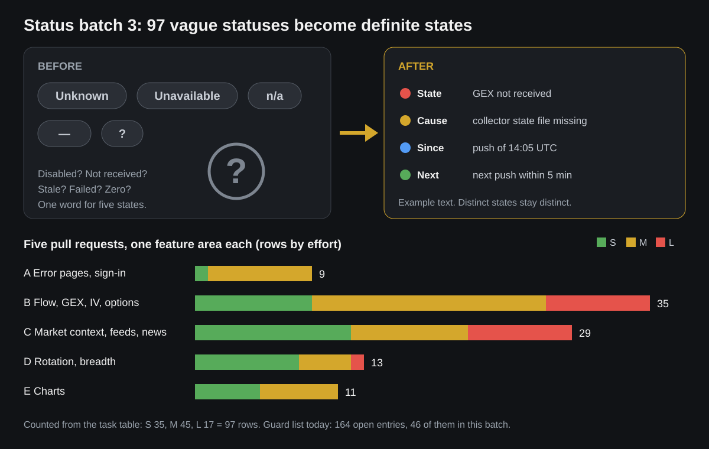

# Status batch 3: definite states for flow, GEX, IV, options, market feeds, rotation, charts, error pages and sign-in

| Item | Value |
| --- | --- |
| Card | `vertex-status-b3-market-data` (follows `vertex-no-unknown-status`) |
| Owner decision | 2026-11-11, owner Discord message (private): an ambiguous status is not acceptable in the dashboard |
| Source | Audit of 2026-11-13; its rows for this batch are in [rows.md](rows.md) (location, current text, when it appears, audit proposal, effort) |
| Final text for each row | [decisions.md](decisions.md) |
| Line numbers | From commit `f1bfa018`; find the text again before an edit |

Terms: the *rig* is the home server that collects market data. The *Quant VPS* is the server that runs the web app and the API. A *workspace* is the client component of one portal page. *GEX* is gamma exposure of option dealers, *IV* is implied volatility, *0DTE* is an option that expires today. A *factor* is one line of the flow page's confluence panel; it has a `vote` (bullish, bearish, neutral), a `value` text (at most 80 characters) and a `detail` text (at most 300 characters). A *fresh-context review* is a review by an agent that has not seen the work.

## Problem Statement

The audit found status texts that do not name a state: `Unknown`, `Unavailable`, `n/a`, a bare dash, `?`. This batch has 97 audit rows: 35 with effort S (text only), 45 with effort M (the data is in scope) and 17 with effort L (the audit classed the cause as not sent by the API). A user cannot tell these states apart: disabled, not yet received, stale, failed, zero.

The rows are in five areas. Row IDs (`A1`, `B12`) are in [rows.md](rows.md).

| Area | Subject | Rows |
| --- | --- | --- |
| A | Route error pages and sign-in | 9 |
| B | Flow, GEX, IV, options | 35 |
| C | Market context, feeds, news, calendar, congress | 29 |
| D | Rotation matrix, sector rotation, breadth | 13 |
| E | Charts and market data | 11 |

The status language guard is the test `apps/web/src/status-language.test.ts`. It fails when a text in `apps/web/src` contains a vague word (the word list is in the test header) and has no entry in the allow list `apps/web/src/status-language-allowlist.ts`. An entry with `open: true` is a known vague text that must be replaced; the constant `MAX_OPEN` is the count of open entries (164 at commit `0dfbf071`) and must equal it. 46 open entries are in files of this batch; one entry can cover several rows of one file, so `MAX_OPEN` falls by 46 (to 118 if no other batch merged). The entry for the dash in `congress-trades-workspace.tsx` counts four places, and the audit listed two (C1, C2); [decisions.md](decisions.md) adds the other two as rows C30 (a third missing value) and C31 (a range dash that is kept). So this plan decides 99 rows: 97 audit rows and 2 added rows. 34 rows are in `packages/api`, which the guard does not scan.

## Goals & Non-Goals

Goals:

- Each of the 99 rows shows a definite state, or it stays with an allow-list entry without `open` and a reason that the review accepts.
- A state that the system cannot determine is shown as not determined, with what was not reported. A value that was not received is never shown as zero, empty or available.

Non-goals:

- No change to an order, execution, arming or risk path, and no change to what the flow control signal computes.
- No new service, table, queue or migration.
- No guard for `packages/api` texts. The per-text tests of this plan fix the replaced texts only. A guard for API texts is a separate card (`vertex-status-api-guard`, created with this plan); it would also meet texts of other batches.
- The enum `FLOW_MONEYNESS` value `unknown` is renamed `not_reported` (card vertex-status-api-guard, migration 0091); the event detail text says "moneyness not reported". The status language guard now scans packages/api/src as well as apps/web/src.
- No change to market-watch-bot (another repository).
- Status rows of the other batches (1, 2, 4 and 5 of the same audit).

## Proposed Design

### Rules

1. **Status line** (banner, alert, badge with body text, caption). Form: `<state>: <cause> · <time> · <next step>`. When a part does not exist in the data, the text names what was not reported (`time not reported by source`). Times are `HH:MM UTC`; a time that is not from the current UTC day adds the date (`2026-11-18 14:05 UTC`).
2. **Table cell or inline value.** A null value shows a short reason of at most four words (`no reading`, `no prior value`, `too few bars`), not a dash. The cause and time are in the section's status line, which is visible on a touch screen; the cell's `title` may repeat them. The visible cell and the screen-reader table show the same text.
3. **Failed load.** A workspace whose request failed shows the badge `Load failed HH:MM UTC` and the error message in the body. Its load state gets a new field `failedAt: number` (epoch milliseconds, set when the request fails). A workspace that keeps the last good data also shows the time of that data.
4. **Error message** from the API or the sign-in flow. It names the subsystem, the case and the next step; rule 1's time is added by the web (rule 3).
5. **One time helper.** Pull request A adds `apps/web/src/components/status-time.ts` with `utcClock(time: Date | number, now?: Date): string` (rule 1's time format) `loadFailedLabel(failedAt: number): string`, and `statusTime(time: Date | number | string | null | undefined, now?: Date): string`. `statusTime` takes a time as the API sends it (ISO text) and returns `time not reported by source` for a missing or unreadable time. Every web text of this batch uses them (`routeErrorText` calls `utcClock(at, at)`, so its title never shows a date). API texts that hold a time format it in UTC in the same form with a local function, because `packages/api` cannot import web code. Other UTC formatters exist (`utcTime` in `owner-market-notes-model.ts`, a module-local `utcClock` in `deployments-snapshot.tsx`); they do not add the date and are not changed. The existing `sinceClock` prints browser-local time and is not used for these texts. The five existing copies of `toISOString().slice(11, 16)` in other files are not changed by this plan, except `route-error-state.tsx`, which calls `utcClock`.
6. **API 503 messages.** Six throw sites pass no message today and use the contract's default: `packages/api/src/server/flow.ts` (3 sites), `packages/api/src/server/sector-rotation.ts` (1 site), `packages/api/src/server/market-news.ts` (2 sites). Each site gets a message that names its case:
   - Repository not configured: `<Subsystem> is not configured on this server; ask the operator`.
   - `DatabasePersistenceError`: `<Subsystem>: database request failed; retry`.
   - Any other error in a `catch` that today turns every error into the 503: `<Subsystem> request failed inside the API (unexpected error); retry, and report it if it repeats`. The status code stays 503, so clients and monitors see no new code.
   The contract default becomes `<Subsystem> request failed; retry`. The words `nothing was changed` are used only in a read-only procedure.
7. **Factor texts.** A factor's `value` holds the state in at most 80 characters (`No vote: options sample empty`). Its `detail` holds the cause, the time and the next step. No text relies on the silent cut at 80 characters in `gex-context.ts`.
8. **Enum values.** In the five enums below, `unknown` is replaced by one or two named values in `snake_case` (as `not_collected`, `no_data` in the contracts today).
9. **Stored values do not change.** Two Postgres text columns can hold `unknown` for these enums: `flow_option_prints.side` (`FLOW_OPTION_SIDES`) and `flow_gex.iv_regime` (`IV_TERM_REGIMES`). The collector keeps writing `unknown` to them, and `packages/db` does not change. The translation between the stored word and the contract value is in one place for each direction: `flow-collect.ts` writes `unknown` for `no_term_data` and `flow-options.ts` writes `unknown` for a print without a side; `flow-snapshot.ts` maps a stored value that is not in the contract enum to the fallback value (`not_classified`, `no_term_data`) when it builds the response. A collector test asserts that `unknown` is the stored word. So a rollback of the deploy, or a revert of the pull request, reads every row that the new code wrote. `flow_gex.regime` (`GEX_REGIMES`) holds only `positive` or `negative`: the collector does not store a GEX row without a sign (`flow-collect.ts`, unchanged). The same read mapping turns any other stored regime into `no_data`, as a guard.
10. **Guard.** Each replaced web text leaves the allow list, and `MAX_OPEN` goes down by the number of removed open entries. A text that stays gets an entry without `open` and a reason. No entry is added to silence the guard.
11. **Value not known to the page.** A web lookup of an enum value (vote, side, regime, bias) that finds no label shows `Value "<value>" has no label in this page version · reload the page`, not a blank. This covers a browser tab that was loaded before a later deploy.
12. **Tests.** Each new state has a test at the lowest level that asserts it (unit test of the formatter or view-model, component test for a badge). Each `packages/api` text has a unit test that asserts the new text. A pull request that changes a file in `packages/api/src/contracts` regenerates `packages/api/openapi.json`.

### Area B: enum values

| Enum | Old value | New values | Meaning | Stored `unknown` maps to |
| --- | --- | --- | --- | --- |
| `FLOW_OPTION_SIDES` | `unknown` | `not_classified` | The feed's side code for the print is missing or not in the `SIDES` map of `packages/api/src/flow-options.ts`. | `not_classified` |
| `FLOW_VOTES` | `unknown` | `no_data`, `context` | `no_data`: the factor has no input that it can use; its `value` text names the cause. `context`: the factor gives background and has no vote (the GEX factor). | not stored |
| `GEX_REGIMES` | `unknown` | `no_data`, `zero` | `no_data`: no GEX estimate. `zero`: net GEX is exactly 0, so it has no sign. Both come from the live options analytics, not from a stored row. | not stored (guard: `no_data`) |
| `GEX_FLOW_BIASES` | `unknown` | `no_signed_flow`, `not_received` | `no_signed_flow`: the flow window has no signed premium. `not_received`: the flow request failed. | not stored |
| `IV_TERM_REGIMES` | `unknown` | `no_term_data` | Fewer than two expiries with IV. The factor's `detail` says which is missing: the front expiry, the back expiry, or both. | `no_term_data` |

The type `TradeSide` (`packages/api/src/flow-trade-signing.ts`) keeps its value `unknown`: the web already shows it as `Unsigned (no usable quote or earlier price)`, and a rename would change a response key (`counts.unknown`) with no change for the user. Row B17 is kept with this reason.

One value replaces `unknown` for the option side and for the IV term regime, because the stored word is one word (rule 9) and the label is definite. The vote `no_data` is one value for three causes (source not collected, sample empty, source failed): the vote is a direction, and the cause is a property of the source. The snapshot already returns each source's sample status (`ok`, `empty`, `unavailable`, `skipped`) and collection time as fields, so a program reads the cause there; the factor's `value` text names it for the user.

Code that reads these enums:

- `packages/api/src/server/flow-control.ts` reads `print.side` through `SIDE_SIGN[print.side] ?? 0`. The old and the new value both give 0. A test asserts this.
- `packages/api/src/server/flow-snapshot.ts` counts a factor as known when its vote is not `unknown`. After the change a factor is known when its vote is `bullish`, `bearish` or `neutral`. The GEX factor is outside this count today and stays outside.
- `packages/api/src/server/mcp.ts` returns these enums in two read-only tools for the assistant (`options_gex_context`, `flow_snapshot`). Their outputs take the new values. A consumer outside this repository that matches the string `unknown` is not known to exist; if one exists, it must be updated by its owner.
- `packages/api/src/server/flow-collect.ts` does not store a GEX row whose regime is not `positive` or `negative`; the condition is rewritten for the new values and keeps its result. `packages/api/src/server/gex-context.ts` computes the regime, bias and IV regime and writes the factor texts; it is the main file of the change.
- The descriptions of the two assistant tools are checked for an old value in the same pull request. The pull request text lists the changed enum values, so the owner of an outside client that holds an agent API key can update it.

### Area C: feed sections

The rig collector `infra/rig/engine-status/market_context.py` pushes one document every 5 minutes. When it cannot build a section (GEX, macro, news), it adds the section name to `missing` and sends no cause. It prints the cause to its own log; it never pushes error text, because an error text can hold a local path.

Change: the collector adds an optional object `sections` with one entry for each of `gex`, `macro` and `news`: `status` (`ok`, `state_file_missing`, `state_file_unreadable`, `state_file_invalid`) and `stateAt` (the modification time of the source state file, or null). The API accepts a document without `sections` (old collector). It reads `sections` leniently: an entry that it cannot read is dropped and does not fail the document.

Web text for a missing section (GEX as the example; macro and news use the same form):

| Case | Text |
| --- | --- |
| `state_file_missing` | `GEX not received: the collector found no GEX state file · collector push 14:05 UTC · <next>` |
| `state_file_unreadable` | `GEX not received: the collector could not read the GEX state file (last written 13:55 UTC) · collector push 14:05 UTC · <next>` |
| `state_file_invalid` | `GEX not received: the GEX state file (last written 13:55 UTC) has a shape the collector does not accept · collector push 14:05 UTC · <next>` |
| No `sections` entry | `GEX not in the collector push of 14:05 UTC; this collector version reports no cause · <next>` |

`<next>` is `collector pushes every 5 min` when the document is fresh. When the API marks the document stale (no push for more than 15 minutes) it is `collector has not pushed since 14:05 UTC; check the rig collector`.

The branch for a document without a `sections` entry stays: an old collector sends none, and the API drops an entry that it cannot read.

Rows whose cause exists only inside market-watch-bot (net GEX null, regime null, no 0DTE block: C10, C11, C12) are table cells (rule 2). Their `title` names the source and the snapshot time: `not in the GEX snapshot of 14:00 UTC`.

Rows C6 and C26 read the endpoint `ibkrMonitor.volatility`. Its response has `sourceErrors`, a list of display strings that start with the source label (`Cboe: …`, `S&P 500: …`). The text for a null series is `Not received from <label>: <error>` when an entry starts with the series' source label, else `No reading in the response of HH:MM UTC`.

### Area A: sign-in text (row A9)

Today `ACCOUNT_SUSPENDED` and `ACCOUNT_DEACTIVATED` show one text. The threat is account enumeration: a caller without the correct password must not learn that an account exists or its status. The server checks the status in the `session.create.before` hook of `packages/auth/src/server.ts`, which runs when a session is created, after the password check. Expected result: the split discloses the status only to a caller who has the correct password. A new test asserts it: a wrong password for a suspended account, a wrong password for an active account and an email with no account all return the same error. With the test green, the text is split into `This account is suspended. Contact the project administrator.` and `This account is deactivated. Contact the project administrator.`. If the test fails, the text does not change, the row stays in the allow list with that reason, and the finding gets its own card with one owner question, because it is an account-enumeration defect.

### Areas D and E

No API change. Area D takes its causes from data in the response (`stats.n`, `adv`, `decl`, `generatedAt`, `source`). Area E keeps the caught error of the chart renderer in the host state and shows its name. The row texts are in [decisions.md](decisions.md).

## Alternatives Considered

| Alternative | Why rejected |
| --- | --- |
| Keep `unknown` as the contract value and change only the web label. | The two assistant tools return the contract value. An assistant that reports `unknown` to the owner repeats the defect that this card removes. The cost of the rename is one mapping at the storage boundary (rule 9). |
| Three vote values for the three causes of `no_data`. | The cause is already a field of the source sample (see "Area B"); a second copy in the vote could disagree with it. |
| Store the new enum values in Postgres and map old rows at read. | After a rollback the old code's strict output schema rejects the new stored values, and the flow page fails until the rows expire (14 days). |
| A data migration that rewrites stored `unknown`. | Same rollback failure, plus a write to production rows for no user-visible gain. |
| Two side values (`not_reported`, `unrecognised` with the raw code), as the audit proposed. | Needs a new column for the raw code. The text is definite without it. |
| Push the collector's error text. | The error text can hold a local path; the collector's rule is to push no error text. A category is enough to name the cause. |
| A cause field from market-watch-bot for C10-C12. | Another repository and another deploy; the snapshot time and source already give a definite text. |
| Change the guard to `open <= MAX_OPEN` to avoid merge conflicts. | It weakens a gate: an open entry could be added inside the slack. Conflicts on one line are cheap to resolve. |
| Put `packages/api` under the guard in this batch. | The scanner would meet texts of other batches and needs new exclusions for TypeScript types; it is a card of its own. |
| Change the status code of unexpected errors from 503 to 500. | Clients and monitors key on 503 today; the message already tells the cases apart. |

## Risks & Mitigations

| Risk | Mitigation |
| --- | --- |
| A response built from a stored `unknown` fails the strict output schema. | Rule 9's mapping; a test builds a response from a row with `unknown` in each of the two columns, and from a GEX row with an out-of-enum regime. |
| A rollback meets rows written by the new code. | The collector writes the same words as before (rule 9); a collector test asserts the stored word for a print without a side and for an IV regime without term data. |
| A client outside the repository (an agent with an API key that calls the two assistant tools) matches `unknown`. | The tool outputs are read by a language model, not by a parser, as far as the repository shows; the pull request lists the changed values. Accepted. |
| The web and API deploy together, but the rig collector deploys separately. | `sections` is optional. The API's upstream schema is not strict, so an old API drops the new key; a test reads a document without `sections`. |
| Security: the sign-in split discloses account status. | Test in "Area A"; no split without the green test. |
| Security: collector data discloses a local path. | Only a category and a file time are pushed. |
| A reader of an enum inside the repository matches `unknown`. | Search `packages`, `apps`, `services`, `scripts` and `infra` for each enum and the string before the change; update each reader in the same pull request. |
| A new factor text exceeds its limit (value 80, detail 300, sample message 300 characters). | Tests assert the longest new text of each field. |
| The five pull requests, and batches 4 and 5, change `MAX_OPEN` and the allow list. | Merge one pull request at a time; after a merge of the base, set `MAX_OPEN` to the count of open entries in the merged list. |
| A new text is still vague. | Web rows: the guard. API and collector rows: the per-text tests and the fresh-context review, which checks each row against [decisions.md](decisions.md). |
| A browser tab loaded before the deploy gets new enum values and shows a blank label until it reloads. | Accepted for this deploy: the old bundle shows the raw value or an empty label and does not fail, and the flow page reloads its data but not its code. Rule 11 (one shared lookup function) removes the blank for later deploys. |
| Scale. | None: no new request, query or stored data. |

## Detailed Implementation Plan

### Pull requests

Pull request A lands the shared helper (rule 5) and this plan. The branches of B to E start from the commit of A that adds the helper, so each has it; they merge after A, in the order B, C, D, E. After a merge of the base into a branch, regenerate `packages/api/openapi.json` and set `MAX_OPEN` to the count of open entries; a fresh-context reviewer then reads the diff of that merge commit, and the `Agent review` line takes the new head.

Base branch of each pull request: `vertex/rebuild-darkfactory-20260921`.

| PR | Branch | Rows |
| --- | --- | --- |
| A | `ws/vertex-status-b3-market-data` | A1-A9 |
| B | `ws/status-b3-flow` | B1-B35 |
| C | `ws/status-b3-feeds` | C1-C31 |
| D | `ws/status-b3-rotation` | D1-D13 |
| E | `ws/status-b3-charts` | E1-E11 |

[decisions.md](decisions.md) has, for each area, the files that the pull request may create or modify (exact paths), and for each row: the final text or template, the source of each placeholder, the file and function, and the test file. Every pull request may also modify `apps/web/src/status-language-allowlist.ts` and `apps/web/src/status-language.test.ts` (`MAX_OPEN` only), and `packages/api/openapi.json` (generated).

### Steps for each pull request

1. Find each row's text again. Write the failing test for the new state.
2. Make the change as [decisions.md](decisions.md) says. Error pages use `RouteErrorState` from `apps/web/src/components/route-error-state.tsx`, as `apps/web/src/app/(portal)/journal/error.tsx` does.
3. Remove the row's open entry from the allow list and lower `MAX_OPEN`. Run `pnpm exec vitest run --config vitest.config.ts apps/web/src/status-language.test.ts` in the repository root.
4. Update the tests that assert the old text or value. Regenerate `packages/api/openapi.json` when a contract file changed (rule 12).
5. Run the test files that [decisions.md](decisions.md) names for the area (`pnpm exec vitest run --config vitest.config.ts <files>` in the repository root; area C also `cd infra/rig/engine-status && python3 -m unittest test_collect test_market_context`), then the repository gate `bun run verify:prepush` (it also runs on `git push`). A changed Playwright spec (area D) and the integration suite run in CI.
6. Push and open the pull request as a draft. Add the before-and-after graphic with the rig tool `pr-visual <PR URL> --before "<text>" --after "<text>"` (`~/.local/bin/pr-visual`).
7. A fresh-context reviewer reads the full diff. Fix each finding or answer it with a reason.
8. Add the line `Agent review: <head SHA>` to the pull request body and mark it ready.
9. When the required checks passed on the reviewed head, merge with `scripts/merge-pr <PR> --card vertex-status-b3-market-data --head <SHA>`.

`pnpm exec` runs a package-local test; `bun run` runs a root script. Both are the repository's convention.

### Deploy and live check

1. After the five merges: `gh workflow run ci.yml --ref vertex/rebuild-darkfactory-20260921` (in the public repository), then confirm that the run's `head_sha` is the deploy commit and that the run is green.
2. Deploy the web app on the Quant VPS as `infra/quantvps/README.md` says, with `infra/quantvps/restart-when-idle.sh`, after 16:00 ET or before 08:30 ET. The script restarts only `vertex-web`, checks health and rolls back a failed build. No trading unit is restarted.
3. Update the rig collector from the merged commit as `infra/rig/engine-status/README.md` says. Read the next document through the API (`marketContext.get` in the live check) and confirm that it has `sections`.
4. Rollback: revert the pull request of the area and deploy again with the same script. No data step is needed (rule 9; `sections` is optional).
5. Live check in headless Chrome on the rig with the agent viewer account (`~/.config/vertex/agent-viewer.env`), dark mode:
   - Normal pass at 375 px and at 1440 px: `/flow`, `/markets`, `/news`, `/calendar`, `/congress-trades`, `/rotation-matrix`, `/sector-rotation`, `/charts`, `/stock/SPY` and `/sign-in`. Each page renders without a page error and shows none of the replaced texts.
   - Blocked-request pass at 1440 px: on `/flow`, `/news`, `/congress-trades`, `/rotation-matrix` and `/sector-rotation` the browser blocks requests to the API route (`**/api/orpc/**`). Each page must show `Load failed HH:MM UTC` with the cause. The server is not touched.
   - States that need a server-side failure or a null value are asserted by the tests, not live.

### Acceptance check

- Each of the 99 rows is replaced as [decisions.md](decisions.md) says, or is kept in the allow list without `open` and with a reason. No open entry of this batch is left, and `MAX_OPEN` equals the count of open entries.
- The five enums have no value `unknown`. A response built from a stored `unknown` passes its output schema, and the collector still stores `unknown`.
- Tests assert each new state. The repository gate and CI are green on the deploy commit. The fresh-context review has no open finding.
- The live check passes.
