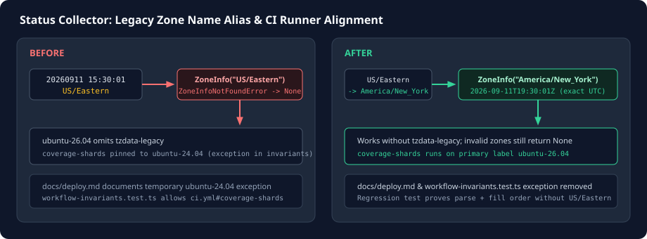

# Plan: Accept legacy zone name `US/Eastern` in status collector

## Problem

`infra/quant-vps/status/collect.py` parses IBKR timestamps such as `20260911 15:30:01 US/Eastern` by passing the trailing zone token directly to `zoneinfo.ZoneInfo(...)`. Ubuntu 26.04 runners omit `tzdata-legacy`, so `ZoneInfo("US/Eastern")` raises `ZoneInfoNotFoundError` and `parse_time` returns `None`. Because of this failure, `.github/workflows/ci.yml` pinned `coverage-shards` to `ubuntu-24.04` as a temporary exception in `docs/deploy.md` and `scripts/ci/workflow-invariants.test.ts`.

## Scope

1. **`infra/quant-vps/status/collect.py`**: Map only the exact legacy zone name `US/Eastern` to `America/New_York` before calling `zoneinfo.ZoneInfo(...)` in `parse_time`. Preserve valid IANA zone names and keep invalid zone names returning `None`.
2. **`infra/quant-vps/status/test_collect.py`**: Add a regression test that creates a temporary zoneinfo directory via `tempfile.TemporaryDirectory(dir=TEMP_ROOT)` (preserving `python-collect.test.ts`'s empty-`TMPDIR` invariant), copies `America/New_York` from `zoneinfo.TZPATH`, saves `old_tzpath = zoneinfo.TZPATH`, calls `zoneinfo.reset_tzpath([tmp_tzdir])` and `zoneinfo.ZoneInfo.clear_cache()` on entry, and restores `zoneinfo.reset_tzpath(old_tzpath)` and `zoneinfo.ZoneInfo.clear_cache()` in `finally`. Inside the isolated `TZPATH` block, assert:
   - `zoneinfo.ZoneInfo("US/Eastern")` raises `ZoneInfoNotFoundError` (proving no cache hit or `tzdata` fallback);
   - `parse_time` converts `US/Eastern` in both EDT (`20260911 15:30:01 US/Eastern` -> `2026-09-11T19:30:01Z`) and EST (`20260115 15:30:01 US/Eastern` -> `2026-01-15T20:30:01Z`);
   - `run_fixture()` produces both converted fill timestamps (`["2026-09-11T19:45:00Z", "2026-09-11T19:30:01Z"]`) and side order (`["sell", "buy"]`);
   - Valid IANA zone names present in the temp zoneinfo dir (`America/New_York`) succeed, and invalid/wrong-case zone names (`Mars/Olympus`, `US/eastern`) return `None`.
3. **`.github/workflows/ci.yml`**: Move `coverage-shards.runs-on` from `ubuntu-24.04` to `ubuntu-26.04` (the current primary label of `ci-gate`, per card `vertex-ci-runner-image-canary`, 2026-11-20) and remove the temporary pin comment.
4. **`scripts/ci/workflow-invariants.test.ts`**: Remove `ci.yml#coverage-shards` from `labelExceptions` and its comment, because `coverage-shards` now uses the primary label.
5. **`docs/deploy.md`**: Remove both references to the temporary `coverage-shards` exception (the final sentence of line 124 and the `` `coverage-shards` (above); `` entry in line 126) while keeping all other runner policy (`scorecard.yml`, `runner-image-canary.yml`) and setup notes intact.

## Out of scope

- Order, execution, arming, risk, sizing, live-service, or deployment changes.
- Installing `tzdata-legacy` or adding any runtime dependency.
- Other CI jobs, runner labels, or broad timezone rewrites.

## Acceptance criteria

- Focused regression test passes with a zoneinfo directory containing `America/New_York` and no `US/Eastern` (and `ZoneInfo.clear_cache()`), verifying `ZoneInfo("US/Eastern")` raises `ZoneInfoNotFoundError`, EDT/EST UTC conversion, fill timestamps and ordering, valid IANA pass-through, and invalid/wrong-case `None` return.
- Full `infra/quant-vps/status/test_collect.py` suite and `infra/quant-vps/status/python-collect.test.ts` pass.
- `scripts/ci/workflow-invariants.test.ts` passes with `coverage-shards` on `ubuntu-26.04` and no `ci.yml#coverage-shards` exception.
- `docs/deploy.md` no longer lists `coverage-shards` as a temporary `ubuntu-24.04` exception.
- `bun run verify:prepush`, fresh-context code review, and exact-head PR CI (`ci-gate`) are green before merge.
