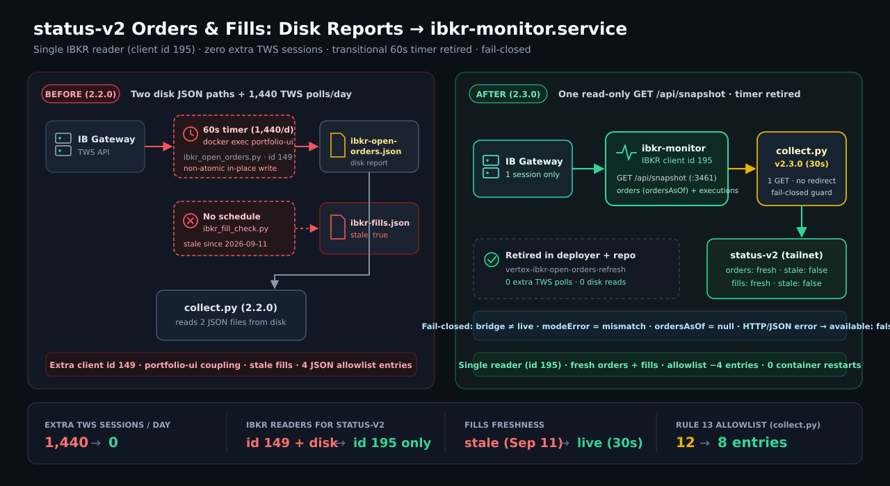

# Plan: Migrate `status-v2` `orders` and `fills` to `ibkr-monitor.service` and Retire Transitional Open-Orders Timer

| Field | Value |
| --- | --- |
| Card | `vertex-status-v2-orders-ibkr-monitor` |
| Supersedes | `docs/vertex-rebuild/designs/open-orders-refresh/plan.md` (transitional bridge, PR #476) |
| Target host | QuantVPS (`infra/quant-vps/status/`) |
| Trading / execution impact | Read-only status collector only; zero order, arming, risk, or container restart changes |

## Problem

1. `infra/quant-vps/status/collect.py` (2.2.0) read `status-v2` `orders` from `/opt/vertex-exec-node/data/nautilus/reports/ibkr-open-orders.json` and `fills` from `/opt/vertex-exec-node/data/nautilus/reports/ibkr-fills.json`.
2. PR #476 added a transitional 60-second `systemd` timer (`vertex-ibkr-open-orders-refresh.{service,timer}`) running `docker exec` into `portfolio-ui` (IBKR client id 149) 1,440 times/day to keep `ibkr-open-orders.json` fresh, while `ibkr-fills.json` remained stale since 2026-09-11.
3. The owner standardized on one IBKR reader: `ibkr-monitor.service` (IBKR client id 195), which already serves live open orders (`orders`, `ordersAsOf`) and executions (`executions`, `status.dataAsOf`) over `GET /api/snapshot`.

## Goals & Non-Goals

### Goals

- Read both `orders` and `fills` in `collect.py` (2.3.0) via a single read-only `GET /api/snapshot` call to local `ibkr-monitor.service` (IBKR client id 195), with strict fail-closed semantics.
- Remove disk reads of `ibkr-open-orders.json` and `ibkr-fills.json` from `collect.py`, shrinking `scripts/ci/json-data-allowlist.ts` by 4 entries (Rule 13).
- Retire the transitional `vertex-ibkr-open-orders-refresh.{service,timer}` unit files, deployer, and tests from the repository, and provide a market-hours-guarded deployer (`deploy-status-v2-ibkr-monitor.sh`) that proves live `ibkr-monitor` freshness before retiring the timer on QuantVPS.
- Preserve exact `DeployUpstreamStatusV2Schema` contract compatibility (verified cross-language in `packages/api/src/deploy-status.test.ts`).

### Non-Goals

- Migrating `positions` and `equity` (account snapshot reports) in this card.
- Modifying `infra/quant-vps/exec-node/`, `portfolio-ui/server.mjs`, `ibkr-monitor.service`, or restarting any container.

## Design

### Read-only HTTP client (`collect.py` 2.3.0)

- **Endpoint resolution**:
  - Explicit `VERTEX_IBKR_MONITOR_URL` (or `--ibkr-monitor-url`) is strictly validated as plain `http://` targeting loopback (`127.0.0.1`, `localhost`, `[::1]`) or Tailscale CGNAT IPv4 (`100.64.0.0/10`), bare base URL only (no credentials, path, query, or fragment). Invalid configuration fails closed without falling back.
  - Default resolution tries `http://127.0.0.1:3461/api/snapshot` first, falling back on transport error to `http://<VERTEX_TAILNET_IPV4>:3461/api/snapshot` from `/etc/vertex/hosts.env` (validated as Tailscale CGNAT IPv4).
- **Hardening**:
  - Single `GET /api/snapshot` per collector run, shared by `build_orders` and `build_fills`.
  - Direct connection only (`urllib.request.ProxyHandler({})`), redirects refused (`_NoRedirectHandler`), 5 s timeout, 4 MiB response cap, strict `application/json` content-type check, no raw URL/IP/body text in error messages.
- **Fail-closed rules**:
  - Any HTTP/transport/JSON error, `status.bridge != "live"`, `account.modeError == "mismatch"`, missing `orders`/`executions` list, or malformed entry yields `{available: false, source: "ibkr-monitor.service (/api/snapshot)", reason: ...}`.
  - For `orders`: when `ordersAsOf` is present and `null` (or invalid), fails closed so an unready feed is never mistaken for zero working orders; when `ordersAsOf` is absent (older `ibkr-monitor`), falls back to `status.dataAsOf`.
  - For `fills`: requires valid `status.dataAsOf`.
  - `stale` is `true` whenever `status.stale is True` OR `(now - as_of) > REPORT_STALE_SECONDS` (300 s).
  - IBKR `Double.MAX` (`>= 1e300`) values normalize to `null`; text fields are scrubbed and order/execution IDs masked as before.

### Deployment & Retirement (`deploy-status-v2-ibkr-monitor.sh`)

1. Enforces the verbatim QuantVPS market-hours guard (refuses Mon–Fri 08:30–16:00 America/New_York or unknown time, exit 3).
2. Dry-runs candidate `collect.py --v2 --verify-ibkr-monitor` into a temp directory; aborts (exit 4) without changing live state if `orders` or `fills` are unavailable, stale, or not from `ibkr-monitor.service`.
3. Captures the 7 protected container start times and backs up `/opt/vertex-status/collect.py` plus any installed `vertex-ibkr-open-orders-refresh.{service,timer}` to `/opt/vertex-status/rollback-<UTC>-ibkr-monitor/`.
4. Installs `collect.py` (`0700`), triggers `systemctl start vertex-status-collect.service`, and verifies the written `status-v2` output via `collect.py --check-v2-dir ... --check-public-dir ...` (exit 5 before touching the timer if verification fails).
5. Disables and removes `vertex-ibkr-open-orders-refresh.{timer,service}`, runs `systemctl daemon-reload`, confirms retirement (`retired_timer=ok`), and asserts `protected_containers=unchanged`.

## Verification

- `python3 -B -I infra/quant-vps/status/test_collect.py`
- `python3 -B -I infra/quant-vps/status/test_deploy_status_v2_ibkr_monitor.py`
- `pnpm exec vitest run infra/quant-vps/status/python-collect.test.ts scripts/ci/json-data.test.ts packages/api/src/deploy-status.test.ts infra/quant-vps/exec-node/python-safety.test.ts infra/quant-vps/host-config.test.ts`
- `bun run verify:prepush`
- Fresh-context code-diff review at exact head SHA.
