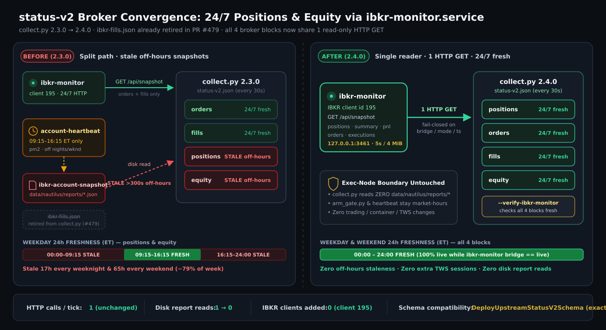

# Plan: Migrate `status-v2` `positions` and `equity` to `ibkr-monitor.service` (Off-Hours Snapshot Convergence)

| Field | Value |
| --- | --- |
| Card | `vertex-ibkr-fills-report-stale` |
| Builds on | `docs/vertex-rebuild/designs/status-v2-orders-ibkr-monitor/plan.md` (PR #479, `collect.py` 2.3.0) |
| Target host | QuantVPS (`infra/quant-vps/status/`) |
| Trading / execution impact | Read-only status collector only; zero order, arming, risk, exec-node, or container changes |

## Investigation Findings

1. **Stale `data/nautilus/reports/ibkr-fills.json` (last written 2026-09-11) — already resolved for `status-v2` in PR #479.**
   - Its sole writer is the on-demand `portfolio-ui/server.mjs` (`POST /api/portfolio-refresh` invoking `/app/scripts/ibkr_fill_check.py`), which is rarely triggered because Vertex reads live broker data from `ibkr-monitor.service` (IBKR client id 195) and `portfolio-ui` is slated for retirement.
   - PR #479 (`collect.py` 2.3.0, card `vertex-status-v2-orders-ibkr-monitor`) already migrated `status-v2` `orders` and `fills` onto `ibkr-monitor.service` (`GET /api/snapshot`) and removed `ibkr-fills.json` reads from `collect.py`. Adding a timer to rewrite `ibkr-fills.json` would add an unnecessary TWS session for a retired disk report.
2. **Off-hours account snapshots (`data/nautilus/reports/ibkr-account-snapshot-*.json`) — active gap in `collect.py` 2.3.0.**
   - Automatic writes come from pm2 `vertex-ibkr-account-heartbeat` (`infra/quant-vps/exec-node/runtime/scripts/ibkr-account-heartbeat.sh`), which is intentionally windowed to `09:15–16:15` `America/New_York`.
   - Outside that 7-hour weekday window (~79% of the week: 17 hours every weeknight and 65 hours every weekend), no new `ibkr-account-snapshot-*.json` file is written.
   - `collect.py` 2.3.0 still read `status-v2` `positions` and `equity` from `data/nautilus/reports/ibkr-account-snapshot-*.json` with `REPORT_STALE_SECONDS = 300`, leaving both blocks `stale: true` all night and all weekend—even though `collect.py` already fetches `GET /api/snapshot` from `ibkr-monitor.service` every 30 seconds and that response already contains live `positions`, `summary`, and `pnl` 24/7.
   - The other runtime reader of `ibkr-account-snapshot-*.json` is `infra/quant-vps/exec-node/runtime/nautilus/arm_gate.py`, which also requires the `ibkr-account-classes.json` sidecar (`conId`/`tradingClass`) and only runs during armed order policy evaluation (market hours). Modifying `infra/quant-vps/exec-node/` or `vertex-ibkr-account-heartbeat` is an order/arming/risk owner-decision path and is deliberately out of scope.

## Goals & Non-Goals

### Goals

- Migrate `build_positions` and `build_equity` in `collect.py` (`2.4.0`) to read from the same single read-only `GET /api/snapshot` response from `ibkr-monitor.service` (IBKR client id 195) already fetched for `orders` and `fills`.
- Eliminate all reads of `/opt/vertex-exec-node/data/nautilus/reports/` (`REPORTS`, `SNAPSHOT_PREFIX`, `latest_report`) from `collect.py` (Rule 13 convergence).
- Extend `verify_v2_document()` (`--verify-ibkr-monitor` and `--check-v2-dir`, called by `deploy-status-v2-ibkr-monitor.sh`) to verify that all four broker blocks (`positions`, `orders`, `fills`, `equity`) are `available: true`, `stale: false`, and sourced from `ibkr-monitor.service`.
- Preserve exact `DeployUpstreamStatusV2Schema` contract compatibility (verified cross-language in `packages/api/src/deploy-status.test.ts`).

### Non-Goals

- Modifying `infra/quant-vps/exec-node/`, `arm_gate.py`, `ibkr-account-heartbeat.sh`, `portfolio-ui/server.mjs`, `ibkr-monitor.service`, or restarting any trading container or pm2 process.
- Adding a per-report timer for `ibkr-fills.json` or `ibkr-account-snapshot-*.json`.

## Design (`collect.py` 2.4.0)

- **Single shared HTTP fetch**: `build()` calls `inp.ibkr_monitor_snapshot()` once per 30-second collector cycle and passes `(ibkr_payload, ibkr_error)` to `build_positions`, `build_orders`, `build_fills`, and `build_equity`.
- **Fail-closed rules**:
  - `build_positions` and `build_equity` share `_validate_ibkr_monitor_snapshot()` with `build_orders` and `build_fills` (fail closed on HTTP/transport/JSON error, `status.bridge != "live"`, `account.modeError == "mismatch"`, or missing `status.dataAsOf`).
  - `build_positions` requires `payload["positions"]` to be a `list` of `dict` entries; `build_equity` requires `payload["summary"]` to be a `dict`.
  - IBKR `Double.MAX` (`>= 1e300`), non-finite floats, and booleans normalize to `null` via `ibkr_num()`.
  - `stale` is `true` whenever `status.stale is True` or `(now - dataAsOf) > REPORT_STALE_SECONDS` (300 s).
- **Field mapping**:
  - `positions`: maps `symbol`, `secType`, `position` -> `qty`, `avgPrice` -> `avg_px` (deriving `avg_cost = round(avg_px * eff_mult, 6)`, or deriving `avg_px` from `avgCost / eff_mult` when `avgPrice` is unset), `multiplier` (`null` when `1`), `last` -> `market_price`, `marketValue` -> `market_value`, `unrealized` -> `unrealized_pnl`, `realized` -> `realized_pnl`, `currency`, plus `right`, `strike`, `expiry` for `OPT`/`FOP`.
  - `equity`: reads `NetLiquidation`, `TotalCashValue`, `AvailableFunds`, `BuyingPower` from `summary`; reads `unrealized` and `realized` from `pnl` (preserving explicit `0.0` and falling back to sums over available `positions` items when absent or `Double.MAX`).
  - `session.account_masked`: `ibkr-monitor.service` intentionally omits account codes for privacy, so `session.account_masked` is `null` (already nullable in `DeploySessionBlockSchema` and handled by the Deployments UI).

## Verification

- `python3 -B -I infra/quant-vps/status/test_collect.py`
- `python3 -B -I infra/quant-vps/status/test_deploy_status_v2_ibkr_monitor.py`
- `python3 -B -I infra/quant-vps/status/test_status_v2_alert.py`
- `pnpm exec vitest run infra/quant-vps/status/python-collect.test.ts packages/api/src/deploy-status.test.ts scripts/ci/json-data.test.ts infra/quant-vps/exec-node/python-safety.test.ts infra/quant-vps/host-config.test.ts`
- `bun run verify:prepush`
- Fresh-context code-diff review at exact head SHA.
