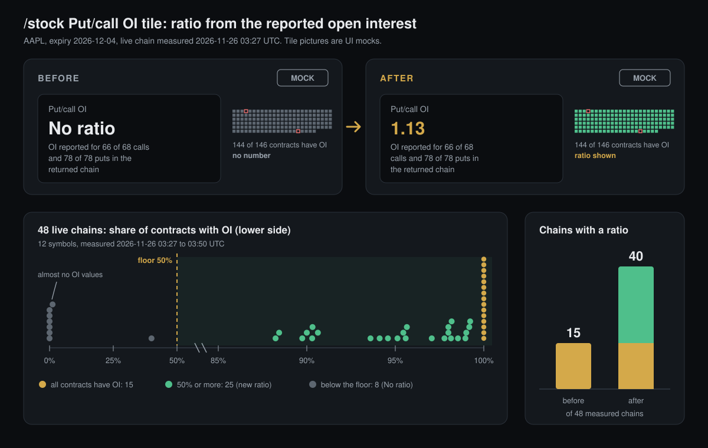

# Consolidated review report: `/stock` Put/call OI ratio of the reported open interest

**Target:** [plan.md](plan.md), version 1 (210 lines; feature part lines 1-110, implementation part lines 111-210)  
**Mode:** consolidated report with all review rubrics, five stages, no stop between stages  
**Date:** 2026-11-25, New York time

Each reviewer ran in a fresh context with the plan, the baseline copies of the tile files and the probe output. Stage 6 read the plan alone.

## Reviewer status

| Stage | Reviewer | Status | Blocker | Major | Nit |
| --- | --- | --- | --- | --- | --- |
| 5 Initial zoom out | egm-zoom-out | completed | 0 | 1 | 5 |
| 5 Initial zoom out | egm-inventive-catalyst | completed | 0 | 1 | 2 |
| 6 Comprehension | egm-comprehension | completed | 0 | 5 | 10 |
| 7 Critic | egm-design | completed | 1 | 4 | 6 |
| 7 Critic | egm-structural | completed | 0 | 1 | 4 |
| 7 Critic | egm-style | completed | 0 | 7 | 12 |
| 8 Intermediate zoom out | egm-zoom-out | completed | 0 | 2 | 5 |
| 9 Implementation readiness | egm-implementation-readiness | completed | 0 | 7 | 6 |
| 9 Implementation readiness | egm-codebase-details | completed | 0 | 8 | 9 |
| 9 Implementation readiness | egm-style | completed | 0 | 6 | 14 |
| Total | 10 reviews | 10 completed | 1 | 42 | 73 |

The 116 findings reduce to the 17 action items below. A reference such as `D-B1` names the reviewer and its finding number: `Z5` zoom out (stage 5), `IC` inventive catalyst, `C` comprehension, `D` design, `ST` structural, `SY7` style (stage 7), `Z8` zoom out (stage 8), `IR` implementation readiness, `CD` codebase details, `SY9` style (stage 9).

## Prioritized action items

### A1. Ratios that the change newly shows carry the Quant Data `0` fault (Blocker)

- **Sources:** D-B1, IC-3, SY7-7, SY7-12, Z8-4
- **Finding:** the plan rejects a 90% floor because missing OI near the money makes a ratio wrong. Its own example, SPY 2026-11-27, holds Quant Data `0` values on five contracts next to the money. A wrong `0` has the same effect on a total as a missing value. The change raises the number of chains that can show such a ratio.
- **Action:** quantify the fault, sequence the change after card vertex-chain-oi-quantdata-zero, and replace the example.

### A2. The floor counts contracts, but its argument is about distance from spot (Major)

- **Sources:** D-M1, IC-1, Z5-3, Z8-3, SY7-3, SY7-8, SY7-9, SY7-17
- **Finding:** "most OI is near the money" is not measured. The count rule admits gaps at any strike on a large side, allows no gap on a side under 20 contracts, and refuses a chain whose gaps are far from spot. The distance rule is rejected without numbers.
- **Action:** measure how far a ratio could move, evaluate the distance rule and the combined rule with numbers, remove the unsupported claim, and state the limits of a count rule.

### A3. The sample is one after-hours snapshot; "the probe can be run again" is no mitigation (Major)

- **Sources:** D-M2, IC-2, Z8-2, SY7-5
- **Finding:** 24 chains of 8 liquid symbols at one time. No thin chain, no long-dated expiry, no in-session measurement, no trigger for a second run.
- **Action:** extend the sample, and add an in-session measurement with a named result that opens a follow-up.

### A4. The evidence for the floor is not referenced and one figure cannot be reproduced (Major)

- **Sources:** D-M3, C-1, SY7-4, IR-M6 (probe part), CD-7 (probe part)
- **Finding:** no path or command for the probe scripts and their output. The counts "within 5% of spot" are in no output. The "no floor" row was computed as a 1% floor.
- **Action:** put the scripts and their complete output next to the plan, print the within-5% counts, and compute the no-floor rule as stated.

### A5. Contradictions about the zero-total states and "always names the counts" (Major)

- **Sources:** D-M4, SY7-2, SY7-11, C-6
- **Finding:** the plan says the detail always names the counts for an incomplete chain and that the other states stay as they are. The display table extends the two zero-total rows to incomplete chains without counts, and "Call OI is 0" is not established when a call has no OI value.
- **Action:** make the statements agree with the table and make the zero-call text true for an incomplete chain.

### A6. The scope label is narrower than the change (Major)

- **Sources:** SY7-6
- **Finding:** "UI display only" hides that the rule deciding whether a ratio exists changes.
- **Action:** name the rule change in the scope line and in the owner-decision line of the pull request.

### A7. No design section; terms used before they are defined (Major)

- **Sources:** ST-1, C-4, C-5, C-7, C-8, C-9, C-10, C-12, SY7-16
- **Finding:** component and data flow appear only in the implementation part. "Returned chain", "Quant Data", `OiSide`, `complete`, "card", "base branch" and "% from spot" are not defined where first used.
- **Action:** add a "Terms" section and a "Proposed design" section.

### A8. The implementation part repeats rules in code and restates repository process (Major)

- **Sources:** Z5-1, Z5-2, Z8-1, Z8-6
- **Finding:** each rule is stated in the table, in the acceptance checks and in code blocks; Phase 4 restates the process of the repository.
- **Action:** make the display table the authority, keep only the boundary predicate as code, and reduce the process steps to what is specific to this change.

### A9. The phase order contradicts the failing-test step; phases have no checkpoints (Major)

- **Sources:** IR-M1, CD-1, SY9-M1
- **Action:** tests first, then the code; one checkpoint command per phase.

### A10. The browser regression is under-specified and cannot detect a wrong ratio (Major)

- **Sources:** IR-M2, CD-3, CD-4, D-N1, Z8-5, SY9-N10, SY9-N13, CD-12
- **Finding:** the second fixture mode has no signature; the expected value has no method; the fake chain has a ratio of 1.00 with or without its far strike, so the value check passes for a wrong rule; the width check cannot fail for the longer text.
- **Action:** give the signature and the call sites, null the at-the-money call, compute the expected value in the test, and bound the number of lines at 375 px.

### A11. The component test cases are incomplete (Major)

- **Sources:** SY9-M3, SY9-N8, SY9-N9, IR-N1, IR-N2, IR-N3, CD-2, CD-17
- **Finding:** three expected strings are not written out; `fill` is defined and not used; no case has an incomplete put side or two incomplete sides; the `chainSummary` test cannot reach the helper of the other test.
- **Action:** write every case with its full strings and say how each test builds its rows.

### A12. The unmerged baseline has no check (Major)

- **Sources:** IR-M3, D-N5, Z8-7, Z5-6, ST-3, CD-16
- **Action:** add a Phase 0 that names the branch commands and the names and texts to confirm.

### A13. Phase 4 cannot be executed as written (Major)

- **Sources:** IR-M4, IR-M5, IR-M6, CD-5, CD-7, CD-8, CD-14, CD-15, SY9-M4, SY9-M5, SY9-M6, C-3, D-N4
- **Finding:** no card ID, branch names, push step or merge arguments; "design drift check" and "fresh-context reviewer" are undefined; no CI evidence before the deploy; the deploy summary omits steps of the README; the live check has no method and no fallback; no failure path.
- **Action:** name the identifiers, define the two terms, add the pre-deploy CI step, cite all eight deploy steps, and write the live check with its method, fallback and failure path.

### A14. The file list does not match what the change commits (Major)

- **Sources:** IR-M7, CD-6, SY7-19, ST-2, SY9-N14
- **Action:** list the documents of the change, the new Status line, and separate "modify" from "read for context".

### A15. The status-language step has no reason (Major)

- **Sources:** C-2, IR-N6, SY9-N12
- **Action:** say what the guard checks and what to do when it fails.

### A16. Wording, dates and small precision gaps (Nit; one Major for hyperbole)

- **Sources:** SY7-1 (Major), SY7-10, SY7-13, SY7-14, SY7-15, SY7-18, C-11, C-13, C-14, C-15, ST-4, ST-5, D-N6, SY9-N1 to SY9-N7, SY9-N11, CD-9, CD-10, CD-11, CD-13, IR-N4, IR-N5
- **Action:** replace "almost never" with the measured count, state the time zone of the dates, use one term per thing, and fix the listed sentences.

### A17. Suggestions about the design that the review raised as options (Nit)

- **Sources:** D-N2, D-N3, Z5-4, Z5-5
- **Finding:** a marker on the value; the `flowFirstPageOnly` flag; the cost of the floor suffix in the detail; no explanation of the chains with no OI values.
- **Action:** decide each and record the reason in the plan.

## Traceability

| Reviewer | Findings | Action items |
| --- | --- | --- |
| egm-zoom-out, stage 5 (6) | Z5-1, Z5-2, Z5-3, Z5-4, Z5-5, Z5-6 | A8, A8, A2, A17, A17, A12 and A16 |
| egm-inventive-catalyst (3) | IC-1, IC-2, IC-3 | A2, A3, A1 |
| egm-comprehension (15) | C-1 to C-15 | A4, A15, A13, A7, A7, A5, A7, A7, A7, A7, A16, A7, A16, A16, A16 |
| egm-design (11) | D-B1, D-M1 to D-M4, D-N1 to D-N6 | A1, A2, A3, A4, A5, A10, A17, A17, A13, A12, A16 |
| egm-structural (5) | ST-1 to ST-5 | A7, A14, A12, A16, A16 |
| egm-style, stage 7 (19) | SY7-1 to SY7-19 | A16, A5, A2, A4, A3, A6, A1, A2, A2, A16, A5, A1, A16, A16, A16, A7, A2, A16, A14 |
| egm-zoom-out, stage 8 (7) | Z8-1 to Z8-7 | A8, A3, A2, A1, A10, A8, A12 |
| egm-implementation-readiness (13) | IR-M1 to IR-M7, IR-N1 to IR-N6 | A9, A10, A12, A13, A13, A13 and A4, A14, A11, A11, A11, A16, A16, A15 |
| egm-codebase-details (17) | CD-1 to CD-17 | A9, A11, A10, A10, A13, A14, A13 and A4, A13, A16, A16, A16, A10, A16, A13, A13, A12, A11 |
| egm-style, stage 9 (20) | SY9-M1 to SY9-M6, SY9-N1 to SY9-N14 | A9, A13 (path of the evidence), A11, A13, A13, A13, A16 (N1 to N7), A11, A11, A10, A16, A15, A10, A14 |

The resolution of each action item is in [goldfish_review_report.md](goldfish_review_report.md), with the re-audit of plan version 2 (3 reviewers, 30 findings) and its resolution in version 3.
