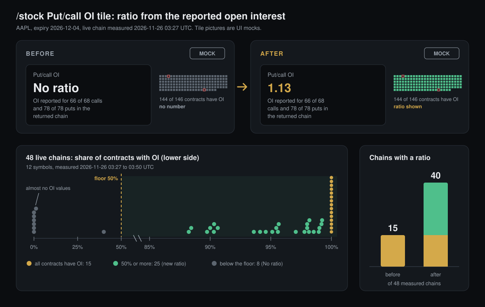

# Drift report: `/stock` Put/call OI ratio of the reported open interest

**Date:** 2026-11-25, New York time  
**Compared:** [plan.md](plan.md) against the working tree of the change (the three source files of "Files"), before the commit  
**Method:** a fresh-context agent read the plan and the code and listed every difference; it also recomputed every test case of the plan against the rule in the code.

## plan.md

The check found five differences. All five are resolved in the same commit; none needed a code change.

| # | Difference | Resolution |
| --- | --- | --- |
| 1 | "Terms" named a predicate `complete` in the code; the change replaces it with `covered`. | Plan: the term says that the baseline predicate is replaced. |
| 2 | The doc comment of `putCallOiDetail` changes one more phrase than the plan stated ("left out of the totals"). | Plan: Phase 2 step 3 names both phrases. |
| 3 | The browser-test mock maps the rows of every fixture through `reportsOi`; before, the complete chain passed through unchanged. The data is identical. | Plan: Phase 3 step 1 states it. |
| 4 | The ratio helper of the browser test reads a missing OI value as 0 (`?? 0`). It has no effect on the fake chain, where every contract has a number. | No change: a detail of the test helper. |
| 5 | The new browser test also asserts that the tile is visible. | Plan: Phase 3 step 4 names the assertion. |

The check confirmed the arithmetic of the four changed expectations, of the new component cases and of the `chainSummary` test, the fixture counts (27 of 41 and 30 of 41 with 25 `no OI` cells; 9 of 41), and the two ratios of the fake chain (complete `1.00`, partial `0.99`).

After the check, the fresh-context code review added two component cases (49 of 100 on each side) and reworded two comments. The plan lists the two cases in Phase 1 step 2. A second pass of the same agent over these edits found two more differences in the plan text (an old reason in the intro of Phase 3, and a list of literals in "Risks and limits" without the new boundary case). Both are corrected in the plan. No difference is open.
