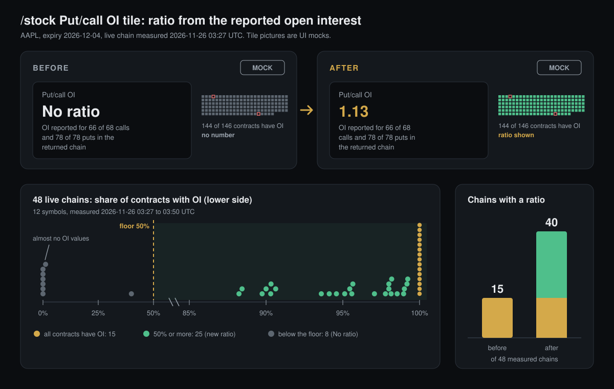

# Goldfish annotated review report

Status: resolved

**Target:** [plan.md](plan.md), version 1 (full file, lines 1-210)  
**Findings:** the 17 action items of [consolidated_review_report.md](consolidated_review_report.md) (116 reviewer findings)  
**Resolution mode:** auto accept (standing owner rule of 2026-11-13 for this gate): every PROPOSE FIX is applied; DECLINE and CONTEST stay as recorded.

## Result

| Category | Reviewer findings |
| --- | --- |
| PROPOSE FIX, applied | 110 |
| DECLINE (Nit, recorded, not fixed) | 6 |
| CONTEST | 0 |
| ESCALATE | 0 |

The fixes were applied as version 2 of the plan (a rewrite, because the Blocker and four Majors changed the measurement, the sequence and the phase order). The six declined Nits are listed at the end. A re-audit of version 2 followed; its 30 findings are applied in version 3 (see "Round 2"). Version 3 replaces the 95% floor and the neighbour estimate of the entries below with a 50% floor and a second-source measurement.

## Prioritized findings and suggestions

### A1 [`egm-design`, `egm-inventive-catalyst`, `egm-style`, `egm-zoom-out`] - Severity: Blocker

- **Affected scope:** "Problem and cause", "Risks and limits", the infographic
- **Discrepancy description:** the example SPY 2026-11-27 and other chains that gain a ratio hold Quant Data `0` values next to the money; the plan names the fault class and offers no mitigation or size.
- **AI suggestion:** PROPOSE FIX
- **Justification:** the critique is valid and measurable. The analysis script now counts Quant Data `0` values per chain: none of the 15 complete chains holds one, and 6 of the 15 chains that gain a ratio do. With the Yahoo values of the five SPY contracts the ratio is 0.78, not 0.66.
- **Applied edit:** new "Sequence" line (the code merges only after the fix of card vertex-chain-oi-quantdata-zero is on the base branch); the risk "Wrong `0` values from Quant Data" with the measured numbers; Phase 0 step 1; the example and the infographic now use AAPL 2026-12-04, a chain with no Quant Data `0`.

### A2 [`egm-design`, `egm-inventive-catalyst`, `egm-zoom-out`, `egm-style`] - Severity: Major

- **Affected scope:** "Coverage floor: measured choice", "Alternatives considered", "Risks and limits"
- **Discrepancy description:** the count floor is argued with distance from spot; "most OI is near the money" is not measured; the distance rule is rejected without numbers.
- **AI suggestion:** PROPOSE FIX
- **Justification:** the claim was wrong. The analysis shows that 0.3% to 100% of the reported OI of a side sits more than 9% from spot. The new measure is the neighbour estimate (each contract with no OI value gets the OI of its larger same-side neighbour). On 44 chains the 95% floor admits 15 incomplete chains with an estimate of 1.6% or less; the distance rule admits a chain with 32.8% and one with 47.7%; the combined rule equals the floor alone.
- **Applied edit:** the measured tables and the choice bullets are rewritten around the neighbour estimate; the claim is removed; the distance rule, the combined rule and a gate on the estimate itself are rejected with numbers; the limits of a count rule (small sides, large sides) are stated.

### A3 [`egm-design`, `egm-inventive-catalyst`, `egm-zoom-out`, `egm-style`] - Severity: Major

- **Affected scope:** "Coverage floor: measured choice", "Risks and limits", "Acceptance checks"
- **Discrepancy description:** one after-hours snapshot of 8 liquid symbols; no trigger for a second measurement.
- **AI suggestion:** PROPOSE FIX
- **Justification:** valid. The sample was extended the same evening: the last listed expiry of the 8 symbols and three expiries of four smaller chains (44 chains). An in-session run before the merge is not possible on the evening before a market holiday.
- **Applied edit:** the sample description and all numbers use the 44 chains; acceptance check 9 (one in-session run after the deploy, recorded in the pull request, with the result that opens a follow-up card); the risk "Sample time".

### A4 [`egm-design`, `egm-comprehension`, `egm-style`, `egm-implementation-readiness`, `egm-codebase-details`] - Severity: Major

- **Affected scope:** "Coverage floor: measured choice", "Files", "Reading list for review"
- **Discrepancy description:** the probe scripts and their output have no location; the within-5% counts and the no-floor rule are not reproducible.
- **AI suggestion:** PROPOSE FIX
- **Applied edit:** new file [probe-evidence.md](probe-evidence.md) with both scripts, the run commands and the complete output; the analysis prints the contracts without an OI value within 5% of spot per chain; the no-floor rule is computed as "one OI value on each side".

### A5 [`egm-design`, `egm-style`, `egm-comprehension`] - Severity: Major

- **Affected scope:** "Goals", "Proposed display", "Acceptance checks"
- **Discrepancy description:** "always names the counts" and "keep every other state" contradict the two zero-total rows; "Call OI is 0" is not established for an incomplete chain.
- **AI suggestion:** PROPOSE FIX
- **Applied edit:** the goal and acceptance check 5 now say which rows keep their text; row 5 reads `Reported call OI total is 0; a ratio needs call OI above 0` for every chain (true for a complete and for an incomplete chain); the word "always" is removed.

### A6 [`egm-style`] - Severity: Major

- **Affected scope:** the Scope line, the owner-decision line of Phase 4
- **AI suggestion:** PROPOSE FIX
- **Applied edit:** Scope reads "client-side only, one tile: the rule for when the tile shows a ratio, and its detail text"; the owner-decision line says "client-side change of one market-data tile".

### A7 [`egm-structural`, `egm-comprehension`, `egm-style`] - Severity: Major

- **Affected scope:** the feature part
- **AI suggestion:** PROPOSE FIX
- **Applied edit:** new sections "Terms" (returned chain and its sources, OI value, side and `OiSide`, complete, coverage and covered, distance from spot, neighbour estimate) and "Proposed design" (the five steps of the data flow and what changes in each); the card and the base branch are named in the header.

### A8 [`egm-zoom-out`] - Severity: Major

- **Affected scope:** "Implementation plan"
- **Discrepancy description:** rules repeated in code; repository process restated.
- **AI suggestion:** PROPOSE FIX
- **Justification:** valid, and in tension with A11 and A13, which ask for exact strings and identifiers. Resolution: the "Proposed display" table is declared the authority; only the boundary predicate stays as code; the other edits are sentences that point at table rows; the process steps name identifiers and point at `AGENTS.md` and the deploy README.
- **Applied edit:** as described; the code blocks for `chainKpis` and `noRatioReason` are removed.

### A9 [`egm-implementation-readiness`, `egm-codebase-details`, `egm-style`] - Severity: Major

- **Affected scope:** phase order
- **AI suggestion:** PROPOSE FIX
- **Applied edit:** Phase 1 is the component tests (checkpoint: the focused run fails only in the two changed tests), Phase 2 the code (checkpoint: it passes), and every phase ends with a checkpoint.

### A10 [`egm-implementation-readiness`, `egm-codebase-details`, `egm-design`, `egm-zoom-out`, `egm-style`] - Severity: Major

- **Affected scope:** Phase 3
- **AI suggestion:** PROPOSE FIX
- **Applied edit:** the parameter of `mockMarketData` becomes `oi: "complete" | "partial" | "atm-call-null"` with the changed call site; the new test nulls the at-the-money call, computes the expected value from the fake gateway, asserts that it is not `1.00`, and lists its assertions; the below-floor test bounds the detail at 9 lines at 375 px; the grep names the two test titles.

### A11 [`egm-style`, `egm-implementation-readiness`, `egm-codebase-details`] - Severity: Major

- **Affected scope:** Phase 1
- **AI suggestion:** PROPOSE FIX
- **Applied edit:** the four changed strings are written out; `fill` is a defined local helper and every case uses it; eight new cases cover an incomplete call side, an incomplete put side, both, a zero put total and the two zero-total rows at both sides of the boundary; the `chainSummary` test names how it builds its rows and its three assertions.

### A12 [`egm-implementation-readiness`, `egm-design`, `egm-zoom-out`, `egm-codebase-details`] - Severity: Major

- **Affected scope:** start of the implementation part
- **AI suggestion:** PROPOSE FIX
- **Applied edit:** Phase 0 with the fetch and rebase commands, the names and texts to confirm in the three files, and a stop rule.

### A13 [`egm-implementation-readiness`, `egm-codebase-details`, `egm-style`, `egm-comprehension`, `egm-design`] - Severity: Major

- **Affected scope:** Phases 4 and 5
- **AI suggestion:** PROPOSE FIX
- **Applied edit:** card, work branch and base branch are named; the push, review, ready, checks and merge steps carry their commands; "design drift check" and "fresh-context reviewer" are defined in place; Phase 5 has the CI run on the merge commit before the deploy, all eight deploy steps by reference, the live check with its method, its fallback and its evidence, and the failure path; the rollback text names the revert of a merge commit.

### A14 [`egm-implementation-readiness`, `egm-codebase-details`, `egm-style`, `egm-structural`] - Severity: Major

- **Affected scope:** "Files", acceptance check 8
- **AI suggestion:** PROPOSE FIX
- **Applied edit:** "Files" has three lists (modify, documents of this change, read for context with a reason each); check 8 says "no source file outside the Modify list"; Phase 4 names the new Status line.

### A15 [`egm-comprehension`, `egm-implementation-readiness`, `egm-style`] - Severity: Major

- **Affected scope:** the status-language step
- **AI suggestion:** PROPOSE FIX
- **Applied edit:** the checkpoint of Phase 2 says what the guard scans, that the new texts hold none of its words, and to stop and change the text when it fails.

### A16 [several reviewers] - Severity: Nit (one Major: hyperbole)

- **Affected scope:** wording across the file
- **AI suggestion:** PROPOSE FIX; DECLINE for ST-4 and C-14
- **Applied edit:** "almost never" is replaced by "15 of 44"; the header states the time zone of the date and of the measurement; "has an OI value" and "no OI value" are the two terms for a contract; one focused test command is used for both runs; `bun run check` is removed from the commit step; the helper rename and the comment texts are exact; the commit subject says "at 95% coverage".
- **Declined:** see the list below.

### A17 [`egm-design`, `egm-zoom-out`] - Severity: Nit

- **Affected scope:** "Non-goals", "Alternatives considered", "Coverage floor: measured choice"
- **AI suggestion:** PROPOSE FIX; DECLINE for Z5-4
- **Applied edit:** the marker on the value has a stated reason in the alternatives; the `flowFirstPageOnly` flag is a non-goal with its reason; the four chains with almost no OI values have one sentence.
- **Declined:** see the list below.

## Round 2 (re-audit of plan version 2)

Three reviewers read version 2 in fresh contexts: `egm-design` on the feature part, `egm-implementation-readiness` and `egm-codebase-details` on the implementation part. They raised 30 findings (1 Blocker, 10 Major, 19 Nit). All 30 are PROPOSE FIX and are applied in version 3; none is contested, declined or escalated.

| Finding | Severity | Applied edit in version 3 |
| --- | --- | --- |
| Design 1: a side passes the 95% floor with a neighbour estimate of 32.8% (QQQ 2026-11-27 puts); the chain is kept out only by one call contract | Blocker | The estimate was checked against a second source (public Nasdaq option-chain data). All 289 contracts with no OI value in the 44 chains of listed expiries have no open interest on record there, also the six QQQ puts. The neighbour estimate is removed as a measure. The floor is now chosen from what it must separate: chains for which a source sent almost no OI values (coverage 1.2% or less; a ratio from them is wrong by up to 44.97%) from all other chains (88.2% or more, one at 40%). The floor is 50%. |
| Design 2: the evidence is from before the Quant Data fix | Major | Phase 0 step 3 measures again after that fix is live, with a stop condition. |
| Design 3: no in-session measurement before the merge; check 9 is weak | Major | Check 9 runs the whole measurement with the second source, has a 5% trigger for a follow-up card and a 20% trigger for a rollback. The risk "Sample time" says why the plan expects the same coverage in a session (OI values are end-of-day figures). |
| Design 4: the data-layer alternative and the cause of a null are missing; OI has two sources, not three | Major | "Terms" gives the cause of a null and the two OI sources; "Alternatives considered" rejects the API change with reasons. |
| Readiness 1 and Codebase 2: the second precondition has no check | Major | Phase 0 step 1 names the tracker state, the merged pull requests and the deploy; step 2 checks the fake chain. |
| Readiness 2 and Codebase 3: commit order and file list contradict | Major | The drift check runs before the one commit; the report has a file name; "Files" lists the documents with their folder; review fixes are new commits. |
| Readiness 3 and Codebase 4: the live check has no method | Major | A live tile check script is part of the evidence file; Phase 5 step 3 names its parts and the fallback expectations. |
| Codebase 1: a quoted baseline string does not exist | Major | Phase 0 quotes `const mockMarketData = async (page: Page, partialOi = false)`. |
| Design 5 to 10, Readiness 4 to 11, Codebase 5 to 9 | Nit | The neighbour-estimate term is removed; the claim about the Sources line is corrected; the goal names both added words; the tile-flip risk is added; the line bound is measured (7 lines, bound 8); Phase 0 checks every name that later steps use; the red states of Phases 1 to 3 are stated; the new tests name their titles, locators and inputs; the complete-chain comparison replaces the literal `1.00`; the dispatch command and the moved-base case are given; check 9 names the line to read. |

After the two rounds the baseline change reached its final form: one counts sentence (`OI reported for C of N calls and P of M puts in the returned chain`) is the detail of every ratio. The plan follows it: the separate text `Reported OI only: …` of versions 1 to 3 is dropped, and the rows of the "Proposed display" table are renumbered (8 rows).

The floor value changed from 95% to 50% in this round. The change follows from the second-source measurement that finding Design 1 asked for; the measurement and its output are in [probe-evidence.md](probe-evidence.md).

## Declined Nits

| Finding | Reason |
| --- | --- |
| ST-4: heading names differ from the names of the standard | The standard calls its names examples. The "Proposed design" section it missed is added. |
| ST-3 and CD-16: the link to the baseline plan does not resolve yet | It resolves when the baseline change is on the base branch, which Phase 0 requires before any code. |
| C-14: `pnpm exec` and `bun run` are both used | Both are the convention of the repository (`AGENTS.md`: Bun runs the root scripts, pnpm runs package-local Vitest). |
| Z5-4: the floor suffix in the below-floor detail costs lines at 375 px | The suffix tells the reader the rule. The cost is bounded by the new line-count assertion. |
| Z8-5: the width check of the new browser test is not required by a stated risk | It reuses the existing loop and guards the new text at the four target widths. |
