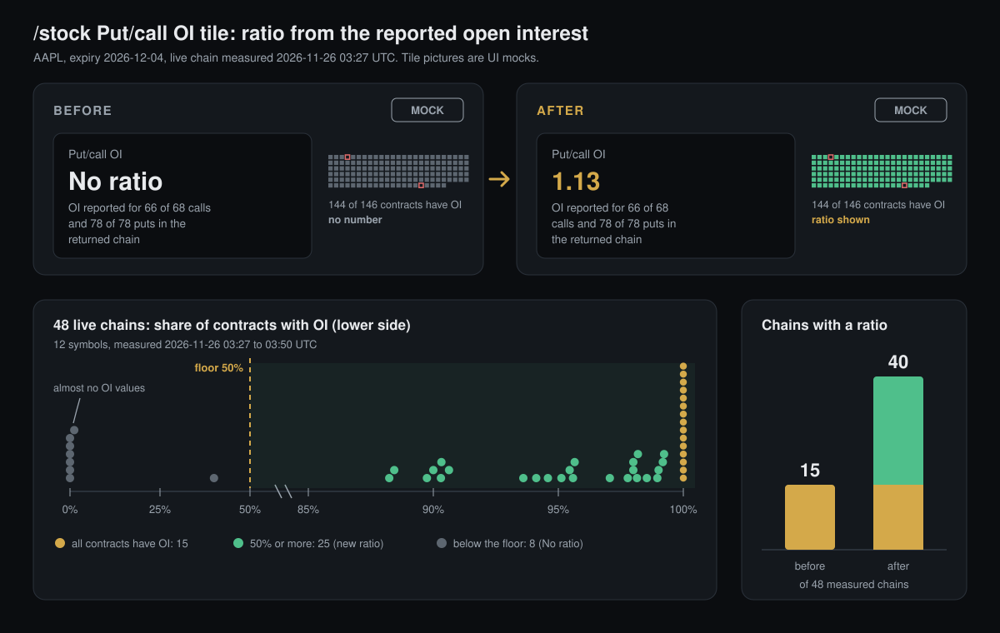

# `/stock` Put/call OI KPI: show the ratio of the reported open interest



- **Date:** 2026-11-25, New York time. The measurements are from the same evening, 2026-11-26 03:27 to 03:50 UTC.
- **Status:** Implemented and committed on the work branch `ws/put-call-oi-tile-reads-no` (Phases 1 to 3, the drift check and the code review). The push and the pull request wait for Phase 0; the test results go into the pull request. The plan was reviewed in two rounds before the code.
- **Card:** vertex-stock-pc-ratio-partial-oi. A card is a work item in the job tracker of the rig.
- **Scope:** client-side only, one tile: the rule for when the tile shows a ratio, and its detail text.
- **Baseline:** the tile after the change of card vertex-stock-pc-tile-oi-dashes ([its plan](../stock-pc-oi-tile/plan.md)): the value is a ratio or the words `No ratio`, and a muted detail line gives the counts behind the ratio, or the reason for `No ratio`. The baseline was still unmerged when this plan was written; its last review round replaced the detail of a ratio with the counts sentence, and this plan follows that final form.
- **Sequence:** the code of this plan merges only after two changes are on the base branch `vertex/rebuild-darkfactory-20260921`: the baseline change, and the fix of card vertex-chain-oi-quantdata-zero (see "Risks and limits").
- **Evidence:** [probe-evidence.md](probe-evidence.md) holds the probe scripts and their complete output.

## Problem and cause

Open interest (OI) is the number of option contracts that are open. The Put/call OI tile on the `/stock` options tab divides the put OI total by the call OI total of the selected expiry.

The tile shows a ratio only when every call and put contract of the returned chain has an OI value. In a measurement of 48 live chains (12 symbols), 15 chains met this rule. On 25 more chains, 1 to 26 contracts had no OI value, and a second data source has no open interest on record for any of these contracts. For these 25 chains the tile reads `No ratio`, although the ratio of the reported OI is the ratio of the whole chain. Example: AAPL, expiry 2026-12-04, has an OI value for 66 of 68 calls and 78 of 78 puts.

Cause: `chainSummary` in `apps/web/src/features/stock-detail/stock-detail-workspace.tsx` returns a null ratio unless both sides are complete.

## Terms

- **Returned chain:** the contracts of one expiry in the answer of the options-chain API (`optionsChain.chain`). The API merges data sources: an OI value comes from Quant Data or from Yahoo. Quant Data reads only its first provider page, so the returned chain can hold fewer contracts than the expiry lists. Every count in this plan and in the tile is a count of the returned chain.
- **OI value:** the `openInterest` field of a contract. A number, also `0`, is a reported value. `null` means that no source sent a value: Quant Data sends OI only for contracts with an order-flow print that reports it, and the merge keeps `null` when Yahoo has no value either. The plan writes "no OI value" for `null`.
- **Side:** the calls, or the puts, of the returned chain. `OiSide` in the code holds three numbers for a side: `contracts` (contracts in the returned chain), `reported` (contracts with an OI value) and `total` (the sum of the OI values).
- **Complete:** a side is complete when it has contracts and every one has an OI value. A chain is complete when both sides are. (The baseline code had a predicate `complete`; this change replaces it with `covered`.)
- **Coverage:** `reported / contracts` of a side. A side is **covered** when it has contracts and its coverage is 50% or more. A chain is covered when both sides are.
- **Second source:** the option-chain data of the public Nasdaq site. The measurement uses it to check the contracts with no OI value. The app does not use it.

## Goals and non-goals

### Goals

- Show the put/call ratio of the reported OI when the chain is covered and the reported call OI total is above zero.
- When a ratio comes from an incomplete chain, the muted detail gives the counts of both sides. The baseline already shows this counts sentence under every ratio, so the text needs no change.
- Keep `No ratio` below the 50% floor, and name the floor in the detail. The floor keeps out a chain for which a source sent almost no OI values (see "Coverage floor: measured choice").
- Keep the value and the text of the other states: no contracts, one side without contracts, loading, no answer after the request deadline, and request error. The two zero-total states keep their meaning; they now also apply to a covered, incomplete chain, and the zero-call text gains the words "Reported" and "total" (see "Proposed display").

### Non-goals

- Do not change the API contract, the OI null semantics, the provider requests, the options-chain merge, orders or risk settings.
- Do not estimate OI for a contract that has no OI value. The tile leaves such a contract out of the total of its side.
- Do not fix wrong OI values of a source. Card vertex-chain-oi-quantdata-zero owns the Quant Data `0` values. This plan waits for that fix (see "Sequence").
- Do not show the `flowFirstPageOnly` flag of the chain in this tile. The tile gives no hint about the page limit of Quant Data; the flow line under the KPI row does when the chain has flow.
- Do not claim that the returned chain holds every contract of the expiry.

## Proposed design

One component file changes. The data flow stays as it is:

1. The workspace loads the returned chain through the options-chain gateway (no change).
2. `chainSummary(chain)` counts `contracts`, `reported` and `total` for each side (no change) and returns `putCallOi`. Change: `putCallOi` is `puts.total / calls.total` when both sides are covered and `calls.total` is above zero; else it is null. The floor is one module constant, `MIN_OI_COVERAGE_PERCENT = 50`, and the test is an integer comparison, so 50% exactly passes.
3. `chainKpis(state)` turns the summary into the two tile strings (no change).
4. `putCallOiDetail(summary)` gives the detail. Change: the counts sentence stays the detail of every ratio; without a ratio, a side below the floor gets the counts sentence with the floor, and the zero-call text gains two words.
5. `KpiRow` renders the two strings in the existing `StatCard` slots (no change).

`chainSummary` and `chainKpis` have no user outside this file and its test (searched in `apps`, `packages` and `tests`).

### Proposed display

This table is the authority for the texts. If a code block or a test list in "Implementation plan" differs from it, the table is right.

`C of N` is calls with an OI value of call contracts in the returned chain. `P of M` is the same for puts.

| # | Chain state | Large value | Muted detail | Change |
| --- | --- | --- | --- | --- |
| 1 | Covered (complete or incomplete), call OI total above zero | Ratio, 2 decimals | `OI reported for C of N calls and P of M puts in the returned chain` | the text stays; it now also applies to a covered, incomplete chain |
| 2 | Both sides have contracts and one or both are below the floor (this includes no OI value at all) | `No ratio` | `OI reported for C of N calls and P of M puts in the returned chain; a ratio needs at least 50% of each side` | the detail gains the floor |
| 3 | Covered, both reported totals are zero | `No ratio` | `Reported call and put OI totals are 0` | now also for an incomplete chain |
| 4 | Covered, call total zero, put total above zero | `No ratio` | `Reported call OI total is 0; a ratio needs call OI above 0` | now also for an incomplete chain; the text gains "Reported" and "total" |
| 5 | No call or put contracts | `No ratio` | `No contracts in the returned chain` | no |
| 6 | No call contracts; puts listed | `No ratio` | `No call contracts; OI reported for P of M puts in the returned chain` | no |
| 7 | No put contracts; calls listed | `No ratio` | `No put contracts; OI reported for C of N calls in the returned chain` | no |
| 8 | Loading; no answer after the request deadline; request error | `No ratio` | The existing state text | no |

A ratio with a put total of zero shows `0.00`.

## Coverage floor: measured choice

Read-only scripts produced the numbers ([probe-evidence.md](probe-evidence.md)). The first asks the live options-chain API as the read-only viewer account of the app (market data only, no account data). The second reads, for every saved chain, the OI that the second source shows for the same contracts. The third works on the saved answers with no network.

The sample is 48 chains:

- 44 chains of listed expiries: the nearest, the 4th, the 9th and the last listed expiry of SPY, QQQ, IWM, NVDA, AAPL, TSLA, PLTR and F, and the nearest, the 4th and the last listed expiry of ETSY, CHWY, CLF and WEN (smaller chains).
- 4 chains of the expiry 2026-11-25, which ended at the close of the measurement day (SPY, QQQ, NVDA, AAPL).

| Rule | Chains with a ratio | Of them incomplete | Largest move of the ratio when the second-source values are added |
| --- | --- | --- | --- |
| Baseline: every contract has an OI value | 15 of 48 | 0 | 0.00% |
| Floor 95% of each side | 30 of 48 | 15 | 0.00% |
| Floor 90% of each side | 37 of 48 | 22 | 0.00% |
| Floor 75% of each side | 40 of 48 | 25 | 0.00% |
| Floor 50% of each side (chosen) | 40 of 48 | 25 | 0.00% |
| Floor 25% of each side | 41 of 48 | 26 | 0.00% |
| No floor: one OI value on each side | 42 of 48 | 27 | 44.97% |

The 48 chains by the coverage of their lower side:

| Lower-side coverage | Chains | Coverage values in the band |
| --- | --- | --- |
| 100% | 15 | 100% |
| 95% to below 100% | 15 | 95.1% to 99.2% |
| 75% to below 95% | 10 | 88.2% to 94.6% |
| 50% to below 75% | 0 | none |
| 10% to below 50% | 1 | 40.0% (PLTR 2029-06-15) |
| Below 10% | 7 | 0.0% to 1.2% |

Findings:

- **In the chains of listed expiries, a contract with no OI value has no open interest on record.** The 44 chains hold 289 contracts with no OI value. The second source shows no value for all 289. For the contracts whose OI the app took from Yahoo, the second source shows the same number for 5,438 of 5,624. The ratio of the reported OI is therefore the ratio of the whole chain: the move is 0.00% for all 26 incomplete chains of listed expiries that have a ratio.
- **A chain with almost no OI values is a different case.** For the expiry that ended that day, Yahoo sent no OI values, and the returned chains hold 0 or 1 value per side from Quant Data. The second source still shows open interest for 723 of these 826 contracts. NVDA 2026-11-25 has one call value and one put value; their ratio is 1.23, and the ratio with the second-source values is 0.68 (a move of 44.97%). The three chains of the newly listed expiry 2026-12-09 have 0 or 1 OI value and no ratio under any rule.
- **The two cases are far apart.** The lower-side coverage is 1.2% or less in the 7 chains of the second case and 88.2% or more in 40 chains of the first case. One chain lies between them: PLTR 2029-06-15, with 26 of 33 calls and 8 of 20 puts.

Choice: 50% of each side. The floor only has to separate the two cases, and every floor from 25% to 95% does so in the sample without a wrong ratio. 50% lies in the empty range, far from both groups, and reads simply ("at least half of each side"). A higher floor hides ratios that the second source confirms (10 chains at 95%). A lower floor comes nearer to the chains with almost no values.

Limits of this choice:

- Coverage counts contracts. It is a proxy for "a source sent the OI of this chain"; it does not prove that a contract with no OI value has no open interest.
- The sparse chain PLTR 2029-06-15 stays `No ratio`, although the second source confirms its ratio of the reported OI.
- A side with very few contracts passes at 1 of 2.
- The first version of this plan chose 95% with a neighbour estimate (each contract with no OI value was given the OI of its larger neighbour strike). The second source showed that this estimate overstates: for QQQ 2026-11-27 it gave a possible move of 32.8% from six puts that have no open interest on record.

## Alternatives considered

- **Keep the rule (ratio only for a complete chain).** Reject: the tile shows no number for 25 measured chains whose ratio of the reported OI equals the ratio with the second-source values.
- **No floor (one OI value on each side is enough).** Reject: NVDA 2026-11-25 would show 1.23 from two contracts; with the second-source values the ratio is 0.68.
- **Floor 95% or 90%.** Reject: they hide 10 and 3 chains of the sample whose ratio the second source confirms, and they do not keep out anything that the 50% floor lets in wrongly.
- **A rule by distance from spot, or by an estimate from neighbour strikes.** Reject: in the sample, the position of a contract with no OI value and the OI of its neighbours do not tell whether open interest is missing (see the QQQ case above).
- **A guard on the source status (ratio only when Yahoo answered).** Reject: the chains of the ended expiry list Yahoo as "used", so the status does not detect the case. It would also put a provider name into the display rule.
- **Complete the OI at the API (another OI source, or more provider pages).** Reject for this change: for listed expiries no open interest is missing in the sample, so there is nothing to add. For an expiry that has ended, another source is an API change of its own with a provider cost, and the chain has little use after the close.
- **Mark the value itself (for example `~0.66`), or a separate detail text for an incomplete chain.** Reject: `~` reads as rounding, and the counts sentence directly under the value already shows how many contracts of each side the ratio uses. The first versions of this plan had a text `Reported OI only: …`; the final baseline made it unnecessary.

## Risks and limits

- **Wrong `0` values from Quant Data.** A `0` is a reported value, so it enters the totals. In the sample, none of the 15 complete chains holds a Quant Data `0`, and 6 of the 25 chains that gain a ratio hold one. Example: SPY 2026-11-27 (212 of 213 calls, 190 of 192 puts) gives 0.66 from the returned chain. With the Yahoo values of the five contracts that Quant Data sent as `0` (puts 700, 705, 710 and 715: 66,054 contracts; call 720: 11,938 contracts; trace of card vertex-chain-oi-quantdata-zero, 2026-11-26 03:24 UTC) the ratio is 0.78. Without that fix, this plan would show ratios that are wrong by this much on more chains. Mitigation: the "Sequence" rule, and Phase 0 measures again after that fix is live. This is also why the example of this plan is AAPL 2026-12-04, a chain with no Quant Data `0`.
- **A state between the two measured cases.** The sample has no chain where a source sent the OI of only a part of the contracts. Such a chain could pass the floor with a wrong ratio. Mitigation: the counts sentence under the value, and the measurements of Phase 0 and of acceptance check 9, which compare with the second source.
- **Sample time.** The sample is one time after the close, the evening before a market holiday. OI values are end-of-day figures of the previous trading day, so the plan expects the same coverage in a session; it does not measure it before the merge. Mitigation: acceptance check 9.
- **The tile can change between a ratio and `No ratio` for one expiry.** This happens when the coverage of a side crosses the floor between two loads. With the floor at 50% and the measured chains at 1.2% or less, or 88.2% or more, the plan accepts this.
- **The floor value appears in several places.** The code has one constant, and the below-floor text is built from it. The tests and this plan state 50%, 10 of 20, 9 of 19 and 49 of 100 as literals and change with the constant.
- **Longer detail below the floor.** The row 2 text has about 115 characters with three-digit counts. Measured on the live tile (166 px wide at a 375 px screen): 7 lines at 375 px, against 4 lines for the baseline text. The browser regression bounds it at 8 lines.
- **Unmerged baseline.** The baseline can land with other texts than the copy this plan was written against. Mitigation: Phase 0 checks it and stops when it differs.
- **Security and load.** The change adds no request, no data access and no stored data.
- **Rollback.** Revert the merge commit of the pull request (`git revert -m 1 <merge commit>`; `scripts/merge-pr` merges with a merge commit), merge the revert through a pull request, and deploy it. The tile then shows a ratio for complete chains only.

## Acceptance checks

1. A covered, incomplete chain with a call total above zero shows the ratio of the reported totals (2 decimals) and the counts sentence of row 1 of the "Proposed display" table.
2. A complete chain shows the ratio and the same counts sentence.
3. The floor is exact at the boundary, on each side: 10 of 20 contracts (50%) passes; 9 of 19 contracts (47.4%) does not.
4. A chain with a side below the floor shows the value and detail of row 2.
5. Rows 3 to 8 show their value and detail; rows 5 to 8 are the same as in the baseline.
6. Component tests assert the value and the detail of rows 1 to 7 and of the three states of row 8. The browser regression checks rows 1 and 2: the detail stays inside the tile at 375, 768, 1024 and 1440 px, the value stays on one line, and at 375 px the detail of row 2 takes at most 8 lines.
7. On the live page after the deploy, for one covered, incomplete chain, the tile value equals puts / calls of the reported OI of the chain response of the same page load (rounded to 2 decimals), and the detail names the same counts. Phase 5 gives the method and the case that no such chain exists.
8. No source file outside the "Modify" list in "Files" changes.
9. In-session measurement: on the first US regular session after the deploy, between 10:00 New York time and 30 minutes before the close, the coverage runs, the second-source run and the analysis of [probe-evidence.md](probe-evidence.md) run once. The check is done when the output is recorded in the pull request. If the line "floor 50% of each side" of the analysis shows a largest move above 5%, a follow-up card for the floor is opened with the output; above 20%, the change is rolled back first.

## Implementation plan

Names used below: card `vertex-stock-pc-ratio-partial-oi`, work branch `ws/put-call-oi-tile-reads-no`, base branch `vertex/rebuild-darkfactory-20260921`, baseline branch `ws/put-call-oi-tile-shows-a-2`. Repository process (pre-push gate, review lines of the pull request, merge script, deploy) is defined in `AGENTS.md` ("Lifecycle gates", "Code review practice") and in `infra/quantvps/README.md`; this plan names only what is specific to this change. The probe scripts run from the job report folder of the card, outside the repository; they are not source files of the change.

Phases 1 to 3 are done on the work branch. The work branch starts at the head of the baseline branch, because the baseline was not merged at that time. Phase 0 puts the change on the base branch before the push.

### Phase 0: preconditions (before the push)

1. Wait until both changes of "Sequence" are merged and the fix of card vertex-chain-oi-quantdata-zero is deployed: the job tracker shows both cards as done (`fm get <card>`), and both pull requests are merged into the base branch.
2. Run `git fetch origin`, then move the commit of this change onto the base branch: `git rebase --onto origin/vertex/rebuild-darkfactory-20260921 <last commit of the baseline branch that the work branch contains>`. The work branch is not pushed before this point.
3. Check that the baseline landed in the form this change was built on. `apps/web/src/features/stock-detail/stock-detail-workspace.tsx` contains `putCallOiDetail`, the fields `putCallOiValue` and `putCallOiDetail`, `const NO_RATIO = "No ratio"` and the texts of rows 1 and 5 to 7. `tests/e2e/stock-detail.spec.ts` contains the test "stock detail keeps partial put/call OI details within the tile at target widths". The fake chain of `apps/web/src/features/stock-detail/fake-gateways.ts` has 41 strikes with the at-the-money row at index 20. The link to the baseline plan in the header resolves. A conflict in the rebase, or a difference here, means that the baseline changed: resolve it, update this plan, and repeat the checkpoints of Phases 2 and 3.
4. Run the measurement again against the live app (the commands of [probe-evidence.md](probe-evidence.md)). Stop if the line "floor 50% of each side" of the analysis shows a largest move above 5%, or if a chain that gains a ratio still holds a Quant Data `0` value. If it stops, update this plan first.

Checkpoint: the rebase is clean, the list of step 3 holds, the checkpoints of Phases 2 and 3 pass on the rebased branch, and the new measurement passes step 4.

### Phase 1: component tests first

**Modify:** `apps/web/src/features/stock-detail/stock-detail-workspace.test.tsx`

1. In the `chainKpis` test "keeps the put/call OI value short and gives the reason in the detail", the helper `oi(...rows)` builds a chain from `[callOi, putOi]` pairs and returns the value and the detail. Change four expectations:
   - `oi([0, 1200])`: detail `Reported call OI total is 0; a ratio needs call OI above 0`
   - `oi([null, null])`: detail `OI reported for 0 of 1 calls and 0 of 1 puts in the returned chain; a ratio needs at least 50% of each side`
   - `oi([400, null])`: detail `OI reported for 1 of 1 calls and 0 of 1 puts in the returned chain; a ratio needs at least 50% of each side`
   - `oi([0, 1200], [null, 300], [null, null])` (1 of 3 calls): detail `OI reported for 1 of 3 calls and 2 of 3 puts in the returned chain; a ratio needs at least 50% of each side`
2. Add local helpers in the same test: `fill(count, pair)` gives `count` copies of one pair; `reportedCounts(counts)` and `belowFloor(counts)` build the two detail sentences around a counts text. Add these cases:

   | Rows | Value | Detail |
   | --- | --- | --- |
   | `...fill(10, [100, 50]), ...fill(10, [null, 50])` (50% of the calls) | `1.00` | counts sentence with `10 of 20 calls and 20 of 20 puts` |
   | `...fill(9, [100, 50]), ...fill(10, [null, 50])` (47.4% of the calls) | `No ratio` | below-floor sentence with `9 of 19 calls and 19 of 19 puts` |
   | `...fill(10, [100, 60]), ...fill(10, [100, null])` (50% of the puts) | `0.30` | counts sentence with `20 of 20 calls and 10 of 20 puts` |
   | `...fill(9, [100, 60]), ...fill(10, [100, null])` (47.4% of the puts) | `No ratio` | below-floor sentence with `19 of 19 calls and 9 of 19 puts` |
   | `...fill(49, [100, 50]), ...fill(51, [null, 50])` (49% of the calls; only a floor of exactly 50 rejects this and accepts 10 of 20) | `No ratio` | below-floor sentence with `49 of 100 calls and 100 of 100 puts` |
   | `...fill(49, [100, 60]), ...fill(51, [100, null])` (49% of the puts) | `No ratio` | below-floor sentence with `100 of 100 calls and 49 of 100 puts` |
   | `...fill(18, [100, 50]), [null, 50], [100, null]` (both sides incomplete) | `0.50` | counts sentence with `19 of 20 calls and 19 of 20 puts` |
   | `[400, 600], [null, 300]` (1 of 2 calls is 50%) | `2.25` | counts sentence with `1 of 2 calls and 2 of 2 puts` |
   | `...fill(19, [100, 0]), [null, 0]` (put total zero) | `0.00` | counts sentence with `19 of 20 calls and 20 of 20 puts` |
   | `...fill(19, [0, 0]), [null, 0]` | `No ratio` | `Reported call and put OI totals are 0` |
   | `...fill(19, [0, 10]), [null, 10]` | `No ratio` | `Reported call OI total is 0; a ratio needs call OI above 0` |

3. In `describe("chainSummary")`, add the test "returns the ratio of the reported open interest for a covered, incomplete chain". It builds 20 rows from the first row of the fake chain that has a call and a put, with strikes `250 + index` and spot 250: 19 rows with call OI 100 and one with call OI null; put OI 50 on all 20. It asserts `calls` equal to `{ contracts: 20, reported: 19, total: 1900 }`, `puts` equal to `{ contracts: 20, reported: 20, total: 1000 }` and `putCallOi` with `toBeCloseTo(1000 / 1900, 5)`.

Checkpoint: `pnpm exec vitest run --config vitest.config.ts --project unit apps/web/src/features/stock-detail/stock-detail-workspace.test.tsx` fails, and only in the changed `chainKpis` test and the new `chainSummary` test. The output goes into the pull request description.

### Phase 2: rule and texts

**Modify:** `apps/web/src/features/stock-detail/stock-detail-workspace.tsx`

1. Add the constant and the predicate `covered`. They replace the predicate `complete`, which has no user after this change:

   ```ts
   const MIN_OI_COVERAGE_PERCENT = 50;

   const covered = (side: OiSide): boolean =>
     side.contracts > 0 &&
     side.reported * 100 >= side.contracts * MIN_OI_COVERAGE_PERCENT;
   ```

   The doc comment of the constant says what the floor separates and points at this plan. The comparison uses integers, so the floor percent exactly passes.
2. In `chainSummary`, the `putCallOi` expression uses `covered(calls) && covered(puts)` in place of `complete(calls) && complete(puts)`. The doc comment of the `putCallOi` field of `ChainSummary` says: puts / calls of the reported open interest; null unless each side reports open interest for at least `MIN_OI_COVERAGE_PERCENT` percent of its contracts and calls sum above 0.
3. In `putCallOiDetail`, after the three reasons for missing contracts (rows 5 to 7): return the counts sentence when there is a ratio (row 1); return the counts sentence with `; a ratio needs at least <floor>% of each side`, built from `MIN_OI_COVERAGE_PERCENT`, when a side is not covered (row 2); then the text of row 3 when `puts.total === 0`; else the text of row 4. Its doc comment names the floor in place of "open interest the source did not report", and says that a contract with no open interest value is not counted as reported and is left out of the totals.

Checkpoint: the command of Phase 1 passes. Then `pnpm exec vitest run --config vitest.config.ts --project unit apps/web/src/status-language.test.ts` passes with `apps/web/src/status-language-allowlist.ts` unchanged. This guard scans every displayed text of the web app for vague status words (for example "unknown", "N/A", a bare dash). The new texts contain none. If it fails, stop and change the text in this plan; do not add an allow-list entry.

### Phase 3: browser regression

**Modify:** `tests/e2e/stock-detail.spec.ts`

The existing fixture (27 of 41 calls, 30 of 41 puts) is covered under the new rule: its test becomes the test of row 1. A new fixture is below the floor and tests row 2.

1. Replace the parameter `partialOi = false` of `mockMarketData` with `oi: OiFixture = "complete"`, where `OiFixture` is `"complete" | "partial" | "sparse"`. A module function `reportsOi(fixture, side, index)` says which contracts keep their OI value: `"partial"` keeps the existing mapping (no call value at row indexes that are multiples of 3, no put value at multiples of 4); `"sparse"` keeps a call value only at row indexes that are multiples of 5 (9 of 41 calls, 22.0%) and every put value. The mock maps the rows of every fixture through `reportsOi`; for `"complete"` the rows are unchanged. The call `mockMarketData(page, true)` becomes `mockMarketData(page, "partial")`; the calls with one argument stay.
2. Move the tile locators and the width loop of the existing test into two module helpers. `putCallOiTile(page)` returns the card (`[data-stock-kpis] dl` filtered by `Put/call OI`), its value (first `dd`) and its detail (second `dd`). `expectTileTextFits(page, maxLinesAt375)` keeps every assertion of the existing loop (detail inside the tile, text inside its box, value on one line, detail wraps at 375 px) and adds: at 375 px the detail height is at most `maxLinesAt375 + 0.5` times its line height.
3. In the test "stock detail keeps partial put/call OI details within the tile at target widths": the value equals `(puts / calls).toFixed(2)` of the OI values of `await optionsChain.chain({ symbol: "NVDA" })` (the module-level fake gateway, with the input the page sends) for the contracts that `reportsOi("partial", …)` keeps, and this string (`0.99`) differs from the same computation for `"complete"` (`1.00`). This second check guards the fixture: it removes other contracts from the calls than from the puts. The detail text and the count of 25 `no OI` cells stay. The width loop becomes `expectTileTextFits(page, 5)`.
4. Add the test "stock detail shows no put/call ratio below the coverage floor". It signs in as `E2E_IDENTITIES.alice`, sets the viewport to 1440 by 1100 px, calls `mockMarketData(page, "sparse")` and opens `/stock/NVDA?tab=options`. It asserts that the tile is visible, the value `No ratio`, the exact detail `OI reported for 9 of 41 calls and 41 of 41 puts in the returned chain; a ratio needs at least 50% of each side`, and `expectTileTextFits(page, 8)`.

Checkpoint: `bun run build`, then `bun run test:e2e --grep "stock detail"` passes, with these two tests in the run (`docs/testing.md` describes the test database that the browser tests need). If the row 2 detail takes more than 8 lines at 375 px, stop and shorten the text in this plan first.

### Phase 4: commit, review, merge

1. Run the design drift check on the working tree before the commit (`egm-drift-report`: a fresh-context agent compares this plan with the code and lists each difference). Fix each difference in the code or in this plan. Save the report as `drift_report.md` in the folder of this plan.
2. Run `bun run verify:prepush`. Make one commit with the files of "Files": `fix(stock): show put-call ratio of reported OI at 50% coverage`. `AGENTS.md` golden rule 8 asks for one change per commit with its tests.
3. After Phase 0: push with `flock /tmp/vertex-research-public-prepush.lock git push -u origin ws/put-call-oi-tile-reads-no` and open a draft pull request against the base branch. Put a dark before/after picture first in its description (`pr-visual <pull request URL> --before "<what was true>" --after "<what is true now>"`), then the failing and passing test output, the risk and the revert step.
4. A fresh-context reviewer (an agent that has not seen this work) reads the full diff of this change at the head commit. A finding is resolved when it is fixed, or answered with a reason in the pull request. A fix is a new commit on the branch (no amend, no force push, once the branch is pushed); then repeat the checkpoints of Phases 2 and 3 and the review at the new head.
5. Add `Agent review: <40-character head SHA>` and `Owner decision: not needed (client-side change of one market-data tile; no order, risk, arming, auth, CI or deploy path changes)` to the description, mark the pull request ready, and wait for the required checks on that head (`gh pr checks <PR> --watch`).
6. Merge with `scripts/merge-pr <PR> --card vertex-stock-pc-ratio-partial-oi --head <40-character reviewed SHA>`.

Checkpoint: the pull request is merged and the script reports that the merge tree equals the tree of the pull request head (when the base moved, the script first merges the base into the pull request; that head is then the one it compares).

### Phase 5: deploy and live checks

1. Evidence before the deploy (`AGENTS.md`, "Lifecycle gates"): dispatch `ci.yml` on a ref that resolves to the merge commit, with the browser lane on: `gh workflow run ci.yml --ref vertex/rebuild-darkfactory-20260921 -f browser_tests=on` while the head of the base branch is the merge commit; if the head has moved, push a branch `ci/<short SHA>` at the merge commit and dispatch on it. Confirm that the `head_sha` of the run is the merge commit and that the four verification jobs passed (`gh run view <run id> --json headSha,conclusion,jobs`).
2. Deploy the merge commit with steps 1 to 8 of the section "Deploy a new web build" of `infra/quantvps/README.md` (deploy claim `fm claim vertex-stock-pc-ratio-partial-oi deploy:quantvps-web`). Run the deploy outside US market hours; `infra/quantvps/restart-when-idle.sh` refuses otherwise.
3. Acceptance check 7: run the coverage script with the default symbols and take the first chain of its output whose counts make it covered and incomplete (`reported * 100 >= contracts * 50` on both sides, and a side with `reported` below `contracts`). Run the live tile check script of [probe-evidence.md](probe-evidence.md) for that symbol and expiry. It signs in as the read-only viewer account in headless Chrome (dark mode), captures the answer of `optionsChain/chain` of the page load of `/stock/<SYMBOL>?expiry=<date>&tab=options`, reads the tile through the locator `[data-stock-kpis] dl` filtered by `Put/call OI`, and compares the tile value and detail with the row of the "Proposed display" table that the captured answer gives. It saves screenshots at 1440 px and 375 px, scrolled to the top. If no chain of the default symbols is covered and incomplete, run the script for a complete chain (row 1) and for a below-floor chain (row 2), record that an incomplete chain with a ratio was not seen live, and repeat this step in acceptance check 9.
4. If a live check fails: check the comparison by hand first; if the tile is wrong, revert as "Rollback" describes, and report the failure on the card.
5. Acceptance check 9: on the first US regular session after the deploy, between 10:00 New York time and 30 minutes before the close, run the measurement of [probe-evidence.md](probe-evidence.md) once and record the output in the pull request.

Checkpoint: acceptance checks 7 and 9 are recorded with their evidence.

## Files

### Modify

- `apps/web/src/features/stock-detail/stock-detail-workspace.tsx`
- `apps/web/src/features/stock-detail/stock-detail-workspace.test.tsx`
- `tests/e2e/stock-detail.spec.ts`

### Documents of this change (same commit, all in `docs/vertex-rebuild/designs/stock-pc-oi-partial-ratio`)

- Create: `plan.md` (this plan), `before-after.svg`, `probe-evidence.md`, `consolidated_review_report.md`, `goldfish_review_report.md`, `drift_report.md`.

### Read for context (not changed)

- `packages/ui/src/stat-card.tsx`: the value and description slots of the tile.
- `packages/api/src/contracts/options-chain.ts`: `openInterest` is `number | null`; its source is Quant Data or Yahoo; `flowFirstPageOnly`.
- `apps/web/src/features/stock-detail/fake-gateways.ts`: the fake chain of the tests.
- `apps/web/src/status-language-allowlist.ts` and `apps/web/src/status-language.test.ts`: the status language guard of Phase 2.
- `infra/quantvps/README.md` and `scripts/merge-pr`: deploy and merge.

## Reading list for review

- [Stock detail workspace](../../../../apps/web/src/features/stock-detail/stock-detail-workspace.tsx)
- [Stock detail tests](../../../../apps/web/src/features/stock-detail/stock-detail-workspace.test.tsx)
- [Stock detail browser tests](../../../../tests/e2e/stock-detail.spec.ts)
- [StatCard](../../../../packages/ui/src/stat-card.tsx)
- [Options-chain contract](../../../../packages/api/src/contracts/options-chain.ts)
- [Baseline plan of the tile](../stock-pc-oi-tile/plan.md)
- [Probe scripts and output](probe-evidence.md)
