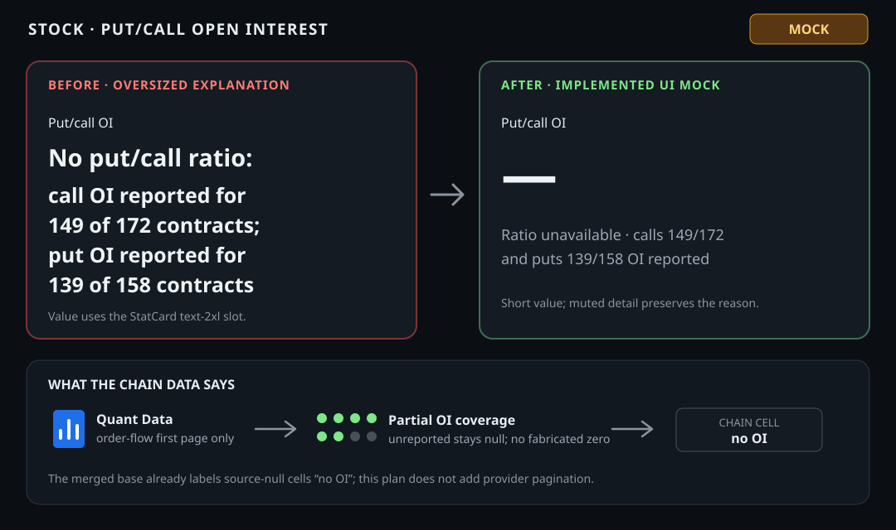

# EGM Drift Report — Stock Put/call OI Tile

## plan.md

- The plan omitted `apps/web/src/status-language-allowlist.ts`, which changed for the two new displayed strings. The plan now lists the file, its limited scope, and its focused test.
- The initial responsive criterion required page-wide overflow checks at all four widths. At a 1024 px viewport, the browser measured a 1179 px document width because the existing options-chain table uses `min-w-[60rem]`. That table is outside this tile task. The plan now checks the OI detail inside its tile at 375, 768, 1024, and 1440 px, requires wrapping at 375 px, and records page-wide overflow as a separate limitation.

## consolidated_review_report.md

- The report still said implementation and runtime verification were pending, and its E2E summary claimed a page-wide overflow check at every target width. It now records focused results, tile-only responsive assertions, the measured table overflow, and the final `bun run verify:prepush` pass (exit 0; the last Vitest phase reported 151 files passed, 3 skipped, and 3,418 tests passed, 6 skipped).

## implementation_readiness_report.md

No drift detected.

## goldfish_review_report.md

- Stage 7 Issue 5 proposed a page-wide `scrollWidth` assertion at every viewport. This is a historical design finding. The final plan narrows the check because the existing table overflows at 1024 px; the current plan and consolidated report record the evidence and limit.

## comprehension_report.md

No drift detected.

## zoom_out_report.md

No drift detected.

## intermediate_zoom_out_report.md

No drift detected.

## critic_report.md

- The Stage 7 resolution says the plan checks document scroll width against the viewport. That criterion was later removed after the 1024 px browser check measured 1179 px from the existing options table. The current plan and consolidated report now specify tile containment and 375 px wrapping; this review report remains a record of the earlier plan.

## before-after.svg

- The after-state was labeled `PROPOSED MOCK` after implementation. It now reads `IMPLEMENTED UI MOCK`. The example counts remain mock data and the graphic remains labeled `MOCK`.
