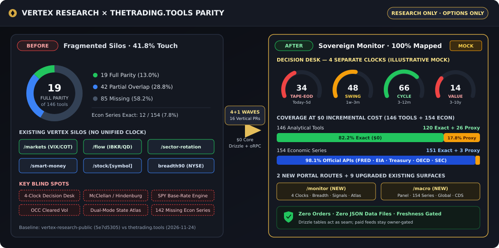
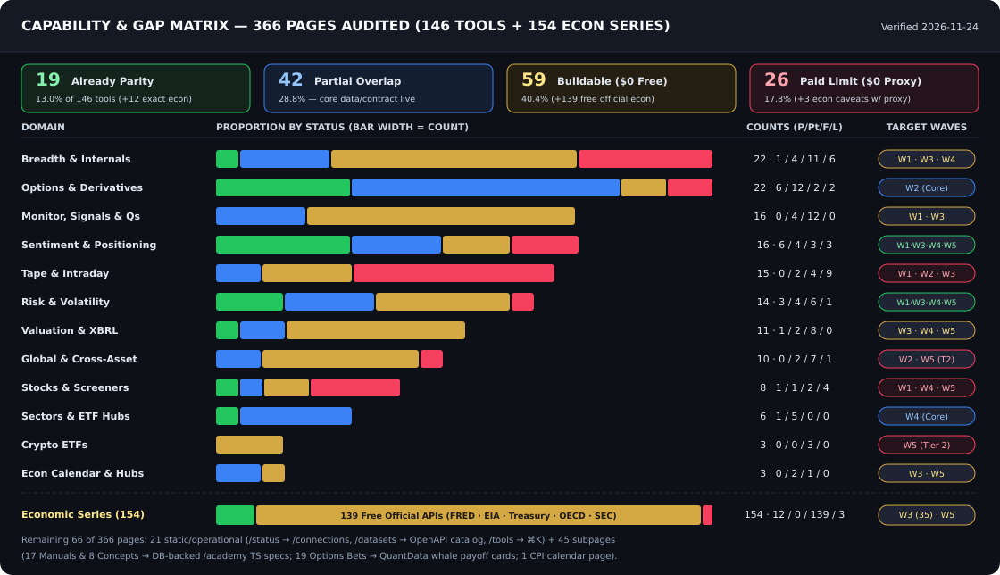
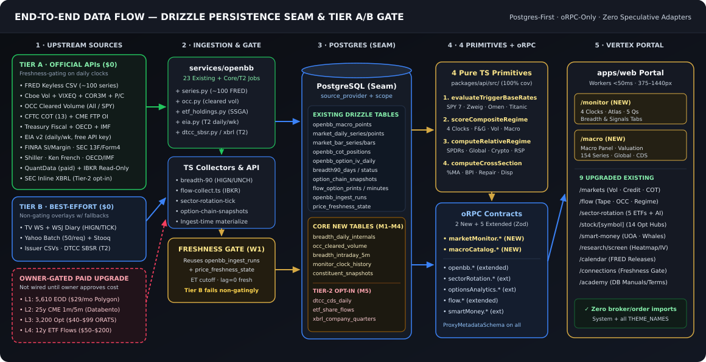
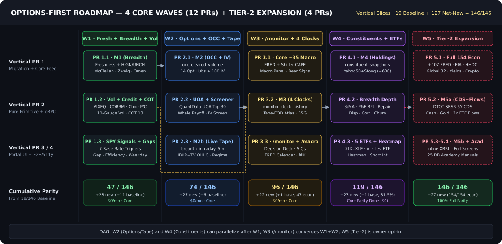

# Full Parity Plan: Recreating `thetrading.tools` Inside Vertex Research

- **Card:** `vertex-thetrading-tools-parity`
- **Author:** Jeff Scott Ward (written by an agent)
- **Date:** 2026-11-24
- **Baseline commit:** `5e7d5305` on `vertex/rebuild-darkfactory-20260921` (`ws/vertex-thetrading-tools-parity`)
- **Status:** Reviewed — EGM Consolidated Review of 2026-11-24 completed (`22/22` action items auto-accepted and applied; see [consolidated_review_report.md](consolidated_review_report.md), [goldfish_review_report.md](goldfish_review_report.md), and [intermediate_zoom_out_report.md](intermediate_zoom_out_report.md))
- **Brainstorm brief:** [concepts_brief.md](concepts_brief.md)
- **Mobile report:** [report.html](report.html)

> **Research-only & options-only invariant.** Nothing in this plan places, modifies, or cancels orders, arms trading, adjusts risk caps, or connects to a live execution path. All tools, composite clocks, breadth alerts, and base-rate studies describe historical and current market structure for options-oriented research. No third-party code, copy, or visual assets from `thetrading.tools` are copied; all fetched site content was treated strictly as untrusted data.

*Figure 1 shows today's baseline (`19` full parity + `42` partial out of `146` analytical tools; `12/154` exact economic series) transitioning across 4 options-first core waves (`12` vertical PRs, `$0/mo`) plus 1 owner-opt-in Tier-2 expansion wave (`4` vertical PRs) to `120` exact `$0` tools plus `26` proxy-backed tools. The four circular gauges on the right (`Tape-EOD 34`, `Swing 48`, `Cycle 66`, `Value 14`) are clearly labeled `MOCK` with illustrative numbers.*

---

## 1. Executive Summary & Audit Reconciliation

On **2026-11-24**, we exhaustively audited `https://www.thetrading.tools/` via `sitemap.xml`, `/tools`, `/datasets`, `/methodology`, `/how-it-works`, `/what-we-offer`, `/status`, `/signals`, `/macro-panel`, `/economy`, `/llms.txt`, all **145** non-economic tool/dashboard/signal pages (`145/145` HTTP 200), `/chart?symbol=AAPL`, and **30** representative economic-series pages. We then verified every capability against `vertex-research-public` (`88` non-test contract files / `55` explicit top-level `appContract` keys (+ generated registry spread), `34` Drizzle schema files across `95` migrations `0000`–`0094`, `79` `page.tsx` routes (`62` portal, `2` lab, `10` public, `5` auth), `23` `services/openbb` ingestion jobs, `5` paid QuantData endpoints, read-only IBKR/Nautilus history & ES/NQ streamed tape, TradingView/WSJ `breadth-90`, `sector-rotation`, `leveraged-etf`, `smart-money`, and `services/research/shiller.py`).

### Exact Site-Wide Page Reconciliation (`366` Live Canonical Pages)

| Surface Class | Count | Share | Source of Truth | Vertex Disposition |
| --- | ---: | ---: | --- | --- |
| Analytical non-economic tools, dashboards, signals, hubs & questions | **146** | 39.9% | `/` (`1`) + sitemap top-level (`140`, incl. `/chart`) + `/tools`-only live pages (`5`) | **19** Parity · **42** Partial · **59** Buildable `$0` · **26** Paid-Limited (all with `$0` proxies) |
| Economic indicator pages (`/tools` Economic Data directory) | **154** | 42.1% | All `154` in `sitemap.xml` (disjoint from the `146` analytical tools) | **12** Exact Present · **139** Buildable `$0` official APIs · **3** Licensing caveat (`MOVE`, 2 NAR) with `$0` proxy |
| Static, editorial, policy & operational transparency pages | **21** | 5.7% | All `21` in `sitemap.xml` | `/status` → `/connections` freshness gate; `/datasets` → `/knowledge` & OpenAPI; `/tools` → global `⌘K`; 18 editorial/legal pages out of scope |
| Subpages (`/manuals/*`, `/concepts/*`, `/options-bets/*`, `/economic-calendar/cpi`) | **45** | 12.3% | All `45` in `sitemap.xml` | `17` Manuals + `8` Concepts → DB-backed `/academy` TS course & `semanticTerms`; `19` Bets → automated QuantData whale cards; `1` CPI → `/calendar` |
| **Total live canonical pages audited** | **366** | **100.0%** | **`361` in `sitemap.xml` + `5` live `/tools` pages** | **120/146 (82.2%) exact `$0` · 146/146 (100%) w/ `$0` proxies · 151/154 (98.1%) official econ** |

*Reconciliation notes:* The 5 live `/tools` pages absent from `sitemap.xml` on 2026-11-24 are `/stocks-at-52-week-lows`, `/volatility-outlook`, `/credit-stress`, `/etf-short-interest`, and `/gold-bottom-or-bounce` (all HTTP 200). Dynamic `/chart?symbol=<TICKER>` is counted as `/chart` inside the `140` sitemap analytical tools (`1 + 140 + 5 = 146`). Zero overlap exists between the `146` analytical tools and the `154` economic indicator pages.

### Key Architectural Decisions (Post-EGM Review)

1. **Options-first 4-Wave Core + Tier-2 Expansion Wave 5:** Core Waves 1–4 (`12` vertical PRs, `$0/mo`) ship **119/146 tools (`81.5%`)**—100% of options, volatility, exchange & constituent breadth, live tape, sector ETF hubs, core ~35 macro/valuation, and the 4-Clock Decision Desk (`/monitor`). Tier-2 Expansion Wave 5 (`4` vertical PRs, owner opt-in) completes the remaining `27` encyclopedia/XBRL/global/crypto/issuer-flow tools and `107` peripheral economic series (`146/146` & `154/154`) without blocking core options workflows.
2. **Drizzle Postgres tables as the sole decoupling seam (`AGENTS.md` Rules 11 & 12):** Zero speculative disabled paid adapters (`POLYGON_API_KEY`, `ORATS_API_KEY`, `DATABENTO_API_KEY`) or premature `ports/` abstractions are shipped in Waves 1–5. Every ingested table carries `source_provider` and `universe_scope` metadata so an owner-approved paid ingestion worker can drop in cleanly later with zero changes to pure TypeScript engines or UI.
3. **Dual-Mode Tape Clock & survivorship-free replays:** `Tape-EOD` uses survivorship-free daily inputs (1995+/2007+) so the 4-Clock Decision Desk and `(Cycle × Tape-EOD)` **Market State Atlas** work on **Day 1 at `$0`** with strict causal analog filtering; `Tape-Live` adds a rolling intraday microstructure overlay (`IBKR` + `TradingView` 5m).
4. **Tier A (Official Structured APIs — freshness-gating) vs Tier B (Best-Effort Web CSV/WS — non-gating overlay):** Reuses Vertex's existing `openbb_ingest_runs`, `price_freshness_state`, and `breadth90_status` from Wave 1 PR 1.1; brittle web CSVs degrade gracefully as non-gating overlays instead of tripping stale banners across `/monitor`.
5. **Minimal surface area:** Four composable pure TypeScript primitives (`evaluateTriggerBaseRates`, `scoreCompositeRegime`, `computeRelativeRegime`, `computeCrossSectionalBreadth`), **2** new top-level routes (`/monitor` with Breadth & Signals tabs, `/macro`), **2** new oRPC contracts (`marketMonitor.*`, `macroCatalog.*`), and **9** upgraded existing routes (`/markets`, `/flow`, `/sector-rotation`, `/stock/[symbol]`, `/smart-money`, `/research/screen`, `/calendar`, `/connections`, `/academy`).

---

## 2. Existing Vertex Research Baseline Inventory

Verified against commit `5e7d5305` on `vertex/rebuild-darkfactory-20260921`:

| Vertex Subsystem | Verified Paths | Current Coverage |
| --- | --- | --- |
| **OpenBB Ingestion (`services/openbb`)** | `services/openbb/vertex_openbb/cli.py`, `rows.py`, `jobs/*.py`, `options_math.py`, `sec_guard.py` | 23 jobs: 14 Cboe vol indices (`VIX`, `VIX1D`, `VIX9D`, `VIX3M`, `VIX6M`, `VIX1Y`, `VVIX`, `SKEW`, `VXN`, `VXD`, `RVX`, `GVZ`, `OVX`, `VXSLV`), VX curve, option IV/GEX/walls, 10 CFTC COT markets (`ES`, `NQ`, `YM`, `RTY`, `VX`, `ZN`, `DX`, `GC`, `SI`, `CL`), CME ES/NQ OI, Fed H.15/NFCI/ANFCI/KCFSI/GSCPI/CBDI/Nowcasts/SOMA/FOMC, TGA + TreasuryDirect auctions, OECD CLI (`openbb_oecd`), 9 keyless FRED CSVs (`HY_OAS`, `IG_OAS`, `T10Y3M`, `T10Y2Y`, `RRP`, `WALCL`, `DTWEXBGS`, `ICSA`, `STLFSI4`), FINRA OTC/SI/Reg SHO, SEC 13F/FTD/Form 4, Fama-French 5+MOM, Congress PTRs, Core 7 ETFs (`SPY`, `QQQ`, `DIA`, `IWM`, `GLD`, `SLV`, `USO`) + futures + `TNX`/`IRX` + `EY_TNX_RATIO` (`35` series in `openbb_macro_series`, `12` exact overlap with the `154` directory) |
| **Freshness & Observability** | `packages/db/src/schema/openbb.ts`, `packages/db/src/schema/openbb-freshness.ts`, `packages/api/src/contracts/price-freshness.ts`, `scripts/price-freshness/tick.ts` | `openbb_ingest_runs`, `price_freshness_state`, `openbb.priceFreshness`, `openbb.checkPriceFreshness`, `breadth90_status` |
| **Breadth-90 Collector** | `scripts/breadth-90/tradingview.ts`, `scripts/breadth-90/wsj.ts`, `scripts/breadth-90/classifier.ts`, `packages/api/src/contracts/breadth-90.ts` | TradingView unauthenticated WS (`USI:ADV`, `USI:DECL`, `USI:UVOL`, `USI:DVOL` daily + 5m) + WSJ Markets Diary cross-check; Lowry 90%/80% up/down-day state machine persisted in `breadth90_days`, `breadth90_events`, `breadth90_status` |
| **Sector Rotation & Baskets** | `packages/api/src/contracts/sector-rotation.ts`, `packages/api/src/contracts/baskets.ts`, `apps/web/src/app/(portal)/sector-rotation/page.tsx`, `apps/web/src/app/(portal)/rotation-matrix/page.tsx` | All 11 Select Sector SPDR ETFs (`XLB`, `XLC`, `XLE`, `XLF`, `XLI`, `XLK`, `XLP`, `XLRE`, `XLU`, `XLV`, `XLY`) vs `SPY` RS-Ratio & RS-Momentum quadrants (daily/weekly) |
| **Paid QuantData & Options Analytics** | `packages/api/src/server/quantdata-client.ts`, `packages/api/src/contracts/options-analytics.ts`, `packages/api/src/contracts/options-chain.ts`, `packages/api/src/contracts/smart-money.ts`, `packages/db/src/schema/option-chain-snapshots.ts` | Paid QuantData client (`1 req/s`, `<=30 req/min` budget; 5 endpoints: `term-structure`, `open-interest-by-strike`, `order-flow/consolidated`, `net-drift`, `gainers-losers`); Postgres `option_chain_snapshots`; strike profiles, expected move, IV rank/percentile history, GEX, gamma flip, walls on `/stock/[symbol]`, `/flow`, `/smart-money` |
| **Read-Only IBKR Flow & History** | `services/ibkr-history/`, `services/research/ibkr_history.py`, `packages/api/src/contracts/flow.ts`, `packages/api/src/server/flow-collect.ts`, `packages/db/src/schema/flow.ts`, `docs/vertex-rebuild/flow-pipeline.md` | Streamed ES & NQ tape, tape speed, live DOM, liquidity heatmap, hedging pressure (`SPY`, `ES`), put/call ratio (`SPY`, `ES`), `apps/web/src/components/portal/flow-strike-heatmap-panel.tsx`, `apps/web/src/components/portal/futures-oi-panel.tsx`; tables `flow_option_prints`, `flow_minutes`, `flow_market_premium`, `flow_market_premium_sessions`, `market_daily_series`/`market_daily_points`, `market_bar_series`/`market_bars` |
| **Leveraged ETFs, Shiller & Academy** | `packages/db/src/schema/leveraged-etf.ts`, `packages/db/src/schema/research-screen.ts`, `services/research/shiller.py`, `packages/db/src/schema/academy-content.ts`, `packages/api/src/contracts/semantic-terms.ts` | Leveraged/inverse ETF universe with option gate; `shiller.py` (`date`, `price`, `earnings` from `ie_data.xls`); `/deep-value`, `/research/screen`; DB-backed `/academy` (`academy_lesson_specs` / `academy_lesson_sources`) + `semanticTerms` |

---

## 3. Complete Exhaustive Inventory & Gap Analysis (All `366` Pages)

Status key: **`PARITY`** (live in Vertex), **`PARTIAL`** (core feed/schema/UI live, needs formula/series/panel extension), **`BUILDABLE_FREE`** (`$0/mo` via existing Vertex feeds + free official APIs), **`PAID_LIMITED`** (needs paid vendor for exact universe/history parity; every row ships with a `$0` Vertex proxy). Wave tags: **W1–W4** = Core Options-First Parity (`$0/mo`); **W5** = Tier-2 Full Encyclopedia Expansion (owner opt-in).

### 3.1 Monitor, Four-Clock Decision Desk, Signals & Questions (`16` tools)

| Route | Tool / Signal | Upstream Data Feed(s) | Vertex Placement & Baseline / Proxy | Status | Wave |
| --- | --- | --- | --- | --- | --- |
| `/` | Market Monitor & 4-Clock Decision Desk | Synthesizes Tape-EOD/Live, Swing, Cycle & Valuation clocks | New `/monitor` front door (`marketMonitor.desk`) | `BUILDABLE_FREE` | W3 |
| `/signals` | SPY Technical Trigger Base-Rate Index | `SPY` daily close (1993–present) | Stored `market_bar_series`/`market_bars` (`SPY`) + `evaluateTriggerBaseRates` | `BUILDABLE_FREE` | W1 |
| `/golden-cross` | Golden Cross (50d > 200d SMA) | `SPY` daily close | `evaluateTriggerBaseRates` on `/monitor` Signals tab | `BUILDABLE_FREE` | W1 |
| `/monthly-faber` | Monthly Faber Crossover (Close > 10M SMA) | `SPY` month-end close | `evaluateTriggerBaseRates` (month-end, no daily cooldown) | `BUILDABLE_FREE` | W1 |
| `/ma50-200-reclaim` | 50/200 MA Reclaim | `SPY` daily close | `evaluateTriggerBaseRates` (prior session `< both` → close `> both`) | `BUILDABLE_FREE` | W1 |
| `/rsi-oversold-thrust` | RSI(14) Oversold Thrust (<30 → >60 in 20d) | `SPY` daily close | Wilder RMA `RSI(14)` trigger in `evaluateTriggerBaseRates` | `BUILDABLE_FREE` | W1 |
| `/market-correction` | 10% Correction from ATH | `SPY` daily close | New-ATH-reset drawdown trigger in `evaluateTriggerBaseRates` | `BUILDABLE_FREE` | W1 |
| `/three-percent-down-day` | 3% Single-Session Down Day | `SPY` daily close | Daily return `<= -3%` trigger in `evaluateTriggerBaseRates` | `BUILDABLE_FREE` | W1 |
| `/five-day-losing-streak` | 5-Day Losing Streak | `SPY` daily close | Split-adjusted close consecutive streak in `evaluateTriggerBaseRates` | `BUILDABLE_FREE` | W1 |
| `/is-this-a-bull-market` | Q: Is This a Bull or Bear Market? | `SPY` 50/200d MAs + Cycle/Breadth | Composed read on `/monitor` (`marketMonitor.questions`) | `BUILDABLE_FREE` | W3 |
| `/is-a-recession-coming` | Q: Is a Recession Coming? | `T10Y3M`, Sahm Rule, `ICSA`, `CCSA`, `NFCI` | `openbb.macro` holds `T10Y3M`/`ICSA`/`NFCI`; add Sahm/`CCSA` in W3 | `PARTIAL` | W3 |
| `/is-market-risk-elevated` | Q: Is Market Risk Elevated? | `VIX`, `VIX`/`VIX3M`, `SPY` 21d RV, 1% move count | Cboe vol indices + `SPY` already stored | `PARTIAL` | W3 |
| `/are-investors-too-bullish` | Q: Are Investors Too Bullish? | Fear & Greed, Lev ETFs, `WRMFSL`, Margin Debt | Composed read on `/monitor` (`marketMonitor.questions`) | `BUILDABLE_FREE` | W3 |
| `/are-small-caps-confirming` | Q: Are Small Caps Confirming S&P 500? | `IWM` vs `SPY` 3m/12m & 50/200d | `IWM` and `SPY` already stored in `market_bars` | `PARTIAL` | W3 |
| `/market-state-atlas` | Market State Atlas (`Cycle × Tape-EOD` Analogs) | Survivorship-free `Cycle` × `Tape-EOD` (1995+) + causal fwd `SPY` | Day-1 `$0` causal analog engine on `/monitor` (intraday `Tape-Live` variant noted in `L2`) | `BUILDABLE_FREE` | W3 |
| `/interactive-charts` | Interactive Charts Hub | Links positioning, SPY options landscape & atlas | Portal `/charts` + `/monitor` interactive tab | `PARTIAL` | W3 |

### 3.2 Breadth & Market Internals (`22` tools)

| Route | Tool / Signal | Upstream Data Feed(s) | Vertex Placement & Baseline / Proxy | Status | Wave |
| --- | --- | --- | --- | --- | --- |
| `/ninety-percent-days` | 90% Up / Down Days | NYSE `UVOL`/`DVOL`/`ADV`/`DECL` | Live in `breadth90.*` (`breadth90_days`) on `/markets` | `PARITY` | W1 |
| `/advance-decline-line` | Advance-Decline Line | Daily advancers & decliners | `breadth90_days` stores `USI:ADV`/`DECL`; add cumulative A-D on `/monitor` Breadth tab | `PARTIAL` | W1 |
| `/mcclellan-oscillator` | McClellan Oscillator & Summation | Daily `ADV`/`DECL` (RANA + raw) | Pure 19d/39d EMA + Summation over `breadth_daily_internals` | `PARTIAL` | W1 |
| `/zweig-breadth-thrust` | Zweig Breadth Thrust | 10d EMA of `ADV/(ADV+DECL)` | Pure thrust state machine (`<=0.40` → `>=0.615` in `<=10d`, then disarm) | `PARTIAL` | W1 |
| `/new-highs-new-lows` | New Highs & New Lows | NYSE 52-week highs, lows & unchanged | Extend `tradingview.ts` + `wsj.ts` with `USI:HIGN`, `USI:LOWN`, `USI:UNCH` | `BUILDABLE_FREE` | W1 |
| `/stocks-at-52-week-lows` | Stocks at 52-Week Lows Washout | NYSE common 52w lows | `breadth_daily_internals` (`USI:LOWN` + S&P 500/NDX washout count) | `BUILDABLE_FREE` | W1 |
| `/hindenburg-omen` | Hindenburg Omen (clustered) | NYSE `HIGN`/`LOWN`/`UNCH` + `McOsc_RANA` + `^NYA` 50d | Pure detector with 30-session cluster counter on `/monitor` Breadth tab | `BUILDABLE_FREE` | W1 |
| `/titanic-syndrome` | Titanic Syndrome (classic + 5-cond) | NYSE `HIGN`/`LOWN`/`UNCH` + `^GSPC` causal 7d 52w high | Pure Ohama 1965 + strict 5-condition detector | `BUILDABLE_FREE` | W1 |
| `/equal-weight-vs-cap-weight` | Equal Weight vs Cap Weight | `RSP` & `SPY` + Ken French Size | Add `RSP` to `daily_prices.py`; `SPY` + Fama-French already stored | `BUILDABLE_FREE` | W1 |
| `/coppock-curve` | Coppock Curve | Month-end `SPY` closes | Pure percent `WMA10(ROC14 + ROC11)` on stored `SPY` | `BUILDABLE_FREE` | W1 |
| `/buy-the-dip` | Buy the Dip Tracker | `SPY`/`QQQ`, `VIX`/`VXN`/`VIX3M`, Ken French | All inputs already stored; add pure regime study in W1 | `BUILDABLE_FREE` | W1 |
| `/swing-tracker` | Swing Tracker (1w–3m Clock) | 5 dimensions (survivorship-free exchange & ETF inputs) | Pure `scoreCompositeRegime` on `/monitor` | `BUILDABLE_FREE` | W3 |
| `/cycle-tracker` | Cycle Tracker (3–12m Clock) | 6 dimensions (survivorship-free trend/breadth/credit/OECD/recession) | Pure `scoreCompositeRegime` on `/monitor` | `BUILDABLE_FREE` | W3 |
| `/market-breadth` | Market Breadth Overview Hub | Aggregates W1 exchange + W4 constituent breadth | `/monitor` Breadth workspace tab (`marketMonitor.breadth`) | `PARTIAL` | W4 |
| `/contribution-concentration` | Contribution Concentration | S&P 500 & NDX weights + closes | Free daily SSGA `SPY` + Invesco `QQQ` holdings in `constituent_snapshots` | `BUILDABLE_FREE` | W4 |
| `/negative-beta` | Negative Beta Tracker | S&P 500 members vs `SPY` + Ken French 49 | `constituent_snapshots` + Ken French 49 industries CSV (added in W4) | `BUILDABLE_FREE` | W4 |
| `/stocks-above-moving-average` | Stocks Above 20/50/200d MAs | ~4,750 US common stocks OHLCV | **Paid limit (`L1`)** · **`$0` proxy:** S&P 500+NDX (~600) in `computeCrossSectionalBreadth` (+ optional TV `MMTW`/`MMFI`/`MMTH`) | `PAID_LIMITED` | W4 |
| `/bullish-percent-index` | Bullish Percent Index (P&F) | ~4,750 US common stocks P&F state | **Paid limit (`L1`)** · **`$0` proxy:** Log 2% 3-box persistent P&F over S&P 500+NDX (~600, forward-only) | `PAID_LIMITED` | W4 |
| `/bear-market-breadth` | Bear Market Breadth (% in 10%/20% DD) | `SPY`/`DIA`/`QQQ` + small-cap cohort | **Paid limit (`L1`)** · **`$0` proxy:** SSGA `SPY`/`DIA` + Invesco `QQQ` + iShares `IWM` top-200 holdings | `PAID_LIMITED` | W4 |
| `/hidden-bear-index` | Hidden Bear Index | `RSP` vs `SPY` DD gap + ~4,750 dispersion | **Paid limit (`L1`)** · **`$0` proxy:** Exact non-negative `HBI_Gap` (`RSP` vs `SPY`) + S&P 500 constituent dispersion | `PAID_LIMITED` | W4 |
| `/market-repair-flow` | Market Repair Flow | Cohort transitions across 4 disjoint MA states | **Paid limit (`L1`)** · **`$0` proxy:** S&P 500+NDX (~600) Markov transition matrix (forward-only) | `PAID_LIMITED` | W4 |
| `/stocks-outperforming-the-index` | Stocks Beating the Index | ~4,750 US common stocks vs `SPY`/`QQQ` | **Paid limit (`L1`)** · **`$0` proxy:** S&P 500 vs `SPY` & NDX vs `QQQ` | `PAID_LIMITED` | W4 |

### 3.3 Risk & Volatility (`14` tools)

| Route | Tool / Signal | Upstream Data Feed(s) | Vertex Placement & Baseline / Proxy | Status | Wave |
| --- | --- | --- | --- | --- | --- |
| `/vix-fear-index` | VIX Fear Index | Cboe `VIX` + `SPY` daily closes | Live in `cboe-vol-indices` + `/markets` | `PARITY` | W1 |
| `/vix-term-structure` | VIX Term Structure | `VIX`/`VIX3M` + VX futures curve | Live in `cboe-vol-indices` + `cboe-vx-curve` | `PARITY` | W1 |
| `/skew-index` | SKEW Index | Cboe `SKEW` + `SPY` | Live in `cboe-vol-indices` (`SKEW`) | `PARITY` | W1 |
| `/tech-volatility-spread` | Tech Volatility Spread | `VXN − VIX` implied + `QQQ`/`SPY` realized | `VXN`, `VIX`, `QQQ`, `SPY` already stored; add spread panel on `/markets` | `PARTIAL` | W1 |
| `/volatility-outlook` | Volatility Outlook (10 Gauges) | `VIX`, `VIX`/`VIX3M`, `VVIX`, `SKEW`, `VXN`, `COR3M`, `SPY` 21d RV, `HY_OAS`, `^MOVE`, `VIXEQ−VIX` | 7/10 stored; add `VIXEQ`, `COR3M`, `^MOVE` (w/ `TLT` 30d IV fallback) | `PARTIAL` | W1 |
| `/volatility-premium` | Single-Stock Vol Premium | Cboe `VIXEQ − VIX` & `COR3M` | Add `VIXEQ`, `COR3M` to `cboe.py` (free Cboe CSV) | `BUILDABLE_FREE` | W1 |
| `/credit-spreads` | Credit Spreads | 9 credit/Treasury ETFs + CFTC Weekly Swaps | `HY_OAS`, `IG_OAS`, `CBDI` live; add 9 ETFs + CFTC Weekly Swaps in W1 | `PARTIAL` | W1 |
| `/macro-panel` | Cross-Asset Macro Panel (15 Inst / 4 Drivers) | 15 cross-asset instruments (exact roster §5.4.5) | 7/15 stored; add 8 liquid ETFs/futures + 4-driver scorer on `/macro` | `PARTIAL` | W3 |
| `/bear-market-warning-signs` | Bear Market Warning Signs (11 Signs) | `^GSPC`/`^NDX`/`^RUT`, Sector SPDRs, Ken French, FRED, Shiller | All free/wired; 11-check panel on `/markets` & `/monitor` | `BUILDABLE_FREE` | W3 |
| `/realized-correlation` | Stock Correlation (Realized + Implied) | Top-50/100 S&P 500 pairwise corr + Cboe `COR3M` | S&P 500 top-100 closes (W4) + `COR3M` (W1), materialized at ingest | `BUILDABLE_FREE` | W4 |
| `/return-dispersion` | Return Dispersion (Top 100 Stocks) | Cross-sectional std dev of top-100 US stocks | SSGA `SPY` top-100 weights + daily closes (W4) | `BUILDABLE_FREE` | W4 |
| `/momentum-churn` | Momentum Churn | Cross-sectional rank turnover (~4,750 stocks) | **Paid limit (`L1`)** · **`$0` proxy:** S&P 500+NDX (~600) 20d/63d rank turnover | `PAID_LIMITED` | W4 |
| `/credit-stress` | Credit Stress (5Y Single-Name CDS) | DTCC SEC Reg SBSR public dissemination | Tier-2 non-gating `dtcc_sbsr.py` (SNAC + LEI/UPI normalization, §5.4.4) | `BUILDABLE_FREE` | W5 |
| `/delinquency-tracker` | Delinquency Tracker | NY Fed HHDC + FRED bank delinquencies (`DRSFRMACBS`, `DRCCLACBS`, `DRCLACBS`) | FRED quarterly bank series + NY Fed HHDC CSV on `/macro` | `BUILDABLE_FREE` | W5 |

### 3.4 Tape & Intraday Structure (`15` tools)

| Route | Tool / Signal | Upstream Data Feed(s) | Vertex Placement & Baseline / Proxy | Status | Wave |
| --- | --- | --- | --- | --- | --- |
| `/gap-analysis` | Gap Analysis (`SPY` & `QQQ`) | Daily OHLC (`SPY`, `QQQ`) | Pure overnight-gap & fill-rate engine on `/flow` Daily Tape tab | `BUILDABLE_FREE` | W1 |
| `/range-efficiency` | Range Efficiency (`QQQ`/`SPY`) | Daily OHLC (`QQQ`, `SPY`) | Pure `abs(C - O) / (H - L)` efficiency engine on `/flow` Daily Tape tab | `BUILDABLE_FREE` | W1 |
| `/seasonality` | Monthly Seasonality (`SPY` & `QQQ`) | Daily closes (`SPY`, `QQQ`) | Pure monthly return matrix on `/flow` Daily Tape tab | `BUILDABLE_FREE` | W1 |
| `/weekday-analysis` | Weekday Analysis (Overnight vs Intraday) | Daily open/close (`SPY`) | Pure open→close vs close→open weekday split on `/flow` | `BUILDABLE_FREE` | W1 |
| `/intraday-momentum` | Intraday Momentum (`QQQ`/`SPY`) | 5m/15m intraday bars | Existing IBKR history + `flow-collect.ts` / `breadth_intraday_5m` | `PARTIAL` | W2 |
| `/nyse-advance-decline` | NYSE A/D Issues (`$ADD` 5m) | 5m NYSE `ADV − DECL` | `breadth-90` already fetches 5m `USI:ADV`/`DECL`; persist OHLC into `breadth_intraday_5m` | `PARTIAL` | W2 |
| `/candle-size` | Futures Candle Size (`ES`/`NQ` 1m) | 1m continuous `ES`/`NQ` (1997+) | **Paid limit (`L2`)** · **`$0` proxy:** Live/rolling IBKR `ES`/`NQ` stream + 6–12m IBKR backfill | `PAID_LIMITED` | W2 |
| `/bull-bear-power` | Bull vs Bear Power (`ES`/`NQ` 5m) | 5m RTH `ES`/`NQ` (2009+) | **Paid limit (`L2`)** · **`$0` proxy:** Live/rolling IBKR `ES`/`NQ` 5m bars in `breadth_intraday_5m` | `PAID_LIMITED` | W2 |
| `/session-momentum` | Session Momentum (`ES`/`NQ` 5m) | 5m RTH `ES`/`NQ` (2009+) | **Paid limit (`L2`)** · **`$0` proxy:** Live/rolling IBKR `ES`/`NQ` 5m bars in `breadth_intraday_5m` | `PAID_LIMITED` | W2 |
| `/index-sync` | Index Sync (`ES`/`NQ`/`YM`/`RTY` 5m) | 5m aligned 4-index futures | **Paid limit (`L2`)** · **`$0` proxy:** Extend `FLOW_SYMBOLS` (`flow.ts`) with `YM`/`RTY` (or `DIA`/`IWM` RTH) | `PAID_LIMITED` | W2 |
| `/nyse-tick` | NYSE TICK (`$TICK` 5m OHLC) | 5m `$TICK` High/Low/Close (1997+) | **Paid limit (`L2`)** · **`$0` proxy:** TV WS (`USI:TICK` OHLC, `<=6–8` sessions/socket) or IBKR `TICK-NYSE` | `PAID_LIMITED` | W2 |
| `/nasdaq-tick` | Nasdaq TICK (`$TIKQ` 5m OHLC) | 5m `$TIKQ` High/Low/Close (2001+) | **Paid limit (`L2`)** · **`$0` proxy:** TV WS (`USI:TICKQ` OHLC) + forward Postgres accumulation | `PAID_LIMITED` | W2 |
| `/nasdaq-advance-decline` | Nasdaq A/D Issues (`$ADQD` 5m) | 5m `$ADQD` (2007+) | **Paid limit (`L2`)** · **`$0` proxy:** TV WS (`USI:ADVQ`/`DECLQ` 5m) + forward accumulation | `PAID_LIMITED` | W2 |
| `/market-regime` | Market Regime (Expansion/Whipsaw/Grind/Chop) | 2-axis Movement × Quality fold | **Paid limit (`L2`)** · **`$0` proxy:** Live/rolling 2-axis regime on `/flow` + EOD proxy back to 1999 | `PAID_LIMITED` | W2 |
| `/tape-tracker` | Tape Tracker (Today–5d Clock) | Dual-Mode: `Tape-EOD` (1995+) + `Tape-Live` (5m) | **Paid limit (`L2`)** for 20y intraday replay · **`$0` proxy:** Full Day-1 `Tape-EOD` + rolling `Tape-Live` on `/monitor` | `PAID_LIMITED` | W3 |

### 3.5 Stocks & Screeners (`8` tools)

| Route | Tool / Signal | Upstream Data Feed(s) | Vertex Placement & Baseline / Proxy | Status | Wave |
| --- | --- | --- | --- | --- | --- |
| `/chart` | Interactive Daily OHLCV Chart | Daily OHLCV per symbol | Live on `/charts` and `/stock/[symbol]` (`StockChartPanel`) | `PARITY` | W1 |
| `/short-interest` | Short Interest & Squeeze Watch | FINRA bi-monthly SI + reference shares | `finra-short-interest` & `finra-short-volume` live; add days-to-cover & float rank on `/research/screen` | `PARTIAL` | W4 |
| `/market-heatmap` | Market Heatmap (Top 100 & Thematic Treemaps) | Top-100/S&P 500 cap weights + returns | `constituent_snapshots` (SSGA weights × cap) + daily closes on `/research/screen` | `BUILDABLE_FREE` | W4 |
| `/us-vs-international-stocks` | US vs International (`SPY` vs `EFA`) | `SPY`, `EFA` + Ken French Intl | Add `EFA` + Ken French Intl CSV on `/macro` | `BUILDABLE_FREE` | W5 |
| `/stock-map` | Stock Map (4,609 US Stocks by Sector/Size) | ~5,500 US stocks + SEC SIC + cap | **Paid limit (`L1`)** · **`$0` proxy:** S&P 500+NDX (~600–750) + SEC EDGAR SIC on `/research/screen` | `PAID_LIMITED` | W5 |
| `/unusual-volume` | Unusual Volume (50%+ vs 30d Avg) | ~5,500 US stocks daily OHLCV | **Paid limit (`L1`)** · **`$0` proxy:** Liquid ~700-stock universe on `/research/screen` | `PAID_LIMITED` | W5 |
| `/momentum-scanner` | Momentum Scanner (Composite 0–100) | ~5,500 US stocks daily OHLCV | **Paid limit (`L1`)** · **`$0` proxy:** Liquid ~700-stock + leveraged ETFs on `/research/screen` | `PAID_LIMITED` | W5 |
| `/squeeze-radar` | Squeeze Radar (Covering Rallies) | FINRA SI + full-universe price/vol | **Paid limit (`L1`)** · **`$0` proxy:** Full FINRA SI joined with liquid ~700-stock OHLCV on `/research/screen` | `PAID_LIMITED` | W5 |

### 3.6 Options & Derivatives (`22` tools)

| Route | Tool / Signal | Upstream Data Feed(s) | Vertex Placement & Baseline / Proxy | Status | Wave |
| --- | --- | --- | --- | --- | --- |
| `/spy-options`, `/qqq-options`, `/iwm-options`, `/gld-options` | Core 4 ETF Options Dashboards (4 pages) | 30d IV vs RV, skew, term, smile, walls, OI | Live on `/stock/{SPY,QQQ,IWM,GLD}` (`optionsAnalytics.*`, `openbb.ivHistory`, QuantData) | `PARITY` (4) | W2 |
| `/spy-options-oi` | SPY Options OI (All/30d/7d/0DTE) | Full-chain OI snapshot | Live via `option_chain_snapshots` + Strike Profiles + QuantData OI | `PARITY` | W2 |
| `/spy-options-landscape` | SPY Options Landscape (Strike × Expiry) | Strike × expiry OI/vol/IV/GEX | Live via `apps/web/src/components/portal/flow-strike-heatmap-panel.tsx` + `option_chain_snapshots` | `PARITY` | W2 |
| `/smh-options`, `/aapl-options`, `/googl-options`, `/msft-options`, `/nvda-options`, `/tqqq-options`, `/sqqq-options`, `/soxl-options`, `/soxs-options`, `/fas-options` | 10 Additional Symbol Options Dashboards (10 pages) | EOD IV, skew, term, walls, P/C | `/stock/[symbol]` renders on demand; add all 10 to nightly `cboe-option-iv` & relax `OpenbbIvOneYearSchema` (`OPENBB_CORE7`) | `PARTIAL` (10) | W2 |
| `/spy-options-volume` | SPY Options Volume (OCC Cleared) | OCC daily cleared call/put contracts | Free OCC daily volume totals (`occ.py` → `occ_cleared_volume`); QuantData dollar premium displayed in separate column | `BUILDABLE_FREE` | W2 |
| `/total-options-putcall` | Total US Options Put/Call by Account | OCC cleared volume (`Customer`/`Firm`/`Market Maker`) | Free OCC daily volume totals (`occ.py`) on `/flow` | `BUILDABLE_FREE` | W2 |
| `/unusual-options-activity` | Unusual Options Activity (Top 30 Bull/Bear) | ~3,200 optionable equities EOD | Already-paid QuantData consolidated flow powers `/smart-money`; add daily Top-30 Bull/Bear view (3,200 EOD tail noted in `L3`) | `PARTIAL` | W2 |
| `/options-bets` | Options Bets Payoff Analyzer | Large options prints + Black-Scholes payoff curve | Auto-curated QuantData whale prints + pure BS payoff curve UI on `/smart-money` | `PARTIAL` | W2 |
| `/most-active-options` | Most Active Options (~2,900 symbols) | Full-market daily option chains | **Paid limit (`L3`)** · **`$0` proxy:** QuantData gainers/flow + OCC top symbols on `/research/screen` | `PAID_LIMITED` | W2 |
| `/iv-screener` | IV Screener (IV, IVR, IV vs RV) | Broad stock/ETF IV database | **Paid limit (`L3`)** · **`$0` proxy:** Expand `openbb_option_iv_daily` to ~100 core ETFs & mega-caps on `/research/screen` | `PAID_LIMITED` | W2 |

### 3.7 Sentiment & Positioning (`16` tools)

| Route | Tool / Signal | Upstream Data Feed(s) | Vertex Placement & Baseline / Proxy | Status | Wave |
| --- | --- | --- | --- | --- | --- |
| `/commitment-of-traders`, `/es-cot`, `/nq-cot`, `/cl-cot`, `/gc-cot` | CFTC COT Board & 4 Core Futures Pages (5 pages) | CFTC TFF & Disaggregated + futures closes | Live via `cftc-cot` (10 markets) + `openbb.cot` + `daily-prices` | `PARITY` (5) | W1 |
| `/futures-open-interest` | Futures Open Interest (`ES` & `NQ`) | CME daily OI workbook | Live via `cme-futures-oi` + `apps/web/src/components/portal/futures-oi-panel.tsx` | `PARITY` | W1 |
| `/cross-asset-positioning-map` | Cross-Asset Positioning Map (COT Heatmap) | 13 COT markets percentile history | Expand `cftc.py` from 10 → 13 (`+ZB, 6E, 6J`) + heatmap UI on `/markets` | `PARTIAL` | W1 |
| `/put-call-ratio` | CBOE Put/Call Ratio (Total/Equity/Index) | Cboe daily market statistics CSV | `flow` tracks SPY/ES P/C; add Cboe daily stats CSV to `cboe.py` + panel on `/markets` | `PARTIAL` | W1 |
| `/consumer-sentiment` | Consumer Sentiment (UMich) | FRED `UMCSENT` | Keyless FRED CSV in `series.py` (W3 core macro) | `BUILDABLE_FREE` | W3 |
| `/fear-greed-index` | Transparent 8-Component Fear & Greed | Momentum, NH/NL, 10d EMA UVOL, P/C, VIX, HY/IG, Safe-Haven, `WRMFSL`/`SHY-BIL` | Pure 8-component scorer (`>=6/8` quorum, decoupled from issuer CSVs) on `/monitor` | `BUILDABLE_FREE` | W3 |
| `/momentum-vs-low-volatility` | Momentum vs Low Volatility (`MTUM`/`USMV`) | `MTUM`, `USMV` + Ken French MOM | Add `MTUM`/`USMV` to `daily_prices.py`; Fama-French MOM already stored | `BUILDABLE_FREE` | W4 |
| `/leveraged-etf-sentiment` | Leveraged ETF Speculation Index (9 Pairs) | 2x/3x bull vs bear ETF dollar volume | `leveraged_etf_universe` exists; add 9 pairs' daily dollar-vol ratio on `/markets` | `PARTIAL` | W4 |
| `/etf-short-interest` | ETF Short Interest (12 Major Funds) | FINRA SI + fund prices & shares | `finra-short-interest` live; join verified-issuer shares in Tier-2 W5 | `PARTIAL` | W5 |
| `/cash-etf-flows` | Cash ETF Flows (23 T-Bill/Ultra-Short ETFs) | Daily shares outstanding (2014+) | **Paid limit (`L4`)** · **`$0` proxy:** Verified-issuer subset (>85% category AUM) + 1940 Act Form N-PORT | `PAID_LIMITED` | W5 |
| `/long-leveraged-etfs` | Long 3x Leveraged ETFs (SI + OCC + Flows) | FINRA SI + OCC + shares out | **Paid limit (`L4`)** · **`$0` proxy:** Free FINRA SI + OCC + ProShares/Direxion daily CSVs | `PAID_LIMITED` | W5 |
| `/short-leveraged-etfs` | Short 3x Leveraged ETFs (SI + OCC + Flows) | FINRA SI + OCC + shares out | **Paid limit (`L4`)** · **`$0` proxy:** Free FINRA SI + OCC + ProShares/Direxion daily CSVs | `PAID_LIMITED` | W5 |

### 3.8 Sectors & ETF Dashboards (`6` tools)

| Route | Tool / Signal | Upstream Data Feed(s) | Vertex Placement & Baseline / Proxy | Status | Wave |
| --- | --- | --- | --- | --- | --- |
| `/sector-performance` | Sector Performance (11 GICS SPDRs vs SPY) | 11 Select Sector SPDRs + `SPY` | Live in `sectorRotation.*`, `/sector-rotation`, `/rotation-matrix` | `PARITY` | W4 |
| `/xlk`, `/smh`, `/xlf`, `/kre`, `/xle` | 5 Sector ETF Deep-Dive Dashboards (5 pages) | Holdings weights, constituent breadth, concentration, options | Extend `/sector-rotation` with ETF drill-down panel fed by SSGA/VanEck `constituent_snapshots` + `optionsAnalytics` | `PARTIAL` (5) | W4 |

### 3.9 Valuation & Fundamentals (`11` tools)

| Route | Tool / Signal | Upstream Data Feed(s) | Vertex Placement & Baseline / Proxy | Status | Wave |
| --- | --- | --- | --- | --- | --- |
| `/stocks-vs-bonds` | Stocks vs Bonds (EY / 10Y) | Shiller earnings yield + `UST10Y`/`TNX` | Live via `services/research/shiller.py` + `EY_TNX_RATIO` | `PARITY` | W3 |
| `/stock-market-trend` | S&P 500 vs Long-Term Trend (1881+) | Shiller monthly price, dividends, CPI | Extend `shiller.py` (currently `date/price/earnings` only) to parse dividends & CPI | `PARTIAL` | W3 |
| `/stock-market-valuation` | Stock Market Valuation Composite | Shiller CAPE + Ken French B/M + FRED Z.1/BEA | Extend `shiller.py` (CAPE col 12) + FRED Z.1/`CP` on `/macro` | `PARTIAL` | W3 |
| `/household-equity-allocation` | Household Equity Allocation (Fed Z.1) | FRED `BOGZ1FL153064486Q` | Keyless FRED CSV in `series.py` (W3 core macro) | `BUILDABLE_FREE` | W3 |
| `/spy-m2-ratio` | SPY / M2 Money Supply Ratio | Stored `SPY` + FRED `M2SL` | Keyless FRED CSV + stored `SPY` on `/macro` | `BUILDABLE_FREE` | W3 |
| `/bubble-tracker` | Bubble Tracker (Valuation Clock 3–10y) | 3 pillars (release-lagged expanding window, ≥10y warm-up) | Pure `scoreCompositeRegime` on `/monitor` & `/macro` | `BUILDABLE_FREE` | W3 |
| `/nasdaq-equal-weight` | Nasdaq Equal Weight (`QQQ`/`QQEW`/`XLK`) | Daily closes (`QQQ`, `QQEW`, `XLK`) | Add `QQEW` in W4 + `computeRelativeRegime` on `/sector-rotation` | `BUILDABLE_FREE` | W4 |
| `/ai-trade` | AI Trade Index (9 Build-Out Groups vs `RSP`) | Curated 9 thematic AI groups + `RSP` | Reuse `baskets.*` + daily closes on `/sector-rotation` | `BUILDABLE_FREE` | W4 |
| `/real-estate-tracker` | Real Estate Tracker | Census via FRED + Zillow CSV + append-only NAR archive | Tier-2 W5 on `/macro` | `BUILDABLE_FREE` | W5 |
| `/corporate-efficiency` | Corporate Efficiency (SG&A & Operating Margins) | SEC EDGAR XBRL income statements (ex-Financials/REITs/Utilities) | Tier-2 W5 (`sec_xbrl.py` via `sec_guard.py`, PK with `period_end_date` & `filed_date`) | `BUILDABLE_FREE` | W5 |
| `/market-pe-ratio` | Bottom-Up Market P/E Ratio | SEC EDGAR XBRL net income + `dei:EntityCommonStockSharesOutstanding` (multi-class summed) + `UST10Y` | Tier-2 W5 (`sec_xbrl.py` on `/macro`) | `BUILDABLE_FREE` | W5 |

### 3.10 Global & Cross-Asset (`10` tools)

| Route | Tool / Signal | Upstream Data Feed(s) | Vertex Placement & Baseline / Proxy | Status | Wave |
| --- | --- | --- | --- | --- | --- |
| `/gold-bottom-or-bounce` | Gold: Bottom or Bounce? (`GLD` Options Study) | `GLD` 5% swings + option IV/skew + OCC `GLD` volume | `GLD` + `openbb_option_iv_daily` + `occ.py` in W2 | `PARTIAL` | W2 |
| `/gold-price` | Gold Price (Nominal, Real & 20% Drawdowns) | `GC=F`/`GLD` + FRED `CPIAUCSL` + World Bank monthly CSV | `GC=F`/`GLD` stored; add CPI deflator + World Bank CSV in W5 | `PARTIAL` | W5 |
| `/gold-etf-flows` | Gold ETF Flows (9 Physical Gold ETFs) | Daily shares outstanding (2012+) | **Paid limit (`L4`)** · **`$0` proxy:** SSGA `GLD`/WGC historical CSV + verified grantor-trust 10-Q/10-K shares (1933 Act trusts do not file Form N-PORT) | `PAID_LIMITED` | W5 |
| `/country-performance` | Country Performance (32 MSCI ETFs vs `ACWI`) | 32 single-country ETFs + `ACWI` | Tier-2 W5 via chunked Yahoo/Stooq on `/macro` | `BUILDABLE_FREE` | W5 |
| `/country-relative-strength` | Country Relative Strength (`Country ÷ ACWI`) | 32 country ETFs ÷ `ACWI` | `computeRelativeRegime` on `/macro` | `BUILDABLE_FREE` | W5 |
| `/country-health` | Global Market Health (50d/200d Regimes) | 32 country ETFs Strong/Pullback/Recovery/Weak | Pure MA-regime classifier on `/macro` | `BUILDABLE_FREE` | W5 |
| `/global-bond-yields` | Global 10-Year Yields (30 Countries) | FRED OECD-mirrored 10Y series (`IRLTLT01*M156N`) + ECB/OECD SDMX | Consolidated via FRED + OECD SDMX in W5 (eliminating 8 bespoke central-bank scrapers) | `BUILDABLE_FREE` | W5 |
| `/central-bank-gold` | Central Bank Gold Buying | IMF IFS official gold reserves API | Tier-2 W5 on `/macro` | `BUILDABLE_FREE` | W5 |
| `/savings-rate-by-country` | Savings Rate by Country | OECD National Accounts SDMX API | Tier-2 W5 (adds direct OECD SDMX HTTP fetcher alongside existing `openbb_oecd`) | `BUILDABLE_FREE` | W5 |
| `/crack-spread` | 3-2-1 Crack Spread | EIA Petroleum API v2 (`WTI`, `RBOB`, `ULSD` spot; free `EIA_API_KEY`) | Tier-2 W5 `eia.py` on `/macro` | `BUILDABLE_FREE` | W5 |

### 3.11 Crypto (`3` tools)

| Route | Tool / Signal | Upstream Data Feed(s) | Vertex Placement & Baseline / Proxy | Status | Wave |
| --- | --- | --- | --- | --- | --- |
| `/crypto-performance` | Crypto Performance (`BTC`/`ETH`/`SOL`/`XRP`/`LTC` ETFs) | Spot crypto ETFs (`IBIT`, `ETHA`, etc.) vs `BITW` | Tier-2 W5 daily prices on `/macro` | `BUILDABLE_FREE` | W5 |
| `/crypto-relative-strength` | Crypto Relative Strength (`Coin ÷ BITW`) | Spot crypto ETFs ÷ `BITW` | `computeRelativeRegime` on `/macro` | `BUILDABLE_FREE` | W5 |
| `/crypto-health` | Crypto Trend Health (50d/200d Regimes) | Spot crypto ETFs 50d/200d regimes | Pure MA-regime classifier on `/macro` | `BUILDABLE_FREE` | W5 |

### 3.12 Economic Calendar & Macro Hubs (`3` tools)

| Route | Tool / Signal | Upstream Data Feed(s) | Vertex Placement & Baseline / Proxy | Status | Wave |
| --- | --- | --- | --- | --- | --- |
| `/economic-calendar` | Economic Release Calendar | FOMC + Treasury auctions + FRED `releases/dates` (`FRED_API_KEY`) | `fed-events` + `treasury-tga` live in `openbb_event_calendar`; add FRED release dates on `/calendar` | `PARTIAL` | W3 |
| `/mortgage-rate` | 30-Year Fixed Mortgage Rate | FRED `MORTGAGE30US` (Freddie Mac PMMS) | Keyless FRED CSV in `series.py` (W3 core macro; distinct URL from the 154 directory) | `BUILDABLE_FREE` | W3 |
| `/economy` | Economic Indicator Directory (`154` Series) | Searchable catalog across 10 macro source families | `openbb_macro_series` holds `35` series (`12` exact directory overlap); expand `+35` core in W3 & `+107` Tier-2 in W5 on `/macro` | `PARTIAL` | W5 |

*Section 3.1–3.12 sum verification:* `16 + 22 + 14 + 15 + 8 + 22 + 16 + 6 + 11 + 10 + 3 + 3 = 146` analytical tools (`19` Parity, `42` Partial, `59` Buildable `$0`, `26` Paid-Limited).

### 3.13 Economic Data Directory (`154` Indicator Pages — Disjoint Partition)

Machine-verified against all `154` `/tools` Economic Data slugs (`0` unassigned, `0` duplicates). Only series with full historical daily/monthly/weekly data already persisted in Vertex today are counted as **Exact Present** (nowcasts like `NY_GDP_NOWCAST`/`CLEV_CPI_NOWCAST` and unparsed `shiller.py` CAPE are honestly counted as Buildable `$0`):

| Source Family | Total | Exact Present | Buildable `$0` | Caveat (`$0` Proxy) | Delivery Wave & Representative Upstream IDs |
| --- | ---: | ---: | ---: | ---: | --- |
| **FRED — Rates, Curve & Fed Liquidity** | 15 | 5 | 10 | 0 | **W3 (core) + W5:** Present: `yield-curve` (`T10Y2Y`/`T10Y3M`), `treasury-yields` (`UST1M–30Y`), `fed-funds-rate` (`EFFR`), `fed-balance-sheet` (`WALCL`/`SOMA_TOTAL`), `treasury-auctions` (`treasury-tga`). Add: `DFII10`, `DGS2`, `M2SL`, `WRMFSL`, `MMMFFAQ027S`, `GFDEBTN`, Fiscal Data `MTS`, Treasury TIC |
| **FRED — Financial Stress, Credit & Vol** | 11 | 3 | 7 | 1 | **W1/W3/W5:** Present: `financial-conditions` (`NFCI`/`ANFCI`), `financial-stress` (`KCFSI`/`STLFSI4`), `vvix` (Cboe `VVIX`). Add: `DRTSCILM`, `TOTCI`, `REVOLSL`, `NONREVSL`, `TERMCBCCALLNS`, `USEPUINDXD`, FINRA `margin-debt`. Caveat: `move-index` (Yahoo `^MOVE` + `TLT` 30d IV fallback) |
| **FRED — Labor & Wages (BLS)** | 23 | 1 | 22 | 0 | **W3 (core) + W5:** Present: `jobless-claims` (`ICSA`). Add: `PAYEMS`, `UNRATE`, `U6RATE`, `CCSA`, `SAHMREALTIME`, `JTSJOL`, `JTSJOR`, `JTSQUR`, `JTSHIR`, `JTSLDR`, `CES0500000003`, `AWHAETP`, `LNS12300060`, `TEMPHELPS`, `UEMP27OV`, `OPHNFB`, `ULCNFB`, BLS diffusion |
| **FRED — Inflation, GDP, Consumer & Industrial** | 33 | 0 | 33 | 0 | **W3 (core) + W5:** `CPIAUCSL`, `CPILFESL`, `PCEPI`, `PCEPILFE`, `PPIACO`, `T5YIE`/`T10YIE`, `GDPC1`, `RSAFS`, `RRSFS`, `PCEC96`, `PI`, `PSAVERT`, `INDPRO`, `IPMAN`, `TCU`, `DGORDER`, `NEWORDER`, `ISRATIO`, `CFNAI`, `FRGSHPUSM649NCIS`, `TRUCKD11`, `HTRUCKSSAAR`, `BOPGSTB`, `BABATOTALSAUS`, `RECPROUSM156N`, `UMCSENT` |
| **FRED / Zillow / NAR — Housing & Real Estate** | 16 | 0 | 14 | 2 | **W5 (Tier-2):** `HOUST`, `PERMIT`, `UNDCONTSA`, `HSN1F`, `MSACSR`, `MSPNHSUS`, `CSUSHPINSA`, `ACTLISCOUUS`, `BOGZ1FL155035015Q`, free Zillow ZHVI CSV. Caveat (`2`): `existing-home-sales` & `existing-home-months-supply` (NAR rolling 12m FRED `EXHOSLUSM495S` → append-only Postgres archive) |
| **FRED / Shiller — Corporate, Wealth & Valuation** | 7 | 0 | 7 | 0 | **W3 (core) + W5:** `shiller-cape` (extend `shiller.py` col 12), `BOGZ1LM883164115Q`/`GDP` (Buffett), `CP` (BEA profits), `W273RE1A156NBEA`, `MEHOINUSA672N`, `WFRBST01134`, `BOGZ1FL153064486Q` |
| **EIA — Energy, Petroleum & Lower-48 Grid** | 23 | 1 | 22 | 0 | **W5 (Tier-2):** Present: `oil-price` (`CL=F`/`USO`). Add via free `EIA_API_KEY` (`eia.py`, daily/weekly rollups matching `openbb_macro_points` date PK): Brent, NatGas, WNGSR gas storage, refinery runs/capacity/utilization, gasoline/diesel/distillate stocks & demand, EIA-930 daily mean/peak/PJM+ERCOT/fuel-mix rollups + Yahoo `BWET` |
| **Global 10Y Yields, FX & Commodities** | 16 | 2 | 14 | 0 | **W5 (Tier-2):** Present: `dollar-index` (`DTWEXBGS`), `gold-silver-ratio` (`GC=F`/`SI=F`). Add: 10 major-country 10Y yields via FRED OECD series (`IRLTLT01*M156N`) + OECD SDMX, `DXY` (`UUP`/ICE proxy), copper, lumber, commodity index |
| **NY Fed HHDC — Household Delinquencies** | 5 | 0 | 5 | 0 | **W5 (Tier-2):** `auto-loan`, `credit-card`, `mortgage`, `student-loan`, `heloc` delinquencies via NY Fed HHDC CSV + FRED `DRSFRMACBS`/`DRCCLACBS`/`DRCLACBS` |
| **SEC Inline XBRL / BLS — Ad Economy** | 5 | 0 | 5 | 0 | **W5 (Tier-2):** `internet-ad-prices` (FRED `WPU366101`/`WPU365`), `advertising-employment` (BLS/FRED), `advertising-revenue` (Census/FRED), plus `youtube-ad-revenue` & `platform-ad-revenue` (Inline XBRL `_htm.xml` dimensional segment parser) |
| **Total Economic Data Directory** | **154** | **12** | **139** | **3** | **`151/154` (98.1%) official free APIs; `154/154` with `$0` proxies (`+35` Core W3, `+107` Tier-2 W5)** |

### 3.14 Static, Operational & Subpage Mapping (`66` Remaining Pages)

- **Operational Transparency (`3` pages):** `/status` → `/connections` Freshness Gate (powered by existing `openbb_ingest_runs` + `price_freshness_state` + `breadth90_status`); `/datasets` → `/knowledge` Data Provenance Catalog (oRPC/Postgres only, zero JSON files); `/tools` → global portal `⌘K` command palette.
- **Educational Library (`25` subpages):** All `17` `/manuals/*` guides and `8` `/concepts/*` explainers are authored independently as a **database-backed Academy course** using TypeScript spec modules under `scripts/academy/` (imported via `bun run vertex:academy:import` into `academy_lesson_specs`/`academy_lesson_sources`—zero new JSON files under `packages/academy/`, staying 100% compliant with `bun run test:json-data`) plus `semanticTerms` definitions.
- **Curated Case Studies (`19` subpages):** `/options-bets/*` is replaced by automated, research-only QuantData whale-flow payoff cards on `/smart-money`.
- **CPI Deep Dive (`1` subpage):** `/economic-calendar/cpi` integrates into `/calendar`.
- **Editorial / Corporate / Legal (`18` pages):** `/about`, `/advertise`, `/disclaimer`, `/editorial-standards`, `/faq`, `/how-it-works`, `/how-we-use-ai`, `/market-questions`, `/methodology`, `/privacy`, `/research`, `/substack`, `/terms`, `/updates`, `/what-we-offer`, `/yuriy-matso`, plus index hubs `/concepts`, `/manuals` — out of scope for replication.

---

## 4. Data & API Limitations: Owner-Gated Paid Upgrade Playbook vs `$0` Vertex Proxies

Under `AGENTS.md` Rules 11 & 12, **zero disabled paid vendor adapters or unapproved env keys are written into code in Waves 1–5**. Instead, Drizzle Postgres tables stamped with `source_provider` and `universe_scope` act as the clean persistence seam. Every hard limitation ships with a documented, honestly labeled `$0` Vertex proxy:

| # | Hard Limitation (Exact Parity) | Affected Tools | Paid Vendor Option(s) & Est. Cost | `$0` / Existing Vertex Proxy (Active by Default) | Postgres Persistence Seam |
| --- | --- | --- | --- | --- | --- |
| **L1** | **Full ~5,610-stock US Common-Stock Daily OHLCV + Shares + Industry Archive (2010–present)** | **11 tools:** `% Above MAs`, `BPI`, `Bear Market Breadth`, `Hidden Bear Index` (dispersion), `Market Repair Flow`, `Stocks Beating Index`, `Momentum Churn`, `Stock Map`, `Unusual Volume`, `Momentum Scanner`, `Squeeze Radar` | **Polygon.io / Massive Stocks Starter** (`$29/mo`, full US EOD + reference details) or **Tiingo Power** (`$30/mo`) or **EODHD All-World** (`$20/mo`) | **Liquid ~600–750 Equity Proxy:** Free daily SSGA `SPY` + Invesco `QQQ` + Sector SPDR + `leveraged_etf_universe` via chunked Yahoo (`<=50` tickers/req + jitter) with **Stooq** daily CSV fallback (IBKR reserved strictly for `<=30` core ETFs/futures). Covers ~85% of US market cap; forward-accumulated only (zero survivorship-biased static backfills). | `market_bars` + `constituent_snapshots` (`source_provider`, `universe_scope`) |
| **L2** | **20–29 Year Historical 1m/5m Continuous Futures (`ES`/`NQ`/`YM`/`RTY`) & Intraday `$TICK`/`$TIKQ`/`$ADD`/`$ADQD` Archive (1997–2025)** | **9 tools:** `Futures Candle Size`, `Bull vs Bear Power`, `Session Momentum`, `Index Sync`, `NYSE TICK`, `Nasdaq TICK`, `Nasdaq A/D`, plus 20y intraday replays of `Market Regime` & `Tape Tracker` | **Databento CME GLBX.MDP3** (~`$50–$150` one-time 1m/5m backfill) + **IQFeed / TradeStation** (`$100–$160/mo` for 25y `$TICK`/`$ADD`) | **Dual-Mode Proxy:** (1) **`Tape-EOD`** uses 1995+/2007+ survivorship-free daily inputs so 4-Clock base rates & Market State Atlas work on Day 1 at `$0`; (2) **`Tape-Live`** streams live/rolling IBKR `ES`/`NQ` (+ `YM`/`RTY`) 5m bars + TradingView OHLC 5m (`USI:TICK`/`TICKQ`/`ADVQ`/`DECLQ`, capped `<=6–8` sessions/socket, or IBKR `TICK-NYSE`/`AD-NYSE`) persisted forward into Postgres. | `breadth_intraday_5m` + `monitor_clock_history` (`clock_mode`: `eod` or `live`) |
| **L3** | **Market-Wide Daily Full Options Chain Snapshots (~2,900–3,200 optionable equities)** | **2 tools** (+ full-universe tail of UOA): `Most Active Options`, `IV Screener` | **Polygon Options Starter/Dev** (`$29–$79/mo`), **ThetaData** (`$40–$80/mo`), or **ORATS Data API** (`$99–$199/mo`) | **Already-Paid QuantData + OCC + Top-100 Snapshots:** Existing QuantData API (`1 req/s`, `<=30 req/min`) + free OCC daily cleared totals + nightly `openbb_option_iv_daily` & `option_chain_snapshots` expanded to ~100 high-liquidity ETFs & mega-caps (>80% of retail-tradable options volume at `$0` incremental spend). | `openbb_option_iv_daily` + `option_chain_snapshots` + `occ_cleared_volume` |
| **L4** | **12–14 Year Daily ETF Shares-Outstanding / Creation-Redemption Archive (2012–present)** | **4 tools:** `Cash ETF Flows`, `Gold ETF Flows`, `Long/Short Leveraged ETFs` (flows leg) | **Trackinsight / ETF.com / Polygon ETF Flows** (`$50–$200/mo`) | **Verified-Issuer Subset (`>85%` Category AUM):** Free daily issuer CSV/XLSX files from stable verified issuers (SSGA `openpyxl`, VanEck, iShares, ProShares, Direxion) with AUM-continuity split adjustment; historical backfill via SSGA `GLD`/WGC archives + 10-Q/10-K for 1933 Act Gold grantor trusts and quarterly Form N-PORT (60d lag) for 1940 Act funds. Visibly labeled as verified-issuer subset. | `etf_share_flows` (`source_provider`, `issuer_subset_flag`) |
| **L5** | **Licensed Macro Benchmarks (`ICE MOVE`, `NAR Existing Home Sales` & `Months Supply` pre-12m)** | **3 econ series:** `/move-index`, `/existing-home-sales`, `/existing-home-months-supply` | **ICE Data Services** (`$500+/mo`) / **NAR commercial license** | **`MOVE`:** Free daily Yahoo `^MOVE` with automatic graceful fallback to `TLT` 30d IV (`openbb_option_iv_daily`) inside Volatility Outlook if `^MOVE` lags `>1` session. **NAR (`2` series):** Free FRED `EXHOSLUSM495S` ingested with an append-only Postgres archive retaining every monthly release forever. | `openbb_macro_points` + `market_daily_points` |

**Owner cost decision note:** All 5 limitations default to `$0/mo` proxies. Enabling any paid vendor later is a new paid cost requiring explicit owner approval. If the owner later chooses a single modest upgrade, **Polygon Stocks Starter (`$29/mo`)** eliminates all **11** `L1` limitations by writing directly into existing `market_bars` with zero engine or UI rewrites.

---

## 5. Target Architecture, Schema, Formulas & Operational Topology

### 5.1 Requirement Classification (per `AGENTS.md`)

- **Core:** None—DarkFactory reusable foundation packages stay domain-neutral.
- **Capability:** None added speculatively; `capabilities.yaml` lists only installed and wired capabilities (`AGENTS.md` Rule 11).
- **Convention:** Strict TypeScript, Postgres-only (no JSON data files), oRPC-only, 100% unit-test coverage on every new source file, freshness dating on every reading, descriptive research-only copy.
- **Implementation:** Specific free upstream ingestion fetchers, Drizzle table schemas, pure calculation primitives, and portal UI layouts.

### 5.2 Lean Drizzle Postgres Schema Additions (`5` Core Tables + `3` Tier-2 Opt-In Tables)

All migrations append after the current repository head (`0000`–`0094`, 95 migrations; never modify immutable `0000`–`0022` or prior applied migrations) via `bun run db:generate` (and `pnpm db:renumber` on branch-merge conflict per `CONVENTIONS.md`):

| Migration | New Table(s) | Primary Key / Indexes | Tier & Purpose |
| --- | --- | --- | --- |
| **M1 (Wave 1)** | `breadth_daily_internals` | `(exchange, trade_date)` PK | Daily NYSE/Nasdaq `ADV`, `DECL`, `UNCH`, `UVOL`, `DVOL`, `HIGN`, `LOWN`, `source_provider`, plus materialized McClellan/Zweig/Hindenburg/Titanic states |
| **M2 (Wave 2)** | `occ_cleared_volume`, `breadth_intraday_5m` | `(symbol, product_type, account_type, trade_date)` PK; `(symbol, bar_ts)` PK | OCC cleared `call_volume` & `put_volume` (`Customer`/`Firm`/`Market Maker`, `Equity`/`Index`/`ETF`); 5m OHLC `{open, high, low, close}` for `$TICK`, `$TIKQ`, `$ADD`, `$ADQD`, and `ES`/`NQ`/`YM`/`RTY` tape features |
| **M3 (Wave 3)** | `monitor_clock_history` | `(clock_id, clock_mode, trade_date)` PK | Materialized daily replay of all 4 Clocks (`tape_eod`, `tape_live`, `swing`, `cycle`, `valuation`), `fear_greed`, and `market_regime` (eliminates Worker-side replay recomputation) |
| **M4 (Wave 4)** | `constituent_snapshots` | `(etf_symbol, as_of_date, member_symbol)` PK | Daily verified-issuer holdings weights & reference shares (`SPY`, `QQQ`, `DIA`, `IWM`, `XLK`, `SMH`, `XLF`, `KRE`, `XLE`) + materialized nightly cross-sectional breadth snapshot rows |
| **M5a (Wave 5, Tier-2)** | `dtcc_cds_daily`, `etf_share_flows` | `(lei_or_upi, trade_date)` PK; `(symbol, trade_date)` PK | Normalized 5Y single-name CDS daily median spread (bps), trade count & entity metadata; daily ETF shares outstanding, `nav_prev`, `split_factor`, and computed dollar flows |
| **M5b (Wave 5, Tier-2)** | `xbrl_company_quarters` | `(cik, period_end_date, form_type, filed_date)` PK | Normalized quarterly SEC Inline XBRL revenue, operating income, SG&A, net income, `entity_common_shares` (multi-class summed), and ad-segment dimensional facts |

*Reused existing tables (no duplicates created):* `openbb_ingest_runs`, `price_freshness_state`, `breadth90_days`/`breadth90_events`/`breadth90_status`, `openbb_macro_series`/`openbb_macro_points` (all `154` economic series, with EIA-930 aggregated to daily summaries to fit `(series_id, observation_date)` PK), `market_daily_series`/`market_daily_points`, `market_bar_series`/`market_bars`, `openbb_cot_positions`, `openbb_option_iv_daily`/`openbb_option_iv_term`, `option_chain_snapshots`, `openbb_event_calendar`, `flow_option_prints`/`flow_minutes`/`flow_market_premium`/`flow_market_premium_sessions`, `leveraged_etf_universe`, `academy_lesson_specs`/`academy_lesson_sources`. (7 SPY trigger base rates compute in `<2 ms` over ~8,500 stored daily `SPY` rows and cache in `monitor_clock_history` metadata—no separate `signal_base_rate_runs` table needed.)

### 5.3 Feed Reliability Tiers, Ingestion Extensions & Allowlist Checklist

Every feed is classified into **Tier A (Official Structured API — gates daily composite freshness)** or **Tier B (Best-Effort Web CSV/WS — non-gating overlay that degrades with an explicit pill rather than stalling `/monitor`)**:

- **Tier A (Gating):** FRED keyless CSV (`series.py`, `>=250 ms` polite pacing + `--since` watermarks + free registered `FRED_API_KEY` for `fred/releases/dates`), Cboe daily vol & P/C CSVs (`cboe.py`), OCC daily volume totals (`occ.py`), CFTC COT + Weekly Swaps (`cftc.py`), CME FTP OI (`cme.py`), Treasury Fiscal Data / TIC (`treasury.py`), FINRA SI + monthly margin debt (`finra.py`), Shiller `ie_data.xls` (`shiller.py` extended to dividends col 2, CPI col 4, CAPE col 12), Ken French CSVs (`series.py`), OECD SDMX / `openbb_oecd`, IMF IFS, EIA API v2 (`eia.py`, mandatory free `EIA_API_KEY`, daily/weekly summaries), SEC EDGAR Inline XBRL (`sec_xbrl.py` routed via `sec_guard.py`), already-paid QuantData (`quantdata-client.ts`), and read-only IBKR (`flow-collect.ts` + `ibkr_history.py`).
- **Tier B (Non-Gating Overlay):** TradingView WS (`scripts/breadth-90/tradingview.ts` extended to `USI:HIGN`, `USI:LOWN`, `USI:UNCH`, `USI:ADVQ`, `USI:DECLQ`, and OHLC `{open, high, low, close}` for `USI:TICK`/`USI:TICKQ`, capped `<=6–8` sessions/socket with jittered backoff; `INDEX:MMTW`/`MMFI`/`MMTH` strictly optional overlay) cross-checked against WSJ Markets Diary (`scripts/breadth-90/wsj.ts` for daily EOD counts); Yahoo Finance chunked batch (`<=50` tickers/req + jitter) with **Stooq** daily CSV equity fallback (IBKR fallback restricted to `<=30` core ETFs/futures); Yahoo `^MOVE` with automatic `TLT` 30d IV fallback; verified ETF issuer CSV/XLSX scrapers (`etf_holdings.py`/`etf_flows.py` using `openpyxl` for SSGA with strict header, row-count, and `[98%, 102%]` weight-sum assertions); DTCC SBSR daily credit files (`dtcc_sbsr.py`, stream-unzipped, isolated Tier-2).
- **Server-side flow pipeline ownership:** `scripts/flow/tick.ts` remains strictly a thin HTTP oRPC scheduler caller. Intraday `ES`/`NQ` (and optional `YM`/`RTY`) bar feature computation lives in `packages/api/src/server/flow-collect.ts`, writes through `packages/db/src/server/flow.ts`, and updates `FLOW_SYMBOLS` in `packages/api/src/contracts/flow.ts`.
- **Mandatory synchronized allowlist checklist (every ingestion PR):** Update `services/openbb/vertex_openbb/rows.py` (`VOL_INDEX_IDS`, `ETF_IDS`, `FUTURE_IDS`, `YIELD_INDEX_IDS`), `packages/api/src/contracts/openbb.ts` (`OPENBB_VOL_INDEX_IDS`, `OPENBB_PRICE_SERIES_KINDS`, `OPENBB_JOBS`, `OPENBB_TABLES`, `OPENBB_JOB_TABLES`, and relax `OpenbbIvOneYearSchema.underlying` beyond `OPENBB_CORE7`), and `scripts/openbb/tick.ts`.

### 5.4 Four Composable Pure Primitives & Complete Formula Specification

All analytical math lives in `packages/api/src/` (100% unit-test coverage, zero I/O, deterministic pure functions) consolidated around **4 reusable primitives**:

1. **`evaluateTriggerBaseRates(series, rule, horizons, cooldownSpec)`** — powers all 7 SPY triggers, Zweig Thrust, Hindenburg Omen, Titanic Syndrome, 90% days, and Gold Bottom-or-Bounce:
   - **7 SPY Triggers (1993–present, split-adjusted close for trigger detection + dividend-adjusted total-return close for forward-return base rates alongside unconditional `SPY` base rate and sample size $N$):**
     - *Golden Cross:* `SMA_50` crosses above `SMA_200` (20-session cooldown).
     - *Monthly Faber:* month-end close crosses above `SMA_10m` (**no** 20-day daily cooldown; evaluated strictly on completed month-ends).
     - *50/200 MA Reclaim:* prior session close `< min(SMA_50, SMA_200)` and current close `> max(SMA_50, SMA_200)` (20-session cooldown).
     - *RSI Oversold Thrust:* Wilder RMA `RSI_14` (SMA-seeded over first 14 periods) crosses above `60` within `20` sessions of printing `< 30` (each `< 30` resets the 20-session arm window; disarms immediately on fire).
     - *10% Correction:* close drawdown from prior ATH crosses `<= -10%` (**new-ATH reset**—cannot refire until `SPY` prints a fresh ATH, preventing choppy bear-market re-triggers).
     - *3% Down Day:* daily close-to-close return `<= -3.0%` (20-session cooldown).
     - *5-Day Losing Streak:* 5 consecutive sessions with `C_t < C_{t-1}` on split-adjusted close (20-session cooldown).
   - **Forward horizons:** $h \in \{5, 21, 63, 126, 189, 252\}$ trading sessions; $R_{t,h} = (C^{\text{TR}}_{t+h} / C^{\text{TR}}_t) - 1$; unelapsed horizons return `null` (`pending`).
   - **Exchange Breadth Signals:**
     - *McClellan Oscillator & Summation:* $\text{RANA}_t = 1000 \times (\text{ADV}_t - \text{DECL}_t) / (\text{ADV}_t + \text{DECL}_t)$; $\text{McOsc}_t = \text{EMA}_{19}(\alpha=0.10) - \text{EMA}_{39}(\alpha=0.05)$ (SMA-seeded over first 19/39 sessions); $\text{McSum}_t = \text{McSum}_{t-1} + \text{McOsc}_t$ anchored at `0` on series start (raw net-advance variant also exposed).
     - *Zweig Breadth Thrust:* $\text{ZBT}_t = \text{EMA}_{10}(\text{ADV}_t / (\text{ADV}_t + \text{DECL}_t))$; arms when `ZBT <= 0.40`, fires when `ZBT >= 0.615` within `<= 10` sessions of `t_armed`, and immediately disarms (`t_armed = null`) until `ZBT <= 0.40` again.
     - *Hindenburg Omen:* $N_t = \text{ADV}_t + \text{DECL}_t + \text{UNCH}_t$ (NYSE). Trigger day requires: (1) `HIGN_t / N_t >= 2.2%` AND `LOWN_t / N_t >= 2.2%` (`2.8%` common-stock mode also exposed to filter NYSE bond CEFs), (2) `HIGN_t <= 2 * LOWN_t`, (3) NYSE Composite `^NYA` close `>=` its 50-session-ago close, and (4) `McOsc_RANA < 0`. Confirmed cluster = `>= 2` triggers in rolling 30 trading sessions.
     - *Titanic Syndrome:* Strictly causal window `0 <= t - t_52wHigh <= 7` on `^GSPC` (or split-only `SPY`, noting difference from Ohama's DJIA). Classic: `NYSE LOWN_t > HIGN_t` inside that window. Strict 5-condition adds `McOsc_RANA < 0`, `AD_t < AD_{t-10}`, and `LOWN_t / N_t >= 1.5%`.
     - *Coppock Curve:* Percent ROC `WMA_10(100*(C_m/C_{m-14} - 1) + 100*(C_m/C_{m-11} - 1))` frozen on completed month-ends (current incomplete month flagged `provisional`).
2. **`scoreCompositeRegime(dimensions, bounds, pointInTimeSpec)`** — powers all 4 Clocks, Fear & Greed, Volatility Outlook, Macro Panel, and Bear Warning Signs (`Math.round` to integer `0–100`; bands: `0–20` Extreme Bear/Risk, `21–40` Cautious/Fragile, `41–59` Mixed, `60–79` Constructive, `80–100` Strong/Extreme):
   - **Dual-Mode Tape Clock (Today–5d):**
     - *`Tape-EOD` (1995+/2007+, powers Day-1 `$0` base rates & Atlas):* 5 equal-weight daily dimensions clamped linearly `[min, max] → [0, 100]`: (1) `SPY` 5d return (`[-4%, +4%]`), (2) `SPY` overnight gap 5d sum (`[-2%, +2%]`), (3) `SPY`/`QQQ` 5d signed range efficiency (`[-0.8, +0.8]`), (4) NYSE 5d EMA `UVOL/(UVOL+DVOL)` (`[25%, 75%]`), (5) inverted `VIX/VIX3M` (`[1.10 → 0, 0.85 → 100]`).
     - *`Tape-Live` (rolling intraday overlay):* Adds 5m `ES`/`NQ` session control, `$TICK`/`$TIKQ` High/Low bias, `$ADD`/`$ADQD` net issues, and 4-index `Index Sync`.
   - **Swing Clock (1w–3m, survivorship-free historical replay):** 5 equal-weight dimensions: (1) `SPY` distance vs 20d/50d SMA (`[-5%, +5%]`), (2) NYSE 10d net `(HIGN-LOWN)/N` (`[-5%, +5%]`), (3) `McOsc_RANA` (`[-80, +80]`) + Zweig bonus, (4) `RSP/SPY` & `IWM/SPY` 21d relative return (`[-4%, +4%]`), (5) `VIX/VIX3M` + `HYG/LQD` 21d trend (`[-3%, +3%]`). Hindenburg Omen renders as an unscored alert badge.
   - **Cycle Clock (3–12m, survivorship-free historical replay):** 6 equal-weight dimensions: (1) `SPY` vs 200d SMA (`[-10%, +15%]`), (2) `RSP` vs `SPY` drawdown gap + NYSE A-D vs 200d SMA, (3) 63d change in NYSE cumulative breadth slope, (4) `HYG/LQD` vs 200d SMA + inverted `HY_OAS` vs 12m mean, (5) `OECD_CLI_USA` level & 3m momentum quadrant, (6) recession composite (`T10Y2Y`, inverted `SAHMREALTIME`, inverted `NFCI`). Forward-accumulated constituent `BPI` / `% > 200d` appear as companion diagnostics (never backfilled on static today-only holdings).
   - **Valuation Clock / Bubble Tracker (3–10y, release-lagged expanding-window replay):** Scored on expanding empirical percentiles (`>= 10-year` warm-up; revised FRED vintages—explicitly noting ALFRED real-time vintages are out of scope) with mandatory publication lags applied to every series: `Fed Z.1 +75d`, `BEA GDP +35d`, `BEA CP +90d`, `FINRA Margin +25d`, `Shiller CAPE +45d`, `CPI +15d`. Three pillars: Valuation (CAPE, Buffett `MarketCap/GDP`, `MarketCap/CP`, `EY_TNX_RATIO`), Allocation (`BOGZ1FL153064486Q`, Sideline Cash `WRMFSL/MarketCap`), Leverage/Concentration (`Margin/GDP`, `XLK/SPY` backfilled pre-1999 with Ken French Tech).
   - **Market State Atlas (`Cycle × Tape-EOD`):** Top `K = 15` non-overlapping historical episodes (`30-session` greedy cooldown) minimizing $d = \sqrt{(\text{Cycle}_t - \text{Cycle}_i)^2 + (\text{TapeEOD}_t - \text{TapeEOD}_i)^2}$, strictly filtered causally ($i \le t - \max(h)$) during backtest replay and requiring `>= 5` matches within `d_max = 18` before rendering 10th/50th/90th percentile forward `SPY` envelopes.
   - **Fear & Greed (8 components, `>= 6/8` quorum):** Fixed-bound `0–100` sub-scores: (1) `SPY` vs 125d SMA (`[-10%, +10%]`), (2) NYSE 5d `(HIGN-LOWN)/N` (`[-5%, +5%]`), (3) 10d EMA `UVOL/(UVOL+DVOL)` (`[30%, 70%]`), (4) inverted 5d OCC/Cboe Equity P/C (`[1.05 → 0, 0.50 → 100]`), (5) inverted `VIX` vs 50d SMA (`[+35% → 0, -25% → 100]`), (6) `HYG/LQD` 20d z-score (`[-2, +2]`), (7) `SPY − TLT` 20d return (`[-8%, +8%]`), (8) inverted cash demand (`WRMFSL` 4w flow / `SHY`-vs-`BIL` volume ratio; Tier-2 issuer Cash ETF flows displayed as non-gating overlay).
   - **Volatility Outlook (10 Gauges):** Rolling 5-year (`1,260`-session) **empirical percentile rank** `100 * count(<= x_t) / N` (not min–max scaling!) across all 10 gauges (`VIX`, `VIX/VIX3M`, `VVIX`, `SKEW`, `VXN`, `COR3M`, `SPY 21d RV` defined as $\sqrt{252}\cdot s_{21}(\ln(C_t/C_{t-1}))$, `HY_OAS`, `^MOVE` w/ automatic `TLT` 30d IV fallback, `VIXEQ − VIX` labeled `<5y history` until Nov 2028). Elevated when `>= 75th` percentile.
   - **Macro Panel (15 Instruments → 4 Drivers → 7 Regimes):** Each instrument scored as `% distance from 50d SMA`: *Dollar/Liquidity* (`UUP`/`DTWEXBGS`, `SHY`, `TIP`), *Rates/Duration* (`TNX`/inverted `TLT`, `IEF`, `DGS2`), *Growth/Cyclical* (`CPER`, `USO`, `XLI`, `IBIT`), *Defense/Stress* (`GLD`, `SLV`, `XLU`, inverted `HYG/LQD`, `UNG`). Driver score = mean of constituent `% from 50d SMA` (`> +1%` Rising, `< -1%` Falling, else Flat) mapping deterministically to `Reflation`, `Risk-On`, `Stagflation`, `Slowdown`, `Liquidity Easing`, `Dollar Stress`, or `Mixed`.
   - **Bear Market Warning Signs (11 Signs):** Mechanical checklist of 11 classic indicators (`SPY < 200d`, `50d < 200d`, `IWM/QQQ >= 10% DD`, `>= 6/11` sectors in `>= 10% DD`, `VIX/VIX3M > 1.0`, `HY_OAS > 4.5%`, `T10Y2Y` un-inversion after inversion, `SAHMREALTIME >= 0.50`, `Hindenburg cluster active`, `McOsc < 0`, `Shiller CAPE > 90th pct`).
   - **Market Regime (2-Axis) & Tier-2 Specialized Engines:**
     - *Market Regime:* `Movement` = mean empirical 252d percentile of Candle Size, True Range %, and Intraday Momentum; `Quality` = mean empirical 252d percentile of Range Efficiency, Index Sync, and Bull/Bear Power; split at `50th` percentile into `Expansion` (High/High), `Whipsaw` (High/Low), `Grind` (Low/High), `Chop` (Low/Low), with a 10-session shift flag when the trailing 10-day quadrant disagrees with the 63-day dominant quadrant.
     - *Credit Stress (DTCC SBSR, Tier-2):* Filter `Action Type = NEWT` (net `CANC`/`CORR`), `Package Indicator != TRUE`, single-name corporate CDS with remaining IMM tenor in `[4.5, 5.5]Y`; resolve `LEI`/`UPI`/`ISIN` via GLEIF/ANNA-DSB lookup; normalize SNAC upfront `%` + `100`/`500 bps` coupon via ISDA risky-PV01 (or restrict to `Price Notation = Basis points` with logged drop rate); compute 5-trading-day rolling Winsorized median (`>= 3` trades); count entity as stressed only when 3m spread widened **`>= +25%` AND `>= +15 bps`** on a baseline `>= 25 bps`.
     - *ETF Creation/Redemption Flows (Tier-2):* $\text{Flow}_{s,t} = (S_t - S_{t-1} \cdot f_{\text{split}}) \times \text{NAV}_{t-1}$ (verifying per-issuer T vs T+1 accounting; `f_split` sourced from corporate actions and cross-checked via AUM continuity $\left|\text{AUM}_t/\text{AUM}_{t-1} - \text{NAV}_t/\text{NAV}_{t-1}\right|$).
3. **`computeRelativeRegime(symbols, benchmark)`** — reuses existing `sectorRotation` RRG/relative-strength math for 11 SPDRs, 32 MSCI countries (`ACWI`), Crypto (`BITW`), `RSP`/`SPY`, `QQEW`/`QQQ`, `MTUM`/`USMV`, `EFA`/`SPY`, and AI Trade 9 groups (`RSP`).
4. **`computeCrossSectionalBreadth(constituentMatrix)`** — single nightly ingest-time pass over `constituent_snapshots` + `market_bars` computing:
   - `% > 20/50/200d SMA`, `Bear Market Breadth`, `Stocks Beating Index`, `Contribution Concentration`, `Return Dispersion`, `Realized Correlation` (top-50/100 pairwise), `Momentum Churn` (Spearman/rank turnover over 20d vs 63d).
   - **Hidden Bear Index (`HBI`):** Non-negative drawdown magnitude $\text{DDMag}_{52w}(X)_t = 1 - C_t / \max_{i \in [t-251, t]} C_i \in [0, 1]$; headline $\text{HBI\_Gap}_t = \text{DDMag}_{52w}(\text{RSP})_t - \text{DDMag}_{52w}(\text{SPY})_t$ (positive when equal-weight suffers deeper drawdown than cap-weight), paired with constituent median drawdown and `% >= 10% / >= 20% DD`.
   - **Log-Scaled 3-Box P&F BPI (`2%` log box, High/Low convention, persistent state machine):** Each stock persists in `buy` or `sell` state (`X`-column breakout above prior `X`-column high → `buy`; `O`-column breakdown below prior `O`-column low → `sell`); $\text{BPI}_t = 100 \times \#\{\text{state} == \text{buy}\} / N$ (labeled `Log 2% P&F`, forward-only over `constituent_snapshots`).
   - **Market Repair Flow (4 mutually exclusive priority-ordered states):**
     1. *Tier 4 (Full Uptrend):* `C > SMA20 && C > SMA50 && C > SMA200`
     2. *Tier 3 (Mid-Term Healthy):* `C > SMA50 && !(Tier 4)`
     3. *Tier 2 (Short-Term Reclaim):* `C > SMA20 && C <= SMA50`
     4. *Tier 1 (Weak / Below MAs):* `C <= SMA20 && C <= SMA50`
     Daily Markov transition matrix counts net tier upgrades minus downgrades.

### 5.5 oRPC Contract Surface, `ProxyMetadata` & Portal Placement

- **2 New oRPC Contracts (kebab-case filenames under `packages/api/src/contracts/`):**
  1. `market-monitor.ts` (`marketMonitor.*`: `desk`, `clockHistory`, `signals`, `atlas`, `questions`, `fearGreed`, `breadth`, `freshness`) → powers new `/monitor` (with Decision Desk, Breadth & Internals, Signals, and Atlas tabs) and `/connections` freshness gate.
  2. `macro-catalog.ts` (`macroCatalog.*`: `directory`, `series`, `macroPanel`, `creditStress`, `globalHealth`, `globalYields`, `cryptoHealth`, `valuation`, `xbrlFundamentals`) → powers new `/macro`.
- **5 Extended Existing oRPC Contracts:** `openbb.ts` (`openbb.*`), `sector-rotation.ts` (`sectorRotation.*`), `options-analytics.ts` (`optionsAnalytics.*`), `flow.ts` (`flow.*`), `smart-money.ts` (`smartMoney.*`).
- **Standardized `ProxyMetadataSchema` (returned on every proxy-backed oRPC payload):**
  - `{ isProxy: boolean, limitationId?: "L1"|"L2"|"L3"|"L4"|"L5", scopeKind: "universe"|"history"|"benchmark", scopeLabel: string, universeCount?: number, upstreamSource: string, historyStartDate: string }`.
- **Portal Routes (`2` New + `9` Upgraded Existing):**
  - **New (`2`):** `/monitor` (4-Clock Decision Desk, Breadth & Internals tab, 7 SPY Signals tab, Market State Atlas, 5 Questions) and `/macro` (Macro Panel, Valuation, 154-Series Catalog, Global/Crypto/CDS).
  - **Upgraded Existing (`9`):** `/markets` (10-Gauge Vol Outlook, Tech Vol Spread, Vol Premium, Credit Spreads, 13-Market COT Heatmap, Leveraged ETF Sentiment, Bear Warning Signs), `/flow` (Daily Tape Gaps/Efficiency/Seasonality/Weekday, OCC Cleared Vol & P/C, Live 5m Tape & Market Regime), `/sector-rotation` (5 ETF Hubs `XLK`/`SMH`/`XLF`/`KRE`/`XLE`, AI Trade Index, `QQQ`/`QQEW`), `/stock/[symbol]` (14 unified Options Dashboards), `/smart-money` (QuantData UOA Top-30 & Whale Payoff Cards), `/research/screen` (Heatmap, IV Screener, Most Active Options, Short Interest, Tier-2 Stock Map/Unusual Vol/Momentum/Squeeze), `/calendar` (FRED Release Schedules), `/connections` (Unified Freshness Gate), `/academy` (DB-backed 17 Manuals + 8 Concepts TS course + `semanticTerms`).
  - **Design system:** Manrope display + Public Sans body; `System` plus all themes in `THEME_NAMES` (`default-light`, `default-dark`, and all 9 named palettes); 44×44 px touch targets; zero layout shift; verified at `375`, `768`, `1024`, and `1440` px.

### 5.6 Freshness Gate Rules (Reusing Existing Tables from Wave 1)

Reuses existing `openbb_ingest_runs`, `price_freshness_state` (`openbb.priceFreshness`), and `breadth90_status` rather than adding a duplicate table:

| Feed Cadence | `expected_session` / SLA Rule | `fresh` | `partial` | `stale` / `failed` | Effect on Composite Clocks |
| --- | --- | --- | --- | --- | --- |
| **Daily EOD (Tier A)** | Today's NYSE session if `now_et >= feed.publishCutoffEt` (default `22:00 ET`), else prior NYSE session (`nyse_closures.py`) | `lag === 0` and `updated / expected >= 0.95` | `lag === 0` and `0.50 <= ratio < 0.95` | `lag >= 1` session past cutoff or error | Fail-closed: serves last aligned complete session + `staleFeeds[]` banner |
| **Daily Overlay (Tier B)** | Same cutoff | `lag === 0` | `ratio < 0.95` | `lag >= 1` or scraper error | Non-gating: degrades gauge/overlay with pill; never stalls `/monitor` |
| **Intraday 5m (Tier B)** | Active RTH (`09:30–16:00 ET`) | Age `<= 15 min` (or last RTH bar post-close) | Missing subset of symbols | Age `> 15 min` during RTH | Non-gating on `Tape-EOD`; flags `Tape-Live` degraded |
| **Weekly / Monthly / Quarterly (Tier A)** | Publication SLA window: Weekly `<= 8d`, Monthly `<= 45d`, Quarterly `<= 100d` | Within SLA window | — | Exceeds SLA window | Dated independently by cadence; only warns if SLA breached |

### 5.7 Compute Materialization, Storage Retention & Scheduler Topology

- **Cloudflare Workers Latency Budget (`< 50 ms` CPU/request):** Heavy cross-sectional and multi-decade computations—600-stock P&F `BPI`, 100×100 pairwise `Realized Correlation`, `Market Repair Flow`, and daily `Tape-EOD`/`Swing`/`Cycle`/`Valuation` replays—are **materialized at ingest time** into `breadth_daily_internals`, `constituent_snapshots`, and `monitor_clock_history`. Cloudflare Worker oRPC handlers perform lightweight indexed Postgres reads (`< 10 ms`) and small in-memory slices (e.g., 7 SPY triggers over ~8,500 rows `< 2 ms`).
- **Storage Retention:** `breadth_intraday_5m` retains raw 5m bars for `365` trading days (~`28,000` rows/symbol/year) and rolls up daily session summaries (`high`/`low`/`close`/extremes) indefinitely into `breadth_daily_internals`; `constituent_snapshots` stores daily holdings for `3` years and month-end snapshots indefinitely (~`1.5M` rows total).
- **Scheduler Host Ownership:** Nightly OpenBB/FRED/Cboe/OCC/issuer/SEC jobs run via existing `infra/openbb/` timers on the research host; RTH 5m IBKR tape (`flow.collect`) and price freshness checks run via existing `infra/quantvps/` / `scripts/price-freshness/tick.ts` timers—never touching Nautilus, IB Gateway, or execution-node units.

### 5.8 Canonical Universe & Ticker Roster Table

| Roster | Count | Exact Canonical Symbols |
| --- | ---: | --- |
| **Credit & Treasury ETFs** | 9 | `HYG`, `JNK`, `LQD`, `TLT`, `IEF`, `SHY`, `TIP`, `EMB`, `AGG` |
| **Macro Panel Instruments** | 15 | `UUP` (`DTWEXBGS`), `SHY`, `TIP`, `TNX` (inverted `TLT`), `IEF`, `DGS2`, `CPER`, `USO`, `XLI`, `IBIT`, `GLD`, `SLV`, `XLU`, `HYG`/`LQD`, `UNG` |
| **Featured Options Dashboards** | 14 | `SPY`, `QQQ`, `IWM`, `GLD`, `SMH`, `AAPL`, `GOOGL`, `MSFT`, `NVDA`, `TQQQ`, `SQQQ`, `SOXL`, `SOXS`, `FAS` |
| **Leveraged ETF Bull/Bear Pairs** | 9 pairs (18) | `TQQQ`/`SQQQ`, `UPRO`/`SPXU`, `SOXL`/`SOXS`, `TNA`/`TZA`, `LABU`/`LABD`, `FAS`/`FAZ`, `ERX`/`ERY`, `BULZ`/`BERZ`, `FNGU`/`FNGD` |
| **ETF Short Interest Funds** | 12 | `SPY`, `QQQ`, `IWM`, `HYG`, `LQD`, `TLT`, `XLF`, `XLE`, `XLK`, `SMH`, `KRE`, `ARKK` |
| **Verified-Issuer Cash ETF Subset (Tier-2)** | 8 (>85% AUM) | `SGOV`, `BIL`, `SHV`, `USFR`, `TFLO`, `JPST`, `MINT`, `BOXX` (expandable to full 23) |
| **Verified-Issuer Gold ETF Subset (Tier-2)** | 6 (>95% AUM) | `GLD`, `IAU`, `GLDM`, `SGOL`, `BAR`, `AAAU` (expandable to 9) |
| **AI Trade Build-Out Groups** | 9 groups | Hyperscalers (`MSFT`,`AMZN`,`GOOGL`,`META`), Chips/Foundry (`NVDA`,`AMD`,`AVGO`,`TSM`), Networking (`ANET`,`MRVL`), Memory (`MU`,`WDC`), Power/Grid (`VST`,`CEG`,`GEV`,`ETN`), Cooling/DC (`VRT`,`EQIX`,`DLR`), Equipment (`ASML`,`AMAT`,`LRCX`,`KLAC`), Cloud/Infra (`ORCL`,`CRWV`/`NBIS`), AI Software (`PLTR`,`NOW`,`CRM`) |
| **Global MSCI Country ETFs (Tier-2)** | 32 + `ACWI` | `EWJ`,`EWU`,`EWG`,`EWQ`,`EWC`,`EWA`,`EWL`,`EWP`,`EWI`,`EWN`,`EWD`,`EWK`,`EWO`,`EWS`,`EWH`,`EWT`,`EWY`,`INDA`,`FXI`,`EWZ`,`EWW`,`EZA`,`EWM`,`THD`,`EIDO`,`EPOL`,`TUR`,`KSA`,`EIS`,`ECH`,`ARGT`,`VNM` vs `ACWI` |
| **Spot Crypto ETFs (Tier-2)** | 5 + `BITW` | `IBIT` (BTC), `ETHA` (ETH), spot SOL/XRP/LTC ETFs (or Yahoo `SOL-USD`/`XRP-USD`/`LTC-USD` fallback) vs `BITW` |

---

## 6. Phased Implementation Plan (4 Core Waves + Tier-2 Expansion · `16` Vertical PRs)

Every PR is a **vertical slice** (`contract → failing test → implement → bun run verify:prepush → fresh-context review → PR`). Every new `.ts`/`.tsx` file achieves **100% test coverage** (`scripts/ci/coverage-baseline.json` never widens). Cumulative parity starts explicitly at **`19/146` baseline** (`+127` net-new/upgraded = `146/146`).

| Wave | PR ID | Vertical Deliverable Scope | Migration / Contracts / UI | Verification Gates |
| --- | --- | --- | --- | --- |
| **Wave 1 (Core, `$0`): Freshness, Exchange Breadth, Vol, COT & SPY Signals** *(+28 new + 11 baseline → `47/146`)* | **PR 1.1** | Extend existing freshness gate (`openbb_ingest_runs` + `price_freshness_state` + `breadth90_status`) with ET cutoffs; extend `tradingview.ts` + `wsj.ts` (`HIGN`, `LOWN`, `UNCH`, `ADVQ`, `DECLQ`) + `^NYA` & `RSP`; pure breadth signals (A-D line, McClellan, Zweig, NH/NL, 52w Lows, Hindenburg Omen, Titanic, Coppock, RSP/SPY, Buy-the-Dip); `/monitor` Breadth tab v1 + `/connections` freshness panel. | **M1:** `breadth_daily_internals`; new `market-monitor.ts` (`breadth`, `freshness`) | 100% unit tests (Hindenburg cluster, Zweig disarm, causal Titanic), Python/TS parser tests, `db:check` |
| | **PR 1.2** | Extend `cboe.py` (`VIXEQ`, `COR3M`, Cboe P/C CSV), `cftc.py` (`+ZB, 6E, 6J` + Weekly Swaps), `daily_prices.py` (9 credit ETFs, `^MOVE` w/ `TLT` IV fallback); update `openbb.ts`/`rows.py`/`scripts/openbb/tick.ts` allowlists; Volatility Outlook 10-gauge (1,260d empirical percentile), Tech Vol Spread, Vol Premium, Credit Spreads, Cboe P/C, 13-market COT heatmap on `/markets`. | Extend `openbb.ts` | 100% unit tests (percentile vs min-max, `^MOVE` fallback), Playwright `/markets` 375/1440px |
| | **PR 1.3** | Implement `evaluateTriggerBaseRates` (all 7 SPY triggers w/ ATH-reset & Wilder RMA) + Daily Tape stats (`Gap Analysis`, `Range Efficiency`, `Seasonality`, `Weekday Analysis`); `/monitor` Signals tab + `/flow` Daily Tape tab. | Extend `market-monitor.ts` (`signals`), `flow.ts` (`gapSeasonality`) | 100% unit tests with 1993–2026 SPY golden fixtures, `openapi:check`, Playwright 375/1440px |
| **Wave 2 (Core, `$0`): Options Depth, OCC Volume & Live 5m Tape** *(+27 new + 6 baseline → `74/146`; parallelizable with W4 after W1)* | **PR 2.1** | Add `occ.py` (daily cleared `call_volume`/`put_volume` by account/product type); expand nightly `cboe-option-iv` to ~100 symbols (incl. all 14 featured options dashboards) and relax `OpenbbIvOneYearSchema.underlying`; `/flow` OCC Total & SPY Put/Call panels + unified `/stock/[symbol]` Options Dashboard across all 14 tickers + Gold Bottom-or-Bounce study. | **M2a:** `occ_cleared_volume`; extend `openbb.ts`, `options-analytics.ts` | OCC parser tests, allowlist contract tests, 100% unit coverage |
| | **PR 2.2** | QuantData UOA Top-30 Bull/Bear + automated Whale Print Payoff Analyzer (Black-Scholes curve) on `/smart-money`; IV Screener (~100 symbols) & Most Active Options proxy panels on `/research/screen` with `ProxyMetadataSchema` badges. | Extend `smart-money.ts`, `options-analytics.ts` | QuantData rate-limit preservation tests (`1 req/s`), 100% unit tests, Playwright `/smart-money` |
| | **PR 2.3** | Persist 5m OHLC `{open,high,low,close}` for `USI:TICK`/`TICKQ`/`ADV`/`DECL`/`ADVQ`/`DECLQ` (`<=6–8` TV sessions/socket) and `ES`/`NQ`/`YM`/`RTY` via `packages/api/src/server/flow-collect.ts` + `packages/db/src/server/flow.ts`; compute Candle Size, Bull/Bear Power, Session Momentum, Index Sync, Intraday Momentum, and 2-axis Market Regime on `/flow`. | **M2b:** `breadth_intraday_5m`; extend `flow.ts` (`FLOW_SYMBOLS`, `tapeMetrics`) | 5m retention/rollup unit tests, 100% engine coverage, Playwright `/flow` 375/1440px |
| **Wave 3 (Core, `$0`): `/monitor` 4-Clock Decision Desk, Day-1 Atlas & Core ~35 Macro** *(+22 new + 1 baseline + `+35` core macro → `96/146` tools, `47/154` econ)* | **PR 3.1** | Expand `series.py` with ~35 core high-signal FRED series (`>=250 ms` pacing, `--since`), `finra.py` (monthly margin debt), `shiller.py` (dividends, CPI, CAPE col 12), `fed.py` (FRED `releases/dates` via `FRED_API_KEY`), and 8 remaining Macro Panel tickers; Macro Panel (15 inst / 4 drivers / 7 regimes), Bear Warning Signs (11 signs), and Valuation Core on new `/macro` + `/calendar`. | New `macro-catalog.ts` (`macroPanel`, `valuation`, `series`); extend `openbb.ts` | Python parser tests, release-lag unit tests, `openapi:check` |
| | **PR 3.2** | Implement `scoreCompositeRegime` & ingest-time materialization for Dual-Mode `Tape-EOD`/`Tape-Live`, `Swing`, `Cycle`, `Valuation`/Bubble Tracker (release-lagged, `>=10y` warm-up), 8-component `Fear & Greed` (`>=6/8` quorum, `WRMFSL`/`SHY-BIL`), causal `Market State Atlas` (`Cycle × Tape-EOD`, `K=15`, `>=5` quorum), and 5 Market Questions. | **M3:** `monitor_clock_history`; complete `market-monitor.ts` | 100% unit tests proving causal Atlas filtering, zero static-constituent survivorship bias, and exact band base rates |
| | **PR 3.3** | Ship full `/monitor` Decision Desk UI (4 separate clocks, band base-rate tables, Fear & Greed, Market State Atlas interactive scatter, 5 Market Questions, `/interactive-charts` hub) + global `⌘K` command palette. | Read-only UI consumers | Playwright E2E + axe a11y across `375`/`768`/`1024`/`1440` px (dark & light) |
| **Wave 4 (Core, `$0`): Constituent Breadth, 5 Sector Hubs & Heatmap** *(+23 new + 1 baseline → `119/146`, Core Parity Complete)* | **PR 4.1** | Add `etf_holdings.py` (verified SSGA `openpyxl` for `SPY`/`DIA`/`XLK`/`XLF`/`KRE`/`XLE`, Invesco `QQQ`, VanEck `SMH`, iShares `IWM` with `[98%, 102%]` weight-sum assertions) + chunked Yahoo (`<=50`/req) w/ Stooq fallback for ~600 constituents + `QQEW`, `MTUM`, `USMV`, 9 leveraged ETF pairs, and Ken French 49-Industry CSV. | **M4:** `constituent_snapshots`; extend `openbb.ts` | Issuer schema-drift fail-closed tests, Stooq fallback tests |
| | **PR 4.2** | Implement `computeCrossSectionalBreadth` (nightly materialized): `% > 20/50/200d MA`, persistent Log-2% P&F `BPI`, `Bear Market Breadth`, non-negative `Hidden Bear Index`, 4-state mutually exclusive `Market Repair Flow`, `Contribution Concentration`, `Stocks Beating Index`, `Negative Beta`, `Realized Correlation`, `Return Dispersion`, `Momentum Churn`; wire into `/monitor` Breadth tab v2. | Extend `market-monitor.ts` | 100% unit tests (P&F state machine, Repair Flow exhaustive partition, HBI sign) |
| | **PR 4.3** | Ship 5 Sector ETF Deep-Dive Hubs (`XLK`, `SMH`, `XLF`, `KRE`, `XLE` + all 11 SPDRs), `QQQ`/`QQEW`, `MTUM`/`USMV`, and `AI Trade Index` (9 groups via `baskets.*`) on `/sector-rotation`; `Leveraged ETF Speculation Index` on `/markets`; `Market Heatmap` (Top 100 & thematic treemaps) + `Short Interest` days-to-cover on `/research/screen`. | Extend `sector-rotation.ts` | Component + Playwright 375/1440px + `ProxyMetadata` badge verification |
| **Wave 5 (Tier-2 Expansion, Owner Opt-In): Full Encyclopedia, Global, CDS, Flows, XBRL & Academy** *(+27 new + `+107` remaining econ → `146/146` tools & `154/154` econ)* | **PR 5.1** | Expand `series.py` (+~65 remaining FRED, Zillow ZHVI, append-only NAR, Ken French Intl, NY Fed HHDC, World Bank gold), add `eia.py` (mandatory free `EIA_API_KEY`, daily/weekly rollups for EIA-930/WNGSR/petroleum/crack spread) & `global_yields.py` (FRED OECD 10Y yields + OECD SDMX + IMF gold); add 32 MSCI country ETFs + `ACWI` + `EFA` + spot crypto ETFs; expose full searchable `154`-series `/economy` catalog, Global 32, Crypto, Real Estate & Delinquency on `/macro`. | Extend `macro-catalog.ts`, `openbb.ts` | Python parser fixtures, daily rollup PK check, Playwright `/macro` |
| | **PR 5.2** | Add isolated Tier-2 `dtcc_sbsr.py` (SNAC + GLEIF LEI/UPI + 5d Winsorized median + `+25% & +15 bps` Credit Stress) and `etf_flows.py` (verified-issuer Cash/Gold/3x Leveraged ETF flows using `NAV_{t-1}` + AUM-continuity split factor + SPDR/WGC 10-Q/10-K for 1933 Act Gold trusts, N-PORT for 1940 Act funds + ETF Short Interest) on `/macro` & `/markets`. | **M5a:** `dtcc_cds_daily`, `etf_share_flows`; extend `macro-catalog.ts`, `openbb.ts` | SNAC normalization tests, reverse-split AUM-continuity tests |
| | **PR 5.3** | Add `sec_xbrl.py` (via `sec_guard.py`; Q4 = `FY - (Q1+Q2+Q3)`, `dei:EntityCommonStockSharesOutstanding` multi-class sum, Inline XBRL `_htm.xml` for ad segments) → `Corporate Efficiency`, bottom-up `Market P/E`, `Platform/YouTube Ad Revenue` on `/macro`; plus broad proxy screeners (`Stock Map`, `Unusual Volume`, `Momentum Scanner`, `Squeeze Radar`) on `/research/screen`. | **M5b:** `xbrl_company_quarters`; extend `macro-catalog.ts` | SEC rate-limit tests, Q4 subtraction & multi-class share unit tests |
| | **PR 5.4** | Author all `17` indicator manuals + `8` core concepts independently as a database-backed Academy course using TypeScript spec modules under `scripts/academy/` (imported via `bun run vertex:academy:import`) + `semanticTerms` entries. | DB Academy course (`academy_lesson_specs`) + `semantic-terms.ts` | `bun run academy:lessons:check`, `bun run test:json-data`, `bun run verify:core` |

---

## 7. Security, Privacy, Governance & CI Gate Hygiene

| Risk / Gate | Mitigation & Verification |
| --- | --- |
| **Options-only / research-only isolation** | Zero imports from `services/execution*`, `vertex-orders.ts`, or broker write adapters. Descriptive regime copy only. |
| **Zero JSON data files (`AGENTS.md` Rule 13)** | Every fetched CSV/JSON is parsed transiently in its worker and upserted to Postgres via oRPC. New Academy lessons use TS spec modules (`scripts/academy/`), never `packages/academy/*.json`. Any non-SEC third-party `.json` URL inside `services/openbb/` (e.g., `eia.py`, `dtcc_sbsr.py`) must carry an inline `# json-data-ignore: <reason>` comment so `bun run test:json-data` stays green without widening `scripts/ci/json-data-allowlist.ts`. |
| **Merge-conditions gate (`scripts/ci/merge-conditions.ts`)** | Every ready PR body must include `Agent review: <40-character head SHA>`. Note that `merge-conditions.ts` classifies non-`docs/` filenames containing `risk` or `cap`/`caps` (e.g., `market-cap.ts`, `market-risk.ts`) as owner-decision paths—either name research modules cleanly (e.g., `size-tiers.ts`, `vol-regime.ts`) or include an accurate `Owner decision: not needed (<20+ char reason>)` line. |
| **Public repository hygiene (`scripts/ci/public-names.ts`)** | Zero links to private Discord servers, zero real `*.ts.net` tailnet hosts, zero secrets or account data in tracked files or commit messages. Verified via `node scripts/public-names.ts`. |
| **Upstream fallback honesty** | Tier A official APIs gate composite freshness. For Tier B single-source feeds (5m `$TICK`/`$TIKQ`/`$ADVQ`/`$DECLQ`, `INDEX:MMTW`/`MMFI`/`MMTH`), UI explicitly notes single-source status (unless IBKR `TICK-NYSE`/`AD-NYSE` is enabled) and degrades non-gatingly. |
| **SEC EDGAR & QuantData rate budgets** | `sec_xbrl.py` uses `services/openbb/vertex_openbb/sec_guard.py` (`<10 req/s`). QuantData screeners share `quantdata-client.ts` (`1 req/s`, `<=30 req/min`) without starving `/flow` or `/stock/[symbol]`. |
| **Coverage ratchet (`AGENTS.md` Rule 4)** | Every new `.ts`/`.tsx` source file achieves 100% line/branch/function/statement coverage; `scripts/ci/coverage-baseline.json` never widens. |
| **Paid cost gate** | Core Waves 1–4 and Tier-2 Wave 5 default to `$0/mo` proxies (`FRED_API_KEY` and `EIA_API_KEY` are free public registrations). Enabling any paid vendor subscription (`L1`–`L4`) requires an explicit owner cost decision first. |

---

## 8. Glossary & Ticker-Code Legend

- **`RANA`:** Ratio-Adjusted Net Advances (`1000 × (ADV − DECL) / (ADV + DECL)`).
- **`MMTW` / `MMFI` / `MMTH`:** TradingView optional indices for `% of stocks above 20d / 50d / 200d SMA`.
- **`VIXEQ` / `COR3M`:** Cboe Single-Stock Equity Volatility Index / Cboe 3-Month Implied Correlation Index.
- **`0DTE` / `GEX` / `IVR`:** Zero-Days-to-Expiration options / Gamma Exposure / Implied Volatility Rank.
- **`RTH` / `DOM` / `RRG`:** Regular Trading Hours (`09:30–16:00 ET`) / Depth of Market / Relative Rotation Graph.
- **`TFF` / `OAS` / `SBSR`:** CFTC Traders in Financial Futures / Option-Adjusted Spread / SEC Regulation SBSR (security-based swap reporting).
- **`SNAC` / `IMM` / `LEI` / `UPI`:** Standard North American Corporate CDS contract (`100`/`500 bps` fixed coupon + upfront) / International Monetary Market roll dates / Legal Entity Identifier / Unique Product Identifier.
- **`WNGSR` / `PJM` / `ERCOT` / `RBOB` / `ULSD`:** EIA Weekly Natural Gas Storage Report / PJM & ERCOT power grids / Reformulated Blendstock Gasoline / Ultra-Low Sulfur Diesel.
- **`HHDC` / `SLOOS` / `EPU` / `ZHVI` / `TIC` / `MTS` / `IFS` / `SDMX`:** NY Fed Household Debt & Credit / Fed Senior Loan Officer Opinion Survey / Economic Policy Uncertainty / Zillow Home Value Index / Treasury International Capital / Monthly Treasury Statement / IMF International Financial Statistics / Statistical Data and Metadata eXchange.
- **`CBDI` / `GSCPI` / `SOMA` / `GLBX.MDP3`:** NY Fed Corporate Bond Market Distress Index / Global Supply Chain Pressure Index / Fed System Open Market Account / CME Globex Market Data Platform v3.

---

## 9. Acceptance & Verification Checklist

- [x] Complete audited inventory of all **366** live canonical pages on `https://www.thetrading.tools/` (`146` analytical tools across 12 explicit tables + `154` disjoint economic series + `21` static/operational + `45` subpages).
- [x] Code-verified gap analysis against `vertex-research-public` commit `5e7d5305` (exact table names, migrations `0000`–`0094`, `88` non-test contract files, `34` schemas, `79` `page.tsx` routes, `23` OpenBB jobs, QuantData, IBKR/Nautilus, `breadth-90`, `shiller.py`).
- [x] Explicit paid-subscription vs `$0` proxy table (`L1`–`L5`) with monthly cost ranges, Drizzle persistence seams, and concrete proxies.
- [x] Complete options-first buildout plan (**4 Core Waves / 12 vertical PRs at `$0/mo` + Tier-2 Expansion Wave 5 / 4 vertical PRs = 16 PRs**) with 4 composable primitives, full formula specs, canonical rosters, freshness rules, and Worker materialization topology.
- [x] Four WCAG AA dark SVG infographics (`before-after.svg`, `capability-matrix.svg`, `data-flow.svg`, `rollout-roadmap.svg`) embedded at the top of this plan.
- [x] Mobile-friendly interactive HTML report (`report.html`) verified for 375–1440 px, dark/light WCAG AA contrast, and accessibility.
- [x] EGM Consolidated Review (`zoom_out_report.md`, `comprehension_report.md`, `critic_report.md`, `implementation_readiness_report.md`, `consolidated_review_report.md`, `goldfish_review_report.md`) completed by 4 fresh-context Goldfish subagents with all `22/22` findings resolved, and Stage 8 post-fix verification (`intermediate_zoom_out_report.md`) passed with all residual fixes closed.
- [ ] Repository verification gates (`bun run verify:core`, `node scripts/public-names.ts`, `bun run test:json-data`) green on exact head commit, followed by fresh-context diff review and PR creation against `vertex/rebuild-darkfactory-20260921`.
