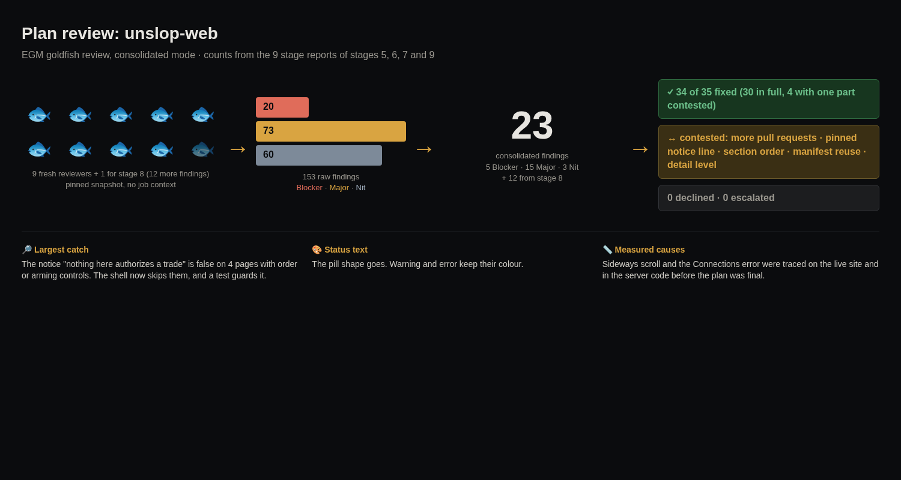

# Consolidated EGM Goldfish Review Report: `unslop-web`

- **Target Document:** `docs/vertex-rebuild/designs/unslop-web/plan.md`
- **Review Mode:** Consolidated report with all review rubrics (standing owner rule of 2026-11-18)
- **Baseline for reviewers:** a pinned snapshot of commit `ac9281e8a`, outside the repository
- **Reviewers (fresh-context goldfish subagents, all completed):**
  - Stage 5: `egm-zoom-out`, `egm-inventive-catalyst`
  - Stage 6: `egm-comprehension` (document only)
  - Stage 7: `egm-design`, `egm-structural`, `egm-style`
  - Stage 8: `egm-zoom-out` on the revised document
  - Stage 9: `egm-implementation-readiness`, `egm-codebase-details`, `egm-style`
- **Raw findings:** 153 in stages 5, 6, 7 and 9 (20 Blocker, 73 Major, 60 Nit before deduplication), plus 12 in stage 8 (5 Major, 7 Nit), listed at the end.

## Consolidated Findings by Priority

### Blocker

- **F1. The shell notice is false on pages with execution controls** (Design B1, Zoom Out 5, Comprehension 2, Style M6). The first draft said that the portal has no order path. Mission control holds the trading node switch and the broker recovery request; Portfolio holds the order screen; Order drafts sends approved drafts; Deployments approves requests.
- **F2. A status loses its tone** (Design B2, Catalyst 2, Zoom Out 4). One muted colour for every status hides a warning such as "Live scope · read only", and the claim that the page body always shows the error had no inventory.
- **F3. The Connections fix was an open investigation** (Zoom Out 2, Design M4, Catalyst 5, Comprehension 10, Style M8, Readiness B1, Codebase M7, Style-9 5). No cause, one branch only, Retry removed on an inferred cause.
- **F4. The file list was open and missed owners of the changed text** (Readiness B2, B3, B5; Codebase B1 to B5; Style-9 1 to 4). Auth titles live in `reset-password-entry.tsx` and the auth panel, eyebrow callers in two smoke fixtures, tight tracking in the contact form, Flow codes in panel files, a failing assertion in `panel.test.ts`.
- **F5. Public copy was specified only for 11 titles** (Readiness B4, Comprehension 6 and 11, Style M4, Style-9 7).

### Major

- **F6. The status mechanism was undefined and used two definitions** (Design M1, Zoom Out 4, Catalyst 6, Comprehension 8, Readiness M2, Codebase M4).
- **F7. The file path fix was at the symptom and added an unused link branch** (Zoom Out 1, Catalyst 1, Design N4, Readiness M9).
- **F8. The raw code labels duplicated existing helpers and had no label table** (Zoom Out 3, Design N4, Comprehension 9, Readiness M4, Codebase B1 and B2).
- **F9. The subtitle decision could not be parsed and gave no result strings** (Comprehension 1, Style M7, Design M3, Readiness M6, Codebase M3).
- **F10. The plan contradicted the design specification without saying so** (Design M3, Zoom Out 6, Comprehension 5 and 20, Readiness M10, Codebase M10): tight tracking kept for one variant only, `MASTER.md` edits without text, the eyebrow option.
- **F11. Problems, goals, decisions and checks did not trace to each other** (Structural M2, Comprehension 3 and 19, Style M3, Design N2, Style-9 14): info icons, legal titles, the file path, portal eyebrows and portal title periods had no goal or no check.
- **F12. The audit script, the task and several terms were not located or defined** (Comprehension 4, 5 and 16, Style M1 and M2, Design N1, Readiness M11, Style-9 12).
- **F13. Risks had no consistent mitigation** (Structural M1, Style N16, Comprehension 17).
- **F14. Surface-level changes, Strategy library and Semantic terms were not specified per component** (Comprehension 7, Readiness M3 and M8, Codebase M6, Style-9 10).
- **F15. Upper-case removal mixed table headers with ticker inputs and pills; source label case not addressed** (Design M2, Comprehension 21, Readiness M7, Codebase M2).
- **F16. Sideways scroll had no named element** (Structural M2, Readiness M9, Codebase N4, Style-9 11).
- **F17. The test plan named no cases; verification steps could not be run by a new reader** (Readiness M11, Codebase M8, Comprehension 18, Style-9 6, 13 and 15).
- **F18. One pull request: no partial rollback, no commit order, shared files across parts** (Design M6, Catalyst 4, Zoom Out 7, Readiness M12, Codebase M11, Style-9 16).
- **F19. Notice position and prominence** (Catalyst 3, Design N3, Comprehension 15, Codebase M9): end of content is below the first screen; "visible" undefined; insertion point ambiguous.
- **F20. The not-found decision did not say why two pages exist** (Design M5, Zoom Out 8).

### Nit

- **F21. The eyebrow option of `PageHeader` stays dead** (Catalyst 7, Zoom Out 8, Readiness B3, Codebase B4).
- **F22. The info icon rule was a judgement without a list** (Zoom Out 10, Design N4, Readiness M5, Codebase M5).
- **F23. Wording and structure** (Style N1 to N16, Structural M3 and N1 to N7, Style-9 17 to 20, Comprehension 12 to 14): slang in the title, "small", "most", "Nine" beside "9", heading names, mixed list styles, section order, unsourced gate time.

## Traceability Matrix

| Finding | Stage 5 | Stage 6 | Stage 7 | Stage 9 | Resolution |
| --- | --- | --- | --- | --- | --- |
| F1 | Zoom Out 5 | 2 | Design B1, Style M6 | Codebase N5 | Fixed: D1, goal 4, route rule and import test |
| F2 | Zoom Out 4, Catalyst 2 | 17 | Design B2 | | Fixed: D4 |
| F3 | Zoom Out 2, Catalyst 5 | 10 | Design M4, Style M8 | Readiness B1, Codebase M7 | Fixed: cause measured, D8 |
| F4 | Zoom Out 10 | 22 | | Readiness B2, B3, B5; Codebase B1 to B5; Style-9 1 to 4 | Fixed: file list per part |
| F5 | | 6, 11 | Style M4 | Readiness B4 | Fixed: copy table |
| F6 | Zoom Out 4, Catalyst 6 | 8 | Design M1 | Readiness M2, Codebase M4 | Fixed: D4, one file |
| F7 | Zoom Out 1, Catalyst 1 | | Design N4 | Readiness M9 | Fixed: D7 (card and server read) |
| F8 | Zoom Out 3 | 9 | Design N4 | Readiness M4, Codebase B1, B2 | Fixed: D5 |
| F9 | | 1 | Style M7, Design M3 | Readiness M6, Codebase M3 | Fixed: Subtitles table |
| F10 | Zoom Out 6 | 5, 20 | Design M3 | Readiness M10, Codebase M10 | Fixed: D10, D11, file list |
| F11 | | 3, 19 | Structural M2, Style M3 | Style-9 14 | Fixed: goals 3, 6, 8, 9, 11; step 7 |
| F12 | | 4, 5, 16 | Style M1, M2 | Readiness M11 | Fixed: Overview, Terms |
| F13 | | 17 | Structural M1 | | Fixed: Risks |
| F14 | | 7 | | Readiness M3, M8; Codebase M6 | Fixed: part 4 list |
| F15 | Zoom Out 11 | 21 | Design M2 | Readiness M7, Codebase M2 | Fixed: D12, Non-Goal 8 |
| F16 | | | Structural M2 | Readiness M9 | Fixed: causes measured, D13 |
| F17 | | 18 | Design N1 | Readiness M11, Codebase M8 | Fixed: Test Plan, step 7 |
| F18 | Zoom Out 7, Catalyst 4 | | Design M6 | Readiness M12, Codebase M11 | Fixed in part; contested in part |
| F19 | Catalyst 3 | 15 | Design N3 | Codebase M9 | Contested in part: D2, Alternative 6 |
| F20 | Zoom Out 8 | | Design M5 | | Fixed: D9, Alternative 12 |
| F21 | Catalyst 7, Zoom Out 8 | | | Readiness B3, Codebase B4 | Fixed: D11 |
| F22 | Zoom Out 10 | 15 | Design N4 | Readiness M5, Codebase M5 | Fixed: D6 |
| F23 | Zoom Out 9 | 12 to 14 | Style N1 to N16, Structural N1 to N7 | Style-9 17 to 20 | Fixed, except section order |

## Stage 8 (Intermediate Zoom Out)

Reviewer `egm-zoom-out` read the revised plan with the stage 5 report. Result: 0 Blocker, 5 Major, 7 Nit.

- **S8-1 (Major). The commit order broke its own rule, and Rollback missed dependencies.** `PageHeader` cannot reject `eyebrow` before the public pages stop passing it; parts share files. Resolution: fixed. The commits are review units by file group, the checks run on the head, and the supported rollback is a revert of the merge.
- **S8-2 (Major). D5 changed helpers that it claimed only to reuse, and the metric labels had no home.** The fallback of `enumLabel` is a deliberate message for a page that is older than the server. Resolution: fixed in the code and the plan. The fallback of `enumLabel` is restored; the missing entries are in the typed label maps; the metric labels moved into `formatMetrics`, so 4 pages print the same words; the change of `labelFor` is stated.
- **S8-3 (Major). The need for a shell notice was not stated.** Resolution: fixed. Alternative 12 names the requirement of the card.
- **S8-4 (Major). The import test was under-specified and D1 repeated the route manifest.** Resolution: fixed in part. D1 names the 5 modules and states that the walk is transitive and counts `import()` calls. Contested: the test keeps its own walk of the route folders, because the rule must hold for a page that is not in the navigation manifest.
- **S8-5 (Major). D8 patched one page for a behavior of the shared failure panel and dropped the next step.** Resolution: fixed in the code and the plan. The shared panel offers no Retry for this failure kind on any page; the Connections line ends with the operator step.
- **S8-6 (Nit). A second `plain` option appeared only in the file list.** Fixed: D4.
- **S8-7 (Nit). The edited rule of the design specification still said that the portal header has no `description`.** Fixed in `MASTER.md`.
- **S8-8 (Nit). Goal 9 named one portal eyebrow; the source has 5.** Fixed: goal 9.
- **S8-9 (Nit). The `reportPath` limit named no card.** Fixed: the server read now returns no path, so the limit is gone.
- **S8-10 (Nit). The alternatives did not cover a separate pull request for the defects, and Rollback did not state the merge method.** Fixed: Alternative 13, Rollback.
- **S8-11 (Nit). Settings pages get the notice without a reason.** Fixed: D1.
- **S8-12 (Nit). Class-level detail in the decisions.** Contested: stages 7 and 9 asked for the mechanism of D2 and D13, and the same facts in two places would drift.
