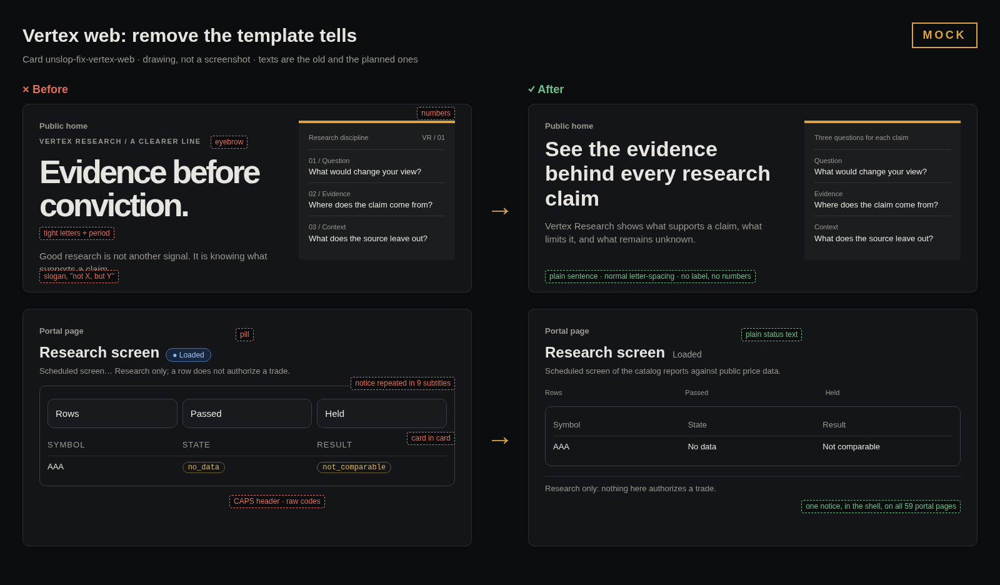
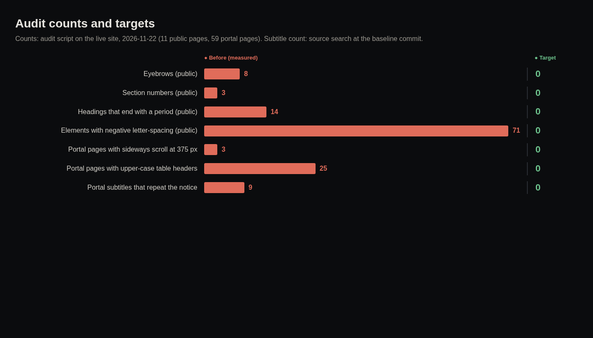

# Vertex Web: Remove the Patterns Found by the Interface Audit

- **Author:** Job agent for card `unslop-fix-vertex-web`
- **Status:** Reviewed (EGM goldfish review resolved, 2026-11-26)
- **Date:** 2026-11-26
- **Baseline commit:** `ac9281e8a` on `vertex/rebuild-darkfactory-20260921` for the plan review; the branch was rebased on `582623a34` of the same branch before the code review
- **Requirement Classification:** Implementation fix in `apps/web`, `packages/ui`, the design specification `design-system/darkfactory/MASTER.md` and the browser tests under `tests/e2e`, and one server read in `packages/api`. No oRPC contract, Zod schema, port or database change.

--------------------------------------------------------------------------------

## Overview

An interface audit of the live Vertex site on 2026-11-22 covered 11 public pages (8 content pages and the 3 sign-in pages) and 59 portal pages. It counted visual and copy patterns of a generated page template and found 4 defects: sideways scroll on 3 pages, a server file path on Market context, an error title on Connections, and a white 404 page. This plan removes the patterns and fixes the 4 defects in one pull request.

The audit script and its metric function are not in this repository. They are kept on the development host with the audit report (`unslop-audit/vertex/vertex-audit.mjs` and `unslop-audit/audit.cjs` in the report folder of that host). The script signs in as the read-only agent viewer, opens each page with headless Chrome at 1440 px and 375 px with a dark colour preference, and counts the patterns in the rendered page.

### Terms

- **Eyebrow:** a small label, often in capital letters, that sits directly above a heading.
- **Pill:** a short text in a fully rounded box with a border or a fill. The code calls it a badge (`StatusBadge`, `Badge`) or a chip.
- **Raw code:** an internal identifier in `snake_case` that the page prints, for example `no_data`.
- **Shell notice:** the sentence `Research only: nothing here authorizes a trade.` that the portal shell prints once under the page content.
- **In-panel notice:** any other text on a page that says that a view is for research, places no orders or is not a trade signal. This plan does not change in-panel notices.
- **Subtitle:** the `description` line that `PageHeader` renders under the page title.
- **Surface level:** one bordered box. "One surface level" means that a bordered box does not contain another bordered box; tables and form inputs are not counted.
- **Execution control:** a control that sends an order, arms the trading node, requests a broker recovery, or approves an order draft or a deployment request.
- **Design specification:** `design-system/darkfactory/MASTER.md`.
- **Read-only agent viewer:** the portal account that agents use for checks. It has no operator or administrator role.

## The Problem

Counts from the audit script on 2026-11-22:

| Metric | Public and sign-in (11 pages) | Portal (59 pages) |
| --- | --- | --- |
| Eyebrows | 8 on 5 pages | 1 on 1 page (Connections) |
| Section numbers ("01 / Question") | 3 on 1 page | 0 |
| Headings (H1 to H4) that end with a period | 14 on 9 pages | 4 on 2 pages (3 are owner note texts on Market context, 1 is the default 404 page) |
| Elements with negative letter-spacing | 71 on 11 pages | 69 on 58 pages (page title and brand mark) |
| Pages with sideways scroll at 375 px | 0 | 3 |
| Pages with upper-case table headers | 0 | 25 |

Found by review of the screenshots (no script count):

1. Public headings are slogans ("Evidence before conviction.") and 3 lines use a "not X, but Y" form.
2. The legal pages have the titles "Privacy notice starter" and "Terms of service starter".
3. Portal pages put bordered cards inside bordered cards (Mission control, Research, Portfolio, Academy).
4. A status pill sits beside the title of pages that pass a status. Strategy library shows 3 pills and a tag column in each row. Semantic terms shows 24 "Certified" pills.
5. Flow and Agent runs print raw codes (`no_data`, `not_comparable`, `research_only`, `wf_cagr`).
6. 9 portal subtitles repeat the research notice in different words.
7. An info icon follows 11 section headings of the experience pages.
8. Market context prints a file path of the development host. Cause: `apps/web/src/components/portal/breadth-90-card.tsx` printed the `reportPath` field of the Breadth 90 record in a `code` element.
9. Connections shows the error title "Server backend not configured" with a Retry button as its first content.
10. A page that calls `notFound()` outside the public route group (for example the lab pages, which are off in production) shows the default white 404 page of the framework.

Causes of the 4 defects, measured on the live site on 2026-11-26 with headless Chrome at 375 px:

- **Market context (document width 504 px):** the screen-reader prefix inside `StatusBadge` has `position: absolute`. The badge was not a positioned element, so the prefix of 16 badges in the Market regime table was placed outside the table scroll container. A `table` with the class `sr-only` in `apps/web/src/components/portal/breadth-90-chart.tsx` also kept its content width, because a table ignores a width of 1 px.
- **Forward drift (document width 1036 px):** the page grids had no column definition, so the single implicit column took the width of the widest child (a table and a select).
- **Pick lists (document width 407 px):** the file input in `apps/web/src/components/portal/pick-list-import-panel.tsx` sat in an `inline-flex` label that cannot wrap.
- **Connections:** the read `vertex.experience.gateways` answers HTTP 503 with the cause "not configured" when the server runtime configuration has no gateway list. The check runs before any permission check, so every signed-in user gets it. A retry cannot change the configuration.

## Goals & Non-Goals

### Goals

1. Public and sign-in pages: 0 eyebrows, 0 section numbers, 0 headings that end with a period, 0 elements with negative letter-spacing (audit metrics).
2. Public headings and the lines in the table "New public copy" are plain sentences. The check is that the rendered text equals the table.
3. The legal page titles have no word "starter".
4. Portal: the shell notice element appears exactly once on every portal page that has no execution control, at 1440 px and at 375 px, and no page subtitle repeats the notice. A page with an execution control gets no shell notice.
5. Portal: no bordered box inside a bordered box in the page content of Mission control and Research. On Portfolio and Academy a card that only wrapped other cards has no border.
6. Portal: Flow and Agent runs print words for states, flags, kinds and metric keys. Names of frameworks, models and tools print as stored.
7. Portal: a status beside a page title is plain text. Row statuses on Strategy library, Semantic terms, Portfolio tables, Flow (control state, freshness, factor votes) and Agent runs are plain text. On Flow, the print sentiment, the event direction, the trade side and the confluence summary keep the badge shape: each is one of a pair of tones (bullish and bearish, buyers and sellers), and plain text would keep the colour of one side only. Table headers print as written, in sentence case.
8. Portal: an info icon after a section heading stays only where its help text defines a term, a limit or a safety rule.
9. Portal: no eyebrow. Of the 6 labels above headings in the experience pages, 5 are plain sentence-case text (2 on Connections, 1 each on Agent runs, Strategy reviews and the research module views) and 1 is removed because it repeats the heading (the research chat).
10. Market context, Forward drift and Pick lists have no sideways scroll at 375 px.
11. Market context prints no file path.
12. Connections prints one plain line for the not-configured state. A page that calls `notFound()` shows a not-found page in the active theme.

### Non-Goals

1. No change to the body text of the legal pages.
2. No change to an in-panel notice, a footnote or a chip that carries a notice: same words, same position. The Baskets subtitle ends with "Tracking only: no orders."; it states a fact about baskets in other words than the research notice, and it stays.
3. No change to the behavior of an order, execution, arming or risk control. These controls exist in the portal (see D1); this change edits only the class of the wrapper around the account card.
4. No change to an oRPC contract, a Zod schema or the database. The only server change is in the Breadth 90 read (D7).
5. No redesign of the sidebar or the top bar.
6. No fix for the Deployments status error (HTTP 403); card `vertex-deploy-status-403-regression` owns it.
7. No change to headings that print stored data (owner note texts on Market context).
8. No change to pills on pages that this plan does not name, except through the shared primitives.

## Alternatives Considered

1. **Three pull requests (public site, shell and primitives, portal pages).** Rejected. The pre-push gate takes about 25 minutes for each push (measured by earlier jobs in this repository) and each merge needs an up-to-date base, so three pull requests cost three gate runs and three merge slots. One pull request with commits by file group gives the reviewer separate diffs.
2. **Two pull requests (primitives and shell first, then pages).** Rejected for the same cost. The page commits need the `plain` option of the first part, so the second pull request could not start before the first one merged.
3. **Print the shell notice on every portal page.** Rejected. The sentence is false on the 4 pages with execution controls (D1).
4. **Write a new notice sentence that is true on every page.** Rejected for this change. A wording change of a safety notice needs an owner decision.
5. **Remove every in-panel notice.** Rejected. The task allows removal of the subtitle copies only, and 2 of the 9 subtitles join the notice with a fact about the data.
6. **Pin the notice to the bottom edge of the window.** Rejected. A fixed line takes one line of height on every page at 375 px, covers content while the on-screen keyboard is open, and reads as a banner. The notice stays in the page flow.
7. **Put the notice in the top bar.** Rejected. The top bar design `docs/vertex-rebuild/designs/portal-topbar-reflow/design.md` fits the existing controls at 375 px; a text line was not part of that design.
8. **Print every status in one muted colour.** Rejected. Pages use the status for real states ("Live scope · read only" is a warning on Research). The shape goes; the text colour of warning and destructive stays.
9. **Strip the pill in `PageHeader` with descendant overrides and add a second look in `StatusBadge`.** Rejected. The plain look is defined in one file, `packages/ui/src/status-badge.tsx`.
10. **Keep tight letter-spacing in the portal title.** Rejected. One rule for both variants is simpler than a class that depends on the variant: no page title has negative letter-spacing.
11. **Show an `http` report link on the Breadth 90 card.** Rejected. The field only ever holds a file path, so the link branch had no user.
12. **Remove the 9 subtitle copies and add no shell notice.** Rejected. The task of the card requires the notice once on every portal page, and at least 4 of the 9 pages (Calendar, News monitor, Research screen, Sector rotation) have no in-panel notice.
13. **Ship the defect fixes as their own pull request.** Rejected. The fix for Market context is in `StatusBadge`, which part 2 also changes, so the two pull requests would conflict; the cost is one more gate run and one more merge slot.
14. **Move the public not-found page to the app root.** Rejected. The public page renders inside the public header and footer for an unknown URL; the app-root page serves `notFound()` calls of routes that have no public shell.

## Technical Plan (Architecture)

The change has 5 parts. The parts share files (`status-badge.tsx` is in parts 2 and 5, `research.tsx` in 3 and 4, `utilities.tsx` in 4 and 5) and types (the public pages must stop passing `eyebrow` before `PageHeader` rejects it). The commits are therefore review units by file group, in this order: public site, shared primitives with the design specification, shell notice, portal pages with the defect fixes, server read, plan documents. A last commit holds the fixes of the code review. The checks run on the head of the branch; an intermediate commit is not a release unit.

1. **Public site.** Public and sign-in pages, the classes in `apps/web/src/app/globals.css`, and the app-root not-found page.
2. **Shared primitives.** `StatusBadge`, `PageHeader`, `TableHeader`, `ResearchTableHeading`, and the design specification.
3. **Shell notice.** The route rule, the shell element, and the 9 subtitles.
4. **Portal pages.** Surface levels, plain status text, words for raw codes, info icons, eyebrows.
5. **Defects.** Sideways scroll, file path, Connections state.

### Decisions

- **D1, where the shell notice prints (part 3, goal 4).** The portal has execution controls on 4 routes: `/dashboard` (trading node switch and broker recovery request in `apps/web/src/components/portal/account-glance.tsx`), `/portfolio` (order screen `apps/web/src/components/portal/vertex-orders.tsx` and the order draft queue), `/drafts` (order draft queue `apps/web/src/components/portal/golive-draft-queue.tsx`) and `/deployments` (approval in `apps/web/src/components/portal/deployment-requests-workspace.tsx`). The shell notice is false there, so `apps/web/src/lib/research-notice.ts` holds the sentence, the 4 routes and the 5 modules that give a page such a control: `nautilus-arm-client.ts`, `ibkr-recovery-client.ts`, `vertex-orders-client.ts`, `golive-draft-queue.tsx` and `deployment-requests-workspace.tsx` in `apps/web/src/components/portal`. `researchNoticeApplies(pathname)` is false for the 4 routes, for their child routes and for an unknown path. `apps/web/src/lib/research-notice.test.ts` walks the relative imports of every route file (page, layout, error, loading, not-found) under the portal route group to the end (static imports and `import()` calls, so a lazy import counts) and fails when a route that reaches one of the modules gets the notice, and when a listed route reaches none. A second scan reads every source file of the app and fails when a file that calls an order, arming, recovery or approval procedure of the API client is not in the lists. The approval call of deployment requests sits in the shared client file `agent-ops-client.tsx` beside read calls, so the rule file names its approval export, and a file that uses that export must be listed. The test reads the route folders and not the navigation manifest `apps/web/src/lib/navigation.ts`, because the rule must also hold for a page that is not in the navigation. Settings pages get the notice: the task asks for every portal page, and the sentence is true there.
- **D2, notice text and element (part 3).** The sentence is copied without change from the old subtitle of the Research page. The shell renders it as the last element of the page content column, inside the main region and outside the sidebar, the top bar and the assistant panel, with `data-slot="portal-research-notice"` and the muted text colour of the design tokens (contrast of at least 4.5:1 by the token rule in the design specification). "Visible" in the checks means rendered and not hidden; on a long page the user reaches it by scrolling.
- **D3, subtitles (part 3).** See the table "Subtitles".
- **D4, plain status (part 2, goal 7).** `StatusBadge` gets a boolean option `plain`. The plain look has no border, fill, dot, rounded box or padding. Warning and destructive keep their text colour; neutral, info and success print in the muted text colour. The same look applies to a `StatusBadge` inside the status slot of `PageHeader` through an ancestor variant on `data-slot="page-status"`, so callers do not change. `data-slot`, `data-status` and the screen-reader prefix "Status:" stay. A generic `Badge` in the status slot would keep its shape; no caller passes one. The read notice of the experience pages (`ReadNotice`) gets its own `plain` option with the same meaning (no border, fill or padding) for a notice inside a card.
- **D5, words for raw codes (part 4, goal 6).** Flow printed codes because panels printed the state field directly and the label maps had no entry. The fix adds the entries to the typed label maps of `apps/web/src/features/flow/view-model.ts`, `apps/web/src/features/flow/control-view-model.ts` and `apps/web/src/features/flow/wall-drift-view-model.ts` and routes the panels through `enumLabel` (`apps/web/src/features/flow/format.ts`). The fallback of `enumLabel` does not change: a value without a label still prints the sentence that asks for a page reload, because it marks a page that is older than the server. Agent runs uses `labelFor` of `apps/web/src/components/portal/agent-ops-client.tsx`. This is a behavior change of that helper: its fallback now also sets an upper-case first letter (`research_only` prints "Research only"). The metric labels (`wf_cagr` prints "Walk-forward CAGR") live in the same file, in `labelledMetrics`, which `formatMetrics` and the task detail call, so Agent runs, Mission control, Backtests and Papers print the same words. A metric value prints as stored, except a code value with a known meaning (`research_only` prints "Research only"); a name stays as stored. Existing Flow labels now start with an upper-case letter ("No data", "Not classified"). The code stays in a `data-*` attribute for the run status, the run flags, the Flow control state and the freshness state.
- **D6, info icons (part 2 and 4, goal 8).** `ResearchTableHeading` renders the icon and its popover only when help text is passed. 3 of 11 call sites drop their help text because it repeats the column headings: the rules table and "Required source data" on Strategy reviews, and "Reservation projections" on Portfolio. The other 8 stay; each defines a term or a limit or holds a safety rule.
- **D7, file path (part 5, goal 11).** The Breadth 90 card no longer prints the report block. The server read that the card and the market regime page share (`readBreadth90` in `packages/api/src/server/breadth-90.ts`) returns `reportPath: null`, so the path does not leave the server. The stored record and the contract do not change; the collector keeps the path for its own alert text.
- **D8, Connections (part 5, goal 12).** The shared failure panel of the experience pages (`ResourcePanel` in `apps/web/src/features/experience/shared.tsx`) offers no Retry for the kind `server-not-configured` on any page; the text of that kind already says that a retry cannot succeed. Every other failure kind keeps its text and its Retry button. The failure panel of the module views (`ReadFailure` in `apps/web/src/components/research/research-views.tsx`) follows the same rule. On Connections, a gateway list that fails with this kind prints one line with `role="status"` in place of the error box: "Connections are not configured on this server. Ask the operator to configure the broker gateways."
- **D9, not-found (part 1, goal 12).** Two new pages. `apps/web/src/app/not-found.tsx` serves `notFound()` calls of routes without a shell (the lab pages when the lab is off); it uses the root layout, so it follows the active theme, and links to `/`. `apps/web/src/app/(portal)/not-found.tsx` serves `notFound()` calls of portal routes (a stock symbol, a lesson or a course that does not exist) inside the portal shell; it has no main landmark of its own and links to Mission control. Both print "Page not found" and one sentence. The public not-found page stays for unknown URLs.
- **D10, letter-spacing (parts 1 and 2, goal 1).** Every negative `letter-spacing` leaves `apps/web/src/app/globals.css`, and `tracking-tight` leaves `PageHeader`, the alert title, the empty-state title and the inline notice. The brand mark is shared, so the portal changes too.
- **D11, eyebrow option (part 2).** No caller passes `eyebrow`, so `PageHeader` rejects it for both variants (`eyebrow?: never`) and no longer renders it. The classes `.vx-eyebrow` and `.vx-index` are deleted.
- **D12, table headers (part 2, goal 7).** `TableHeader` no longer forces upper case. Header labels in source were already in sentence case. Ticker inputs keep their upper-case class.
- **D13, sideways scroll (part 5, goal 10).** `StatusBadge` is a positioned element (`relative`), so its screen-reader prefix stays inside a scroll container. The hidden Breadth 90 table sits in a `div` with `sr-only`. The Forward drift grids have one column of `minmax(0, 1fr)`. The Pick lists file input wraps and has a maximum width of 100%.

### New public copy

| Page (route) | Old | New |
| --- | --- | --- |
| Home (`/`) title | Evidence before conviction. | See the evidence behind every research claim |
| Home lede | Good research is not another signal. It is knowing what supports a claim, what limits it, and what remains unknown. | Vertex Research shows what supports a claim, what limits it, and what remains unknown. |
| Home side card | Research discipline, VR / 01, Make the reasoning inspectable., 01 / Question | Three questions for each claim; labels Question, Evidence, Context |
| Home side card note | A method, not a performance claim. | This is a research method. It makes no claim about performance. |
| Home section headings | More context. Less assumption. / Follow the evidence. See the boundaries. / Build conviction. Keep the evidence. | How the workspace handles evidence / What you can read in the workspace / Open the workspace |
| Home principle titles | Sources before signals / Context before conclusions / Research before action | Each claim shows its source / Missing context stays visible / Research is separate from execution |
| About (`/about`) | Clarity is a research advantage. | About Vertex Research |
| Platform (`/features`) | A workspace for the evidence behind the idea. | What the platform does |
| Method (`/solutions`) | An idea is a question. Not a conclusion. | How to test a research idea |
| Field guide (`/resources`) | Read the record. Understand the context. | Field guide to workspace terms |
| Contact (`/contact`) | Talk to the people behind the system. | Contact Vertex Research |
| Privacy (`/legal/privacy`) | Privacy notice starter | Privacy notice |
| Terms (`/legal/terms`) | Terms of service starter | Terms of service |
| Sign in | Welcome back. | Sign in |
| Sign up | Start with a verified identity. | Create an account |
| Forgot password | Reset access without exposing the account. | Reset your password |
| Reset password | Set a new password. / Request a new reset link. | Set a new password / Request a new reset link |
| Verify email | three titles with a final period | the same titles without the period |
| Not found, error | That page is not available. / title with a period | Page not found / This page needs another attempt |
| Public footer | Evidence-first research tooling. Sources before signals. Context before conclusions. | Research tooling that shows the source and the limits of each claim. |

Rules for the other changed lines: one plain sentence, no pair of two-word slogans, no "not X, but Y" form, no claim about returns, regulation or advice. A factual negation stays ("Research tooling. Not investment advice or an execution service." is unchanged). The section titles of the Field guide stay; they state factual distinctions.

### Subtitles

| Page | Removed from the subtitle | Subtitle after the change |
| --- | --- | --- |
| Calendar | Research only; no orders. | first sentence, unchanged |
| Congress trades | Research only. | first sentence, unchanged |
| Deep value screen | Research only. | first sentence, unchanged |
| News monitor | Research only; no orders. | first sentence, unchanged |
| Research screen | Research only; a row does not authorize a trade. | first sentence, unchanged |
| Rotation matrix | Research only. | first sentence, unchanged |
| Sector rotation | Research only. | first two sentences, unchanged |
| Smart money | the words "Research only;" | first sentence, then "No blended score and no trade signals." |
| Research | Research only: nothing here authorizes a trade. | Discuss evidence with corpus-based research agents. |

## Non-Functional Requirements

- Accessibility: status text keeps its screen-reader prefix. Headings keep their levels and ids. The notice has `role="note"`.
- Responsive: no new sideways scroll at 375, 768, 1024 and 1440 px.
- Coverage: every changed source file stays at 100%, or at its minimum in `scripts/ci/coverage-baseline.json`.

## Risks and Limits

1. **Risk:** a notice is less visible, because the subtitle was at the top of 9 pages and the shell notice is at the end of the content. **Mitigation:** every research page now has the notice (46 pages had none), and all in-panel notices stay.
2. **Risk:** a page with an execution control gets the notice later, when a new page is added. **Mitigation:** the import test of D1 fails for such a page, and an unknown path gets no notice.
3. **Risk:** a neutral, info or success status loses its colour. **Mitigation:** warning and destructive keep theirs; the page body states the reason of an error in its own alert on the pages that this change touches.
4. **Risk:** tests assert old text, so they change with the text and cannot find an unwanted text change. **Mitigation:** the audit script runs again on the live site after the deploy, and the browser tests of the public pages run in CI.
5. **Risk:** other jobs edit the same files (about 140 files change). **Mitigation:** file claims in the job tracker during the work, and one merge of the base before the push.
6. **Limit:** names of agent frameworks, models and tools still print as stored (`vibe_trading`), and stored audit event texts print as stored. A metric key without a label prints as its words.
7. **Limit:** the cause of the Connections state is a missing server setting. Adding gateways is an access change that only the owner decides; this change only makes the state readable.

## Detailed Implementation Plan

### Target Files to Modify

The pull request diff is the full list. The files with a behavior or text change are:

Part 1, public site:

- `apps/web/src/app/(public)/page.tsx`, `apps/web/src/app/(public)/about/page.tsx`, `apps/web/src/app/(public)/features/page.tsx`, `apps/web/src/app/(public)/solutions/page.tsx`, `apps/web/src/app/(public)/resources/page.tsx`, `apps/web/src/app/(public)/contact/page.tsx`: copy from the table; no eyebrow, no numbers.
- `apps/web/src/app/(public)/_components/research-page.tsx`, `apps/web/src/app/(public)/_components/public-content.tsx`, `apps/web/src/app/(public)/_components/legal-page.tsx`: the `eyebrow` property and the index numbers are removed.
- `apps/web/src/app/(public)/legal/privacy/page.tsx`, `apps/web/src/app/(public)/legal/terms/page.tsx`: titles.
- `apps/web/src/app/(public)/not-found.tsx`, `apps/web/src/app/(public)/error.tsx`, `apps/web/src/app/(public)/loading.tsx`, `apps/web/src/app/(public)/loading-smoke/page.tsx`, `apps/web/src/app/(public)/error-smoke/recoverable-error-fixture.tsx`: headings without a period, no eyebrow.
- `apps/web/src/app/(auth)/sign-in/page.tsx`, `apps/web/src/app/(auth)/sign-up/page.tsx`, `apps/web/src/app/(auth)/forgot-password/page.tsx`, `apps/web/src/app/(auth)/verify-email/page.tsx`, `apps/web/src/components/auth/reset-password-entry.tsx`: titles.
- `apps/web/src/components/contact/contact-form.tsx`, `apps/web/src/components/inline-notice.tsx`: no tight letter-spacing.
- `apps/web/src/app/globals.css`: no negative `letter-spacing`; `.vx-hero h1` is `clamp(2.25rem, 4.5vw, 4rem)` with line height 1.1 and a maximum width of 16ch; `.vx-eyebrow`, `.vx-index` and the side card heading row are deleted.
- `apps/web/src/app/not-found.tsx`, `apps/web/src/app/(portal)/not-found.tsx` and their tests: new.
- `apps/web/src/components/public-shell.tsx`: the footer sentence.
- `apps/web/src/status-language-allowlist.ts`: 3 entries carry the new text of the same sentences and 1 stale entry is deleted. No entry is added.

Part 2, shared primitives:

- `packages/ui/src/status-badge.tsx`: `plain`, the ancestor variant, `relative`.
- `packages/ui/src/headings.tsx`: no `tracking-tight`, no eyebrow.
- `packages/ui/src/table.tsx`: no upper-case transform of header cells.
- `packages/ui/src/alert.ts`, `packages/ui/src/empty-state.tsx`: no `tracking-tight`.
- `apps/web/src/components/research/research-table-heading.tsx`: optional help.
- `apps/web/src/components/command-palette.tsx`: group headings print as written.
- `design-system/darkfactory/MASTER.md`: the type scale rows and the headline rule lose `tracking-tight`; the portal header rule allows a plain status and a one-line `description`, and has no eyebrow; new rules for the shell notice and for sentence-case table headers.

Part 3, shell notice:

- `apps/web/src/lib/research-notice.ts`, `apps/web/src/lib/research-notice.test.ts`: new.
- `apps/web/src/components/portal-shell.tsx`: the notice element.
- The 9 files of the table "Subtitles" (the two ticker inputs of Congress trades and Smart money also keep their placeholder in normal case): `apps/web/src/components/portal/calendar-workspace.tsx`, `apps/web/src/components/portal/congress-trades-workspace.tsx`, `apps/web/src/components/portal/deep-value-workspace.tsx`, `apps/web/src/components/portal/market-news-workspace.tsx`, `apps/web/src/components/portal/research-screen.tsx`, `apps/web/src/components/portal/rotation-matrix-workspace.tsx`, `apps/web/src/components/portal/sector-rotation-workspace.tsx`, `apps/web/src/components/portal/smart-money-workspace.tsx`, `apps/web/src/features/experience/research.tsx`.

Part 4, portal pages:

- Mission control: `apps/web/src/components/portal/account-glance.tsx` (the wrapper of the account card loses its border, fill and padding; the tiles keep theirs; no control changes), `apps/web/src/components/portal/mission-control.tsx` (the 6 task counters are one bordered list; the stage cells lose their border; the task kind prints as words), `apps/web/src/components/portal/dashboard-widgets.tsx` (plain "Stale" status).
- Portfolio: `apps/web/src/components/portal/portfolio-monitor-tables.tsx` (the section card loses its border; plain order status; header case), `apps/web/src/components/portal/portfolio-monitor-charts.tsx` (the warning "No stop orders for this position." loses its border only; its fill, colour, words and position stay), `apps/web/src/features/experience/portfolio.tsx` (the status lines inside the two cards are plain text; the warning about a portfolio source that does not respond keeps its box).
- Research: `apps/web/src/features/experience/research.tsx` (the outer panel is a plain section), `apps/web/src/features/experience/research-chat-view.tsx` (the label that repeated the heading is removed), `apps/web/src/features/experience/research-chat-view.css` (the rule of the removed label), `apps/web/src/components/research/research-views.tsx` (the module label is plain text; the failure panel offers no Retry for the not-configured kind).
- Academy: `apps/web/src/components/portal/academy/academy-gallery.tsx` (the panels around the card lists are plain sections; tag chips are plain text), `apps/web/src/components/portal/academy/academy-lesson.tsx` (tags are one line of plain text with separators), `apps/web/src/components/portal/academy/lesson-video.tsx`, `apps/web/src/components/portal/academy/lesson-interactive.tsx` (labels in sentence case).
- Strategy library: `apps/web/src/components/portal/strategy-library-workspace.tsx`. The Status column is the one status of a row. "High priority" is plain text beside the name. "Vertex result" and "External claim" are two plain-text columns in place of the tag column. The cards view prints the same plain text and no tag list. The tags stay in the Tags field of the detail view; `apps/web/src/components/portal/strategy-library-detail.tsx` changes only the export and the comment of its badge component.
- Semantic terms: `apps/web/src/components/portal/semantic-terms-workspace.tsx`. Each row prints "Certified", the time and the certifier as one plain line; a row that is not certified keeps its red text. The edit form inside a term has a top rule in place of a box.
- Flow: `apps/web/src/features/flow/view-model.ts`, `apps/web/src/features/flow/control-view-model.ts`, `apps/web/src/features/flow/wall-drift-view-model.ts`, `apps/web/src/components/portal/flow-workspace.tsx`, `apps/web/src/components/portal/flow-control-panel.tsx`.
- Agent runs: `apps/web/src/components/portal/agent-ops-client.tsx` (the fallback of `labelFor`), `apps/web/src/components/portal/agent-runs-workspace.tsx`, `apps/web/src/components/portal/agent-model-run-view.ts`, `apps/web/src/components/portal/agent-model-run-badges.tsx`, `apps/web/src/components/portal/agent-model-runs-client.ts`, `apps/web/src/components/portal/agent-model-runs-workspace.tsx`, `apps/web/src/components/portal/agent-model-run-detail.tsx`.
- Info icons and eyebrows: `apps/web/src/features/experience/strategies.tsx`, `apps/web/src/features/experience/utilities.tsx`, `apps/web/src/features/experience/agents.tsx`.
- Local header classes: `apps/web/src/components/portal/agent-frameworks-section.tsx`, `apps/web/src/features/stock-detail/options-chain-table.tsx`.

Part 5, defects:

- `packages/ui/src/status-badge.tsx` (`relative`), `apps/web/src/components/portal/breadth-90-chart.tsx`, `apps/web/src/components/portal/breadth-90-card.tsx`, `apps/web/src/components/portal/market-context-workspace.tsx`, `apps/web/src/components/portal/forward-drift-workspace.tsx`, `apps/web/src/components/portal/pick-lists-workspace.tsx`, `apps/web/src/components/portal/pick-list-import-panel.tsx`, `apps/web/src/components/portal/pick-list-proposal-panel.tsx`.
- File path at the server: `packages/api/src/server/breadth-90.ts` and `packages/api/src/breadth-90-server.test.ts`.
- Connections: `apps/web/src/features/experience/utilities.tsx`, `apps/web/src/features/experience/shared.tsx`.

### Test Plan

A changed component changes its test file in the same commit where a test reads the changed output. Named cases:

- `apps/web/src/lib/research-notice.test.ts`: the wording; true for `/research`, `/portfolio-combos` and a settings route; false for the 4 routes, their child routes and a null path; no route file (page, layout, error, loading, not-found) that reaches an execution module gets the notice; no listed route is without one; every relative import on the way resolves; every source file that calls an order, arming, recovery or approval procedure, or that names the approval export of the shared client file, is in the lists.
- `apps/web/src/components/portal-shell.test.tsx`: one notice after the page content and outside the top bar, sidebar and assistant panel; one notice in the mobile layout; none on the 4 routes; none for a null path.
- `packages/ui/src/page-primitives.test.ts`: plain with warning keeps the warning text class; plain with info is muted; the badge in the status slot carries the ancestor classes; header cells have no upper-case class; the title has no tracking class.
- `apps/web/src/components/research/research-table-heading.test.tsx`: no button and no popover without help text.
- `apps/web/src/components/portal/breadth-90-card.test.tsx`: no path is printed for a relative path, an absolute path, a home path and a web address.
- `packages/api/src/breadth-90-server.test.ts`: the read returns `reportPath: null` for a stored path; a status without a basket returns a null basket.
- `apps/web/src/features/experience/connections.test.tsx`: the not-configured line with no button; a status read of the same kind shows the error box with no Retry; another failure kind keeps Retry.
- `apps/web/src/features/flow/view-model.test.ts`, `apps/web/src/features/flow/control-view-model.test.ts` and `apps/web/src/components/portal/agent-ops-workspaces.test.tsx`: a known code prints its label; an unknown Agent runs code prints words; a metric key prints its label.
- `apps/web/src/app/not-found.test.tsx` and `apps/web/src/app/(portal)/not-found.test.tsx`: title, sentence and link; the portal page adds no second main landmark.
- Browser tests that read changed text: `tests/e2e/auth.spec.ts`, `tests/e2e/contact.spec.ts`, `tests/e2e/public-accessibility.a11y.spec.ts`, `tests/e2e/public-visual.spec.ts`, `tests/e2e/smoke.spec.ts`.

### Verification Plan

1. `bun run check` (format, lint, typecheck) and the Vitest files of `apps/web/src` and `packages/ui/src`.
2. The push hook runs `bun run verify:prepush`; it must pass.
3. Local browser check: the public and sign-in pages of a local production build at 375, 768, 1024 and 1440 px with a dark preference and the metric function of the audit; the 4 public metrics are 0.
4. Fresh-context review of the full diff by a reviewer agent with no job context; no open finding. A drift report of this plan against the final head.
5. CI passes on the reviewed head; merge with `scripts/merge-pr`.
6. Deploy `vertex-web` with `infra/quantvps/restart-when-idle.sh` outside the hours 08:30 to 16:00 America/New_York of an exchange trading day.
7. Live check as the read-only agent viewer with headless Chrome, dark preference, 1440 and 375 px:
   - public and sign-in pages: eyebrows 0, section numbers 0, title periods 0, negative letter-spacing 0; the titles equal the table;
   - every portal page except the 4 routes of D1: exactly 1 element `[data-slot="portal-research-notice"]` that is rendered and not hidden, at both widths; the 4 routes: 0;
   - Mission control and Research: 0 elements with 4 borders (wider than 80 px, higher than 40 px) inside another such element in the main region, not counting `table`, `input`, `select`, `textarea` and `button`;
   - Flow and Agent runs: the texts `no_data`, `not_comparable`, `research_only` and `wf_cagr` are not in the visible text of the main region;
   - a portal page with a table: no header cell has an upper-case text transform; a page title has a status with no border;
   - Market context, Forward drift, Pick lists at 375 px: the document width is not larger than the window; Market context has no text that starts with `/home/`;
   - Connections: the text "Connections are not configured on this server. Ask the operator to configure the broker gateways." and no Retry button, or the gateway list if the server has one by then;
   - a lab URL and a portal URL of a stock symbol that does not exist: the text "Page not found" on the dark background of the theme, with one main landmark.
8. Receipt of the job with before and after screenshots. The screenshot script replaces every digit and e-mail address in the page text with a dot before the capture, so the images hold no account numbers.

### Rollback

The default is a revert of the whole change: `git revert -m 1 <merge sha>` in a new pull request (`scripts/merge-pr` merges with a merge commit, so the merge commit exists), then CI and a deploy of that commit with the same restart script. A fault in one page is fixed forward in a new pull request; the commits of this change are not independent, so a revert of one commit is not a supported path. The change has no data migration. The rules in the design specification revert with the merge.
