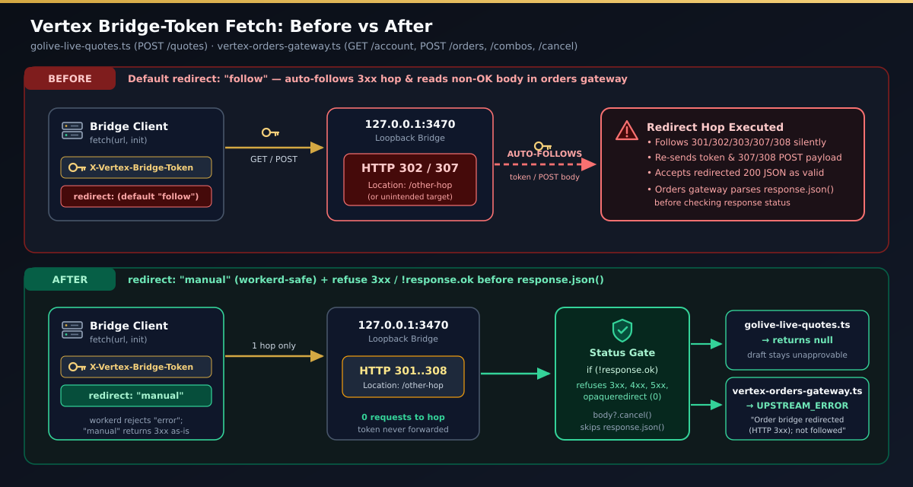

# Plan: Refuse Redirects on Bridge-Token Fetches (`golive-live-quotes.ts`, `vertex-orders-gateway.ts`)

- **Card:** `vertex-bridge-token-fetch-follows-redirect`
- **Requirement class:** Implementation hardening (security; fail-closed transport behavior preserving existing `GoLiveQuotesPort` and `OrderGatewayPort` contracts)
- **Bricks touched:** `packages/api` (`packages/api/src/server/golive-live-quotes.ts`, `packages/api/src/server/vertex-orders-gateway.ts`, `packages/api/src/golive-live-quotes.test.ts`, `packages/api/src/vertex-orders-rules.test.ts`), `docs/vertex-orders.md`
- **Owner decision:** Owner accepted scope as written on 2026-11-27 (owner Discord message (private)): own PR, `redirect: "manual"` + refuse `3xx` + tests, full fresh-context review. Does not alter arming, live order rules, sizing, risk caps, kill switch, or access.

## Problem

Both clients that send `X-Vertex-Bridge-Token` (`VERTEX_ORDER_BRIDGE_TOKEN`) to the loopback bridge (`VERTEX_ORDER_BRIDGE_URL`) omit `redirect` from `fetch(..., init)`:

1. `packages/api/src/server/golive-live-quotes.ts` (`POST /quotes`)
2. `packages/api/src/server/vertex-orders-gateway.ts` (`GET /account`, `POST /orders`, `POST /combos`, `POST /cancel`)

Because `fetch` defaults to `redirect: "follow"`, any `301`/`302`/`303`/`307`/`308` response from the loopback port is automatically followed—potentially forwarding `X-Vertex-Bridge-Token` or re-POSTing order payloads (`307`/`308`) to a redirect target and accepting a redirected `200` JSON body. In addition, `vertex-orders-gateway.ts` called `await response.json()` before checking `response.ok`.

## Design

1. **`redirect: "manual"` on both bridge fetches (`workerd`-compatible):**
   - Cloudflare Workers (`workerd`) rejects `redirect: "error"` with a `TypeError`; `redirect: "manual"` returns any `3xx` response as-is without following `Location`.
2. **Fail-closed `3xx` / non-OK refusal before reading JSON:**
   - **`golive-live-quotes.ts`:** pass `redirect: "manual"` in `fetchImpl(endpoint, { ... })`. On `!response.ok` (which refuses all `3xx` `300-399`, `4xx`/`5xx`, and `opaqueredirect` status `0`), cancel `response.body` (`void response.body?.cancel()`) and return `none` so callers receive `null` and drafts stay unapprovable.
   - **`vertex-orders-gateway.ts`:** pass `redirect: "manual"` in `fetchImpl(url, { ... })`. Before `response.json()`, check `if (!response.ok)`, cancel `response.body` (`void response.body?.cancel()`), and throw `OrderGatewayError("UPSTREAM_ERROR", ...)`:
     - For `response.status >= 300 && response.status < 400`: ``Order bridge redirected (HTTP ${response.status}); redirects are not followed`` (never leaks `Location`, URL, token, or body).
     - For other non-OK statuses: ``Order bridge returned an invalid response (HTTP ${response.status})``.
   - Keep `vertex-orders.ts` unknown-outcome reconciliation unchanged (a failed `place`/`placeCombo` still records `unknown` and blocks retries until reconciled).
3. **Live docs:** document `redirect: "manual"` and `3xx` refusal in `docs/vertex-orders.md` under "Live bridge".

## Acceptance Check

- Unit tests in `packages/api/src/golive-live-quotes.test.ts` and `packages/api/src/vertex-orders-rules.test.ts` prove:
  1. Both clients send `redirect: "manual"` on every bridge call (`POST /quotes`, `GET /account`, `POST /orders`, `POST /combos`, `POST /cancel`).
  2. Mocked `301`/`302`/`303`/`307`/`308` responses (including with valid JSON body and `Location` header, and with `null` body) are refused fail-closed (`null` in quotes reader; `OrderGatewayError("UPSTREAM_ERROR")` with `"Order bridge redirected (HTTP 3xx); redirects are not followed"` and without calling `response.json()` in orders gateway).
  3. Real loopback HTTP (`127.0.0.1:0`) tests with default `globalThis.fetch` prove a `307` redirect is never followed and the redirect target receives `0` requests (never receiving `X-Vertex-Bridge-Token` or the POST payload).
  4. Both `packages/api/src/server/golive-live-quotes.ts` and `packages/api/src/server/vertex-orders-gateway.ts` retain 100% statements, branches, functions, and lines coverage.
- `bun run verify:prepush`, fresh-context full-diff review at the exact head SHA, and hosted PR `ci-gate` pass.
