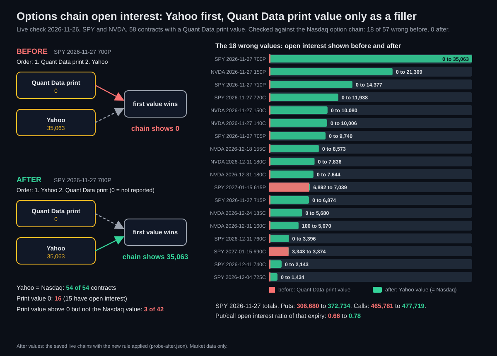

# Plan: options chain open interest from Yahoo first; a Quant Data print value of 0 is not used



- Card: vertex-chain-oi-quantdata-zero
- Kind: bug fix. No new module, endpoint or data format. One enum of the API schema changes the order of its two values.
- Base commit: 2f2a18186
- Status: the code change is built and tested on the branch (acceptance checks 1 to 3 pass). The push, the pull request, the deploy and the live check (checks 4 and 5) are open.

## Terms

- **Open interest (OI):** the number of open contracts of one option contract. The clearing house publishes it once per day.
- **Print:** one reported option trade in the Quant Data order-flow response. Each print has an `openInterest` field: the OI of its contract at the time of the trade. The chain adapter reads the first provider page of the prints of the last 24 hours (the flow window).
- **Flow:** the totals of the prints of one contract in the flow window (premium, trades, volume).
- **Options chain:** the table on `/stock/<SYMBOL>` (tab Options). The procedure `optionsChain.chain` builds it from three sources: Quant Data, IBKR and Yahoo Finance. IBKR supplies only bid and ask, so OI can come from Quant Data or Yahoo only.
- **API schema:** the oRPC contract in `packages/api/src/contracts/options-chain.ts`. In this plan "contract" always means an option contract.
- **Job, card, job report folder:** the agent run that made this plan, its tracker item, and its folder of evidence files. The folder is not in the repository.
- **Agent viewer:** a read-only login of the web app that agents use for checks.

## Goal

For every contract that Yahoo lists, the chain shows the OI that the clearing house published. No OI of 0 that comes from a print is shown.

## Problem

The chain takes each value from the first source that has it. For OI the order is Quant Data, then Yahoo (`OPTIONS_CHAIN_PRIORITY.openInterest` in `packages/api/src/options-chain-merge.ts`). Quant Data has no OI per option contract. Its value is the `openInterest` field of the newest print of the contract (`flowByContract` in `packages/api/src/server/options-chain-quantdata.ts`), and the adapter accepts 0 as a reported OI.

That print value differed from two other sources for 18 of 57 checked contracts: it was 0 for 15 contracts that have OI, and above 0 but lower for 3. Because Quant Data comes first, the print value replaces the Yahoo value. The chain then shows 0 for contracts with an OI of 1,434 to 35,063, and the put/call OI totals of the expiry are too low.

## Evidence

Live reads on 2026-11-26, 03:14 to 03:42 UTC, market closed.

### Method

1. The agent viewer read `optionsChain.chain` for every SPY and NVDA expiry that had a print: 23 chains (SPY 8 expiries, NVDA 15).
2. For each contract with `sources.openInterest` = `quantdata`, the Yahoo adapter of this repository read the Yahoo OI directly, and one request per expiry read the Nasdaq option chain (a third, public source).
3. For four whole chains (SPY and NVDA, 2026-11-27 and 2026-12-18), every Yahoo OI was compared with the Nasdaq value.

The result files are in the job report folder: `qd-yahoo-nasdaq.json` and `yahoo-vs-nasdaq-full.json` under `live-before/`, and `probe-after.json` (the saved chains with the new rules applied; the figure is drawn from it).

### Contracts with a print value

| Result | Contracts |
| --- | --- |
| OI from a Quant Data print | 58 |
| Nasdaq has a value (the comparable contracts) | 57 |
| Yahoo and Nasdaq both have a value | 54 |
| Yahoo value equal to the Nasdaq value | 54 of 54 |
| Print value 0 | 16 |
| Print value 0 and Nasdaq OI above 0 | 15 (1,434 to 35,063) |
| Print value 0, no value in Yahoo or Nasdaq | 1 (NVDA 2027-01-08 180C) |
| Print value above 0 | 42 |
| Print value above 0 and equal to the Nasdaq value | 39 of 42 |
| Print value above 0 and lower than the Yahoo and Nasdaq value | 3 (100 against 5,070; 6,892 against 7,039; 3,343 against 3,374) |

Of the 57 comparable contracts, the chain showed a value that is not the Nasdaq value for 18 (15 zeros and 3 lower values). The 3 lower values can be the OI of the day before. Three of the 39 equal values belong to contracts that expired on the day of the check (2026-11-25): Yahoo no longer listed them, so the print value was the only OI.

Examples of print value 0: SPY 2026-11-27 700P (35,063), 710P (14,377), 720C (11,938); NVDA 2026-11-27 150P (21,309), 150C (10,080), 140C (10,006).

Effect on one expiry (SPY 2026-11-27): put OI total 306,680 instead of 372,734; call OI total 465,781 instead of 477,719; put/call OI ratio 0.66 instead of 0.78.

### Yahoo against Nasdaq on whole chains

| Contracts in four chains | Yahoo equal to Nasdaq |
| --- | --- |
| Strike from one third of the spot to twice the spot | 1,311 of 1,311 |
| Strike outside that range | 209 of 272 |
| Yahoo value 0 (161 contracts): Nasdaq value above 0 | 8, all outside that range |

Yahoo and Nasdaq agree for every contract near the money. They differ for 63 far strikes; 61 of them are in one chain (NVDA 2026-12-18, strikes below 50 or above 300 with the spot at 148.97). Which source is right there is not known.

### Second signal (hypothesis)

`flow.optionPrints` returned the 200 newest stored SPY prints (20:58 to 21:13 UTC on 2026-11-25). Quant Data's own flag `isOpeningPosition` was true on every print of the five SPY 2026-11-27 contracts with print value 0 (23 prints: sweeps, blocks and splits). It was false on every print of four contracts with a print value above 0 (6 prints). A provider can set this flag when the trade size is larger than the OI, which is always true for an OI of 0. If Quant Data does so, the 0 is its value for the contract and not a property of one print type. This is a hypothesis for this sample only.

### What is not known

- The raw print payload was not read. This job has no Quant Data key and no access to the server that stores the prints. The adapter keeps a value only when the field is a finite number of 0 or more (or a numeric string), so the provider sent 0, `"0"` or a number below 1 for the 16 contracts.
- Why Quant Data has 0 or a lower value for these contracts is not known. All 16 strikes with 0 are multiples of 5, but 21 other multiples of 5 had a value above 0.
- The sample is one evening with the market closed and two liquid symbols. It does not show Yahoo's values in the morning, when the daily OI is published again, or for illiquid symbols. Yahoo and Nasdaq can share one upstream feed.

## Decision

Two rules change.

1. **Yahoo first for OI.** `OPTIONS_CHAIN_PRIORITY.openInterest` becomes Yahoo, then Quant Data. A print value fills only a contract for which Yahoo has no OI. In the sample this rule alone corrects all 18 differences.
2. **A print value below 1 is read as not reported.** The adapter truncates the value and gives no OI when the result is 0. This rule matters for a contract that has a print and no Yahoo OI. The sample has one such contract with a 0, and its real OI is not known. The rule rests on an inference: where a second source existed, a print 0 was false for 15 of 15 contracts, so a print 0 is not a trusted value anywhere.

Rule for several prints of one contract: the newest print whose field is a finite number of 0 or more decides; a print with a missing or invalid field is skipped. When the newest such value is below 1, the contract has no Quant Data OI. An older print with a value above 0 is not used, because it can be the number of the day before.

Yahoo's own 0 stays a reported value and is shown, also when a print carries a value above 0. The Yahoo adapter keeps a count of 0 or more and reads a missing or negative field as not reported.

### Alternatives considered

| Option | Differences from Nasdaq in the sample (of 57) | Verdict |
| --- | --- | --- |
| A. Rule 2 alone; Quant Data stays first | 3 (the lower values above 0) | Rejected: not enough |
| B. Rule 1 alone | 0, but a print 0 still shows where Yahoo has no OI | Rejected: keeps a value that was false 15 of 15 times |
| AB. Rules 1 and 2 | 0, and no 0 from a print | Chosen |
| C. Keep the order and mark the cell | 18 | Rejected: the table and the totals keep the values |
| D. Remove the print value as an OI source | 0 | Rejected: the 3 contracts that expired that day would show no OI (their print values were right), and the chain would show no OI when Yahoo fails |
| E. Use Quant Data's open-interest-by-strike endpoint | Not measured | Rejected: it gives one number per strike for all expiries together, not per option contract |
| F. Add Nasdaq as an OI source | Not measured | Rejected for this fix: a new adapter for an unofficial endpoint is a new source, not a bug fix |
| G. Let a print value above 0 win over a Yahoo 0 | 0 | Rejected: no such contract was observed, and the merge would get a second rule beside the priority order |

### Authority for the change of order

The general source order (Quant Data first for chains; Yahoo fills gaps) is an owner decision of 2026-11-13, recorded in the comment of `OPTIONS_CHAIN_PRIORITY`. Rule 1 is an exception for one field. It is not on the owner-decision list of `AGENTS.md` ("Code review practice"), so the job decided it from the measurements above. The job posted the decision in its job channel with a control that lets the owner reverse it (owner Discord message (private), 2026-11-26). To reverse rule 1 only, restore the old order in `OPTIONS_CHAIN_PRIORITY` and in the enum of the API schema, regenerate `packages/api/openapi.json` and restore the test expectations. Rule 2 can stay.

## Risks and limits

| Risk | Effect | Mitigation or accepted limit |
| --- | --- | --- |
| Yahoo fails or has no row for a contract | OI falls back to the print value, which was lower than the other sources for 3 of 42 values above 0 | The source label of the value shows Quant Data. Accepted: before the fix every print value was shown |
| Yahoo reports a false 0 | The chain shows 0 | Accepted: 8 of 161 Yahoo zeros had a Nasdaq value above 0, all far from the money, and the truth there is not known. A test fixes the behaviour (Yahoo 0 is shown) |
| A real OI of 0 on a contract with a print and no Yahoo OI | The chain shows no OI instead of 0 | Accepted: one contract in the sample |
| Yahoo's OI is late or wrong at other times of day or for other symbols | A wrong OI is shown with source Yahoo | Not measured. Live check 5 compares with Nasdaq again; a difference there reopens the card |
| Stored option chain snapshots hold the merged chain | Rows saved before the deploy can hold a print value; totals over time have a step at the deploy | Accepted, not repaired |
| Only the first page of prints is read | The newest print on the page is not always the newest print of the contract | No change by this fix |

The change has no security effect (read-only market data, no new request) and adds no load.

## Scope

In scope: the priority order of one field, the adapter rule, their tests, the chain notes, and the source description in `docs/data-sources-and-platform-roles.md`.

Not in scope:

- The stored prints (table `flow_option_prints`, written by `parseOptionPrints` in `packages/api/src/flow-options.ts`). The column `open_interest` keeps the raw value. A search for `openInterest` and `open_interest` in `packages/api/src` and `packages/db/src` found no reader of that column.
- The flags Opening and Vol > OI on the Flow page. They are Quant Data's own flags (`isOpeningPosition`, `isVolumeGreaterThanOpenInterest`). The second signal above suggests that they are wrong for the same contracts. A change needs proof from the stored prints and a third state of each flag (the provider value is not used) in the API schema and in a table; the repository's status language rule does not allow a vague state name. Follow-up card: vertex-flow-print-flags-oi-zero.
- Strike profiles, GEX and max pain on `/charts`. They read the open-interest-by-strike endpoint (option E). For SPY strike 700 it returned calls 43,925 and puts 223,749 (all expiries together) in the same check.

## Acceptance checks

1. Adapter test: a contract whose newest print carries 0 (number or string) has `openInterest: null` and keeps its flow totals; a value below 1 is also not reported; a newest 0 does not bring back an older value above 0; a newest value above 0 is kept when an older print carried 0.
2. Service test with the real Quant Data adapter (fake HTTP) and a Yahoo snapshot, four contracts: print 0 and Yahoo 2210 give 2210 with source `yahoo`; print 1554 and Yahoo 1500 give 1500 with source `yahoo`; print 4786 and no Yahoo row give 4786 with source `quantdata`; print 0 and no Yahoo row give no OI and no source. The flow is shown in all four cases.
3. Merge test: a Yahoo OI of 0 is shown with source `yahoo` when a print carries a value above 0.
4. `bun run verify:prepush` passes, and the coverage lane of CI passes (it holds the per-file minimums of `scripts/ci/coverage-baseline.json`; the three changed source files are not on that list, so each must stay at 100 %).
5. Live, after the deploy: `live-check.mjs` (job report folder; run with `bun` from a checkout, at least 6 minutes after the deploy) exits 0. It reads the SPY and NVDA chains of every expiry with a print and passes when, for every contract with flow: (a) no value has source `quantdata` while Yahoo has an OI; (b) no value with source `quantdata` is 0; (c) the shown OI equals the Yahoo OI when Yahoo has one; (d) the shown OI equals the Nasdaq value when Nasdaq has one. Exit 3 means that the flow window held no print (for example after a day without a session): the check is then not done and is run again after the next US session. Exit 1 reopens the card. The same script exits 1 against the app before the fix (saved run in `live-check-before/`).

State on 2026-11-26: checks 1 to 3 passed on the branch. The changed and new tests failed on the base source first (saved run `red-run-base.txt`: 7 failed) and pass with the fix (`green-run-fix.txt`).

## Implementation Plan

The change is built. The fix commit of the pull request is the exact text of the change; this section states what it contains and why. Steps 1 to 5 are one commit: between them the tests fail. Steps 6 and 7 are open.

### Files

| Path | Action |
| --- | --- |
| `packages/api/src/server/options-chain-quantdata.ts` | Modify |
| `packages/api/src/options-chain-merge.ts` | Modify |
| `packages/api/src/contracts/options-chain.ts` | Modify |
| `packages/api/openapi.json` | Modify (generated) |
| `packages/api/src/options-chain-quantdata.test.ts` | Modify |
| `packages/api/src/options-chain.test.ts` | Modify |
| `packages/api/src/options-chain-merge.test.ts` | Modify |
| `docs/data-sources-and-platform-roles.md` | Modify |
| `docs/vertex-rebuild/data-sources/reel-de8mrtzrrpy.md` | Modify (one sentence) |
| `CHANGELOG.md` | Modify |
| `apps/web/src/features/stock-detail/fake-gateways.ts` | Modify (comment only) |
| `docs/vertex-rebuild/designs/vertex-chain-oi-quantdata-zero/plan.md` | Create |
| `docs/vertex-rebuild/designs/vertex-chain-oi-quantdata-zero/before-after.png` | Create |
| `docs/vertex-rebuild/designs/vertex-chain-oi-quantdata-zero/before-after.svg` | Create |

`packages/api/src/contracts/options-chain.contract.test.ts` is run and not changed.

### Step 1: adapter rule

File: `packages/api/src/server/options-chain-quantdata.ts`, function `flowByContract`. The `if` that keeps a print OI has the same condition and this body:

```ts
if (openInterest.success && at >= tally.openInterestAt) {
  const count = Math.trunc(openInterest.data.openInterest);
  tally.openInterest = count === 0 ? null : count;
  tally.openInterestAt = at;
}
```

`tally.openInterestAt` is still set when the count is 0, so an older print cannot replace the empty value. `PrintOpenInterestSchema` does not change. The row type `OptionsAnalyticsRow.openInterest` is already `number | null`. The comment above the `if` and the header comment of the file state the rule and its reason and point to the documentation for the numbers.

### Step 2: source order of one field

- File `packages/api/src/options-chain-merge.ts`: in `OPTIONS_CHAIN_PRIORITY`, `openInterest: ["yahoo", "quantdata"]`, with a comment that states the exception and its reason. `mergeContract` already calls `pick` with this list, so no other merge code changes.
- File `packages/api/src/contracts/options-chain.ts`: in `OptionContractSourcesSchema`, `openInterest: z.enum(["yahoo", "quantdata"]).nullable()`. For a client the order of an enum has no meaning. It changes because the existing test "is the one source order per field and names only contract sources" requires the enum order to equal the priority order. The set of values is the same. A client now receives `yahoo` as the OI source of a contract for which it received `quantdata` before.
- `bun run openapi:generate` rewrites `packages/api/openapi.json`. The two `openInterest` source enums (the call and the put of a chain row) change their order; the commit shows no other change in that file.

### Step 3: notes for the reader

File: `packages/api/src/options-chain-merge.ts`, function `chainNotes`.

- The note built from `IV: ${split("iv")}. Open interest: ${split("openInterest")}.` gets the constant `PRINT_OPEN_INTEREST_NOTE` appended when Quant Data has rows (`facts.quantDataRows`): "A Quant Data print value is used only when no other source has the open interest. A print value of 0 is read as not reported." The sentence is appended to an existing note, because the API schema allows at most 10 notes of at most 300 characters and 10 notes can already occur. With two counts of up to four digits per field the note has 234 characters. The sentence names no second source, because existing tests require that the notes do not name Yahoo when Yahoo failed.
- The next note changed its first sentence from "Quant Data open interest and flow come from the order-flow prints of the last 24 hours, so a contract without a print shows neither." to "Quant Data flow and print open interest come from the order-flow prints of the last 24 hours, so a contract without a print has neither." The old text said that a contract without a print shows no OI, which is false when Yahoo supplies it.

### Step 4: tests

- `packages/api/src/options-chain-quantdata.test.ts`: new test "reads a print open interest of 0 as not reported" (check 1). Puts at the strikes 90 to 93 with prints at two trade times.
- `packages/api/src/options-chain.test.ts`: new test "open interest: Yahoo first; a Quant Data print value fills a contract Yahoo does not list, and a print value of 0 is not used" (check 2). It uses the configured Quant Data client with a fake `fetch`. The Yahoo fixture lists the strikes 90, 100 and 110, so the two contracts without a Yahoo row are puts at 60 and 61. The test "Quant Data present: IV, delta and open interest are tagged quantdata and flow is set" has the new title "Quant Data present: IV and delta are tagged quantdata, flow is set and the open interest stays Yahoo's" and expects the Yahoo OI (2210, source `yahoo`).
- `packages/api/src/options-chain-merge.test.ts`: the priority test expects the new order. The test "takes each value from the first source of its priority order" expects the Yahoo OI for the contract that both sources have, the split "Open interest: Yahoo Finance for 6, Quant Data for 1" and the two changed notes. New test "shows an open interest of 0 from Yahoo, also when a Quant Data print carries a value" (check 3). The first-page test expects the new first sentence of its note.

### Step 5: documentation

File: `docs/data-sources-and-platform-roles.md`, four places: the chain row of the source table (OI: Yahoo, then Quant Data print value), the line "A source is asked for a bounded part", the Quant Data line of the chain sources (the rule, its reason and the numbers of the tables above) and the Yahoo line. The sentence "Open interest and flow (premium, prints, size) come from the order-flow prints of the last 24 hours for the shown expiry" stays: it says where Quant Data's values come from.

The review of the code diff found three more texts that stated the old order: the entry of the merged chain in `CHANGELOG.md` (corrected, and a new entry under "Fixed"), one sentence in `docs/vertex-rebuild/data-sources/reel-de8mrtzrrpy.md`, and the comment of the fake chain in `apps/web/src/features/stock-detail/fake-gateways.ts` (the fake keeps its Quant Data tags so that the test page shows both source tags).

### Step 6: commits and verification (open)

1. Commit `docs(designs): plan for the options chain open interest source` with this plan and its figure. It comes first, because the documentation of the fix links to this plan.
2. Commit `fix(options-chain): open interest from Yahoo first; drop a Quant Data print value of 0` with steps 1 to 5. The repository rule is one change per commit with its tests, generated files and documents; the failing run is kept as a file, not as a commit.
3. Commands, from the repository root: `bun run check` (format, lint, typecheck). In `packages/api`: `pnpm exec vitest run src/options-chain-quantdata.test.ts src/options-chain.test.ts src/options-chain-merge.test.ts src/contracts/options-chain.contract.test.ts` (the repository runs Vitest through pnpm). The pre-push hook runs `bun run verify:prepush`, which includes `bun run openapi:check`.
4. Pull request against `vertex/rebuild-darkfactory-20260921`; review of the full diff by an agent that did not write it; the CI lanes that `ci.yml` selects for a ready pull request; merge with `scripts/merge-pr`.

### Step 7: deploy and live check (open)

The web app deploy follows `infra/quantvps/README.md` ("Deploy a new web build"). That route refuses a restart in US market hours. The job that wrote this plan has no access to that server, so a deploy card runs the deploy after the merge: either its own card or the next deploy of the base branch, which then contains the fix. The card that runs the deploy also runs check 5 and records the result on card vertex-chain-oi-quantdata-zero. Wait at least 6 minutes after the deploy: the chain cache lasts 60 s and the shared Quant Data cache 5 minutes.

### Rollback

Revert the fix commit and deploy. The revert restores the enum order in the API schema and in `packages/api/openapi.json`. The change writes no data and changes no database schema, so nothing needs repair. To reverse only the source order, see "Authority for the change of order".
