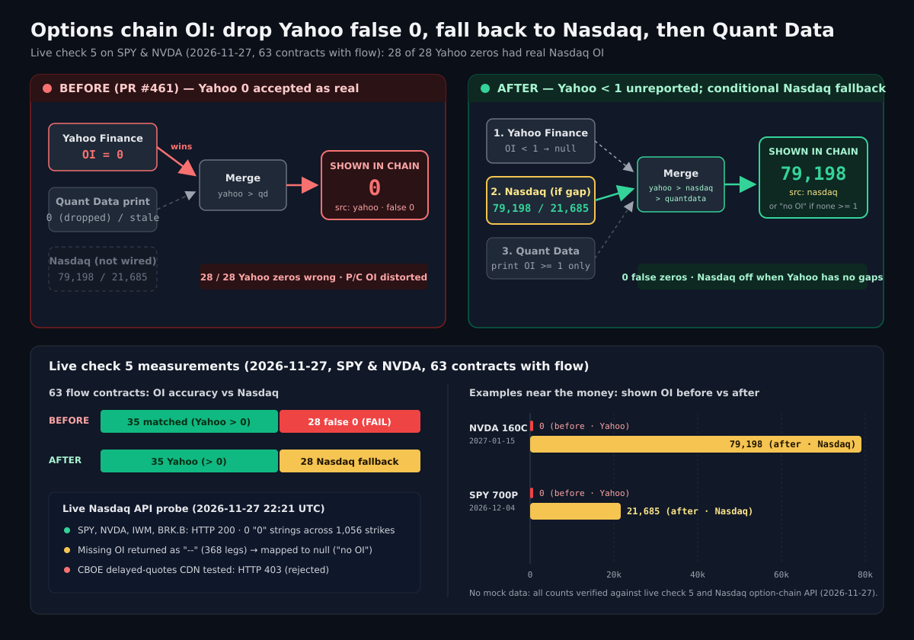

# Plan: options chain open interest drops Yahoo Finance false zeros and falls back to Nasdaq

- Card: `vertex-chain-oi-yahoo-false-zero`
- Kind: bug fix with one new read-only open-interest fallback adapter (`Nasdaq`) and one contract update (`openInterest` source enum + 4th `sources` status entry).
- Base branch: `vertex/rebuild-darkfactory-20260921` (`6db354c97`)
- Follow-up deploy card: `vertex-chain-oi-quantdata-zero-deploy` (deploys the merged commit off-hours on QuantVPS and reruns live check 5).
- EGM plan review: `review/goldfish_review_report.md` (15 findings: 4 High, 7 Medium, 4 Low; auto-accepted and resolved: 15 fixed, 0 contested, 0 declined, 0 escalated).

## Terms

- **Open interest (OI):** total open contracts for one option contract, published once per day by the OCC.
- **False zero:** a provider returning `0` for `openInterest` on a contract whose real OCC open interest is above 0.
- **Options chain:** `/stock/<SYMBOL>` Options tab, served by `optionsChain.chain` and `optionsChain.expiries` (`packages/api/src/contracts/options-chain.ts`).
- **Primary chain sources (`OPTIONS_CHAIN_PRIMARY_SOURCES`):** Quant Data (`quantdata`), IBKR (`ibkr`), and Yahoo Finance (`yahoo`), which supply expiries, spot, quotes, IV, and contract rows.
- **OI fallback source:** Nasdaq (`nasdaq`), an OI-only public read-only adapter consulted only by `optionsChain.chain` when the resolved expiry has at least one contract without a positive Yahoo OI.

## Goal

The options chain never displays a Yahoo Finance `openInterest: 0` as a real open interest value. When Yahoo reports `0` (or omits a contract or fails), `optionsChain.chain` falls back to Nasdaq's option-chain OI (`>= 1`), then to a positive Quant Data print OI (`>= 1`), and otherwise shows `null` ("no OI"). Quant Data print values of `0` remain dropped (PR #461). Non-OI endpoints (`expiries`, `expectedMove`, `spread`) never block on Nasdaq.

## Problem and evidence

PR #461 (`b69e8c4a`) changed `OPTIONS_CHAIN_PRIORITY.openInterest` to `["yahoo", "quantdata"]` and dropped Quant Data print OI `< 1`, while keeping Yahoo `openInterest: 0` as a reported value. Its risk table accepted Yahoo false zeros because an earlier sample showed only 8 of 161 far-OTM Yahoo zeros with Nasdaq OI > 0.

Live check 5 on build `6db354c97aa4266ad31b5c454e44f6b3be47af4c` (2026-11-27 16:14 ET and 17:16 ET, SPY and NVDA, every expiry with a flow print) disproved that assumption:

| Yahoo OI on contracts with flow | Contracts | Comparison against Nasdaq OI |
| --- | ---: | --- |
| Yahoo OI `> 0` | 35 | Equal to Nasdaq OI on **35 of 35** |
| Yahoo OI `= 0` | 28 | Nasdaq OI `> 0` on **28 of 28**, many near the money |

Named examples from live check 5 (verified directly against `api.nasdaq.com` at 2026-11-27 22:21 UTC):

- `NVDA 2027-01-15 160C`: Yahoo `0`, Nasdaq `79,198` (`p_Openinterest` on `160P`: `58,525`)
- `SPY 2026-12-04 700P`: Yahoo `0`, Nasdaq `21,685` (`c_Openinterest` on `700C`: `1,023`)

### Direct public-source probe (2026-11-27 22:21–22:23 UTC)

| Source / Symbol | Expiry | HTTP / `rCode` | Strikes | `"0"` OI strings | `"--"` OI strings | Max OI | Notes |
| --- | --- | --- | ---: | ---: | ---: | ---: | --- |
| Nasdaq `SPY` (`assetclass=etf`) | `2026-12-04` | 200 / 200 | 269 | 0 | 167 | 26,062 | `700P = 21685`; `assetclass=stocks` gives `rCode 400` |
| Nasdaq `SPY` (`assetclass=etf`) | `2026-12-18` | 200 / 200 | 262 | 0 | 0 | — | 262/262 positive OI |
| Nasdaq `SPY` (`assetclass=etf`) | `2027-01-15` | 200 / 200 | 239 | 0 | 98 | 82,261 | All rows in one page (`limit=2000`) |
| Nasdaq `NVDA` (`assetclass=stocks`) | `2027-01-15` | 200 / 200 | 85 | 0 | 5 | — | `160C = 79198` |
| Nasdaq `NVDA` (`assetclass=stocks`) | `2026-12-18` | 200 / 200 | 416 | 0 | 73 | 126,833 | All rows in one page (`limit=2000`) |
| Nasdaq `IWM` (`assetclass=etf`) | `2026-12-18` | 200 / 200 | 132 | 0 | 30 | 125,529 | — |
| Nasdaq `BRK.B` (`assetclass=stocks`) | `2026-12-18` | 200 / 200 | 89 | 0 | 5 | — | `BRK-B` gives `rCode 400`; dot form works |
| Nasdaq `SPX` (`assetclass=index`) | `2026-12-18` | 200 / 400 | 0 | 0 | 0 | 0 | Index class not supported by this endpoint |
| Nasdaq `SPY` (`assetclass=etf`) | `2026-12-05` (Sat) | 200 / 200 | 0 | 0 | 0 | 0 | `totalRecord: 0`, `table.rows: null` |
| CBOE CDN (`SPY`, `NVDA`) | all | 403 | — | — | — | — | Blocked; rejected |

Key finding: Nasdaq never reports `"0"` for open interest across 1,056 strike rows (2,112 legs); it reports positive integers or `"--"`. None of Yahoo, Nasdaq, or Quant Data reliably distinguishes a genuine 0 OI from an unreported/placeholder 0.

### Regular-session timing note

This worker ran in an isolated cloud sandbox on Friday 2026-11-27 after 17:18 ET (the US market closed early at 13:00 ET for the day after Thanksgiving; the next regular US session is Monday 2026-11-30 09:30 ET) without access to the rig's `live-check.mjs` or `agent-viewer.env`. Measuring whether Yahoo false zeros also occur intraday vs only off-hours does not change the design choice:

- Off-hours research and off-hours deploy checks both require accurate OI (not false zeros).
- Because the Nasdaq adapter is called **conditionally** only by `optionsChain.chain` when at least one contract in the resolved expiry lacks a positive Yahoo OI, a chain where Yahoo reports positive OI on every contract makes **zero** Nasdaq requests (`status: "off"`). Whenever Yahoo reports `0` — whether intraday or off-hours — Nasdaq fills the real OI.

## Decision

1. **Yahoo `openInterest < 1` is read as unreported (`null`).**
   - In `packages/api/src/server/options-chain-yahoo.ts`, change `openInterest` from `wholeCount` (accepts `0`) to `positiveCount` (`value !== undefined && value >= 1 ? Math.trunc(value) : null`), matching how `options-chain-yahoo.ts` already filters placeholder IV `< 0.001` and how `options-chain-quantdata.ts` drops print OI `< 1`. `volume` stays `wholeCount` (`0` is valid).
   - In `packages/api/src/options-chain-merge.ts`, also apply `positiveOpenInterest` (`value !== null && value !== undefined && Number.isFinite(value) && value >= 1 && value <= Number.MAX_SAFE_INTEGER ? Math.trunc(value) : null`) before `pick(OPTIONS_CHAIN_PRIORITY.openInterest, ...)` as defense-in-depth so synthetic snapshots or direct merge callers cannot leak `0`, `NaN`, `Infinity`, or non-integers into `OptionContractSchema.openInterest`.
2. **Add a narrow OI-only port and read-only Nasdaq adapter.**
   - Port in `packages/api/src/server/options-chain-source.ts`: `OptionsOpenInterestRow`, `OptionsOpenInterestSnapshot`, `OptionsOpenInterestSource.read(symbol, expiry)`.
   - Adapter in `packages/api/src/server/options-chain-nasdaq.ts`:
     - Input validation & URL safety: normalize `symbol` via `symbol.trim().toUpperCase().replaceAll("-", ".")`, validate `expiry` against `/^\d{4}-\d{2}-\d{2}$/` (throw `OptionsChainSourceError("UPSTREAM_ERROR", ...)` on invalid input), and build `https://api.nasdaq.com/api/quote/${encodeURIComponent(normalizedSymbol)}/option-chain?assetclass=${assetClass}&limit=2000&fromdate=${expiry}&todate=${expiry}&excode=oprac&callput=callput&money=all&type=all`.
     - Request headers: `user-agent` (standard browser UA), `accept: "application/json, text/plain, */*"`, `accept-language: "en-US,en;q=0.9"`, `origin: "https://www.nasdaq.com"`, `referer: "https://www.nasdaq.com/"`.
     - Shared timeout budget: create **one** `AbortSignal.timeout(timeoutMs)` (default `8_000` ms) at the top of `read(symbol, expiry)` and reuse it across both requests if an uncached ETF falls back from `stocks` to `etf`, capping total Nasdaq tail latency at `timeoutMs` (never `2 * timeoutMs`).
     - Asset-class resolution & bounded cache: store `Map<string, "stocks" | "etf">` capped at `500` entries (FIFO eviction of oldest key). If uncached, try `"stocks"`, and on `rCode === 400` retry once with `"etf"`. If a cached `assetClass` later returns `rCode === 400`, evict it and try the alternate class once. Cache the working class only when `rCode === 200` with non-null `data` (never cache on transient errors).
     - Complete HTTP & `rCode` error matrix (fixed safe messages only; never copy `status.bCodeMessage`, URL, or raw body):
       - Network / timeout throw -> `UNAVAILABLE`
       - HTTP `404` -> `NOT_FOUND`
       - HTTP `3xx`, `403`, `429`, or `>= 500` -> `UNAVAILABLE`
       - Superseded 2026-11-28 by `docs/vertex-rebuild/designs/workerd-fetch-redirect/plan.md`: workerd rejects `redirect: "error"` before any request, so the adapter sends `redirect: "manual"` and refuses a 3xx as `UNAVAILABLE`.
       - Other non-200 HTTP -> `UPSTREAM_ERROR`
       - Body > 4 MiB (`readCappedText`) or invalid JSON or schema mismatch -> `UPSTREAM_ERROR`
       - `rCode === 200` with `data === null`, `data.table === null`, or `data.table.rows === null` -> `{ expiry, rows: [] }`
       - `rCode === 400` on both `stocks` and `etf` -> `NOT_FOUND`
       - `rCode === 404` -> `NOT_FOUND`
       - `rCode >= 500` -> `UNAVAILABLE`
       - Any other non-200 `rCode` -> `UPSTREAM_ERROR`
     - Consecutive-failure cooldown (protects against Akamai IP blocking on QuantVPS without waiting for an off-hours rollback): after `3` consecutive `UNAVAILABLE` failures (HTTP 403/429/5xx/network/timeout), pause Nasdaq calls for `5` minutes (`300_000` ms), throwing `OptionsChainSourceOff("Nasdaq temporarily paused after repeated upstream failures")` during cooldown; any successful response (or `NOT_FOUND`) resets the streak to `0`.
     - Row parsing (`parseNasdaqOpenInterest(body, expiry)`):
       - Skip `expirygroup` header rows (`strike === null` or non-empty `expirygroup`).
       - If `drillDownURL` is a string matching `/([0-9]{6})[cp][0-9]{8}$/i`, require the 6-digit `YYMMDD` token to match `expiry` (`YYYY-MM-DD` -> `YYMMDD`); skip mismatched rows so another expiry can never leak in.
       - Parse `strike`: trim, strip commas, match `/^\d+(?:\.\d+)?$/`, require finite `> 0`.
       - Parse `c_Openinterest` and `p_Openinterest`: trim, strip commas, match `/^\d+$/` (strict digits — never `parseInt`), require integer `>= 1` and `<= Number.MAX_SAFE_INTEGER`. `"--"`, `"0"`, empty, or invalid values are skipped.
       - `limit=2000` covers up to 1,999 strikes in one page (the largest observed SPY/NVDA monthly chains have 239–416 strikes); no multi-page loop is needed.
3. **Update contract and priority order cleanly (without leaking `"nasdaq"` into primary-only fields).**
   - Export `OPTIONS_CHAIN_PRIMARY_SOURCES = ["quantdata", "ibkr", "yahoo"] as const` and `OptionsChainPrimarySourceId` from `packages/api/src/contracts/options-chain.ts`.
   - Use `OPTIONS_CHAIN_PRIMARY_SOURCES` for `expiriesSources` (enum, `.max()`, priority `.refine()`), BOTH `spotSource` fields (`quoteFields` and spread/expected-move output), `OPTIONS_CHAIN_PRIORITY.spot`, `OPTIONS_CHAIN_PRIORITY.expiries`, and `listed`/`quoteTimes` in `options-chain-merge.ts`.
   - Update `OPTIONS_CHAIN_SOURCES` to `["quantdata", "ibkr", "yahoo", "nasdaq"] as const` and `OPTIONS_CHAIN_SOURCE_LABELS` to include `nasdaq: "Nasdaq"`.
   - Update `OptionContractSourcesSchema.openInterest` to `z.enum(["yahoo", "nasdaq", "quantdata"]).nullable()`.
   - Update `OptionsChainSourceStatusesSchema` to a 4-tuple: `quantdata`, `ibkr`, `yahoo`, `nasdaq`. The existing `/stock/<SYMBOL>` `SourceLines` component renders all 4 entries automatically.
   - Keep `OptionContractSchema.openInterest` as `count` (`nonnegative`) for forward/UI compatibility (the UI already tests and handles `openInterest: 0` cleanly if a future authoritative OCC feed ever supplies verified real `0`), while enforcing `>= 1` across Yahoo, Nasdaq, Quant Data, and the merge boundary.
   - Add `EMPTY_MESSAGES.nasdaq = "Nasdaq has no open interest values for this expiry"` and `NOTE_NAMES.nasdaq = "Nasdaq"` in `options-chain-merge.ts`.
   - Regenerate `packages/api/openapi.json` via `bun run openapi:generate`.
4. **Separate Nasdaq OI fallback from `readChain()` so non-OI endpoints stay fast and truthful.**
   - `readChain()` continues reading and caching `{ quantdata, ibkr, yahoo }` (60 s TTL, max 200 entries).
   - Non-OI endpoints (`optionsChain.expiries`, `optionsChain.expectedMove`, `optionsChain.spread`) pass `{ status: "off", message: "Not asked: endpoint does not display open interest" }` as `reads.nasdaq` — **0 ms** extra latency, and `expiries` never falsely reports `nasdaq: "used"`.
   - `optionsChain.chain` evaluates `needsNasdaqOpenInterest(reads, expiry)`:
     - Returns `false` with `"Not asked: no option contracts for this expiry"` when `expiry === null` or when 0 contracts exist for `expiry` across `yahoo` (only when `yahoo.data.expiry === expiry`), `liveQuotes(ibkr)` (only when `ibkr.expiry === expiry`), and `quantdata` (rows where `row.expiry === expiry`).
     - Checks positive Yahoo OI (`>= 1`) by exact `(right, strike)` key (`contractKey`) only when `yahoo.status === "ok" && yahoo.data.expiry === expiry`.
     - If every contract for `expiry` already has positive Yahoo OI, returns `false` with `"Not asked: Yahoo Finance reported open interest for every contract"`.
     - Otherwise calls `readNasdaqOpenInterest(context, symbol, expiry, now)` backed by its own bounded `(symbol, expiry)` 60 s cache (max 200 entries; failed promises/outcomes are NOT cached, and `nearest` + explicit `expiry` share the exact same cache key so no duplicate Nasdaq request fires).
   - `setOptionsChainForTesting` accepts `nasdaq?: OptionsOpenInterestSource`, resets `nasdaqSource = null`, and clears the Nasdaq cache (mirroring `yahooSource = null` and `cache.clear()`). All existing test setups in `options-chain.test.ts` that trigger Yahoo gaps/failures pass a deterministic fake `nasdaq` so unit tests never touch live `api.nasdaq.com`.
5. **Update chain notes within strict contract limits (`<= 10` notes, `<= 300` chars each).**
   - Invariant: NEVER append text to the `age` note (already `297 / 300` chars when all three primary sources are present).
   - Keep total notes `<= 10`.
   - Update the IV + Open interest note:
     - Prefix: `IV: ${split("iv")}. Open interest: ${split("openInterest")}.` (worst case at 4,000 contracts = `125` chars).
     - Append `" Open interest of 0 is read as not reported."` (44 chars) whenever any contract exists (`contracts.length > 0`), so Yahoo `0` -> `null`/Nasdaq is always explained even when Quant Data has no rows.
     - Append `" Quant Data print OI fills gaps only."` (37 chars) when `facts.quantDataRows` is true.
     - Worst-case length at 4,000 contracts = `125 + 44 + 37 = 206` chars (well under `300`, verified by a unit test!).
6. **Keep PR #461's Quant Data print `0` rule unchanged.**

### Alternatives considered

| Option | Result on 28 Yahoo false zeros | Verdict |
| --- | --- | --- |
| A. Drop Yahoo `0` without adding Nasdaq (fall back to Quant Data print OI only) | Fails live check 5 criterion (d) whenever Quant Data print OI is `0` (~28% of prints), stale (3/42), or absent (most strikes without flow), and risks dropping Put/call OI coverage below 50% | Rejected |
| B. Keep Yahoo `0`, override only when Nasdaq/QD `> 0` | If Nasdaq fails/times out while Yahoo sends false `0`, the UI still shows false `0` (e.g. `0` on NVDA 160C); adds special-case merge branching outside `OPTIONS_CHAIN_PRIORITY` | Rejected |
| C. Drop Yahoo `< 1` + conditional Nasdaq OI fallback in `optionsChain.chain` (`yahoo -> nasdaq -> quantdata`) | All 35 Yahoo `> 0` stay Yahoo; all 28 Yahoo `0` resolve to Nasdaq OI; if Nasdaq fails, falls back to Quant Data `> 0` or `null` ("no OI"), never false `0`; zero Nasdaq calls on non-OI endpoints or when Yahoo has no gaps | **Chosen** |
| D. Make Nasdaq primary (`nasdaq -> yahoo -> quantdata`) | Adds ~2–4 s Nasdaq call on every expiry even when Yahoo has complete OI, and depends on Nasdaq's unofficial API on every request | Rejected |
| E. Use CBOE delayed-quotes CDN | HTTP 403 on live probe | Rejected |

## Risks and limits

| Risk | Effect | Mitigation / accepted limit |
| --- | --- | --- |
| QuantVPS IP blocked/throttled by Akamai (HTTP 403/429 or timeout) | `sources[3]` reports `Nasdaq: failed` (then `off` during 5-min cooldown); affected contracts fall back to Quant Data print OI `>= 1` or `null` ("no OI") | Consecutive-failure cooldown (3 `UNAVAILABLE` failures -> 5 min pause) prevents repeated 8 s stalls without needing an emergency rollback; deploy card runs a live QuantVPS probe to `api.nasdaq.com` and inspects `sources[3]` in `live-check.mjs` |
| Symbol not covered by Nasdaq (`SPX` index or unknown asset class) | `sources[3]` reports `Nasdaq: failed` (`NOT_FOUND`) | Graceful degradation; does not trip the `UNAVAILABLE` cooldown; equity and ETF symbols cover the stock detail portal |
| Sequential latency when Nasdaq is triggered (~2–3.5 s after Yahoo) | First uncached `optionsChain.chain` read for an expiry with Yahoo `0`/missing takes longer; cached 60 s per `(symbol, expiry)` | Non-OI endpoints (`expiries`, `expectedMove`, `spread`) never call Nasdaq; shared single `8_000` ms timeout bounds worst-case ETF `stocks -> etf` fallback |
| True 0 OI on a brand-new or deep-OTM contract | Shown as `no OI` (`null`) instead of `0` | Matches Nasdaq itself (`"--"`) and PR #461's Quant Data rule; prevents false zeros from corrupting totals and ratios |
| `live-check.mjs` criterion (c) on the rig | Criterion (c) ("shown OI equals Yahoo OI when Yahoo has one") will reject Nasdaq values replacing Yahoo `0` | Documented exact update for `vertex-chain-oi-quantdata-zero-deploy` (compare against Yahoo only when `yahooOi > 0`; report `sources[3]` Nasdaq status; keep criteria (a), (b), (d) strict) |
| Regular-session frequency of Yahoo zeros not yet measured | Unknown whether Yahoo zeroes occur intraday as well as off-hours | Conditional fallback handles both identically; deploy/verification card can still run a read-only intraday check if desired |

## Scope

In scope:

- `packages/api/src/contracts/options-chain.ts` and regenerated `packages/api/openapi.json`
- `packages/api/src/server/options-chain-source.ts`
- `packages/api/src/server/options-chain-yahoo.ts`
- `packages/api/src/server/options-chain-nasdaq.ts` (new)
- `packages/api/src/options-chain-merge.ts`
- `packages/api/src/server/options-chain.ts`
- Unit & contract tests in `packages/api` (100% coverage on every touched/new file) and updated 4-source fixtures in `apps/web` tests/fake-gateways
- Documentation updates in `docs/data-sources-and-platform-roles.md` and `CHANGELOG.md`

Out of scope:

- Stored flow prints (`flow_option_prints`) and Flow page `Opening` / `Vol > OI` badges
- `/charts` GEX / strike profiles
- QuantVPS deploy and rig-local `~/Documents/reports/web/vertex-chain-oi-quantdata-zero/live-check.mjs` (owned by follow-up card `vertex-chain-oi-quantdata-zero-deploy`)

## Acceptance checks

1. **Failing test first:** Unit/merge/service tests reproduce Yahoo `openInterest: 0` alongside Nasdaq OI `> 0` (`79,198` and `21,685`) and Quant Data print OI `0` / `> 0`, fail on current code, then pass with the implementation.
2. **Contract & merge tests:**
   - `OPTIONS_CHAIN_PRIMARY_SOURCES` rejects `"nasdaq"` in `spotSource` and `expiriesSources`; `OptionContractSourcesSchema.openInterest` accepts `["yahoo", "nasdaq", "quantdata"]`; `OptionsChainSourceStatusesSchema` requires the 4-tuple.
   - `positiveOpenInterest` rejects `0`, `-1`, `NaN`, `Infinity`, `1.5` (truncates finite `>= 1` integers only).
   - `chainNotes` at worst-case 4,000 contracts parses cleanly under `OptionsChainOutputSchema` (`<= 300` chars, `<= 10` notes), and `age` note stays `<= 300` chars.
3. **Adapter tests (`options-chain-nasdaq.test.ts` + `options-chain.test.ts`):**
   - `parseYahooOptions` maps `openInterest: 0` and `< 1` to `null` while keeping positive integers and `volume: 0`.
   - `createNasdaqOptionsOpenInterestSource` covers `stocks` -> `etf` fallback + 500-entry cache eviction + stale cached `assetClass` eviction, `BRK-B` -> `BRK.B` normalization, invalid expiry rejection, single shared timeout signal, every HTTP/`rCode` error branch, consecutive-failure cooldown & reset, comma-formatted strikes/OI, strict digit parsing (`"12abc"` rejected), `"--"` / `"0"` / negative skipped, `drillDownURL` expiry match & mismatch, `totalRecord: 0` with `rows: null`, `readCappedText` overflow, and sanitized error messages.
4. **Service tests (`options-chain.test.ts`):**
   - Yahoo `> 0` wins over Nasdaq and Quant Data.
   - Yahoo `0` (or missing or Yahoo expiry mismatch) falls back to Nasdaq (`sources.openInterest = "nasdaq"`).
   - Yahoo `0` + Nasdaq failed/empty falls back to Quant Data print OI `>= 1` (`"quantdata"`), never `0`.
   - Yahoo `0` + Nasdaq failed/empty + Quant Data `0`/absent returns `openInterest: null`, `sources.openInterest: null`.
   - When Yahoo reports positive OI for every contract in the expiry, Nasdaq is NOT called (`status: "off"`).
   - `optionsChain.expiries`, `expectedMove`, and `spread` NEVER call Nasdaq (`status: "off"`).
   - `chain` with `nearest` and explicit `expiry` share the `(symbol, expiry)` Nasdaq cache; failed Nasdaq reads are not cached.
5. **Gates:** `bun run verify:prepush` passes (including `openapi:check`, format, lint, typecheck, contract/unit tests), 100% coverage on all touched/new source files, fresh-context code review at exact head SHA, CI green, and merge via `scripts/merge-pr` (or PR ready if base/CI constraints apply).
6. **Live verification (follow-up card `vertex-chain-oi-quantdata-zero-deploy`):** probe `api.nasdaq.com` from QuantVPS, update rig-local `live-check.mjs` criterion (c) to check `yahooOi > 0` instead of `yahooOi != null` and log `sources[3]` (Nasdaq) status, deploy off-hours via `restart-when-idle.sh`, wait >= 6 min, and verify `live-check.mjs` exits `0` (including criterion (d): shown OI equals Nasdaq OI whenever Nasdaq has one).

## Rollback

Revert the fix commit (which cleanly reverts `openapi.json`, the 4-tuple `OptionsChainSourceStatusesSchema`, `options-chain-nasdaq.ts`, and `apps/web` fixtures together) and redeploy `vertex-web` off-hours via `restart-when-idle.sh`. No database schema or stored data changes are involved. Updating `live-check.mjs` criterion (c) to `yahooOi > 0` remains compatible after rollback (while criterion (d) fails again on Yahoo false zeros as expected).
