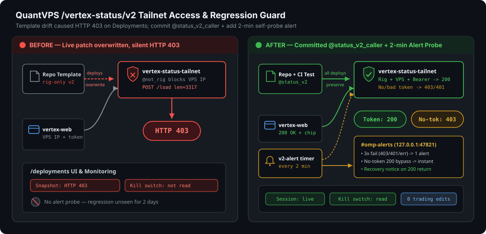

# Plan: Fix `/vertex-status/v2` HTTP 403 regression and add alert probe

## System context and verified root cause

- **QuantVPS** is the trading/control VPS on the private Tailscale **tailnet**. It runs:
  - `vertex-web.service` (the Vertex web app serving `/deployments`), which fetches `VERTEX_DEPLOY_STATUS_V2_URL` (`https://<VERTEX_TAILNET_HOST>:8443/vertex-status/v2`) from QuantVPS's own tailnet IP with `Authorization: Bearer <VERTEX_STATUS_TOKEN>`.
  - `vertex-status-tailnet` (a read-only `caddy:2-alpine` Docker container bind-mounting `/opt/vertex-status/Caddyfile.tailnet` and `/opt/vertex-status/private-v2` as `/srv`), which serves `/vertex-status/v2`, `/vertex-status/v1`, `/vertex-research-lenses/v1/*`, `/vertex-ibkr-recovery/v1/*`, `/vertex-history/v1/*`, and `/vertex-portfolio/v1/*`.
- **Rig** is the operator workstation on the same tailnet; it also calls the tailnet endpoints and runs the Discord alert relay reachable on QuantVPS at `http://127.0.0.1:47821/post`.

On 2026-11-22 (card `ui-unslop-audit`), live `/deployments` reported `"Tailnet snapshot unavailable: Status endpoint returned HTTP 403"` and `"Kill switch state not read … not treated as clear"`.

Read-only inspection of QuantVPS on 2026-11-24 disproved the tailnet IP-drift hypothesis and proved the root cause:

1. QuantVPS tailnet IPs, rig tailnet IPs, `/etc/vertex/hosts.env`, and `vertex-web`'s `VERTEX_DEPLOY_STATUS_V2_URL` are all current after the tailnet DNS rotation.
2. Card `vertex-deploy-status-v2-403-from-vps` (2026-11-15/16) added `@status_v2_caller` directly to `/opt/vertex-status/Caddyfile.tailnet` on QuantVPS (`2026-11-16 01:10:24Z`, Caddy `/load` length 3812), without committing it to `infra/quant-vps/status/Caddyfile.tailnet`.
3. On `2026-11-20 03:41:36Z`, a `vertex-history` deploy ran `install-history.sh`, which renders `infra/quant-vps/status/Caddyfile.tailnet` and overwrites `/opt/vertex-status/Caddyfile.tailnet` (length 3317). Later deploys (`vertex-ibkr-recovery` on Nov 22 and `vertex-history` on Nov 23–24) re-applied the same stale template where `/vertex-status/v2` sits behind `@not_rig`.
4. Because `vertex-web` calls `/vertex-status/v2` from QuantVPS's own tailnet IP, Caddy's `@not_rig` rule returned HTTP `403` even with a valid bearer token. Live self-probe from QuantVPS on 2026-11-24 confirmed: valid token `403`, no token `403`, wrong token `403`.

## Scope

1. **Modify `infra/quant-vps/status/Caddyfile.tailnet`**:
   - Add `@status_v2_caller` before `@not_rig` (immediately after `@lens_caller`, preserving `# IBKR recovery service` block placement for `install-recovery.sh`'s drift check):
     - `remote_ip __RIG_IP__ __TS_IP__`
     - `path /vertex-status/v2`
     - `header Authorization "Bearer {$VERTEX_STATUS_TOKEN}"`
   - Handle `@status_v2_caller` with `root * /srv`, `rewrite * /status-v2.json`, and `file_server`.
   - Remove the unreachable duplicate `handle /vertex-status/v2` block inside `handle @rig_authorized` (retaining `/status-v2.json` once, keeping `scripts/ci/json-data-allowlist.ts` clean and non-stale).
   - Update the top comment to reflect that `/vertex-status/v2` is allowed for rig and VPS tailnet IPs with bearer token, and that `__TS_IP__` holds the VPS tailnet IPv4 and IPv6 addresses.
   - Resulting access matrix for `/vertex-status/v2`: rig + valid token -> `200`; VPS + valid token -> `200`; rig + no/wrong token -> `401`; VPS + no/wrong token -> `403`; any other IP -> `403`. `/vertex-history/v1/*` and `/vertex-portfolio/v1/*` stay rig-only (`403` from VPS).
2. **Modify `infra/quant-vps/status/install-tailnet.sh`**:
   - Update header comment and step 4 self-checks on `/vertex-status/v2`: expect `200` with valid bearer token, `403` without token, and `403` with wrong token. Keep zero tailnet/IP literals anywhere in the file (per `infra/quant-vps/host-config.test.ts`).
3. **Create `infra/quant-vps/status/status_v2_alert.py`** (Python 3.10+ stdlib only, installed at `/opt/vertex-status/status_v2_alert.py` mode `0755`):
   - **CLI flags and defaults**:
     - `--hosts-env` (default `/etc/vertex/hosts.env`): reads `VERTEX_TAILNET_HOST` (skipped when `--url` is passed).
     - `--token-env` (default `$CREDENTIALS_DIRECTORY/status-token` if set, else `/opt/vertex-status/token.env`): reads non-empty `VERTEX_STATUS_TOKEN`. Never printed, logged, or included in alerts.
     - `--url` (optional explicit override for tests): `http://` is permitted only for loopback hosts (`127.0.0.1`, `::1`, `localhost`); `https://` always enforces default TLS verification (`ssl.create_default_context()`).
     - `--state-file` (default `$STATE_DIRECTORY/state.txt` if set, else `/var/lib/vertex-status-v2-alert/state.txt`).
     - `--post-url` (default `http://127.0.0.1:47821/post`), `--channel` (default `omp-alerts`), `--timeout` (default `8`), `--threshold` (default `3`), `--dry-run`.
   - **Probes (read-only `GET`, redirects refused via custom `HTTPRedirectHandler` so bearer tokens never leak across 3xx, body capped at `262144` bytes)**:
     1. Authorized probe (`Authorization: Bearer <token>`): requires HTTP `200` and valid JSON object with `"schema" == "vertex-deploy-status-v2"`. Classifies `403` as Caddy allow-list rejection, `401` as bearer token rejection, other HTTP codes, invalid/oversized payload, redirect refusal, or transport error.
     2. Unauthenticated guard probe (no `Authorization` header) and wrong-token guard probe (`Authorization: Bearer invalid-probe`): run whenever the authorized probe did not fail with a transport/timeout error. Require `401` or `403` on both. Any `2xx` from either guard probe triggers an immediate tick-1 **auth-bypass** incident; unexpected non-`2xx` (e.g., `404`/`5xx`/transport) counts as an availability failure.
   - **Independent incident state machines (`avail_*` and `bypass_*`)** persisted atomically (`0600` temp file + `os.replace`, temp cleanup on error) as plain text `key=value` lines (newlines stripped from values; missing/corrupt file resets safely to defaults; zero `.json` filename literals anywhere in the Python file, including docstrings, to comply with `scripts/ci/json-data.ts`):
     - `avail`: alerts `#omp-alerts` once after `threshold` (default 3) consecutive failed ticks; posts one recovery message when healthy again.
     - `bypass`: alerts `#omp-alerts` immediately on tick 1 (`threshold = 1`) independently of `avail_alert_open`; posts one recovery message when both guard probes return `401`/`403` again.
     - If `POST /post` fails (8 s timeout), `alert_open` stays unchanged so the next tick retries delivery.
   - **Stdout JSON summary (single line, nonsecret)** and exit codes:
     - Fields: `ok` (bool), `auth_http` (`int | null`), `no_token_http` (`int | null`), `wrong_token_http` (`int | null`), `detail` (str), `avail_failures` (int), `avail_alert_open` (bool), `bypass_alert_open` (bool), `alert_sent` (bool), `recovery_sent` (bool), `checked_at` (UTC ISO-8601).
     - Exits `0` on normal probe ticks (including alertable probe failures, matching `nautilus_health_alert.py`); exits `1` only on fatal config errors (missing/malformed host, invalid `--url` scheme/host, or missing/empty token).
4. **Create `infra/quant-vps/status/vertex-status-v2-alert.service` and `infra/quant-vps/status/vertex-status-v2-alert.timer`**:
   - Hardened systemd oneshot: `ExecStart=/usr/bin/python3 -B -I /opt/vertex-status/status_v2_alert.py`, `DynamicUser=yes`, `StateDirectory=vertex-status-v2-alert`, `LoadCredential=status-token:/opt/vertex-status/token.env`, `TimeoutStartSec=60`, `NoNewPrivileges=yes`, `ProtectSystem=strict`, `ProtectHome=yes`, `PrivateTmp=yes`, `PrivateDevices=yes`, `CapabilityBoundingSet=`, `RestrictAddressFamilies=AF_INET AF_INET6 AF_UNIX`.
   - Timer runs every 2 minutes (`OnBootSec=60s`, `OnUnitActiveSec=2m`, `AccuracySec=15s`).
5. **Create `infra/quant-vps/status/deploy-status-v2-alert.sh`** (executable deploy helper run on QuantVPS):
   - Enforces the weekday 08:30–16:00 ET market-hours guard (same rule as `install-history.sh` / `odte-quotes/install.sh`).
   - Reads `VERTEX_RIG_IPS` and `VERTEX_TAILNET_HOST` from `/etc/vertex/hosts.env` and VPS tailnet IPs from `tailscale ip`, renders `Caddyfile.tailnet` into a temp `$STAGE` dir, validates with `docker run --rm --network none ... caddy:2-alpine caddy validate`, records protected container start times before/after, saves a timestamped backup `/opt/vertex-status/Caddyfile.tailnet.bak-<UTC>-v2alert`, writes `$STAGE/Caddyfile.tailnet` in place (`cat ... > /opt/vertex-status/Caddyfile.tailnet`, preserving bind-mount inode), and gracefully reloads `vertex-status-tailnet` via `docker exec vertex-status-tailnet caddy reload --config /etc/caddy/Caddyfile --adapter caddyfile --address unix//tmp/caddy-admin.sock`.
   - Installs `/opt/vertex-status/status_v2_alert.py` (mode `0755`, ensuring `/opt/vertex-status` is `0755` for `DynamicUser=yes`) and `vertex-status-v2-alert.{service,timer}` (mode `0644`), runs `systemctl daemon-reload`, enables/starts the timer, runs one live check, and verifies VPS-self probes (`/vertex-status/v2` valid `200`, no-token `403`, wrong-token `403`; `/vertex-history/v1/health` `403`; `/vertex-portfolio/v1/health` `403`) plus unchanged protected container start times.
   - Contains zero tailnet/IP literals.
6. **Create `infra/quant-vps/status/test_status_v2_alert.py` and modify `infra/quant-vps/status/python-collect.test.ts` and `infra/quant-vps/host-config.test.ts`**:
   - Static invariant tests on `infra/quant-vps/status/Caddyfile.tailnet` (`@status_v2_caller` precedes `@not_rig`, includes `__RIG_IP__ __TS_IP__`, requires `Authorization "Bearer {$VERTEX_STATUS_TOKEN}"`, single `/status-v2.json` rewrite, `@not_rig` still returns `403`, no tailnet literals) and on `vertex-status-v2-alert.service` (`TimeoutStartSec=60`, `DynamicUser=yes`, `LoadCredential=`).
   - Unit tests for `status_v2_alert.py` against local loopback HTTP servers: healthy `200`/`403`/`403` and `200`/`401`/`401`, `403` 3-tick alert + dedupe + recovery, `401` failure, invalid JSON / bad schema / oversized body, redirect refusal (token never forwarded), unauthenticated `200` and wrong-token `200` immediate `bypass` alerts independent of an open `avail` alert (and staying open until both guard probes return `401`/`403`), `/post` failure retry for both alert and recovery, corrupt/invalid-UTF-8/missing `state.txt` recovery, `$CREDENTIALS_DIRECTORY/status-token` resolution, fatal config exit `1`, non-loopback `http://` rejection on `--url` and `--post-url`, secret redaction, zero leftover temp dirs.
   - Wire `"test_status_v2_alert.py"` into `infra/quant-vps/status/python-collect.test.ts` with `NO_COLOR: "1"` and isolated `TMPDIR` per suite, and add `"status/deploy-status-v2-alert.sh"` to `infra/quant-vps/host-config.test.ts` (satisfying `scripts/ci/infra-python-tests.test.ts` and `scripts/ci/test-invariants.test.ts`).
   - Update `/vertex-status/v2` access documentation, timeline, component table, and rollback steps to document VPS-self access, `deploy-status-v2-alert.sh`, and `vertex-status-v2-alert.{service,timer}`.

## Out of scope

- Any change to trading units, Nautilus, IB Gateway, watchdog, execution kernel, `infra/quant-vps/exec-node/`, arming, orders, or risk settings.
- Changing `/vertex-history/v1/*` or `/vertex-portfolio/v1/*` access rules (they stay rig-only).
- Modifying `vertex-web` application code, `scripts/ci/json-data-allowlist.ts`, or coverage baselines.

## Risks and rollback

- **Caddy syntax / inode risk:** `deploy-status-v2-alert.sh` validates via `caddy validate` in a `--network none` container before writing in place (`cat ... > /opt/vertex-status/Caddyfile.tailnet`) and gracefully reloads `vertex-status-tailnet` outside market hours (after 16:00 ET or before 08:30 ET). Trading containers and `vertex-web` are never restarted.
- **Rollback:** Restore `/opt/vertex-status/Caddyfile.tailnet.bak-<UTC>-v2alert` in place (`cat ... > /opt/vertex-status/Caddyfile.tailnet`) and run `docker exec vertex-status-tailnet caddy reload --config /etc/caddy/Caddyfile --adapter caddyfile --address unix//tmp/caddy-admin.sock`; run `systemctl disable --now vertex-status-v2-alert.timer`, remove `/etc/systemd/system/vertex-status-v2-alert.{service,timer}` and `/opt/vertex-status/status_v2_alert.py`, and run `systemctl daemon-reload`.
- **Rollback:** Restore `/opt/vertex-status/Caddyfile.tailnet.bak-<UTC>` in place (`cat ... > /opt/vertex-status/Caddyfile.tailnet`) and run `docker exec vertex-status-tailnet caddy reload --config /etc/caddy/Caddyfile --adapter caddyfile --address unix//tmp/caddy-admin.sock`; run `systemctl disable --now vertex-status-v2-alert.timer`, remove `/etc/systemd/system/vertex-status-v2-alert.{service,timer}` and `/opt/vertex-status/status_v2_alert.py`, and run `systemctl daemon-reload`.

## Acceptance criteria

- `infra/quant-vps/status/python-collect.test.ts`, `infra/quant-vps/host-config.test.ts`, `infra/quant-vps/research-lenses/research-lenses-rig.test.ts`, `scripts/ci/json-data.test.ts`, `scripts/ci/infra-python-tests.test.ts`, `scripts/ci/public-names.test.ts`, `bun run verify:prepush`, fresh-context diff review, and PR `ci-gate` pass.
- After merging via `scripts/merge-pr` and running `deploy-status-v2-alert.sh` on QuantVPS outside market hours:
  - QuantVPS self-probe of `/vertex-status/v2`: valid token `200`, no token `403`, wrong token `403`; `/vertex-history/v1/health` `403`; `/vertex-portfolio/v1/health` `403`.
  - Rig probe of `/vertex-status/v2`: valid token `200`, no token `401`, wrong token `401`.
  - `vertex-status-v2-alert.timer` active and live oneshot prints `ok: true`, `auth_http: 200`, `no_token_http: 403`, `wrong_token_http: 403`.
  - Live `/deployments` (headless Chrome on rig, agent viewer account, dark mode, never JEV) shows session chip and kill switch state with zero `"HTTP 403"` text; dark screenshots (1440 px and 375 px) captured with account data masked.
