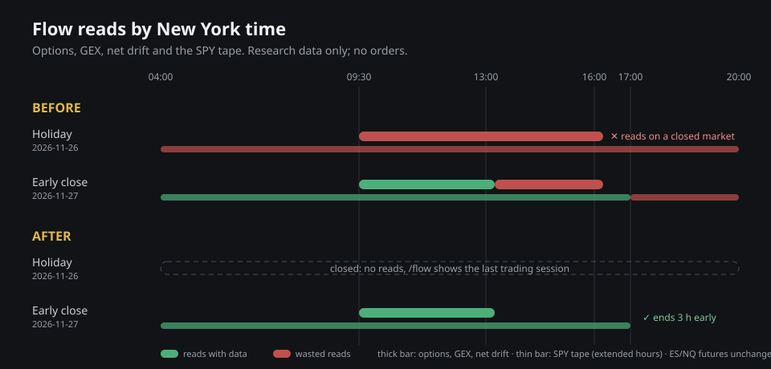

# Plan: no flow reads on an NYSE holiday, and early closes in the session checks

* **Card:** `vertex-flow-collect-holiday-guard` (job tracker card on the rig; `fm find vertex-flow-collect-holiday-guard`)
* **Kind:** bug fix (no new API procedure, contract field or data format; four new exports in `packages/api/src/nyse-calendar.ts`, two moved there)
* **Baseline commit:** `6db354c9` on `vertex/rebuild-darkfactory-20260921`
* **Revision:** 2 (after the consolidated 🐘🐟 review in [review/](./review/consolidated_review_report.md))
* **Related plan:** [plan-holiday-session.md](../smart-money/plan-holiday-session.md) (the holiday check of the market premium live capture; it named this card as its follow-up)

## Background

Vertex Research is a private, login-only research portal. It shows research data only. Nothing in this plan places, changes or sizes an order.

* **Flow collector.** The procedure `flow.collect` (`packages/api/src/server/flow-collect.ts`) runs every 60 seconds from a timer on QuantVPS. For each source of each instrument it first asks `flowSessionOpen(source, symbol, now)` (`packages/api/src/server/flow-snapshot.ts`). When the answer is false, it makes no live read ("market closed"); the option source then only drains stored gaps, as on a weekend. The sources (all New York time):
  * `options`: option prints from QuantData, 09:30 to the close of the stream in `FLOW_OPTION_STREAMS` (`packages/api/src/flow-features.ts`): 16:15 for the SPX (ES), NDX (NQ), SPY, QQQ and IWM streams, 16:00 for NVDA.
  * `gex`: the gamma exposure read, 09:30-16:15.
  * `net_drift`: the QuantData net drift read (net call and put premium per minute), 09:30-16:20.
  * `ticks` and `depth` of the stock-session instruments (`session: "stock"` in `FLOW_INSTRUMENTS`): SPY ticks and depth and QQQ depth from IBKR, 04:00-20:00 (extended hours). The plan calls these "the stock tape".
  * `ticks` and `depth` of ES and NQ: CME Globex hours.
  * `market_premium`: the QuantData per-ticker total of large option trades (the `/smart-money` ranking). `flowSessionOpen` always returns true for it. Its live capture has its own check, `isMarketPremiumSessionOpen` (`packages/api/src/openbb-overdue.ts`): 09:30-16:15 on an NYSE trading day. The same check sets the `coverage` state of `smartMoney.ranking`.
* **Shared session helpers.** Three functions decide what the flow pages and tools show, and every reader follows them:
  * `flowSessionOpen`, through `buildSourceFreshness`: the freshness state `fresh`, `stale` or `closed` of every `/flow` view and of options analytics, the no-data reason `market_closed` of `flow.control`, and the window of `flow.optionPrints`.
  * `flowSessionDate(now)` (`flow-snapshot.ts`): the New York date of the newest session at or before a time. Today it steps back over weekends and before 09:30, but not over holidays.
  * `optionsSessionRange(date)` (`packages/api/src/server/flow-control.ts`): the options session of a date, always 09:30-16:15. Readers use it to bound stored rows, as the shown `sessionEnd`, and in `collectorCaughtUp` (`packages/api/src/server/options-analytics.ts`), which decides whether stored strike-profile flow is complete.
* **Overdue alert.** `openbb.status` and the overdue monitor (`evaluateOpenbbSources` in `openbb-overdue.ts`) use a second copy of the windows, `isFlowSourceSessionOpen`. It already checks NYSE trading days. Its stock window is the regular session, 09:30-16:00. For the market premium source, an open overdue alert clears after the close when today's capture is `complete`, or was captured at or after the clear cutoff: the close (16:15) minus the source's maximum age (`maxAgeSeconds` 1800, so 30 minutes), 15:45.
* **Calendar.** `packages/api/src/nyse-calendar.ts` computes the NYSE full-day holidays of any year (`isNyseTradingDay`; one-off closures are in `NYSE_SPECIAL_CLOSURES`). The early-close rule lives in `nyseSession` (`packages/api/src/strategy-dsl-compile.ts`): on a trading day that is 3 July, 24 December or the day after Thanksgiving, the NYSE closes at 13:00 New York instead of 16:00. The exchange-sourced list `infra/quantvps/nyse-calendar.txt` (used by the deploy guard) holds the same holidays and early closes for 2025-2028.

## Problem

1. **Holidays.** `flowSessionOpen` checks only the weekday and the clock. On a weekday NYSE holiday the collector makes live reads of option prints, GEX, net drift and the stock tape for each source's full regular window. Seen live on 2026-11-26 (Thanksgiving): `openbb.status` listed the newest `ok` option read at 16:14 New York and the newest GEX read at 16:02. These reads store few or no rows and use QuantData and IBKR requests. The `/flow` pages show the holiday as an open session with stale or missing data instead of the last trading session. The market premium ranking was already fixed by [plan-holiday-session.md](../smart-money/plan-holiday-session.md).
2. **Early closes.** No session check knows the early close. On an early-close day (for example 2026-11-27) the collector keeps reading options, GEX, net drift and the market premium until the regular close, and the stock tape until 20:00, after the markets have closed. The overdue alert expects fresh option, GEX and net drift samples until 16:15 or 16:20. It stays silent today only because the collector also keeps reading until then (an `ok` read counts as fresh even when it stores no row).
3. **Two windows disagree.** The overdue copy checks holidays; `flowSessionOpen` does not. The documentation records the gap: [flow-pipeline.md](../../flow-pipeline.md) says "Holidays and half days are not modelled" for `flow.control` and "Holidays are not modelled" for the snapshot sessions.

## Goal

* On an NYSE holiday no live read of option prints, GEX, net drift or the stock tape runs (stored option gaps still drain, as on a weekend). The `/flow` pages, `flow.control` (both sides) and options analytics show the last trading session, as on a weekend.
* On an NYSE early-close day these windows, the market premium live capture and the overdue windows end 180 minutes earlier.

## Fix

### Rule

One calendar rule in `nyse-calendar.ts`, used by every session check of `packages/api`: **an equity or option window is open only on an NYSE trading day, and on an early-close day its close moves 180 minutes earlier.** 180 minutes is the distance between the regular NYSE close (16:00) and the early close (13:00).

### Windows

| Window | Regular | Early-close day |
| --- | --- | --- |
| Options of the SPX, NDX, SPY, QQQ and IWM streams; GEX; market premium | 09:30-16:15 | 09:30-13:15 |
| Options of the NVDA stream | 09:30-16:00 | 09:30-13:00 |
| Net drift | 09:30-16:20 | 09:30-13:20 |
| Stock tape (`flowSessionOpen`, extended hours) | 04:00-20:00 | 04:00-17:00 |
| Stock tape (overdue alert, regular session) | 09:30-16:00 | 09:30-13:00 |
| `optionsSessionRange` (options session of a date) | 09:30-16:15 | 09:30-13:15 |
| ES and NQ ticks and depth (CME Globex) | unchanged | unchanged |

On the NYSE early-close days the US-listed equity and index options of all six streams close at 13:00 (single stocks) or 13:15 (index and ETF options), and the extended-hours stock session ends at 17:00. So the same 180-minute shift applies to each row.

### Changed pieces

* `nyse-calendar.ts` gets `isNyseEarlyClose(day)` (moved from `nyseSession`, which then calls it), `nyseCloseMinute(day, regularCloseMinute)`, `utcDayOfIso(iso)` (replaces the private `parseIsoUtcDay` of `openbb-overdue.ts`), and `previousNyseTradingDay` with `isoDayOf` (moved from `openbb-overdue.ts`).
* `flowSessionOpen` uses `isNyseTradingDay` and `nyseCloseMinute` for every source except `ticks` and `depth` of ES and NQ. The stock branch no longer calls `marketSession`.
* `flowSessionDate` returns today when today is an NYSE trading day and the time is 09:30 or later, else the previous NYSE trading day.
* `optionsSessionRange(date)` ends at `nyseCloseMinute(day, 16:15)`.
* `flow.control`: the futures side is `market_closed` on a day that is not an NYSE trading day (`isNyseTradingDay` instead of `isWeekday`), and the closed-session text names the close of that session (13:15 after an early close).
* `openbb-overdue.ts` uses `nyseCloseMinute` in `isMarketPremiumSessionOpen`, `isFlowSourceSessionOpen`, and in the two checks that decide when a closed market premium session clears the alert (on an early-close day the clear cutoff is 12:45).

### Data flow

`flow.collect` timer → **session check: NYSE trading day and the close of the day (changed)** → QuantData and IBKR reads → `flow_samples` and the flow tables → **session date and session range of the readers (changed)** → `/flow` views, `flow.control`, options analytics, `openbb.status` (overdue copy, changed).

### Before and after

| Time (New York) | Before | After |
| --- | --- | --- |
| Holiday, each window's regular hours | live reads of options (09:30-16:15), GEX, net drift and the stock tape (04:00-20:00); `/flow` shows the holiday as open and stale; options analytics counts the holiday as the session | no live read ("market closed"; stored option gaps drain); `/flow`, `flow.control` and options analytics show `closed` and the last trading session |
| Holiday, market premium | already no live capture (plan-holiday-session.md) | unchanged |
| Early-close day, from each shifted close (13:00 NVDA options; 13:15 options, GEX, market premium; 13:20 net drift) to the regular close | reads continue after the market closed | no live read; sources show `closed`; the overdue alert expects no sample |
| Early-close day, stock tape 17:00-20:00 | reads continue | no read |
| Early-close day, overdue stock tape 13:00-16:00 | expected fresh | not expected |
| Regular trading day | reads | unchanged |
| ES and NQ ticks and depth | Globex hours | unchanged |

## Alternatives considered

| Alternative | Decision | Reason |
| --- | --- | --- |
| Holiday check only, early closes left out | Rejected | It keeps about three hours of reads per source on each early-close day after the market closed (Problem 2), and the overdue alert keeps expecting samples that only these reads produce. |
| Skip the whole `flow.collect` run on an NYSE holiday (timer calendar or a run-level guard) | Rejected | It also stops the ES and NQ Globex reads, does not change the readers (`/flow` views, `flow.control`, options analytics), and does not handle early closes. |
| Call `isFlowSourceSessionOpen` of `openbb-overdue.ts` from `flowSessionOpen` | Rejected | The two stock windows differ on purpose (extended hours for the collector, the regular session for the alert). A shared close-minute function keeps one calendar rule and both windows. |
| One declarative window table for the collector and the alert | Rejected | A wider refactor than this bug fix; the remaining copies are recorded in Risks. |
| Change `marketSession` (`packages/api/src/server/gex-context.ts`) to know holidays | Rejected | `marketSession` names the phase of the day for the GEX context and other readers; changing it changes those pages. After this change `flowSessionOpen` does not call it. |
| Read the calendar from `infra/quantvps/nyse-calendar.txt` at run time | Rejected | It covers 2025-2028 only and is deploy-guard data outside `packages/api`. A test pins the rule to it instead. |
| Absolute early-close times per window, or trading hours from the data vendor | Rejected | Every listed window shifts by the same 180 minutes; a per-window table is a second rule, and vendor hours are a new data dependency. |
| Model CME holiday and early-close hours for ES and NQ | Deferred | CME has its own calendar (shortened sessions on most NYSE holidays). It needs its own data and plan (see Out of scope). |

## Out of scope

* ES and NQ ticks and depth keep Globex hours; CME holidays and early closes are not modelled. On an NYSE holiday the futures side of `flow.control` is `market_closed`, as on a weekend.
* `futuresSessionRange` (09:30-16:00, the futures comparison window of `flow.control`): after an early close the futures line reads stale until 16:00, as before.
* `marketSession` and the GEX context phases.
* The text of `flowOptionDelayLabel` and the MCP tool description of `flow/optionPrints`: they name the regular hours.
* The 405-minute point limits of the series contracts (`FLOW_*_MAX_POINTS`): an early-close session has fewer points.
* The market premium gap fill. A seed run of `flow.collect` (an operator option that reads on request) now targets the last trading session on a holiday, through `flowSessionDate`.
* The other early-close lists (`scripts/breadth-90/calendar.ts`, `infra/quantvps/nyse-calendar.txt`, the Python services): other dependency boundaries.
* Two weekday statements of `flow-pipeline.md` that describe code this fix does not change: the daily series lists the stored sessions ("stored weekday options session"; a holiday has no stored session), and the `levels` previous close steps back by weekday with its own holiday fallback (`readPreviousClose` in `flow.ts`).
* Orders, arming, risk settings and trading units.

## Risks and limits

| Risk | Effect | Handling |
| --- | --- | --- |
| A closure that the calendar does not hold | The collector reads as before on that day | Same as the baseline; add the date to `NYSE_SPECIAL_CLOSURES` |
| A one-off early close (none announced) | The rule cannot express it; the collector reads until the regular close | Add a list of one-off early closes when one is announced |
| The calendar marks a trading day as a holiday or an early close | No option, GEX or net drift data for that day or afternoon; net drift and GEX have no backfill, so the loss is permanent; the overdue alert uses the same calendar and stays silent (common-mode fault); the deploy guard blocks a same-day fix | Accepted. The rule is pinned to the exchange-sourced `infra/quantvps/nyse-calendar.txt` for every day of 2025-2028 by a test, and the holidays of 2024-2028 by `price-freshness.test.ts` |
| An option stream that does not close early (none today) | It would stop three hours early | All six streams are US-listed equity or index options, which close early on these days |
| The regular windows stay in two copies (`flowSessionOpen` and `isFlowSourceSessionOpen`) | A change to one window can miss the other | Accepted for this fix; both now share the calendar rule |
| Security | None: no new input, no new access | — |
| Load | On a weekday holiday no live option, GEX, net drift or stock tape reads (about 390 minutes of reads per source); on an early-close day about 180 minutes fewer per source | — |

## Acceptance criteria

* Unit tests prove:
  * `isNyseTradingDay` and `isNyseEarlyClose` agree with `infra/quantvps/nyse-calendar.txt` on every day of its covered years (2025-2028); `isNyseEarlyClose` is false on a day that is not a trading day; `nyseCloseMinute` returns the regular minute minus 180 on an early close and the regular minute on another day.
  * `flowSessionOpen`, table-driven: on 2026-11-26 12:00 (holiday) false for SPY `options`, `gex`, `net_drift`, `ticks`, `depth` and QQQ `depth`, true for ES `ticks`; on 2026-11-27 (early close) the last open and first closed minute of SPY options (13:14/13:15), NVDA options (12:59/13:00), GEX (13:14/13:15), net drift (13:19/13:20), SPY ticks and QQQ depth (16:59/17:00). The existing regular-day cases stay.
  * `flowSessionDate`: 2026-11-26 12:00 → 2026-11-25; 2026-11-27 06:00 → 2026-11-25. The existing cases stay.
  * `optionsSessionRange("2026-11-27").to` is 13:15 New York.
  * Options analytics `storedProfileFlow`: `complete` is true on 2026-11-26 12:00 with a 6-hour window and the newest `ok` options sample at 2026-11-25 16:14, and on 2026-11-27 14:00 with the newest `ok` sample at 13:14.
  * `flow.control` on 2026-11-26 12:00: the options and futures sides are `market_closed`, and the session date is 2026-11-25. After 13:15 on 2026-11-27 the closed text says "ended 13:15 ET".
  * `isMarketPremiumSessionOpen` is true on 2026-11-27 at 13:14 and false at 13:15. `evaluateOpenbbSources` lists no overdue `options` source on 2026-11-27 at 14:00 with the newest `ok` sample at 13:10, and lists it overdue with the same offsets on 2026-11-20 (control). A market premium session of 2026-11-27, `partial`, captured at 13:00 is clearable at 13:30; captured at 12:40 it is not (cutoff 12:45).
  * `nyseSession` keeps its results (existing tests).
* The coverage lane of the PR checks reports 100% for every changed source file (none is in `scripts/ci/coverage-baseline.json`, the list of files below 100%).
* `bun run verify:prepush` passes, and the PR checks pass on the reviewed head.
* Live, after the deploy (read-only): the `flow.collect` timer runs on QuantVPS succeed after the restart, and `openbb.status` lists no overdue flow source. The first early close after the deploy is 2026-12-24 and the first holiday is 2026-12-25; a check on those days is optional. The unit tests are the required proof of the rule.

## Implementation Plan

All files below exist and are modified, except the new `packages/api/src/nyse-calendar.test.ts` and this plan folder (`plan.md`, `before-after.svg`, `review/`). No existing test fixture sits on a holiday or early close at an affected time (scanned at `6db354c9`). If a test outside the listed files fails, stop and amend this plan. Each phase ends with its test checkpoint; commit once per phase.

### Phase A: calendar

1. `packages/api/src/nyse-calendar.ts`:
   * Add the module-private `const NYSE_EARLY_CLOSE_SHIFT_MINUTES = 180;` with the comment "Minutes by which an NYSE early close (13:00 instead of 16:00 New York) moves each NYSE-calendar window close of that day earlier."
   * Add `export const isNyseEarlyClose = (day: number): boolean`: false when `!isNyseTradingDay(day)`; else, with `const date = new Date(day * DAY_MS)`, true when (`date.getUTCMonth() === 6 && date.getUTCDate() === 3`) or (`date.getUTCMonth() === 11 && date.getUTCDate() === 24`) or `day === nthWeekday(date.getUTCFullYear(), 10, 4, 4) + 1` (the day after the fourth Thursday of November). This is the expression that `nyseSession` computes inline today.
   * Add `export const nyseCloseMinute = (day: number, regularCloseMinute: number): number`: `regularCloseMinute - NYSE_EARLY_CLOSE_SHIFT_MINUTES` when `isNyseEarlyClose(day)`, else `regularCloseMinute`.
   * Move `previousNyseTradingDay(todayUtcDay)` and its formatter `isoDayOf` from `openbb-overdue.ts` (same code); `openbb-overdue.ts` imports them from `./nyse-calendar.ts` and its test imports `previousNyseTradingDay` from there.
   * Add `export const utcDayOfIso = (iso: string): number` (`Date.parse(\`${iso}T00:00:00Z\`) / DAY_MS`) and use it in`openbb-overdue.ts` instead of its private `parseIsoUtcDay`.
2. `packages/api/src/strategy-dsl-compile.ts`, `nyseSession`: replace the `date`, `month`, `dayOfMonth` locals and the early-close expression with `const earlyClose = isNyseEarlyClose(day);`. The import becomes `import { isNyseEarlyClose, isNyseTradingDay, weekday } from "./nyse-calendar.ts";`.
3. New `packages/api/src/nyse-calendar.test.ts`: the parity test with `infra/quantvps/nyse-calendar.txt` (read with `readFileSync(new URL("../../../infra/quantvps/nyse-calendar.txt", import.meta.url))`, as `price-freshness.test.ts` reads the Python list): for every day of the `years` range, `isNyseTradingDay` is false exactly on the `closed` dates and weekends, and `isNyseEarlyClose` is true exactly on the `early:1300` dates. Plus `nyseCloseMinute(day, 975)` on 2026-11-27 (795) and 2026-11-23 (975), `isNyseEarlyClose` on 2026-11-26 (false, a holiday), and `previousNyseTradingDay`.
4. Checkpoint: `pnpm exec vitest run src/nyse-calendar.test.ts src/strategy-dsl-compile.test.ts src/openbb-overdue.test.ts src/price-freshness.test.ts` in `packages/api`.

### Phase B: session helpers

1. `packages/api/src/server/flow-snapshot.ts`:
   * `flowSessionOpen`: keep `if (source === "market_premium") return true;` first. Rename the weekday local to `weekdayName`. Compute `const nyDay = newYorkDayOf(parts)`, where the module-private `newYorkDayOf` returns `utcDay(Number(parts["year"]), Number(parts["month"]) - 1, Number(parts["day"]))` (also used by `flowSessionDate`). A local function `nyseWindowOf(source, symbol)` returns the regular window `[open, close)` in New York minutes: `net_drift` 09:30-16:20 `[570, 980)`; `options` 09:30 to `FLOW_OPTION_STREAMS[symbol].closeMinuteEt`; `gex` 09:30-16:15 `[570, 975)`; `ticks` or `depth` of a `FlowSymbol` with `FLOW_INSTRUMENTS[symbol].session === "stock"` 04:00-20:00 `[240, 1200)`; otherwise `null`. With a window: return `isNyseTradingDay(nyDay) && minutes >= open && minutes < nyseCloseMinute(nyDay, close)`. Without a window: the existing `isFlowSymbol` test and the Globex rules on `weekdayName`, unchanged.
   * Doc comment of `flowSessionOpen`: "Is this source's market open now (New York wall time)? Equity and option sources follow the NYSE calendar: closed on a holiday, and on an early close their close moves 180 minutes earlier. ES and NQ ticks and depth follow CME Globex hours; CME holidays are not modelled."
   * `flowSessionDate`: `const today = utcDay(...)` of the New York date; return `isoDayOf(today)` when `isNyseTradingDay(today)` and the time is 09:30 or later, else `previousNyseTradingDay(today)`. Doc comment: "The New York date of the newest NYSE session at or before now (YYYY-MM-DD): today from 09:30 on a trading day, else the previous NYSE trading day."
   * Imports: `import { newYorkParts } from "./gex-context.ts";` (drop `marketSession`), and `isNyseTradingDay`, `isoDayOf`, `nyseCloseMinute`, `previousNyseTradingDay`, `utcDay` from `"../nyse-calendar.ts"`.
2. `packages/api/src/server/flow-control.ts`:
   * `optionsSessionRange(date)`: `to` is `newYorkTime(date, nyseCloseMinute(utcDayOfIso(date), 975))`. Doc comment: "The options session of a New York date: 09:30 to 16:15 (13:15 on an NYSE early close)."
   * `futuresReason`: replace `!isWeekday(today)` with `!isNyseTradingDay(utcDayOfIso(today))`, and delete `isWeekday` (this was its only use).
3. `packages/api/src/flow-control-rules.ts` imports contract types only, so the close comes in as a fact: `FlowSideFacts` gets `sessionEndEt: string`, which `flow-control.ts` sets to `etClock(optionsSessionRange(rows.sessionDate).to)` ("16:15 ET", "13:15 ET" after an early close). `closedDetail` uses it: `` `Last session ended ${facts.sessionEndEt} on ${facts.sessionDate}; ...` ``.
4. Tests:
   * `packages/api/src/server/flow-snapshot.test.ts`: the table-driven `flowSessionOpen` cases (plus SPX options of the ES stream on the holiday), the `flowSessionDate` cases of the acceptance criteria (plus 2026-11-27 14:00 → 2026-11-27), and a `buildFreshness` case: on the holiday the SPY ticks, depth, options and GEX rows are `closed`.
   * `packages/api/src/server/flow-control.test.ts`: `optionsSessionRange("2026-11-27").to`; `flow.control` rows on 2026-11-26 12:00 (both sides `market_closed`, session date 2026-11-25, using the existing row builders of the file).
   * `packages/api/src/server/flow-control.test.ts`: with session date 2026-11-27 at 14:00 New York the closed text says "ended 13:15 ET" (the fixture of `flow-control-rules.test.ts` gets `sessionEndEt: "16:15 ET"`).
   * `packages/api/src/options-analytics.test.ts`: the two `storedProfileFlow` `complete` cases.
5. Checkpoint: run the changed test files above plus `src/server/flow-option-prints.test.ts`, `src/server/flow.test.ts`, `src/server/flow-collect.test.ts`.

### Phase C: overdue alert

 1. `packages/api/src/openbb-overdue.ts`:
    * `isMarketPremiumSessionOpen`: `minutes < nyseCloseMinute(parts.utcDayNum, MARKET_PREMIUM_CLOSE_MINUTE)`. Doc comment: "NYSE trading day and 09:30–16:15 America/New_York (13:15 on an early close)."
    * `isFlowSourceSessionOpen`: each close goes through `nyseCloseMinute(parts.utcDayNum, <regular close>)`.
    * Replace `MARKET_PREMIUM_CLEAR_MINUTE` with `MARKET_PREMIUM_CLEAR_MARGIN_MINUTES = Math.floor(FLOW_SOURCE_METADATA.market_premium.maxAgeSeconds / 60)` (30).
    * `isCapturedNearClose`: `const cutoff = nyseCloseMinute(sessionDay, MARKET_PREMIUM_CLOSE_MINUTE) - MARKET_PREMIUM_CLEAR_MARGIN_MINUTES;` and `nyWallTimeUtcMs(sessionDay, Math.floor(cutoff / 60), cutoff % 60)`.
    * `isOffHoursMarketPremiumClearable`: compare with `nyseCloseMinute(parts.utcDayNum, MARKET_PREMIUM_CLOSE_MINUTE)`.
 2. `packages/api/src/openbb-overdue.test.ts`: the `isMarketPremiumSessionOpen` early-close cases, the options sample case with its 2026-11-20 control, and the two market premium clear cases.
 3. Checkpoint: `pnpm exec vitest run src/openbb-overdue.test.ts src/server/flow-market-premium-collect.test.ts src/smart-money-ranking.test.ts`.

### Phase D: text

 1. Comments and documentation (exact replacements):
    * `packages/api/src/server/smart-money.ts` (comment in `coverageOf`) and `packages/api/src/server/flow-market-premium-collect.ts` (header and the comment above the live capture condition): "09:30-16:15 New York" becomes "09:30-16:15 New York, 13:15 on an early close,". `packages/api/src/contracts/smart-money.ts` (`coverage.state` comment): "(09:30-16:15 New York)" becomes "(09:30-16:15 New York, 13:15 on an NYSE early close)".
    * `packages/api/src/contracts/flow.ts`, `sessionEnd` comment: "Session close (16:15 New York, 13:15 on an NYSE early close) in ISO UTC; null when no print is stored."
    * `docs/vertex-rebuild/flow-pipeline.md`:
      * `flow.control` "No data" item: the sentence starting "Holidays and half days are not modelled" becomes "On an NYSE holiday both sides are `market_closed` and the page shows the last trading session, as on a weekend; on an early close the options side closes at 13:15. CME early closes are not modelled: after an early close the futures line reads stale until 16:00."
      * Snapshot sessions line: "Holidays are not modelled." becomes "Options, GEX, net drift and the stock tape follow the NYSE calendar: closed on a holiday, and 180 minutes earlier on an early close (`flowSessionOpen`). CME holidays are not modelled."
      * Session date (option prints range and net drift): "a weekend or a pre-open print maps to the weekday before" becomes "a weekend, holiday or pre-open print maps to the NYSE trading day before"; "(the newest weekday; before 09:30 the previous weekday)" becomes "(the newest NYSE trading day; before 09:30 the previous one)".
      * Market premium "Live capture": "(09:30-16:15 New York on an NYSE trading day;" becomes "(09:30-16:15 New York, 13:15 on an early close, on an NYSE trading day;".
      * "the options close (16:15 New York)" becomes "the options close (16:15 New York, 13:15 on an early close)"; "session 9:30-16:20 New York" becomes "session 9:30-16:20 New York, 13:20 on an early close".
    * `CHANGELOG.md`, `## [Unreleased]`, `### Fixed`, first entry: "- Flow collector on NYSE holidays and early closes (Vertex, research only; card `vertex-flow-collect-holiday-guard`, plan `docs/vertex-rebuild/designs/vertex-flow-collect-holiday-guard/plan.md`): option prints, GEX, net drift and the stock tape (SPY ticks and depth, QQQ depth) get no live read on an NYSE holiday, and on an early-close day their windows, the market premium live capture and the overdue alert windows end 180 minutes early (`flowSessionOpen`, `isMarketPremiumSessionOpen`, `nyseCloseMinute`). `flowSessionDate` and `optionsSessionRange` follow the same calendar, so `/flow`, `flow.control` and options analytics show the last trading session on a holiday. Before, on Thanksgiving 2026-11-26 the newest `ok` option read was at 16:14 and the newest GEX read at 16:02 New York. ES and NQ keep CME Globex hours."
 2. Checkpoint: `bun run verify:prepush` at the repository root. The coverage criterion is checked by the PR coverage lane.

### Deploy and live check

 1. Deploy: steps 1-8 of "Deploy a new web build" in `infra/quantvps/README.md`, with `restart-when-idle.sh --deploy <merged sha>`, the claim `fm claim vertex-flow-collect-holiday-guard deploy:quantvps-web` (`fm` is the job tracker on the rig), and release of the claim after step 8. Preconditions: a full CI run on that exact commit passed all four verification checks (core, coverage, integration, browser), and `fm market` (the rig's market-hours check) exits 0, which it does outside 08:30 to the close on an NYSE trading day. The restart script refuses market hours itself (exit 14). No migration. If the health check fails, the script rolls back.
 2. Live check, read-only: the `flow.collect` timer journal on QuantVPS shows successful runs after the restart, and `openbb.status`, viewed on `/smart-money` while signed in as the agent viewer (`~/.config/vertex/agent-viewer.env` on the rig), lists no overdue flow source.
