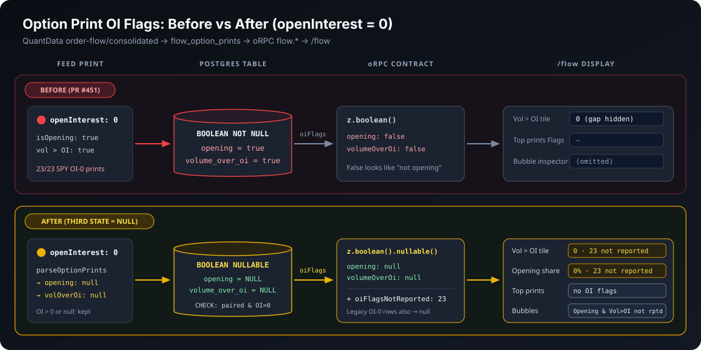

# Plan: store Opening and Vol > OI as not reported when a print reports open interest 0



- **Card:** `vertex-flow-print-flags-oi-zero-third-state` (follow-up of `vertex-flow-print-flags-oi-zero`, PR #451)
- **Date:** 2026-11-26
- **Scope:** `flow_option_prints` schema and rollback SQL, QuantData collector parsing, flow oRPC/OpenAPI/MCP read contracts, and `/flow` display; no trading-execution, order, arming (enabling live trading), risk, auth, or CI changes.

## Problem

QuantData (a third-party options-flow vendor) sends two flags on each option print from its `order-flow/consolidated` endpoint:

- `isOpeningPosition`, stored in `flow_option_prints.opening` ("Opening").
- `isVolumeGreaterThanOpenInterest`, stored in `flow_option_prints.volume_over_oi` ("Vol > OI").

Both flags compare the print with the contract's open interest. In a 2026-11-25 sample of 29 SPY prints, every print whose `openInterest` was `0` had `isOpeningPosition = true` (23 of 23 prints across five contracts that Yahoo and Nasdaq showed with 6,874 to 35,063 open contracts), while every print with `openInterest > 0` had `isOpeningPosition = false` (6 of 6 prints; `Vol > OI` was not separately tallied on that sample). Because Yahoo and Nasdaq show non-zero open interest on those contracts, a reported `0` behaves as a missing placeholder and makes OI-derived flags unusable; the operator SQL query under `## Operator verification` checks whether both flags follow this pattern across all stored days and tickers.

PR #451 added an interim read-time guard (`oiFlags` in `packages/api/src/flow-options.ts`): the collector (`packages/api/src/server/flow-collect.ts`) still stores QuantData's raw booleans, and readers (`printView`, `buildOptionsSummary`, `foldOptionBubbles`, and `optionEvents`) read both flags as `false` when `openInterest === 0`. Two gaps remain:

1. Stored rows keep `opening = true` and `volume_over_oi = true` for `open_interest = 0` prints, so direct SQL readers see false positives and every application reader must apply the `openInterest === 0` guard.
2. On the wire, `opening: false` and `volumeOverOi: false` cannot distinguish "not opening" from "QuantData gave no usable flag". In `/flow`, the `Opening share` tile already discloses the 100%-OI-0 case, while mixed windows (`0 < oiFlagsNotReported < trades`), the `Vol > OI` tile, the `OptionsFlowPanel` top-prints `Flags` column, and the bubble inspector hide the gap.

## Goal

Represent the third state ("not reported") from storage through the API contracts to `/flow`:

- **Storage:** `flow_option_prints.opening` and `flow_option_prints.volume_over_oi` allow `NULL` ("not reported") when `open_interest = 0`. A PostgreSQL `CHECK` constraint enforces paired nullability and the `open_interest = 0` cause.
- **Contracts:** `opening` and `volumeOverOi` widen to `boolean | null` on `FlowOptionPrintViewSchema` (`flow.snapshot` top prints and `flow.optionPrints`) and `FlowOptionBubblesItemSchema` (`flow.optionBubbles`), and `FlowOptionsSummarySchema` adds required `oiFlagsNotReported: count`.
- **MCP descriptions:** deferred (2026-11-26). The `flow_snapshot` and `flow_option_prints` tool descriptions stay unchanged, because every Plan-mode tool description is part of the recorded semantic-layer eval (`tests/integration/semantic-layer/eval-replay.test.ts`); a changed description makes all 90 recorded trials stale and needs a full re-recording. The nullable output schemas and `packages/api/openapi.json` state that `opening` and `volumeOverOi` can be `null`.
- **Display (`/flow`):**
  - `OptionsFlowPanel` `Vol > OI` tile: `N` when `M === 0`, `N · M not reported` when `M > 0`, where `N = summary.volumeOverOi` and `M = summary.oiFlagsNotReported`.
  - `OptionsFlowPanel` `Opening share` tile: keeps the existing all-OI-0 text when `openingPremiumShare === null`; when `openingPremiumShare !== null` and `M > 0`, appends `" · M not reported"` so mixed-window denominator exclusions are visible.
  - `OptionsFlowPanel` top-prints `Flags` column (`optionPrintRows`): appends `"no OI flags"` (plain comma-separated string list, ordered after `"unusual"`, mutually exclusive with `"vol>OI"` and `"opening"`) when either flag is `null`.
  - `FlowOptionBubblesPanel` bubble inspector (`describeSelectedBubble`): appends `"Opening and Vol > OI not reported"` to `readout.flags` (rendered under `Flags: ...`, mutually exclusive with `"Vol > OI"` and `"Opening"`) when either flag is `null`.

### Non-Goals

- `FlowOptionTapePanel` (`apps/web/src/features/flow/option-tape-view-model.ts`, backed by `flow.optionPrints`) and `FlowOptionTapeSummarySchema`: intentionally unchanged because that 6-ticker panel displays neither OI flags nor OI-flag summary tiles.
- `FlowOptionBubblesTotalsSchema`: intentionally unchanged (no `oiFlagsNotReported` total).
- Exposing `openInterest` on `FlowOptionPrintViewSchema` or `FlowOptionBubblesItemSchema`.
- Backfilling existing rows in `flow_option_prints` or rewriting historical `flow_events.detail` text.
- Changing `openInterest === null` (field not sent) or omitted upstream flag behavior when `openInterest !== 0`.
- Bumping `schemaVersion` from `.v1` to `.v2`.

## Alternatives considered

1. **Read-time-only `null` projection (no DB migration):** Change only `oiFlags` and contracts while keeping `NOT NULL` booleans in Postgres. Avoids a migration and preserves raw values permanently, but leaves `opening = true` / `volume_over_oi = true` in `flow_option_prints` for SQL readers and does not meet the card's explicit requirement to store the third state with a migration. Rejected.
2. **Nullable `boolean` columns without backfill (chosen):** Drop `NOT NULL` on `opening` and `volume_over_oi`, add a paired-nullability + `open_interest = 0` `CHECK` constraint, write `NULL` at ingest when `openInterest === 0`, and keep the read-time `openInterest === 0` rule while pre-change rows age out over the 14-day retention window (`FLOW_RETENTION_DAYS.flow_option_prints` in `flow-collect.ts`). Pre-change rows remain intact for the operator proof query.
3. **Nullable `boolean` columns with one-time backfill `UPDATE`:** Eliminates the 14-day transition window, but destroys pre-deploy raw QuantData booleans before the operator proof query can run and takes write locks across 14 days of rows. Rejected.
4. **Text enum column (`yes` / `no` / `not_reported`) or separate `oi_flags_reported` boolean:** A text column breaks rollback because prior code treats non-empty strings such as `"no"` as truthy internally and fails `z.boolean()` at the contract boundary. A separate boolean column duplicates state that PostgreSQL three-valued booleans already represent natively. Rejected.
5. **Contract versioning (`.v2` or additive fields) vs. in-place `.v1` update (chosen):** Vertex web and API deploy together from one origin on QuantVPS (`vertex-web.service`). Widening `boolean` to `boolean | null` and adding `oiFlagsNotReported` in place avoids parallel `.v1`/`.v2` endpoints; primitive fields in these contracts (`price`, `underlyingPrice`, `iv`, `dte`) already use `.nullable()` for "not reported" (categorical enums such as `FLOW_MONEYNESS` use `"not_reported"`).

## Proposed architecture

Data flow: QuantData `order-flow/consolidated` → `parseOptionPrints` (`packages/api/src/flow-options.ts`) → `flow_option_prints` (`packages/db/src/schema/flow.ts`) → `oiFlags` / `oiFlagsKnown` (`packages/api/src/flow-options.ts`) → `flow.snapshot` (`flow-snapshot.ts`), `flow.optionPrints` (`flow-option-prints.ts`), `flow.optionBubbles` (`flow-option-bubbles-rules.ts`), and MCP tools (`mcp.ts`) → `OptionsFlowPanel` (`view-model.ts`) and `FlowOptionBubblesPanel` (`option-bubbles-view-model.ts`).

### Write, read, and summary rules

- **Collector write rule (`parseOptionPrints`):** When `row.openInterest === 0`, store `opening: null` and `volumeOverOi: null`. Otherwise (`openInterest > 0` or `openInterest === null`), keep `isOpeningPosition === true` and `isVolumeGreaterThanOpenInterest === true` (omitted upstream flags on non-zero/null OI continue coercing to `false` so `NULL` maps exclusively to `open_interest = 0`).
- **Read rule (`oiFlags` and `oiFlagsKnown`):** `oiFlags(print)` returns `{ opening: null, volumeOverOi: null }` when `print.openInterest === 0` (pre-migration rows) or either stored flag is `null` (new rows); otherwise it returns the stored booleans. `oiFlagsKnown(print)` returns `true` only when both `oiFlags(print).opening !== null` and `oiFlags(print).volumeOverOi !== null`.
- **Summary (`buildOptionsSummary`):**
  - `volumeOverOi`: count of prints where `oiFlags(print).volumeOverOi === true`.
  - `oiFlagsNotReported`: count of prints where `!oiFlagsKnown(print)`.
  - `openingPremiumShare`: premium where `oiFlags(print).opening === true` divided by premium where `oiFlagsKnown(print)`, or `null` when none exists. Because `oiFlagsKnown` already excluded `openInterest === 0` prints in PR #451, the share value is unchanged.
- **Event text (`optionEvents`):** Check `oiFlags(print).volumeOverOi === true` for strict-boolean typing; the emitted `flow_events.detail` text is unchanged (`", vol > OI"` appended only when `true` and reported).

### Invariants

- **Database invariant (extended `flow_option_prints_check`):**
  `(("opening" is null) = ("volume_over_oi" is null)) and ("opening" is not null or ("open_interest" is not null and "open_interest" = 0))`
  Pre-migration rows (`opening` and `volume_over_oi` both non-null) satisfy this constraint without backfill; post-migration rows can only store `NULL` as a pair and only when `open_interest = 0`.
- **Summary invariants:** `0 <= oiFlagsNotReported <= trades`; `volumeOverOi + oiFlagsNotReported <= trades`; when `oiFlagsNotReported === trades`, `volumeOverOi === 0` and `openingPremiumShare === null`.
- **Transition window:** Keep the `openInterest === 0` branch in `oiFlags` until a production query confirms zero rows match `open_interest = 0 and (opening is not null or volume_over_oi is not null)` (and do not extend `flow_option_prints` retention past 14 days before that without a backfill).

## Risks and mitigations

| Risk | Mitigation |
| --- | --- |
| New collector inserts `NULL` before DB migration runs (Postgres `23502` rejects the whole print batch) | Follow the QuantVPS migration order (`docs/vertex-rebuild/flow-pipeline.md`): deploy outside 08:30–16:00 ET, pause `vertex-flow.timer`, apply `0099_flow_option_prints_oi_flags.sql` via `psql -v ON_ERROR_STOP=1 --single-transaction`, run a rolled-back write probe as `vertex_research`, deploy `vertex-web.service` + collector, then resume `vertex-flow.timer`. |
| `.strict()` v1 wire change breaks skewed browser tabs or external `flow.optionPrints` / MCP clients | Web and API deploy together on one origin; open browser tabs reload on restart. The nullable output schemas and `packages/api/openapi.json` document `null` flags and `oiFlagsNotReported` for oRPC and OpenAPI clients. MCP clients get no output schema, and the MCP tool descriptions are unchanged (deferred, see **MCP descriptions** under Goal). |
| Rollback to PR #451 code reads rows with `NULL` flags | Safe by DB proof: `flow_option_prints_check` guarantees `NULL` occurs only when `open_interest = 0`, and PR #451's `oiFlags` returns `false` on `openInterest === 0` before reading stored columns. |
| Restoring `NOT NULL` later fails if `NULL` rows exist | Provide guarded `packages/db/rollback/0099_flow_option_prints_oi_flags.down.sql` that checks for `opening IS NULL OR volume_over_oi IS NULL`, raises an exception if any exist (no silent row mutation), and otherwise restores pre-0099 `flow_option_prints_check` and `SET NOT NULL`. |

## Detailed Implementation Plan

### Target Scope & File Boundary

- **Create:**
  - `packages/db/migrations/0099_flow_option_prints_oi_flags.sql` (generated by `drizzle-kit generate --name flow_option_prints_oi_flags`)
  - `packages/db/migrations/meta/0099_snapshot.json` (generated)
  - `packages/db/rollback/0099_flow_option_prints_oi_flags.down.sql`
  - `docs/vertex-rebuild/designs/vertex-flow-oi-flags-not-reported/before-after.svg`
  - `docs/vertex-rebuild/designs/vertex-flow-oi-flags-not-reported/plan.md`
  - `docs/vertex-rebuild/designs/vertex-flow-oi-flags-not-reported/2026-11-26_DRIFT_REPORT.md`
- **Modify:**
  - `packages/api/src/contracts/flow.ts`
  - `packages/api/openapi.json` (generated by `bun run openapi:generate`)
  - `packages/api/src/flow-options.ts` and `packages/api/src/flow-options.test.ts`
  - `packages/api/src/server/flow-snapshot.ts` and `packages/api/src/server/flow-snapshot.test.ts`
  - `packages/api/src/server/flow-option-prints.test.ts`
  - `packages/api/src/flow-option-bubbles-rules.ts` and `packages/api/src/flow-option-bubbles-rules.test.ts`
  - `packages/api/src/server/mcp.ts` (unchanged; see **MCP descriptions** under Goal)
  - `packages/db/src/schema/flow.ts`
  - `packages/db/migrations/meta/_journal.json` (generated)
  - `packages/db/src/server/flow-migration.test.ts`
  - `apps/web/src/lab/fixtures/flow.ts`
  - `apps/web/src/features/flow/view-model.ts` and `apps/web/src/features/flow/view-model.test.ts`
  - `apps/web/src/features/flow/option-bubbles-view-model.ts` and `apps/web/src/features/flow/option-bubbles-view-model.test.ts`
  - `docs/vertex-rebuild/flow-pipeline.md`

### Phase 1 — Contracts, Collector & Readers (Contracts First)

1. Update `packages/api/src/contracts/flow.ts`:
   - `FlowOptionPrintViewSchema` and `FlowOptionBubblesItemSchema`: `opening: z.boolean().nullable()`, `volumeOverOi: z.boolean().nullable()`.
   - `FlowOptionsSummarySchema`: add required `oiFlagsNotReported: count`.
   - Regenerate `packages/api/openapi.json` with `bun run openapi:generate`.
2. Update `packages/api/src/flow-options.ts`:
   - `FlowOptionPrintRow.opening` and `.volumeOverOi`: `boolean | null`.
   - `parseOptionPrints`: store `null` for both flags when `row.openInterest === 0`.
   - `oiFlags`: return `{ opening: null, volumeOverOi: null }` when `print.openInterest === 0 || print.opening === null || print.volumeOverOi === null`; otherwise return stored booleans.
   - `oiFlagsKnown`: return `flags.opening !== null && flags.volumeOverOi !== null`.
   - `optionEvents`: append `", vol > OI"` only when `oiFlags(print).volumeOverOi === true`.
3. Update `packages/api/src/server/flow-snapshot.ts` (`buildOptionsSummary`: add `oiFlagsNotReported: countWhere((print) => !oiFlagsKnown(print))`, check `=== true` for `openingPremiumShare` and `volumeOverOi`; `printView` needs no body change).
4. Update `packages/api/src/flow-option-bubbles-rules.ts` (`OptionBubblesPrintRow`: `opening: boolean | null`, `volumeOverOi: boolean | null`; `foldOptionBubbles` needs no body change).
5. Keep `packages/api/src/server/mcp.ts` unchanged (see **MCP descriptions** under Goal: a description change makes the semantic-layer eval recording stale).
6. Add/update API unit and contract tests:
   - `packages/api/src/flow-options.test.ts`: `parseOptionPrints` (`openInterest: 0` → `null`, `openInterest > 0` and `null` keep booleans), `oiFlags` & `oiFlagsKnown` (legacy OI-0 with `true`, stored `null`, split `null`, OI > 0, OI `null`), `optionEvents` (omits `", vol > OI"` for legacy OI-0 and stored `null`).
   - `packages/api/src/server/flow-snapshot.test.ts`: `printView` (`null` flags), `buildOptionsSummary` (legacy + new OI-0 rows together, all-OI-0 case, `oiFlagsNotReported`, `volumeOverOi`, `openingPremiumShare`, `FlowSnapshotSchema.parse`).
   - `packages/api/src/server/flow-option-prints.test.ts`: `buildFlowOptionPrints` + `FlowOptionPrintsSchema.parse` with OI-0 / `null`-flag prints.
   - `packages/api/src/flow-option-bubbles-rules.test.ts`: legacy OI-0 (`true`) and stored `null` prints produce `null` flags alongside OI > 0 prints.
7. Checkpoint: `pnpm exec vitest run --config vitest.config.ts --project unit packages/api/src/flow-options.test.ts packages/api/src/server/flow-snapshot.test.ts packages/api/src/server/flow-option-prints.test.ts packages/api/src/flow-option-bubbles-rules.test.ts` and `bun run openapi:check`.

### Phase 2 — Schema, Migration & Rollback SQL

1. Update `packages/db/src/schema/flow.ts`: remove `.notNull()` on `opening` and `volumeOverOi` and extend `flow_option_prints_check` with `and (${table.opening} is null) = (${table.volumeOverOi} is null) and (${table.opening} is not null or (${table.openInterest} is not null and ${table.openInterest} = 0))`.
2. Generate migration `0099_flow_option_prints_oi_flags` with `DATABASE_URL` set (`pnpm --filter @darkfactory/db exec drizzle-kit generate --name flow_option_prints_oi_flags`).
3. Create `packages/db/rollback/0099_flow_option_prints_oi_flags.down.sql` with a `DO $$ ... RAISE EXCEPTION ... $$` guard refusing rollback while `opening IS NULL OR volume_over_oi IS NULL` rows exist, then restoring pre-0099 `flow_option_prints_check` and `SET NOT NULL` on both columns.
4. Add `describe("0099_flow_option_prints_oi_flags migration", ...)` to `packages/db/src/server/flow-migration.test.ts` verifying forward SQL (`DROP NOT NULL`, `ADD CONSTRAINT "flow_option_prints_check"`, no `UPDATE`/`DELETE`), journal tag, and guarded rollback SQL.
5. Checkpoint: `pnpm exec vitest run --config vitest.config.ts --project unit packages/db/src/server/flow-migration.test.ts packages/db/src/server/migration-journal.test.ts`.

### Phase 3 — Web View Models, Lab Fixtures, Docs & Full Verification

1. Update `apps/web/src/lab/fixtures/flow.ts`: set `oiFlagsNotReported: 0` in `labFlowSnapshot` (keeping existing top-prints fixtures unchanged).
2. Update `apps/web/src/features/flow/view-model.ts`:
   - `optionsMetrics`: `Vol > OI` tile renders `"N · M not reported"` when `options.oiFlagsNotReported > 0` and `"N"` otherwise. `Opening share` tile appends `" · M not reported"` when `options.openingPremiumShare !== null && options.oiFlagsNotReported > 0`.
   - `optionPrintRows`: when `print.opening === null || print.volumeOverOi === null`, append `"no OI flags"` (mutually exclusive with `"vol>OI"` and `"opening"`).
3. Update `apps/web/src/features/flow/option-bubbles-view-model.ts`:
   - `describeSelectedBubble`: when `bubble.opening === null || bubble.volumeOverOi === null`, append `"Opening and Vol > OI not reported"` to `flags` (mutually exclusive with `"Vol > OI"` and `"Opening"`).
4. Add web tests in `apps/web/src/features/flow/view-model.test.ts` (tile `M === 0` vs `M > 0` for `Vol > OI` and `Opening share`, all-OI-0 `Opening share`, `optionPrintRows` with `null` flags vs `false`/`false` vs `true`/`true`) and `apps/web/src/features/flow/option-bubbles-view-model.test.ts` (`null` flags alone and alongside `goldenSweep`/`unusual`).
5. Update `docs/vertex-rebuild/flow-pipeline.md` (`## Features and events` → `- **Options:**`) to document the stored `NULL` third state, the extended `flow_option_prints_check`, `oiFlagsNotReported`, and the operator verification SQL.
6. Checkpoint: focused web Vitest (using `pnpm`, the workspace package/test runner, while `bun` runs root lifecycle scripts), `bun run typecheck`, `bun run verify:prepush`, and a fresh-context code-diff review.

## Acceptance check

- A QuantData row with `openInterest: 0` is stored with `opening = NULL` and `volume_over_oi = NULL` (unit test on `parseOptionPrints`; migration and rollback tests in `flow-migration.test.ts`, `migration-journal.test.ts`, and the real-Postgres `tests/integration/database/flow-option-prints-oi-flags.test.ts`).
- `flow.snapshot`, `flow.optionPrints`, and `flow.optionBubbles` return `null` flags for `openInterest: 0` prints, pre-migration rows included (unit and contract schema tests on `printView`, `buildFlowOptionPrints`, and `foldOptionBubbles`).
- `FlowOptionsSummary.oiFlagsNotReported` counts them; `volumeOverOi` and `openingPremiumShare` exclude them (unit test).
- `/flow` names the state in `OptionsFlowPanel` (`Vol > OI` tile, `Opening share` tile in mixed windows, top-prints `Flags` column) and `FlowOptionBubblesPanel` inspector (web view-model tests).
- `bun run verify:prepush` passes; required PR checks pass on the reviewed head.

## Operator verification (QuantVPS read-only SQL)

Run on QuantVPS Postgres (the host running production `flow_option_prints`) before deploy—or within 14 days of deploy while pre-migration non-null rows remain—to verify whether QuantData sets both flags on every `open_interest = 0` print across all days and tickers:

```sql
select (traded_at at time zone 'America/New_York')::date as day,
       ticker,
       count(*) as prints,
       count(*) filter (where open_interest = 0) as oi_zero,
       count(*) filter (where open_interest = 0 and opening is null) as oi_zero_not_reported,
       count(*) filter (where open_interest = 0 and opening is true) as oi_zero_opening_true,
       count(*) filter (where open_interest = 0 and opening is false) as oi_zero_opening_false,
       count(*) filter (where open_interest = 0 and volume_over_oi is true) as oi_zero_vol_over_oi_true,
       count(*) filter (where open_interest = 0 and volume_over_oi is false) as oi_zero_vol_over_oi_false,
       count(*) filter (where open_interest > 0) as oi_pos,
       count(*) filter (where open_interest > 0 and opening is true) as oi_pos_opening_true,
       count(*) filter (where open_interest is null) as oi_null,
       count(*) filter (where open_interest is null and opening is true) as oi_null_opening_true
from flow_option_prints
group by 1, 2
order by 1, 2;
```

- **Confirming pattern (pre-deploy rows):** `oi_zero_opening_false = 0` and `oi_zero_vol_over_oi_false = 0` (equivalently `oi_zero_opening_true = oi_zero - oi_zero_not_reported` and `oi_zero_vol_over_oi_true = oi_zero - oi_zero_not_reported`).
- **If any day/ticker shows `oi_zero_opening_false > 0` or `oi_zero_vol_over_oi_false > 0`:** QuantData emits valid `false` flags on `open_interest = 0` prints for that ticker/day; open a follow-up to narrow or remove the `openInterest === 0` suppression rule.

### Result (2026-11-26, before migration 0099)

The query ran on QuantVPS (`vertex-postgres`, database `vertex_research_development`) inside a `begin transaction read only` block on 2026-11-26 at 04:08 ET. It covered every stored day and ticker: 20 groups, 2026-11-12 to 2026-11-25, SPX and SPY.

|Measure|Count|
|---|---|
|`prints`|282,235|
|`oi_zero`|15,667|
|`oi_zero_opening_true`|15,667|
|`oi_zero_opening_false`|0|
|`oi_zero_vol_over_oi_true`|15,667|
|`oi_zero_vol_over_oi_false`|0|
|`oi_zero_not_reported`|0|
|`oi_null`|0|
|`oi_pos`|266,568|
|`oi_pos_opening_true`|22,458 (8.4%)|

The confirming pattern holds in every group: QuantData sets both flags to `true` on every `open_interest = 0` print. On `open_interest > 0` prints, `opening` is mixed (8.4% `true`), so the flag carries information there; the 6-of-6 `false` result of the 29-print sample above does not hold in general. Only the `open_interest = 0` case is a placeholder. No follow-up to narrow the `openInterest === 0` rule is necessary. `tests/integration/database/flow-option-prints-oi-flags.test.ts` runs `flow_option_prints_check` and the guarded rollback on real Postgres.
