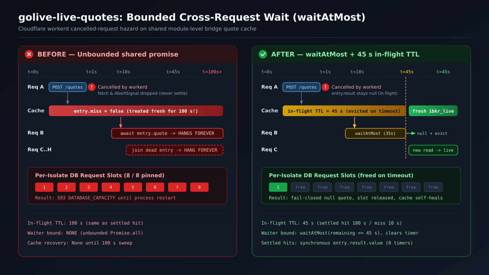

# Plan: Bound Cross-Request Wait on In-Flight Go-Live Bridge Quote Reads

- **Card:** `vertex-golive-quotes-shared-wait-bound`
- **Requirement class:** Implementation hardening (reliability; preserves existing read-only `GoLiveQuotesPort` contract and fail-closed `null` semantics)
- **Bricks touched:** `packages/api` (`packages/api/src/server/golive-live-quotes.ts`, `packages/api/src/golive-live-quotes.test.ts`)

## Problem

`bridgeQuotesReaderFor` keeps one `createBridgeQuotesReader` instance (and its `cache` map) per bridge configuration for the lifetime of the server isolate. When Request A starts a bridge quote read (`POST /quotes`), it stores an in-flight `Entry` in `cache` with `miss: false` and awaits `entry.quote`.

On Cloudflare Workers (`workerd`), if Request A is cancelled while `fetch` is in flight, its `fetch` and `AbortSignal.timeout(45_000)` are bound to Request A's I/O context and can drop without settling. Because `entry.miss` stayed `false`, `fresh()` treated the orphaned entry as live for `GOLIVE_QUOTES_CACHE_MS` (`100_000` ms), and every subsequent request joining that key awaited `entry.quote` indefinitely—pinning per-isolate Postgres request slots (max 8) until `503 DATABASE_CAPACITY`.

## Design

1. **Caller-owned `waitAtMost(promise, ms)` helper:** races `entry.quote` against a `setTimeout` owned by the current caller's I/O context and always clears the timer in `finally`.
2. **Explicit settled state (`entry.result: { value: GoLiveQuote | null } | null`):**
   - Settled hits (`value !== null`) keep `GOLIVE_QUOTES_CACHE_MS` (`100_000` ms) and return `entry.result.value` synchronously without creating a timer or awaiting a cross-request promise.
   - Settled misses (`value === null`) keep `GOLIVE_QUOTES_MISS_CACHE_MS` (`10_000` ms) and return `null` synchronously.
   - In-flight entries (`result === null`) are fresh only for `timeoutMs` (`GOLIVE_QUOTES_TIMEOUT_MS`, default `45_000` ms), so an orphaned entry older than `timeoutMs` is swept immediately on the next call.
3. **Bounded wait & safe eviction:**
   - Callers joining an in-flight entry wait at most `Math.max(0, Math.min(timeoutMs, entry.at + timeoutMs - time))`.
   - On timeout, the caller deletes the entry only if `cache.get(key) === entry` (never evicting a newer replacement entry) and returns `null` (fail closed: draft keeps its stored delayed quote and remains unapprovable).

## Acceptance Check

- Unit tests prove:
  1. Cross-request waiters on a never-settling in-flight read resolve to `[null]` at the remaining `GOLIVE_QUOTES_TIMEOUT_MS` bound, evict the hung entry so the next caller recovers with a fresh bridge read, and never evict a newer replacement entry.
  2. An unsettled in-flight entry older than `timeoutMs` is evicted immediately on sweep instead of lingering for `GOLIVE_QUOTES_CACHE_MS`.
  3. Mixed requests return live quotes for healthy spreads alongside `null` for timed-out shared reads, clamp backward clock skew to `timeoutMs`, and leave 0 pending timers after settlement.
  4. `packages/api/src/server/golive-live-quotes.ts` maintains 100% statements, branches, functions, and lines coverage.
- `bun run verify:prepush` and hosted PR checks (`ci-gate`) pass on the reviewed head.
