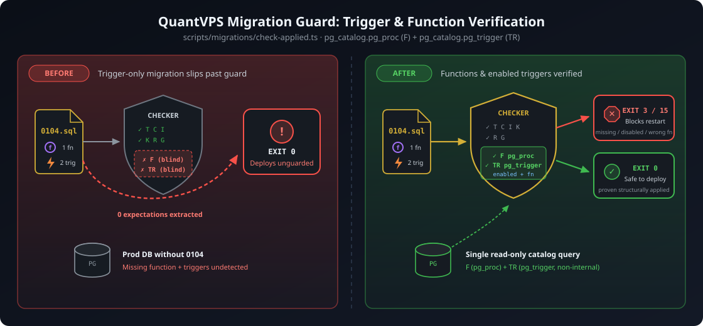

# Plan: QuantVPS migration guard — verify functions and triggers

## Problem

Before every `vertex-web` deployment on QuantVPS, `infra/quantvps/restart-when-idle.sh` (running on `omarchy-rig`, the Linux compute host) executes `scripts/db-migrations-check.ts` (backed by `scripts/migrations/check-applied.ts`). Because QuantVPS applies individual SQL migrations with `psql`, `drizzle.__drizzle_migrations` is incomplete. The guard therefore checks each migration (identified by its journal `tag`, such as `0104_jev_verdict_log_append_only`) against the live PostgreSQL catalog using a single read-only SQL query (`MIGRATIONS_SNAPSHOT_SQL`).

In `checkAppliedMigrations`, each structural check adds the owning migration's `tag` to `structuralTags` (counted in `structuralCount`) and appends any violation to `reasonsByTag`. A migration passes whenever `reasonsByTag.get(tag)` is empty, regardless of whether its SHA-256 hash exists in `drizzle.__drizzle_migrations`. Currently, `scripts/migrations/check-applied.ts` inspects only tables (`T`), columns and nullability (`C`), indexes (`I`), constraints and widened `CHECK` literals (`K`), roles (`R`), and `vertex_research` table grants (`G`). It ignores function and trigger DDL. Consequently, a trigger-and-function-only migration such as `0104_jev_verdict_log_append_only.sql` produces zero structural expectations and passes (`EXIT_APPLIED`, code 0) even when it has never been applied on QuantVPS.

## Goals

1. Prove that every `public`-schema function and `BEFORE`/`AFTER` trigger declared in repository migrations exists on QuantVPS Postgres before `vertex-web` restarts.
2. Catch unapplied trigger-only migrations (such as `0104_jev_verdict_log_append_only.sql`), dropped functions or triggers, disabled (`tgenabled = 'D'`) or replica-only (`tgenabled = 'R'`) triggers, and triggers bound to a different function or non-public function schema.
3. Preserve zero-dependency execution, backward compatibility with existing snapshot fixtures, and 100% statement/branch/function/line coverage on `scripts/migrations/check-applied.ts`.

## Root cause

1. `MIGRATIONS_SNAPSHOT_SQL` does not query `pg_catalog.pg_proc` or `pg_catalog.pg_trigger`.
2. `DatabaseSnapshot`, `MutableSnapshot`, `applySnapshotRecord`, and `parsePostgresSnapshot` have no fields or record kinds for functions or triggers.
3. `stripSqlComments` does not skip dollar-quoted blocks (`$$...$$`), which can cause apostrophes inside PL/pgSQL function bodies to leave subsequent `--> statement-breakpoint` comments unstripped before `CREATE TRIGGER`.
4. `extractMigrationExpectations`, `processStatement`, and `recordDropTable` do not extract function or trigger DDL statements or cascade table drops onto triggers.
5. `checkAppliedMigrations` has no verification step for functions or triggers.

## Alternatives Considered

1. **Add a full PostgreSQL SQL parser dependency (e.g., `libpg-query`/WASM or `pgsql-ast-parser`)**: Rejected. `scripts/db-migrations-check.ts` is executed directly by `restart-when-idle.sh` via plain `bun` or `node` with zero third-party imports (`node:child_process` and `node:crypto` only), keeping deploy checks fast and independent of native/WASM bindings or `node_modules` installation state.
2. **Require QuantVPS manual `psql` runs to insert rows into `drizzle.__drizzle_migrations`**: Rejected. A ledger row only proves someone inserted a hash, not that the trigger still exists or remains enabled (`ALTER TABLE ... DISABLE TRIGGER` would pass a ledger check), and manual `psql` runs historically omit the ledger.
3. **Compare full `pg_proc.prosrc` bodies and `pg_get_triggerdef(tg.oid)` expressions**: Rejected. PostgreSQL normalizes `pg_get_triggerdef` formatting and quoting across versions, and `prosrc` whitespace/newline normalization creates false-positive deploy blocks. Checking function presence, trigger presence, enabled state (`O`/`A` vs `D`/`R`), and qualified target function name detects every missing, disabled, or mis-wired trigger without brittle formatting diffs.

## Target Scope & File Boundary

| Action | Path | Purpose |
| --- | --- | --- |
| Modify | `scripts/migrations/check-applied.ts` | Snapshot query (`F`, `TR`), parser, SQL DDL extractor, `stripSqlComments` dollar-quote skip, `checkFunctionsAndTriggers`, header comment |
| Modify | `scripts/migrations/check-applied.test.ts` | Shared snapshot test helpers (`emptySnapshot`, `buildSnapshot`) and unit tests reaching 100% coverage |
| Modify | `tests/integration/database/migration-guard.test.ts` | Real-Postgres tests for dropped trigger, disabled trigger, and dropped trigger function (`CASCADE`) |
| Modify | `infra/quantvps/restart-when-idle.sh` | Update migration guard header comment to include functions and triggers |
| Modify | `infra/quantvps/README.md` | Update Migration guard section to include functions and triggers |
| Create | `docs/vertex-rebuild/designs/vertex-migration-guard-triggers/*` | Plan doc, dark before-vs-after SVG, resolved Goldfish review report, EGM drift report |

## Detailed Design

### 1. Catalog snapshot query and parser (`scripts/migrations/check-applied.ts`)

- Extend `MIGRATIONS_SNAPSHOT_SQL` (one read-only `SELECT kind, a, b, c` framed by `@@START` / `@@END`) with two `UNION ALL` branches before `@@END`:
  - `ord = 8`, `kind = 'F'`: distinct normal functions in schema `public` from `pg_catalog.pg_proc p JOIN pg_catalog.pg_namespace ns ON ns.oid = p.pronamespace WHERE ns.nspname = 'public' AND p.prokind = 'f' GROUP BY p.proname`, emitting `p.proname::text AS a`, `''::text AS b`, `''::text AS c`.
  - `ord = 9`, `kind = 'TR'`: non-internal triggers on relations in schema `public` from `pg_catalog.pg_trigger tg JOIN pg_catalog.pg_class cls ON cls.oid = tg.tgrelid JOIN pg_catalog.pg_namespace ns ON ns.oid = cls.relnamespace JOIN pg_catalog.pg_proc fn ON fn.oid = tg.tgfoid JOIN pg_catalog.pg_namespace fn_ns ON fn_ns.oid = fn.pronamespace WHERE ns.nspname = 'public' AND NOT tg.tgisinternal`, emitting `cls.relname::text AS a`, `tg.tgname::text AS b`, and `(tg.tgenabled::text || ':' || CASE WHEN fn_ns.nspname = 'public' THEN fn.proname ELSE fn_ns.nspname || '.' || fn.proname END)::text AS c`.
  - Shift `@@END` to `ord = 10`.
- Export `SnapshotTrigger` (`export interface SnapshotTrigger { readonly enabled: string; readonly fn: string; }`) and add `makeTriggerKey(table: string, trigger: string): string` using `\0` (`${table}\0${trigger}`, which PostgreSQL forbids in identifiers so dots inside quoted table or trigger names never collide).
- Extend `DatabaseSnapshot` and `MutableSnapshot` with:
  - `readonly functions: ReadonlySet<string>` (`Set<string>` in `MutableSnapshot`)
  - `readonly triggers: ReadonlyMap<string, SnapshotTrigger>` (`Map<string, SnapshotTrigger>` in `MutableSnapshot`, keyed by `makeTriggerKey(table, trigger)`)
- Update `parsePostgresSnapshot`:
  - Initialize `functions: new Set()` and `triggers: new Map()` in `snap`.
  - Filter blank lines via `line.trim().length > 0` without calling `.trimEnd()` on non-empty TSV lines so quoted identifiers ending in spaces are preserved.
- Update `applySnapshotRecord`:
  - `case "F"`: if `a` is non-empty, `snap.functions.add(a)`.
  - `case "TR"`: if `a && b`, validate that `c.length > 2 && c[1] === ":"` and `c[0]` is a valid PostgreSQL `tgenabled` flag (`O`, `D`, `R`, `A`); if invalid, fail closed by returning `"malformed trigger record in Postgres migration snapshot"`. Otherwise store `{ enabled: c.slice(0, 1), fn: c.slice(2) }` under `makeTriggerKey(a, b)` (supporting quoted function names containing `:`). Existing snapshots without `F` or `TR` rows continue to parse with empty collections.

### 2. SQL lexer and expectation extractor (`scripts/migrations/check-applied.ts`)

- **Scanner hardening**:
  - Update `SIMPLE_IDENT` and `IDENT` quoted-identifier subpattern from `"[^"]+"` to `"(?:[^"]|"")+"` so escaped double quotes inside quoted identifiers match.
  - Tighten `scanDollarQuoted` tag pattern to `/^\$(?:[A-Za-z_][A-Za-z0-9_]*)?\$/u` (PostgreSQL tags cannot start with a digit).
  - Skip dollar-quoted blocks inside `stripSqlComments` via `scanDollarQuoted` (preserving them verbatim) so apostrophes or `--` sequences inside PL/pgSQL bodies cannot corrupt comment stripping for subsequent statements.
  - Add `parsePublicQualifiedIdent(schema: string | undefined, name: string): string | null`: accepts only `schema === undefined`, exact `'"public"'`, or unquoted `public` (case-insensitive), rejecting quoted uppercase `"PUBLIC"` and non-public schemas; returns `parseIdentToken(name)`.
  - Extend `processStatement`'s `DO` block trigger from `/^DO\s+\$/iu` to `/^DO\s+(?:LANGUAGE\s+\S+\s+)?\$/iu` so `DO LANGUAGE plpgsql $ ... $` blocks are parsed, and strip SQL comments on the extracted `DO` body inside `processDoBlock` before running `recordGrantStatements` and `splitTopLevel` (preventing comments inside `DO` blocks from breaking statement anchors or matching commented-out `GRANT`s).
- **Expectation structures**:
  - Add `interface TriggerRule { readonly fn: string | null; readonly table: string; readonly tag: string; readonly trigger: string; }`.
  - Add `readonly functions: Map<string, string>` (`fnName -> tag`) and `readonly triggers: Map<string, TriggerRule>` (`makeTriggerKey(table, trigger) -> TriggerRule`) to `MigrationExpectations` and initialize/return them in `extractMigrationExpectations`.
- **Function and trigger DDL extraction in `processStatement`**:
  - `CREATE [OR REPLACE] FUNCTION [<schema>.]<name>(`: if `parsePublicQualifiedIdent(schema, name)` is non-null, set `state.functions.set(fnName, tag)`. Non-public schemas are ignored.
  - `DROP FUNCTION [IF EXISTS] <targets> [CASCADE|RESTRICT]`: detect and strip trailing `CASCADE|RESTRICT` before calling `splitTopLevel(rest, ",")`. For each item, extract optional `<schema>.<name>` and optional `(...)` parameter list; skip non-public items. Delete `fnName` from `state.functions`. When `CASCADE` is present and the item has omitted or empty `()` parameters (trigger functions take zero declared parameters), also delete every entry in `state.triggers` where `rule.fn === fnName`.
  - `CREATE [OR REPLACE] TRIGGER <name> {BEFORE|AFTER} ... ON [<schema>.]<table> ... EXECUTE {FUNCTION|PROCEDURE} [<fn_schema>.]<fn_name>(`: parse `ON` and `EXECUTE {FUNCTION|PROCEDURE}` by scanning keywords at paren depth 0 outside single/double quotes (reusing `scanQuoted`), preventing false matches inside quoted column names (`UPDATE OF "on bar"`) or `WHEN (...)` literals (`'EXECUTE FUNCTION fake()'`). Ignore non-public target tables (`parsePublicQualifiedIdent(tableSchema, tableName) === null`). Record `fn = parsePublicQualifiedIdent(fnSchema, fnName)` (`null` for non-public helper functions such as `pg_catalog.*`). Set `state.triggers.set(makeTriggerKey(table, trigger), { fn, table, tag, trigger })`.
  - `DROP TRIGGER [IF EXISTS] <name> ON [<schema>.]<table>`: if target table is public/unqualified, delete `makeTriggerKey(table, trigger)` from `state.triggers`.
  - `recordDropTable(table, state)`: delete every entry in `state.triggers` where `rule.table === table`.

### 3. Verification logic (`scripts/migrations/check-applied.ts`)

- Add `checkFunctionsAndTriggers(expectations, snapshot, structuralTags, reasonsByTag)` and invoke it in `checkAppliedMigrations` immediately after `checkAppGrants`:
  - For each `[fnName, tag]` in `expectations.functions`:
    - `structuralTags.add(tag)`
    - If `!snapshot.functions.has(fnName)`, add reason `missing function ${fnName}`.
  - For each `[key, rule]` in `expectations.triggers`:
    - `structuralTags.add(rule.tag)`
    - If `!snapshot.tables.has(rule.table)`, skip (same parent-table suppression used by columns, indexes, constraints, and grants).
    - Look up `actual = snapshot.triggers.get(key)`.
    - If `actual === undefined`: add reason `missing trigger ${rule.table}.${rule.trigger}` and continue.
    - Check enabled state and target function independently in deterministic order:
      - If `actual.enabled === "D"`: add reason `trigger ${rule.table}.${rule.trigger} is disabled`.
      - Else if `actual.enabled === "R"`: add reason `trigger ${rule.table}.${rule.trigger} is replica-only (not active on origin)`.
      - If `rule.fn !== null && actual.fn !== rule.fn`: add reason `trigger ${rule.table}.${rule.trigger} calls ${actual.fn} (expected ${rule.fn})`.

### 4. Tests and documentation

- **`scripts/migrations/check-applied.test.ts`**:
  - Update `emptySnapshot()` and `buildSnapshot(overrides)` to accept `functions?: string[]` and `triggers?: [string, SnapshotTrigger][]` (helper keys converted via `makeTriggerKey` or passed directly).
  - Add unit tests covering:
    - `stripSqlComments` preserving dollar-quoted function bodies with embedded apostrophes/comments before `--> statement-breakpoint` + `CREATE TRIGGER`, plus `scanDollarQuoted` rejecting digit-leading tags.
    - `CREATE [OR REPLACE] FUNCTION`, `DROP FUNCTION` (single, comma-separated with arg commas, `CASCADE` removing dependent triggers only for 0-arg/omitted-arg drops, ignoring non-public schema drops), `DO LANGUAGE plpgsql $$ ... $$`.
    - `CREATE [OR REPLACE] TRIGGER` (`BEFORE`/`AFTER`, `UPDATE OF` with quoted `"on"` column, `WHEN (...)` containing `'EXECUTE FUNCTION fake()'`, `EXECUTE FUNCTION` and `EXECUTE PROCEDURE`, quoted names with dots and escaped `""`, non-public table skipped, non-public target function `fn: null`, `PUBLIC` vs `"PUBLIC"` schema distinction), `DROP TRIGGER`, and `DROP TABLE` removing only triggers on the dropped table (not `"a.b"` when dropping `a`).
    - Extend `it("parses all real repository migrations cleanly", ...)` to assert the exact verified inventory across all repository migrations (including `0104_jev_verdict_log_append_only` after PR #501):
      - `0005_workflow_durability`: functions `reject_workflow_journal_mutation`, `delete_workflow_run_outbox_events`; triggers `workflow_journal.workflow_journal_immutable`, `workflow_runs.workflow_runs_delete_outbox`.
      - `0008_vertex_buildout`: functions `vertex_reject_epoch_transition_mutation`, `vertex_reject_native_approval_audit_mutation`; triggers `vertex_portfolio_epoch_transitions.vertex_epoch_transition_immutable`, `vertex_portfolio_epoch_transitions.vertex_epoch_transition_no_truncate`, `vertex_native_approval_audit.vertex_native_approval_audit_immutable`, `vertex_native_approval_audit.vertex_native_approval_audit_no_truncate`.
      - `0012_vertex_research_chat_copy_inventory`: function `vertex_chat_copy_immutable`; triggers `vertex_research_chat_copy_families.vertex_copy_family_immutable`, `vertex_research_chat_copy_allocations.vertex_copy_allocation_immutable`, `vertex_research_chat_copy_content_bindings.vertex_copy_content_immutable`, `vertex_research_chat_copy_dependencies.vertex_copy_dependency_immutable`, `vertex_research_chat_copy_closures.vertex_copy_closure_immutable`.
      - `0013_vertex_research_chat_copy_cleanup`: trigger `vertex_research_chat_copy_cleanup_intents.vertex_copy_cleanup_immutable` (`fn: "vertex_chat_copy_immutable"`).
      - `0104_jev_verdict_log_append_only`: function `jev_verdict_log_reject_mutation`; triggers `jev_verdict_log.jev_verdict_log_immutable`, `jev_verdict_log.jev_verdict_log_no_truncate`.
    - `parsePostgresSnapshot` with `F` and `TR` rows (including quoted function names containing colons, trailing spaces, and malformed `TR` fail-closed error).
    - `checkAppliedMigrations` for: trigger-only migration matching `0104_jev_verdict_log_append_only.sql` unapplied (exit 3, flags missing function and both triggers), applied without Drizzle ledger (exit 0, counted in `structuralCount`), disabled trigger (`D`), replica-only trigger (`R`), wrong function (including cross-schema `other.fn`), disabled + wrong function emitting both reasons, and parent-table missing suppression.
  - Verify **100% statements, branches, functions, and lines** on `scripts/migrations/check-applied.ts` (`scripts/ci/coverage-baseline.json` records per-file coverage minimums for legacy files; unlisted files must reach 100%).
- **`tests/integration/database/migration-guard.test.ts`**:
  - Append steps 5–8 to the existing sequential `it(...)` block (updating its test title):
    - Step 5: `DROP TRIGGER workflow_journal_immutable ON public.workflow_journal` -> flags `0005_workflow_durability` with `missing trigger workflow_journal.workflow_journal_immutable`.
    - Step 6: `ALTER TABLE public.vertex_portfolio_epoch_transitions DISABLE TRIGGER vertex_epoch_transition_immutable` -> flags `0008_vertex_buildout` with `trigger vertex_portfolio_epoch_transitions.vertex_epoch_transition_immutable is disabled`.
    - Step 7: `DROP FUNCTION public.vertex_reject_native_approval_audit_mutation() CASCADE` -> flags `0008_vertex_buildout` with `expect.arrayContaining(["missing function vertex_reject_native_approval_audit_mutation", "missing trigger vertex_native_approval_audit.vertex_native_approval_audit_immutable", "missing trigger vertex_native_approval_audit.vertex_native_approval_audit_no_truncate"])`.
    - Step 8: `DROP FUNCTION public.jev_verdict_log_reject_mutation() CASCADE` -> flags `0104_jev_verdict_log_append_only` with `expect.arrayContaining(["missing function jev_verdict_log_reject_mutation", "missing trigger jev_verdict_log.jev_verdict_log_immutable", "missing trigger jev_verdict_log.jev_verdict_log_no_truncate"])`.
- **Documentation**:
  - Update header comments in `scripts/migrations/check-applied.ts` and `infra/quantvps/restart-when-idle.sh`, and the Migration guard bullet in `infra/quantvps/README.md`.

## Phasing & Checkpoints

1. **Phase 1 — Snapshot + Extractor + Checker + Unit Tests (`check-applied.ts`, `check-applied.test.ts`)**: Implement all code and unit tests together so `DatabaseSnapshot` and test helpers stay type-safe in one atomic step. Checkpoint: `pnpm exec vitest run --coverage scripts/migrations/check-applied.test.ts` passes with 100% coverage on `check-applied.ts`.
2. **Phase 2 — Integration Test + Docs (`migration-guard.test.ts`, `restart-when-idle.sh`, `README.md`)**: Add real-Postgres steps 5–8 and update comments/docs. Checkpoint: `pnpm exec vitest run infra/quantvps/restart-when-idle.test.ts`, `bun run verify:prepush` (repository pre-push lint/typecheck/unit/contract/operations gate), and `node scripts/public-names.ts` (public-repo leak scanner) all pass.
3. **Phase 3 — Drift Check + Fresh-Context Code Review + CI**: Run Elephant-Goldfish Model (EGM) drift report against `plan.md`, run fresh-context code review of the full diff, open/ready PR to `vertex/rebuild-darkfactory-20260921`, and confirm required `ci-gate` (including real-Postgres `verify:integration`) passes.

## Risks and rollback

- **Risk: Pre-existing missing trigger/function on QuantVPS (`0005`, `0008`, `0012`, `0013`) blocks a future deploy.** Mitigation: this is intended guard behavior; `restart-when-idle.sh` reports the exact missing object and supports `--allow-unapplied-migrations "<reason>"` while the missing SQL is applied.
- **Risk: Overloaded functions or same-function `CREATE OR REPLACE TRIGGER` edits.** Mitigation: `GROUP BY p.proname` deduplicates snapshot rows; adding a second overload of an existing function name or modifying trigger timing/events/`WHEN` without changing the function name will not be detected by existence/fn-name checks alone (documented in Out of scope).
- **Risk: A future migration intentionally runs `ALTER TABLE ... DISABLE TRIGGER`.** Mitigation: not used in this repository; if introduced later, it would be flagged as disabled until the guard is extended or `--allow-unapplied-migrations` is used.
- **No QuantVPS web deploy required:** `scripts/migrations/check-applied.ts` runs on `omarchy-rig` inside `infra/quantvps/restart-when-idle.sh`, not in the `apps/web` bundle.
- **Rollback:** `git revert` the merge commit restores previous checker behavior with no database or service changes.

## Out of scope

- Comparing PL/pgSQL function body source (`pg_proc.prosrc`) on `CREATE OR REPLACE FUNCTION` or trigger event/timing/`WHEN` diffs on `CREATE OR REPLACE TRIGGER` keeping the same function name.
- `CREATE PROCEDURE` (`prokind = 'p'`), `CREATE EVENT TRIGGER`, `CREATE CONSTRAINT TRIGGER`, `INSTEAD OF` (view) triggers, `ALTER FUNCTION ... RENAME TO / SET SCHEMA`, `ALTER TRIGGER ... RENAME TO`, `ALTER TABLE ... DISABLE/ENABLE TRIGGER`, multi-table `DROP TABLE t1, t2`, and dynamic `EXECUTE 'CREATE TRIGGER ...'` inside `DO` blocks.
- Backslash-escaped `E'...'` strings and nested `/* /* */ */` block comments in `stripSqlComments` (unused across all repository migrations).
- Modifying `0104_jev_verdict_log_append_only.sql` (owned by card `vertex-jev-verdict-log-owner-grants`, PR #501).

## Acceptance criteria

1. `scripts/migrations/check-applied.ts` queries `pg_catalog.pg_proc` (`F`) and `pg_catalog.pg_trigger` (`TR`, non-internal, with `tgenabled` and schema-aware target function name), parses function and trigger DDL (`CREATE`/`DROP`, `DROP FUNCTION ... CASCADE`, `DROP TABLE` cascade, `DO [LANGUAGE ...] $$`), and flags missing functions, missing triggers, disabled (`D`) triggers, replica-only (`R`) triggers, and mismatched trigger functions.
2. A trigger-and-function-only migration (matching `0104_jev_verdict_log_append_only.sql`) exits 3 (`EXIT_UNAPPLIED`) when absent from the snapshot, flags disabled/replica-only/mis-wired triggers, and exits 0 (`EXIT_APPLIED`, counted in `structuralCount`) when present even without Drizzle ledger rows.
3. `pnpm exec vitest run --coverage scripts/migrations/check-applied.test.ts` passes with **100% statements, branches, functions, and lines** on `scripts/migrations/check-applied.ts`.
4. `pnpm exec vitest run infra/quantvps/restart-when-idle.test.ts` passes.
5. `bun run verify:prepush` and `node scripts/public-names.ts` pass with zero errors.
6. Real-Postgres integration test (`tests/integration/database/migration-guard.test.ts`, including steps 5–8) passes in full CI (`ci-gate` green on the reviewed head SHA).
7. EGM drift report shows zero drift between `plan.md` and the implemented code, and fresh-context code review passes with zero open findings.
