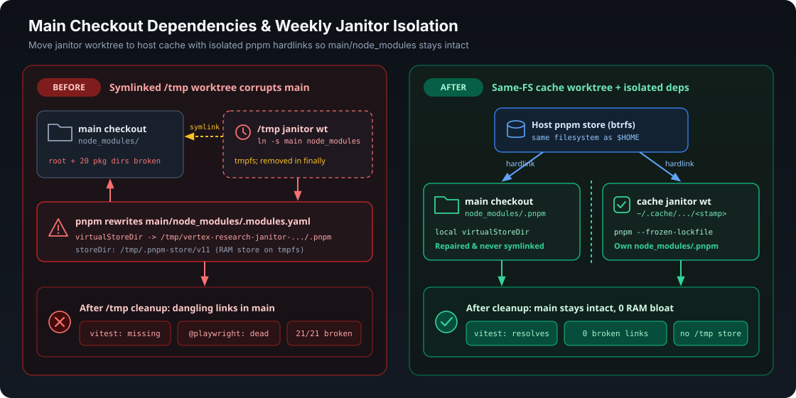

# Plan: Repair main checkout `node_modules` and isolate weekly janitor dependencies



## Problem

On `omarchy-rig` (the Linux compute host), the main checkout at `/home/jeffscottward/Github/trading/vertex-research-public` (clean detached `HEAD` at `b78791a1`, snapshot checked 2026-11-27 07:48 ET) has broken `node_modules` symlinks. Its `node_modules/.modules.yaml` (mtime 2026-11-15) records:

- `virtualStoreDir: ../../../../../../tmp/vertex-research-janitor-20261115-1100/node_modules/.pnpm`
- `storeDir: /tmp/.pnpm-store/v11`

Because `/tmp/vertex-research-janitor-20261115-1100` was deleted at the end of the 2026-11-15 weekly janitor run, 15 of 30 top-level `node_modules` entries and symlinks across all 20 workspace `apps/*/node_modules` and `packages/*/node_modules` directories are broken. `node_modules/vitest/vitest.mjs` and `node_modules/@playwright/test` do not resolve.

## Root cause

Every Sunday at 06:00 ET, the systemd user timer `vertex-janitor.timer` starts `vertex-janitor.service`, which executes `~/.local/bin/vertex-janitor-run`. That launcher exports `scripts/vertex-janitor.ts` and `scripts/janitor/` from the repository default branch on `origin` (`origin/vertex/rebuild-darkfactory-20260921`, the PR base branch) and invokes `runJanitorWeekly` in `scripts/janitor/weekly.ts`.

`scripts/janitor/weekly.ts` creates a temporary worktree `${wt}` at `/tmp/vertex-research-janitor-<stamp>` and symlinks `${main}/node_modules` into `${wt}/node_modules`. That symlink violates the worktree dependency isolation rule — never symlink a writable `node_modules` directory into a worktree (owner safety rule 2026-10-23, owner Discord message (private)):

1. Workspace `apps/*/node_modules` and `packages/*/node_modules` directories do not exist in `${wt}`, and `pnpm-workspace.yaml` enforces `verifyDepsBeforeRun: error`.
2. When a janitor pass invokes `pnpm install` inside `${wt}`, pnpm follows the `${wt}/node_modules` symlink into `${main}/node_modules`, rewrites `${main}/node_modules/.modules.yaml` with the `/tmp` virtual store path, and rewrites symlinks across `${main}` to point into `/tmp/vertex-research-janitor-<stamp>/node_modules/.pnpm`.
3. Because `/tmp` is `tmpfs` (a different filesystem from `/home`, which is `btrfs`), pnpm also creates a separate `/tmp/.pnpm-store/v11` in RAM instead of hardlinking from the host store on `/home`.
4. In `finally`, `weekly.ts` unlinks `${wt}/node_modules` and deletes `${wt}`, leaving `${main}/node_modules` with dangling symlinks. Any future Sunday `vertex-janitor.timer` pass that runs `pnpm install` will break `${main}/node_modules` again until `scripts/janitor/weekly.ts` is fixed.

## Scope

### 1. Live main checkout repair on `omarchy-rig`

Repair `/home/jeffscottward/Github/trading/vertex-research-public/node_modules` in place without changing its git branch, commit, or working tree (must run from an un-sandboxed host shell on `omarchy-rig`; autogrind `bwrap` worktree sessions mount the main checkout read-only and exit with `EROFS`):

- Point-in-time audit (2026-11-27 07:48 ET): 0 of 92 linked worktrees symlinked to `${main}/node_modules`, and 0 running processes held a `cwd` or open file descriptor in `${main}/node_modules`. Re-verify both immediately after acquiring the claim before running `pnpm install`.
- Acquire the coordinator claim (`fm claim`, the rig's task-coordination lock CLI) before modifying `${main}/node_modules`, and release it (`fm release`) in all outcomes (success or failure).
- Reinstall `${main}/node_modules` from the local pnpm store with `--frozen-lockfile --offline --config.virtual-store-dir=node_modules/.pnpm --config.confirm-modules-purge=false` (falling back to `--prefer-offline` only if a locked package from `b78791a1` is absent from the local store).

### 2. Root-cause fix in `scripts/janitor/weekly.ts` and `scripts/janitor/weekly.test.ts`

- **`scripts/janitor/weekly.ts`**:
  - Export `resolveWorktreePath(env, stamp)` to place `${wt}` on the same filesystem as the host pnpm store:
    - If `env["XDG_CACHE_HOME"]` is set and starts with `/` (absolute; ignore relative paths), use `<xdg-trimmed>/vertex-research-janitor/<stamp>`.
    - Else if `env["HOME"]` is set and starts with `/`, use `<home-trimmed>/.cache/vertex-research-janitor/<stamp>`.
    - Else fall back to `/tmp/vertex-research-janitor-<stamp>`.
    - Keep small scratch files (`busyPath` and `${wt}-pr-body.md` -> `/tmp/vertex-research-janitor-<stamp>-busy.txt` and `-pr-body.md`) in `/tmp`.
  - Remove the `ln -s ${main}/node_modules ${wt}/node_modules` step.
  - Immediately after `worktree = true` and `git rev-parse HEAD` (after `--dry-run` and `ls-remote` guards, so install failures trigger `finally` cleanup), install isolated dependencies inside `${wt}` via:

    ```bash
    pnpm install --frozen-lockfile --prefer-offline \
      --config.virtual-store-dir=node_modules/.pnpm \
      --config.confirm-modules-purge=false
    ```

    Run with `{ cwd: wt, inherit: true }` wrapped in `must(..., "pnpm install")` so install failures stream diagnostics to `vertex-janitor.service` logs and exit cleanly. Because `${wt}` is on the same `btrfs` filesystem as the host pnpm store, pnpm natively hardlinks packages (~0 RAM overhead) and child `pnpm` commands inside the `omp` pass also resolve the host store without creating `/tmp/.pnpm-store`.
  - Update `finally` cleanup: remove `rm -f ${wt}/node_modules` (a real directory causes `rm -f` to fail), run `git worktree remove --force --force ${wt}` (double `--force` handles any nested `.git` directory), and if that exits non-zero, fall back to `rm -rf ${wt}` followed by `git worktree prune` before `git branch -D ${branch}`.
  - Update `stagePass` (the helper that stages model edits while keeping `JANITOR-REPORT.md` and `node_modules` unstaged) JSDoc comments to describe a real `node_modules/` directory rather than a symlink, while retaining `git reset -q -- node_modules JANITOR-REPORT.md`.
- **`scripts/janitor/weekly.test.ts`**:
  - Update fixtures and weekly pass tests for `resolveWorktreePath` (`XDG_CACHE_HOME`, relative `XDG_CACHE_HOME` ignored, `HOME`, and `/tmp` fallback) and isolated `pnpm install` (`cwd === wt`, `inherit: true`, exact flags, no `ln -s`, no `rm -f ${wt}/node_modules`).
  - Assert strict execution order: `git worktree add` < `pnpm install` < `omp` < `git commit` < `git worktree remove --force --force`.
  - Add tests for `pnpm install` failure (asserting `omp` is not called, exit code 1, `janitor: pnpm install failed`, and worktree + branch cleanup) and `git worktree remove --force --force` failure triggering `rm -rf` + `git worktree prune`.
  - Extend `stagePass against real git` to cover a real `node_modules/` directory plus nested `apps/web/node_modules/` directories and `git worktree remove --force --force` teardown.
  - Replace `git push` with `git fetch` into the local bare `origin.git` fixture in the real-worktree `collectBusyFiles` test so the suite runs cleanly inside `bwrap` (`fm-push-broker`) pre-push environments.

## Execution order

1. **Repair `${main}/node_modules` on `omarchy-rig`:**

   ```bash
   fm claim vertex-public-main-node-modules-dangling "file:vertex-research-public:node_modules"
   # Re-verify 0 worktree symlinks and 0 processes with cwd/fd in main/node_modules
   cd /home/jeffscottward/Github/trading/vertex-research-public
   pnpm install --frozen-lockfile --offline \
     --config.virtual-store-dir=node_modules/.pnpm \
     --config.confirm-modules-purge=false
   ```

   Run verification commands below, then run `fm release vertex-public-main-node-modules-dangling "file:vertex-research-public:node_modules"` (also on error).
2. **Implement and test the `scripts/janitor/weekly.ts` fix in the linked worktree** (`ws/vertex-research-public-main`).
3. **Run verification gates:** Vitest with 100% coverage on `scripts/janitor/weekly.ts`, `bun run verify:prepush`, `node scripts/public-names.ts` (public-repo leak scanner), Elephant-Goldfish Model (EGM) drift report, and fresh-context code review.
4. **Open PR to `vertex/rebuild-darkfactory-20260921`**, add dark before-vs-after graphic and `Agent review: <40-char SHA>`, wait for required `ci-gate`, and merge via `scripts/merge-pr` (serialized merge helper).
5. **Run post-merge live verification** on `omarchy-rig`.

## Rollback and recovery

- **Live repair failure:** If `pnpm install --offline` fails mid-purge, retry once with `--prefer-offline` (preserving `--frozen-lockfile`). If both fail, release `file:vertex-research-public:node_modules` immediately, record the exact stderr and remaining state in `.omp-status.md`, and stop without modifying git state in `${main}`.
- **Code fix rollback:** Do **not** `git revert` the merged PR directly if it would reintroduce `ln -s ${main}/node_modules ${wt}/node_modules`. Instead, stop/disable `vertex-janitor.timer` (`systemctl --user stop vertex-janitor.timer`) while a follow-up fix is prepared.

## Out of scope

- Changing the checked-out commit or branch of `/home/jeffscottward/Github/trading/vertex-research-public`.
- Modifying `fm-spawn` (the rig worktree launcher).

## Acceptance criteria

1. **Main checkout repaired and verified live:** In `/home/jeffscottward/Github/trading/vertex-research-public`:
   - `node_modules/.modules.yaml` has a local `virtualStoreDir` and a `/home`-backed `storeDir` (neither references `/tmp`).
   - 0 broken symlinks exist across root `node_modules` and all 20 workspace `apps/*/node_modules` and `packages/*/node_modules` directories.
   - `node -e "require.resolve('vitest'); require.resolve('@playwright/test')"` and `pnpm exec vitest --version` exit 0.
   - `git status --short` is empty and `git rev-parse --short HEAD` remains `b78791a1`; `/tmp/.pnpm-store` does not exist; `file:vertex-research-public:node_modules` claim is released.
2. **Unit and real-git coverage:** `pnpm exec vitest run --coverage scripts/janitor/weekly.test.ts` passes with 100% lines, branches, functions, and statements on `scripts/janitor/weekly.ts`.
3. **Repository gates and merge:** `bun run verify:prepush`, `node scripts/public-names.ts`, EGM drift report (`No drift detected`), fresh-context code review, and PR `ci-gate` pass; PR merges to `vertex/rebuild-darkfactory-20260921` via `scripts/merge-pr`.
4. **Post-merge live check:**
   - `vertex-janitor-run --dry-run` exits 0 and prints the merged `origin/vertex/rebuild-darkfactory-20260921` short SHA.
   - A real worktree setup + isolated `pnpm install` + teardown smoke test under `$HOME/.cache/vertex-research-janitor/` exits 0, removes its temporary worktree, leaves `/tmp/.pnpm-store` absent, and leaves `/home/jeffscottward/Github/trading/vertex-research-public/node_modules/.modules.yaml` unchanged.
