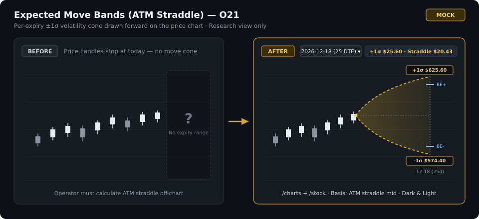

# Expected move bands (ATM straddle) on the price chart per expiry (card vertex-viz-expected-move)

- **Author:** Jeff Scott Ward (written by an agent)
- **Status:** reviewed (Elephant-Goldfish Model consolidated review of 2026-11-23; all accepted fixes applied, see [goldfish_review_report.md](goldfish_review_report.md))
- **Date:** 2026-11-23
- **Baseline commit:** `60c13a563` on `vertex/rebuild-darkfactory-20260921`; branch `ws/viz-exp-move`
- **Source:** research card `vertex-flow-viz-gap` (owner request, 2026-11-20), chart **O21** ("Expected move bands: The typical move (one standard deviation) that the at-the-money straddle price implies, drawn as a cone to expiry").

Research view only. Nothing in this change places, changes, or cancels an order, arms trading, or changes a risk setting. The expected move cone is an analytical display derived from option quotes or implied volatility; it is not a trade signal.



![Figure 2. Data flow: cached optionsChain merge feeds computeOptionsExpectedMove, exposed via optionsChain.expectedMove for /charts and called directly on /stock/[symbol], rendered by ExpectedMoveBar and KLineCharts vxExpectedMoveCone](data-flow.svg)

## Overview

Vertex already merges listed option chains from three sources (Quant Data analytics first, Interactive Brokers (`IBKR`) live quotes second, and Yahoo Finance snapshots third) inside `packages/api/src/server/options-chain.ts` with a 60-second response cache, and renders interactive candlestick price charts with KLineCharts 9.8.12 on both `/charts` (`ChartsWorkspace`) and `/stock/[symbol]` (`StockDetailWorkspace` -> `StockChartPanel`). Today, neither price chart draws the market-implied expected move cone for a chosen expiry.

This change adds:

1. A pure, browser-safe calculation module `packages/api/src/options-expected-move.ts` (`computeOptionsExpectedMove`, `STRADDLE_TO_ONE_SIGMA`, re-exported from `packages/api/src/index.ts`) that derives the per-expiry at-the-money (`ATM`) straddle price, straddle breakevens (`±1× straddle`), and one-standard-deviation (`±1σ`) expected move bands from one merged `OptionsChainOutput`, preserving leg-level quote provenance and cleanly separating market quotes from Black-Scholes implied-volatility (`IV`) fallback.
2. A read-only oRPC procedure `optionsChain.expectedMove` (oRPC path `/api/orpc/optionsChain/expectedMove`, OpenAPI path `GET /api/openapi/options-chain/expected-move`, operator session and automatic `agent-viewer` read-only `GET`) that reuses the 60-second cached `readChain` + `mergeOptionsChain` pipeline and returns a lightweight expected-move payload plus the listed expiry array. Like `optionsChain.spread`, it is session + `agent-viewer` only and does not widen `x-api-key` read allowlists (`operator-access.ts` / `handler.ts`).
3. A KLineCharts 9.8.12 custom overlay (`vxExpectedMoveCone`, pure geometry in `apps/web/src/features/charts/expected-move-overlay.ts`, wired through `CandleRenderer.setExpectedMove` in `kline-adapter.ts`, `ChartWorkstation`, and `MarketBarsChart`) that draws a translucent square-root-of-time (`√t`) `±1σ` cone expanding forward from the latest candle to the selected expiry, opens sufficient right-hand chart offset automatically, marks inner straddle breakeven ticks (`BE+` / `BE-`) when quoted, lists `Expected move (<expiry>)` in the Object Tree, and stays locked (`lock: true` on overlay, `ignoreEvent: true` on every figure) so it never interferes with user drawings or panning.
4. A `ChartToolbar` toggle (`Expected move`, matching `Order-flow marks` and `openInterest`) paired with a reusable, accessible, token-styled summary and expiry-selector component `ExpectedMoveBar` (`apps/web/src/components/portal/expected-move-bar.tsx`, returning `null` when disabled) mounted on:
   - **`/stock/[symbol]` (Chart tab):** enabled by default once the page loads, reusing the page's existing `optionsChain.chain` response synchronously (zero extra network requests), keeping `lastChain?.expiries` mounted during expiry switches to preserve `<select>` focus, and syncing bi-directionally with the page URL `?expiry=YYYY-MM-DD` and `ChainPanel`.
   - **`/charts` (US equity `STK` charts whose symbol passes `OptionsChainSymbolSchema`):** opt-in toggle in `ChartToolbar`, lazy-fetching `optionsChain.expectedMove` only when enabled, and suppressing the live forward cone while historical bar replay is active.

### Requirement classification

- **Core:** none (no change to reusable DarkFactory template primitives).
- **Capability:** read-only research chart overlay and oRPC market-data endpoint within the Vertex portal vertical.
- **Convention:** contracts first, strict TypeScript (no `any`, no `@ts-ignore`, Zod at boundaries), 100% test coverage on all new files and untouched-baseline files, oRPC only, token-only light/dark styling (`design-system/darkfactory/MASTER.md` and `.impeccable.md`), minimum 44×44 px touch targets, responsive 375–1440 px layout, honest status language.
- **Implementation:** KLineCharts 9.8.12 `registerOverlay` (`vxExpectedMoveCone`) + `setOffsetRightDistance`, shared pure math in `packages/api`, and React controls in `apps/web`.

## Method and knowledge-base alignment

The calculation aligns with the trading knowledge-base master rules (`~/Github/knowledge-bases/trading/_master-rules/rules.jsonl`) and the existing Vertex Academy specification (`packages/academy/src/lessons/specs/expected-move-cheat-code.json`, `packages/academy/src/math.ts`):

1. **ATM straddle to `1σ` conversion (`√(π/2) ≈ 1.2533`):** Under European Black-Scholes with `S = K`, the ATM straddle price satisfies `C + P ≈ S · σ · √T · √(2/π) ≈ 0.7979 · S · σ · √T`. Multiplying the quoted ATM straddle price by `√(π/2) ≈ 1.253314` converts the market-quoted straddle into the corresponding `±1σ` expected move (`expected-move-cheat-code.json`).
2. **Raw ATM straddle breakevens shown alongside `±1σ` when quoted:** Traders also read the unscaled ATM straddle price directly as the priced-in breakeven move (`trading-fraternity:indicator:8`, `define-your-risk-instagram:options_structure:4`). When quotes exist, the contract and `ExpectedMoveBar` display both `±1σ` (`spot ± expectedMove`) and the ATM straddle breakeven (`spot ± straddlePrice`, drawn as `BE+` / `BE-` ticks on the expiry guide line).
3. **Time to expiry (`yearsToExpiry` and `dte`):** Reuses `expiryCloseMs(expiry)` and `yearsToExpiry(expiry, now)` directly from `packages/api/src/options-chain-greeks.ts`: ACT/365 calendar years `(expiryCloseMs - nowMs) / (365 * 86_400_000)` to `16:00 America/New_York` on the expiry date (DST-aware; does not model 13:00 ET early-close holidays). `dte` (Days To Expiration, including `0DTE` for same-day contracts before 16:00 New York) comes directly from `chain.dte`.
4. **ATM IV aggregation (`atmIv`):** From the selected ATM strike's call and put rows, collect strictly positive (`> 0`) IV values: if both legs have `iv > 0`, `atmIv = (call.iv + put.iv) / 2`; if only one leg has `iv > 0`, use that leg's IV; otherwise `atmIv = null`.
5. **Honest three-tier quote/model hierarchy (never conflate quotes with model values):**
   - **Tier 1 — `atm_straddle_mid`:** Both call and put at the ATM strike have valid positive two-sided quotes (`bid !== null && ask !== null && bid > 0 && ask >= bid && contract.sources.quote !== null`). Requiring `bid > 0` prevents after-hours zero-bid Yahoo rows from halving leg prices. Each leg price is `(bid + ask) / 2`; each leg's quote source is its own `contract.sources.quote` (`"ibkr"` or `"yahoo"`). `straddlePrice = callPrice + putPrice`, `expectedMove = straddlePrice * STRADDLE_TO_ONE_SIGMA`.
   - **Tier 2 — `atm_straddle_last`:** Tier 1 does not hold, and both call and put have a usable market price (`mid` when `bid > 0 && ask >= bid && contract.sources.quote !== null`, else `last` when `last !== null && last > 0`). Per leg: a `mid`-priced leg records `contract.sources.quote`, while a `last`-priced leg records `"yahoo"` (only Yahoo populates `last` in `options-chain-merge.ts`). `straddlePrice = callPrice + putPrice`, `expectedMove = straddlePrice * STRADDLE_TO_ONE_SIGMA`.
   - **Tier 3 — `atm_iv_model`:** Market quotes are unavailable on at least one ATM leg (for example, Quant Data answered alone without bid/ask quotes), and `atmIv !== null && atmIv > 0`. The function computes `expectedMove = spot * atmIv * Math.sqrt(yearsToExpiry)` (matching `packages/academy/src/math.ts`) and leaves `straddlePrice: null`, `straddlePct: null`, `straddleUpper: null`, `straddleLower: null`, `callPrice: null`, `putPrice: null`, `callQuoteSource: null`, `putQuoteSource: null`. No synthetic Black-Scholes straddle breakeven ticks (`BE+` / `BE-`) are fabricated when market quotes are absent. The UI labels the basis explicitly as `ATM IV model`.
   - **Unavailable (`band: null`):** Returned with a plain-English `unavailableReason` whenever `spot` is missing/non-positive, `yearsToExpiry <= 0` (expiry already closed at 16:00 New York), no strike carries both a call and a put, or neither market quotes nor positive `atmIv` yield a finite positive `expectedMove`.
6. **Square-root-of-time cone trajectory (`√t`):** Between the last candle (`u = 0`) and the cone horizon (`u = 1`), the cone curves follow `spot ± expectedMove · √u` (`define-your-risk-instagram:indicator:3`).
7. **No new database migration or JSON data file:** All inputs come from the live 60-second cached `optionsChain` merge.

## Architecture and contracts

### 1. oRPC contract (`packages/api/src/contracts/options-chain.ts`)

Add constants and strict Zod schemas:

```ts
export const EXPECTED_MOVE_BASES = [
  "atm_straddle_mid",
  "atm_straddle_last",
  "atm_iv_model",
] as const;

export const EXPECTED_MOVE_LEG_SOURCES = ["ibkr", "yahoo"] as const;
```

- **Input (`OptionsExpectedMoveInputSchema`):** `{ symbol: OptionsChainSymbolSchema, expiry: isoDate.optional() }` (strict). When `expiry` is omitted, the server selects the nearest open expiry; if no open expiry exists, the server throws `NOT_FOUND` (matching `optionsChain.chain`).
- **Band (`OptionsExpectedMoveBandSchema`):**
  - `atmStrike`: `finite.positive()`
  - `atmIv`: `finite.positive().nullable()`
  - `basis`: `z.enum(EXPECTED_MOVE_BASES)`
  - `callPrice`: `finite.nonnegative().nullable()`
  - `putPrice`: `finite.nonnegative().nullable()`
  - `callQuoteSource`: `z.enum(EXPECTED_MOVE_LEG_SOURCES).nullable()`
  - `putQuoteSource`: `z.enum(EXPECTED_MOVE_LEG_SOURCES).nullable()`
  - `straddlePrice`: `finite.positive().nullable()` (`null` under `atm_iv_model`)
  - `straddlePct`: `finite.positive().nullable()` (`null` under `atm_iv_model`)
  - `expectedMove`: `finite.positive()`
  - `expectedMovePct`: `finite.positive()`
  - `upperBand`: `finite.positive()` (`spot + expectedMove`)
  - `lowerBand`: `finite.nonnegative()` (`Math.max(0, spot - expectedMove)`)
  - `straddleUpper`: `finite.positive().nullable()` (`spot + straddlePrice` when quoted, else `null`)
  - `straddleLower`: `finite.nonnegative().nullable()` (`Math.max(0, spot - straddlePrice)` when quoted, else `null`)
  - `expiryCloseAt`: `snapshotTimestamp` (strict ISO-8601 UTC string for `expiryCloseMs(expiry)`)
  - `expiryCloseMs`: `z.number().int().positive()` (epoch ms of 16:00 New York on `expiry`)
- **Output (`OptionsExpectedMoveOutputSchema`):**
  - `...quoteFields`, `expiry: isoDate`, `dte: z.number().int().nonnegative()`, `band: OptionsExpectedMoveBandSchema.nullable()`, `unavailableReason: z.string().max(240).nullable()`, `notes: z.array(z.string().max(300)).max(10)`.
  - `.superRefine` enforces:
    1. Bijection: `(band === null) !== (unavailableReason === null)`.
    2. When `band !== null`: `spot !== null`, `band.lowerBand <= spot`, `spot <= band.upperBand`; when `band.basis === "atm_iv_model"`, `straddlePrice`, `straddlePct`, `straddleUpper`, `straddleLower`, `callPrice`, `putPrice`, `callQuoteSource`, and `putQuoteSource` are all `null`; when `band.basis !== "atm_iv_model"`, those straddle fields are all non-null.
- **Route & Wiring:**
  - `GET /options-chain/expected-move`, `operationId: "optionsChain.expectedMove"`, `tags: ["Market data"]`, errors `OPTIONS_CHAIN_ERRORS`.
  - Registered in `optionsChainContract` (`packages/api/src/contracts/options-chain.ts`) and `optionsChainRouter` (`packages/api/src/server/options-chain.ts`).
  - Re-exported in `packages/api/src/index.ts` alongside `computeOptionsExpectedMove` and `STRADDLE_TO_ONE_SIGMA`.
  - Authorization: `requireOperator` in `packages/api/src/server/options-chain.ts`; automatic `agent-viewer` read-only `GET` access via `agentViewerReadOnlyInterceptor` (snapshot updated in `packages/api/src/agent-viewer.test.ts`). No change to `operator-access.ts` or `handler.ts`.

### 2. Pure calculation (`packages/api/src/options-expected-move.ts`)

- Browser-safe (imports only contract types and `expiryCloseMs`/`yearsToExpiry` from `./options-chain-greeks.ts`; zero `./server/*` imports).
- `findAtmPairRow(rows, spot)`: filters `rows` to `row.call !== null && row.put !== null` and selects the row minimizing `Math.abs(row.strike - spot)` with deterministic lower-strike tie-break. (Distinct from `options-chain-table.tsx`'s single-sided `atmIndex` highlight because an ATM straddle requires both a call and a put at the same strike.)
- `computeOptionsExpectedMove(chain: OptionsChainOutput, now?: Date): OptionsExpectedMoveOutput`:
  - Reference time: `now` if supplied, else parsed `chain.receivedAt` (falling back to `new Date(0)` guard -> unavailable if invalid).
  - Notes: builds `[basisNote, RESEARCH_ONLY_NOTE, ...deduplicatedChainNotes].slice(0, 10)` so critical basis and research caveats are never truncated by trailing chain notes.

### 3. KLineCharts cone overlay (`apps/web/src/features/charts/`)

- **`expected-move-overlay.ts` (pure, zero circular imports, 100% coverage):**
  - `EXPECTED_MOVE_OVERLAY = "vxExpectedMoveCone"`, `EXPECTED_MOVE_GROUP_ID = "vx_expected_move"`.
  - `MAX_EXPECTED_MOVE_CONE_BARS = 24`, `MIN_EXPECTED_MOVE_CONE_BARS = 4`, `CONE_CURVE_STEPS = 12`.
  - `ExpectedMoveCone` type (also exported from `types.ts`): `{ expiry, expiryCloseMs, dte, spot, upperBand, lowerBand, straddleUpper, straddleLower, expectedMove, expectedMovePct, straddlePrice, basis }`.
  - `validExpectedMoveCone(cone)`: checks finite positive prices, `lowerBand <= spot <= upperBand`, nullable straddle consistency (`(straddlePrice === null) === (straddleUpper === null) && (straddlePrice === null) === (straddleLower === null)`), integer `dte >= 0`, valid `expiry` and `basis`.
  - `expectedMoveTargetIndex(timestamps, expiryCloseMs, spacingMs)`:
    - Takes `spacingMs` explicitly (computed via `barSpacing(timestamps)` by callers) to avoid any circular import with `kline-adapter.ts`.
    - Returns `null` when `timestamps.length === 0`, `!(spacingMs > 0)`, `!Number.isFinite(expiryCloseMs)`, or `expiryCloseMs <= lastTs`.
    - Computes `rawSteps = Math.max(1, Math.round((expiryCloseMs - lastTs) / spacingMs))`, clamps `span = Math.min(MAX_EXPECTED_MOVE_CONE_BARS, Math.max(MIN_EXPECTED_MOVE_CONE_BARS, rawSteps))`, and returns `{ anchorIndex: timestamps.length - 1, targetIndex: timestamps.length - 1 + span, span, horizonScale: rawSteps > MAX_EXPECTED_MOVE_CONE_BARS ? "compressed" : rawSteps < MIN_EXPECTED_MOVE_CONE_BARS ? "expanded" : "exact" }`.
  - `withAlpha(color, alpha)`: native `oklch(L C H)` -> `oklch(L C H / alpha)` (stripping any prior `/ a`), `#RGB`/`#RRGGBB` -> `rgba(...)`, `rgb(...)`/`rgba(...)` -> `rgba(...)`, fallback `color-mix(in srgb, ${color} ${pct}%, transparent)`.
  - `expectedMoveConeFigures(coordinates, data, bounding)`:
    - Receives 5 overlay points `[(anchorIndex, spot), (targetIndex, upperBand), (targetIndex, lowerBand), (targetIndex, straddleUpper ?? upperBand), (targetIndex, straddleLower ?? lowerBand)]`.
    - Returns `[]` if fewer than 5 finite coordinates or invalid `extendData`.
    - Uses `palette.warning` for cone stroke and translucent fill (`withAlpha(palette.warning, 0.16)`), `palette.grid` for spot/expiry dashed guides, and `palette.background` fill + `palette.warning` border + `palette.foreground` text for pill labels (high contrast in both light and dark themes).
    - Draws `√t` shaded polygon (`12` upper + `12` lower samples), upper and lower dashed `±1σ` lines, horizontal spot guide, vertical expiry guide, and (only when `hasStraddle === true`) short `BE+`/`BE-` horizontal ticks at `straddleUpper`/`straddleLower`.
    - Label formatting: `+1σ $625.60`, `-1σ $574.40`, `MM-DD (Nd)`, plus `BE+`/`BE-` when `hasStraddle`. If `x1` is panned off-canvas (`bounding !== undefined && (x1 < 0 || x1 > bounding.width)`), omits text pills so labels never float over historical candles. If `yUpper < 14` or `yLower > bounding.height - 14`, clamps Y inside the viewport and prefixes the pill with `↑` or `↓` to show the band sits off-scale.
    - Every figure sets `ignoreEvent: true`.
- **`kline-adapter.ts`, `types.ts`, `chart-workstation.tsx`, `market-chart.tsx`:**
  - Register `EXPECTED_MOVE_OVERLAY` with `totalStep: 6`, `needDefaultPointFigure: false`, `needDefaultXAxisFigure: false`, `needDefaultYAxisFigure: false`.
  - Guard optional chart methods (`chart.getOffsetRightDistance?.()`, `chart.setOffsetRightDistance?.()`, `chart.getBarSpace?.()`) so test stubs remain resilient, and update all three `kline-adapter*.test.ts` mock charts with `getOffsetRightDistance: () => 80`, `setOffsetRightDistance`, and `getBarSpace: () => 8`.
  - Update `setOffsetRightDistance` only when the cone's active state or `span` changes (avoiding scroll snap on ordinary bar updates); re-apply cone in `remember(...)` and clear cone + restore `defaultOffsetRight` on `replace([])` or `setExpectedMove(null)`.
  - In `ChartWorkstation`, apply `renderer?.setExpectedMove?.(expectedMove ?? null)` in a `try/catch`-guarded `useEffect([renderer, expectedMove])` matching `setSeriesPane`, and list `Expected move (${expectedMove.expiry})` in the Object Tree when active.

### 4. Portal UI (`ChartToolbar`, `ExpectedMoveBar`, `/charts`, `/stock/[symbol]`, `/lab`)

- **`ChartToolbar` (`apps/web/src/features/charts/chart-toolbar.tsx`):**
  - Add optional `expectedMove?: ChartToolbarToggle` (`checked`, `disabled`, `hint`, `onChange`) — matching `openInterest` — or render the toggle button inside `ChartToolbar` children cleanly on both `/charts` and `StockChartPanel` (`min-h-11` 44×44 px target, `aria-pressed`).
- **`ExpectedMoveBar` (`apps/web/src/components/portal/expected-move-bar.tsx`):**
  - Returns `null` when `enabled === false` (matching `OrderFlowMarksBar`).
  - Semantic tokens only; responsive `flex-wrap` from `375px` to `1440px`; `min-h-11` on expiry `<select>` (`aria-label="Expected move expiry"`) and Retry button.
  - States: `loading` (`aria-busy="true"`, keeping `<select>` mounted with `expiries` when available), `error` (`role="alert"` + Retry button), `unavailable` (`role="status"` with `unavailableReason`), `ready` (numeric readout of `±1σ` move & range, ATM strike, quoted ATM straddle & breakevens when present, basis + leg sources, `horizonScale` note computed from `barTimestamps`/`spacingMs` when `"compressed"` or `"expanded"`, and "Research view only"), and `replayHidden` (when `enabled && replayActive`: `Expected move cone hidden during bar replay.`).
- **`OptionsChainGateway` (`apps/web/src/features/stock-detail/options-chain-client.ts`):**
  - Add `expectedMove: (input: OptionsExpectedMoveInput) => Promise<OptionsExpectedMoveOutput>` in `OptionsChainGateway`, `createBrowserOptionsChainGateway`, `createFakeOptionsChainGateway` (with optional `now` and `spotFor` overrides), and `stock-detail-workspace.test.tsx` `spies()`.
- **`/stock/[symbol]` (`stock-detail-workspace.tsx` & `stock-chart-panel.tsx`):**
  - Default `showExpectedMove = true` on the Chart tab; compute `computeOptionsExpectedMove(chain.chain)` synchronously when `chain.type === "ready"`.
  - Forward `lastChain?.expiries`, `selectedExpiry`, `onExpiry`, `onRetry`, and mapped `ChainState` (including `"no-answer"` -> `error` with Retry) into `StockChartPanel` -> `ExpectedMoveBar`.
- **`/charts` (`charts-workspace.tsx`):**
  - Gate US equity eligibility with `data.request.secType === "STK" && data.request.currency === "USD" && OptionsChainSymbolSchema.safeParse(data.request.symbol).success`.
  - Scope expiry selection as `{ symbol: string; expiry: string | undefined }` so symbol changes never request the new symbol with the previous symbol's expiry.
  - Bump generation counter on cleanup and disable; reset state cleanly when disabled.
  - Pass `expectedMove={replay.active ? null : expectedMove.cone}` to `LazyMarketBarsChart`.
- **`/lab/charts` (`apps/web/src/lab/entries/charts.tsx`):**
  - Supply a `labChartsOptionsChain` adapter anchored to `LAB_NOW` and the last close of `labBars(symbol)` so `/lab/charts` cones align with `/lab/charts` candles on every ticker.

## Verification plan

1. **Contract, OpenAPI, & unit tests (100% coverage on all new and non-baseline files):**
   - `packages/api/src/options-expected-move.test.ts`
   - `packages/api/src/contracts/options-chain.contract.test.ts` (schema invariants + route table)
   - `packages/api/src/options-chain.test.ts` (handler, cache reuse, `NOT_FOUND`, error mapping)
   - `packages/api/src/agent-viewer.test.ts` (`optionsChain.expectedMove` in GET allowlist)
   - `bun run openapi:generate` (`packages/api/openapi.json`)
   - `apps/web/src/features/charts/expected-move-overlay.test.ts`
   - `apps/web/src/features/charts/kline-adapter.test.ts`, `kline-adapter-scripts.test.ts`, `kline-adapter-series.test.ts`
   - `apps/web/src/features/charts/chart-workstation.test.tsx`
   - `apps/web/src/components/portal/expected-move-bar.test.tsx`
   - `apps/web/src/components/portal/charts-workspace.test.tsx`
   - `apps/web/src/features/stock-detail/options-chain-client.test.tsx`, `fake-gateways.test.ts`, `stock-detail-workspace.test.tsx`
   - `apps/web/src/lab/entries/charts.test.tsx`
2. **Repository gates:**
   - `bun run verify:core`, `bun run verify:prepush`, and coverage check (`bun run verify:coverage` or scoped Vitest coverage verifying 100% on all new/non-baseline files and baseline minimums preserved).
3. **Browser QA (headless Chrome on rig against `/lab/charts` and `/lab/stock`):**
   - Verify dark + light themes at `375px` and `1440px`, confirm cone renders on canvas with readable labels, controls meet `44×44 px`, and zero console/page errors.
4. **EGM drift report:**
   - Run fresh-context drift check comparing final code against `design.md` and write `2026-11-23_DRIFT_REPORT.md`.
