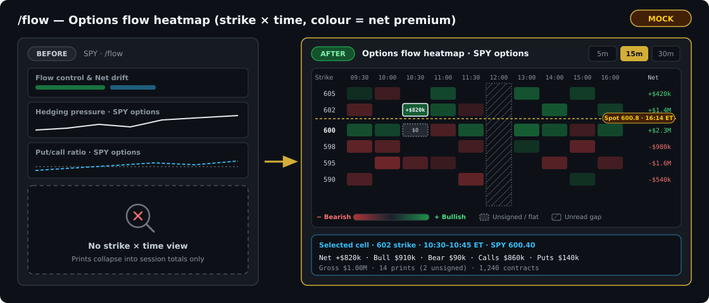
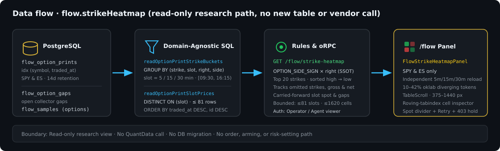

# Options flow heatmap (strike × time) on `/flow` (card `vertex-viz-flow-strike-time-heatmap`)

- **Author:** Jeff Scott Ward (written by an agent)
- **Status:** reviewed (EGM consolidated Goldfish review of 2026-11-23; all findings resolved via auto-accept, see [goldfish_review_report.md](goldfish_review_report.md))
- **Date:** 2026-11-23
- **Baseline commit:** `74aac07ef` on `vertex/rebuild-darkfactory-20260921`; branch `ws/options-flow-heatmap-strike-2`
- **Source:** research card `vertex-flow-viz-gap`, chart O29 ("Options flow heatmap: strike × time, colour = net premium").

Research view only. Nothing in this change places, changes, or cancels an order, arms trading, or changes a risk setting. The heatmap describes stored option prints; it is not a trade signal.

Figure 1 is a mock. It shows layout, descending strike ladder, diverging net-premium cells, gap hatch, latest spot divider, granularity selector, and cell inspection readout. Real sessions may hold up to 20 displayed strikes and up to 81 slots (at 5-minute granularity).

## Overview

### Terms

- **Print:** One option trade stored in `flow_option_prints` (QuantData `order-flow/consolidated`, premium `>= $10,000`, retained 14 days).
- **Symbol and ticker:** `/flow` tracks four symbols (`SPY`, `ES`, `QQQ`, `NQ`). Stored option prints exist only for `SPY` (options ticker `SPY`) and `ES` (options ticker `SPX`, where `underlying_price` is the SPX index). `QQQ` and `NQ` have no stored option prints and do not render this panel.
- **Options session:** Regular options hours `[09:30, 16:15)` New York time (405 minutes, end-exclusive) of the newest stored print's session date (`flowSessionDate` + `optionsSessionRange` in `packages/api/src/server/flow-control.ts`).
- **Aggressor side (`side`):** QuantData fill classification relative to the quote: `above_ask`, `ask`, `mid`, `bid`, `below_bid`, or `unknown`.
- **Directional sign:** Uses `OPTION_SIDE_SIGN` (`packages/api/src/flow-options.ts`, the single sign table shared with the `flow.control` options cross-check and `flow.hedgingPressure`):
  - **Bullish (`+1`):** Call at `ask`/`above_ask`, or Put at `bid`/`below_bid`.
  - **Bearish (`-1`):** Put at `ask`/`above_ask`, or Call at `bid`/`below_bid`.
  - **Unsigned (`0`):** Fill at `mid` or `unknown` side. Contributes `0` to `netPremium`, and counts toward `grossPremium`, `prints`, `unsignedPrints`, and `volume`.
- **Net premium:** `bullishPremium - bearishPremium` in US dollars. Positive values indicate net bullish option flow; negative values indicate net bearish option flow.
- **Time slot:** A fixed-width interval of `5`, `15` (default), or `30` minutes aligned to `09:30` New York time, ending at or before `16:15` New York time. At `30` minutes, the final slot (`16:00–16:15`, index 13) covers the 15-minute close and is labelled explicitly as `16:00–16:15 ET (15m close)`.
- **Open collector gap (`flow_option_gaps`):** An inclusive `[start_time, end_time]` range the flow collector has not finished paging yet. Any slot overlapping an open gap is flagged `unread: true`.
- **Auth & freshness terms:** `requireOperator` enforces an authenticated operator session (or read-only agent viewer account via `isAgentViewerReadProcedure` in `packages/api/src/server/agent-viewer.ts`, which auto-permits GET procedures; agent API keys stay excluded like `flow.putCallRatio` and `flow.hedgingPressure`). `latestSamples(symbol, ["options"])` returns the newest and newest-ok `flow_samples` rows for source `"options"` to build `FlowFreshnessSchema`.
- **UI & verification terms:** `TableScroll` (`@darkfactory/ui`) is the keyboard-accessible horizontal scroll wrapper for wide tabular surfaces. `/lab/flow` (`apps/web/src/lab/entries/research.tsx`) is the fixture gallery route for visual preview. `egm-drift-report` compares this design document against the finished code and records differences in `{YYYY-MM-DD}_DRIFT_REPORT.md`.

## The Problem

`/flow` currently displays session-wide option summaries (`flow.snapshot`), estimated dealer hedging pressure (`flow.hedgingPressure`), and cumulative/daily put-call ratios (`flow.putCallRatio`), but does not show **which strikes** drew option premium **at which times** during the session. Operators cannot see whether bullish or bearish flow clustered near spot at the open, shifted to a higher strike midday, or concentrated in one late sweep.

## Design Decisions & Rationale

1. **Data source: `flow_option_prints` only (no migration, no vendor call).**
   - `flow_option_prints` already stores `symbol`, `traded_at`, `strike`, `right`, `side`, `premium`, `size`, and `underlying_price`, indexed on `(symbol, traded_at)` (`flow_option_prints_symbol_time_idx`).
   - `flow_net_drift` (the vendor one-minute OTM net-drift table) aggregates across all strikes and cannot build a strike axis.
2. **Domain-agnostic DB layer; single sign table in `packages/api`.**
   - Postgres groups rows by `(strike, slotIndex, right, side)` without hardcoding directional sign rules in SQL.
   - `packages/api/src/flow-strike-heatmap-rules.ts` applies `OPTION_SIDE_SIGN` as the sole source of truth so numbers reconcile with `flow.control` and `flow.hedgingPressure`.
3. **Granularity: `5`, `15` (default), or `30` minutes.**
   - `15` minutes gives up to 27 slots (`09:30`–`16:15` ET), balancing intraday detail and scannability.
   - `5` minutes (up to 81 slots) exposes short bursts; `30` minutes (up to 14 slots) gives a compact overview on 375 px phones.
4. **Strike selection & ordering: Top 20 strikes by `grossPremium`, rendered descending by strike.**
   - Keeps at most `20` strikes (`FLOW_STRIKE_HEATMAP_MAX_STRIKES = 20`) ranked by `grossPremium desc` (tie-breakers: `|netPremium| desc`, `|strike - latestPrice| asc` when `latestPrice !== null`, `strike desc`).
   - Kept strikes render high-to-low (standard options ladder) with a latest-spot reference divider.
   - `totals` reports `totalStrikes`, `shownStrikes`, `omittedStrikes`, `omittedGrossPremium`, `omittedNetPremium`, and `omittedPrints` so minor-strike activity outside the top 20 is never hidden.
5. **Time axis span: `09:30` ET through `max(lastPrintSlot, lastUnreadGapSlot)` clipped to `[09:30, 16:15)` ET.**
   - Keeps live morning sessions compact without trailing empty afternoon columns while still displaying late unread collector gaps.
   - If no regular-session prints exist, returns empty `slots`, `strikes`, and `cells` with zero totals.
6. **No separate aligned SVG price strip in v1.**
   - `/flow` already renders the session underlying price line directly above this panel in `FlowHedgingPressurePanel` and `FlowPutCallRatioPanel`. Avoiding a second SVG outside `TableScroll` eliminates horizontal scroll misalignment across 375–1440 px.
   - Instead, the panel marks latest spot on the strike axis (labelled with price and ET time) and displays each slot's carried-forward underlying price in the cell inspection readout bar and column header tooltip.
7. **Colour scale, contrast, and keyboard accessibility:**
   - Diverging theme tokens (`var(--color-success)` for `netPremium > 0`, `var(--color-destructive)` for `netPremium < 0`) via `color-mix(in oklab, <token> <pct>%, transparent)` capped to `10%–42%` (`10 + (|net| / maxAbs) ** 0.65 * 32`, guarded for `maxAbs === 0`), preserving WCAG AA text contrast across light mode, dark mode, and all ten palettes.
   - Never relies on color alone: active cells show signed compact values (`+$120k`, `−$85k`, or `$0` for unsigned/flat cells) and a descriptive `aria-label`; cells with `prints > 0 && netPremium === 0` use a distinct dashed neutral border so they never look empty.
   - Roving `tabIndex` inside the grid (`tabIndex={0}` on active cell, `tabIndex={-1}` on others, Arrow/Home/End navigation) keeps sequential Tab order to one stop even at 81 × 20 cells.
   - Default selected cell is the displayed cell with the largest `|netPremium|` (tie-breakers: `grossPremium desc`, `strike desc`, `slotIndex asc`), falling back to largest `grossPremium` when all cells have `netPremium === 0`.

## Architecture & Contracts

### 1. Database Reads (`packages/db/src/server/flow.ts`)

Add two methods to `FlowRepository` (exported from `packages/db/src/server/index.ts`):

1. `readOptionPrintStrikeBuckets(query: FlowOptionPrintStrikeBucketsQuery): Promise<FlowOptionPrintStrikeBucketRecord[]>`
   - Input: `{ symbol: FlowSymbolValue; from: Date; to: Date; bucketMinutes: 5 | 15 | 30 }`.
   - Validation: rejects unsupported `bucketMinutes` or non-finite / inverted `[from, to)` by throwing `InvalidRepositoryInputError` (`packages/db/src/server/repository-errors.ts`).
   - Logical grouping: filters `flow_option_prints` by `symbol = $symbol and traded_at >= $from and traded_at < $to` (index `flow_option_prints_symbol_time_idx`), computes `slotIndex = floor(extract(epoch from (traded_at - $from)) / bucketSeconds)::int` once in `SELECT` (validated ISO timestamp + `sql.raw` integer seconds, grouping/ordering by output alias `"slotIndex"` to prevent Drizzle duplicate-parameter `GROUP BY` errors), and groups by `(strike, slotIndex, right, side)`.
   - Output fields per row (normalized with `Number(...)` and `toGroupedDate(...)`):
     `strike: number`, `slotIndex: number`, `right: "call" | "put"`, `side: FlowOptionSideValue`, `premium: number`, `prints: number`, `volume: number`, `lastTradedAt: Date`.
   - Ordered by `strike desc, slotIndex asc, right asc, side asc`.

2. `readOptionPrintSlotPrices(query: FlowOptionPrintStrikeBucketsQuery): Promise<FlowOptionPrintSlotPriceRecord[]>`
   - Same input and validation as `readOptionPrintStrikeBuckets`.
   - Uses `DISTINCT ON ("slotIndex")` over `flow_option_prints` filtered by `symbol = $symbol and traded_at >= $from and traded_at < $to and underlying_price > 0 and underlying_price < 'Infinity'::double precision and underlying_price = underlying_price`, ordered by `"slotIndex" asc, traded_at desc, id desc`.
   - Output fields per row (at most 81 rows, zero `array_agg`): `slotIndex: number`, `price: number`, `pricedAt: Date`.

### 2. Pure Rules (`packages/api/src/flow-strike-heatmap-rules.ts`)

Constants (`STRIKE_HEATMAP_RULES`, version `"strike-heatmap.v1"`):

- `minPremiumUsd: 10_000`
- `retentionDays: 14`
- `maxStrikes: 20`
- `defaultBucketMinutes: 15`
- `version: "strike-heatmap.v1"`

Pure function `foldStrikeHeatmap(input)`:

- Inputs: `buckets` (`StrikeBucketRow[]`), `slotPrices` (`SlotPriceRow[]`), `range` (`{ from: Date; to: Date }`), `bucketMinutes` (`5 | 15 | 30`), `gaps` (`{ startTime: Date; endTime: Date }[]`), `maxStrikes` (default `20`).
- Filters out invalid rows (non-finite or `<= 0` strike, out-of-bounds `slotIndex`, non-finite price `<= 0`).
- Computes `maxSlots = Math.ceil((to - from) / (bucketMinutes * 60_000))` (81 for `5m`, 27 for `15m`, 14 for `30m`).
- Classifies each `(right, side)` bucket using `OPTION_SIDE_SIGN[side] * (right === "call" ? 1 : -1)` (`+1` bullish, `-1` bearish, `0` unsigned).
- **Aggregation scope:**
  - `slots[]`, `totals`, `storedUntil`, and `latestPrice` aggregate across **all** valid session prints (before top-20 strike filtering).
  - `strikes[]` and `cells[]` include only the top `maxStrikes` strikes (ranked by `grossPremium desc`, `|netPremium| desc`, `|strike - latestPrice| asc` when `latestPrice !== null`, `strike desc`), sorted `strike desc` (and `slotIndex asc` within each strike).
  - `totals.omittedStrikes`, `totals.omittedGrossPremium`, `totals.omittedNetPremium`, and `totals.omittedPrints` sum all strikes excluded from the top `maxStrikes`.
- **Slot prices:** For each `slotIndex` in `0 .. slotCount - 1`, takes the slot's `price` from `slotPrices` when present, else carries forward the previous slot's `price` (`null` for leading slots prior to the first priced print). `latestPrice` is the newest non-null slot price (or `null`).
- **Gap overlap:** Slot `[slotStart, slotEnd)` is marked `unread: true` if any open gap satisfies `gap.startTime < slotEnd && (gap.endTime > slotStart || (gap.endTime === gap.startTime && gap.startTime === slotStart))`.

### 3. oRPC Contract & Handler (`packages/api/src/contracts/flow.ts`, `packages/api/src/server/flow-strike-heatmap.ts`, `packages/api/src/server/flow.ts`)

- Procedure: `flow.strikeHeatmap` → `GET /flow/strike-heatmap`, auth `requireOperator` (operator session or read-only agent viewer; not on agent API key read list).
- Input (`FlowStrikeHeatmapInputSchema`, `.strict()`):
  - `symbol`: `z.enum(["SPY", "ES"])`
  - `bucketMinutes`: strict coerced `5 | 15 | 30`, default `15` (rejects `""`, `"10"`, `"15.5"`, booleans, negatives).
- Output (`FlowStrikeHeatmapSchema`, `.strict()`, `schemaVersion: "flow-strike-heatmap.v1"`):
  - `schemaVersion`: `"flow-strike-heatmap.v1"`
  - `symbol`: `"SPY" | "ES"`
  - `ticker`: `"SPY" | "SPX" | "QQQ" | "NDX"` (`FlowOptionTickerSchema`)
  - `session`: `YYYY-MM-DD | null`
  - `bucketMinutes`: `5 | 15 | 30`
  - `storedUntil`: ISO timestamp `| null`
  - `options`: `FlowFreshnessSchema`
  - `unread`: `FlowHedgingUnreadSchema | null`
  - `rules`: `FlowStrikeHeatmapRulesSchema`
  - `slots` (max 81): `{ index, start, end, netPremium, bullishPremium, bearishPremium, grossPremium, prints, unsignedPrints, volume, price, unread }[]`
  - `strikes` (max 20): `{ strike, netPremium, bullishPremium, bearishPremium, callPremium, putPremium, grossPremium, prints, unsignedPrints, volume }[]`
  - `cells` (max 1620): `{ strike, slotIndex, netPremium, bullishPremium, bearishPremium, callPremium, putPremium, grossPremium, prints, unsignedPrints, volume }[]`
  - `totals`: `{ netPremium, bullishPremium, bearishPremium, callPremium, putPremium, grossPremium, prints, unsignedPrints, volume, totalStrikes, shownStrikes, omittedStrikes, omittedGrossPremium, omittedNetPremium, omittedPrints, latestPrice }`
- Handler (`readFlowStrikeHeatmapRows` in `packages/api/src/server/flow.ts`):
  - Reads `newestOptionPrintAt(symbol)`. If `null`, reads `latestSamples(symbol, ["options"])` and returns empty session response.
  - Otherwise computes `range = optionsSessionRange(session)` and runs `readOptionPrintStrikeBuckets`, `readOptionPrintSlotPrices`, `optionGaps`, and `latestSamples(symbol, ["options"])` in `Promise.all`.
- **Performance & payload budget:** Indexed scan over one session of `flow_option_prints`; at `15m` default, typical response is `<= 27` slots, `<= 20` strikes, `<= 300` sparse cells (~35–60 KB JSON); worst-case `5m` full session is bounded at `<= 81` slots, `<= 20` strikes, `<= 1620` cells.

### 4. Portal UI (`apps/web/src/features/flow/strike-heatmap-view-model.ts`, `apps/web/src/components/portal/flow-strike-heatmap-panel.tsx`, `apps/web/src/components/portal/flow-workspace.tsx`)

- **Placement:** Below `FlowPutCallRatioPanel` on `/flow`, rendered only when `symbol` is `SPY` or `ES`.
- **Independent lifecycle in `FlowWorkspace`:**
  - Extends `FlowGateway` and `createBrowserFlowGateway()` with `strikeHeatmap(input)`.
  - Uses dedicated `heatmapLatest` ref and `heatmapForbidden` ref with `loadStrikeHeatmap(targetSymbol, targetBucketMinutes)`.
  - Initial load, symbol change, and 60 s refresh trigger `loadStrikeHeatmap` (skipped while `heatmapForbidden.current` is true).
  - Clicking `5m` / `15m` / `30m` or the heatmap panel's **Retry** button calls `loadStrikeHeatmap` alone without refetching other panels or resetting the 60 s timer.
  - Switching `symbol` clears `strikeHeatmap` and `strikeHeatmapFailure` immediately and retains `bucketMinutes`.
  - During a `bucketMinutes` switch, keeps the previous grid visible with a loading indicator; if the switch fails, the error banner notes which bucket width is currently shown.
- **Grid & interaction:**
  - Header controls: `5m`, `15m`, `30m` `@darkfactory/ui` `Button` controls (`>= 44×44 px` touch targets, `aria-pressed`).
  - Table inside `TableScroll` with sticky left `Strike` column, scrollable time-slot columns (`09:30` .. end), and right `Net` summary column per strike.
  - Spot reference divider row or badge placed accurately (above top strike, at exact strike, between strikes, or below bottom strike; omitted when `latestPrice === null`), showing latest spot and `storedUntil` ET time.
  - Cell inspection readout bar showing selected cell's Strike, Time range (ET), Net premium, Bullish vs Bearish premium, Call vs Put premium, Gross premium, Prints (with unsigned count), Contracts, and underlying price at that slot.
  - Roving `tabIndex` + arrow/Home/End keyboard navigation across active cells.
  - Complete states: loading, empty (no prints in 14 days / no regular-session prints), transient error with Retry over stale response, hard error with Retry, and open-gap incomplete warning.

## Changed-Files Manifest

- `docs/vertex-rebuild/designs/vertex-viz-flow-strike-time-heatmap/{design.md,goldfish_review_report.md,before-after-mock.svg,data-flow.svg,2026-11-23_DRIFT_REPORT.md}`
- `packages/db/src/server/flow.ts`, `packages/db/src/server/flow.test.ts`, `packages/db/src/server/index.ts`
- `tests/integration/database/flow-strike-heatmap.test.ts`
- `packages/api/src/contracts/flow.ts`, `packages/api/src/flow-strike-heatmap-rules.ts`, `packages/api/src/flow-strike-heatmap-rules.test.ts`, `packages/api/src/flow-strike-heatmap.contract.test.ts`
- `packages/api/src/server/flow-strike-heatmap.ts`, `packages/api/src/server/flow-strike-heatmap.test.ts`, `packages/api/src/server/flow.ts`, `packages/api/src/server/flow.test.ts`, `packages/api/src/server/flow-collect.test.ts`, `packages/api/src/index.ts`, `packages/api/src/agent-viewer.test.ts`, `packages/api/openapi.json`
- `apps/web/src/features/flow/strike-heatmap-view-model.ts`, `apps/web/src/features/flow/strike-heatmap-view-model.test.ts`
- `apps/web/src/components/portal/flow-strike-heatmap-panel.tsx`, `apps/web/src/components/portal/flow-strike-heatmap-panel.test.tsx`, `apps/web/src/components/portal/flow-workspace.tsx`, `apps/web/src/components/portal/flow-workspace.test.tsx`
- `apps/web/src/lab/fixtures/flow.ts`, `apps/web/src/lab/fixtures/fixtures.test.ts`, `apps/web/src/lab/entries/research.tsx`, `apps/web/src/lab/entries/research.test.tsx`
- `docs/vertex-rebuild/flow-pipeline.md`, `docs/debugging.md`, `CHANGELOG.md`

## Risks & Mitigations

| Risk | Mitigation |
| --- | --- |
| Outlier sweep washes out normal cells in color intensity | Non-linear `ratio ** 0.65` scale mapped to contrast-safe `10%–42%` `oklab` mix keeps smaller active clusters visible and text legible across all palettes. |
| Many strikes in volatile SPX sessions crowd the DOM | Cap displayed rows at top `20` strikes by `grossPremium` and surface `omittedStrikes`, `omittedGrossPremium`, and `omittedNetPremium`. |
| Mid/unknown prints misread as empty cells | Count `unsignedPrints` separately and style `prints > 0 && netPremium === 0` cells with a distinct dashed neutral border and `$0` label. |
| Open collector gaps make unread slots look quiet | Mark overlapping slots `unread: true`, apply hatched shading, and display the incomplete-session notice with exact ET time range. |
| Narrow 375 px phone view causes page horizontal overflow | Constrain grid inside `TableScroll` with sticky strikes and wrap header controls cleanly; verify at 375, 768, 1024, and 1440 px in headless Chrome. |
| Slow `5m` request lands after switching to `15m` or another symbol | Dedicated `heatmapLatest` sequence ref discards stale responses without refetching unrelated `/flow` panels. |

## Verification & Acceptance Criteria

1. **DB unit & Postgres integration tests:** `packages/db/src/server/flow.test.ts` and `tests/integration/database/flow-strike-heatmap.test.ts` prove SQL bucketing (`5m`/`15m`/`30m`), `(strike, slotIndex, right, side)` grouping, `DISTINCT ON` slot prices with `(traded_at desc, id desc)` tie-breaking, invalid-input errors, and session bounds.
2. **Contract, rule & server tests:** 100% coverage across `flow-strike-heatmap-rules.ts`, `server/flow-strike-heatmap.ts`, `flow-strike-heatmap.contract.test.ts`, `server/flow.test.ts`, and `agent-viewer.test.ts`.
3. **UI & view-model tests:** 100% coverage across `strike-heatmap-view-model.ts`, `flow-strike-heatmap-panel.tsx`, `flow-workspace.test.tsx`, and `/lab/flow` fixture tests.
4. **Gates & live visual proof:** `bun run openapi:generate`, `bun run verify:prepush`, headless Chrome screenshots of `/lab/flow` in dark and light modes across 375–1440 px confirming zero horizontal overflow, legible cells, and readable spot/gap/inspector states, plus `egm-drift-report` and fresh-context full-diff code review.
