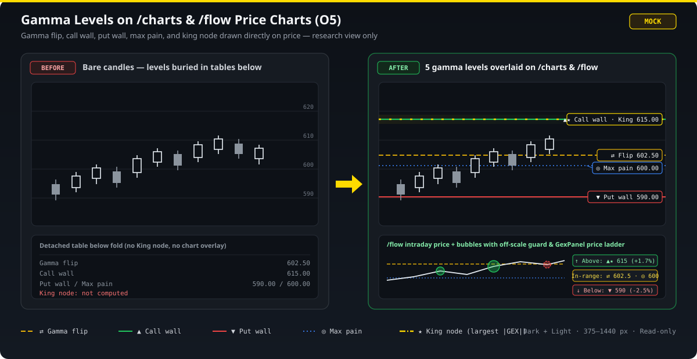
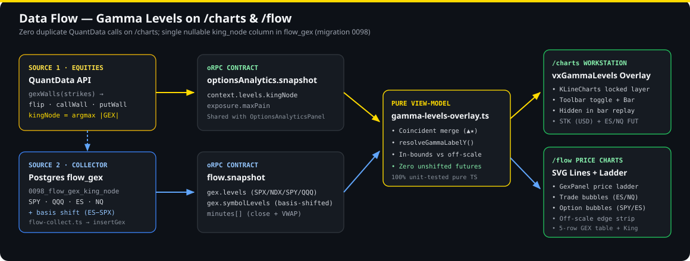

# Gamma levels on /charts and /flow price charts (O5)

- **Card:** `vertex-viz-gamma-levels-on-chart` (chart **O5** from `vertex-flow-viz-gap`)
- **Status:** implemented and verified (read-only research view)
- **Prerequisite:** `vertex-gamma-flip-sources` (merged in PR #399)

Research view only. Nothing in this change places, changes, or cancels an order, arms trading, or changes a risk setting.

## Requirement classification

- **Core:** none (no change to reusable DarkFactory template primitives).
- **Capability:** read-only research chart overlay and level persistence within the Vertex portal vertical.
- **Convention:** contracts first, Drizzle generated migration (`0095_flow_gex_king_node`), oRPC only, strict TypeScript, 100% coverage on all new and touched non-baseline files, dark + light tokens, WCAG non-color encoding, 375–1440 px responsive layout.

## Definitions and math

All five levels use the existing QuantData dealer-gamma estimate (`packages/api/src/server/gex-context.ts`, sign convention: dealers long calls, short puts):

| Level | Key | Definition | Visual encoding |
| --- | --- | --- | --- |
| Gamma flip | `flip` | Nearest zero crossing of the estimated GEX spot sweep | Amber (`--warning`) long dash `8 4` · `⇄` |
| Call wall | `callWall` | Strike with the largest positive estimated net GEX (`gex > 0`) | Green (`--success`) solid · `▲` |
| Put wall | `putWall` | Strike with the most negative estimated net GEX (`gex < 0`) | Red (`--destructive`) solid · `▼` |
| Max pain | `maxPain` | Strike minimizing aggregate open-interest holder payout | Blue (`--info`) dotted `2 4` · `◎` |
| King node | `kingNode` | Strike with the largest absolute estimated net GEX (`argmax \|gex\|`, `gex !== 0`) | Theme chart accent (`--chart-1`) dash-dot `10 3 2 3` · `★` |

Because `kingNode` maximizes `|net GEX|`, it shares a strike with either `callWall` or `putWall` whenever non-zero GEX exists. `groupCoincidentGammaLevels` merges exact-price coincidences into one line with a combined pill (for example, `▲★ Call wall · King 615.00`) and a `--chart-1` accent overlay dash, while legends and tables list all five levels explicitly.

## Schema and contract changes

1. **Database (`packages/db`):** Adds nullable `king_node double precision` to `flow_gex` (`migrations/0095_flow_gex_king_node.sql`, guarded reversal `rollback/0095_flow_gex_king_node.down.sql`). Existing rows stay valid with `king_node = NULL` until subsequent collector runs populate it.
2. **oRPC contracts (`packages/api`):**
   - `optionsAnalytics.snapshot`: adds `context.levels.kingNode: finite.nullable()` computed in `gexWalls`.
   - `flow.snapshot`: adds `kingNode: finite.nullable()` to `gex.levels` and basis-shifted `gex.symbolLevels`.
   - `packages/api/openapi.json` regenerated and verified with `bun run openapi:check`.

## Portal surfaces

1. **`/charts` (`ChartsWorkspace`):**
   - KLineCharts custom overlay `vxGammaLevels` (`apps/web/src/features/charts/gamma-levels-overlay.ts`, wired through `kline-adapter.ts`, `ChartWorkstation`, and `MarketBarsChart`): locked (`lock: true`, `ignoreEvent: true`), non-overlapping right-edge pills (`resolveGammaLabelY`), top/bottom edge summaries for off-viewport levels, and Object Tree listing.
   - `ChartToolbar` toggle (`Gamma levels`, 44 px target) + `GammaLevelsBar` legend/status/source-disclosure strip.
   - US equities (`STK`/`USD`) reuse the `OptionsAnalyticsPanel` snapshot via `onReport` (zero duplicate QuantData requests); supported futures (`ES`/`NQ`) read stored basis-shifted `flow_gex` via `flow.snapshot` and never plot unshifted index levels when `basis` is null.
   - Suppressed automatically during bar replay so live levels never leak onto historical replay bars.
   - `OptionsAnalyticsPanel` also lists `King node (largest |GEX|)` alongside Gamma flip, Call wall, and Put wall.
2. **`/flow` (`FlowWorkspace`):**
   - `GexPanel` renders `FlowGammaLevelsChart` (intraday close/VWAP or spot ladder with all five gamma levels fitted cleanly into bounds) above the updated 5-row GEX levels table.
   - `FlowTradeBubblesPanel` (`ES`/`NQ` 1-min candles + VWAP) and `FlowOptionBubblesPanel` (`SPY` / `ES` (`SPX` options) underlying price path) overlay in-range levels via `SvgGammaLevelLines` (using `document.ticker` so `ES` Option Bubbles plots unshifted `SPX` levels) with an accessible `Gamma levels` toggle and list out-of-range levels in `OffScaleGammaLevelsStrip` so intraday candles and bubbles are never compressed.

## Acceptance check

- All 5 levels (`flip`, `callWall`, `putWall`, `maxPain`, `kingNode`) computed, typed in oRPC + OpenAPI, persisted in `flow_gex`, and drawn on `/charts` and `/flow` price charts.
- 100% statement, branch, function, and line coverage on all new and touched non-baseline files.
- `bun run verify:core`, `db:check`, unit/contract/operations tests, and fresh-context code review pass cleanly.
