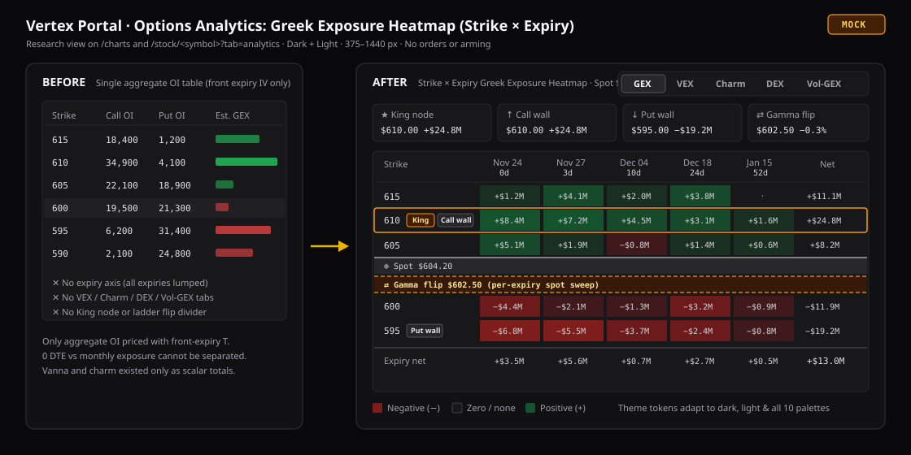
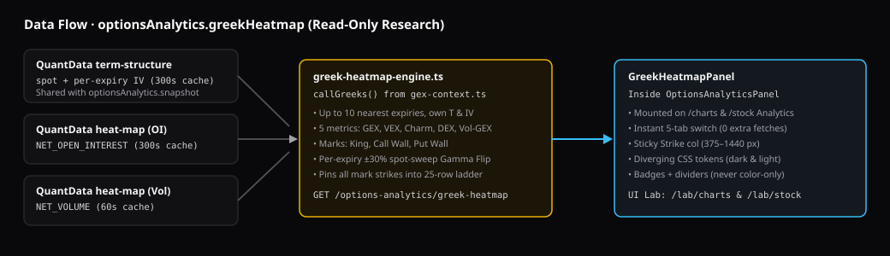

# Greek Exposure Heatmap (Strike × Expiry) — card `vertex-viz-greek-heatmap`

Figure 1 is a mock illustrating the panel layout, five metric tabs, diverging exposure matrix, mark cards, and ladder dividers.

## Overview

Research view only. Nothing in this change places, changes, or cancels an order, arms trading, or changes a risk setting.

- **Card:** `vertex-viz-greek-heatmap` (from research card `vertex-flow-viz-gap`, charts O1, O2, O3, O4, O27).
- **Surface:** `OptionsAnalyticsPanel` on `/charts` and `/stock/<symbol>?tab=analytics` (plus `/lab/charts` and `/lab/stock` in the UI lab).
- **Procedure:** `optionsAnalytics.greekHeatmap` (`GET /options-analytics/greek-heatmap`, guarded by `requireOperator`, readable by the read-only agent viewer, not on `AGENT_API_KEY_READ_PROCEDURES`).

## Data Sources and Quota

The endpoint makes three cached QuantData requests per symbol through the shared server-side rate-limited client (`quantDataClientFor`):

1. `POST /v1/options/tool/term-structure` (300 s TTL): underlying `stockPrice` plus per-expiry, per-strike IV. Uses the exact same endpoint, payload, and cache key as `optionsAnalytics.snapshot` and `optionsChain`, so loading the heatmap alongside the analytics snapshot spends zero additional `term-structure` quota.
2. `POST /v1/options/tool/heat-map` with `dataMode: "NET_OPEN_INTEREST"` (300 s TTL): per-expiry, per-strike call and put open interest (`{ callValue, putValue }`).
3. `POST /v1/options/tool/heat-map` with `dataMode: "NET_VOLUME"` (60 s TTL): per-expiry, per-strike session call and put volume (`{ callValue, putValue }`).

Each metric reports its own status (`ok`, `empty`, or `failed`) and cause message so a failure in volume does not hide the four open-interest tabs, and vice versa. HTTP 422 from `heat-map` is QuantData's "data-unavailable" answer (no data for those inputs), so the metric is `empty`, not `failed`.

Request budget (base cap of 2026-11-25: 54 request starts per 60 s in `quantdata-client.ts`, of which the flow collector leaves `FLOW_QUANTDATA_CALLER_RESERVE = 6` free for `/charts` and `/stock` reads):

- The portal asks for the heatmap only after `optionsAnalytics.snapshot` of the same symbol answered, so `term-structure` is a cache hit. One uncached symbol costs 5 starts: 3 for the snapshot and 2 for the heatmap. Before the heatmap it cost 3. The count also holds when the reads overlap: a queued read checks the client cache again when it reaches the head of the queue, so an identical read that starts while the first one is still open (for example the Expected move read on `/charts`, which asks for the same `term-structure` and 24 h `order-flow`) gets the answer of the first and makes no start. A failed read is not cached, so the identical read after it makes its own start.
- One uncached symbol per 60 s always fits inside the reserve of 6. A second uncached symbol in the same window fits only when the collector left starts unused (a live collector tick uses at most 32 of its 48). Requests beyond the free starts are not sent: those sections show the rate limit with a retry time, and the answer stays HTTP 200.
- The total cap does not change, so the heatmap cannot raise the load on the QuantData account (240 requests per 60 s, shared with the market-watch jobs).
- `packages/api/src/greek-heatmap.test.ts` pins the count of 5 starts against the reserve. `packages/api/src/options-analytics.test.ts` pins it for `optionsAnalytics.snapshot`, `optionsChain` and the heatmap called at the same time.

## Formulas and Marks

All five tabs reuse `callGreeks(spot, strike, iv, years)` from `packages/api/src/server/gex-context.ts` (zero-rate Black-Scholes, each expiry's own days to expiry floored at 0.5 days for 0 DTE, strike IV with expiry ATM IV fallback, strikes within 50%–150% of spot, up to 10 nearest unexpired expiries):

| Tab | Metric | Per-cell formula at `(expiry, strike)` | Sign convention |
| --- | --- | --- | --- |
| `GEX` | Gamma exposure | `(OI_c · 100 · Γ_c − OI_p · 100 · Γ_p) · S² · 0.01` | Dealers long calls (+), short puts (−) |
| `VEX` | Vanna exposure | `(OI_c · 100 · Vanna_c − OI_p · 100 · Vanna_p) · S · 0.01` | Dealers long calls (+), short puts (−) |
| `Charm` | Charm exposure | `((OI_c · 100 · Charm_c − OI_p · 100 · Charm_p) · S) / 365` | Dealers long calls (+), short puts (−) |
| `DEX` | Delta exposure | `(OI_c · 100 · Δ_c + OI_p · 100 · (Δ_p − 1)) · S` | Holders' side (calls +, puts −) |
| `Vol-GEX` | Volume-weighted GEX | `(Vol_c · 100 · Γ_c − Vol_p · 100 · Γ_p) · S² · 0.01` | Dealers long calls (+), short puts (−) |

Marks computed per metric across all in-range strikes of the shown expiries (all marked strikes are pinned into the 25-row strike ladder):

- **King node (`kingStrike`):** strike with the largest absolute net exposure (`|total|`). Tie-break: nearest spot, then higher strike.
- **Call wall (`callWall`):** strike with the largest positive net exposure (`total > 0`). Tie-break: nearest spot, then higher strike.
- **Put wall (`putWall`):** strike with the most negative net exposure (`total < 0`). Tie-break: nearest spot, then lower strike.
- **Gamma flip (`flip`):** per-expiry spot-sweep zero crossing (`±30%` around spot in 120 steps, fixed IV, each expiry's own time to expiry), nearest to spot. Computed for `GEX` and `Vol-GEX`; `VEX`, `Charm`, and `DEX` show the `GEX` flip as a labeled reference line.

## UI and Accessibility

- Five tabs with WAI-ARIA `tablist` semantics (`ArrowLeft`, `ArrowRight`, `Home`, `End`) and `min-h-11` (44 px) touch targets.
- Sticky left `Strike` column inside an `overflow-auto` container so mobile viewports (`375 px`) scroll expiries horizontally without losing strike labels or badges.
- Diverging background fill uses `color-mix(in oklab, var(--color-success|destructive) 8%..42%, transparent)` so contrast holds in dark, light, and all ten theme palettes.
- State never relies on color alone: every populated cell prints its signed compact dollar value (`+$4.3M`, `−$450K`) with full-precision tooltip; marks carry explicit icons and text badges (`King`, `Call wall`, `Put wall`, `Spot`, `Flip`).

## Verification

- Contract tests: `packages/api/src/greek-heatmap.contract.test.ts`
- Engine and procedure unit tests: `packages/api/src/greek-heatmap.test.ts` (100% statements, branches, functions, lines on `greek-heatmap-engine.ts`, `options-analytics.ts`, `contracts/options-analytics.ts`)
- View-model and UI tests: `apps/web/src/features/options-heatmap/view-model.test.ts`, `apps/web/src/components/portal/greek-heatmap-panel.test.tsx`, `apps/web/src/components/portal/options-analytics-panel.test.tsx`, `apps/web/src/lab/fixtures/fixtures.test.ts`, `apps/web/src/lab/entries/charts.test.tsx` (100% statements, branches, functions, lines across all six touched web files)
- Status language and agent viewer guards: `packages/api/src/status-language.test.ts`, `apps/web/src/status-language.test.ts`, `packages/api/src/agent-viewer.test.ts`
