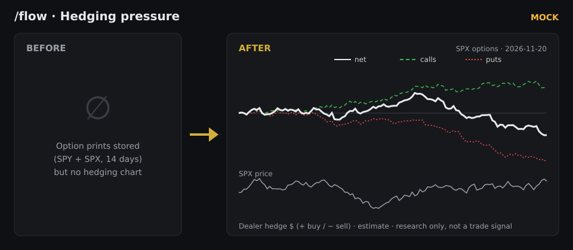
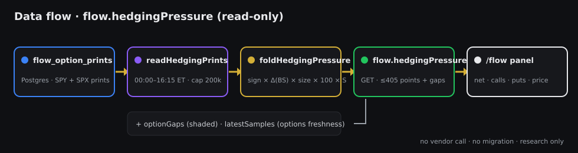

# Hedging pressure line on /flow (card vertex-viz-hedging-pressure)

- **Author:** Jeff Scott Ward (written by an agent)
- **Status:** reviewed (EGM consolidated review of 2026-11-22; fixes applied, see
  [goldfish_review_report.md](goldfish_review_report.md))
- **Date:** 2026-11-22
- **Baseline commit:** `86faca3a` on `vertex/rebuild-darkfactory-20260921`; branch `ws/viz-hedging-pressure`
- **Source:** research card `vertex-flow-viz-gap`, chart O28 "Hedging pressure line (HIRO-style)".
  The gap report is an internal page on the owner's private network; the row reads: "Signed delta
  notional that dealers must hedge from each print, cumulated. See real-time hedging pressure behind
  moves. Vertex today: nothing."

Research view only. Nothing in this change places, changes or cancels an order, arms trading or
changes a risk setting. The line is an estimate, not a trade signal.

Figure 1 is a mock: it shows the panel layout only. It leaves out the header line, the y-axis
labels, the totals lines and the rule text of section "User experience", and it draws straight
segments where the panel draws stepped lines.

## Overview

### Terms

- **Print**: one option trade stored in `flow_option_prints` (QuantData
  `order-flow/consolidated`, read by the flow collector `packages/api/src/server/flow-collect.ts`).
- **Symbol and ticker**: `/flow` uses four symbols (SPY, ES, QQQ, NQ; `FLOW_INSTRUMENTS` in
  `packages/api/src/flow-features.ts`). Option prints are collected for two of them: symbol SPY
  stores SPY options (ticker SPY), and symbol ES stores SPX options (ticker SPX), the index options
  of the S&P 500 group. For ES the stored `underlying_price` is the SPX index, so the ES line is in
  SPX index dollars, not ES futures dollars.
- **Aggressor side**: the stored `side` of a print: `above_ask`, `ask`, `mid`, `bid`,
  `below_bid` or `unknown` (vendor classification of the fill price against the quote).
- **`right`**: call or put.
- **Dealer**: the market maker that takes the other side of a customer print.
- **Sign**: +1 when the customer bought, -1 when the customer sold, none otherwise (rule 3).
- **Delta**: the change of an option price for a change of 1 in the underlying price. A call delta
  is between 0 and 1; a put delta is between -1 and 0.
- **Hedge notional of a print**: `sign × delta × size × 100 × underlying_price`, in US dollars,
  with the delta at the time of the print. It is the estimated dollar value of underlying that the
  dealer would buy (positive) or sell (negative) to stay delta-neutral right after the print,
  assuming that the dealer took the other side (rule 3).
- **Hedging pressure line**: the running sum of the hedge notional of the prints of one regular
  options session (09:30 to 16:15 New York time), in time order.
- **Options session**: 09:30 to 16:15 New York time of one date (`optionsSessionRange` in
  `packages/api/src/server/flow-control.ts`, the session that the `/flow` control panel uses).
- **Gap**: a time range that the collector has not read yet. It reads at most 6 pages per run and
  queues the rest in `flow_option_gaps`; later runs fill it (section "Options paging and gaps" of
  `docs/vertex-rebuild/flow-pipeline.md`). A filled gap adds prints to the past of the line.
- **Source freshness**: the state of the options source of a symbol from its newest stored sample
  (`buildSourceFreshness` in `packages/api/src/server/flow-snapshot.ts`): `fresh` (an ok sample
  newer than the source's stale limit while the session is open), `stale` (older), `closed` (the
  session is closed) or `never` (no ok sample).
- **Operator session and agent viewer**: `/flow` procedures need an operator session
  (`requireOperator`). The read-only agent viewer account may also call every GET procedure
  (`isAgentViewerReadProcedure` in `packages/api/src/server/agent-viewer.ts`). Agent API keys
  reach only the procedures on `AGENT_API_KEY_READ_PROCEDURES`; this procedure is not on it, like
  `flow.tapeSpeed`.
- **Response**: one `flow-hedging-pressure.v1` answer of `flow.hedgingPressure`.
- **HIRO**: SpotGamma's name for a similar indicator
  ([user guide](https://spotgamma.com/wp-content/uploads/2025/10/SpotGamma-HIRO-User-Guide.pdf)).
  Vertex copies the idea only; it does not use SpotGamma data or claim the same numbers.

## The Problem

Vertex stores the SPY and SPX option prints that QuantData returns (premium $10,000 or more) in
`flow_option_prints`, but it shows no estimate of the underlying trading that dealers would do to
delta-hedge those prints. The line estimates one thing: during this session, did the signed option
prints imply dealer buying or selling of the underlying, and when?

## Goals

1. Show the hedging pressure line of the newest options session for SPY (SPY options) and ES (SPX
   options) on `/flow`, with separate call and put lines and the underlying price on the same time
   axis.
2. Use only stored data: no new vendor request, no new table and no migration, so the line works on
   every stored print from the first deploy.
3. State the assumptions and the data limits on the screen: the dealer-side rule, the delta at
   print time, the prints that are not counted, the $10,000 minimum premium and open gaps.
4. Light, dark and system themes; widths 375, 768, 1024 and 1440 px; contrast per
   `design-system/darkfactory/MASTER.md`.

## Non-Goals

1. No trade signal, alert or score, and no input to any engine, rule or the confluence vote of
   `flow.snapshot`.
2. No QQQ or NQ line: Vertex stores no option prints for them. The page already says so in its
   "not collected" line (`notCollectedLine`), so the panel is not rendered for them.
3. No vendor delta (section "Alternatives Considered", alternative D2).
4. No past sessions: the procedure has no date input in version 1.
5. No re-marking of earlier prints when spot or time moves (section "Risks and Mitigations").

## Open Questions

None blocks version 1. Recorded for later:

1. Does the QuantData flow row carry a delta, under which field name and units? No raw row is
   stored, so this needs one captured response. It decides whether alternative D2 replaces D1.

## Critical User Journeys

1. **Read today's pressure.** The operator opens `/flow` on SPY during the session. The panel
   shows the net, call and put lines from 09:30 to the newest counted minute, the SPY price under
   them, and the end values. The line updates with each page refresh (every 60 s).
2. **Read after the close or on a weekend.** The panel shows the newest stored session (Friday on
   a weekend or holiday) with the freshness state `closed`.
3. **Read an incomplete session.** The collector has an open gap inside the session. The panel
   shades the gap on both charts and the header says "Incomplete: prints of HH:MM–HH:MM ET not read
   yet; earlier parts of the line can still change."
4. **Switch to QQQ or NQ.** The panel is not rendered and no call is made; the page's existing
   "not collected" line names the missing option prints.
5. **The call fails.** The panel shows one error line with the time of the next refresh; the last
   response stays below it. Other panels do not change.

## Technical Plan (Architecture)

### Read path

`flow.hedgingPressure` (GET `/flow/hedging-pressure`, input `{ symbol: "SPY" | "ES" }`):

1. `repository.newestOptionPrintAt(symbol)`. Null: answer with `session: null` and no points.
2. Session date = `flowSessionDate(newest)` (`server/flow-snapshot.ts`): the newest session at or
   before the newest print, so a Sunday or a Monday 02:00 print maps to Friday.
3. Read the prints of `optionsSessionRange(date)` (09:30 to 16:15, end-exclusive) with the new
   repository method `readHedgingPrints` (needed columns only, ascending by `traded_at` then `id`,
   limit `HEDGING_READ_CAP + 1`). Prints before 09:30 are not read and not counted.
4. `repository.optionGaps(symbol)`, reduced like the cross-check of `flow.control`
   (`server/flow-control.ts`): the gaps that overlap the options session give one covering span
   (oldest start to newest end, clipped to the session) and their count.
5. `repository.latestSamples(symbol, ["options"])` for the source freshness.
6. The pure fold (next section) and the response assembly.

### Computation (pure rules, version `hedging-pressure.v1`)

1. **Range.** Only prints in `[09:30, 16:15)` New York time are read (read path step 3).
2. **Order. Prints are folded in `traded_at` order; equal times keep the read order (`id`).
3. **Sign.** `above_ask` and `ask`: +1. `bid` and `below_bid`: -1. `mid` and `unknown`: none.
   This is the same side grouping as the ask-side and bid-side premium of `flow.snapshot`. The rule
   assumes that the dealer is the other side of every signed print. This is an assumption, not a
   fact of the data. It differs from the GEX convention of `/flow` (dealers long calls, short puts),
   which describes open interest, not single prints.
4. **Per print, in this order:**
   1. `prints += 1`.
   2. No sign: `notSigned += 1`; stop.
   3. `signed += 1`.
   4. `iv`, `dte` or `underlying_price` null: `notPriced += 1`; stop.
   5. Volatility `σ`: `iv ÷ 100` (`iv` is stored in percent). When `iv < 1` (the vendor sends
      0.0477 on deep in-the-money options it cannot solve), `σ = volFallback` (0.20) and
      `ivAdjusted += 1`.
   6. Time in years `T = max(dte, 0) ÷ 365` (`dte` is stored in days; `bsDelta` handles 0).
   7. `delta = bsDelta(right, underlying_price, strike, T, r, q, σ)` with
      `r = OPTIONS_CHAIN_RISK_FREE_RATE` (0.04, the options chain assumption) and
      `q = DIVIDEND_YIELD.get("SPY")` (0.015; SPX has the same index yield). `bsDelta` refuses a
      non-finite input, a spot, strike or volatility of 0 or less, and a negative time; such a
      throw counts as `notPriced += 1` and stops (reachable, for example with a NaN or infinite
      `iv`, or `underlying_price` 0).
   8. `notional = sign × delta × size × 100 × underlying_price`. Add it to `net`, and to `calls` or
      `puts`; `gross += |notional|`.
5. **Minutes.** Line prints are grouped by the minute of `traded_at`. A minute appears when it has
   at least one line print (at most 405 minutes). Each point holds the running sums at the end of
   the minute (`net`, `calls`, `puts`), the minute's own `minuteNet`, its `prints`, and `price`:
   the `underlying_price` of its last print with a price, else the previous point's price, else
   null.
6. **Largest minutes.** `largestRise` is the point with the largest positive `minuteNet` and
   `largestFall` the point with the most negative one (first wins on equal values); null when no
   such minute exists.
7. **Read cap.** At most `HEDGING_READ_CAP` = 200,000 prints per session (about 7.8 times the busiest stored day,
   25,688). When the read returns more, the newest prints are dropped and `truncated` is true.

### Procedure and response

The handler mirrors `flow.tapeSpeed` (`packages/api/src/server/flow.ts`): `requireOperator`,
`readRows` (a failed read is `STORAGE_ERROR`), `assemble`. Response `flow-hedging-pressure.v1`:

| Field | Type | Meaning |
| --- | --- | --- |
| `schemaVersion` | literal | `flow-hedging-pressure.v1` |
| `symbol`, `ticker` | enum | `SPY`/`SPY` or `ES`/`SPX` |
| `session` | date or null | New York date; null when no print is stored |
| `rules` | object | `version`, `rate`, `dividendYield`, `volFallback`; the panel builds its rule text from them |
| `options` | freshness row | the `options` source row, same shape as in `flow.snapshot` |
| `storedUntil` | timestamp or null | `traded_at` of the newest counted line print |
| `truncated` | boolean | the read cap dropped prints |
| `unread` | object or null | open gaps inside the session: `from` (oldest start), `to` (newest end), both clipped to the session, and `ranges` (count) |
| `totals` | object | `prints`, `signed`, `notSigned`, `notPriced`, `ivAdjusted`; `net`, `calls`, `puts`, `gross` (US dollars); `largestRise`, `largestFall` (`{ minute, minuteNet }` or null) |
| `points` | list, at most 405 | `minute` (timestamp), `net`, `calls`, `puts`, `minuteNet`, `prints`, `price` (number or null) |

Errors: the `FLOW_API_ERRORS` set of the other flow procedures.

### Page

`FlowHedgingPressurePanel` sits below the Tape speed panel on `/flow`. The workspace loads it in its
own call beside tape speed (not awaited with the snapshot), skips QQQ and NQ, and clears it on a
symbol change. Rendering follows the Tape speed panel: view-model geometry, SVG in the component.

## User experience

- **Title.** "Hedging pressure · SPY options" or "Hedging pressure · SPX options (ES)".
- **States.** Loading ("Loading hedging pressure…"; the charts keep their height). Failed: one
  error line "Hedging pressure not loaded: <code>: <message> · retrying with the next refresh";
  the last response stays below it. Empty: "No option prints stored for <symbol> in the last 14
  days." A forbidden answer shows the access screen of the page, like tape speed.
- **Header line.** "Session <date> · as of <HH:MM> ET · options <freshness>", plus "· read cap
  reached, prints after <HH:MM> ET not counted" when truncated, plus the incomplete sentence of
  journey 3 when `unread` is not null (the span `from`–`to`).
- **Chart 1, hedging pressure (fixed height).** Three stepped lines on a time axis from 09:30 to
  the newest point: net (solid, foreground color, stroke 2 px), calls (dashed, info color, 1.5 px)
  and puts (dotted, warning color, 1.5 px). Green and red are not used, because a positive put line
  or a negative call line is normal. A zero line. Three to five y-axis labels in signed compact
  dollars ("+$1.2B", "−$56.7K", "$0"). The `unread` span is shaded.
- **Chart 2, price (fixed height).** The underlying price per point (SPY, or SPX index for ES),
  thin line, with its low and high labels.
- **Legend.** A line sample for net, calls, puts and the gap shade.
- **Totals lines.** "Net +$1.2B · calls +$2.0B · puts −$0.8B · gross $5.1B" and "Largest rise
  +$310M at 10:42 ET · largest fall −$450M at 15:58 ET".
  Counts: "3,100 prints · 2,800 signed · 300 not signed (mid or no side) · 12 not priced · 40 IV
  adjusted".
- **Rule text.** "Estimate. Each print is signed by its aggressor side, assuming the dealer took
  the other side; mid prints and prints without a side are not counted. Delta is Black-Scholes at the print time
  (rate 4%, yield 1.5%) from the print's IV; it is not updated as price moves. Only prints with
  premium of $10,000 or more are stored; prints before 09:30 ET are not counted. Research only,
  not a trade signal. hedging-pressure.v1." The numbers come from `rules`.
- **Accessibility.** Each SVG has `role="img"` and an `aria-label` with the session, the end
  values and the largest rise and fall with their times. The panel has no interactive control.
  Text uses the theme tokens of MASTER.md (WCAG AA 4.5:1); the dash patterns, not only color,
  tell the lines apart.
- **Lab.** `/lab/flow` serves an SPY response (rise then fall, one open gap) and an ES response
  (not-signed, not-priced and IV-adjusted counts). The empty, truncated and failed
  states are covered by component tests.

## Risks and Mitigations

| Risk | Effect | Mitigation |
| --- | --- | --- |
| The dealer-side assumption is wrong for a print (customer to customer, spread legs) | Wrong size or sign | Rule text names the assumption; the line is labeled an estimate |
| Delta is frozen at print time; dealers re-hedge as spot and time move (gamma) | The line is "signed delta at print time", not the dealers' current hedge need; largest error on short-dated SPX days | Rule text says the delta is not updated; alternative C3 records the cost of re-marking |
| Large multi-leg trades (for example 133,500 SPY puts at 16:03 ET on 2026-11-20, $174M premium) | One minute moves the line a lot | `largestRise` and `largestFall` are shown in the totals and the aria label |
| Open gaps from the collector page cap | The line understates and later changes | The unread span is read, shaded and named in the header |
| The $10,000 minimum premium | Small prints are missing | Rule text says so |
| Vendor IV placeholder (0.0477%) on 7,297 stored prints, mostly deep in the money; 965 within 2% of spot with under 0.5 days to expiry | Delta error for those prints | Fallback volatility 0.20 instead of 0.01, which gives a delta near ±1 when deep in the money and a moderate delta near the money; counted as IV adjusted |
| Rate and yield are fixed assumptions | Small delta error on long-dated prints | Same assumptions as the options chain; named in the rule text |
| Stale collector | An old session looks current | Header shows the options freshness state and the session date |
| A bad row (non-finite number) | Could throw and fail the panel | Step 4.4 guards every `bsDelta` input; tests with NaN and Infinity |
| Read cost | One indexed read and a fold per open page each 60 s | 15 ms database execution for 25,688 rows (measured); end-to-end target under 300 ms, measured after deploy; read cap |
| Access | New GET endpoint | Operator session or agent viewer only; not on the agent API key list; no input except the symbol enum |

## Alternatives Considered

### Alternative C1: Store per-minute sums in the collector

Rejected for version 1. It needs a new table and a migration (against goal 2), it must recompute
a minute when a gap fills, and the read is already 15 ms.

### Alternative C2: Fold in the browser

Rejected. The browser would download up to 25,688 rows per refresh instead of at most 405 points,
and the agent viewer would get no computed numbers.

### Alternative C3: Re-mark the delta of all earlier prints each minute

Rejected for version 1. It needs about 25,000 prints × 405 minutes Black-Scholes calls per read
and a model of which positions are still open, which the data does not hold.

### Alternative D1: Black-Scholes delta from the stored print IV (chosen)

Uses each print's own IV and spot at trade time and works on every stored print. Costs: the IV
fallback rule and Vertex deltas that can differ from vendor deltas.

### Alternative D2: Store the vendor delta from the flow row

Rejected for version 1: it needs a new column and a migration, the field name and units are not
verified (open question 1), and the stored rows have no value, so the line would be empty until new
prints arrive. Revisit when open question 1 is answered.

### Alternative D3: Delta from the current QuantData chain

Rejected: it is the delta now, not at the print time, and it adds vendor calls to every read.

### Alternative S1: Sign by the stored vendor `sentiment`

Rejected: the vendor does not document how it sets `sentiment`, and it is not a side.

### Alternative S2: Sign mid prints by fill price against bid and ask, or by half weight

Rejected for version 1: `bid` and `ask` are missing on some prints, and the stored side already
encodes the comparison. The not-signed count shows how much this leaves out (16,853 of 259,282
stored prints are `mid`).

### Alternative T1: New York calendar day as the session

Rejected after review: SPX prints start at 00:00 ET, so the line would enter 09:30 with hours of
thin overnight flow, and `/flow` already uses 09:30 to 16:15 (`optionsSessionRange`). Prints
before 09:30 are not counted; the rule text says so. A pre-open total was dropped in the stage 8
review: it doubled the read for a side figure that is visible only after the open.

### Alternative P1: Add the line to `flow.snapshot`

Rejected: the snapshot window is at most 390 minutes and depends on the page window; a separate
procedure keeps a slow fold from delaying the other panels (the same reason as `flow.tapeSpeed`).

## Non-Functional Requirements

- Read-only; no write path.
- Response size at most 405 points.
- End-to-end handler time under 300 ms for the busiest stored session.
- Coverage 100% for every new file and every changed file outside
  `scripts/ci/coverage-baseline.json`.

## Data facts (read-only queries on the QuantVPS database, 2026-11-22)

| Fact | Value |
| --- | --- |
| Stored prints | SPY 134,686 and ES (SPX) 124,596, 2026-11-09 to 2026-11-20 (retention 14 days) |
| Prints per date | 7,975 to 25,688 per symbol; busiest 25,688 (ES, 2026-11-20) |
| Smallest premium | $10,000 for both symbols (smallest stored premium; consistent with a QuantData minimum, not confirmed in vendor documentation) |
| Sides | ask 89,760; bid 102,971; below_bid 32,994; mid 16,853; above_ask 16,704; unknown 0 |
| `iv` | stored in percent (median 20 to 25). Below 1%: 6,309 ES and 988 SPY prints (0.0477 placeholder), all but 2 marked in the money; 965 of them within 2% of spot, with a mean `dte` under 0.5 days. Above 500%: 27 ES, 17 SPY |
| `dte` | days as a fraction (minimum 0.03), never null in the stored rows |
| `underlying_price` | present and above 0 on every row; no NaN in `iv`, `strike` or `underlying_price` |
| Hours | ES (SPX) prints from 00:00 ET; 10 ES prints after 17:00 ET in total; SPY from 07:00 ET |
| Read cost | session read of 25,688 ES rows on the `(symbol, traded_at)` index: 15 ms execution |
| Concentration | Options sessions of 2026-11-18 to 2026-11-20, rules of this design (independent script): the 10 largest prints are 3.4% to 9.5% of the session gross, the 50 largest 8.7% to 16.2%, and the IV-adjusted prints 1.3% to 7.2%. No small set of prints or fallback rows sets the line |

## Rollout

No migration and no collector change. The QuantVPS web deploy follows `infra/quantvps/README.md`
(`restart-when-idle.sh`, which refuses to run in US market hours). Rollback: deploy the previous
build; nothing stored changes. Verification after deploy: headless Chrome with the agent viewer
account on `/flow` (SPY and ES), dark and light, 375 px and 1440 px.

## Future Improvements

- A date input for past sessions, when a study or the agent needs it.
- Vendor delta (alternative D2) after open question 1.
- A 0DTE split and a strike filter.

## Implementation notes (drift report of 2026-11-22)

The code differs from the plan below in these points; the code is the accepted behavior
([2026-11-22_DRIFT_REPORT.md](2026-11-22_DRIFT_REPORT.md)):

- `dividendYield` is the literal 0.015; a test checks that it equals `DIVIDEND_YIELD.get("SPY")`.
- `ivAdjusted` counts a print only when it is priced; a print that `bsDelta` refuses is only
  `notPriced`.
- A point's `price` is the newest finite `underlying_price` above 0 of any print up to the end of
  the minute. Every point has a counted print with a price, so the price is not carried over.
- `foldHedgingPressure` sorts its input by `tradedAt` (stable), and the assembly drops prints
  outside the options session before the read cap, so `truncated` counts session prints only.
- The procedure passes the database rows (with `id`) to the assembly; the gap input type is
  `{ startTime, endTime }`.
- The time axis ends at the end of the newest point's minute.
- Extra texts: the failure line ends "retrying with the next refresh at HH:MM ET"; the rule text
  names the fallback volatility; the chart caption "Estimated dealer hedge notional (US dollars,
  running sum)"; "No counted print in this session."; "no counted print" in the header; "read
  cap reached, later prints not read" when no print was counted; "No rising minute" and "no
  falling minute"; a separate aria label for the price chart. The legend shows the gap entry only
  when the chart draws the gap shade.
- The handler time target (under 300 ms) and the post-deploy recomputation are checked after the
  deploy, not by a test.

## Detailed Implementation Plan

Three phases. Each phase ends with `bun run check` (format, lint, typecheck) and the focused tests:
`pnpm --filter <package> exec vitest run <file>` from the repository root. Phase A also runs
`bun run openapi:check`; phase C runs `bun run docs:check`. Before the PR: `bun run verify:core`
and `bun run verify:coverage`.

### Files

| Action | File |
| --- | --- |
| Create | `packages/api/src/flow-hedging-pressure-rules.ts`, `packages/api/src/flow-hedging-pressure-rules.test.ts` |
| Create | `packages/api/src/flow-hedging-pressure.contract.test.ts` |
| Create | `packages/api/src/server/flow-hedging-pressure.ts`, `packages/api/src/server/flow-hedging-pressure.test.ts` |
| Create | `tests/integration/database/flow-hedging-prints.test.ts` |
| Create | `apps/web/src/features/flow/hedging-pressure-view-model.ts`, `apps/web/src/features/flow/hedging-pressure-view-model.test.ts` |
| Create | `apps/web/src/components/portal/flow-hedging-pressure-panel.tsx`, `apps/web/src/components/portal/flow-hedging-pressure-panel.test.tsx` |
| Modify | `packages/api/src/contracts/flow.ts`, `packages/api/openapi.json` (generated), `packages/api/src/index.ts` |
| Modify | `packages/api/src/server/flow.ts`, `packages/api/src/server/flow.test.ts`, `packages/api/src/server/flow-collect.test.ts` (repository double) |
| Modify | `packages/api/src/flow-tape-speed.contract.test.ts` (expected `flowContract` keys), `packages/api/src/agent-viewer.test.ts` (reviewed read list) |
| Modify | `packages/db/src/server/flow.ts`, `packages/db/src/server/flow.test.ts`, `packages/db/src/server/index.ts` |
| Modify | `apps/web/src/features/flow/format.ts`, `apps/web/src/features/flow/format.test.ts` |
| Modify | `apps/web/src/components/portal/flow-workspace.tsx`, `apps/web/src/components/portal/flow-workspace.test.tsx` |
| Modify | `apps/web/src/lab/fixtures/flow.ts`, `apps/web/src/lab/fixtures/fixtures.test.ts`, `apps/web/src/lab/entries/research.tsx`, `apps/web/src/lab/entries/research.test.tsx` |
| Modify | `docs/vertex-rebuild/flow-pipeline.md`, `docs/debugging.md`, `CHANGELOG.md` |

### Phase A: API and database

1. **Contract** (`packages/api/src/contracts/flow.ts`):
   - `FLOW_HEDGING_PRESSURE_VERSION = "flow-hedging-pressure.v1"`,
     `FLOW_HEDGING_SYMBOLS = ["SPY", "ES"] as const`, `FLOW_HEDGING_MAX_POINTS = 405`.
   - `FlowHedgingPressureInputSchema = z.object({ symbol: z.enum(FLOW_HEDGING_SYMBOLS) }).strict()`.
   - `FlowHedgingPressureRulesSchema` (keys of section "Procedure and response"; `version` literal
     `hedging-pressure.v1`), `FlowHedgingMinuteSchema` (`{ minute: timestamp, minuteNet: finite }`),
     `FlowHedgingPointSchema`, `FlowHedgingTotalsSchema`, `FlowHedgingPressureSchema`, all
     `.strict()`; `points` `.max(405)`; `unread` nullable; `session: isoDate.nullable()`;
     `options: FlowFreshnessSchema`; `ticker: z.enum(FLOW_OPTION_TICKERS)`.
   - Route `hedgingPressure`: GET `/flow/hedging-pressure`, `operationId: "flow.hedgingPressure"`,
     summary "SPY or ES: running dealer hedge notional of the session's option prints (research
     input)"; add it to `flowContract`; export the types (`FlowHedgingPressure`,
     `FlowHedgingPressureInput`, `FlowHedgingPressureRules`, `FlowHedgingPoint`,
     `FlowHedgingTotals`). `packages/api/src/index.ts` already re-exports the contract; add
     `export * from "./flow-hedging-pressure-rules.ts";` beside the tape speed rules export.
   - Test `flow-hedging-pressure.contract.test.ts`: input accepts SPY and ES and refuses QQQ, NQ
     and extra keys; output accepts a valid response and refuses 406 points and unknown
     keys; `FLOW_HEDGING_SYMBOLS` equals the symbols whose `FLOW_INSTRUMENTS` sources include
     `options`. Update `flow-tape-speed.contract.test.ts` to expect the key `hedgingPressure`.
2. **Rules** (`packages/api/src/flow-hedging-pressure-rules.ts`, pure; imports contract types,
   `FlowOptionPrintRow` and `OPTION_SIDE_SIGN` from `./flow-options.ts`, `bsDelta`,
   `DIVIDEND_YIELD` and `OPTIONS_CHAIN_RISK_FREE_RATE` only):
   - Move `SIDE_SIGN` from `server/flow-control.ts` to `flow-options.ts` as the exported
     `OPTION_SIDE_SIGN: Readonly<Record<StoredOptionSide, number>>` (`mid` and `unknown` are 0);
     `flow-control.ts` imports it. One table for both panels.
   - `HEDGING_PRESSURE_RULES: FlowHedgingPressureRules` (`version` "hedging-pressure.v1", `rate`
     0.04, `dividendYield` 0.015, `volFallback` 0.2); `HEDGING_READ_CAP = 200_000`.
   - `HedgingPrint = Pick<FlowOptionPrintRow, "tradedAt" | "right" | "strike" | "dte" | "iv" |
     "underlyingPrice" | "side" | "size">`.
   - `printSign(side)`: `OPTION_SIDE_SIGN[side]`, 0 meaning "no sign".
   - `printDelta(print)`: `{ delta: number; ivAdjusted: boolean } | null` (computation steps 4.4
     to 4.7); catches the throw of `bsDelta` and returns null.
   - `foldHedgingPressure(prints)`: computation steps 2 to 6 over prints already limited to the
     options session; returns `{ totals, points, storedUntil }`.
   - Tests: the sign table for all six sides; the four sign × right cases of the notional; the
     count precedence of step 4 on one mixed input (exact counts); `iv` 0.0477, 0, NaN, Infinity;
     `dte` null, 0 and negative; `underlying_price` null and 0; strike 0; minute grouping, running
     sums, `minuteNet`, price carry-over and null price; largest rise and fall with ties; empty
     input.
3. **Repository** (`packages/db/src/server/flow.ts`):
   - `FlowHedgingPrintRecord = Pick<FlowOptionPrintRecord, "id" | "tradedAt" | "right" | "strike"
     | "dte" | "iv" | "underlyingPrice" | "side" | "size">`, re-exported from
     `packages/db/src/server/index.ts`.
   - `readHedgingPrints({ symbol, from, to, limit })` on `FlowRepository`: those columns, `symbol`
     and `from <= traded_at < to`, ordered by `traded_at`, then `id`, with `limit`.
   - Unit test in `packages/db/src/server/flow.test.ts` (selected columns, WHERE and ORDER BY, as
     the `readTapeSeconds` test does). Integration test
     `tests/integration/database/flow-hedging-prints.test.ts` (pattern:
     `flow-tape-seconds.test.ts`): symbol filter, end-exclusive `to`, order, `limit`, nullable
     columns passed through.
   - Add `readHedgingPrints: vi.fn(async () => [])` to the repository doubles in
     `server/flow-collect.test.ts` and `server/flow.test.ts`.
4. **Assembly** (`packages/api/src/server/flow-hedging-pressure.ts`):
   - `FlowHedgingPressureRows = { symbol, now, session: string | null, prints:
     HedgingPrint[], gaps: FlowOptionGapRecord[], latest, latestOk }` (the procedure maps the
     database rows to `HedgingPrint`).
   - `buildFlowHedgingPressure(rows)`: cuts `prints` to `HEDGING_READ_CAP` (sets `truncated`),
     calls `foldHedgingPressure`, reduces the gaps that overlap `optionsSessionRange(session)` to
     `unread` (`from` = the oldest start, `to` = the newest end, both clipped to the session;
     `ranges` = their count; null without one), and fills `options` with
     `buildSourceFreshness(rows, "options")`. `session: null` gives no points and zero totals.
   - Tests: no prints; truncation at `HEDGING_READ_CAP + 1`; gaps outside, overlapping and inside
     the session; a DST date (2026-03-09 and 2026-11-02) for the session range.
5. **Procedure** (`packages/api/src/server/flow.ts`): `readFlowHedgingPressureRows` (read path
   steps 1 to 5; `limit: HEDGING_READ_CAP + 1`) and the `hedgingPressure` handler like `tapeSpeed`; add it
   to `flowRouter`. Tests in `server/flow.test.ts`: operator session gets the response; non-operator
   user gets FORBIDDEN; no repository gives STORAGE_ERROR; a failed read gives STORAGE_ERROR; no
   stored print gives `session: null`; a Sunday newest print gives Friday;
   `isAgentApiKeyProcedurePath(["flow","hedgingPressure"])` and
   `AGENT_API_KEY_READ_PROCEDURES.has("flow.hedgingPressure")` are false. Add
   `"flow.hedgingPressure"` to the reviewed list in `packages/api/src/agent-viewer.test.ts`; do
   not change `operator-access.ts` or `handler.ts`.
6. `bun run openapi:generate`, then `bun run check`, `bun run openapi:check` and the tests above.

### Phase B: web

1. **Format** (`apps/web/src/features/flow/format.ts`): `formatSignedMoney(value)`: "+" or "−"
   (U+2212, like `formatSigned`) before `formatMoney(Math.abs(value))`, and `formatMoney(0)` for
   0. Examples: 1,234,000,000 → "+$1.2B"; -56,700 → "−$56.7K"; 999 → "+$999"; 0 → "$0". Gross
   uses `formatMoney`. Tests for each example.
2. **View-model** (`apps/web/src/features/flow/hedging-pressure-view-model.ts`):
   - `hedgingSymbolOf(symbol)`: the symbol when it is in `FLOW_HEDGING_SYMBOLS`, else null.
   - `buildHedgingChart(response, width, height)`: x from 09:30 of the session to the last point;
     one y scale for net, calls and puts with 0 inside; nice step from {1, 2, 2.5, 5} × 10ⁿ giving
     3 to 5 ticks; stepped path strings (`M`, `H`, `V`); zero line y; the `unread` rectangle.
   - `buildPriceChart(response, width, height)`: path, low and high labels; no path without a
     price.
   - Texts with the exact templates of section "User experience": `hedgingTitle`,
     `hedgingHeaderLine`, `hedgingTotalsLine`, `hedgingLargestLine`, `hedgingCountsLine`,
     `hedgingRuleText(rules)` (built from the response's `rules`, like the tape speed rule
     sentence), `HEDGING_LOADING`, `hedgingEmptyLine`, `hedgingAriaLabel`.
   - Tests: scales with only positive, only negative and mixed values; one point; path commands;
     the unread rectangle; every text function with a fixture value.
3. **Panel** (`apps/web/src/components/portal/flow-hedging-pressure-panel.tsx`):
   `FlowHedgingPressurePanel({ document, failure, refreshMs, symbol })`, with
   `FlowHedgingPressureFailure = FlowControlFailure & { failedAt: number }`. SVG as in the Tape
   speed panel (`role="img"`, `vectorEffect="non-scaling-stroke"`, `h-32` and `h-16`). Tests:
   loading, failed with and without a response, empty, lines and legend, aria label, truncated and
   incomplete header.
4. **Workspace** (`apps/web/src/components/portal/flow-workspace.tsx`):
   - `FlowGateway.hedgingPressure(input: HedgingPressureRequest)`, browser gateway
     `api().flow.hedgingPressure(input)`.
   - State `hedging` and `hedgingFailure`; a `hedgingForbidden` ref set and cleared only by
     hedging answers; the end of `load()` shows the access screen when `tapeForbidden` or
     `hedgingForbidden` is true.
   - In `load()`: for a hedging symbol, call without awaiting, newest request only; for QQQ and NQ,
     set response and failure to null and clear the ref; the panel is not rendered for them.
   - Clear the hedging state when the symbol changes; the window select does not clear it.
   - Render `<FlowHedgingPressurePanel>` after `<FlowTapeSpeedPanel>`.
   - Tests: one call per load for SPY; no call for QQQ; symbol switch clears it; a failure changes
     no other panel; a forbidden hedging answer shows the access screen when the snapshot answers
     later; a later non-forbidden hedging answer does not clear a tape speed hold.
5. **Lab**: `labFlowHedgingPressure(symbol)` in `apps/web/src/lab/fixtures/flow.ts` (SPY: rise
   then fall with one unread span; ES: not signed, not priced and IV adjusted counts);
   `labFlowGateway.hedgingPressure` in `apps/web/src/lab/entries/research.tsx`; parse tests in
   `fixtures.test.ts`; panel assertions in `research.test.tsx`.
6. `bun run check` and the tests above.

### Phase C: documentation

1. `docs/vertex-rebuild/flow-pipeline.md`: section "Hedging pressure (SPY, ES)" after "Tape speed
   (ES, NQ)", with the rules, the response and the panel; an entry in the `Code:` list of the
   overview.
2. `docs/debugging.md`: one table row (symptom "Hedging pressure panel empty or incomplete";
   checks: newest option print, open gaps, options freshness).
3. `CHANGELOG.md`: one entry.
4. `bun run docs:check`.

### Acceptance

- `bun run verify:core` and `bun run verify:coverage` pass; every new or changed file outside
  `scripts/ci/coverage-baseline.json` is at 100%.
- `/lab/flow` with SPY and ES: no horizontal scroll (`document.documentElement.scrollWidth <=
  innerWidth`) at 375 and 1440 px, light and dark; screenshots in the PR.
- After deploy, `/flow` for SPY and ES shows the newest stored session. Its end values (net,
  calls, puts) match, within $1, a standalone script that recomputes sign, delta and notional
  from the database rows without importing the rules module. The script and its output go in the
  PR description; the script is not committed.
