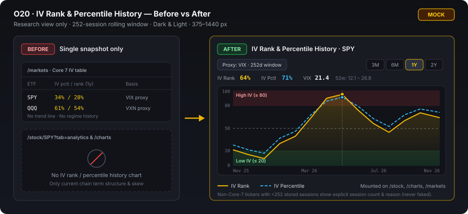
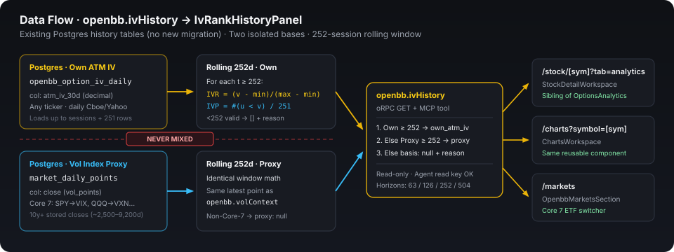

# IV rank and percentile history chart per ticker (card vertex-viz-iv-rank-history)

- **Author:** Jeff Scott Ward (written by an agent)
- **Status:** reviewed (EGM consolidated review of 2026-11-23; fixes applied, see [goldfish_review_report.md](goldfish_review_report.md))
- **Date:** 2026-11-23
- **Baseline commit:** `fdc1b9566` on `vertex/rebuild-darkfactory-20260921`; branch `ws/viz-iv-rank`
- **Source:** research card `vertex-flow-viz-gap` (owner request, 2026-11-20), chart **O20** ("IV rank / percentile history: Today's IV vs its 1-year range, as a line").

Research view only. Nothing in this change places, changes, or cancels an order, arms trading, or changes a risk setting. The chart shows historical implied volatility standing; it is not a trade signal.





## Overview

Vertex already stores daily implied volatility history in PostgreSQL (`openbb_option_iv_daily` for own 30-day ATM IV and `market_daily_points` / `market_daily_series` for multi-year Cboe 30-day volatility indices) and computes a single latest 1-year IV percentile and IV rank per Core 7 ETF in `openbb.volContext` (see `docs/vertex-rebuild/designs/iv-percentile/plan.md`). Today the portal shows only one latest number in the `/markets` Core 7 implied volatility table and shows no IV rank or IV percentile history on `/stock/<symbol>?tab=analytics` or `/charts`.

This change adds:

1. A read-only oRPC procedure `openbb.ivHistory` (oRPC path `/api/orpc/openbb/ivHistory`, OpenAPI REST path `GET /api/openapi/openbb/iv-history`) and read-only MCP tool `openbb_iv_history` that compute a daily time series of rolling 252-session IV rank and IV percentile for any requested ticker over selectable display horizons (`63`, `126`, `252`, or `504` trading sessions; default `252`).
2. Shared rolling-window calculation in `packages/api/src/openbb-iv-standing.ts` (`computeIvWindowStats` and `openbbIvHistory`) reusing the exact 252-session formulas, contiguous stored-row semantics, and strict basis separation of `openbb.volContext.ivOneYear`.
3. A reusable, accessible, token-styled chart component `IvRankHistoryPanel` (`apps/web/src/components/portal/iv-rank-history-panel.tsx` and pure view-model `iv-rank-history-model.ts`) mounted as an independent sibling panel on:
   - `/stock/<symbol>?tab=analytics` (in `StockDetailWorkspace`, reusing its existing `openbb` gateway prop as a sibling of `OptionsAnalyticsPanel`),
   - `/charts?symbol=<symbol>` (in `ChartsWorkspace`, as a sibling of `JevVerdictPanel` and `OptionsAnalyticsPanel` when a US equity symbol has loaded `marketData.bars`), and
   - `/markets` (inside `OpenbbMarketsSection`, with a Core 7 ETF selector: `SPY`, `QQQ`, `DIA`, `IWM`, `GLD`, `SLV`, `USO`, defaulting to `SPY`).

Mounting as a sibling leaves `options-analytics-panel.tsx` untouched and keeps the OpenBB/Cboe chart isolated from QuantData outages or rate limits by construction. On `/charts`, the panel shares the existing US `STK` conditional block gated on `marketData.bars` (while `/stock/<symbol>?tab=analytics` renders it unconditionally on the Analytics tab).

### Requirement classification

- **Core:** none (no change to reusable DarkFactory template primitives).
- **Convention:** contracts first, strict TypeScript, 100% test coverage on all new and touched files, oRPC only, Drizzle only, token-only dark/light styling (`packages/ui/src/styles.css` and `themes.css`), minimum 44x44 px interactive targets, OpenAPI and live docs kept in sync.
- **Implementation:** `openbbIvHistory` in `packages/api/src/openbb-iv-standing.ts`, `openbb.ivHistory` contract/handler/MCP registration, `IvRankHistoryPanel` + `iv-rank-history-model.ts`, and `/lab` fixtures in `apps/web/src/lab/entries/charts.tsx`.

### Terms

- **IV Rank (IVR):** where today's implied volatility sits between its trailing 252-session low and high, as a percentage from `0` to `100`: `((v - min) / (max - min)) * 100`, clamped to `[0, 100]`, or `null` when `max === min`.
- **IV Percentile (IVP):** the share of the other 251 observations in the trailing 252-session window that are strictly below today's value: `(100 * count(u < v)) / 251`.
- **Own ATM IV basis (`own_atm_iv`):** 30-day constant-maturity ATM implied volatility (`openbb_option_iv_daily.atm_iv_30d`, stored in decimal, e.g., `0.185` = `18.5%`).
- **Volatility-index proxy basis (`vol_index_proxy`):** Cboe 30-day volatility index daily close (`market_daily_points.close`, metadata in `market_daily_series`, stored in vol points, e.g., `18.5`) for Core 7 ETFs via `OPENBB_VOL_INDEX_PROXY` (`SPY->VIX`, `QQQ->VXN`, `DIA->VXD`, `IWM->RVX`, `GLD->GVZ`, `SLV->VXSLV`, `USO->OVX`).
- **Display horizon (`sessions`):** number of newest plotted trading sessions returned for the chart: `63` (3M), `126` (6M), `252` (1Y, default), or `504` (2Y).
- **Basis evaluation summary (`OpenbbIvBasisResultSchema` / `OpenbbIvProxyBasisResultSchema`):** existing schemas in `packages/api/src/contracts/openbb.ts` containing `asOf`, `ivPercentile`, `ivRank`, `latestValue`, `minSessions` (`252`), `reason`, `sessions` (count of valid non-null observations in the newest 252-row window), `windowSessions` (`252`), plus `index` on the proxy variant.

## Method and KB alignment

This design builds directly on the KB decision record in `docs/vertex-rebuild/designs/iv-percentile/kb-decision-record.md` and trading master rules (`~/Github/knowledge-bases/trading/_master-rules/rules.jsonl`):

1. **Strict 252-session minimum (`OPENBB_IV_PERCENTILE_MIN_SESSIONS = 252`):** Every plotted point requires 252 contiguous valid non-null observations in its trailing window. Never compute or plot a 1-year IV rank or percentile from fewer than 252 sessions.
2. **Never mix series:** Own `atm_iv_30d` (decimal) and Cboe volatility-index closes (vol points) are evaluated strictly independently.
3. **No new database migration:** `openbb_option_iv_daily` (PK `(as_of, underlying)`) and `market_daily_points` (PK `(series_id, date)`, metadata in `market_daily_series`) already store all required daily history. Note: `openbb_option_iv_daily`'s composite PK leads with `as_of`; at current table size (Core 7 daily rows, `< 10,000` rows for years), `optionIvDaily` executes in `< 1 ms`. If daily collection expands broadly beyond Core 7 and approaches `100,000` rows, add a secondary index on `(underlying, as_of DESC)`.
4. **Reference bands and dual lines:** Plot both IV Rank (solid line) and IV Percentile (dashed line) on a shared `0–100%` vertical axis (`inthemoneyadam:entry:3`, `trading-verrillo-aleks:regime:12`). Shade **High IV (`>= 80`)** and **Low IV (`<= 20`)** reference bands (matching the O20 mock and `nicholas-crown:options_structure:7`) and draw a dashed **50** midpoint guide.

## Architecture and contracts

### 1. oRPC contract (`packages/api/src/contracts/openbb.ts`)

Add constants and schemas:

```ts
export const OPENBB_IV_HISTORY_HORIZONS = [63, 126, 252, 504] as const;
export type OpenbbIvHistoryHorizon = (typeof OPENBB_IV_HISTORY_HORIZONS)[number];
```

**Input (`OpenbbIvHistoryInputSchema`):**

- `symbol`: `inputSymbol` (trimmed, uppercased, matches `symbol` regex `^[A-Z0-9.^=-]{1,16}$`)
- `sessions`: `z.coerce.number().pipe(z.union([z.literal(63), z.literal(126), z.literal(252), z.literal(504)])).default(252)` (coerces query strings on `GET /api/openapi/openbb/iv-history` cleanly, matching `OpenbbInsiderClustersInputSchema`)
- `asOf`: `historyFrom.optional()` (`YYYY-MM-DD`, `>= "1900-01-01"`, preventing negative/pre-1000 ISO date shifts when subtracting the 2Y lookback)

**Point (`OpenbbIvHistoryPointSchema`):**

- `date`: `date` (`YYYY-MM-DD`, ascending order)
- `iv`: `finite` (raw observation on `date`, in `unit`: decimal for `own_atm_iv`, vol points for `vol_index_proxy`)
- `ivRank`: `finite.min(0).max(100).nullable()` (`null` if trailing 252-session range is flat)
- `ivPercentile`: `finite.min(0).max(100)`
- `low52w`: `finite` (minimum observation in the trailing 252-session window ending on `date`, in `unit`)
- `high52w`: `finite` (maximum observation in the trailing 252-session window ending on `date`, in `unit`)

**Output (`OpenbbIvHistoryOutputSchema`):**

- `symbol`: `symbol` (normalized uppercase ticker)
- `requestedSessions`: `z.union([z.literal(63), z.literal(126), z.literal(252), z.literal(504)])`
- `windowSessions`: `z.literal(OPENBB_IV_PERCENTILE_SESSIONS)`
- `minSessions`: `z.literal(OPENBB_IV_PERCENTILE_MIN_SESSIONS)`
- `basis`: `z.enum(OPENBB_IV_BASES).nullable()` (`"own_atm_iv" | "vol_index_proxy" | null`)
- `proxyIndex`: `z.enum(OPENBB_VOL_INDEX_IDS).nullable()` (index id when `basis === "vol_index_proxy"`, else `null`)
- `unit`: `z.enum(OPENBB_IV_UNITS).nullable()` (`"decimal" | "vol_points" | null`)
- `asOf`: `date.nullable()` (date of the newest plotted point, else `null`)
- `latest`: `OpenbbIvHistoryPointSchema.nullable()` (last item of `points`, else `null`)
- `points`: `z.array(OpenbbIvHistoryPointSchema)` (ascending by `date`, length `0..requestedSessions`)
- `own`: `OpenbbIvBasisResultSchema` (latest-session summary for own ATM IV)
- `proxy`: `OpenbbIvProxyBasisResultSchema.nullable()` (latest-session summary for mapped Cboe vol index if `symbol` is in `OPENBB_VOL_INDEX_PROXY`, else `null`)
- `reason`: `z.string().min(1).nullable()` (`own.reason` when `basis === "own_atm_iv"`, `proxy.reason` when `basis === "vol_index_proxy"`, combined reason when `basis === null`; non-null on a selected basis only when the newest 252-session window is flat)

**Route in `openbbContract`:**

```ts
ivHistory: route(
  "GET",
  "ivHistory",
  "iv-history",
  "Rolling 252-session IV rank and IV percentile history for one ticker"
)
  .input(OpenbbIvHistoryInputSchema)
  .output(OpenbbIvHistoryOutputSchema),
```

**Access, MCP, and OpenAPI registration:**

- Operator-only, read-only (`requireOperator`).
- Added to `AGENT_API_KEY_READ_PROCEDURES` in `packages/api/src/server/operator-access.ts` and `packages/api/src/agent-viewer.test.ts`.
- Exposed as read-only MCP tool `openbb_iv_history` in `packages/api/src/server/mcp.ts` with a `present` formatter that returns metadata (`symbol`, `basis`, `proxyIndex`, `unit`, `asOf`, `latest`, `own`, `proxy`, `reason`, `totalPoints`), high/low milestones across the window, and the newest up to `63` daily points (plus `pointsOmitted`), keeping MCP tool responses compact even at `sessions: 504`.
- `packages/api/openapi.json` regenerated via `bun run openapi:generate`.

### 2. Shared rolling calculation (`packages/api/src/openbb-iv-standing.ts` and `packages/api/src/server/openbb.ts`)

1. **Shared window math (`computeIvWindowStats`):**
   - Export `computeIvWindowStats(values: readonly number[])` from `packages/api/src/openbb-iv-standing.ts` returning `{ ivPercentile, ivRank, low52w, high52w, reason }`. Both `openbbEvaluateOwnIvBasis` / `openbbEvaluateProxyIvBasis` and rolling history call this exact function.
   - Add optional `lookbackDays = 420` parameter to `openbbEvaluateProxyIvBasis(index, columns, lookbackDays = 420)` so `openbb.volContext` preserves `"in 420d window"` and `openbb.ivHistory` reports its actual queried lookback window (`in ${lookbackDays}d window`).
2. **Row loading in `packages/api/src/server/openbb.ts`:**
   - Needed sessions to plot `requestedSessions` full 252-session points: `requiredSessions = requestedSessions + OPENBB_IV_PERCENTILE_SESSIONS - 1`.
   - Query `openbb.optionIvDaily([symbol], asOf, requiredSessions)`.
   - Look up `proxyIndex` via a safe Core-7 helper (`openbbVolIndexProxy(symbol)`). If present, also query `series.loadSeries([proxyIndex], { from: nyDate(-lookbackCalendarDays, asOf ?? undefined), ...(asOf === null ? {} : { to: asOf }) })`, where `lookbackCalendarDays = Math.ceil(requiredSessions * 1.6) + 30`. Catch `MarketDailySeriesInputError` defensively and return `errors.BAD_REQUEST`.
   - For non-Core-7 tickers, skip `series.loadSeries` completely.
3. **Rolling evaluation (`openbbIvHistory` exported from `packages/api/src/openbb-iv-standing.ts`):**
   - **Own ATM IV rolling points:** For each index `i` in `ownRows` from `OPENBB_IV_PERCENTILE_SESSIONS - 1` to `ownRows.length - 1`, inspect the exact contiguous 252-row slice `ownRows.slice(i - 251, i + 1)`. Emit a point ONLY when every row in that 252-row slice has `atmIv30d !== null`. Keep the newest `requestedSessions` emitted points. This matches `openbbEvaluateOwnIvBasis` identically, guaranteeing point-in-time parity with `openbb.volContext({ asOf })`.
   - **Proxy rolling points:** When `proxyIndex !== null` and `columns` has `>= 252` closes, for each index `i` from `Math.max(251, columns.close.length - requestedSessions)` to `columns.close.length - 1`, evaluate `columns.close.slice(i - 251, i + 1)` with `computeIvWindowStats` and emit `{ date, iv, ivRank, ivPercentile, low52w, high52w }`.
4. **Basis selection without Day-252 history collapse:**
   - Compute `own = openbbEvaluateOwnIvBasis(ownRows)` and `proxy = proxyIndex === null ? null : openbbEvaluateProxyIvBasis(proxyIndex, columns, lookbackCalendarDays)`.
   - Select `own_atm_iv` when `own.ivPercentile !== null && ownPoints.length > 0 && (ownPoints.length >= requestedSessions || proxyPoints.length === 0)` (returning `points: ownPoints`, `latest: ownPoints.at(-1)`, `asOf: latest.date`, `unit: "decimal"`, `proxyIndex: null`, `reason: own.reason`).
   - Otherwise, if `proxy !== null && proxy.ivPercentile !== null && proxyPoints.length > 0`, select `vol_index_proxy` (returning `points: proxyPoints`, `latest: proxyPoints.at(-1)`, `asOf: latest.date`, `unit: "vol_points"`, `proxyIndex`, `reason: proxy.reason`). This prevents collapsing a Core 7 `1Y`/`2Y` chart to a single dot on day 252 of own collection while still exposing `own` standing metadata on every response.
   - Otherwise return `basis: null`, `proxyIndex: null`, `unit: null`, `asOf: null`, `latest: null`, `points: []`, and `reason`:
     - If `proxy !== null`: `Own ATM IV: ${own.reason}; ${proxy.index} proxy: ${proxy.reason}`
     - If `proxy === null`: `No Cboe volatility-index proxy for ${symbol}; own ATM IV: ${own.reason}`

### 3. UI and visualization (`apps/web`)

#### Gateway contract (`apps/web/src/features/openbb/gateway.ts`)

- Add `readonly ivHistory: (symbol: string, sessions?: OpenbbIvHistoryHorizon) => Promise<OpenbbIvHistoryOutput>` to `OpenbbGateway` (matching existing positional-argument style in `OpenbbGateway`).
- Export `export type IvHistoryGateway = Pick<OpenbbGateway, "ivHistory">;`.
- Implement `ivHistory: (symbol, sessions) => api().ivHistory(sessions === undefined ? { symbol } : { sessions, symbol })` inside `createBrowserOpenbbGateway()`.

#### Pure view-model (`apps/web/src/components/portal/iv-rank-history-model.ts`)

- Reuses `formatNumber` and `formatPercent` from `apps/web/src/features/openbb/view-model.ts`.
- **Regime classification:** Driven explicitly by `metric = point.ivRank ?? point.ivPercentile`:
  - `metric >= 80`: `"High IV (≥ 80)"` (`"high"`)
  - `metric <= 20`: `"Low IV (≤ 20)"` (`"low"`)
  - `metric > 20 && metric < 80`: `"Mid range (20–80)"` (`"mid"`)
- **SVG series geometry:**
  - Normalized `0..100` Y-axis with High IV (`80..100`), Low IV (`0..20`), and `50` midline coordinates.
  - Handles `points.length === 1` without division by zero (places the single point horizontally centered and adds a `"1 rolling session available"` note).
  - Splits `ivRank` into contiguous polyline segments across any `null` flat-range points; draws `ivPercentile` continuously across all points.
  - UTC-safe `YYYY-MM-DD` X-axis tick formatting (parses year/month/day integers without local timezone drift): `"MMM DD"` for `63`/`126` horizons, `"MMM YY"` for `252`/`504` horizons.
- **Accessible table rows:** Builds a deterministic table dataset consisting of the newest up to `10` sessions (newest first) plus distinct horizon high/low IVR/IVP milestones if not already in the newest 10, with formatted Date, Raw IV (`18.5%` for `decimal`, `18.5` for `vol_points`), IV Rank, IV Percentile, and 52w Range.

#### Panel component (`apps/web/src/components/portal/iv-rank-history-panel.tsx`)

- Built with `@darkfactory/ui` primitives (`Panel`, `Button`, `Table`, `TableHeader`, `TableBody`, `TableRow`, `TableHead`, `TableCell`) and verified CSS tokens from `packages/ui/src/styles.css` & `themes.css`:
  - IV Rank line: solid `var(--color-primary)`, `vectorEffect="non-scaling-stroke"`
  - IV Percentile line: dashed `"6 3"` `var(--color-info)`, `vectorEffect="non-scaling-stroke"`
  - High IV (`>= 80`) band: `var(--color-destructive)` at `0.12` fill opacity
  - Low IV (`<= 20`) band: `var(--color-success)` at `0.12` fill opacity
  - 50% midline: `currentColor` dashed `"4 4"` at `0.35` opacity
- Props:
  - `symbol: string`
  - `gateway?: IvHistoryGateway` (defaults to `createBrowserOpenbbGateway()`)
  - `symbols?: readonly string[]` (Core 7 selector strip on `/markets`)
  - `onSymbolChange?: (symbol: string) => void`
- Async reliability:
  - Stale-response generation counter + unmount cleanup.
  - `OPENBB_REQUEST_TIMEOUT_MS = 30_000` timeout transitioning to a `"no-answer"` state with `Retry` button; error formatting via `describePortfolioMonitorFailure` (matching `openbb-panels.tsx`).
  - Unavailable (`basis === null` or `points.length === 0`) renders a calm status block (no `[data-error-code]` attribute, never treated as an error) displaying the exact `reason`, own session progress (`${own.sessions} / ${own.minSessions} own ATM IV sessions stored`), and `"Research view only"`.
- Controls & accessibility:
  - Horizon segmented radio group (`3M`, `6M`, `1Y` default, `2Y`), each `min-h-11 min-w-11` with visible focus ring.
  - Series visibility toggle buttons (`aria-pressed`) for `IV Rank` and `IV Percentile`; when only one series is active, its toggle button is `disabled` so the chart can never become silently blank.
  - Responsive SVG with `role="img"` and descriptive `aria-label` summarizing ticker, basis, horizon, latest IV Rank, latest IV Percentile, and regime (matching `flow-put-call-ratio-panel.tsx` and `flow-hedging-pressure-panel.tsx`).
  - Basis pill (`Own 30d ATM IV` or `Proxy: <INDEX>`) + partial-history notice (`"Showing N of M requested sessions"`) when `points.length < requestedSessions` + proxy caveat line.
  - Collapsible `<details>` table (`<summary className="min-h-11 ...">`) showing recent sessions and horizon extremes for exact numeric inspection.
  - Dark + light support and responsive wrapping at `375`, `768`, `1024`, and `1440` px with zero horizontal overflow.

#### Portal mounting points and `/lab`

1. **`StockDetailWorkspace`** (`apps/web/src/features/stock-detail/stock-detail-workspace.tsx`):
   - In the `query.tab === "analytics"` branch, render `<IvRankHistoryPanel gateway={openbb} symbol={symbol} />` above `<OptionsAnalyticsPanel gateway={optionsAnalytics} symbol={symbol} />` inside `<div className="space-y-6">`.
2. **`ChartsWorkspace`** (`apps/web/src/components/portal/charts-workspace.tsx`):
   - Add optional `readonly openbb?: IvHistoryGateway` to `ChartsWorkspaceProps` and mount `<IvRankHistoryPanel gateway={openbb} symbol={data.request.symbol} />` alongside `<JevVerdictPanel>` and `<OptionsAnalyticsPanel>`.
3. **`OpenbbMarketsSection`** (`apps/web/src/features/openbb/openbb-panels.tsx`):
   - Add `selectedIvSymbol` state (initial `"SPY"`) and render `<IvRankHistoryPanel gateway={gateway} onSymbolChange={setSelectedIvSymbol} symbol={selectedIvSymbol} symbols={OPENBB_CORE7} />` as a full-width block (`lg:col-span-2`) right below the Core 7 implied volatility table inside `MarketsBlocks`.
4. **UI Lab (`apps/web/src/lab/fixtures/market.ts` & `apps/web/src/lab/entries/charts.tsx`):**
   - Add deterministic `labIvHistory(symbol, sessions)` fixture returning realistic 63/126/252/504-session proxy curves (spanning high-IV `>= 80` and low-IV `<= 20` regimes) for Core 7 ETFs (`SPY`, `QQQ`, `DIA`, `IWM`, `GLD`, `SLV`, `USO`) and `basis: null` with explicit reason for non-Core-7 tickers (`NVDA`, etc.).
   - Wire `labOpenbbIvHistoryGateway` into both `/lab/charts` and `/lab/stock` in `apps/web/src/lab/entries/charts.tsx`. (`/lab/markets` in `lenses.tsx` renders `MarketContextPage` alone and is unchanged.)

## Testing and verification plan

1. **API unit & contract tests (100% coverage on every new/touched file):**
   - `packages/api/src/openbb-iv-standing.test.ts`: extend with rolling `openbbIvHistory` tests (hand-computed 252-session IVR/IVP, parity with `openbbIvOneYear`, contiguous null-row exclusion, flat-range `ivRank: null`, Day-252 proxy retention vs full-horizon own switchover, 1-point own series when no proxy exists, non-Core-7 `basis: null` reason, `lookbackDays` parameterization).
   - `packages/api/src/openbb-server.test.ts`: `openbb.ivHistory` handler tests (Core 7 proxy load, non-Core-7 skips `loadSeries`, `asOf` bound, `GET /api/openapi/openbb/iv-history?symbol=SPY&sessions=63` string coercion, `MarketDailySeriesInputError` -> `BAD_REQUEST`, storage error, read-key authorization).
   - `packages/api/src/agent-viewer.test.ts` & `packages/api/src/server/mcp.test.ts`: allowlist and MCP `openbb_iv_history` bounded `present` output.
2. **Web unit tests (100% coverage on every new/touched file):**
   - `apps/web/src/components/portal/iv-rank-history-model.test.ts`: geometry, `0..100` bounds, null-rank segment splitting, 1-point center placement, UTC date tick formatting (`MMM DD` vs `MMM YY`), regime labels (including `ivRank === null` fallback to `ivPercentile`), milestone table rows.
   - `apps/web/src/components/portal/iv-rank-history-panel.test.tsx`: loading, timeout `"no-answer"` + Retry, error + Retry, ready (own & proxy), partial-horizon label, unavailable (`NVDA`, no `data-error-code`), horizon switching (`3M`/`6M`/`1Y`/`2Y`), series toggles + last-series disabled guard, Core 7 switcher, stale-response guard.
   - Update `openbb-panels.test.tsx`, `charts-workspace.test.tsx`, `stock-detail-workspace.test.tsx`, `apps/web/src/lab/fixtures/fixtures.test.ts`, and `apps/web/src/lab/entries/charts.test.tsx`.
3. **E2E & visual QA (`tests/e2e/iv-rank-history.spec.ts`):**
   - Verify `/lab/stock?symbol=SPY&tab=analytics` (renders SVG chart with High/Low bands, switches horizon to `3M` and `2Y`, toggles `IV Percentile`, zero horizontal scroll at `375px` and `1440px`, dark + light) and `/lab/stock?symbol=NVDA&tab=analytics` (renders explicit unavailable state with `0 / 252` progress and zero error banners).
   - Capture real headless Chrome dark + light screenshots at `1440px` and `375px` for visual QA and PR graphic.
4. **Gates:**
   - `bun run openapi:generate`, update `docs/vertex-rebuild/openbb.md`.
   - `bun run verify:prepush`, fresh-context EGM drift report (`2026-11-23_DRIFT_REPORT.md`), fresh-context full-diff code review at final head SHA, full hosted CI (`ci-gate`) green, and merge via `scripts/merge-pr`.
