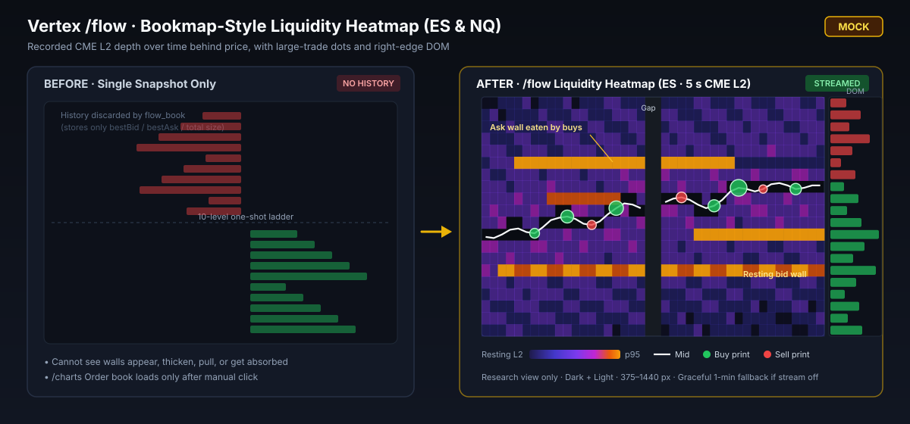
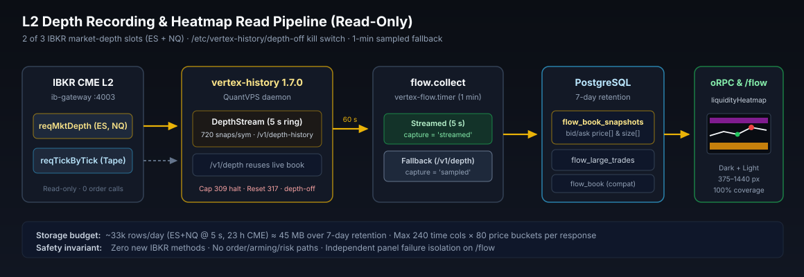

# Bookmap-Style Liquidity Heatmap for ES and NQ on /flow

**Card:** `vertex-viz-liquidity-heatmap` (gap report F2)  
**Date:** 2026-11-23  
**Scope:** Research view only. No orders, no arming, no risk settings, no live trading engine changes.

## Overview

Vertex already collects CME Level 2 depth for ES and NQ every minute in `flow.collect` and streams every ES and NQ trade print through `vertex-history /v1/tape`. Today, `collectDepth` collapses each 10-level order book into a single aggregate row in `flow_book` (`bestBid`, `bestAsk`, `bidSize`, `askSize`, `levels`, `pressure`) and discards every individual price level. As a result, Vertex has no historical view of where resting liquidity sits over time, whether large walls thicken, pull, or absorb price, or where executed prints hit those walls.

This feature adds:

1. Continuous L2 depth recording for ES and NQ in `vertex-history` (`1.7.0`, `DepthStream` sampling every 5 s, with `/v1/depth-history` and live reuse on `/v1/depth` to keep account usage at 2 of IBKR's 3 market-depth slots, plus `/etc/vertex-history/depth-off` kill switch and error-309 cap halt).
2. Dual-mode persistence in `flow.collect` into a new Postgres table `flow_book_snapshots`: drains 5-second streamed snapshots when `/v1/depth-history` is active (`capture = 'streamed'`), and automatically persists the 10-level L2 book from the existing 1-minute `/v1/depth` call (`capture = 'sampled'`) if streaming is off or not yet deployed.
3. A pure rules engine and operator-only oRPC read procedure `flow.liquidityHeatmap` (`GET /flow/liquidity-heatmap`) that aligns recorded L2 book columns, mid/BBO price lines, recorded `flow_large_trades` buy/sell dots, current right-edge DOM bars, gap shading, and active resting-wall rankings.
4. A responsive, accessible, dark-and-light `FlowLiquidityHeatmapPanel` on `/flow` for the selected index group's future (`ES` for SPY/ES, `NQ` for QQQ/NQ), sharing the `/flow` window selector (`15m–390m`) and auto-refresh cadence with its own isolated loading and error state.

## Analysis

### Root Gap

- `flow_book` records only top-of-book prices and summed bid/ask totals. Resting liquidity at individual price levels is lost at ingest time.
- `/charts` `OrderFlowPanel` -> `Order book` shows a single one-shot snapshot only after manual click (`Load order flow`).
- `flow_large_trades` already stores exact `(second, price, size, side, signing, capture)` for large ES prints (`>= 40`) and NQ prints (`>= 10`), and `flow_minutes` already stores 1-minute OHLC/VWAP, so the price and trade-dot layers need zero new tape tables.

### IBKR Subscription Budget & Safety

- IBKR allows at most 3 simultaneous `reqMktDepth` subscriptions per account (error `309` when exceeded).
- Holding 2 persistent CME futures `reqMktDepth` subscriptions (`ES`, `NQ`, `rows=10`, `smartDepth=False`) leaves 1 slot free for ad hoc `/charts` lookups of other instruments.
- Serving `/v1/depth` for `ES` and `NQ` directly from the live `DepthStream` book avoids opening a 3rd subscription when `/charts` or a manual call inspects ES/NQ depth.
- `reqMktDepth` and `cancelMktDepth` are already in `vertex_history.py`'s `ALLOWED_IB_CALLS`; no new IBKR API method is introduced.
- Error `317` ("Market depth data has been RESET") clears the `DepthBook` cleanly; error `309` halts `DepthStream` until restart; `/etc/vertex-history/depth-off` cancels both subscriptions within 1 s.

## Goals vs. Non-Goals

### Goals

- Record per-level ES and NQ CME L2 snapshots over time in Postgres (`flow_book_snapshots`) with 7-day retention and dual `streamed` / `sampled` capture provenance.
- Render a truthful Bookmap-style liquidity heatmap on `/flow`: resting L2 size grid behind the mid-price (and subtle BBO) line, green buy / red sell trade dots from `flow_large_trades`, and a right-edge current DOM bar strip.
- Distinguish missing/unrecorded intervals with explicit gap shading (never forward-fill across outages).
- Support dark, light, and system themes, responsive viewports from 375 px to 1440 px, keyboard inspection, and an accessible summary table of top resting liquidity walls and recent large prints.
- Maintain 100% test coverage across all new and touched TypeScript files and full unit/safety test coverage in `test_vertex_history.py`.

### Non-Goals

- No stock L2 heatmap (IBKR stock SMART depth remains gated behind `STOCK_DEPTH_VERIFIED` and lacks paid ArcaBook/TotalView feeds).
- No trade signals, spoofing alerts, automated order placement, arming, or risk-setting changes.
- No browser WebSocket streaming or client-side direct IBKR connections (follows `/flow`'s existing Postgres + oRPC polling architecture).
- No synthetic trade dots invented from aggregate minute volume when `flow_large_trades` has no prints.

## Alternatives Weighed

| Decision | Chosen Option | Rejected Alternative | Reason |
| --- | --- | --- | --- |
| Depth recording cadence | `DepthStream` 5 s snapshots in `vertex-history` + automatic 1-min `/v1/depth` fallback in `flow.collect` | 1-min sampled only; or raw every-update L2 tick storage | 5 s cadence captures wall appearances/pulls at low storage cost (~45 MB / 7 d); fallback guarantees immediate value even before `vertex-history` deploys or if `depth-off` is set. Storing every raw update (~212 msgs/s) would bloat Postgres (>15M rows/day) with no visual benefit. |
| Storage representation | Compact `double precision[]` parallel arrays (`bid_prices`, `bid_sizes`, `ask_prices`, `ask_sizes`) per `(symbol, captured_at)` | Normalized child table `(symbol, captured_at, side, level, price, size)` (20 rows per snapshot) | Array rows match `flow_tape_seconds`, reduce row count 20x, keep primary-key range scans fast, and simplify atomic upserts and retention pruning. |
| Portal placement | Dedicated `FlowLiquidityHeatmapPanel` on `/flow` (alongside `FlowTapeSpeedPanel`) | Tab inside `/charts` `OrderFlowPanel` | `/flow` already owns continuously collected ES/NQ panels, window selection (`15m–390m`), and auto-refresh; `/charts` is lazy one-shot for arbitrary symbols. |
| Trade dots source | Real individual prints from `flow_large_trades` (`side`, `price`, `size`, `second`) | Synthetic dots from `flow_minutes` aggregate delta | Keeps every plotted dot truthful to an actual recorded print; avoids misleading traders during quiet windows. |
| Intensity scaling | Clamped at window `p95` resting size (`min(size / p95, 1)`) | Clamped at window `max` | A single outlier institutional block would otherwise wash out normal resting liquidity across the entire chart. |

## Key Decisions & Staging for Next Steps

1. Proceed to `egm-draft` writing `docs/vertex-rebuild/designs/vertex-viz-liquidity-heatmap/design.md` with exact schemas, contracts, rules, UI spec, rollout/rollback, and acceptance tests.
2. Run full EGM Goldfish review (`egm-review` consolidated mode per standing owner rule 2026-11-18) and auto-accept resolution (`egm-resolve` per owner rule 2026-11-13).
3. Implement in focused commits:
   - Commit 1: EGM design docs + dark infographics + Goldfish review reports.
   - Commit 2: `vertex-history` 1.7.0 (`DepthStream`, `/v1/depth-history`, `/v1/depth` live reuse, `/v1/health`, tests).
   - Commit 3: Postgres schema `flow_book_snapshots`, migration `0093`, rollback SQL, `packages/db` repository + tests.
   - Commit 4: oRPC contract `flow.liquidityHeatmap`, pure rules `flow-liquidity-heatmap-rules.ts`, `flow-collect.ts` dual-mode ingest, `market-data.ts` upstream client, `flow-liquidity-heatmap.ts` server handler, OpenAPI regeneration + 100% tests.
   - Commit 5: `apps/web` view-model, `FlowLiquidityHeatmapPanel`, `/flow` wiring, lab fixture + 100% tests + live/browser visual verification (dark + light, 375 px & 1440 px).
   - Commit 6: Documentation (`flow-pipeline.md`, `quantvps-status-endpoint.md`, EGM drift report).
