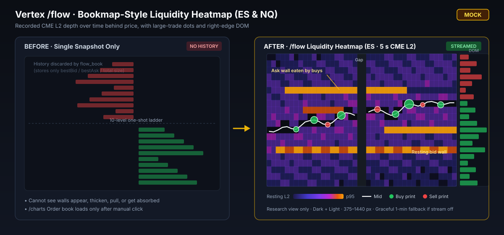
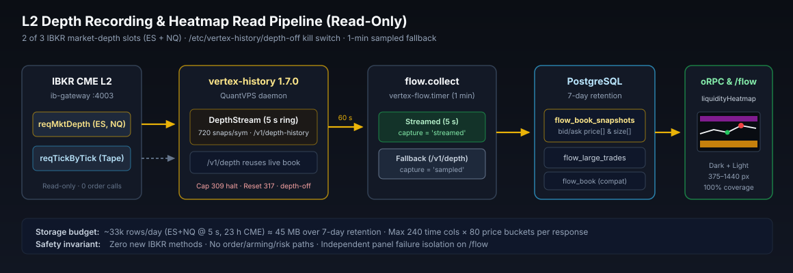

# Bookmap-Style Liquidity Heatmap on /flow (card `vertex-viz-liquidity-heatmap`)

## Overview

This design adds a Bookmap-style liquidity heatmap for CME E-mini futures (`ES` and `NQ`) on the `/flow` page of Vertex Research. The heatmap renders recorded Level 2 resting order book liquidity behind the mid-price (and best-bid/best-ask) trajectory, overlays executed large trades from `flow_large_trades` as directional buy/sell dots, shows a current right-edge Depth of Market (DOM) bar strip, marks recording gaps explicitly without forward-filling, and lists the top active resting liquidity walls and recent large prints in keyboard-accessible tables.

The change spans four bounded layers:

1. **`vertex-history` 1.7.0 (`infra/quant-vps/history/vertex_history.py`)**: adds a continuous `DepthStream` for `ES` and `NQ` using existing read-only `reqMktDepth` / `cancelMktDepth` calls, samples the live top-10 L2 book every 5 seconds into an in-memory ring buffer, exposes `GET /vertex-history/v1/depth-history`, exposes stream health in `GET /vertex-history/v1/health`, and lets `GET /vertex-history/v1/depth` read the live stream for `ES` and `NQ` so total concurrent IBKR L2 subscriptions stay at 2 of the account's 3-slot cap.
2. **PostgreSQL (`packages/db`)**: adds `flow_book_snapshots` (migration `0094_flow_book_snapshots.sql` + guarded rollback `0094_flow_book_snapshots.down.sql`) storing compact 1D `double precision[]` price/size arrays per `(symbol, captured_at)` with `capture` provenance (`'streamed' | 'sampled'`) and 7-day retention.
3. **oRPC API & Collector (`packages/api`)**: extends `flow.collect` with dual-mode L2 ingest (drains 5-second snapshots from `/depth-history` when live, and falls back automatically to persisting the 10-level book from `/depth` as `'sampled'` when the stream is off or not yet deployed, while never hammering `/depth` during an active error-309 cap halt); adds pure grid/normalization rules (`flow-liquidity-heatmap-rules.ts`), server assembly (`flow-liquidity-heatmap.ts`), and read-only operator procedure `flow.liquidityHeatmap` (`GET /flow/liquidity-heatmap`, schema `flow-liquidity-heatmap.v1`).
4. **Portal UI (`apps/web`)**: exposes `15m` and `30m` alongside `[60, 120, 240, 390]` in `/flow`'s `FLOW_WINDOW_MINUTES` (already accepted by `snapshotMinutes` in `contracts/flow.ts`), and adds `FlowLiquidityHeatmapPanel` and its pure view-model (`apps/web/src/features/flow/liquidity-heatmap-view-model.ts`) to `/flow`, matching the selected index group's future (`ES` for `SPY`/`ES`, `NQ` for `QQQ`/`NQ`) and selected window (`15–390` min, default `120`), with dark/light/system theme support, 375–1440 px responsive layout, hover/keyboard inspection, and isolated error/loading states.

This view is strictly read-only research. Nothing in this feature places orders, arms trading, modifies risk limits, or emits trade signals.

### Terms

- **Resting liquidity**: size (contracts) resting on the CME Level 2 order book at a specific price level at the moment a snapshot is taken.
- **L2 snapshot**: top 10 bid price/size pairs (descending by price) and top 10 ask price/size pairs (ascending by price) captured at one timestamp for `ES` or `NQ`, filtered to finite `price > 0` and `size > 0`.
- **Heatmap column**: one fixed time bucket (`columnSeconds`) on the chart horizontal axis. Covered columns use the latest L2 snapshot inside that bucket (preferring `'streamed'` over `'sampled'` inside the same bucket before tie-breaking by timestamp); empty buckets are marked `state = 'no_data'` and are never forward-filled.
- **Price bucket (`priceStep`)**: one vertical row on the heatmap grid, sized to an integer multiple of `minTick` (`0.25` for ES/NQ) with a dynamic fallback ceiling so `priceLevels.length <= 80` always holds for any finite price range. Bucket index is `Math.floor((price - priceMin) / priceStep)` clamped to `[0, priceLevels.length - 1]`. Within a single `(column, p)`, bid and ask resting sizes merge into at most one cell `{ p, s, side }` (`s = bidSize + askSize`, `side = "both" | "bid" | "ask"`).
- **Intensity scale (`p95Size`)**: nearest-rank 95th percentile of all positive cell resting sizes in the returned window (`0` when empty). Cell intensity clamps at `min(size / p95Size, 1)` (tier `0` when `p95Size <= 0`) so one extreme resting block does not wash out the rest of the book.
- **Trade dot**: one real recorded large trade from `flow_large_trades` (`>= FLOW_INSTRUMENTS[symbol].deepTradeLimit`: `40` on ES, `10` on NQ) plotted at `(second, price)`, colored `var(--color-success)` for `buy` (ask-lift) and `var(--color-destructive)` for `sell` (bid-hit), radius `Math.min(11, Math.max(3, 2.5 + Math.sqrt(size) * 0.6))`.
- **Capture mode**: `'streamed'` when every snapshot in the window came from `DepthStream`, `'sampled'` when every snapshot came from 1-minute `/depth`, `'mixed'` when both appear, or `'none'` when zero snapshots exist.

## The Problem

Today on Vertex:

- `flow.collect` fetches a 10-level CME L2 order book for `ES` and `NQ` every minute, then `buildBook()` discards all individual price levels and writes only top-of-book prices and summed bid/ask totals to `flow_book`.
- `/charts` -> `Order flow` -> `Order book` shows a single point-in-time snapshot only after a manual click.
- Traders cannot see whether resting liquidity walls appeared, grew, pulled away, or absorbed aggressive market orders as price approached them.

## Goals

1. Continuously record ES and NQ CME L2 order books at 5-second intervals in `vertex-history` without exceeding IBKR's 3-subscription market-depth cap or introducing any new IBKR client methods.
2. Persist per-level L2 snapshots in PostgreSQL (`flow_book_snapshots`) with automatic 1-minute sampled fallback when `DepthStream` is off or unavailable (skipping fallback during an error-309 cap halt), and prune rows older than 7 days.
3. Serve an operator-only `flow.liquidityHeatmap` oRPC endpoint on the shared `FLOW_API_ERRORS` builder (`tags = ["Flow"]`, `STORAGE_ERROR`) with bounded response size (`<= 240` time columns, `<= 80` price rows, `<= 500` newest trade dots), deterministic bucketing, honest gap states, and active resting-wall rankings.
4. Render the Bookmap-style heatmap on `/flow` with full dark/light/system theme support, 375–1440 px responsive layout, hover and keyboard inspection, accessible wall and print tables, and zero coupling to other `/flow` panels' failure states.
5. Maintain 100% test coverage across all new and modified non-baseline TypeScript files (`lines`, `branches`, `functions`, `statements`), raise/preserve `coverage-baseline.json` for `packages/api/src/server/market-data.ts`, and maintain full Python unit/safety coverage in `test_vertex_history.py`.

## Non-Goals

- Stock (`SPY`/`QQQ`) L2 heatmaps (IBKR stock SMART depth lacks paid exchange books and remains behind `STOCK_DEPTH_VERIFIED`).
- Storing raw tick-by-tick order-book deltas (~212 messages/s across ES and NQ).
- WebSocket streaming to the browser or direct browser-to-IBKR connections.
- Synthetic trade dots invented from aggregate minute volume.
- Trade signals, spoofing classifications, order execution, arming, or risk settings.

## Critical User Journeys

### CUJ 1: Inspect resting liquidity walls and trade execution on `/flow`

- **Given** the operator opens `/flow` with `ES` or `SPY` selected (showing `ES`) and window `120 min` (default, 30 s columns) or `15 min` (5 s columns).
- **When** `flow.liquidityHeatmap` returns stored L2 snapshots and `flow_large_trades`.
- **Then** the panel displays the color-ramped resting liquidity grid behind the segmented mid-price line, emerald buy and crimson sell trade dots, the right-edge current DOM bar strip, a `Streamed 5 s` capture badge, coverage stats, and summary tables of top resting walls and recent large prints. Hovering or pressing `ArrowLeft`/`ArrowRight` on the focusable chart container updates the live readout with ET time, mid price (`"—"` if one-sided), spread (`"—"` if one-sided), and strongest resting level in that column.

### CUJ 2: Stream off or not yet deployed (graceful 1-minute sampled fallback)

- **Given** `/etc/vertex-history/depth-off` exists on QuantVPS or `vertex-history` is on `1.6.0` (returns 404 on `/depth-history`).
- **When** `vertex-flow.timer` runs `flow.collect`.
- **Then** `collectDepth` falls back to `/depth`, stores the 10-level L2 snapshot in `flow_book_snapshots` with `capture = 'sampled'`, and `/flow` renders a 1-minute-column heatmap labeled `Sampled 1 min`.

### CUJ 3: Recording gap, one-sided book, or closed market

- **Given** the IBKR gateway restarted, CME was in its daily break, a book reset (`317`) left one side temporarily empty, or `DepthStream` halted on error `309`.
- **When** the operator views a window covering that period.
- **Then** missing time columns render with gap shading (`data-flow-heatmap-gap=""`), the mid-price polyline breaks cleanly across both `no_data` columns and `mid === null` one-sided columns (never interpolating across gaps), and coverage reflects only recorded columns.

### CUJ 4: Isolated failure and empty state

- **Given** `flow.liquidityHeatmap` fails (`STORAGE_ERROR` / network error) or returns zero snapshots.
- **When** `/flow` loads.
- **Then** only `FlowLiquidityHeatmapPanel` shows its retryable alert or honest empty state (`No recorded L2 depth snapshots in this window yet.`); all other `/flow` panels continue operating normally.

### CUJ 5: Kill switch on QuantVPS

- **Given** an operator needs all 3 IBKR L2 slots for another client.
- **When** the operator creates `/etc/vertex-history/depth-off`.
- **Then** within ~1 second `DepthStream.step()` cancels both `reqMktDepth` subscriptions, `/vertex-history/v1/health` reports `depth.off = true` and `depth.feeds.ES.state = "off"`, and `flow.collect` automatically drops back to sampled mode.

## Technical Plan (Architecture)

### 1. `vertex-history` 1.7.0 (`infra/quant-vps/history/vertex_history.py`)

#### Constants

- `VERSION = "1.7.0"`
- `DEPTH_HISTORY_SCHEMA = "vertex-history-depth-history-v1"`
- `DEPTH_STREAM_SYMBOLS = ("ES", "NQ")`
- `DEPTH_STREAM_ROWS = 10`
- `DEPTH_SAMPLE_SECONDS = 5`
- `DEPTH_HISTORY_MAX = 720` (60 minutes of 5-second snapshots per symbol; entire ring fits in one HTTP response, so no pagination is needed)
- `DEPTH_SETTLE_SECONDS = 1.0` (post-attach / post-reset settle window before sampling or serving live snapshots)
- `DEPTH_IDLE_SECONDS = 60.0` (60 s without updates marks feed stale for live reuse / skips sampling)
- `DEPTH_QUIET_SECONDS = 1800.0` (30 min without updates triggers resubscribe)
- `DEPTH_RETRY_SECONDS = 30.0`, `DEPTH_RETRY_MAX_SECONDS = 300.0`
- `DEPTH_CAP_CODE = 309` (IBKR max simultaneous market depth requests -> immediately release all `DepthFeed`s and halt stream until restart)
- `DEPTH_RESET_CODE = 317` (IBKR market depth reset -> `reset_book()`, keep subscription)
- `DEPTH_OFF_FILE = "depth-off"` (under existing `CONFIGURATION_DIRECTORY`, override via `VERTEX_HISTORY_DEPTH_OFF`)

#### `DepthFeed(_Holder)`

- Holds `symbol`, `book = DepthBook()`, `req_id`, `info`, `min_tick`, `attached_at`, `reset_at`, `last_update`, `retry_at`, `delay`, `snapshots = deque(maxlen=DEPTH_HISTORY_MAX)`, `last_sampled_t`.
- `update(now, position, operation, side, price, size, venue)`: forwards to `self.book.apply(...)`, sets `self.last_update = now`.
- `reset_book(now)`: calls `self.book.reset()` and sets `self.reset_at = now` so sampling and `live_snapshot()` wait `DEPTH_SETTLE_SECONDS`.
- `sample(now)`: computes `bucket_t = int(now // DEPTH_SAMPLE_SECONDS) * DEPTH_SAMPLE_SECONDS`. When attached, `bucket_t > last_sampled_t`, `last_update >= max(attached_at, reset_at)`, `now - max(attached_at, reset_at) >= DEPTH_SETTLE_SECONDS`, and `now - last_update <= DEPTH_IDLE_SECONDS`: reads `raw_bids, raw_asks, _ = self.book.snapshot(DEPTH_STREAM_ROWS)` (list of dicts `{"price": float, "size": float, "venue": ...}`), filters `math.isfinite(p) and p > 0 and math.isfinite(s) and s > 0`, and if `bids or asks` appends `{ "t": bucket_t, "bestBid": bids[0][0] if bids else None, "bestAsk": asks[0][0] if asks else None, "bids": bids, "asks": asks }` and sets `last_sampled_t = bucket_t`.
- `read(since, now, halted=None, off=False)`: returns all stored snapshots with `snap["t"] >= since` in one response matching `/tape`'s envelope: `{ "schema": DEPTH_HISTORY_SCHEMA, "source": "ibkr", "client_id": self.client_id, "fetchedAt": now_iso(now), "symbol": self.symbol, "contract": self.info, "minTick": self.min_tick, "sampleSeconds": DEPTH_SAMPLE_SECONDS, "rows": DEPTH_STREAM_ROWS, "stream": { "state": state, "error": cause }, "since": since, "snapshots": [...] }`.
- `live_snapshot(rows, now)`: returns `(info, { "minTick": min_tick, "bids": raw_bids, "asks": raw_asks, "sizeMultiplier": 1, "venues": book.venues, "updates": updates })` when attached, settled (`now - max(attached_at, reset_at) >= DEPTH_SETTLE_SECONDS`), fresh (`last_update >= max(attached_at, reset_at)` and `now - last_update <= DEPTH_IDLE_SECONDS`), and `rows <= DEPTH_STREAM_ROWS`.

#### `DepthStream`, `IbGateway`, `HistoryService`, and `main()` Wiring

- `IbGateway.subscribe_depth(req, feed)` / `unsubscribe_depth(feed)`: uses existing `reqMktDepth` and `cancelMktDepth` (no change to `ALLOWED_IB_CALLS`).
- `IbGateway.depth_update(...)`: checks `isinstance(h, DepthFeed)` first (calling `h.update(self.clock(), ...)`), else falls back to `_depth_book(req_id)`.
- `IbGateway.depth_notice(req_id, message)`: checks `isinstance(h, DepthFeed)` first (records notice on `h.book.venues`), else `_depth_book(req_id)`.
- `IbGateway.on_error(req_id, code, message)`:
  - Before `INFO_CODES` early return: on `2103`/`2105` (farm broken), reset all attached `DepthFeed` books (`feed.reset_book(now)`); on `1101` (data lost), fail all attached `DepthFeed`s so `DepthStream.step()` resubscribes.
  - On `317` (`DEPTH_RESET_CODE`): if `req_id == -1`, reset all attached `DepthFeed`s and `active_depth`; else if `isinstance(h, DepthFeed)` call `h.reset_book(now)`; else if `isinstance(h, DepthBook)` call `h.reset()`.
  - On `309` (`DEPTH_CAP_CODE`): fail the target `DepthFeed` with `code=DEPTH_CAP_CODE`, AND if `309` arrives on a one-shot `DepthBook` or `req_id == -1` while any `DepthFeed` is attached, set `self.depth_cap_reached = True` so `DepthStream.step()` immediately calls `_release(feeds, now)` and sets `self.halted = "depth subscription cap reached"`.
- `HistoryService.__init__(..., depth_stream=None)`: stores `self.depth_stream`.
- `HistoryService.depth(raw)`: when `self.depth_stream` is set and `req["secType"] == "CONTFUT"`, `req["exchange"] == "CME"`, `req["currency"] == "USD"`, `not req["smartDepth"]`, `req["symbol"] in DEPTH_STREAM_SYMBOLS`, `req["rows"] <= DEPTH_STREAM_ROWS`: checks `live_snapshot(req["rows"], now)`. When present, constructs the standard depth payload and returns `self._ok(payload, 0, DEPTH_TTL, False, camel=True)` (exact `cache` envelope required by `VertexDepthUpstreamSchema`).
- `HistoryService.depth_history(raw)`: validates `symbol in DEPTH_STREAM_SYMBOLS` and non-negative integer `since`, returns `200` JSON from `self.depth_stream.read(symbol, since, now)`.
- `HistoryService.health()`: includes `"depth": { "off": ds.off, "halted": ds.halted, "feeds": { s: f.status(now, ds.reason()) for s, f in ds.feeds.items() } }` when `depth_stream` is wired (matching `"tape"`).
- `make_handler`: registers `PREFIX + "/depth-history": service.depth_history`.
- `main()`: instantiates `DepthStream(gateway, off_file=depth_off_path, log=_log)`, passes `depth_stream=depth_stream` to `HistoryService`, and starts `depth_stream.start()`.

### 2. PostgreSQL Schema, Migration, Rollback & Repository (`packages/db`)

#### Table `flow_book_snapshots` (`packages/db/src/schema/flow.ts`)

- Primary key: `(symbol, captured_at)`
- Columns: `symbol` (`'ES' | 'NQ'`), `captured_at` (`timestamptz`), `contract` (`text`, len 1..20), `capture` (`'sampled' | 'streamed'`), `min_tick` (`double precision`), `best_bid` (`double precision` nullable), `best_ask` (`double precision` nullable), `bid_prices` (`double precision[]`), `bid_sizes` (`double precision[]`), `ask_prices` (`double precision[]`), `ask_sizes` (`double precision[]`).
- Check constraint `flow_book_snapshots_check`:
  - `symbol in ('ES', 'NQ')` and `capture in ('sampled', 'streamed')`
  - `min_tick > 0 and min_tick < 'Infinity'::double precision and min_tick <> 'NaN'::double precision`
  - `length(contract) between 1 and 20`
  - 1D array guards: `coalesce(array_ndims(col), 0) <= 1` for all four array columns
  - Length alignment: `cardinality(bid_prices) = cardinality(bid_sizes) and cardinality(bid_prices) <= 20`, `cardinality(ask_prices) = cardinality(ask_sizes) and cardinality(ask_prices) <= 20`, `cardinality(bid_prices) + cardinality(ask_prices) > 0`
  - Non-null & finite positive entries: `array_position(col, NULL) is null and 0 < all(col) and 'Infinity'::double precision > all(col)` for all four arrays (in Postgres `0 < 'NaN'` is true while `'Infinity' > 'NaN'` is false, so `0 < all(col) and 'Infinity'::double precision > all(col)` excludes `<= 0`, `Infinity`, `-Infinity`, and `NaN`!)
  - Side-emptiness alignment: `(best_bid is null) = (cardinality(bid_prices) = 0)` and `(best_bid is null or (best_bid > 0 and best_bid < 'Infinity'::double precision))`; same for `best_ask` / `ask_prices`.
- Migration `0094_flow_book_snapshots.sql` grants `SELECT, INSERT, UPDATE, DELETE ON TABLE "flow_book_snapshots" TO "vertex_research"` when role `vertex_research` exists.
- Guarded rollback `packages/db/rollback/0094_flow_book_snapshots.down.sql` follows the exact repo standard (timer-stop header, NO `IF EXISTS`/`CASCADE`/`TRUNCATE`, `BEGIN; SET LOCAL search_path = pg_catalog, public; SET LOCAL row_security = off; LOCK TABLE "public"."flow_book_snapshots" IN ACCESS EXCLUSIVE MODE; DROP TABLE "public"."flow_book_snapshots"; COMMIT;`).
- `packages/db/src/server/flow.ts` & `packages/db/src/server/index.ts`:
  - Export `FlowBookSnapshotRecord`, `FlowBookSnapshotsQuery`.
  - Add `upsertBookSnapshots(rows: readonly FlowBookSnapshotRecord[]): Promise<number>` with conflict target `(symbol, capturedAt)` and `setWhere: sql\`excluded.capture = 'streamed' or ${flowBookSnapshots.capture} = 'sampled'\``.
  - Add `readBookSnapshots(query: FlowBookSnapshotsQuery): Promise<FlowBookSnapshotRecord[]>` querying `from <= captured_at < to`, `ORDER BY captured_at DESC LIMIT query.limit`, then reversing to ascending so newest data is always preserved (`limit = 5000` covers 390 m × 12/min = 4,680 rows).
  - Add `"flow_book_snapshots"` to `FlowPruneTable` and add explicit `database.delete(flowBookSnapshots).where(lt(flowBookSnapshots.capturedAt, cutoffs.flow_book_snapshots))` inside `createFlowRepository().prune`.
- `tests/integration/database/database.test.ts`: register `flow_book_snapshots: "symbol,captured_at"`.

### 3. Upstream Client, Collector, Contract, Pure Rules & Server Handler (`packages/api`)

#### Upstream Client (`packages/api/src/server/market-data.ts` + `packages/api/src/market-data.test.ts`)

- `MARKET_DEPTH_HISTORY_TIMEOUT_MS = 10_000`
- `buildMarketDepthHistoryUrl(base, input)` -> `${base.replace(/\/+$/, "")}/depth-history?symbol=...&since=...`
- `VertexDepthHistoryUpstreamSchema` matching `/depth-history` payload (`source`, `client_id`, `fetchedAt`, `symbol`, `contract`, `minTick`, `sampleSeconds`, `rows`, `stream: { state, error }`, `since`, `snapshots`).
- `fetchMarketDepthHistory(config: DeployStatusConfig | null, input: Readonly<{ symbol: string; since: number }>, options?: FetchMarketBarsOptions): Promise<MarketDepthHistory>` with error redaction via `tapeStreamError`.

#### Dual-Mode Ingest (`packages/api/src/server/flow-collect.ts`)

- `FLOW_RETENTION_DAYS.flow_book_snapshots = 7`, wired in `pruneIfDue`.
- `FlowCollectDeps.depthHistory?: (instrument: FlowInstrument, since: number) => Promise<MarketDepthHistory>` (wired in `packages/api/src/server/flow.ts`).
- Helper `sanitizeBookSnapshotLevels(levels, sizeMultiplier)` filters finite `price > 0 && size * mult > 0`, caps at 20 levels per side, returns parallel `prices`/`sizes` arrays and `best`.
- In `collectDepth(state, instrument)`:
  1. For futures (`ES`, `NQ`) with `state.deps.depthHistory`: call `depthHistory(instrument, since)` (`since = floor((lastOk ?? now - 120s) - 60s)` clamped to `now - 600s`).
  2. If `stream.state === "live"` and sanitized snapshots > 0:
     - Build newest aggregate `flow_book` row, set `state.prices.set(symbol, mid)` (when both sides non-null), write `flow_book` FIRST (primary write), then isolate `upsertBookSnapshots(rows)` secondary write (failure appends concise note to sample message without breaking `flow_book` or GEX basis).
  3. If `stream.state === "halted"`: do NOT call one-shot `/depth` (avoids re-triggering IBKR error `309`); record unavailable sample with stream cause.
  4. Otherwise (`depthHistory` throws, or `stream.state` is `"off" | "down" | "starting"` or empty): fall back to `state.deps.depth(instrument)`, write `flow_book` + `state.prices` first, then isolate `upsertBookSnapshots` with one `'sampled'` snapshot floored to whole seconds (`Math.floor(now.getTime() / 1000) * 1000`).

#### oRPC Contract (`packages/api/src/contracts/flow.ts`)

- Built on shared `flow = oc.errors(FLOW_API_ERRORS)`, `tags = ["Flow"]`, `operationId: "flow.liquidityHeatmap"`, `GET /flow/liquidity-heatmap`.
- Reuses `FLOW_TAPE_SYMBOLS` (`["ES", "NQ"]`) and `snapshotMinutes` (`min(15).max(390).default(120)`).
- Excluded from `AGENT_API_KEY_READ_PROCEDURES` (matching `flow.tapeSpeed`, `flow.hedgingPressure`, `flow.putCallRatio`); update `packages/api/src/agent-viewer.test.ts` sorted GET procedure list.
- Output `FlowLiquidityHeatmapSchema` (`schemaVersion: "flow-liquidity-heatmap.v1"`): `symbol`, `contract`, `capture`, `windowStart`, `windowEnd`, `axisStart`, `axisEnd`, `columnSeconds`, `minTick`, `priceStep`, `priceMin`, `priceMax`, `priceLevels` (max 80), `columns` (max 240; each `{ t, state, capture, bestBid, bestAsk, mid, cells: [{ p, s, side: "bid" | "ask" | "both" }] }`), `currentDom` (`[{ p, price, bidSize, askSize }]`), `trades` (max 500), `tradesTruncated`, `walls` (max 10), `scale` (`{ p95Size, maxSize, totalCells }`), `totals` (`{ snapshots, recordedColumns, totalColumns, coveragePct, largeTrades }`), `depth` (`FlowFreshnessSchema`), `rules` (`{ version: "flow-liquidity-heatmap-rules.v1", sampleSeconds: 5, maxColumns: 240, maxPriceBuckets: 80, intensityQuantile: 0.95, largeTradeLimit }`).

#### Pure Rules (`packages/api/src/flow-liquidity-heatmap-rules.ts`) & Server Assembly (`packages/api/src/server/flow-liquidity-heatmap.ts`)

- `liquidityColumnSeconds(minutes, hasStreamed)`:
  - `hasStreamed`: `<= 15 ? 5 : <= 30 ? 10 : <= 60 ? 15 : <= 120 ? 30 : <= 240 ? 60 : 120` (always `<= 240` columns!).
  - `!hasStreamed`: `<= 120 ? 60 : <= 240 ? 120 : 180`.
- Axis alignment: `axisEndSec = Math.floor(windowEnd / 1000 / columnSeconds) * columnSeconds + columnSeconds`; `totalColumns = Math.min(240, Math.ceil((minutes * 60) / columnSeconds))`; `axisStartSec = axisEndSec - totalColumns * columnSeconds`. Guarantees `columns.length <= 240` for arbitrary timestamps.
- `choosePriceStep(minPrice, maxPrice, minTick)`: tests `[1, 2, 4, 8, 12, 20, 40, 80, 160]`, with mathematical fallback `Math.ceil((maxPrice - minPrice) / ((80 - 1) * minTick)) * minTick` so `priceLevels.length <= 80` is an invariant.
- Trade truncation: keeps the newest 500 `flow_large_trades` in `[axisStart, axisEnd)`, returned ascending by `(second, seq)`, sets `tradesTruncated = allInWindow.length > 500`.
- Walls: computed from newest recorded column's non-zero `(p, side)` resting sums; `columnsPresent` counts recorded columns with positive resting size on that same `(p, side)` (or `"both"`); sorted by `(size DESC, persistencePct DESC, Math.abs(price - mid) ASC, price DESC, side ASC)`; returns `[]` when `recordedColumns === 0`.
- Server assembly (`packages/api/src/server/flow-liquidity-heatmap.ts`): reads `readBookSnapshots({ symbol, from: axisStart, to: windowEnd, limit: 5000 })`, `readLargeTrades({ symbol, from: axisStart, to: windowEnd })`, and `readLatestSamples(symbol)` in parallel, passes to `buildFlowLiquidityHeatmap`, wired in `packages/api/src/server/flow.ts` using `requireOperator`, `repositoryFor`, `readRows`, and `assemble` (`STORAGE_ERROR`). Re-exported from `packages/api/src/index.ts`.

### 4. Portal UI (`apps/web`)

- `apps/web/src/features/flow/view-model.ts`: extend `FLOW_WINDOW_MINUTES = [15, 30, 60, 120, 240, 390] as const` (keep `FLOW_DEFAULT_WINDOW = 120`).
- `apps/web/src/features/flow/liquidity-heatmap-view-model.ts`:
  - `heatmapSymbolOf(symbol: FlowSymbol): "ES" | "NQ"`.
  - `heatCellTier(size, p95Size)`: returns `0` when `p95Size <= 0 || size <= 0`; else `1..5` at ratio cutoffs `[0.15, 0.35, 0.55, 0.80, 1.0]` mapped to dark/light-safe palette tokens.
  - `tradeDotRadius(size)`: `Math.min(11, Math.max(3, 2.5 + Math.sqrt(Math.max(0, size)) * 0.6))`.
  - `buildLiquidityHeatmapPlot(document)`: builds segmented mid-price polylines (breaking across `no_data` AND `mid === null`), subtle BBO lines, heatmap cells, gap rects, trade dots (`var(--color-success)` / `var(--color-destructive)`), right-edge DOM bars (rendering separate bid/ask bars when both exist in one bucket), price ticks, and ET time ticks.
  - `inspectColumnSummary(document, index)`: returns ET time, mid (`"—"` if null), spread (`"—"` if null), capture label, and top resting level in that column.
- `apps/web/src/components/portal/flow-liquidity-heatmap-panel.tsx`:
  - Interactive focusable wrapper (`tabIndex={0}`, `onKeyDown` for `ArrowLeft`/`ArrowRight`/`Home`/`End`, `aria-label` describing keyboard scrubbing) around the `<svg role="img">` + live readout strip (`aria-live="polite"`) + accessible resting-wall and large-print tables + isolated error/empty/loading states.
- `apps/web/src/components/portal/flow-workspace.tsx`:
  - Extend `FlowGateway` with `liquidityHeatmap`, add `liquidityHeatmap` / `liquidityHeatmapFailure` state and `heatmapForbidden` ref (matching `tapeSpeed`), reset on symbol group / window change, render `<FlowLiquidityHeatmapPanel />` directly below `<FlowTapeSpeedPanel />`, and update footer copy to reflect recorded ES/NQ depth.
- `apps/web/src/lab/fixtures/flow.ts` & `apps/web/src/lab/entries/research.tsx`: add realistic fixture and wire `labFlowGateway.liquidityHeatmap`.

## Rollout & Rollback

1. **Migration (`0094_flow_book_snapshots.sql`)**: additive new table, locks no existing table. Apply off-hours (after 16:00 ET or before 08:30 ET) with `psql -v ON_ERROR_STOP=1 --single-transaction`. Run write probe as `vertex_research`.
2. **Web deploy (`vertex-web`)**: deploys `flow.collect` dual-mode ingest, `flow.liquidityHeatmap` API, and `/flow` panel. Immediately records 1-minute `'sampled'` L2 snapshots even before `vertex-history` upgrades.
3. **History deploy (`vertex-history` 1.7.0)**: backup `/opt/vertex-history`, run `test_vertex_history.py`, install updated `vertex_history.py`, restart `vertex-history` off-hours, verify `/vertex-history/v1/health` shows `depth.off = false`, `depth.halted = null`, `depth.feeds.ES.state = "live"`, `depth.feeds.NQ.state = "live"`.
4. **Rollback**:
   - Disable depth streaming immediately without restart: `sudo touch /etc/vertex-history/depth-off`.
   - Revert `vertex-history` or web PR; optional DB rollback via `packages/db/rollback/0094_flow_book_snapshots.down.sql` after stopping `vertex-flow.timer`.

## Detailed Implementation Plan

### Commit 1: EGM design docs + dark infographics + Goldfish review report

- `docs/vertex-rebuild/designs/vertex-viz-liquidity-heatmap/{concepts_brief.md, design.md, before-after-mock.svg, data-flow.svg, goldfish_review_report.md}`

### Commit 2: `vertex-history` 1.7.0 continuous L2 depth recorder

- `infra/quant-vps/history/vertex_history.py`
- `infra/quant-vps/history/test_vertex_history.py`
- Verify: `python3 -m unittest infra/quant-vps/history/test_vertex_history.py`

### Commit 3: PostgreSQL schema, migration, rollback, and DB repository

- `packages/db/src/schema/flow.ts`
- `packages/db/migrations/0094_flow_book_snapshots.sql` + `meta/0094_snapshot.json` + `meta/_journal.json`
- `packages/db/rollback/0094_flow_book_snapshots.down.sql`
- `packages/db/src/server/flow.ts`, `packages/db/src/server/index.ts`
- `packages/db/src/server/flow.test.ts`, `packages/db/src/server/flow-book-snapshots-migration.test.ts`
- `tests/integration/database/database.test.ts`
- Verify: `bun run db:check`, `pnpm --filter @darkfactory/db exec vitest run`

### Commit 4: oRPC contract, pure rules, collector dual-mode ingest, and server handler

- `packages/api/src/contracts/flow.ts` + `packages/api/openapi.json` (`bun run openapi:generate`)
- `packages/api/src/flow-liquidity-heatmap-rules.ts` + `.test.ts`
- `packages/api/src/flow-liquidity-heatmap.contract.test.ts`
- `packages/api/src/server/market-data.ts` + `packages/api/src/market-data.test.ts`
- `packages/api/src/server/flow-collect.ts` + `.test.ts`
- `packages/api/src/server/flow-liquidity-heatmap.ts` + `.test.ts`
- `packages/api/src/server/flow.ts` + `.test.ts`
- `packages/api/src/index.ts`, `packages/api/src/agent-viewer.test.ts`, plus test fakes (`flow-market-premium-collect.test.ts`, `smart-money-ranking.test.ts` if affected)
- Verify: `bun run openapi:check`, `bun run check`, `pnpm --filter @darkfactory/api exec vitest run`

### Commit 5: Portal UI view-model, panel, `/flow` integration, lab fixtures, and visual verification

- `apps/web/src/features/flow/view-model.ts` + `.test.ts`
- `apps/web/src/features/flow/liquidity-heatmap-view-model.ts` + `.test.ts`
- `apps/web/src/components/portal/flow-liquidity-heatmap-panel.tsx` + `.test.tsx`
- `apps/web/src/components/portal/flow-workspace.tsx` + `.test.tsx`
- `apps/web/src/lab/fixtures/flow.ts`, `apps/web/src/lab/entries/research.tsx`
- Verify: `pnpm --filter @darkfactory/web exec vitest run`, `bun run verify:prepush`, real browser visual check (dark + light, 375 px & 1440 px)

### Commit 6: Documentation + EGM drift report

- `docs/vertex-rebuild/flow-pipeline.md`
- `docs/vertex-rebuild/quantvps-status-endpoint.md`
- `docs/vertex-rebuild/designs/vertex-viz-liquidity-heatmap/2026-11-23_DRIFT_REPORT.md`
