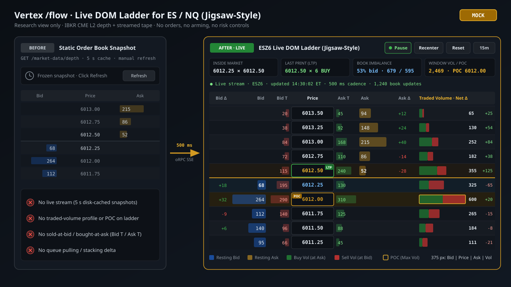
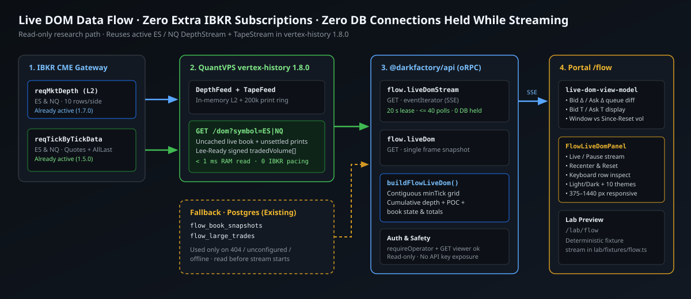

# Design: Live DOM Ladder for ES/NQ with Traded-Volume Column (Jigsaw-style)

- **Author:** Jeff Scott Ward (written by an agent)
- **Status:** reviewed (EGM consolidated Goldfish review of 2026-11-24; 16/17 PROPOSE FIX applied via auto-accept, 1/17 DECLINE kept as recorded — see [goldfish_review_report.md](goldfish_review_report.md))
- **Date:** 2026-11-24
- **Card:** `vertex-viz-live-dom`
- **Source:** research card `vertex-flow-viz-gap` (owner request, 2026-11-20), chart **F1** ("Live DOM ladder for ES/NQ that streams, with a traded-volume column (Jigsaw-style)").
- **Requirement class:** Vertex product capability (research visualization only; no orders, no arming, no risk settings).
- **Target surface:** `/flow` (`FlowLiveDomPanel` alongside `FlowTapeSpeedPanel` and `FlowLiquidityHeatmapPanel`), plus `/lab/flow` fixture gallery.

Research view only. Nothing in this change places, changes, or cancels an order, arms trading, or changes a risk setting. Resting depth, queue changes, and traded-volume counts describe the book and tape; they are never a trade signal.

Figure 1 is a mock. It shows layout, descending contiguous tick ladder, resting bid/ask depth bars, pulling/stacking queue deltas (`Bid Δ` / `Ask Δ`), sold-at-bid and bought-at-ask columns (`Bid T` / `Ask T`), center price with `LTP`/`POC`/`BID`/`ASK` markers, and the traded-volume profile column with buy/sell split and net delta. Real streams cover up to 10 resting levels per side and up to 80 contiguous price rows centered on the inside market.

## Overview

### Terms

- **DOM (Depth of Market) ladder:** A vertical price ladder ordered highest price at top to lowest price at bottom on a contiguous `minTick` grid (`0.25` for ES and NQ), showing resting L2 liquidity on both sides of the spread alongside executed volume at each price.
- **Pulling / Stacking (`Bid Δ` / `Ask Δ`):** Client-computed difference between a price level's current resting size and its resting size in the previous frame on the same contract, keyed by integer `tickIndex`. Positive values (`+18`) indicate resting contracts added (stacking); negative values (`-12`) indicate resting contracts removed or filled (pulling).
- **`Bid T` (Traded at Bid) and `Ask T` (Traded at Ask):** Per-price aggressive volume displayed beside the center price column on desktop (`>= 768 px`):
  - `Bid T` = `row.tradedSell` (contracts signed as seller-initiated at that price in the active rolling window, or since Reset), shown on every row where `tradedSell > 0`.
  - `Ask T` = `row.tradedBuy` (contracts signed as buyer-initiated at that price in the active rolling window, or since Reset), shown on every row where `tradedBuy > 0`.
- **Traded-volume column:** Per-price executed contract volume aggregated over the selected rolling window (`5m`, `15m`, `30m`, `60m`) from `vertex-history`'s in-memory streamed tape ring (or since exact server-side `since` epoch reset), signed by quote rule first (`bid < ask`: `price >= ask` buy, `price <= bid` sell) and tick-rule fallback (else `"unsigned"`), with a horizontal buy/sell bar, total contracts, signed net delta (`buy - sell`), and `POC` (Point of Control: highest total traded volume price).
- **Aggressive imbalance (`3×`):** At a price row where `tradedBuy >= 15` and `tradedBuy >= 3 * tradedSell` (`imbalance: "buy"`), or `tradedSell >= 15` and `tradedSell >= 3 * tradedBuy` (`imbalance: "sell"`), marked explicitly in text and styling so color is never the sole cue.
- **Stream lease:** Each `flow.liveDomStream` (`GET /flow/live-dom/stream`, oRPC `eventIterator` SSE) runs for at most `20_000 ms` (`<= 40` outbound polls) before emitting a clean `reconnect` event. Auth (`requireOperator`) and any fallback database read complete **before** returning the inner async generator so `request-scope.ts` finalizes PostgreSQL immediately and zero DB connections are held while streaming.

## Problem

Vertex already collects CME L2 order book depth (`DepthStream`, 10 rows/side) and tick-by-tick streamed tape (`TapeStream`, 200,000-print ring) for `ES` and `NQ` inside QuantVPS `vertex-history`, and renders two partial views:

1. `OrderBookView` on `/charts` and `/stock`: a manual one-shot "Refresh order book" button backed by the 5-second disk-cached `/depth` endpoint, with no live streaming, no traded-volume column, no pulling/stacking deltas, and no price-axis stabilization.
2. `FlowLiquidityHeatmapPanel` on `/flow`: a historical Bookmap-style heatmap refreshed every 60 seconds from stored 5-second `flow_book_snapshots`, with a compact right-edge DOM bar and no per-price traded-volume breakdown.

Neither surface gives an operator a live streaming Jigsaw-style DOM ladder where resting L2 bids/asks, queue deltas, last trade, and per-price traded volume update together in real time.

## Design Decisions & Rationale

1. **Zero new IBKR subscriptions; new uncached `GET /dom` in `vertex-history` `1.8.0`:**
   - Reuses the already-running `DepthStream` (`ES`, `NQ`, 10 rows) and `TapeStream` (`ES`, `NQ`, 200,000-print ring) in `infra/quant-vps/history/vertex_history.py`.
   - Bypasses `/depth`'s 5-second disk cache and `/tape`'s 3-second settle lag so live book updates and unsettled prints arrive in `< 1 ms` RAM reads with zero IBKR API pacing.
   - `TapeFeed.attach()` clears `self.prints`, `self.spans`, `self.open_span`, and the live-volume cache whenever `self.info` existed with a different `conId`, preventing front-month rollover from polluting the ladder with expired-contract prices.
   - `TapeFeed.live_volume(window_seconds, now, since=None)` scans up to `TAPE_SEED_SCAN` prints before `cutoff` under `self.lock` to compute scalar `(previous, different)`, copies the bounded print slice (`<= 50,000` prints), releases `self.lock`, signs outside the lock, and caches the aggregated result keyed by `(self.count, effective_cutoff)` so concurrent tabs or quiet polls never re-scan under the GIL.
2. **True oRPC SSE streaming (`flow.liveDomStream`) + single-snapshot (`flow.liveDom`), zero DB connections held:**
   - `flow.liveDomStream` (`GET /flow/live-dom/stream`, `eventIterator(FlowLiveDomStreamEventSchema)`) delivers `500 ms` (default, selectable `500 ms` / `1 s` / `2 s`) live updates over a bounded `20_000 ms` lease capped at `FLOW_LIVE_DOM_MAX_POLLS_PER_LEASE = 40` polls (staying safely under Cloudflare Workers' 50-subrequest floor, `cpu_ms: 500`, and 30 s idle bounds). Each loop fetch bounds its timeout to `Math.min(MARKET_DOM_TIMEOUT_MS, Math.max(500, leaseEndsAt - nowMs))` and stops once `leaseEndsAt - nowMs < 500`.
   - `openFlowLiveDomStream` is a regular `async function` returning `Promise<AsyncGenerator<FlowLiveDomStreamEvent>>` (NEVER a top-level `async function*`). It `await`s the initial `readFlowLiveDomSnapshot` (including any PostgreSQL fallback) **before** returning the inner generator; the inner generator holds NO reference to `FlowRepository` or `db`.
   - Deduplicates emitted frames by composite key `${frame.contract ?? ""}:${frame.source}:${frame.depthFeed.state}:${frame.tapeFeed.state}:${frame.depthUpdates}:${frame.tapeSeq}` and emits a `heartbeat` every `5_000 ms` during quiet markets.
   - If the initial read returned `source !== "live_stream"`, yields `{ type: "frame", frame }` then `{ type: "reconnect", at, reason: "recorded_fallback", retryAfterMs: 5000 }` and exits. If a mid-stream fetch fails (other than `signal.aborted`) or `depthStream.state !== "live"` / empty live book, yields `{ type: "reconnect", at, reason: "upstream_interrupted", retryAfterMs: 5000 }` and exits cleanly so the client's next request opens a fresh scope with DB fallback available.
   - Both `flow.liveDom` and `flow.liveDomStream` attach to `oc.errors(FLOW_API_ERRORS)` with `requireOperator` and `GET` method, so read-only agent viewer accounts (`agent-viewer.ts`) are automatically permitted while staying excluded from `AGENT_API_KEY_PROCEDURE_PATHS` (`packages/api/src/server/handler.ts`) and `AGENT_API_KEY_READ_PROCEDURES` (`packages/api/src/server/operator-access.ts`), matching `flow.liquidityHeatmap`, `flow.tapeSpeed`, and `flow.strikeHeatmap`.
3. **Zero new PostgreSQL tables; bounded truthful recorded fallback:**
   - When `VERTEX_HISTORY_URL` is unconfigured, unreachable, returns `404` (pre-1.8.0 `vertex-history`), or the live depth stream is not yet settled (`starting`/`down`/`off`/`halted`), the server queries:
     - `readBookSnapshots({ symbol, from: new Date(now - 72 * 3600_000), to: now, limit: 1 })` (newest snapshot within 72 hours, covering weekends),
     - `readLargeTrades({ symbol, from: tradeFrom, to: tradeTo })` anchored to `[max(anchor - windowSeconds * 1000, sinceMs), anchor]` bounded to at most `5_000` rows in-memory / repository limit,
     - `latestSamples(symbol, ["depth", "ticks"])` so both `depthFeed` and `tapeFeed` carry real recorded freshness metadata.
   - Labels provenance explicitly (`source: "recorded_fallback" | "empty"`, `volumeSource: "large_trades_only" | "none"`) with definite status-language descriptions (using `"unsigned"`, NEVER `"unknown"`, `"unavailable"`, `"N/A"`, `"—"`, or `"..."`).
4. **Exact server-side volume Reset (`since`):**
   - Optional `since` (epoch seconds) on `GET /dom`, `flow.liveDom`, and `flow.liveDomStream`. Clicking **Reset vol** sets `since = Math.floor(Date.now() / 1000)` and reconnects the stream; `TapeFeed.live_volume` uses `cutoff = max(int(now) - window_seconds, since)`. Clicking **Full window** clears `since`. Zero roll-off drift!
5. **Jigsaw-style client enrichments & responsive accessibility (`375 px` – `1440 px`):**
   - Desktop (`>= 768 px`): 8 columns (`Bid Δ`, `Bid`, `Bid T`, `Price`, `Ask T`, `Ask`, `Ask Δ`, `Volume`). Mobile (`375 px`): 4 core columns (`Bid`, `Price`, `Ask`, `Volume`) visible immediately without overflow, wrapped in `TableScroll` with a keyboard-navigable selected-row inspection bar (`ArrowUp`, `ArrowDown`, `Home`, `End`, `Escape`).
   - Semantic CSS theme tokens only (`var(--color-info)`, `var(--color-warning)`, `var(--color-success)`, `var(--color-destructive)`, `border-border`, `text-foreground`, `text-muted-foreground`) via `color-mix(in oklab, ...)` across light, dark, and all ten DarkFactory themes; all interactive controls `min-h-11` (`44×44 px`); zero layout shift (`tabular-nums`, reserved viewport height); auto-pause when `document.visibilityState === "hidden"`; exponential reconnect backoff (`1 s -> 2 s -> 4 s -> 8 s`, max `15 s`).

## Architecture & Contracts

### 1. QuantVPS `vertex-history` `1.8.0` (`infra/quant-vps/history/vertex_history.py`)

- Constants:
  - `VERSION = "1.8.0"`
  - `DOM_SCHEMA = "vertex-history-dom-v1"`
  - `DOM_SYMBOLS = DEPTH_STREAM_SYMBOLS` (`("ES", "NQ")`)
  - `DOM_ROWS_MIN = 1`, `DOM_ROWS_MAX = DEPTH_STREAM_ROWS` (`10`), `DOM_ROWS_DEFAULT = DEPTH_STREAM_ROWS` (`10`)
  - `DOM_WINDOW_SECONDS_ALLOWED = (300, 900, 1800, 3600)` (default `900`)
  - `DOM_MAX_PRINTS = 50_000`, `DOM_MAX_VOLUME_LEVELS = 200`
  - `DOM_PARAMS = frozenset(("symbol", "rows", "windowSeconds", "since"))`
- `validate_dom(raw)`: requires `symbol` in `("ES", "NQ")`, bounds `rows` (`1..10`, default `10`), validates `windowSeconds` in `(300, 900, 1800, 3600)` (default `900`), validates optional `since` as non-negative integer epoch seconds (`SINCE_RE`), rejects unknown query parameters.
- `DepthFeed.live_dom_book(rows, now, halted=None)`: under `self.lock`, checks `_settled_locked(now)` and `self.info is not None`; reads all levels from `self.book.snapshot(max(DEPTH_STREAM_ROWS * 4, rows))`, filters via `_positive_depth_pairs`, aggregates identical prices by summing sizes, sorts bids descending and asks ascending, and slices `[:rows]`. Returns `bids`, `asks`, `updates`, `contract`, `minTick`, `lastUpdate`, and `stream: { state, error, lastUpdate }`.
- `TapeFeed.attach(info, min_tick, quote_id, now)`: when `self.info` existed and `self.info.get("conId") != info.get("conId")`, clears `self.prints`, `self.spans`, `self.open_span`, and invalidates the live-volume cache.
- `TapeFeed.live_volume(window_seconds, now, since=None, halted=None)`:
  - Computes `base_cutoff = int(now) - window_seconds` and `effective_cutoff = max(base_cutoff, since)` when `since is not None` (clamped to `<= int(now)`).
  - Checks cache keyed by `(self.count, effective_cutoff)`; returns cached copy immediately if hit.
  - Under `self.lock`: locates slice `t >= effective_cutoff` (capped to newest `DOM_MAX_PRINTS` prints), scans up to `TAPE_SEED_SCAN` prints before `effective_cutoff` to compute scalar `(previous, different)`, copies slice tuples, and releases `self.lock`.
  - Outside `self.lock`: signs each print via quote rule first (`bid < ask`: `price >= ask -> "buy"`, `price <= bid -> "sell"`) else tick rule (`previous`, `different`), else `"unsigned"`; aggregates per-price `[price, buyVol, sellVol, unsignedVol, trades]`; identifies `lastTrade` (`{ t, price, size, side }` where `side` is `"buy" | "sell" | "unsigned"`); caps `volumeByPrice` to `DOM_MAX_VOLUME_LEVELS = 200` (keeping levels nearest `lastTrade.price` plus POC); stores in cache and returns `{ tapeSeq, windowSeconds, since, lastTrade, volumeByPrice, stream }`.
- `HistoryService.dom(raw)`: combines `DepthFeed.live_dom_book` + `TapeFeed.live_volume` with `seq = depth_updates + tape_seq` (informational counter), returning HTTP 200 JSON (`vertex-history-dom-v1`). Wired at `PREFIX + "/dom"` in `make_handler`.

### 2. Market Data Adapter (`packages/api/src/server/market-data.ts`)

- `MARKET_DOM_TIMEOUT_MS = 4_000`
- Extend `FetchMarketBarsOptions` with optional `signal?: AbortSignal` (combined with timeout abort controller and cleaned up in `finally`) and optional `notFoundOn404?: boolean` (default `false` so existing endpoints keep `"UPSTREAM_ERROR"` on 404). When `notFoundOn404` is `true` and `response.status === 404`, throws `new MarketDataError("NOT_FOUND", "Market DOM endpoint not found on history service (HTTP 404)")`.
- `buildMarketDomUrl(base, { symbol, rows, windowSeconds, since })` -> `<base>/dom?...`
- `VertexDomUpstreamSchema`: strict Zod validation of `schema: "vertex-history-dom-v1"`, `source: "ibkr"`, `client_id`, `symbol: "ES" | "NQ"`, `contract: MarketBarsContractSchema.nullable()`, `minTick: positive | null`, `seq: int >= 0`, `depthUpdates: int >= 0`, `tapeSeq: int >= 0`, `windowSeconds: int > 0`, `since: int >= 0 | null`, `bids`/`asks`: arrays of `[positive, positive]` (max 10), `volumeByPrice`: array of `[positive, >=0, >=0, >=0, int>=1]` (max 200), `lastTrade: { t: int > 0, price: positive, size: positive, side: "buy" | "sell" | "unsigned" } | null`, `depthStream`/`tapeStream`: `{ state: "live" | "starting" | "down" | "off" | "halted", error: string(2000) | null, lastAt: isoUtc | null }`, `fetchedAt: isoUtc`.
- `fetchMarketDom(config, input, options)`: calls `fetchHistoryDocument` with `notFoundOn404: true` and `signal: options.signal`, validates `VertexDomUpstreamSchema`, and redacts both `depthStream.error` and `tapeStream.error` via `tapeStreamError(...)` (redacting IBKR account IDs and capping at `MARKET_TAPE_ERROR_MAX = 200`).

### 3. oRPC Contracts, Pure Rules & Streamer (`packages/api`)

- `packages/api/src/contracts/flow.ts` (attached to `flow = oc.errors(FLOW_API_ERRORS)`):
  - `FLOW_LIVE_DOM_VERSION = "flow-live-dom.v1"`
  - `FLOW_LIVE_DOM_RULES_VERSION = "flow-live-dom-rules.v1"`
  - `FLOW_LIVE_DOM_MAX_LEVELS = 80`
  - `FLOW_LIVE_DOM_ROWS_MIN = 1`, `FLOW_LIVE_DOM_ROWS_MAX = 10`, `FLOW_LIVE_DOM_ROWS_DEFAULT = 10`
  - `FLOW_LIVE_DOM_WINDOW_SECONDS = [300, 900, 1800, 3600] as const` (default `900`)
  - `FLOW_LIVE_DOM_CADENCE_MS = [500, 1000, 2000] as const` (default `500`)
  - `FLOW_LIVE_DOM_STREAM_LEASE_MS = 20_000`, `FLOW_LIVE_DOM_MAX_POLLS_PER_LEASE = 40`, `FLOW_LIVE_DOM_HEARTBEAT_MS = 5_000`
  - `FlowLiveDomInputSchema`: `{ symbol: z.enum(FLOW_TAPE_SYMBOLS), rows: z.coerce.number().int().min(1).max(10).default(10), windowSeconds: z.coerce.number().int().refine(...in [300,900,1800,3600]).default(900), since: z.coerce.number().int().min(1).optional() }`
  - `FlowLiveDomStreamInputSchema`: extends `FlowLiveDomInputSchema` with `cadenceMs: z.coerce.number().int().refine(...in [500,1000,2000]).default(500)`.
  - `FlowLiveDomRowSchema`: `{ tickIndex: int, price: positive, bidSize: >=0, askSize: >=0, cumBidSize: >=0, cumAskSize: >=0, tradedBuy: >=0, tradedSell: >=0, tradedUnsigned: >=0, tradedTotal: >=0, tradedDelta: finite, trades: int>=0, imbalance: "buy"|"sell"|null, isBestBid: boolean, isBestAsk: boolean, isLastTrade: boolean, isPoc: boolean }`.
  - `FlowLiveDomTotalsSchema`: `{ bidSize: >=0, askSize: >=0, bidSharePct: 0..100|null, tradedBuy: >=0, tradedSell: >=0, tradedUnsigned: >=0, tradedTotal: >=0, tradedDelta: finite, trades: int>=0 }`.
  - `FlowLiveDomFeedSchema`: `{ state: "live"|"starting"|"down"|"off"|"halted"|"recorded"|"never", lastAt: timestamp|null, error: string(200)|null }`.
  - `FlowLiveDomRulesSchema`: `{ version: literal("flow-live-dom-rules.v1"), maxLevels: int>0, imbalanceMinContracts: int>0, imbalanceRatio: >0, streamLeaseMs: int>0, maxPollsPerLease: int>0, heartbeatMs: int>0 }`.
  - `FlowLiveDomSchema`: `schemaVersion`, `symbol`, `contract`, `source` (`"live_stream" | "recorded_fallback" | "empty"`), `volumeSource` (`"streamed_tape" | "large_trades_only" | "none"`), `minTick`, `seq`, `depthUpdates`, `tapeSeq`, `windowSeconds`, `since` (`int | null`), `capturedAt`, `bookState` (`"normal" | "locked" | "crossed" | "one_sided" | "empty"`), `bestBid`, `bestAsk`, `mid`, `spread` (`finite | null`, `0` when locked, `< 0` when crossed), `spreadTicks` (`int | null`), `pocPrice`, `pocVolume`, `lastTrade` (`{ t, price, size, side: "buy"|"sell"|"unsigned" } | null`), `totals`, `rows` (max 80, highest price first), `depthFeed`, `tapeFeed`, `rules`.
  - `FlowLiveDomStreamEventSchema`: discriminated union of `{ type: "frame", frame: FlowLiveDomSchema }`, `{ type: "heartbeat", at: timestamp, seq: int>=0 }`, `{ type: "reconnect", at: timestamp, reason: "lease_expired"|"recorded_fallback"|"upstream_interrupted", retryAfterMs: int(0..30_000) }`.
  - Procedures: `flow.liveDom` (`GET /flow/live-dom`) and `flow.liveDomStream` (`GET /flow/live-dom/stream`, `eventIterator(FlowLiveDomStreamEventSchema)`). Re-exported via `packages/api/src/index.ts` alongside `flow-live-dom-rules.ts`; `packages/api/openapi.json` regenerated via `bun run openapi:generate`.
- `packages/api/src/flow-live-dom-rules.ts` — **Edge-Case Rules Checklist:**
  1. **Floating-point canonicalization:** `tickIndex = Math.round(price / minTick)` and canonical `price = Math.round(tickIndex * minTick * 1_000_000) / 1_000_000`.
  2. **Null `minTick` fallback:** uses `FLOW_INSTRUMENTS[symbol].minTick` (`0.25` for ES/NQ).
  3. **Duplicate prices after tick snapping:** sums resting sizes and traded volumes for entries snapping to the same `tickIndex` (never overwrites).
  4. **Outward cumulative depth on locked/crossed books:** accumulates `cumBidSize` descending from highest bid price and `cumAskSize` ascending from lowest ask price, independent of `bookState`.
  5. **Centering priority & wide spreads:** anchors ladder on `mid` (normal/locked/crossed), `bestBid ?? bestAsk` (one-sided), `lastTrade.price` (empty book with tape), or `pocPrice` (empty book with volume); when `spreadTicks >= 80`, centers the 80-row window on `mid` while header KPIs still report true inside `bestBid`/`bestAsk`.
  6. **POC tie-breaking:** when max `tradedTotal === 0`, `pocPrice = null, pocVolume = 0`. On ties (`> 0`), picks the price closest to `mid ?? lastTrade?.price ?? 0`, breaking exact equidistant ties by higher price.
  7. **Aggressive imbalance:** `tradedBuy >= 15 && tradedBuy >= 3 * tradedSell -> "buy"`, `tradedSell >= 15 && tradedSell >= 3 * tradedBuy -> "sell"`, else `null`.
- `packages/api/src/server/flow-live-dom.ts`:
  - `readFlowLiveDomSnapshot(deps, input, now, signal)` and `openFlowLiveDomStream(deps, input, signal)` with injectable `deps: { fetchDom, repository, now, sleep, leaseMs, maxPolls, heartbeatMs }` for deterministic 100% branch coverage.

### 4. Web Portal (`apps/web`)

- `apps/web/src/features/flow/live-dom-view-model.ts`:
  - Pure symbol mapping (`domSymbolOf(symbol)` -> `"ES"` for `SPY|ES`, `"NQ"` for `QQQ|NQ`).
  - Pulling/stacking queue diffing keyed by `row.tickIndex` (resetting `prevBookSizes`, Reset `since`, and Axis Lock whenever `symbol`, `contract`, or `source` changes).
  - Axis lock / recenter slicing (`sliceDomRows`), status-language-compliant banner builders (definite state + cause + ET timestamp + next action), KPI summary builders, and row inspection formatter.
- `apps/web/src/components/portal/flow-live-dom-panel.tsx`:
  - Consumes `gateway.liveDomStream(input, { signal })` via `for await`, auto-reconnecting across `20 s` leases, exponential backoff on transport errors, `visibilitychange` auto-pause/resume, Pause/Resume toggle, Cadence selector (`500 ms` / `1 s` / `2 s`), Window selector (`5m` / `15m` / `30m` / `60m`), Reset vol / Full window toggle (sets server `since`), Lock axis / Re-center controls, and keyboard-accessible ladder (`TableScroll`, roving `tabIndex`, row inspection readout).
- `apps/web/src/components/portal/flow-workspace.tsx`:
  - Adds `liveDom(input)` and `liveDomStream(input, options?: { signal?: AbortSignal })` to `FlowGateway` / `createBrowserFlowGateway()`.
  - Renders `<FlowLiveDomPanel gateway={gateway} symbol={symbol} />` right below `FlowTapeSpeedPanel` (decoupled from the 60 s workspace poll timer) and updates the `/flow` footer copy to mention both live DOM streaming and recorded snapshots.
- `apps/web/src/lab/fixtures/flow.ts` & `apps/web/src/lab/entries/research.tsx`:
  - Adds deterministic `labFlowLiveDom` + `labFlowLiveDomStream` fixture so `/lab/flow` renders the live DOM ladder cleanly.

## Verification Plan

1. **Python unit tests** (`infra/quant-vps/history/test_vertex_history.py`): `validate_dom`, `DepthFeed.live_dom_book` (filtering before slicing, duplicate-price summing), `TapeFeed.attach` (conId rollover reset), `TapeFeed.live_volume` (quote rule, tick rule with `TAPE_SEED_SCAN`, `since` reset cutoff, cache hit/invalidation, level capping, POC retention), `HistoryService.dom`, and HTTP `/dom` routing.
2. **API tests (`packages/api`)** at 100% coverage for all new files: `flow-live-dom-rules.test.ts`, `flow-live-dom.contract.test.ts`, `server/flow-live-dom.test.ts`, `market-data.test.ts`, `server/flow.test.ts`, `agent-viewer.test.ts`, `status-language.test.ts`, plus `bun run openapi:check`.
3. **Web tests (`apps/web`)** at 100% coverage for all new files: `features/flow/live-dom-view-model.test.ts`, `components/portal/flow-live-dom-panel.test.tsx`, `components/portal/flow-workspace.test.tsx`, `lab/fixtures/fixtures.test.ts`, `lab/entries/research.test.tsx`, `status-language.test.ts`.
4. **Repository gates:** `bun run verify:prepush` (`verify:core` + `test:unit` + `test:contract` + `test:operations` including `scripts/ci/public-names.test.ts` and `scripts/ci/json-data.test.ts`), coverage check on all touched/new files, EGM drift report (`2026-11-24_DRIFT_REPORT.md`), and fresh-context code review of the full diff at exact HEAD.
