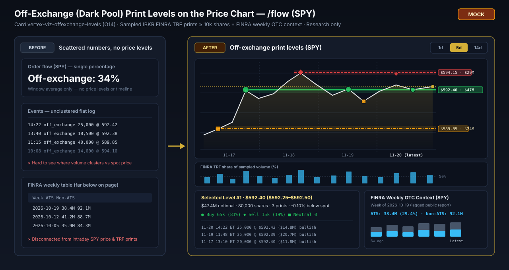
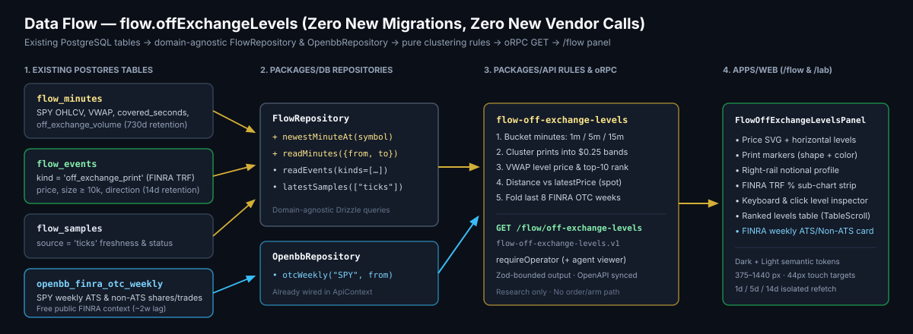

# Off-exchange (dark pool) print levels on the price chart on `/flow` (card `vertex-viz-offexchange-levels`)

- **Author:** Jeff Scott Ward (written by an agent)
- **Status:** implemented and verified on branch `ws/off-exchange-levels`
- **Date:** 2026-11-24
- **Baseline commit:** `60c13a56` on `vertex/rebuild-darkfactory-20260921`
- **Source:** research card `vertex-flow-viz-gap`, chart O14 ("Off-exchange (dark pool) print levels on the price chart").

Research view only. Nothing in this change places, changes, or cancels an order, arms trading, or changes a risk setting. The chart describes stored sampled off-exchange prints and lagged weekly FINRA OTC reports; it is not a trade signal.

Figure 1 is a mock. It shows layout, range selector (`1d` / `5d` / `14d`), SPY price chart with horizontal clustered off-exchange print levels, print markers, right-rail notional profile, FINRA TRF volume-share strip, interactive level inspector, and FINRA weekly OTC context.

## Overview

### Terms

- **Off-exchange print:** One SPY trade on the `FINRA` TRF venue with `size >= 10,000` shares (`FLOW_INSTRUMENTS.SPY.largePrint`), stored by the existing flow collector in `flow_events` (`kind = 'off_exchange_print'`, `source = 'ibkr'`, 14-day retention).
- **Sampled ticks:** SPY ticks are collected via IBKR historical tick samples (~1,000 newest prints every ~6 minutes, `capture = 'sampled'`). `flow_minutes` stores `open`, `high`, `low`, `close`, `vwap`, `volume`, `off_exchange_volume`, and `covered_seconds` (730-day retention).
- **Print level (cluster band):** Off-exchange prints within the selected window grouped into `$0.25` half-open price bands `[k * 0.25, (k + 1) * 0.25)`. Each band's displayed price is the share-weighted VWAP of its prints (`sum(price * size) / sum(size)`). Levels are ranked by total notional (`sum(price * size)`) descending, keeping up to `10` levels (`FLOW_OFF_EXCHANGE_MAX_LEVELS = 10`).
- **Dominant direction:** Uses the quote/tick-signed `direction` already stored on each `flow_events` row (`bullish`, `bearish`, `neutral`). A level is labelled `bullish` when `buyShares > sellShares && buyShares >= 0.5 * totalShares`, `bearish` when `sellShares > buyShares && sellShares >= 0.5 * totalShares`, and `neutral` otherwise.
- **FINRA weekly OTC context:** Free public FINRA weekly off-exchange volume already stored in `openbb_finra_otc_weekly` (`venue` = `'ats'` dark pools vs `'non_ats'` wholesalers/OTC) for `SPY`, shown for up to `8` recent weeks with explicit reporting-lag context (~2 weeks for Tier 1 NMS securities).

## The Problem

`/flow` currently surfaces off-exchange SPY activity only as a single window-wide scalar percentage (`orderFlow.offExchangeShare`), a flat unclustered events list (`EventsPanel`), and a separate FINRA weekly table at the bottom of the page. Operators cannot see **at which prices** large off-exchange prints clustered relative to the SPY price path, how much notional sits above or below current spot, or how intraday FINRA TRF activity compares with multi-week FINRA OTC volume.

## Design Decisions & Rationale

1. **Zero new migrations, zero new vendor calls.**
   - `flow_minutes`, `flow_events`, `flow_samples`, and `openbb_finra_otc_weekly` already hold all required columns and indexes.
   - `FlowRepository` adds two narrow, domain-agnostic reads: `newestMinuteAt(symbol)` and `readMinutes({ symbol, from, to })`. `readEvents`, `latestSamples`, and `OpenbbRepository.otcWeekly` are reused directly.
2. **SPY only (`FLOW_OFF_EXCHANGE_SYMBOLS = ["SPY"]`).**
   - `ES` and `NQ` are CME futures (`offExchange: false`). `QQQ` does not collect ticks (`ticks: "none"`). `SPY` is the sole flow symbol collecting IBKR FINRA TRF ticks and is the default symbol on `/flow`.
3. **Three lookback ranges (`1d`, `5d` default, `14d`) with session-compressed bucketing.**
   - `1d`: newest stored SPY regular session `[09:30, 16:00)` NY time, `1`-minute bars (up to 390 bars).
   - `5d` (default): up to 5 recent trading sessions within the lookback window, `5`-minute bars (up to 390 bars), surfacing multi-day dark pool levels immediately even early in the morning session.
   - `14d`: up to 10 recent trading sessions within 14 calendar days (matching `flow_events` 14-day retention), `15`-minute bars (up to 260 bars).
   - Price lines break across session boundaries and unsampled gaps (`> max(2 * bucketMinutes, 12) min`), rendering isolated single-bar points as markers instead of invisible single-point polylines, never fabricating price continuity over missing samples.
4. **Pure rules in `packages/api`, pure view-model in `apps/web`.**
   - `packages/api/src/flow-off-exchange-levels-rules.ts` owns bar bucketing, `$0.25` level clustering, VWAP calculation, ranking, spot distance, and FINRA weekly folding.
   - `apps/web/src/features/flow/off-exchange-levels-view-model.ts` owns SVG geometry, formatters, keyboard selection, and ARIA copy.
5. **Accessible, dual-theme, responsive UI (375–1440 px).**
   - Semantic CSS variables (`var(--color-success)`, `var(--color-destructive)`, `var(--color-warning)`, `var(--color-info)`, `var(--color-primary)`) support both light and dark modes.
   - Direction is encoded with **both** color and geometry (circle/solid = bullish, diamond/dashed = bearish, square/dot-dash = neutral), never color alone.
   - Isolated refetch on range changes or Retry via a dedicated sequence ref in `FlowWorkspace`, never resetting the 60 s refresh timer or refetching sibling panels.

## Verification & Acceptance

- Contract tests (`flow-off-exchange-levels.contract.test.ts`), pure rules tests (`flow-off-exchange-levels-rules.test.ts`), assembly tests (`server/flow-off-exchange-levels.test.ts`), router/auth tests (`server/flow.test.ts`, `agent-viewer.test.ts`), repository unit & integration tests (`db/server/flow.test.ts`, `tests/integration/database/flow-off-exchange-levels.test.ts`), view-model tests (`off-exchange-levels-view-model.test.ts`), panel tests (`flow-off-exchange-levels-panel.test.tsx`), workspace & lab tests (`flow-workspace.test.tsx`, `lab/fixtures/fixtures.test.ts`, `lab/entries/research.test.tsx`).
- 100% line/branch/function/statement coverage on all new and modified files; `bun run check`, `bun run openapi:check`, `bun run docs:check`, and `bun run verify:prepush` green.
