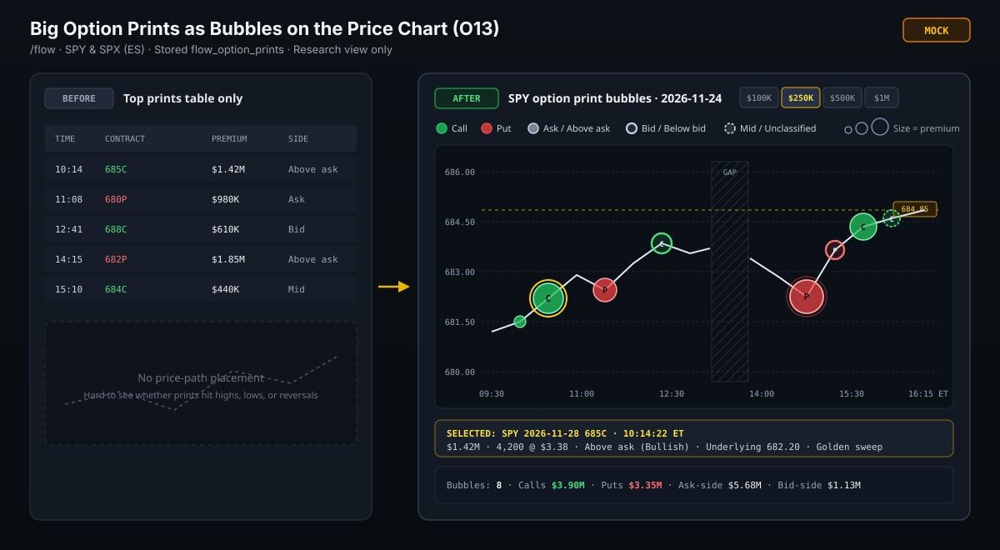
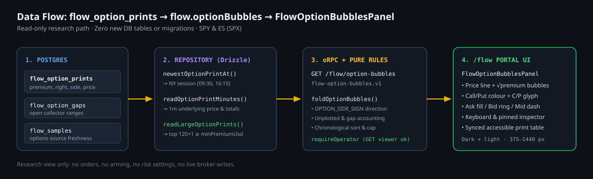

# Big option prints as bubbles on the price chart (`/flow`, card `vertex-viz-option-bubbles`)

- **Author:** Jeff Scott Ward (written by an agent)
- **Status:** implemented
- **Date:** 2026-11-24
- **Baseline commit:** `60c13a56` on `vertex/rebuild-darkfactory-20260921`; branch `ws/big-option-prints-as-bubbles-2`
- **Source:** research card `vertex-flow-viz-gap`, chart O13 ("Big option prints as bubbles on the price chart (size = premium, colour = call/put, side)").

Research view only. Nothing in this change places, changes, or cancels an order, arms trading, or changes a risk setting. Option print bubbles describe stored option trades; they are never a trade signal.

Figure 1 is a mock. It shows layout, intraday underlying price trajectory, proportional call/put bubbles, filled/hollow/dashed side encoding, collector gap hatch, minimum-premium selector, and pinned print inspector. Real sessions may display up to 120 largest prints matching the selected premium floor.

## Overview

### Terms

- **Print:** One option trade stored in `flow_option_prints` (QuantData `order-flow/consolidated`, premium `>= $10,000`, retained 14 days).
- **Symbol and ticker:** `/flow` tracks four symbols (`SPY`, `ES`, `QQQ`, `NQ`). Stored option prints exist only for `SPY` (options ticker `SPY`, underlying = SPY) and `ES` (options ticker `SPX`, underlying = SPX index). `QQQ` and `NQ` do not collect `flow_option_prints` and do not render this panel.
- **Options session:** Regular options hours `[09:30, 16:15)` New York time (405 minutes, end-exclusive) of the newest stored print's session date (`flowSessionDate` + `optionsSessionRange`).
- **Minimum premium floor (`minPremiumUsd`):** User-selectable preset `$100,000`, `$250,000` (default), `$500,000`, or `$1,000,000`.
- **Aggressor side (`side`):** QuantData fill classification relative to the quote: `above_ask`, `ask`, `mid`, `bid`, `below_bid`, or `not_classified` (stored as `unknown`).
- **Directional sign:** Shared `OPTION_SIDE_SIGN` (`packages/api/src/flow-options.ts`):
  - `+1` bullish: call at `ask`/`above_ask`, or put at `bid`/`below_bid`.
  - `-1` bearish: put at `ask`/`above_ask`, or call at `bid`/`below_bid`.
  - `0` unsigned: `mid` or `not_classified`.
- **Unplotted print:** A matching big print whose stored `underlying_price` is null or non-positive. It is never fabricated onto the price axis; it stays listed in the accessible detail table with an explicit note and is counted in `totals.unplottedBubbles`.
- **Open collector gap (`flow_option_gaps`):** Inclusive `[start_time, end_time]` range still waiting to be paged by the collector. Clipped ranges are shaded explicitly on the time axis and break the underlying price polyline.

## Architecture

### Database (`packages/db/src/server/flow.ts`)

- No schema migration required; uses existing `flow_option_prints` (`flow_option_prints_symbol_time_idx`), `flow_option_gaps`, and `flow_samples`.
- Reuses `newestOptionPrintAt`, `readOptionPrintMinutes` (1-minute underlying price path and full-session print totals), `optionGaps`, and `latestSamples`.
- Adds `readLargeOptionPrints(query: FlowLargeOptionPrintsQuery)` selecting prints with `symbol = query.symbol`, `from <= traded_at < to`, and `premium >= query.minPremiumUsd`, ordered by `premium DESC, traded_at DESC, id DESC`, bounded by `limit`.

### API Contract & Pure Rules (`packages/api`)

- **Procedure:** `flow.optionBubbles` (`GET /flow/option-bubbles`, schema `flow-option-bubbles.v1`, protected by `requireOperator`, permitted for read-only agent viewer as a `GET` read procedure).
- **Input:** `{ symbol: "SPY" | "ES", minPremiumUsd?: 100_000 | 250_000 | 500_000 | 1_000_000 }` (default `250_000`, accepting number or numeric string for HTTP GET query parameters).
- **Pure rules (`packages/api/src/flow-option-bubbles-rules.ts`):** `foldOptionBubbles` caps bubbles to `FLOW_OPTION_BUBBLES_MAX_BUBBLES = 120` largest prints (setting `truncated: true` when `limit + 1` rows are returned), sorts returned bubbles chronologically (`tradedAt ASC, id ASC`), maps `side`/`moneyness` to contract values, computes `directionalSign`, builds 1-minute `pricePoints` and clipped `gaps` / `unread`, and tallies honest totals.

### Portal UI (`apps/web`)

- **View model (`apps/web/src/features/flow/option-bubbles-view-model.ts`):**
  - Builds segmented underlying price polylines (never drawing bridges across gaps or > 5 minute holes), Y-axis price ticks, X-axis ET session ticks (`09:30`–`16:15`), open gap bands, and latest spot reference line.
  - Visual encoding (never color alone):
    - **Size:** `r` proportional to `sqrt(premium)`, clamped to `[5, 22]` against `max(maxPlottedPremium, minPremiumUsd * 4)`, with a 3-circle size scale legend.
    - **Colour:** Calls use `var(--color-success)`, puts use `var(--color-destructive)`, plus a centered `C` / `P` glyph on bubbles with `r >= 10`.
    - **Side:** `ask`/`above_ask` = solid filled circle (`above_ask` or `goldenSweep` adds a subtle outer ring halo); `bid`/`below_bid` = hollow thick-ringed circle; `mid`/`not_classified` = dashed-ring circle.
  - Draws larger bubbles first so smaller bubbles render on top and remain clickable.
  - Client-side right filter (`All`, `Calls`, `Puts`) and side filter (`All sides`, `Ask-side`, `Bid-side`).
- **Component (`apps/web/src/components/portal/flow-option-bubbles-panel.tsx`):**
  - Independent loading, failure + Retry, and threshold switching on `/flow` without resetting the 60 s refresh timer or affecting sibling panels.
  - Keyboard navigation (`ArrowLeft`, `ArrowRight`, `Home`, `End`, `Escape`), pinned bubble inspector strip (`aria-live="polite"`), and synced accessible table inside `TableScroll`.
  - Dark + light mode via semantic tokens; responsive from 375 px to 1440 px with `min-h-11` interactive targets.
- **Lab preview:** Deterministic `labFlowOptionBubbles` fixtures for `SPY` and `ES` in `/lab/flow`.

## Acceptance Criteria

1. `flow.optionBubbles` validates input/output strictly (`flow-option-bubbles.v1`), enforces `requireOperator`, and matches generated `packages/api/openapi.json`.
2. `readLargeOptionPrints` queries `flow_option_prints` with `premium >= minPremiumUsd` in descending premium order and is verified by unit and Postgres integration tests.
3. `/flow` renders `FlowOptionBubblesPanel` for `SPY` and `ES` (not `QQQ`/`NQ`) with size = premium, colour = call/put (+ `C`/`P` glyph), side = filled/hollow/dashed, interactive inspection, synced detail table, threshold switching, and client-side right/side filters.
4. `bun run verify:core`, `bun run test:unit`, `bun run test:contract`, `bun run test:operations`, and 100% test coverage on all new and touched source files pass.
