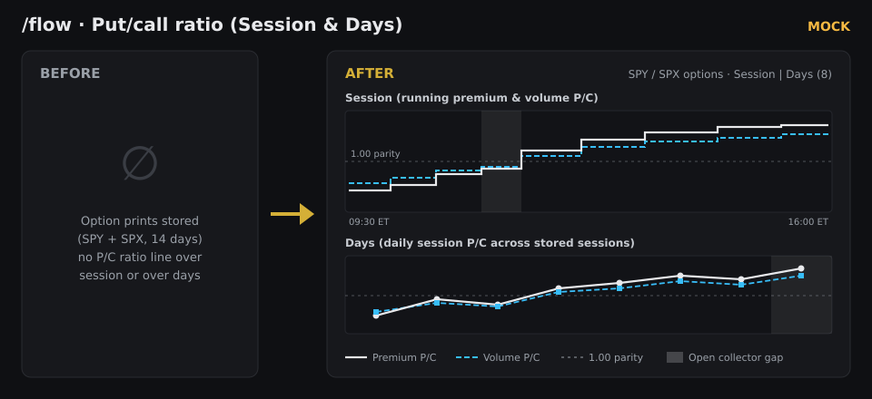

# Put/call ratio line on `/flow` (card `vertex-viz-pc-ratio-line`)

- **Date:** 2026-11-22
- **Source:** research card `vertex-flow-viz-gap`, chart O15 ("Put/call premium and volume ratio as a line over the session and over days").
- **Scope:** Research view only. Nothing here places, changes or cancels an order, arms trading or changes a risk setting.

## Data source decision (`flow_option_prints` vs `flow_net_drift`)

The card listed both stored QuantData tables (`flow_option_prints` and `flow_net_drift`). Auditing `packages/db/src/schema/flow.ts` and `packages/api/src/flow-net-drift.ts` confirms:

- `flow_net_drift` stores **signed net** values (`net_call_premium`, `net_put_premium`, `net_call_volume`, `net_put_volume` = ask minus bid, OTM-only). Signed values can be negative or zero, so dividing put by call is mathematically invalid.
- `flow_option_prints` stores **non-negative gross** `premium` (`>= 0`, minimum $10,000 stored by the collector) and `size` (`>= 0` contracts) per print with `right` (`call` | `put`), `traded_at`, `underlying_price`, and `symbol` (`SPY` = SPY options, `ES` = SPX options), retained for 14 days (~10 trading sessions), with open collector gaps in `flow_option_gaps`.

Therefore `flow.putCallRatio` reads `flow_option_prints` only (no new table, no migration, no new vendor call) and states on screen that net drift holds signed values and is not used. `QQQ` and `NQ` have no stored option prints and do not render the panel.

## Aggregation and contract (`flow-put-call-ratio.v1`)

- **Database queries (`packages/db/src/server/flow.ts`):**
  - `readOptionPrintMinutes`: groups `flow_option_prints` by `date_trunc('minute', traded_at)` over the newest session `[09:30, 16:15)` New York time using `flow_option_prints_symbol_time_idx (symbol, traded_at)`. Returns at most 405 rows (no read cap truncation).
  - `readOptionPrintDays`: groups regular-session weekday prints (`09:30` to `16:15` in `America/New_York`, Mon–Fri) over the last 20 calendar days by New York session date, returning the newest 20 sessions oldest-first.
- **Rules (`put-call-ratio.v1`, `packages/api/src/flow-put-call-ratio-rules.ts`):**
  - Gross `putPremium / callPremium` and `putVolume / callVolume`; `null` when the denominator is `0` (never `Infinity` or `NaN`).
  - Session view (`points`, max 405): running cumulative sums and ratios from 09:30 ET with carried-forward positive underlying price, session high/low ratio minutes (first wins), and clipped open gap span (`unread`).
  - Multi-day view (`days`, max 20): daily session ratios, last positive underlying price, and `incomplete: true` when any open `flow_option_gaps` range overlaps that session's `[09:30, 16:15)` ET window.
- **Procedure:** `GET /flow/put-call-ratio` (`flow.putCallRatio`), operator session or read-only agent viewer (`isAgentViewerReadProcedure`), no API key.

## Portal UI (`FlowPutCallRatioPanel`)

- Placed on `/flow` below `FlowHedgingPressurePanel` for `SPY` and `ES` only; loads in its own call with independent loading, error-with-retry, and forbidden hold states.
- Segmented toggle switches instantaneously between **Session** (stepped running lines + underlying price + session totals, range and print counts) and **Days (N)** (multi-day lines with distinct circle/square markers so single-day history stays legible + underlying price + daily breakdown table).
- Distinguishes lines by both stroke style and semantic tokens (solid foreground for premium P/C, dashed info for volume P/C, dotted subtle for `1.00` parity, translucent shade for open collector gaps); works across light, dark and all theme palettes at 375–1440 px.
