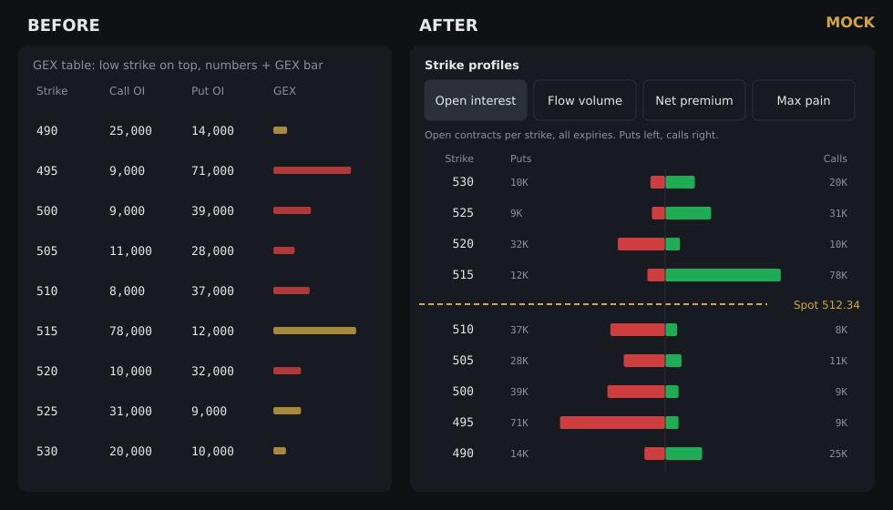
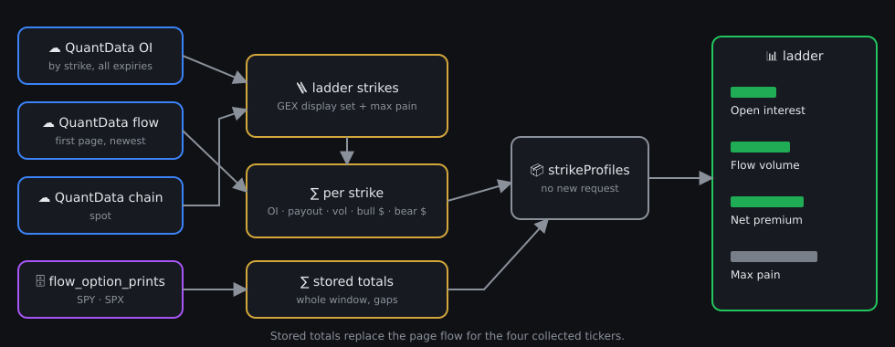

# Strike bar profiles in the options analytics panel (card vertex-viz-strike-profiles)

- **Author:** Jeff Scott Ward (written by an agent)
- **Status:** reviewed (EGM consolidated review of 2026-11-22; fixes applied, see
  [goldfish_review_report.md](goldfish_review_report.md))
- **Date:** 2026-11-22
- **Baseline commit:** `c7c4f6cd` on `vertex/rebuild-darkfactory-20260921`;
  branch `ws/strike-bar-profiles-oi`
- **Source:** research card `vertex-flow-viz-gap`, charts O7, O8, O9 and O16 (rows quoted in
  [The Problem](#the-problem)). The card of this build, `vertex-viz-strike-profiles`, says:
  "Data source: QuantData OI/volume (already paid) and stored flow_option_prints. Build in the
  Vertex portal (/flow, /charts or /stock Analytics as fits), dark + light, 375-1440 px, tests per
  AGENTS.md. Research view only: no orders, no arming, no risk settings." Both cards live in the
  owner's task tracker, which is not in this repository.

Research view only. Nothing in this change places, changes or cancels an order, arms trading or
changes a risk setting. The profiles describe positioning and recent trades; they are not trade
signals.



Figure 1 is a mock with invented numbers. It shows the Open interest profile only. It leaves out
the caption lines, the value texts next to the bars and the scroll box; section
[User experience](#user-experience) gives the exact texts.

## Overview

The options analytics panel is shown on `/charts` and on the stock page Analytics tab
(`/stock/<symbol>?tab=analytics`). It loads one `optionsAnalytics.snapshot` response with the open
interest per strike, the max-pain strike and QuantData option-flow prints. Today it shows these
only as table numbers and totals. This change adds one section, "Strike profiles": one strike
ladder with four bar profiles that a radio group selects:

1. **Open interest:** put OI as a bar to the left, call OI as a bar to the right.
2. **Flow volume:** contracts in the option-flow prints, puts left, calls right.
3. **Net premium:** bullish premium minus bearish premium (QuantData sentiment), a signed bar.
4. **Max pain:** the holder payout at each strike; the max-pain strike is marked.

Every profile uses the same rows, so a strike keeps its place when the reader switches profiles.
The strike is the vertical axis: higher strikes are higher on the screen, as on a price chart. A
horizontal line marks the spot price between the two strikes around it.

### Terms

- **Vertex:** this product (research portal and trading back end).
- **QuantData:** a paid options-data vendor. Vertex calls its REST API from the server with a
  shared per-minute quota (`packages/api/src/server/quantdata-client.ts`).
- **GEX section:** the existing panel section "Gamma exposure and open interest". GEX is the
  estimated dealer gamma exposure per strike.
- **Strike ladder:** a table with one row per strike, sorted from the highest strike at the top
  to the lowest at the bottom.
- **Display strikes:** the strike set of the GEX section, chosen by `displayStrikes` in
  `options-analytics-engine.ts` from the strikes within 50-150 % of spot: the 55 nearest spot plus
  the 25 with the largest call OI plus put OI, at most 80. Without a spot price: the 40 lowest
  strikes plus the 25 largest.
- **Open interest (OI):** open option contracts at a strike. QuantData `open-interest-by-strike`
  sends it summed over all expiries. The snapshot notes already say that it can reflect the
  previous session.
- **Flow print:** one row of QuantData `order-flow/consolidated` (one trade, sweep or block) with a
  strike, a right (call or put), an expiry, a size in contracts, a premium in dollars and a
  sentiment (`bullish`, `bearish` or `neutral`) that QuantData assigns.
- **Counted print:** a flow print with a strike above 0, a premium of 0 or more and an expiry on
  or after today (New York date). The options chain (`options-chain-quantdata.ts`) counts the same
  prints for its Vol column.
- **Stored prints:** the table `flow_option_prints`. The flow collector (`flow-collect.ts`) pages
  through QuantData order flow and stores every print for the flow instruments whose `sources`
  in `FLOW_INSTRUMENTS` include `"options"`: today SPY (option ticker SPY) and ES (option ticker
  SPX). It records ranges it could not finish in `flow_option_gaps` and its run results in
  `flow_samples` (the freshness that `/flow` shows).
- **Holder payout at a price `P`:** the intrinsic value in dollars of all open contracts (all
  expiries) if the underlying is at `P`: the sum over strikes `K` of
  `max(0, P - K) * callOI(K) * 100 + max(0, K - P) * putOI(K) * 100`.
- **Max pain:** the strike with the smallest holder payout (`maxPain` in
  `options-analytics-engine.ts`; on a tie, the first strike in strike order).
- **Spot:** the underlying price QuantData sends with the term-structure response.
- **`/lab`:** a development page (on when `VERTEX_UI_LAB=on`) that renders panels with fixture
  data. Fixture data is labelled MOCK.
- **QuantVPS:** the server that runs the `vertex-web` service (the portal).

## The Problem

The gap report lists these chart types as missing (owner request of 2026-11-20):

- O7 "Open interest by strike (calls vs puts)": call OI to the right, put OI to the left, per
  strike. Vertex today: call OI and put OI are numbers in the GEX table; no bars.
- O8 "Options volume by strike": call and put volume per strike as bars. Vertex today: a Vol
  column in the options chain, one expiry only; no bars.
- O9 "Net premium by strike": bullish minus bearish premium per strike. Vertex today: only call
  and put premium totals for the window.
- O16 "Max pain by strike": total option-holder payout if the price settles at each strike; the
  lowest is max pain. Vertex today: one max-pain number.

A reader who wants to see how OI, traded contracts and premium are spread across strikes must
read the GEX table (up to 80 rows) or use another tool.

## Goals

1. Draw the four profiles (O7, O8, O9, O16) for any symbol the panel shows, on one strike ladder
   with the strike on the vertical axis and a spot line.
2. For SPY and SPX (the option tickers with stored prints), compute the flow profiles from the
   stored prints of the whole window. For other symbols, use the prints the snapshot already fetches and state the time span
   they cover.
3. Add no QuantData request.
4. Label each profile with its source and its limits.
5. Pass criteria for layout and access: no horizontal page overflow at 375, 768, 1024 and
   1440 px; light and dark mode; the radio group works with Tab and arrow keys; the ladder is a
   table that screen readers read by column; bars are hidden from screen readers.

## Non-Goals

1. No per-expiry view. QuantData documents an expiry filter for OI and a per-expiry max-pain
   request (not used in this repository); each would cost requests per expiry. Deferred.
2. No total exchange volume per strike (see [Alternative V1](#alternative-v1-a-quantdata-volume-per-strike-request)).
3. No new procedure and no migration. The only new database code is one read query.
4. No change to the `/flow` page.
5. No trade action, order ticket link or alert from the profiles.

## Open Questions

None. The card leaves the place open ("as fits"); this design chooses the shared panel (see
[Alternatives Considered](#alternatives-considered)). The card names the data sources; the
design uses both. Decisions taken by the job (not owner gates): flow-print contracts stand for
O8 volume, with a caption that says so; per-expiry views wait.

## Critical User Journeys

1. **OI walls.** The reader opens `/stock/SPY?tab=analytics`. In "Strike profiles" the Open
   interest profile is selected. The reader sees which strikes have the longest call bar and the
   longest put bar, and where they sit relative to the spot line.
2. **Where trading went.** The reader selects Flow volume and sets the flow window to 6 h. For
   SPY the bars show the contracts of all stored prints of the last 6 hours. For a symbol the
   collector does not store, the caption gives the time span of the prints shown.
3. **Net premium by strike.** The reader selects Net premium. Bars to the right mark strikes with
   more bullish than bearish premium; bars to the left mark the opposite.
4. **Max-pain strike.** The reader selects Max pain. The row whose strike equals the max-pain
   number of the GEX section is marked "max pain"; it is always on the ladder.
5. **Missing data.** QuantData sends no flow prints. The Flow volume and Net premium profiles show
   the flow message; the Open interest and Max pain profiles still draw.

## Technical Plan (Architecture)



### Read path

The three cached QuantData requests stay as they are: term structure (IV and spot), open interest
by strike, and the first page of order flow for the window (1, 6, 24 or 72 h). For SPY and SPX
the `optionsAnalytics.snapshot` handler also reads one grouped query from `flow_option_prints`,
the collector gaps and the newest options run of the collector. `buildOptionsAnalytics` (which
the flow collector also calls) does not read the database. The hedging pressure line
(`flow.hedgingPressure`) is the precedent: it reads the same stored prints, gaps and run results,
and its gap helper `unreadOf` is reused.

### The ladder (pure functions in `options-analytics-engine.ts`)

1. **Rows.** The ladder strikes are the display strikes of the GEX section plus the max-pain
   strike when it is not one of them (at most 81 rows). Without OI there is no ladder; every
   profile then shows a message.
2. **OI and payout.** Each row carries the call and put OI of its strike and the holder payout at
   that strike over every OI row (not only the ladder rows). A pinned max-pain strike that has no
   OI row of its own has OI 0.
3. **Flow.** Each row carries `callVolume`, `putVolume` (sum of sizes), `bullishPremium`,
   `bearishPremium` (sum of premiums by sentiment; neutral prints add to neither) and `trades`
   (number of counted prints, neutral included). Counted prints at strikes that are not on the
   ladder are counted in `flow.offLadderTrades`.
4. **Flow source.** `quantdata_page`: the counted prints of the snapshot's first order-flow page;
   the coverage is the trade time of the oldest and the newest print, and `complete` is false
   when the provider has more pages. `stored_prints`: the grouped query result for the window;
   the coverage is the oldest and newest stored print time, and `complete` is false when a
   recorded collector gap overlaps the window or the collector did not catch up: its options
   source is stale or never ran (`buildSourceFreshness`, as on `/flow`), or, outside the session,
   its last good run is older than the close of the newest session in the window (an outage late
   in a session leaves no gap row until the next session). When the stored read fails, the page
   flow stays and the handler emits the semantic event
   `vertex.optionsAnalytics.strikeProfilesStoredRead` (failure).

### Contract (`packages/api/src/contracts/options-analytics.ts`)

A new top-level output field `strikeProfiles`; the GEX and flow sections do not change.

```ts
StrikeProfileRow = {
  strike: number;            // finite
  callOpenInterest: number;  // int >= 0
  putOpenInterest: number;   // int >= 0
  holderPayout: number;      // finite >= 0, dollars
  callVolume: number;        // int >= 0, contracts
  putVolume: number;         // int >= 0
  bullishPremium: number;    // finite >= 0, dollars
  bearishPremium: number;    // finite >= 0
  trades: number;            // int >= 0
};
StrikeProfiles = {
  strikes: StrikeProfileRow[];          // ascending strike, at most 81
  flow: {
    source: "quantdata_page" | "stored_prints";
    trades: number;                     // counted prints in the source
    offLadderTrades: number;            // counted prints at strikes not on the ladder
    oldestTradeAt: string | null;       // ISO time
    newestTradeAt: string | null;
    complete: boolean;
  };
};
```

The field is named per side (`bullishPremium`, `bearishPremium`); the web computes the net, so
"net premium" keeps one meaning in the flow section (call minus put). Readers of the full output:
the web panel, the `/lab` fixture and their tests. `packages/api/src/server/mcp.ts` and
`packages/api/src/server/flow-collect.ts` read named fields only and do not change.
`packages/api/openapi.json` is regenerated.

### Stored prints query (`packages/db/src/server/flow.ts`)

`readOptionStrikeTotals({ symbol, from, to, minExpiry })` groups the rows of `flow_option_prints`
with `symbol = $symbol`, `from <= traded_at < to`, `expiry >= minExpiry` and `strike > 0` by
`strike`, `right`
and `sentiment`, and returns per group the sum of `size`, the sum of `premium`, the row count and
the oldest and newest `traded_at`. `symbol` is the flow instrument whose `optionsTicker` is the
panel symbol and whose `sources` include `"options"` (`storedPrintsSymbol`: SPY for SPY, ES for
SPX), so the query uses the index on `(symbol, traded_at)`. Gaps come from the existing
`optionGaps(symbol)`, the run results from `latestSamples(symbol, ["options"])`.

### Web

- A pure model `apps/web/src/components/portal/strike-profiles-model.ts` turns the snapshot and
  the selected profile into table rows, bar fractions, the spot-line position, the max-pain
  marker and the captions.
- A component `apps/web/src/components/portal/strike-profiles-panel.tsx` draws the section.
- `apps/web/src/components/portal/center-marked-row.ts` centres a marked row in a scroll box; the
  GEX table and the new ladder share it.
- `options-analytics-panel.tsx` renders the section after the GEX section and shows the GEX table
  from the highest strike to the lowest, so both strike tables read in the same direction.
- The `/lab` fixture (`apps/web/src/lab/fixtures/market.ts`) gets `strikeProfiles`.

## User experience

- **Section title:** "Strike profiles".
- **Profile selector:** a `fieldset` with the legend "Profile" and four native radio buttons
  styled as a segmented control: "Open interest", "Flow volume", "Net premium", "Max pain". Each
  label is at least 44 x 44 px. Tab moves to the group; arrow keys change the profile. Open
  interest is selected first; the choice stays when the snapshot reloads.
- **Status:** Open interest and Max pain need the GEX section status `ok`; otherwise they show its
  message. Flow volume and Net premium need the stored prints, or a flow section with status
  `ok`; otherwise they show the flow message. Without ladder rows every profile says "No strikes:
  QuantData sent no open interest for this symbol." When every value of a profile is 0, the
  ladder still draws and the caption says "No values for this profile."
- **Captions (under the selector; they wrap on narrow screens):**
  - Open interest: "Open contracts per strike, all expiries (QuantData; can be the previous
    session). Puts left, calls right."
  - Flow volume: "Contracts in option-flow prints, all expiries. Puts left, calls right. Flow
    prints only, not total exchange volume."
  - Net premium: "Bullish minus bearish premium per strike (QuantData sentiment). Neutral prints
    are not counted."
  - Max pain: "Holder payout if the price settles at each strike (open interest, all expiries).
    Bar: payout above the max-pain strike."
  - Flow coverage, under the two flow profiles (times as `MM-DD HH:MM` UTC):
    - stored prints: "All stored prints of the last N h (start to end UTC)." or, without prints,
      "No stored prints in the last N h."; when not complete: "Stored prints can be incomplete:
      the collector has gaps or is behind in this window."
    - QuantData page: "Newest K prints, start to end UTC, of the last N h window." or "No counted
      prints in the last N h."; when more pages exist: "First provider page only."
    - when `offLadderTrades > 0`: "M prints at strikes not shown."
  - Strike rule, under every profile: "Strikes: the 55 nearest spot and the 25 largest by open
    interest (at most 80), plus the max-pain strike." Without spot: "Strikes: the 40 lowest and
    the 25 largest by open interest, plus the max-pain strike."
- **Table columns:**
  - Open interest and Flow volume: Strike, Puts, (bar), Calls.
  - Net premium: Strike, Bearish, (bar), Bullish. The bar is the net value.
  - Max pain: Strike, Payout, (bar).
- **Bars:** two-sided bars share one scale: the largest put or call value in the profile. Net
  premium bars use the largest absolute net value. Max pain bars show the payout minus the
  smallest payout on the ladder, scaled by the largest such excess. A scale of 0 gives bars of
  length 0.
- **Values:** counts with `formatCount` ("12K"), money with `formatMoney` ("$1.2M"), from
  `apps/web/src/features/flow/format.ts`. A value of 0 shows "0" or "$0". The row `title` gives
  the exact numbers (`toLocaleString("en-US")`).
- **Colours:** calls and bullish use `success`; puts and bearish use `destructive`, which the
  order-flow views already use for the sell side; payout uses `muted-foreground`. On the Max pain
  profile the row whose strike equals the GEX max-pain number has a `primary` bar and the text
  "max pain" after its strike. Side and sign also come from position and column, never from colour
  alone.
- **Spot line:** a row across all columns after the last strike above spot (a strike equal to
  spot is below the line), labelled "Spot 512.34" (two decimals). Without a spot price there is no
  line. On load and on a profile change the scroll box centres the spot line.

## Risks and Mitigations

1. **The QuantData page covers a short time.** The snapshot reads one order-flow page, newest
   first. For a busy symbol it covers minutes, not the window. Mitigation: stored prints for SPY
   and SPX; for other symbols the caption gives the real time span and says "First provider page
   only."
2. **Flow volume is not exchange volume.** Mitigation: the label is "Flow volume" and the caption
   says "Flow prints only, not total exchange volume."
3. **Sentiment is the vendor's label.** Mitigation: the caption names the source; neutral prints
   are left out.
4. **Aggregate OI mixes expiries.** Max pain over all expiries is a proxy for the next expiry.
   Mitigation: the caption says "all expiries"; the GEX section already says "aggregate OI".
5. **Stored prints can be incomplete.** A collector gap or a stale or never-run collector leaves
   prints out. Mitigation: `complete` is false in both cases, and the caption says so.
6. **Phone width.** Two-sided bars with values may not fit at 375 px. Mitigation: the bar column
   is fluid, values are compact and the table scrolls inside its box.
7. **Access.** No new procedure. The new field has the same access as `optionsAnalytics.snapshot`:
   the operator session and the read keys of research agents (MCP `options_gex_context`). Each
   SPY or SPX call, from either, runs the grouped query. The query is read-only.
8. **Response size and cost.** At most 81 rows of 9 numbers (about 8 KB of JSON). Server work:
   at most 81 payout evaluations over the OI rows, one pass over the page prints, and for SPY and
   SPX one grouped query over at most 72 h of stored prints of one symbol, using the
   `(symbol, traded_at)` index, plus the existing gap and run-result reads.

## Alternatives Considered

Prefixes: P = where the profiles are computed and shown, V = volume source, R = rendering.

### Alternative P1: A new panel on `/flow`

`/flow` shows four index symbols only and has no OI by strike. Rejected: the options analytics
panel has every input for every symbol; it gets the stored prints for SPY and SPX through the same
procedure.

### Alternative P2: Separate strike sets per profile (first draft)

Volume and net premium used their own top-80 strikes by premium. Rejected in review: rows moved
when the reader switched profiles, and the caption had two meanings for "largest". The draft's
fallback ladder from flow prints when OI is missing was dropped for the same reason (Stage 8).

### Alternative P3: Extend the GEX table

The GEX table already lists the display strikes. Adding put and call bars, a payout column and
flow columns to it would make a row of eight or more columns, which does not fit 375 px, and the
GEX context strip would sit above unrelated profiles. Rejected; the new section uses the same
strikes and the same order instead.

### Alternative P4: Holder payout on the GEX strike rows

Rejected in review: it changes the GEX row type that `gex-context.ts` uses. The payout lives in
`strikeProfiles`.

### Alternative V1: A QuantData volume-per-strike request

QuantData documents a `heat-map` request with a net-volume mode by strike and expiry. It is not
used in this repository, its response has not been checked against a live answer, and it costs one
more request per symbol and refresh from the shared quota. Deferred (Future Improvement 2).

### Alternative R1: SVG chart

An SVG chart (the web app has `d3-scale`) draws the same bars but needs extra work to be read by a
screen reader. Rejected: an HTML table with CSS bars gives table semantics for free.

### Alternative R2: Strike on the horizontal axis

Vertical columns per strike are common, but the card asks for price on the vertical axis, as on a
price chart. Rejected.

### Chosen design

P3 rejected, separate section with the GEX display strikes (rows), stored prints for SPY and SPX,
HTML table with CSS bars (R1 rejected), strike on the vertical axis.

## Non-Functional Requirements

- No new QuantData request.
- At most 81 rows; one grouped database query (plus the gap and run-result reads) per snapshot,
  for SPY and SPX only.
- Every new or changed source file at 100 % coverage (the repository gate).

## Rollout

The change ships with the web app. On the QuantVPS the build is staged with
`infra/quantvps/stage-build.sh` and `vertex-web` is restarted only through
`infra/quantvps/restart-when-idle.sh`, after 16:00 ET or before 08:30 ET (the script refuses the
hours in between). No trading unit is touched. Rollback: deploy the previous build the same way;
nothing stored changes.

## Future Improvements

1. A per-expiry filter for OI, flow volume and max pain.
2. Exchange volume per strike from QuantData `heat-map`, after a live check of its response.
3. Profiles side by side on wide screens.

## Detailed Implementation Plan

### Files

|File|Action|Change|
|---|---|---|
|`packages/api/src/contracts/options-analytics.ts`|Modify|add `STRIKE_PROFILE_FLOW_SOURCES`, `StrikeProfileRowSchema`, `StrikeProfilesSchema`, field `strikeProfiles` on the output, types `StrikeProfiles`, `StrikeProfileRow`, `StrikeProfileFlowSource`|
|`packages/api/src/server/options-analytics-engine.ts`|Modify|add `holderPayout`, `isCountedPrint`, `profileStrikes`, `withProfileFlow`, `strikeProfiles`, `pageProfileFlow` and the types `FlowPrintGroup`, `StrikeProfileFlowInput`; `maxPain` uses `holderPayout`|
|`packages/api/src/server/options-analytics.ts`|Modify|add `flowWindow`, `storedPrintsSymbol`, `storedProfileFlow`; `buildOptionsAnalytics` sets `strikeProfiles`; the handler applies stored prints|
|`packages/api/src/server/options-chain-quantdata.ts`|Modify|use `isCountedPrint`|
|`packages/api/src/server/flow-hedging-pressure.ts`|Modify|export `unreadOf`|
|`packages/api/src/options-analytics.test.ts`|Modify|engine, stored-flow and procedure tests|
|`packages/api/src/server/flow.test.ts`, `packages/api/src/server/flow-collect.test.ts`|Modify|repository doubles get `readOptionStrikeTotals`|
|`packages/db/src/server/flow.ts`, `packages/db/src/server/index.ts`|Modify|add `readOptionStrikeTotals`, `FlowOptionStrikeTotalRecord`, `FlowOptionStrikeTotalsQuery`|
|`packages/db/src/server/flow.test.ts`|Modify|query shape through the fake database|
|`tests/integration/database/flow-option-strike-totals.test.ts`|Create|grouping and filters on Postgres|
|`packages/api/openapi.json`|Modify|regenerate|
|`apps/web/src/components/portal/strike-profiles-model.ts` and `.test.ts`|Create|model and tests|
|`apps/web/src/components/portal/strike-profiles-panel.tsx` and `.test.tsx`|Create|section and tests (also covers `center-marked-row.ts`)|
|`apps/web/src/components/portal/center-marked-row.ts`|Create|shared scroll-centring helper|
|`apps/web/src/components/portal/options-analytics-panel.tsx` and `.test.tsx`|Modify|render the section; GEX table high to low; fixture field|
|`apps/web/src/lab/fixtures/market.ts`, `apps/web/src/lab/fixtures/fixtures.test.ts`|Modify|fixture `strikeProfiles`; max pain at the smallest payout|
|`docs/data-sources-and-platform-roles.md`, `CHANGELOG.md`|Modify|documentation|

The API, database, web and fixture changes go in one commit, so every commit builds.

### Phase A: API and database

1. `holderPayout(rows, price)` computes the Terms formula. `maxPain` returns the strike with the
   smallest `holderPayout(rows, strike)`; on a tie the first row wins (unchanged).
2. `isCountedPrint(event, today)`: strike above 0, premium of 0 or more, expiry on or after
   `today`. `flowByContract` in `options-chain-quantdata.ts` uses it (same result as before).
3. `profileStrikes(oiRows, spot, maxPainStrike)`: the strikes of
   `displayStrikes(inRangeStrikes(oiRows, spot), spot)` plus `maxPainStrike`, ascending; `[]`
   without OI.
4. `pageProfileFlow(events, today, firstPageOnly)`: the counted prints as one group each, the
   oldest and newest trade time, `complete = !firstPageOnly`.
5. `strikeProfiles({ oiRows, spot, maxPainStrike, flow })`: ladder rows with OI and payout, then
   `withProfileFlow(rows, flow)`, which joins the flow groups by strike and counts
   `offLadderTrades`.
6. `buildOptionsAnalytics` sets `strikeProfiles` with the page flow. The `snapshot` handler: when
   `storedPrintsSymbol(symbol)` is not null and the flow repository exists, it calls
   `storedProfileFlow` for `flowWindow(flowHours, now)` and replaces the flow with
   `withProfileFlow`; when that throws, it keeps the page flow.
7. `readOptionStrikeTotals` as in the Architecture section.
8. Tests (`packages/api/src/options-analytics.test.ts`):
   - payout: OI `{80: call 10, put 500}`, `{100: call 300, put 300}`, `{120: call 800}` gives
     600,000 at 80, 20,000 at 100 and 640,000 at 120; `maxPain` is 100; ties keep the first;
   - counted prints: strike 0, negative premium and an expired expiry are left out;
   - ladder: display strikes plus a pinned max-pain strike; no OI gives no ladder;
   - page flow: groups, time span, `complete`;
   - neutral prints add volume and trades but no premium; prints off the ladder are counted;
     150 prints on one strike give `trades = 150`;
   - stored flow: query arguments, a gap in or before the window, a stale or never-run collector,
     no stored prints;
   - procedure: SPY uses stored prints, QQQ makes no query, a failed read keeps the page flow,
     SPX reads symbol ES.
9. Database: the unit test checks the query shape; the integration test checks the grouping, the
   time and expiry filters and the symbol filter on Postgres.
10. From the repository root: `bun run openapi:generate`.

### Phase B: web

1. Model `buildStrikeProfile(metric, snapshot)` with
   `StrikeProfileMetric = "openInterest" | "flowVolume" | "netPremium" | "maxPain"`. It returns
   a message view or a ladder view with `layout` (`split` or `single`), `columns`, `rows`
   (highest strike first; `left` and `right` fractions, `leftText`, `rightText`, `title`,
   `maxPain`), `spotAfter` (index of the last row above spot; `-1` when no row is above it;
   `null` without spot), `spotLabel` and `captions`.
2. Panel `StrikeProfilesPanel({ snapshot })` renders the radio group, the captions, the table with
   `data-strike-profiles={metric}`, the spot-line row (`data-spot-line`) and `data-max-pain-row`.
3. `options-analytics-panel.tsx`: render `StrikeProfilesPanel` after the GEX section; render the
   GEX rows in reverse order; both use `centerMarkedRow`.
4. Fixture `labOptionsAnalytics()`: `strikeProfiles` from its OI rows and events (MOCK data),
   `maxPain` at the smallest payout.
5. Tests: each profile (columns, texts, fractions), scale 0, spot above, below, between, equal to
   a strike and missing, the max-pain marker, the status messages, the coverage captions, the
   radio group, and the GEX table order.

### Phase C: documentation

1. `docs/data-sources-and-platform-roles.md`: the options analytics paragraph names the strike
   profiles and the stored-prints read.
2. `CHANGELOG.md`, under `## [Unreleased]`: one `### Added` line for the strike profiles and one
   `### Changed` line for the GEX table order.

### Acceptance

1. The changed test files pass with `pnpm exec vitest run --config vitest.config.ts --project
   unit`, and `--coverage` with `--coverage.include` on the changed source files reports 100 %.
2. `bun run test:integration` passes the new database test.
3. `bun run verify:prepush` passes.
4. Headless Chrome on the rig renders the `/lab` charts entry (MOCK fixture) at 375, 768, 1024
   and 1440 px in light and dark mode with no horizontal page overflow; screenshots go in the PR.
5. After deploy: headless Chrome on the rig opens the live `/stock/SPY?tab=analytics`; each profile
   shows a ladder or its source message, the Max pain profile marks the GEX max-pain strike, and
   the Flow volume coverage line names the stored prints.

## Implementation notes

- Stage 8 (2026-11-22) findings applied: SPY and SPX only (the collector stores no QQQ or NDX
  prints); `complete` also uses the collector freshness; `unreadOf` reused; no ladder from flow
  prints when OI is missing; one shared scroll-centring helper; the query filters on `symbol`
  only; the max-pain marker shows on the Max pain profile only.
- Biome: the repository formats with `biome format` and lints with `biome lint`. `biome check
  --write` also sorts object keys and imports in whole files; do not run it on existing files.
