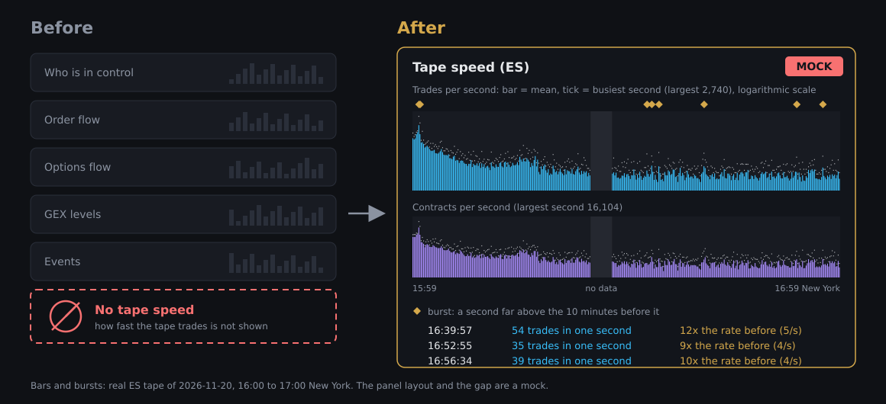
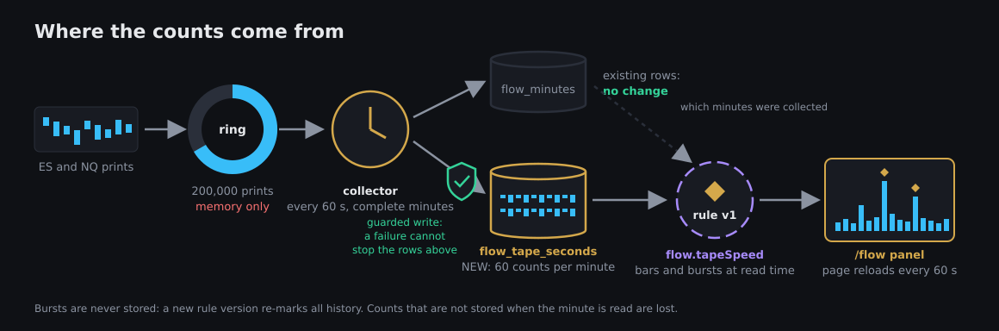
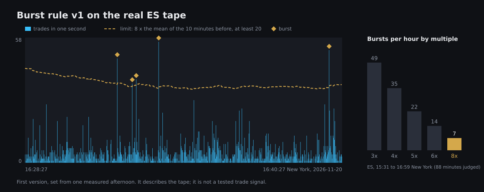
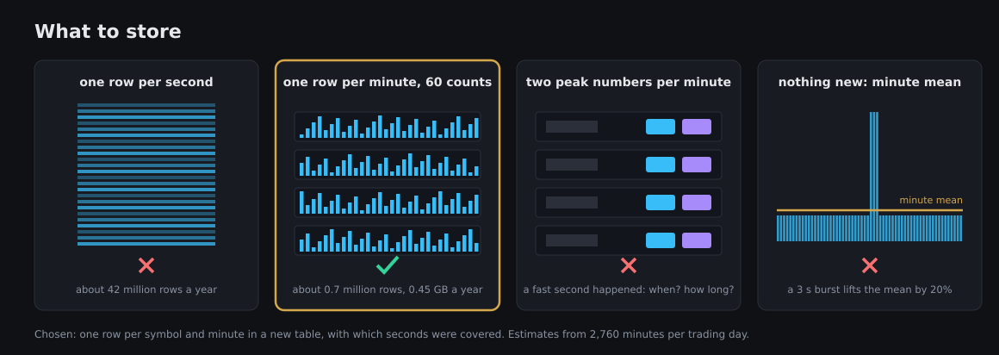
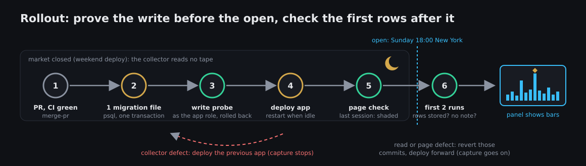

# Tape speed chart for ES and NQ on /flow

- **Author:** Jeff Scott Ward
- **Status:** Approved (goldfish review of 2026-11-22 resolved: 49 fixes applied, 3 nits declined)
- **Date:** 2026-11-22
- **Baseline commit:** f289b21b (branch `vertex/rebuild-darkfactory-20260921`)











## Overview

The page `/flow` of the Vertex portal shows order flow for SPY, QQQ, ES and NQ. It does not show how fast the tape trades. The work card `vertex-viz-tape-speed` asks for a "tape speed: trades per second / size per second histogram with burst marks" for the ES and NQ tape. This design adds a "Tape speed" panel: bars of trades per second and contracts per second over the page window, and a mark on each burst (figure 1). The collector already reads every print of the ES and NQ tape once per minute. It will also count the prints of each second and store the counts. A new read procedure turns the stored counts into bars and bursts (figure 2). Research only: nothing in this design places, changes or cancels an order, and nothing changes the switch that lets the system trade ("arming") or a risk setting.

### Terms

- **Print:** one trade report of the tape, `[exchange second, price, size, bid, ask]`. Timestamps are whole seconds. "Trades per second" counts prints. "Contracts per second" adds their sizes.
- **Tape:** the stream of prints of one future. Only ES and NQ have a streamed tape.
- **Contract name:** the local symbol of the futures contract that the stream follows, for example `ESZ6`.
- **Ring:** the memory buffer of the service `vertex-history` on the trading server. It holds the newest 200,000 prints per symbol and is the only place where single prints exist. It is empty after a restart of the service.
- **Collector:** the scheduled procedure `flow.collect`, a part of the web app. A timer on the trading server calls it every 60 s. It stores per-minute rows in the table `flow_minutes` (one row for each minute that has a print), large single prints ("deep trades", table `flow_large_trades`) and events.
- **Read range:** each tape read covers whole minutes `[since, end)`. `since` is one minute before the minute of the last successful read, and at most 10 minutes before now. `end` is the start of the minute in progress. A normal run therefore reads two complete minutes: the newest one, and the one before it again (a late print can still reach it). After an outage a run reads at most 10 minutes; older minutes are never read.
- **Covered second:** an exchange second for which the service reports that its stream was live. The service sends covered time as inclusive pairs of seconds. A covered span needs two prints at most 60 s apart, and it ends at a late or out-of-order print.
- **Sample:** the record of one collector read in `flow_samples`: a status (`ok`, `empty` or `unavailable` for the tape), counts of stored items and events, and a message of at most 300 characters.
- **Response document:** the versioned JSON answer of a read procedure, for example `flow-snapshot.v1`.
- **Operator:** a signed-in user who may read `/flow`. **Viewer account:** a read-only sign-in for agents; a rule of the API lets it call every GET procedure and no write.
- **Index group:** S&P 500 (ES, SPY, SPX) or Nasdaq 100 (NQ, QQQ, NDX). The table `FLOW_GROUPS` names the future of each group.
- **Burst second:** a covered second that the burst rule marks. **Burst:** a run of consecutive burst seconds.

## The Problem

A trader who reads order flow uses the speed of the tape to see where a move started: many trades in a few seconds after a slow stretch. Vertex stores per-minute totals only. A per-minute mean hides a short burst: 3 seconds at five times the normal rate raise the minute mean by 20%. The single prints that would show the burst exist only in the ring. The collector never reads back more than 10 minutes, so per-second counts that are not stored when the minute is collected cannot be rebuilt later.

The stored data is 1 to 2 minutes behind the market. The panel is therefore a record for looking back at the session, not a live signal.

Today the collector reduces covered time to a count per minute, and a minute row exists only for a minute with a print. A quiet second and an unseen second then look the same. A chart of speed must draw the first as zero and the second as a gap.

## Goals

- Store, for ES and NQ, the trades and the contracts of each exchange second of every complete minute that the collector reads, with a flag per second that says if the second was covered.
- Show on `/flow` two bar charts on one time axis (trades per second, contracts per second) for the page window of 60, 120, 240 or 390 minutes, at 375 to 1440 px, in dark and in light mode.
- Mark each bar that holds a burst second with a shape, and list the bursts with time, size, baseline and multiple, so that a person can check each mark. One burst second must be visible in the 390-minute window.
- Give one second the same verdict in every window, and state the rule with its version and numbers on the panel and in the response document.
- Draw time without counts as a shade, never as zero, and give each state of the panel its own text.
- A fault of the new write or of the new read changes no minute row, no sample status, and no other panel of the page.
- Roll out and roll back without a database step other than one added table.

## Non-Goals

- Any order, arming, sizing or risk change. No new paid data. No change to the service `vertex-history`.
- A live view of the present second.
- A baseline over past sessions. It needs a session calendar and weeks of history that do not exist yet.
- A study that tests the burst rule as a signal. The stored counts make such a study possible later.
- An agent tool, an API-key route or a semantic catalog term for tape speed.
- Structured telemetry for the flow pipeline and a request id that reaches `vertex-history`. The flow code has neither today.
- A stored reason code per gap. The cause of a gap is in the sample message, which is kept 14 days.
- A per-second zoom view. The bars are buckets of 10 to 60 seconds; each bar shows its busiest second as a tick.
- Pruning of the new table. It grows by about 0.45 GB per year; a cutoff is set when the later study states what it needs.

## Open Questions

- None.

## Critical User Journeys (CUJs)

### CUJ 1: Read tape speed for ES

- **Given**: The operator is signed in, the ES tape was collected in the last two hours, and the per-second table holds rows for that time.
- **When**: The operator opens `/flow`, selects ES and the 120-minute window.
- **Then**: The panel "Tape speed (ES)" shows 363 bars of 20 seconds for trades per second and for contracts per second. A diamond mark sits above each bar that holds a burst second. A table lists the bursts with New York time, peak trades in one second, baseline and multiple. The caption states the bucket length and the rule with its version. The tape line states the newest stored minute.

### CUJ 2: Default view on SPY

- **Given**: The page opens on SPY, which has no streamed tape.
- **When**: The page loads.
- **Then**: The panel shows the ES tape and its title is "Tape speed (ES, the future of the S&P 500 group)". For QQQ the panel shows NQ with the Nasdaq 100 group name. The panel has its own time axis, with its start and end time under the chart.

### CUJ 3: Time without counts

- **Given**: The stream was down for 6 minutes inside the window, and the feature was deployed 30 minutes ago.
- **When**: The operator looks at the 60-minute window.
- **Then**: The 6 minutes are shaded as "no data". The first 30 minutes are shaded in the warning tone with the legend "collected, but no per-second counts". A covered second without a trade counts as zero inside its bar. No shaded time is drawn as a bar of height zero.

### CUJ 4: Closed market

- **Given**: It is Saturday. The newest stored per-second minute is Friday 16:58 New York time (the minute before the daily break is not stored, a known gap of the collector).
- **When**: The operator opens `/flow` on ES.
- **Then**: The panel shows the window that ends at Friday's last data, and the tape line reads "market closed" with the date and time of the newest stored minute.

### CUJ 5: The read fails or is slow

- **Given**: The new table does not exist (a deploy step was missed), or the previous app is running after a rollback while a browser tab still runs the new page, or the answer takes longer than a minute.
- **When**: The page reloads.
- **Then**: The Tape speed panel shows one error line with the error code, the time and "retrying every 60 s", or keeps its loading text. The control panel, the order flow panel and all other panels load and update as before.

### CUJ 6: The write fails

- **Given**: The table has no grant for the app's database role `vertex_research`.
- **When**: The collector runs.
- **Then**: The minute rows, the deep trades and the events are stored as before, and the sample has the status, the item count and the event count that it would have without this feature. The sample message holds the note `; per-second counts not stored (<error name> <SQLSTATE>)`. On the panel, the tape line shows "Per-second counts are not being stored" with the note, and the affected minutes are shaded in the warning tone.

## Technical Plan (Architecture)

Figure 2 shows the flow. The same in text:

```text
IBKR tape (ES, NQ)
   |
vertex-history ring (memory, 200,000 prints per symbol)      no change
   |  GET /tape, once per minute
flow.collect -> collectTape (packages/api)
   |-- existing: sign prints -> flow_minutes, flow_large_trades, flow_events    no change
   |-- new, after the existing writes, one guarded step:
   |      countTapeSeconds(prints, covered pairs, read range) -> rows
   |      repository.upsertTapeSeconds(rows) -> table flow_tape_seconds
   v
flow.tapeSpeed({ symbol, minutes })  (new read procedure, operator session)
   |-- repository: per-second rows (axis + 10 minutes lead-in),
   |               the minutes of the axis that have a minute row, newest samples
   |-- judgeTapeSeconds + foldTapeBursts (rule flow-tape-speed-rules.v1, pure)
   |-- buildFlowTapeSpeed -> response document flow-tape-speed.v1
   v
/flow: FlowWorkspace loads it in its own call -> FlowTapeSpeedPanel
```

### Storage

One new table, `flow_tape_seconds`, with one row per symbol and minute (figure 4 compares the options).

|Column|Type|Meaning|
|---|---|---|
|`symbol`|text|`ES` or `NQ`|
|`minute`|timestamp with time zone|start of the minute|
|`trades`|integer array, 60 elements|prints of each second of the minute|
|`contracts`|integer array, 60 elements|contracts of each second (the size sum, as a whole number)|
|`covered`|text, 60 characters of `0` and `1`|`1`: the second was covered|
|`total_trades`|integer|sum of `trades`|
|`contract`|text, 1 to 20 characters|contract name of the stream|

Rules of the table:

- Primary key (`symbol`, `minute`). One check constraint holds the symbol list, 60 elements in each array, no NULL and no negative element, the mask pattern, `total_trades >= 0` and the length of the contract name.
- The collector writes a row for each complete minute of a read that has at least one covered second or at least one print. A covered minute without a print gets a row of zeros. A minute with no covered second and no print gets no row.
- A minute can lack a row for four reasons: the stream was not live or had no trade for more than 60 s; the minute was collected before this feature was deployed; the per-second write failed; or the collector was down for more than 10 minutes. The read procedure tells the second and third reason apart from the others by the minute row in `flow_minutes` (section "Read procedure and response document").
- The counts hold all prints of the minute, also those of an uncovered second (measured on 2026-11-22: 3 such seconds in 94 minutes of ES). Rates, peaks and the burst rule use covered seconds only: the service ends a covered span at a late or out-of-order print, so an uncovered second with prints can be incomplete.
- Replace rule: a new row replaces the stored row of the same key when it has at least as many trades. This is the rule of the minute rows for the streamed tape (`MINUTE_REPLACE_RULES.trades`), so both tables keep the same read of a minute. A read after a service restart holds fewer trades and does not replace a fuller row. A late print gives a later read more trades and fewer covered seconds, and that read replaces the row.
- The table is not pruned in this change. Reader: a later burst study. Estimate: about 0.65 kB per row and 2,760 rows per trading day, so about 0.45 GB per year without index and backup overhead. The trading server has 27 GB free and the app database holds 1.3 GB (measured 2026-11-22). The table `flow_market_premium` is the precedent for a flow table without a prune.
- The table holds raw counts only. It holds no burst, no baseline and no bucket.

### Collector

`collectTape` reads the tape, classifies each print as buy or sell ("signs" it), stores the minute rows with `upsertMinutes`, and then stores the deep trades and the events with `insertTickSample`. After these writes, and before it builds the sample, it runs one new guarded step:

1. `countTapeSeconds` (pure) folds the prints of the read, the covered pairs and the read range into rows.
2. `upsertTapeSeconds` stores the rows. In a dry run nothing is stored, like the other writes.
3. One `try` holds both calls. On any error the step returns the note `; per-second counts not stored (<error name> <SQLSTATE>)`: the error name is cut to 40 characters, and the five-character SQLSTATE code is added when the error or one of its causes has one. Without an error it returns an empty note.
4. The note is added to the sample message, before the existing note "older minutes skipped" when both apply. The text before the notes is cut so that the message keeps its limit of 300 characters.

The step changes no status, no item count and no event count of the sample, and it runs after the existing writes. A missing table or grant therefore does not stop the minute rows, and the tape read of the next run starts where it would start without this feature. A successful run produces the same sample message as today.

A failed write is not retried by itself. The next run reads the previous minute again and stores its row. A single failed run of a normal read (two minutes) therefore loses no row; after an outage it can lose up to eight rows. A lasting fault (missing table or grant) loses every row until it is repaired. It is visible in every sample message and on the panel.

Limit: the guard catches an error; it does not bound a write that blocks on a lock. Such a write delays the run like any other write of the collector. The only statement that takes a lock on the new table is the rollback file, which this design orders after a stop of the collector timer.

### Burst rule

One pure module holds the rule and its numbers (figure 3):

|Field|Value|Meaning|
|---|---|---|
|`version`|`flow-tape-speed-rules.v1`|shown on the panel and in the response document|
|`baselineSeconds`|600|the baseline of a second is taken from the 600 seconds before it|
|`minBaselineCoveredSeconds`|300|fewer covered seconds in the baseline: no verdict|
|`multiple`|8|the second needs at least 8 times the baseline|
|`floorTrades`|20|and at least 20 trades|

For a covered second `s`:

- The baseline is the mean trades per second over the covered seconds in `[s - 600, s - 1]`.
- If fewer than 300 of those seconds are covered, the second is "not evaluated". This is a separate verdict from "normal", and its baseline is null.
- Otherwise the second is a burst second when `trades >= 20` and `trades >= 8 x baseline`.
- A burst is a run of burst seconds whose exchange seconds follow each other without a step. Its baseline is the baseline of its first second.

The rule uses exchange seconds only. The read procedure reads 10 minutes before the first bar, so a second gets the same verdict in every window. The rule marks trades per second only. Contracts per second are shown, not marked: one large print already appears on the page as a deep trade.

Evidence and limits:

- The numbers come from one sample: the ring content of Friday 2026-11-20, 15:26 to 17:00 New York time. That is the last 34 minutes of the regular session, the close and the hour before the daily break. Nothing is measured yet for the night session, the 08:30 releases or the 09:30 open.
- In the sample, ES had a mean of 35.6 trades per second, a median of 13, a 99th percentile of 257 and a maximum of 2,740 (16,104 contracts in one second).
- In the sample the rule marked 10 ES bursts in 88 judged minutes and 14 NQ bursts in 125 judged minutes, about 7 per hour for each. A multiple of 5 marked about 22 per hour.
- Known limit: a mean baseline is lifted by the bursts it marks. A run of 30 seconds at 500 trades per second adds about 25 trades per second to the baseline of the next 10 minutes, so the limit rises by about 200 and follow-on bursts are marked less. The later study measures this.
- The rule is version 1 of a description of the tape. It is not a tested signal, and the panel says so.

Bursts are computed at read time and never stored. A new rule version is a code change with tests; it re-marks all stored history at once.

### Read procedure and response document

New procedure `flow.tapeSpeed`, `GET /flow/tape-speed`, input `{ symbol: "ES" | "NQ", minutes }` with the `minutes` rule of `flow.snapshot` (integer 15 to 390, default 120). It needs an operator session, like `flow.snapshot`. The API has two lists of procedures that an API key may call (one for all keys, one for read-only keys); `flow.tapeSpeed` is in neither, so an API key cannot call it. It is a GET procedure, so the viewer account can call it.

Window and axis: the window ends at the newest stored data of the symbol and not later than now (the rule of `flow.snapshot`, the repository method `newestDataAt`). The time axis runs from the start of the minute of the window start to the end of the minute of the window end. That is `minutes + 1` whole minutes. For ES and NQ this is the axis of the order flow chart of the same symbol; for SPY and QQQ the panel shows the future and has its own axis.

Bucket length: 10 s for a window of at most 60 minutes, 20 s for at most 120 minutes, 60 s above. That gives 366, 363, 241 and 391 bars for the four page windows. The bucket depends on the window only, and every bucket lies inside one minute.

Bar states, in this order:

1. `counted`: the minute of the bar has a per-second row, and the bar has at least one covered second.
2. `not_recorded`: the minute has no per-second row and has a minute row in `flow_minutes`.
3. `no_data`: every other bar.

A `counted` bar is drawn as a bar; the other two states are drawn as shades in two tones. `not_recorded` is the state of every minute collected before the deploy and of every minute of a write fault, also at the right edge of the chart. Transient: the collector writes the minute row a moment before the per-second row, so a page read between the two writes shows the newest minute as `not_recorded` until the next reload.

Each bar carries: start, state, covered seconds, trades and contracts of its covered seconds, the peak trades and the peak contracts of one covered second, and the number of burst seconds.

Response document `flow-tape-speed.v1` (strict, like the other flow documents):

|Field|Reader|
|---|---|
|`schemaVersion`, `symbol`|the page checks which tape it shows|
|`contract`: contract name of the newest per-second row of the axis, or null|tape line|
|`axisStart`, `bucketSeconds`|chart geometry, labels, caption|
|`storedUntil`: end of the newest minute of the axis that has a per-second row, or null|tape line|
|`rules`|rule sentence|
|`tape`: the freshness row of the tape|tape line and fault line|
|`totals`: covered seconds, evaluated seconds, bursts|evaluated sentence, burst count line, chart label|
|`bars`: at most 391|charts, shades, marks, legend|
|`bursts`: the newest 50 that have a second on the axis, oldest first; each with start second, length in seconds, peak trades, contracts, baseline, and multiple (peak trades divided by the baseline; null for a baseline of 0)|burst table|

`tape` is built by the function that builds the freshness rows of `flow.snapshot`: `fresh` when the last `ok` sample is at most 180 s old, `stale` when it is older, `closed` when the futures session is closed by the weekday and time rule of that function (Friday 17:00 to Sunday 18:00 and the daily break; holidays are not modelled, so a holiday shows `stale`), and `never` without an `ok` sample. The document carries its own copy because the panel must not depend on the other two calls, and because on SPY and QQQ the snapshot holds the rows of another symbol.

One call reads at most 401 per-second rows (about 0.26 MB), at most 391 minute starts and the newest samples. The response is at most 391 bars and 50 bursts (about 50 kB of JSON). There is no cache. Target: under 300 ms on the trading server, the target of `flow.control`; the live check measures it once.

### Page

`FlowWorkspace` starts the `flow.tapeSpeed` call at each load, for the future of the selected symbol's index group (ES for SPY and ES, NQ for QQQ and NQ; `FLOW_GROUPS` is the one source). The call is not part of the `Promise.allSettled` of the other two calls: its answer is applied when it arrives, so a slow answer does not delay the other panels. A "forbidden" answer shows the access screen, as for the other calls. Any other failure is kept in its own state and shown inside the Tape speed panel only.

The panel sits below the control panel ("Who is in control"), which also shows the future of the group and does not depend on the snapshot. Its parts, top to bottom:

1. Title with the instrument.
2. Tape line: state, contract name, newest stored minute, and the sentence that the data is 1 to 2 minutes behind and that the newest minute can still change.
3. Fault line, only when the newest sample message holds the "not stored" note.
4. Chart "Trades per second": one bar per bucket (the mean of the covered seconds), a tick at the busiest second of the bar, shades, and a row of diamond marks above the bars that hold a burst second. A bar with fewer covered seconds than its bucket is drawn lighter.
5. Chart "Contracts per second": the same axis, bars and ticks, no marks.
6. Start and end time of the axis.
7. Caption (bucket, meaning of bar and tick, scale, largest values) and the legend of the shades with their minutes.
8. Rule sentence with the version and the numbers, and the count of evaluated seconds when it is below the covered seconds.
9. Burst table, or "No burst in this window."

A mark belongs to a bar, and the table lists bursts: a burst that crosses two bars has two marks and one row.

Scale: logarithmic (the natural logarithm of 1 plus the value), from 0 to the largest peak second of the window. The measured tape has a mean of 35.6 and a maximum of 2,740 trades per second. A linear scale would flatten every bar, a clipped scale would give the bursts one height, and on a square-root scale a mean bar has a tenth of the chart height (seen on the fixture page during the build). The caption names the scale.

Panel states:

|State|Condition|Shown|
|---|---|---|
|Loading|no response document and no failure|one loading text|
|Failed|the call failed|one error line; the last response document stays visible when one exists|
|Document|a response document exists|all parts above; when no bar is counted, the charts show shades only and one empty text is added|

The exact texts and the geometry formulas are in the detailed plan (file 23).

### Rollout and rollback

Figure 5 shows the order.

1. Merge with `scripts/merge-pr` after CI is green.
2. Deploy hours: after 16:00 or before 08:30 New York time (owner rule of 2026-11-16 for service deploys on the trading server). The migration adds one table and locks no existing table.
3. Apply the one migration file alone with `psql -v ON_ERROR_STOP=1 --single-transaction` in the `vertex-postgres` container. Do not run `db:migrate` there: the migration ledger of that database is incomplete (`docs/vertex-rebuild/flow-pipeline.md`, section "Deploy").
4. Write probe: in one transaction that is rolled back, as role `vertex_research`, insert one synthetic row with the upsert form of the repository, read it, and delete it. This proves the grants, the check constraint and the array columns. The collector's dry run does not write, so it cannot find a missing grant.
5. Deploy the app as `infra/quantvps/README.md` states (`infra/quantvps/restart-when-idle.sh`). The deploy restarts `vertex-web` only.
6. Page check with headless Chrome and the viewer account. In a closed market the window ends at the last session: the panel shows that session shaded as "collected, but no per-second counts". The collector reads no tape while the futures session is closed.
7. First two collector runs with a live tape (after Sunday 18:00 New York time for a weekend deploy): the journal of `vertex-flow.service` shows the ES and NQ tape messages without the "not stored" note; a query returns one row per symbol for the newest complete minute; the page shows counted bars; one `flow.tapeSpeed` call is timed. The agent of the card `vertex-viz-tape-speed` runs this check. For a deploy in a closed market, a one-shot scheduled job on the rig runs the journal command and the query after the open and posts the result in the card's channel. A fault is fixed forward: nothing but the per-second counts is affected.

Rollback paths:

- **Defect in the read or the page:** revert those commits and deploy forward. The collector keeps storing counts.
- **Defect in the collector step:** deploy the previous app. It runs on the migrated database and does not write or read the new table. This period leaves a permanent hole in the per-second data.
- The rollback file drops the table and its data. It is not a rollback path. It runs only on an owner decision, after `systemctl stop vertex-flow.timer`.

Fallback: capture starts with the deploy, and every session before it has no counts. If the review of the read and the page holds the pull request for more than one trading day, the storage and collector commits go first as their own pull request.

Support level: no alert. A fault is found on the panel (fault line, warning shade, error line) or in the sample message. Triage on the next working day with the three commands that this change adds to the deploy subsection of `docs/vertex-rebuild/flow-pipeline.md`.

## Risks and Mitigations

|Risk|Effect|Detection|Mitigation|
|---|---|---|---|
|The per-second write fails (missing table, grant, constraint)|counts of that time are lost for good|note in every sample message; fault line and warning shade on the panel|guarded step after the existing writes; write probe before the deploy; fix forward|
|The first write after a weekend deploy is not watched|a fault could cost the first session|check of the first two runs after the open, by the agent or the scheduled job|step 7 of the rollout|
|The new read fails or is slow|the panel shows an error or keeps loading|error line in the panel|own call outside the shared wait; the other panels are not affected|
|The rule misleads: untested numbers, masking after a strong burst, marks at each open|a reader trusts a mark too much|rule sentence on the panel ("not a trade signal")|versioned rule computed at read time; raw counts stored for a study|
|Coverage breaks at a burst (a late print ends a covered span) or in a quiet stretch of more than 60 s|a shade exactly where the tape was fast, or where it was only quiet|"no data" shade and its legend text|uncovered prints are stored; the legend states both causes|
|The ring overflows (a 2-minute read fits below about 1,667 prints per second on average)|the oldest seconds of a read are uncovered|"no data" shade|none in this change; the health counters of the service show drops|
|The table grows without a prune|about 0.45 GB per year on a disk with 27 GB free|size query in the deploy subsection|a cutoff with the study, before the table passes 2 GB|
|A rollback of the app stops the capture|permanent hole in the counts|shade on the panel|second rollback path that keeps the collector step|
|A write blocks on a lock|the run is delayed like any collector write|journal of the timer|the rollback file runs only with the timer stopped|
|Another branch takes migration number 0091|merge conflict in the journal|merge|`pnpm db:renumber`, then `pnpm db:generate` must report no schema change|
|A page read falls between the two writes of a run|the newest minute shows as "not recorded" for one reload|none needed|stated in the pipeline document|

Security: the procedure is read-only behind the operator check, with no API-key access. The table, the response document and the panel hold no secret, account or position data.

## Alternatives Considered

### Alternative A: one row per second

- **Pros**: plain SQL for every question; no arrays.
- **Cons**: about 165,000 rows per trading day and about 42 million rows per year; every row is written twice by the re-read of the previous minute; a row-by-row conflict rule can mix two reads of one minute.
- **Reason for Rejection**: Rejected by author: 60 times the rows of the chosen form for the same information, on the database of the trading server.

### Alternative B: two or three peak numbers on the `flow_minutes` row

- **Pros**: no new table; one small migration.
- **Cons**: the peak says that a fast second happened, not when or for how long; no other rule can be tested on it later; it cannot tell a quiet covered second from an unseen second; new columns enter every whole-row read of `flow_minutes`; after a rollback the previous app replaces a minute row and leaves the new columns stale.
- **Reason for Rejection**: Rejected by author: the first rule is untested, and data that would allow a second rule cannot be collected later.

### Alternative C: no new storage, bars from the per-minute mean

- **Pros**: no backend change; the page already holds trades, volume and covered seconds per minute.
- **Cons**: a 3-second burst at five times the rate raises the minute mean by 20%; a covered minute without a print has no row.
- **Reason for Rejection**: Rejected by author: the card asks for burst marks, and a minute mean cannot carry them.

### Alternative D: no storage, counts from the ring at request time

- **Pros**: no table and no collector change; the newest seconds are visible.
- **Cons**: the ring is empty after a restart and holds 200,000 prints (94 minutes of ES at the measured close); every page reload depends on the service; no history for a study.
- **Reason for Rejection**: Rejected by author: the 240 and 390 minute windows and the later study need more than the ring holds.

### Alternative E: per-second arrays as columns of `flow_minutes`

- **Pros**: one row per minute for all facts; one replace rule.
- **Cons**: about 0.5 kB more in every row that `flow.snapshot` and `flow.control` read; a zero-print minute cannot have a row because open, close, high, low and VWAP are required; a fault of the new columns stops the minute rows.
- **Reason for Rejection**: Rejected by author: it couples a research chart to the table that feeds the control panel.

### Alternative F: one transaction for the minute row and the per-second row

- **Pros**: the two rows cannot disagree.
- **Cons**: a missing table or grant stops the minute rows; after 10 minutes those minutes are lost for good.
- **Reason for Rejection**: Rejected by author: a guarded second write protects the existing 730-day series; the same replace rule keeps the two rows on the same read when both writes succeed.

### Alternative G: a new key in `flow-snapshot.v1`

- **Pros**: one call per reload.
- **Cons**: the schemas are strict, so old readers and the agent tool reject the document.
- **Reason for Rejection**: Rejected by author: a separate procedure ships and rolls back alone, as in the design `flow-control-signals`.

### Alternative H: bursts stored as events at collection time

- **Pros**: bursts appear in the Events list without a new read.
- **Cons**: a rule change leaves old marks of the old rule or needs a backfill on a hand-migrated database; the event kind list is part of a strict contract.
- **Reason for Rejection**: Rejected by author: the rule is version 1 and may change.

### Alternative I: baseline of the same time of day over 20 sessions

- **Pros**: the open is not marked every day; one source of the knowledge-base consult compares activity this way.
- **Cons**: the streamed tape started on 2026-11-20; holidays, contract rolls and daylight-saving changes are not modelled; every reload reads many sessions.
- **Reason for Rejection**: Rejected by author for this version: the baseline of the same session works from the first day.

### Alternative J: a median baseline in place of the mean

- **Pros**: a burst does not lift a median, so follow-on bursts are not masked.
- **Cons**: with the same floor of 20 trades, the median with multiple 8 marked about 18 bursts per hour in the sample, against about 7 for the mean; a multiple of 12 marked 5 (ES) and 8 (NQ) per hour. A sliding median costs more than running sums.
- **Reason for Rejection**: Rejected by author for version 1: one sample cannot decide between two baselines, and the stored counts let the study compare them later without a migration.

### Alternative K: buckets chosen from the screen width

- **Pros**: every pixel is used.
- **Cons**: the same data gives other bars at 375 px and at 1440 px; the server and the page can disagree; tests multiply by viewport.
- **Reason for Rejection**: Rejected by author: the existing charts scale one fixed drawing.

### Alternative L: panel for ES and NQ only

- **Pros**: no mapping from SPY and QQQ to a future.
- **Cons**: the page opens on SPY, so the panel is absent on the default view.
- **Reason for Rejection**: Rejected by author: the group table already maps each symbol to its future, and the title names the instrument.

### Alternative M: a linear scale clipped at a percentile

- **Pros**: true proportions below the clip.
- **Cons**: a clip at the 98th percentile cuts 7 of 366 bars in every window, also in a calm one, and gives the largest bars one height.
- **Reason for Rejection**: Rejected by author: the logarithmic scale shows the mean bars and the peak ticks of a window whose values span 1 to 2,740.

### Alternative N: two pull requests (storage first, panel second)

- **Pros**: smaller reviews; capture starts with the first.
- **Cons**: two reviews, two CI runs and two deploys.
- **Reason for Rejection**: Rejected by author as the first plan: the commits are ordered so that the first two can ship alone, and the fallback in "Rollout and rollback" uses that when the review stalls.

### Alternative O: prune the table at 365 or 730 days

- **Pros**: bounded size.
- **Cons**: a delete that cannot act for a year; the shared prune of the collector is not guarded, so a missing table or grant would make every collector run fail at its end.
- **Reason for Rejection**: Rejected by author: no prune now; the study sets the cutoff.

## Non-Functional Requirements

- **Failure isolation**: tests check that a throwing count or write leaves the sample status, items, events and the stored minute rows as they are without the fault, and that a failing or never-ending `flow.tapeSpeed` call leaves the other panels as they are.
- **Load**: one extra read per open page per 60 s (limits in "Read procedure and response document"); one extra upsert of 2 rows per symbol per collector run (at most 10 after an outage).
- **Compatibility**: `flow-snapshot.v1`, `flow-control.v1`, the `flow.collect` output, the agent tools and `vertex-history` do not change. The sample message of a successful run does not change.
- **Accessibility**: each chart has `role="img"` and an `aria-label` with the axis times, the bucket, the largest second and the number of bursts; the burst table is the text alternative of the marks; a mark has a shape and a tone; a shade has a legend text.

## Additional Resources

- `docs/vertex-rebuild/flow-pipeline.md` (sections "Streamed tape (ES, NQ)", "Retention", "Deploy", "Known gaps").
- `docs/vertex-rebuild/designs/flow-streaming-tape/plan.md` and `docs/vertex-rebuild/designs/flow-control-signals/design.md`.
- `docs/vertex-rebuild/designs/vertex-viz-tape-speed/concepts_brief.md` (brainstorm of 2026-11-22, seven reviewers).
- Knowledge-base consult of 2026-11-22 (six trading knowledge bases, one neutral question): Aleks Rosme, Serge Hoffmann and Fabio Valentini name speed of tape as an order-flow tool and give no unit, threshold or bucket; DeltaTrend Trading compares activity with a rolling baseline of the same time of day. The rule is therefore relative, and its numbers come from the measurement.

## Future Improvements

- **Rule study**: test the rule against later price moves; compare the mean and the median baseline; set the numbers from a percentile; set the prune cutoff.
- **Baseline by time of day**: when a session calendar and 20 sessions of data exist.
- **Agent access**: an agent tool and a catalog term, with a token budget.
- **Catch-up read**: read back minutes that lack a per-second row while the ring still holds them.

## Detailed Implementation Plan

The work is one pull request with five commits. Each of the commits 1 to 4 passes `bun run typecheck` and the tests of the files it touches, and holds the documents of its code (AGENTS.md rules 8 and 10). The design folder is commit 5: the document check (`bun run docs:check`, part of `bun run verify:core`) needs every path that a Markdown file names in backticks to exist, and this document names the files of all commits. The changelog entry of commit 4 names this document; the check skips the changelog. `bun run verify:prepush` runs on the head.

|Commit|Scope|Files (numbers below)|
|---|---|---|
|1|storage|1 to 9, and the storage parts of 33|
|2|collector|10 to 13, and the collector part of 33|
|3|read|14 to 22 and 32, and the read parts of 33|
|4|page|23 to 31, 34, 35, and the page part of 33|
|5|design folder|36, and the link to it in 33|

### Target Files to Create/Modify

#### 1. `packages/db/src/schema/flow.ts` (Modify)

- **Type / Scope**: Drizzle schema.
- **Proposed Changes**:
  - Add the table `flowTapeSeconds` (`flow_tape_seconds`) after `flowLargeTrades`, with a doc comment that states the row rule and that the table is not pruned.
  - Columns: `contract` text not null; `contracts` integer array not null; `covered` text not null; `minute` (the file's `utc` helper) not null; `symbol` text typed `"ES" | "NQ"` not null; `totalTrades` (`total_trades`) integer not null; `trades` integer array not null.
  - Primary key (`symbol`, `minute`).
  - One check, `flow_tape_seconds_check`: `symbol in ('ES', 'NQ') and cardinality(trades) = 60 and cardinality(contracts) = 60 and array_position(trades, NULL) is null and array_position(contracts, NULL) is null and 0 <= all(trades) and 0 <= all(contracts) and covered ~ '^[01]{60}$' and total_trades >= 0 and length(contract) between 1 and 20`.
  - The header comment of the file lists the retention per table: add that `flow_tape_seconds` is not pruned.

#### 2. `packages/db/migrations/0091_flow_tape_seconds.sql` (Create), `packages/db/migrations/meta/0091_snapshot.json` (Create), `packages/db/migrations/meta/_journal.json` (Modify)

- **Type / Scope**: generated migration, then one hand-added block.
- **Proposed Changes**:
  - Generate in `packages/db` with `DATABASE_URL` set to any Postgres URL (the command does not connect): `bunx --bun --no-install drizzle-kit generate --config drizzle.config.ts --name flow_tape_seconds`. The result is the SQL file with the `CREATE TABLE "flow_tape_seconds"` statement, the snapshot and the journal entry with the tag `0091_flow_tape_seconds`.
  - Append to the SQL file `--> statement-breakpoint` and the grant block of `packages/db/migrations/0078_flow_large_trades.sql` for the new table (`GRANT SELECT, INSERT, UPDATE, DELETE` to `vertex_research` inside the role check), with a comment that names the user of each privilege (collector upsert; `flow.tapeSpeed` read; DELETE for the write probe and a later prune).
  - If another branch takes the number 0091 first: after the base merge run `pnpm db:renumber`, then `pnpm db:generate` must report "No schema changes", then update the file names in this document and in file 33.

#### 3. `packages/db/rollback/0091_flow_tape_seconds.down.sql` (Create)

- **Type / Scope**: SQL that drops the table; no rollback path runs it.
- **Proposed Changes**: the form of `packages/db/rollback/0078_flow_large_trades.down.sql`: a header comment (guarded reversal of 0091 only; the rollback is "deploy the previous app"; the table holds counts that cannot be collected again, so check the row count first; stop `vertex-flow.timer` before it runs; no conditional drop; the ledger note; "Outside discoverable migrations."), then `BEGIN;`, the two `SET LOCAL` lines, `LOCK TABLE "public"."flow_tape_seconds" IN ACCESS EXCLUSIVE MODE;`, `DROP TABLE "public"."flow_tape_seconds";`, `COMMIT;`.

#### 4. `packages/db/src/server/flow.ts` (Modify)

- **Type / Scope**: flow repository.
- **Proposed Changes**:
  - `export type FlowTapeSecondsRecord = typeof flowTapeSeconds.$inferSelect;`
  - `export type FlowTapeSecondsQuery = Readonly<{ symbol: "ES" | "NQ"; from: Date; to: Date }>;` (from inclusive, to exclusive).
  - `upsertTapeSeconds(rows: readonly FlowTapeSecondsRecord[]): Promise<number>`: batches of `FLOW_UPSERT_BATCH`; `onConflictDoUpdate` on (`symbol`, `minute`) that sets `contract`, `contracts`, `covered`, `totalTrades` and `trades` from `excluded`, with `setWhere` `excluded.total_trades >= flow_tape_seconds.total_trades`; returns the number of rows written (`returning`).
  - `readTapeSeconds(query: FlowTapeSecondsQuery): Promise<FlowTapeSecondsRecord[]>`: an explicit column list of the seven columns, `from <= minute < to`, ascending by minute.
  - `readMinuteStarts(query: FlowTapeSecondsQuery): Promise<Date[]>`: the column `minute` of `flow_minutes`, `from <= minute < to`, ascending.
  - The three methods are added to the type `FlowRepository` with doc comments. `FlowPruneTable` and `prune` do not change.

#### 5. `packages/db/src/server/index.ts` (Modify)

- **Type / Scope**: package exports.
- **Proposed Changes**: export the types `FlowTapeSecondsRecord` and `FlowTapeSecondsQuery` in the flow export list (in its alphabetical place).

#### 6. `packages/db/src/server/flow.test.ts` (Modify)

- **Type / Scope**: unit tests with the existing query double.
- **Proposed Changes**:
  - `upsertTapeSeconds`: the table, the conflict target, the five set columns, the rendered `setWhere` text, two statements for `FLOW_UPSERT_BATCH + 1` rows, the returned count (also when the rule writes fewer rows than offered), and no statement for an empty list.
  - `readTapeSeconds`: the table, the seven selected columns, the two range conditions with their values, the order.
  - `readMinuteStarts`: the table `flow_minutes`, the one selected column, the range, the order, and a result of `Date` values.
  - `prune`: the existing test pins the list of deleted tables; it stays unchanged, with a comment that the new table is not in it.

#### 7. `packages/db/src/server/flow-tape-seconds-migration.test.ts` (Create)

- **Type / Scope**: unit test of the migration files, after the 0078 block of `packages/db/src/server/flow-migration.test.ts`.
- **Proposed Changes**: the migration creates only `flow_tape_seconds` and alters no other table; it holds the check constraint that the schema renders (`getTableConfig` and `PgDialect`); it holds the grant block; the rollback file has no `IF EXISTS`, and its one drop statement is `DROP TABLE "public"."flow_tape_seconds";`; the journal holds the tag `0091_flow_tape_seconds` (no neighbouring entry is pinned).

#### 8. `tests/integration/database/flow-tape-seconds.test.ts` (Create)

- **Type / Scope**: integration test on a real Postgres, after the pattern of `tests/integration/database/flow-minutes.test.ts`.
- **Proposed Changes**:
  - A row round-trips with its two arrays, mask, total and contract name.
  - Replace rule: a row with more trades replaces the stored row; a row with equal trades replaces it; a row with fewer trades does not.
  - The check constraint refuses: an array of 59 elements, an empty array, an array with a NULL element, an array with a negative element, a mask of 59 characters, a mask with the character `2`, the symbol SPY, an empty contract name, a contract name of 21 characters.
  - `readTapeSeconds` returns the row at `from` and not the row at `to`.
  - `readMinuteStarts` returns the minutes of the `flow_minutes` rows of the range.
  - The check constraint accepts a covered minute of zeros.
  - The grant block is checked by the migration unit test (file 7) and by the write probe of the deploy steps; the test database has no role `vertex_research`.

#### 9. `tests/integration/database/database.test.ts` (Modify), `packages/api/src/server/flow-collect.test.ts` (Modify), `packages/api/src/server/flow.test.ts` (Modify)

- **Type / Scope**: pinned lists and repository doubles that must hold the new names in commit 1.
- **Proposed Changes**:
  - `database.test.ts`: add `flow_tape_seconds: "symbol,minute"` to `VERTEX_PRIMARY_KEYS`, after `flow_samples`.
  - Both repository doubles end with `satisfies FlowRepository`: add `upsertTapeSeconds`, `readTapeSeconds` and `readMinuteStarts` to each (a recording mock that returns the row count, and two mocks that return an empty list). The tests that use them follow in commits 2 and 3.

#### 10. `packages/api/src/flow-tape-seconds.ts` (Create)

- **Type / Scope**: pure module, imports types only.
- **Proposed Changes**:
  - `export type FlowTapeSecondsRow = Readonly<{ symbol: "ES" | "NQ"; minute: Date; contract: string; trades: number[]; contracts: number[]; covered: string; totalTrades: number }>;`
  - `export type TapeSecondsInput`: the input object of `countTapeSeconds` below (the collector names it for `storeTapeSeconds`).
  - `export const TAPE_SECONDS_FAILURE_PREFIX = "; per-second counts not stored";` (the start of the note).
  - `export const countTapeSeconds = (input: Readonly<{ symbol: "ES" | "NQ"; contract: string; prints: readonly TapePrint[]; covered: readonly (readonly [number, number])[]; since: number; end: number }>): FlowTapeSecondsRow[]`. `TapePrint` is the type of `packages/api/src/flow-trade-signing.ts`. For each minute start `m` in `[since, end)`: element `i` of `trades` and `contracts` holds the count and the rounded size sum of the prints with exchange second `m + i`; character `i` of `covered` is `1` when `m + i` lies inside a covered pair. A print outside `[since, end)` is ignored. A row is returned only when its mask has a `1` or the minute has a print. The contract name is cut to 20 characters; an empty name becomes the symbol. The rows are ascending by minute.
  - `export const tapeSecondsFailureNote = (error: unknown): string`: returns `; per-second counts not stored (<name>)` or `; per-second counts not stored (<name> <code>)`. The name is the string property `causeName` of the error when it has one (the wrapped storage error of the collector), else `name` of an `Error`, else `typeof error`; cut to 40 characters. The code is the first string property `code` of five characters `[0-9A-Z]` found on the error or on its `cause` chain (at most five links).

#### 11. `packages/api/src/flow-tape-seconds.test.ts` (Create)

- **Type / Scope**: unit tests.
- **Proposed Changes**:
  - A print with exchange second `m + 7` raises element 7 of `trades` by 1 and element 7 of `contracts` by its size.
  - A covered minute without a print gives a row of 60 zeros with a mask of 60 times `1`.
  - A minute with no covered second and no print gives no row.
  - An uncovered second with a print is counted and has the mask character `0`.
  - A covered pair that starts before `since` or ends after `end` is cut to the range; a pair that crosses a minute edge marks both minutes; two pairs in one minute mark both parts.
  - A print at `since - 1` and a print at `end` are ignored.
  - `totalTrades` equals the sum of `trades`.
  - A size sum of 2.6 is stored as 3.
  - A contract name of 25 characters is cut to 20; an empty name becomes the symbol.
  - `since` equal to `end` gives an empty list.
  - `tapeSecondsFailureNote`: an object with `causeName`; an `Error`; a string; a name of 60 characters is cut to 40; a code on the error; a code on the second cause; a `code` of another form is ignored; a cause chain of seven links stops at five.

#### 12. `packages/api/src/server/flow-collect.ts` (Modify)

- **Type / Scope**: collector.
- **Proposed Changes**:
  - `tapeMessage(text, skipped, note = "")`: the suffix is `note` followed by the existing skip note; the text is cut to `300 - suffix.length` characters.
  - New function `storeTapeSeconds(state, input): Promise<string>`: inside one `try`, `countTapeSeconds(input)` and `store(state, rows, (list) => state.deps.repository.upsertTapeSeconds(list))`; it returns `""`, or `tapeSecondsFailureNote(error)` in the `catch`.
  - `collectTape`: after `insertTickSample` and before the check of the newest complete minute, `const note = await storeTapeSeconds(state, { contract, covered: read.covered, end, prints, since, symbol })`. The symbol is `instrument.symbol as "ES" | "NQ"` with the comment that `collectTape` runs only for the instruments with a streamed tape (the cast form of `packages/api/src/server/flow.ts` for `group.future`). The `ok` message and the message of the newest-minute check pass `note` to `tapeMessage`: the closure `nothingIn` gets a fourth parameter `note = ""`, and both of its branches pass it on. The early return for a read without a complete minute stays before the new step.
  - No status, item count or event count changes. `FLOW_RETENTION_DAYS` and `pruneIfDue` do not change.

#### 13. `packages/api/src/server/flow-collect.test.ts` (Modify)

- **Type / Scope**: unit tests.
- **Proposed Changes**:
  - A tape run of two complete minutes calls `upsertTapeSeconds` once with two rows that hold the expected arrays, masks, totals and contract name.
  - For each minute of that run, the number of `1` in the mask equals `coveredSeconds` of the minute row, and `totalTrades` equals its `trades`.
  - A covered minute without a print is in the per-second rows and not in the minute rows.
  - A dry run does not call `upsertTapeSeconds`.
  - With a throwing `upsertTapeSeconds`: the status, the items, the events, and the arguments of `upsertMinutes` and `insertTickSample` equal those of the same run without the fault; the message is the message of that run plus the note.
  - With `skipped` true and a text of 400 characters, the message has 300 characters and ends with the per-second note followed by the skip note.
  - A feed that gave nothing in the newest complete minute carries the note in its `empty` and in its `unavailable` message.
  - The message of a successful run is unchanged: the existing tests of the streamed tape assert the full message text of each run, and they pass without an edit.
  - A read with no complete minute calls no per-second write.

#### 14. `packages/api/src/flow-tape-speed-rules.ts` (Create)

- **Type / Scope**: pure module, imports contract types only.
- **Proposed Changes**:
  - `export const FLOW_TAPE_SPEED_RULES: FlowTapeSpeedRules = Object.freeze({ baselineSeconds: 600, floorTrades: 20, minBaselineCoveredSeconds: 300, multiple: 8, version: "flow-tape-speed-rules.v1" });`
  - `export type TapeSecond = Readonly<{ t: number; trades: number; contracts: number }>;` (covered seconds, ascending by `t`).
  - `export type TapeSecondVerdict = "burst" | "normal" | "not_evaluated";`
  - `export type JudgedTapeSecond = TapeSecond & Readonly<{ baseline: number | null; verdict: TapeSecondVerdict }>;` (`baseline` is null only for `not_evaluated`).
  - `export const judgeTapeSeconds = (seconds: readonly TapeSecond[], rules: FlowTapeSpeedRules = FLOW_TAPE_SPEED_RULES): JudgedTapeSecond[]` (cost linear in the number of seconds).
  - `export type TapeBurst = Readonly<{ start: number; seconds: number; contracts: number; peakTrades: number; baseline: number }>;`
  - `export const foldTapeBursts = (judged: readonly JudgedTapeSecond[]): TapeBurst[]`.

#### 15. `packages/api/src/flow-tape-speed-rules.test.ts` (Create)

- **Type / Scope**: unit tests.
- **Proposed Changes**:
  - 299 covered baseline seconds give `not_evaluated` with a null baseline; 300 give a verdict.
  - With a baseline of 10: 80 trades are a burst, 79 are normal.
  - With a baseline of 1: 19 trades are normal, 20 are a burst.
  - With a baseline of 0: 20 trades are a burst.
  - The baseline excludes the second itself and a second 601 s before it, and includes a second 600 s before it.
  - An uncovered stretch of 400 s inside the baseline window gives `not_evaluated`.
  - The same second gets the same verdict and baseline when the series starts 600 s or 3,000 s before it.
  - Three burst seconds in a row are one burst: `seconds` 3, the baseline of the first, the largest `peakTrades`, the summed `contracts`.
  - Two burst seconds with one normal second between them are two bursts; two burst seconds with an uncovered second between them are two bursts.
  - An empty series gives two empty lists.
  - The rules object is frozen and has the five values of the table in "Burst rule".
  - `judgeTapeSeconds` uses a rules object that the caller passes; `foldTapeBursts` ignores seconds that were not evaluated.

#### 16. `packages/api/src/contracts/flow.ts` (Modify)

- **Type / Scope**: oRPC contract and Zod schemas.
- **Proposed Changes**:
  - `export const FLOW_TAPE_SPEED_VERSION = "flow-tape-speed.v1";`
  - `export const FLOW_TAPE_SYMBOLS = ["ES", "NQ"] as const;`
  - `export const FLOW_TAPE_SPEED_BAR_STATES = ["counted", "not_recorded", "no_data"] as const;`
  - `export const FLOW_TAPE_SPEED_MAX_BARS = 391;` and `export const FLOW_TAPE_SPEED_MAX_BURSTS = 50;`
  - `FlowTapeSpeedInputSchema`: strict object `{ symbol: z.enum(FLOW_TAPE_SYMBOLS), minutes: snapshotMinutes }`.
  - `FlowTapeSpeedRulesSchema`: strict object `{ version: text(40), baselineSeconds: count, minBaselineCoveredSeconds: count, multiple: finite.positive(), floorTrades: count }`.
  - `FlowTapeSpeedBarSchema`: strict object `{ start: timestamp, state: z.enum(FLOW_TAPE_SPEED_BAR_STATES), coveredSeconds: count, trades: count, contracts: count, peakTrades: count, peakContracts: count, burstSeconds: count }`.
  - `FlowTapeSpeedBurstSchema`: strict object `{ start: timestamp, seconds: count, peakTrades: count, contracts: count, baseline: nonNegative, multiple: finite.nullable() }`.
  - `FlowTapeSpeedTotalsSchema`: strict object `{ coveredSeconds: count, evaluatedSeconds: count, bursts: count }`.
  - `FlowTapeSpeedSchema`: strict object `{ schemaVersion: z.literal(FLOW_TAPE_SPEED_VERSION), symbol: z.enum(FLOW_TAPE_SYMBOLS), contract: text(20).nullable(), axisStart: timestamp, bucketSeconds: count, storedUntil: timestamp.nullable(), rules: FlowTapeSpeedRulesSchema, tape: FlowFreshnessSchema, totals: FlowTapeSpeedTotalsSchema, bars: z.array(FlowTapeSpeedBarSchema).max(FLOW_TAPE_SPEED_MAX_BARS), bursts: z.array(FlowTapeSpeedBurstSchema).max(FLOW_TAPE_SPEED_MAX_BURSTS) }`.
  - Route `tapeSpeed`: `GET`, operation id `flow.tapeSpeed`, path `/flow/tape-speed`, summary "ES or NQ: trades and contracts per second as bars, and bursts by the tape speed rule (research input)", tag Flow, with the two schemas; `flowContract` becomes `{ collect, control, snapshot, tapeSpeed }`.
  - Types: `FlowTapeSpeedInput`, `FlowTapeSpeedParsedInput`, `FlowTapeSpeed`, `FlowTapeSpeedBar`, `FlowTapeSpeedBarState`, `FlowTapeSpeedBurst`, `FlowTapeSpeedRules`, `FlowTapeSymbol`.
  - The header comment of the file names the new procedure.

#### 17. `packages/api/src/index.ts` (Modify)

- **Type / Scope**: package exports.
- **Proposed Changes**: one line, `export * from "./flow-tape-speed-rules.ts";`, after the line that exports `./flow-control-rules.ts` (the fixtures of file 31 import `FLOW_TAPE_SPEED_RULES`). The contract names of file 16 are already exported by the existing `export * from "./contracts/flow.ts";`.

#### 18. `packages/api/src/server/flow-snapshot.ts` (Modify)

- **Type / Scope**: one extracted function; no change of behaviour.
- **Proposed Changes**: `export const buildSourceFreshness = (rows: Pick<FlowSnapshotRows, "latest" | "latestOk" | "now" | "symbol">, source: FlowSnapshotSource): FlowFreshness` holds the body of the `map` callback of `buildFreshness`; `buildFreshness` calls it for each source. The existing tests of `buildFreshness` stay unchanged and pass.

#### 19. `packages/api/src/server/flow-tape-speed.ts` (Create)

- **Type / Scope**: pure assembly of the response document.
- **Proposed Changes**:
  - `export const tapeSpeedBucketSeconds = (minutes: number): number`: 10 for `minutes <= 60`, 20 for `minutes <= 120`, else 60.
  - `export type FlowTapeSpeedAxis = Readonly<{ axisStart: Date; axisEnd: Date; readFrom: Date }>;` and `export const tapeSpeedAxis = (windowStart: Date, windowEnd: Date): FlowTapeSpeedAxis`: `axisStart` is `windowStart` cut to its minute; `axisEnd` is `windowEnd` cut to its minute plus 60 s; `readFrom` is `axisStart` minus `FLOW_TAPE_SPEED_RULES.baselineSeconds`.
  - `export type FlowTapeSpeedRows = Readonly<{ symbol: FlowTapeSymbol; minutes: number; now: Date; windowStart: Date; windowEnd: Date; seconds: readonly FlowTapeSecondsRow[]; minuteStarts: readonly Date[]; latest: readonly FlowSampleRow[]; latestOk: readonly FlowSampleRow[] }>;`
  - `export const buildFlowTapeSpeed = (rows: FlowTapeSpeedRows): FlowTapeSpeed`, in these steps:
    1. The axis and the bucket.
    2. One ascending series of the covered seconds of all per-second rows in `[readFrom, axisEnd)`.
    3. `judgeTapeSeconds`, then `foldTapeBursts`.
    4. One bar per bucket of `[axisStart, axisEnd)`: the sums, the peaks and the burst seconds of its covered seconds, and its state by the ordered rule of "Read procedure and response document".
    5. `storedUntil`: the minute of the newest per-second row at or after `axisStart`, plus 60 s; null without such a row.
    6. `contract`: the contract name of that row; null without it.
    7. `bursts`: the bursts whose last second is at or after `axisStart`; `totals.bursts` is their number; the document lists the newest 50, oldest first; `multiple` is `peakTrades / baseline`, or null for a baseline of 0.
    8. `totals.coveredSeconds` and `totals.evaluatedSeconds` count the covered seconds of the axis and those with a verdict other than `not_evaluated`.
    9. `tape` is `buildSourceFreshness(rows, "ticks")`.

#### 20. `packages/api/src/server/flow-tape-speed.test.ts` (Create)

- **Type / Scope**: unit tests.
- **Proposed Changes**:
  - The bucket is 10 for 15 and 60 minutes, 20 for 61 and 120, 60 for 121 and 390.
  - A window that ends at 14:03:27 with 60 minutes has an axis from 13:03:00 to 14:04:00 (61 minutes) and a `readFrom` of 12:53:00.
  - The windows of 60, 120, 240 and 390 minutes give 366, 363, 241 and 391 bars, and `FlowTapeSpeedSchema` accepts each document.
  - A minute with a per-second row gives `counted` bars with the sums and peaks of their covered seconds.
  - An uncovered second with prints adds nothing to its bar; a bar without a covered second inside a minute that has a row is `no_data`.
  - A covered minute of zeros gives `counted` bars with zero trades.
  - A minute with a minute start and no per-second row gives `not_recorded` bars, also when it is the newest minute of the axis.
  - A minute with neither gives `no_data` bars.
  - `storedUntil` and `contract` come from the newest per-second row of the axis; both are null without one, also when a row exists only in the lead-in.
  - A burst that lies in the lead-in only is not listed and not counted; a burst that starts in the lead-in and ends on the axis is listed and counted.
  - The same second has the same burst verdict in the document of the 60-minute and of the 390-minute window.
  - 60 bursts give 50 listed (the newest, oldest first) and `totals.bursts` 60.
  - `multiple` is null for a baseline of 0.
  - `totals.evaluatedSeconds` is below `totals.coveredSeconds` when the lead-in has no row.
  - `tape` is the ticks freshness row: `fresh`, `stale`, `closed` and `never` each from fitting samples and times.

#### 21. `packages/api/src/server/flow.ts` (Modify)

- **Type / Scope**: flow procedures.
- **Proposed Changes**:
  - `readFlowTapeSpeedRows(repository, input, now)`: `newestDataAt(input.symbol)` and the window as in `readFlowSnapshotRows`; `tapeSpeedAxis`; `readTapeSeconds({ symbol, from: readFrom, to: axisEnd })`; `readMinuteStarts({ symbol, from: axisStart, to: axisEnd })`; `latestSamples(symbol)`.
  - Handler `tapeSpeed = api.flow.tapeSpeed.use(requireOperator).handler(...)` with `repositoryFor`, `readRows` and `assemble`, as the `snapshot` handler.
  - `flowRouter` becomes `{ collect, control, snapshot, tapeSpeed }`; the header comment names the procedure.

#### 22. `packages/api/src/server/flow.test.ts` (Modify), `packages/api/src/flow-tape-speed.contract.test.ts` (Create), `packages/api/src/agent-viewer.test.ts` (Modify)

- **Type / Scope**: unit and contract tests of the procedure.
- **Proposed Changes**:
  - `flow.test.ts` (through the router client): the handler passes `readFrom` and `axisEnd` to `readTapeSeconds`, and `axisStart` and `axisEnd` to `readMinuteStarts`; the window ends at the newest stored data, and at now when that data is newer than now or absent; the handler refuses a caller that is not an operator; a read that throws gives the storage error of `readRows`, and a failed assembly gives the "unexpected error" text; the answer passes the output schema; an API key cannot call the procedure (`isAgentApiKeyProcedurePath`, `AGENT_API_KEY_READ_PROCEDURES`) and the viewer account can (`isAgentViewerReadProcedure`).
  - `flow-tape-speed.contract.test.ts` (after `packages/api/src/flow-control.contract.test.ts`): the route is `GET /flow/tape-speed` with the operation id `flow.tapeSpeed`; the input refuses SPY, QQQ, 14 minutes, 391 minutes and an unknown key, and defaults to 120 minutes; the output refuses an unknown key at the top, in a bar, in a burst, in `totals` and in `rules`, and refuses 392 bars and 51 bursts; `flowContract` holds the four names `collect`, `control`, `snapshot` and `tapeSpeed`.
  - `agent-viewer.test.ts`: insert `"flow.tapeSpeed"` after `"flow.snapshot"` in `REVIEWED_READS`.

#### 23. `apps/web/src/features/flow/tape-speed-view-model.ts` (Create)

- **Type / Scope**: pure view-model of the panel: every text and every number of the drawing, except the failure line.
- **Proposed Changes**: these exports, with the exact texts.

|Export|Result|
|---|---|
|`TapeSpeedRequest`|the type of the page's request: `{ symbol: FlowTapeSymbol; minutes: FlowWindowMinutes }`|
|`tapeSymbolOf(symbol)`|`FLOW_GROUPS[FLOW_INSTRUMENTS[symbol].group].future as FlowTapeSymbol`, with the comment that every group's future is ES or NQ|
|`tapeSpeedTitle(symbol)`|`Tape speed (ES)` when the symbol is its own future; else `Tape speed (ES, the future of the S&P 500 group)` with the future and `FLOW_GROUPS[group].label`|
|`TAPE_SPEED_LOADING`|`Loading tape speed…`|
|`tapeLine(document)`|four parts joined by the separator `·` with one space on each side: (1) `Tape <name>: <state words>`; (2) `newest stored minute <formatNyDateTime(storedUntil - 60 s)>`, or `no per-second counts in this window` when `storedUntil` is null; (3) `stored per complete minute, 1 to 2 minutes behind the market; the newest minute can still change`; (4) only for `stale` and `never` with a message: `last read: <message>`. `<name>` is the contract name, or the symbol when it is null. State words: `fresh`, `stale`, `market closed`, `never collected`|
|`tapeFaultLine(document)`|null when `tape.message` does not hold the text `per-second counts not stored`; else `Per-second counts are not being stored: <detail>`, where `<detail>` is the bracket part of the note (for example `Per-second counts are not being stored: (PostgresError 42501)`)|
|`buildTapeSpeedChart(document)`|the geometry below|
|`tapeSpeedAriaLabel(chart, "trades")`|`Trades per second from <start> to <end>, one bar per <bucket> s, largest second <n>, <k> bursts`|
|`tapeSpeedAriaLabel(chart, "contracts")`|`Contracts per second from <start> to <end>, one bar per <bucket> s, largest second <n>`|
|`tapeSpeedCaption(chart)`|`Each bar: <bucket> s. Bar: mean per second over the covered seconds of the bar. Tick: the busiest second of the bar. Logarithmic scale. Largest second: <n> trades, <m> contracts. A lighter bar had only part of its seconds covered.`|
|`tapeSpeedLegend(chart)`|a list with one entry per shade state that occurs, the warning state first: `Collected, but no per-second counts: <m> min (before this panel was deployed, or the per-second write failed)` and `No data: <m> min (the stream was not live, or it had no trade for more than 60 s)`; `<m>` is the shaded seconds divided by 60, rounded up|
|`TAPE_SPEED_EMPTY`|`No per-second counts in this window.` (shown when no bar is counted)|
|`TAPE_SPEED_NO_BURST` (not exported)|`No burst in this window.`|
|`ruleSentence(rules)`|`◆ Burst: a second with at least <multiple> times the mean rate of the <baselineSeconds / 60> minutes before it and at least <floorTrades> trades (rule <version>). A burst describes the tape. It is not a trade signal, and it is not a large trade.`|
|`evaluatedSentence(document)`|null when all covered seconds are evaluated; else `Rule evaluated on <e> of <c> covered seconds; it needs <minBaselineCoveredSeconds> covered seconds in the <baselineSeconds / 60> minutes before a second.`|
|`TAPE_SPEED_BURST_HEADERS`|`Time (ET)`, `Seconds`, `Peak trades/s`, `Contracts`, `Baseline`, `Multiple` (short, for the 375 px table)|
|`burstRows(document)`|per burst: a `key` (the start), `formatEtSeconds(start)`, the seconds, the peak trades and the contracts as whole numbers with thousands separators, the baseline with one decimal, the multiple with one decimal and `x`, or `n/a`|
|`burstCountLine(document)`|`No burst in this window.` for 0 bursts; `Showing the newest <listed> of <n> bursts.` when the window has more bursts than the document lists (the document lists at most 50); else null|

Geometry of `buildTapeSpeedChart` (it always returns a chart):

- `width = bars.length x CHART_SLOT_WIDTH`, `height = CHART_HEIGHT` (the exported values 4 and 96 of `apps/web/src/features/flow/view-model.ts`), top padding 4.
- For each of the two series: `top` is the largest peak second of the counted bars, at least 1; `y(v) = ln(1 + v) / ln(1 + top) x (height - 4)`.
- Counted bar `i`: `start`, `x = i x 4 + 0.5`, `width = 3`, `height = y(sum / coveredSeconds)`, `y = chart height - height` (the top of the bar), `tickY = chart height - y(peak)`, `partial = coveredSeconds < bucketSeconds`.
- Shades: one rectangle per run of neighbouring bars of one state other than `counted`: `x = first x 4`, `width = count x 4`, with the state.
- Marks (trades chart only): for each bar with `burstSeconds > 0`, its `start` and `leftPercent = (i + 0.5) / bars.length x 100`.
- The file also exports the top padding `TAPE_SPEED_PAD` (4) and the types of these results (`TapeSpeedChart`, `TapeSpeedBar`, `TapeSpeedShade`, `TapeSpeedMark`, `TapeSpeedLegendEntry`, `TapeSpeedBurstRow`) for the component and the tests.
- `startLabel = formatNyTime(axisStart)`, `endLabel = formatNyTime(axisStart + bars.length x bucketSeconds)`.
- Also: `bucketSeconds`, the two `top` values, `counted` (number of counted bars), `bursts` (`totals.bursts`), and the shaded seconds per state.

#### 24. `apps/web/src/features/flow/tape-speed-view-model.test.ts` (Create)

- **Type / Scope**: unit tests.
- **Proposed Changes**:
  - `tapeSymbolOf` gives ES for SPY and ES, NQ for QQQ and NQ; the title has the short form for ES and NQ and the long form with "S&P 500" for SPY and "Nasdaq 100" for QQQ.
  - `tapeLine`: one case per state; with and without `storedUntil`; with a null contract name; the message part only for `stale` and `never` with a message.
  - `tapeFaultLine`: null without the note; the text with the note at the end of a message; the text when the skip note follows the per-second note.
  - Chart: the width for 366 and 391 bars; a bar with a mean of 9 under a `top` of 99 has half of the usable height; `tickY` of the largest peak is 4; a counted bar of zero trades has height 0 and makes no shade; `partial` for 7 of 10 covered seconds; two neighbouring `no_data` bars and one `not_recorded` bar give two shades with their widths; `leftPercent` of the first and of the last bar; without a counted bar `top` is 1 and `counted` is 0.
  - Both `aria-label` texts, the caption for 10, 20 and 60 s, the legend with no entry, one entry and two entries (59 shaded seconds give 1 min, 61 give 2 min).
  - The rule sentence holds the version and the three numbers; the evaluated sentence is null for equal counts and holds both counts otherwise.
  - Burst rows: the time form `16:39:57 ET`, a baseline of 4.26 as `4.3`, a multiple of 12.44 as `12.4x`, a null multiple as `n/a`; the count line for no burst, for a window whose bursts are all listed, and for more bursts than listed.

#### 25. `apps/web/src/features/flow/format.ts` (Modify), `apps/web/src/features/flow/format.test.ts` (Modify), `apps/web/src/features/flow/control-view-model.ts` (Modify)

- **Type / Scope**: one formatter moved to the shared file.
- **Proposed Changes**: `format.ts` gets `export const formatEtSeconds = (iso: string): string`: New York time in the form `16:39:57 ET` (the `Intl.DateTimeFormat` options of the private `etSeconds` of `control-view-model.ts`), and the existing "unreadable time" text for an unreadable timestamp. `control-view-model.ts` uses it for the deep-trade time and loses its private formatter; its tests stay unchanged and pass. One difference: a deep trade with an unreadable timestamp now reads "unreadable time"; before, the formatter threw on it. `format.test.ts` covers a winter time, a summer time and an unreadable input.

#### 26. `apps/web/src/components/portal/flow-tape-speed-panel.tsx` (Create)

- **Type / Scope**: client component.
- **Proposed Changes**:
  - `export type FlowTapeSpeedFailure = FlowControlFailure & Readonly<{ failedAt: number }>;`
  - `export const FlowTapeSpeedPanel = ({ symbol, document, failure, refreshMs }: Readonly<{ symbol: FlowSymbol; document: FlowTapeSpeed | null; failure: FlowTapeSpeedFailure | null; refreshMs: number }>)`.
  - It renders a `Panel` with the title and, by state: the loading text; the failure line `<loadFailedLabel(failedAt)> · Tape speed not loaded: <code>: <message> · retrying every <seconds> s` with `role="alert"` (the form of the error line in `apps/web/src/components/portal/flow-workspace.tsx`); and, for a response document, the parts of section "Page" from the view-model.
  - Each chart is an inline SVG as in `MinuteChart` (`viewBox`, `preserveAspectRatio="none"`, `role="img"`, `aria-label`): shades (`no_data` in `currentColor`, `not_recorded` in `var(--color-warning)`), bars (`var(--color-info)` for trades, `currentColor` for contracts; a partial bar at half opacity), and one tick line per counted bar.
  - The mark row is a `div` with `aria-hidden` above the trades chart; each mark is an absolutely positioned, rotated square, placed by `leftPercent`.
  - The fault line has `role="alert"` and a warning badge "Write fault" before the sentence of the view-model. The burst table uses the `Table` parts of `@darkfactory/ui` with a caption, inside a region that scrolls when the table is wider than the panel.
  - Data attributes for the tests: `data-flow-tape-speed` (the tape symbol), `data-flow-tape-state` (`loading`, `failed` or `document`), `data-flow-tape-chart` (`trades` or `contracts`), `data-flow-tape-bar` (`full` or `partial`), `data-flow-tape-tick`, `data-flow-tape-shade` (the state), `data-flow-tape-marks`, `data-flow-tape-mark`, `data-flow-tape-fault`, `data-flow-tape-error`, and one attribute per text part (`-line`, `-empty`, `-legend`, `-rule`, `-evaluated`, `-burst`, `-count`).

#### 27. `apps/web/src/components/portal/flow-tape-speed-panel.test.tsx` (Create)

- **Type / Scope**: component tests in the form of `apps/web/src/components/portal/flow-control-panel.test.tsx`: the `// @vitest-environment jsdom` line, `act` from `react`, `createRoot` from `react-dom/client` and a local `mount` helper. `apps/web` has no Testing Library.
- **Proposed Changes**:
  - Loading: the loading text and `data-flow-tape-state="loading"`.
  - Failed without a document: the error line with code, message and the retry seconds. Failed with a document: the error line and the charts.
  - Document with counted bars (the ES fixture): two SVG charts whose `aria-label` equal the view-model texts; one bar and one tick per counted bar; the shades with their state; one mark per bar with a burst second, with its `left` style; the tape line, the caption, the legend, the rule sentence and the burst rows that the view-model returns.
  - Document without a counted bar: the shades, the empty text, no bar.
  - The fault line is present only when the view-model returns one.
  - The title for SPY names ES and the group.

#### 28. `apps/web/src/components/portal/flow-workspace.tsx` (Modify)

- **Type / Scope**: page body.
- **Proposed Changes**:
  - `FlowGateway` gets `tapeSpeed: (input: TapeSpeedRequest) => Promise<FlowTapeSpeed>`; the browser gateway calls `api().flow.tapeSpeed(input)`.
  - Two new states: `tapeSpeed` and `tapeSpeedFailure`.
  - `load` starts `gateway.tapeSpeed({ minutes, symbol: tapeSymbolOf(symbol) })` before it awaits the other two calls, and handles its result in `then` handlers that apply only for the newest request: success sets the document and clears the failure; a "forbidden" failure sets the page failure, and it stays in force when the other two calls answer after it; any other failure sets `tapeSpeedFailure` with `failedAt`.
  - A symbol change that changes the future, and every window change, clears the document and the failure.
  - `FlowTapeSpeedPanel` is rendered after the control panel and the not-collected line, above `SnapshotView`. `SnapshotView` does not change.
  - The header comment names the panel.

#### 29. `apps/web/src/components/portal/flow-workspace.test.tsx` (Modify)

- **Type / Scope**: component tests; every gateway double and both client doubles of the browser-gateway tests gain `tapeSpeed`.
- **Proposed Changes**:
  - The browser gateway calls `flow.tapeSpeed` with its input on the one client.
  - The page calls `tapeSpeed` with ES for SPY and for ES, with NQ for QQQ and for NQ, and with the selected minutes.
  - A rejected `tapeSpeed` shows the error line in the panel; the snapshot and control panels are rendered.
  - A `tapeSpeed` that never resolves: the snapshot and control panels are rendered, the status text leaves "Loading flow…", and the tape panel keeps its loading text.
  - A "forbidden" `tapeSpeed` shows the access screen.
  - A window change clears the panel to the loading text, also after a failure.
  - A change from SPY to ES keeps the panel's document; a change from SPY to QQQ clears it.
  - An answer of an older request does not replace a newer one.

#### 30. `apps/web/src/lab/fixtures/flow.ts` (Modify) and `apps/web/src/lab/fixtures/fixtures.test.ts` (Modify)

- **Type / Scope**: deterministic fixtures for the page `/lab/flow`.
- **Proposed Changes**:
  - `labFlowTapeSpeed(symbol: FlowTapeSymbol, minutes: number): FlowTapeSpeed`, built from the lab clock `LAB_NOW` with a formula per bar index (no random number).
  - ES: every bar counted except bars 120 to 155 and the newest minute of the axis (`no_data`); bars 0 to 5 have means of 300 to 900 trades per second and peaks up to 2,740; bars 170 to 175 have 7 of their seconds covered; three bursts with marks on four bars: at bar 3, at bars 90 and 91 (one burst of two seconds that crosses the bar edge) and at the bar 40 before the end of the axis (every window has it); `tape` fresh; contract name `ESZ6`.
  - NQ: the first third of the stored bars `not_recorded`; the rest counted, with bars of zero trades in the second third; the newest minute `no_data`; no burst; `totals.evaluatedSeconds` 600 below `totals.coveredSeconds`; `tape` stale with a message that holds the note `; per-second counts not stored (PostgresError 42501)`.
  - NQ with 390 minutes: every bar `no_data`, `storedUntil` and `contract` null, `tape` never.
  - Test: each fixture of ES and NQ for 60, 120, 240 and 390 minutes passes `FlowTapeSpeedSchema` and has 366, 363, 241 or 391 bars; the ES fixture lists three bursts and marks four bars; the NQ fixture has the note inside a message of at most 300 characters.

#### 31. `apps/web/src/lab/entries/research.tsx` (Modify)

- **Type / Scope**: lab gateway.
- **Proposed Changes**: `labFlowGateway` gets `tapeSpeed: ({ minutes, symbol }) => Promise.resolve(labFlowTapeSpeed(symbol, minutes))`.

#### 32. `packages/api/openapi.json` (Modify)

- **Type / Scope**: generated with `bun run openapi:generate`, in commit 3 with the contract.
- **Proposed Changes**: the new path and schemas. Never edited by hand.

#### 33. `docs/vertex-rebuild/flow-pipeline.md` (Modify)

- **Type / Scope**: pipeline document; each part lands in the commit of its code.
- **Proposed Changes**:
  - Commit 1: the new table in the source table and in the "Code" list at the top; a section "Tape speed (ES, NQ)" after "Deep trades" with the table, its row rule and its replace rule; in "Retention" the sentence that the table is not pruned, with the estimate; in "Deploy" the subsection "Tape speed (migration 0091)" with the steps of "Rollout and rollback", the write probe as SQL, the page check, the two rollback paths, and three checks written as commands: the journal of the last run (`journalctl -u vertex-flow.service -n 40 --no-pager` on the trading server), the newest per-second row per symbol (`select symbol, max(minute), count(*) filter (where minute > now() - interval '10 minutes') from flow_tape_seconds group by 1`), and the size of the table (`select pg_size_pretty(pg_total_relation_size('flow_tape_seconds'))`).
  - Commit 2: in the new section, the guarded step, the note and its two parts; in "Known gaps": no catch-up of a failed per-second write.
  - Commit 3: in the new section, the rule table and its limits, the procedure, the response document and the bar states; the modules in the "Code" list; in "Known gaps": the rule is not tested as a signal, and a strong burst lifts the baseline of the next 10 minutes.
  - Commit 4: in the new section, the panel (parts, states, scale, the transient of the newest minute); the page files in the "Code" list.
  - Commit 5: the link to this design at the top of the new section.

#### 34. `docs/debugging.md` (Modify)

- **Type / Scope**: symptom table.
- **Proposed Changes**: one row: symptom "Tape speed panel on `/flow` shows 'Per-second counts are not being stored', an error line, or warning shades where the order flow chart has bars"; it points to the deploy subsection of file 33 with its checks (journal, newest rows, table size) and its write probe.

#### 35. `CHANGELOG.md` (Modify)

- **Type / Scope**: changelog.
- **Proposed Changes**: one entry under `[Unreleased]`: the panel, the table `flow_tape_seconds` (migration 0091), the procedure `flow.tapeSpeed` and the rule version.

#### 36. `docs/vertex-rebuild/designs/vertex-viz-tape-speed/` (Create)

- **Type / Scope**: design folder.
- **Proposed Changes**: this document, `concepts_brief.md` and the five SVG files.

### Verification Plan

- **Compilation/Build**: `bun run check` (format check, lint, typecheck).
- **Unit Tests**: `pnpm exec vitest run --config vitest.config.ts --project unit <file>` for each new or changed unit test file while iterating; `bun run test:unit` before the push.
- **Contract Tests**: `pnpm exec vitest run --config vitest.config.ts --project contract packages/api/src/flow-tape-speed.contract.test.ts`; `bun run test:contract`.
- **Integration**: `bun scripts/with-test-env.ts pnpm exec vitest run --config vitest.config.ts --project integration tests/integration/database/flow-tape-seconds.test.ts tests/integration/database/database.test.ts`.
- **Static Analysis & Linting**: `bun run verify:core` and `bun run test:json-data`.
- **Test Coverage Requirement**: 100% lines, branches, functions and statements for every new or changed source file (no flow file is in `scripts/ci/coverage-baseline.json`); no file is added to that list, and no listed minimum falls.
- **Pre-push**: `bun run verify:prepush` (runs in the push hook).
- **Browser**: the fixture page `/lab/flow` (it needs `VERTEX_UI_LAB=on` and `APP_ENV=development`) in headless Chrome at 375, 768, 1024 and 1440 px, dark and light, for ES and NQ. Pass rules: the document has no horizontal scroll bar; the panel's right edge is inside the viewport; both charts have a height above 0; each mark's centre lies above its bar's horizontal range; no text of the panel is cut or overlaps another element. In the 390-minute ES fixture the tick and the mark of the burst at bar 351 are visible. Screenshots carry a MOCK label.
- **CI**: the pull request's `ci-gate` is green on the reviewed head. The body holds the line `Agent review: <40-character head SHA>`. No path of this plan is an owner-decision path of `scripts/ci/merge-conditions.ts`, so the body needs no `Owner decision:` line.
- **Live**: the steps 3 to 7 of "Rollout and rollback" with their pass rules: the migration applies; the write probe ends without an error; the app deploys; the page check shows the panel (shaded last session in a closed market); with a live tape the two journal messages have no "not stored" note, the query returns one row per symbol for the newest complete minute, the page shows counted bars, and one `flow.tapeSpeed` call takes less than 300 ms. Screenshots: dark, 375 px and 1440 px, viewer account.
