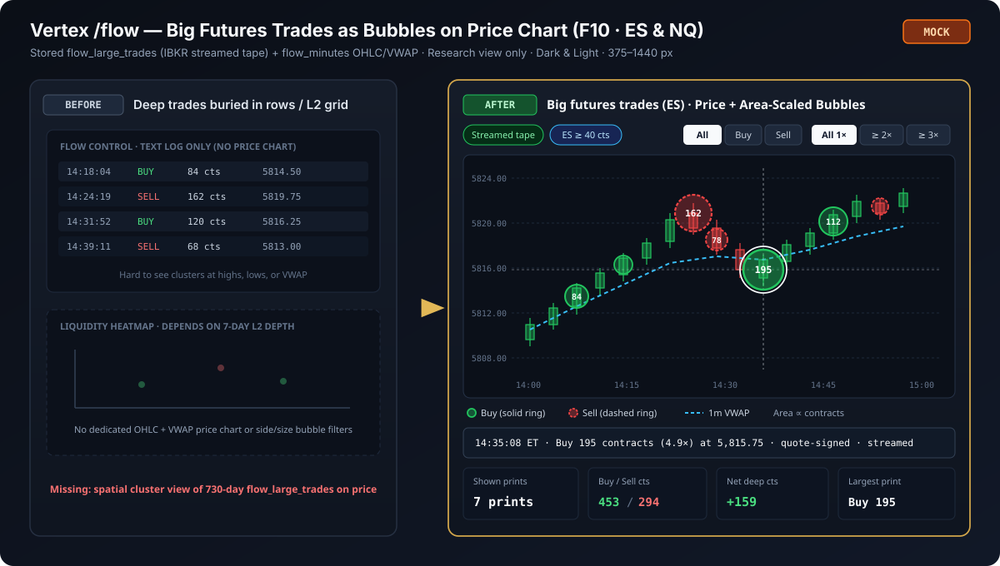
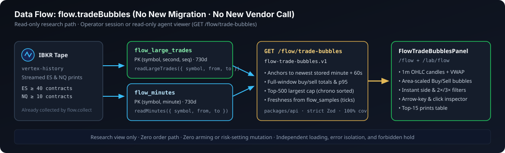

# Big futures trades as bubbles on the price chart (ES/NQ) on `/flow` (card `vertex-viz-trade-bubbles`)

- **Date:** 2026-11-24
- **Source:** research card `vertex-flow-viz-gap`, chart F10 ("Big futures trades as bubbles on the price chart (ES/NQ deep trades)").
- **Scope:** Research view only. Nothing here places, changes or cancels an order, arms trading or changes a risk setting.

## Data source and storage reuse

Both PostgreSQL tables are already populated by `flow.collect` and retained for 730 days (no new migration, no new vendor call):

- `flow_large_trades` (`PRIMARY KEY (symbol, second, seq)`): every ES (`>= 40` contracts) and NQ (`>= 10` contracts) single print from the IBKR streamed tape (`capture: 'streamed' | 'sampled'`, `signing: 'quote' | 'tick'`, `side: 'buy' | 'sell'`, `size`, `price`, `limit_size`). Read through existing `FlowRepository.readLargeTrades`.
- `flow_minutes` (`PRIMARY KEY (symbol, minute)`): 1-minute OHLC, VWAP, volume, and `covered_seconds` for ES and NQ. Read through a new narrow indexed query `FlowRepository.readMinutes` so the panel does not pull options prints, depth books, GEX, or events.
- `flow_samples` (`source = 'ticks'`): tape freshness via existing `FlowRepository.latestSamples`.

## Contract and pure rules (`flow-trade-bubbles.v1`)

- **Procedure:** `GET /flow/trade-bubbles` (`flow.tradeBubbles`), operator session or read-only agent viewer (`isAgentViewerReadProcedure`), no API key.
- **Input:** `{ symbol: "ES" | "NQ", minutes: 15..390 (default 120) }`.
- **Window anchoring:** anchors `windowEnd` to `newestDataAt(symbol)` extended by 60 s (clamped to `now`) when stored data precedes `now`, so deep trades inside the newest minute row are never cut off during post-close or weekend replay.
- **Rules (`trade-bubbles.v1`, `packages/api/src/flow-trade-bubbles-rules.ts`):**
  - Sanitizes candles and deep prints inside `[windowStart, windowEnd)`, sorts chronologically, computes full-window `buyTrades`, `sellTrades`, `buyVolume`, `sellVolume`, `netVolume`, `maxSize`, nearest-rank `p95Size`, `largestBubble` (largest size, tie-broken by newest `(second, seq)`), and `captureMode` (`streamed` | `sampled` | `mixed` | `none`).
  - Caps returned `bubbles` at 500 by keeping the largest prints when a rare busy window exceeds 500, re-sorting chronologically and flagging `totals.truncated = true` while preserving full-window totals.

## Portal UI (`FlowTradeBubblesPanel`)

- Placed on `/flow` directly below `FlowTapeSpeedPanel` (and above `FlowLiquidityHeatmapPanel`); maps `SPY -> ES` and `QQQ -> NQ` via `tapeSymbolOf`, sharing the page window and auto-refresh cadence while isolating its own loading, error, and forbidden hold states.
- Draws 1-minute OHLC candlesticks, a dashed 1-minute VWAP line (`var(--color-info)`), a subtle close-price line, and area-proportional deep-trade bubbles painted largest-first so smaller bubbles stay clickable.
- Distinguishes sides by both ring style and semantic color tokens (`var(--color-success)` solid ring for Buy; `var(--color-destructive)` dashed ring for Sell), supporting light, dark, system, and all 10 palettes at 375–1440 px.
- Instant client-side filters (`All sides` / `Buy` / `Sell` and `All deep` / `≥ 2×` / `≥ 3×`) with minimum 44×44 px touch targets, keyboard arrow/Home/End/Escape bubble stepping, crosshair + pinned `aria-live` inspector, summary strip, and top-15 largest prints table.
