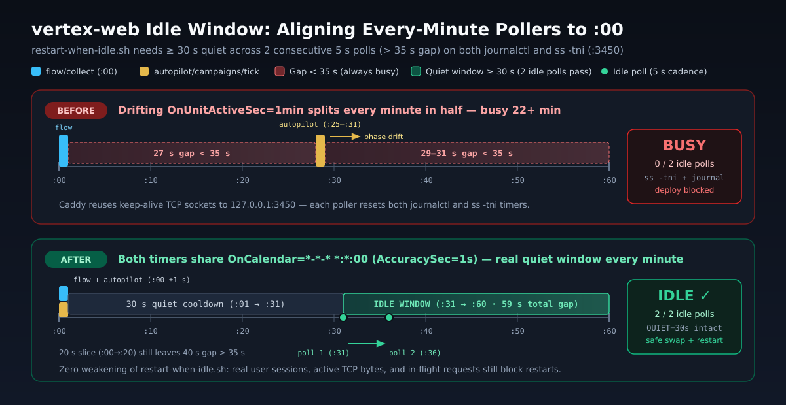

# Plan: Align `vertex-autopilot.timer` with `vertex-flow.timer` for `restart-when-idle`

## Problem

On 2026-11-22 (12:22-12:45 ET), `infra/quantvps/restart-when-idle.sh --deploy 94c0d2da` stayed busy for 22 minutes and could not deploy PR #379. QuantVPS journal logs showed `POST /api/orpc/flow/collect` at `:00` and `POST /api/orpc/autopilot/campaigns/tick` at `:25`-`:31` every minute.

`restart-when-idle.sh` requires a 30 s quiet window (`VERTEX_RESTART_QUIET=30`) on two consecutive polls 5 s apart (`VERTEX_RESTART_POLL=5`), so polling clients must leave gaps greater than 35 s. Because `infra/autopilot/vertex-autopilot.timer` uses `OnUnitActiveSec=1min` (monotone relative to each tick completion), its phase drifts across the minute and splits the 60 s interval against `infra/flow/quantvps/vertex-flow.timer` (`OnCalendar=*-*-* *:*:00`, `AccuracySec=1s`).

## Why timer alignment (and not path/header filtering in `restart-when-idle.sh`)

`restart-when-idle.sh` checks two independent signals on QuantVPS:

1. The last `vertex-web` journal line timestamp (`journalctl -u vertex-web -n 1`).
2. Every established TCP socket to `127.0.0.1:3450` (`ss -Htni`), requiring no queued bytes, no open request, and `lastsnd`/`lastrcv >= 30 000 ms`.

Caddy (`vertex-web-tailnet`) proxies both timers and user browsers over pooled loopback keep-alive TCP connections to `127.0.0.1:3450`. Filtering `journalctl` by path or header would not clear `ss -tni` (`lastsnd`/`lastrcv` still reset on every timer request), and weakening `ss -tni` would weaken protection for real user sessions and in-flight requests. Aligning `vertex-autopilot.timer` onto `:00` eliminates the split-minute collision at the source without lowering `VERTEX_RESTART_QUIET`, pausing pollers, or weakening the idle signal.

## Scope

1. **`infra/autopilot/vertex-autopilot.timer`**: Replace `OnBootSec=3min` and `OnUnitActiveSec=1min` with `OnCalendar=*-*-* *:*:00` and `AccuracySec=1s` (keeping `Persistent=false`), matching `infra/flow/quantvps/vertex-flow.timer`. Because `vertex-autopilot.service` is `Type=oneshot`, systemd continues to skip overlapping ticks.
2. **`infra/autopilot/units.test.ts`**: Add unit tests verifying `vertex-autopilot.timer` uses `OnCalendar=*-*-* *:*:00`, `AccuracySec=1s`, `Persistent=false`, no `OnUnitActiveSec`/`OnBootSec`/`RandomizedDelaySec`, shares the exact calendar schedule of `infra/flow/quantvps/vertex-flow.timer`, keeps `Type=oneshot`, and verifies `restart-when-idle.sh` keeps `QUIET=30` and `POLL=5`.
3. **`infra/quantvps/restart-when-idle.test.ts`**: Add regression tests covering the exact 30 s log/TCP quiet boundary, a multi-poll restart succeeding in the quiet window left by aligned `:00` pollers, and split-minute pollers remaining busy without restarting.
4. **Docs**: Update `infra/quantvps/README.md`, `docs/vertex-rebuild/autopilot.md`, `infra/research-worker/README.md`, and the stale timer comment in `scripts/backtest-worker/nautilus-worker.ts`.

## Out of scope

- Lowering `VERTEX_RESTART_QUIET`, pausing `vertex-flow.timer` or `vertex-autopilot.timer`, or weakening `restart-when-idle.sh` checks.
- Order, execution, arming, risk, sizing, Nautilus, IB Gateway, exec-node, or trading container changes.
- QuantVPS live install/deploy (executed from `omarchy-rig` outside US market hours after merge).

## Post-merge QuantVPS deploy steps (outside US market hours)

1. Merge via `scripts/merge-pr` after exact-head CI (`ci-gate`) passes.
2. Copy `infra/autopilot/vertex-autopilot.timer` to `/etc/systemd/system/vertex-autopilot.timer` on QuantVPS and run `systemctl daemon-reload && systemctl restart vertex-autopilot.timer`.
3. Outside US market hours (after 16:00 ET or before 08:30 ET), deploy staged `94c0d2da` or newer merged base SHA with `infra/quantvps/restart-when-idle.sh --deploy <sha>` and confirm it finds idle within its window.
4. Run live checks of the 2026-11-19 data-fault pages and close `orphan-pr-vertex-research-public-379`.

## Acceptance criteria

- `infra/autopilot/units.test.ts` fails before the timer fix and passes after.
- `infra/quantvps/restart-when-idle.test.ts` and `infra/flow/quantvps/install.test.ts` pass, including the new boundary and aligned-vs-split poller tests.
- `bun run verify:prepush`, `node scripts/public-names.ts`, fresh-context review, and PR `ci-gate` are green.
