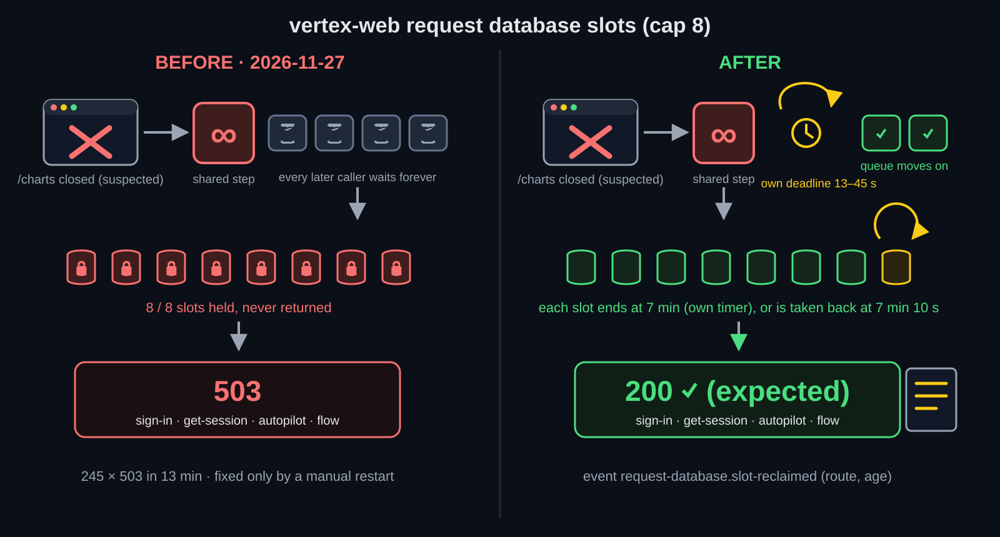

# Consolidated EGM review report: `plan.md`

- **Target:** `docs/vertex-rebuild/designs/vertex-web-request-slot-leak-cancel/plan.md` (first draft, 125 lines; FeatureRange 1-109, DetailedRange 110-125)
- **Mode:** Consolidated report with all review rubrics (uninterrupted full flow), chosen by the job under the owner's standing rule of 2026-11-15/2026-11-18.
- **Reviewers (fresh context, all completed):** Stage 5 `egm-zoom-out` + `egm-inventive-catalyst`; Stage 6 `egm-comprehension`; Stage 7 `egm-design` + `egm-structural` + `egm-style`; Stage 8 `egm-zoom-out`; Stage 9 `egm-implementation-readiness` + `egm-codebase-details` + `egm-style`. Full reports: [review/](review/).
- **Resolution:** `egm-resolve` with Auto accept (owner rule 2026-11-13). Dispositions: [goldfish_review_report.md](goldfish_review_report.md).

## Priority list (deduplicated)

| # | Priority | Action | Raised by |
| --- | --- | --- | --- |
| 1 | 🔴 | Drop the idle-under-pressure reclaim and the order-route exemption; the owner request ends its own slot at the age limit | Design7 B2, M3, M4; Catalyst5 M1, M2; ZoomOut5 #3; ZoomOut8 B1; Readiness9 M7; Codebase9 B1, M8 |
| 2 | 🔴 | Report the reclaim through the sink of a live request (owner or requester), never through a gone request | Readiness9 B1; Codebase9 B2; Design7 M5; ZoomOut5 #4 |
| 3 | 🔴 | Bound every known shared in-flight promise, not three: add `instant-backtest.ts#columnsFor`; `golive-live-quotes.ts` goes to a follow-up card | ZoomOut5 #1; ZoomOut8 B2 |
| 4 | 🔴 | Add an Alternatives section | Structural7 B1; Design7 B1; ZoomOut8 M4 |
| 5 | 🔴 | Deploy step must build, stage and deploy the merged SHA, after full manual CI on that SHA | Style9 B1; Readiness9 M11 |
| 6 | 🔴 | Define reclaimed-slot hand-off (FIFO) and the acquire/release API | Readiness9 B2; Codebase9 M7 |
| 7 | 🟡 | One shared primitive `waitAtMost`; one line per site with deadline basis and timeout behavior; one rule in ARCHITECTURE.md | ZoomOut5 #2; ZoomOut8 M1, M2, N2; Comprehension6 #8, #9; Style7 M13 |
| 8 | 🟡 | Yahoo: renew once per stale start; identity-checked failure handler | Design7 M7; Readiness9 M3; Codebase9 M5 |
| 9 | 🟡 | QuantData: identity-guarded release; state the clock | Readiness9 M1, M2; Codebase9 M3, M4 |
| 10 | 🟡 | Route label must not carry a path token (`/api/auth/reset-password/<token>`) | Design7 M6; Codebase9 M9; Style7 N14 |
| 11 | 🟡 | Calibrate claims: trigger is a hypothesis; 8 slots vs 5 connections; 714 s "consistent with"; 30 s limit "not enforced by workerd as run on QuantVPS" | Comprehension6 #1, #3; Style7 M1, M3, M4, M6, M7; Design7 M1 |
| 12 | 🟡 | Goals with bounds; Risks with mitigations and security | Design7 M2, M9; Structural7 M2, M3 |
| 13 | 🟡 | Real test file paths, test doubles, clocks, coverage | Style9 M2; Readiness9 M5, M6; Codebase9 M2, M10, M11 |
| 14 | 🟡 | Complete file list; correct revert statement | Comprehension6 #6, #7; Style9 M4, M6; Readiness9 M4, M9; Codebase9 M1, M12 |
| 15 | 🟢 | Image: mark trigger as suspected, cite 245, fix overlap, show all deadlines | all Stage 7 reviewers; Comprehension6 #13 |

## Traceability

Every finding of the ten stage reports maps to one row of the priority list above or to a CONTEST/DECLINE entry in [goldfish_review_report.md](goldfish_review_report.md).
